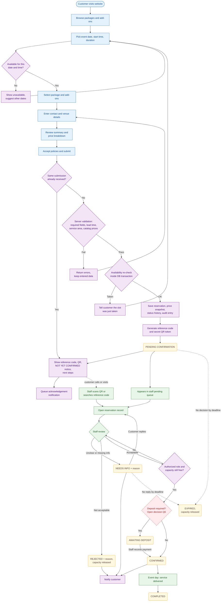
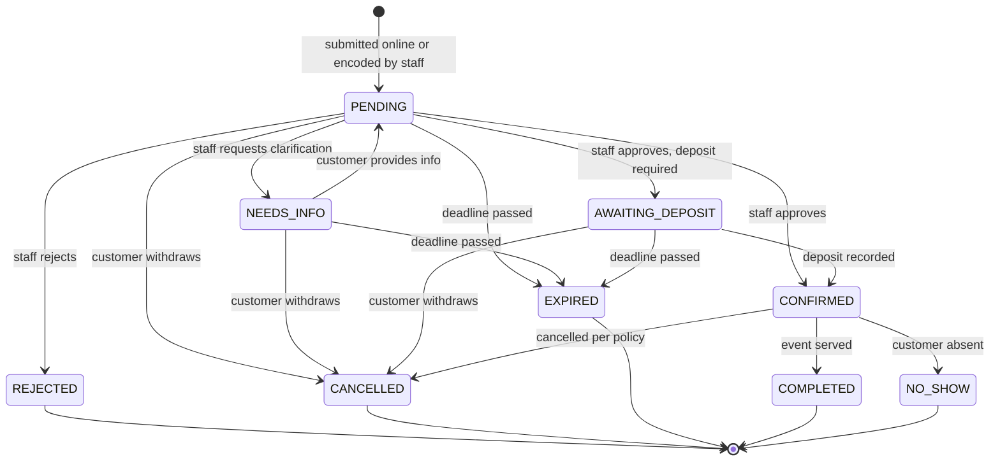
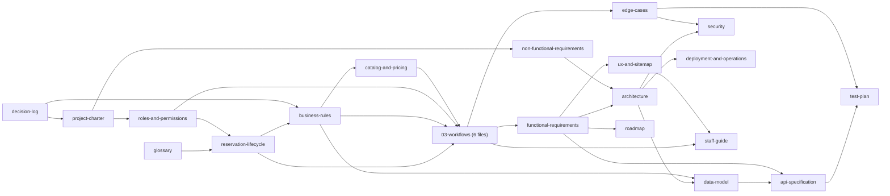

# Discovery Brief — Round 1

> **⚠️ SUPERSEDED (2026-10-21).** The Round 1 questions were answered during brainstorming, and several proposals changed. Examples: Needs Info became a flag, statuses changed, and the stack was chosen. The current source of truth is the [design spec](../superpowers/specs/2026-10-21-kasoundbox-design.md). This file is kept for history only; do not update it.

> **Status:** Superseded · **Version:** 0.1 · **Date:** 2026-10-21
> This is a snapshot of the first planning round. As each target document in [§4](#4-proposed-documentation-structure) is written, it supersedes the matching part of this brief. Once all are written, this file is frozen and kept for history only.

**Labels used in all documents**

| Label | Meaning |
|---|---|
| **[C] Confirmed** | Stated by DJB Kasoundbox |
| **[P] Proposed** | Recommendation; needs your approval |
| **[A] Assumption** | Treated as true for now; must be confirmed |
| **[O] Open** | Decision required (see [§6](#6-key-unresolved-decisions) and [§7](#7-questions--round-1)) |

---

## 1. Understanding of the business and the proposed system

### 1.1 The business

- **[C]** DJB Kasoundbox offers videoke services: packages, rental options, and party needs/add-ons (extra equipment, decorations, other services).
- **[C]** Customers reserve for an event with a date, time, venue, package, and add-ons.
- **[O]** Whether equipment is delivered and set up at the customer's venue, used at your premises, or both (Q1). The "venue" field suggests delivery, but this is not confirmed.
- **[O]** Current booking channels and how bookings are tracked today (Q8).

### 1.2 The proposed system

Two interfaces, one business process.

| Interface | Users | Purpose |
|---|---|---|
| Customer website (public) | Customers; no login **[P]** | Browse catalog, check availability, submit a reservation request, receive reference code + QR, track status |
| Admin panel (private) | Authorized staff, by role | Find and decide on reservations, scan QR, manage catalog, schedule, settings, view audit trail |

Core principles:

- **[C]** A submission creates a *request*, not a booking. Initial status is **Pending Confirmation**.
- **[C]** Only authorized staff can confirm. A reference code or QR is **not** proof of approval or payment.
- **[C]** The QR holds a secure token only — no personal data.
- **[C]** Scanning the QR and searching the reference code open the same record.
- **[C]** Every status change and important admin action is logged.
- **[C]** Online payment is not assumed.
- **[P]** The server is the only authority on price and availability; the website only displays them.
- **[P]** Prices are copied into the reservation at submission (price snapshot). Later catalog changes do not alter existing reservations.

### 1.3 Preliminary technical direction

- **[P]** One backend and one relational database serve both interfaces, so availability has a single source of truth and bookings can be protected by database transactions.
- **[P]** The admin panel is separated by its own URL (e.g., a subdomain), its own login, and server-side role checks on every admin request.
- **[O]** The specific stack and hosting are not chosen. They depend on Q11 and will be evaluated in `05-technical/architecture.md`.

### 1.4 Preliminary MVP scope [P]

| Area | MVP (Release 1) | Later | Depends on |
|---|---|---|---|
| Public pages: home, packages, add-ons, contact/FAQ | Yes | Promotions manager, gallery, reviews | — |
| Availability check | Yes | — | Q1–Q4 |
| Reservation form, summary, submission | Yes | — | — |
| Reference code + QR | Yes | — | Q7 |
| Status tracking (reference code + second factor) | Yes | Customer self-cancel / reschedule | Round 2 |
| Admin login and roles | Yes | Two-factor login | Q9 |
| Dashboard: pending queue, upcoming events | Yes (simple) | Charts and analytics | — |
| Search, QR scan, details, decisions, notes, history | Yes | — | — |
| Staff-created reservations (phone / walk-in / social media) | Recommended | — | Q8 |
| Package and add-on management | Yes | Advanced package restrictions | Q4 |
| Schedule settings: capacity, hours, blocked dates, lead time | Yes | — | Q2–Q3 |
| Deposit / payment recording | Undecided | Online payment gateway | Q6 |
| Customer notifications | One channel | More channels, automatic reminders | Q10 |
| Reports | Reservation list + CSV export | Revenue reports | Q6 |
| Audit log (record + view) | Yes | — | — |
| Customer accounts | No | Optional | — |

---

## 2. Preliminary end-to-end reservation workflow

| # | Stage | Actor | What happens | Data | Status after |
|---|---|---|---|---|---|
| 1 | Browse | Customer | Views packages, inclusions, prices, add-ons | Catalog read | — |
| 2 | Check availability | Customer, System | Picks date/time; system shows availability per capacity rules | Schedule read | — |
| 3 | Configure | Customer | Picks package, add-ons + quantities, venue, event details | Browser only | — |
| 4 | Review | Customer | Enters contact info; sees summary and price breakdown; accepts policies | Browser only | — |
| 5 | Submit and validate | System | Rejects duplicate submits; re-validates fields, lead time, service area, prices from catalog; re-checks availability inside a transaction | Reservation, line items with price snapshot, status history, audit entry | Pending Confirmation |
| 6 | Identifiers | System | Creates a human-readable reference code and a separate secret QR token | Stored on reservation | — |
| 7 | Acknowledge | System → Customer | Shows reference code, QR, a clear "not yet confirmed" notice, and next steps; queues a notification | Notification record | — |
| 8 | Locate | Staff | Opens it from the pending queue, by QR scan, or by reference search — same record | Read | — |
| 9 | Review | Staff | Verifies details; system flags conflicts; staff may contact customer | Internal notes | — |
| 10 | Decide | Authorized staff | Approve, reject (reason required), or request info (reason required) | Status history, audit entry | Confirmed\* / Rejected / Needs Info |
| 11 | Notify | System | Informs customer of the decision | Notification record | — |
| 12 | Changes | Staff, on customer request | Reschedule (availability re-checked) or cancel per policy | Status history, audit entry | Confirmed / Cancelled |
| 13 | Expiry | System (scheduled job) | Requests not acted on by the deadline expire; capacity is released | Status history | Expired |
| 14 | Close | Staff | After the event, marks Completed (or No-show) | Status history | Completed / No-show |

\* If a deposit is required (Q6), approval leads to **Awaiting Deposit** first.

### 2.1 Recommended improvements to the original workflow [P]

| # | Original step | Recommendation | Reason |
|---|---|---|---|
| 1 | Availability checked at validation | Check availability first (date before details), then re-check at submission and at approval | Customers don't fill a form for a full date; race conditions are caught on the server |
| 2 | "Request clarification" | Add an explicit **Needs Info** status with a reply deadline | Clarifications become trackable and can expire |
| 3 | Pending reservations | Decide whether a pending request holds capacity (D-03), with automatic expiry | Defines conflict behavior and prevents stale holds |
| 4 | One reference code + QR | Two identifiers: a short reference code for people, a long random QR token for scanning. Both point to one reservation | Code is easy to read over the phone; QR cannot be guessed |
| 5 | Status tracking by code | Public lookup needs reference code **plus** a second factor (e.g., last 4 digits of mobile) and shows limited details | Prevents guessing codes and exposing customer data |
| 6 | Online submissions only | Staff can encode phone / walk-in / social media bookings (Q8) | One calendar prevents double booking across channels |
| 7 | Submission | Idempotency key + duplicate detection (same contact, same date, still pending) | Double clicks and network retries don't create duplicates |
| 8 | Approval | Approval runs in a transaction with capacity re-check and a record version check | Two staff can't confirm conflicting bookings or act on outdated data |
| 9 | Customer is informed | Notifications go through a queue with retry and de-duplication; a failed message never undoes a status change | Provider errors don't corrupt data or send duplicates |
| 10 | Flow ends at Confirmed | Add Cancelled, Expired, Completed (and possibly No-show) | Accurate calendar, history, and reports |
| 11 | Price shown at submission | Server computes the price and saves a snapshot; fees that need staff judgment (e.g., delivery) are shown as "to be confirmed" | Catalog price changes don't affect submitted reservations |

---

## 3. Initial Mermaid diagrams

### 3.1 End-to-end flow

Legend: blue = customer, purple = system, green = staff, yellow = status, red dashed = open decision.



### 3.2 Proposed reservation statuses



| Code | Display label | Meaning | Holds capacity? |
|---|---|---|---|
| `PENDING` | Pending Confirmation | Submitted; awaiting staff review | **[O]** D-03 |
| `NEEDS_INFO` | Needs Clarification | Staff is waiting on the customer | **[O]** D-03 |
| `AWAITING_DEPOSIT` | Awaiting Deposit | Approved; deposit outstanding. Exists only if D-04 requires deposits | Yes **[P]** |
| `CONFIRMED` | Confirmed | Approved by staff (and deposit received, if required) | Yes |
| `REJECTED` | Rejected | Declined by staff, with reason | No |
| `CANCELLED` | Cancelled | Withdrawn by customer or cancelled by staff, with reason | No |
| `EXPIRED` | Expired | Deadline passed without action | No |
| `COMPLETED` | Completed | Event served | No |
| `NO_SHOW` | No-show | Customer absent; kept only if D-01 makes it relevant | No |

- **[P]** Rescheduling is a change of date/time on an active reservation, not a status. Whether it needs re-approval is a Round 2 question.
- **[P]** Reservations are never hard-deleted; they end in a final status.

---

## 4. Proposed documentation structure

```text
docs/
├── README.md                               Index, document status, labels, ID conventions
├── 00-project/
│   ├── discovery-brief.md                  This file (snapshot; frozen later)
│   ├── project-charter.md                  Goals, stakeholders, scope, MVP vs later
│   ├── glossary.md                         Canonical terms and status names
│   └── decision-log.md                     Decisions, open questions, assumptions
├── 01-requirements/
│   ├── roles-and-permissions.md            Roles and permission matrix
│   ├── functional-requirements.md          FR-xx with MVP flag and acceptance criteria
│   ├── non-functional-requirements.md      Performance, security, privacy, devices
│   ├── business-rules.md                   BR-xx rules with examples
│   └── edge-cases.md                       Scenario → expected behavior → rule → test
├── 02-domain/
│   ├── reservation-lifecycle.md            Statuses, state diagram, transition table
│   └── catalog-and-pricing.md              Packages, add-ons, price calculation
├── 03-workflows/
│   ├── booking-and-submission.md           WF-01 browse & submit, WF-02 code & QR
│   ├── availability-and-conflicts.md       WF-05 availability and conflict prevention
│   ├── lookup-and-review.md                WF-03 scan/search, WF-04 review & decisions
│   ├── changes-and-expiry.md               WF-06 cancel, reschedule, expire
│   ├── notifications-and-tracking.md       WF-07 notifications and status tracking
│   └── administration.md                   WF-08 catalog, WF-09 auth & roles, WF-10 audit
├── 04-design/
│   └── ux-and-sitemap.md                   Sitemap, page inventory, layout guidelines
├── 05-technical/
│   ├── architecture.md                     Stack evaluation, components, hosting
│   ├── data-model.md                       ERD, tables, constraints, concurrency
│   ├── api-specification.md                Public and admin endpoints, errors
│   └── security.md                         Threats and controls
├── 06-delivery/
│   ├── roadmap.md                          Phases, milestones, MVP backlog
│   └── test-plan.md                        Test cases, UAT, traceability matrix
└── 07-operations/
    ├── deployment-and-operations.md        Deploy, backup/restore, monitoring
    └── staff-guide.md                      How staff use the admin panel
```

| File | Purpose and contents | Depends on | Needed |
|---|---|---|---|
| `README.md` | Index; status of each document; labels; ID conventions; change procedure | — | Before development |
| `00-project/project-charter.md` | Goals, stakeholders, scope, MVP vs later, success criteria, constraints | decision-log | Before development |
| `00-project/glossary.md` | One definition per term (reservation, package, add-on, hold, each status) used by all documents | — | Before development |
| `00-project/decision-log.md` | D-xx decisions with date, owner, rationale, affected documents; open questions; assumptions | — | Before development (living) |
| `01-requirements/roles-and-permissions.md` | Roles; permission matrix (the only place permissions are defined); who sees personal data | charter | Before development |
| `01-requirements/functional-requirements.md` | FR-xx for website and admin panel; MVP flag; acceptance criteria | workflows, business-rules | Before development |
| `01-requirements/non-functional-requirements.md` | Response times, uptime, security, privacy, accessibility, supported devices | charter | Before development |
| `01-requirements/business-rules.md` | BR-xx: capacity, lead time, holds, expiry, price snapshot, cancellation, deposits, limits — each with an example | reservation-lifecycle, decision-log | Before development |
| `01-requirements/edge-cases.md` | Duplicates, races, bad QR, price changes, network errors, admin mistakes: expected behavior, linked BR and test IDs | business-rules, workflows | Before development |
| `02-domain/reservation-lifecycle.md` | Status definitions; state diagram; transition table (who, preconditions, side effects, notification) | glossary, roles-and-permissions | Before development |
| `02-domain/catalog-and-pricing.md` | Package/add-on structure, inclusions, restrictions, price calculation, archiving | business-rules | Before development |
| `03-workflows/*.md` (6 files) | Mermaid flowcharts and sequence diagrams for WF-01 to WF-10: actors, decisions, success/failure paths, data touched | lifecycle, business-rules, roles, catalog | Before development |
| `04-design/ux-and-sitemap.md` | Sitemap; page inventory with MVP flag; key screen contents; responsive and accessibility guidelines | functional-requirements | Before UI build |
| `05-technical/architecture.md` | Stack options and choice with trade-offs; components; hosting and cost | non-functional, functional requirements | Before development |
| `05-technical/data-model.md` | ERD (Mermaid); tables; constraints; indexes; double-booking prevention | business-rules, architecture | Before development |
| `05-technical/api-specification.md` | Public vs admin endpoints; auth; validation; error format; idempotency | data-model, functional-requirements | Before each module |
| `05-technical/security.md` | Authentication, roles, QR token design, personal data, rate limiting, logging | architecture, edge-cases | Before development |
| `06-delivery/roadmap.md` | Phases, milestones, MVP backlog by module, dependencies | functional-requirements | Before development |
| `06-delivery/test-plan.md` | Test strategy; TC-xx cases; UAT; traceability FR/BR → TC | requirements, edge-cases, api | Draft before development; completed during |
| `07-operations/deployment-and-operations.md` | Environments, deploy and rollback, backup and restore, monitoring, maintenance | architecture | Before go-live |
| `07-operations/staff-guide.md` | Step-by-step staff procedures (scan, review, approve, handle problems) | workflows, ux-and-sitemap | Before UAT |

Deliberately left out to avoid duplication:

- No separate architecture-decision folder — technical decisions go in `decision-log.md`.
- No file per workflow — the 10 workflows are grouped into 6 files by lifecycle area.
- No separate traceability file — the matrix lives in `test-plan.md`.
- No separate style guide — design guidelines live in `ux-and-sitemap.md` until branding needs more.

---

## 5. Planning sequence and document dependencies



| Step | Documents | Phase | Gate to continue |
|---|---|---|---|
| 1 | decision-log, glossary, project-charter | 1 Discovery | Round 1 answers received |
| 2 | roles-and-permissions, reservation-lifecycle | 1 → 2 | Statuses and roles approved |
| 3 | business-rules, catalog-and-pricing | 2 Design | Round 2 answers received |
| 4 | 03-workflows (6 files) | 2 Design | Workflows approved |
| 5 | functional-requirements, non-functional-requirements, edge-cases | 2 Design | MVP scope frozen |
| 6 | ux-and-sitemap | 3 UI/UX | Page inventory approved |
| 7 | architecture, data-model, api-specification, security | 2 Design (technical) | Design review passed |
| 8 | roadmap, test-plan | 2 → 4 | Ready for development |
| 9 | deployment-and-operations, staff-guide | 5 → 6 | Before UAT / go-live |

Adjustments to your proposed phases **[P]**:

- Steps 6 and 7 can run in parallel: both depend on the functional requirements, not on each other.
- The staff guide is written during testing so UAT also validates it.
- The data model waits for business rules, because capacity and hold rules shape the tables and constraints.

---

## 6. Key unresolved decisions

| ID | Decision | Options | Recommendation [P] | Documents affected |
|---|---|---|---|---|
| D-01 | Service model | Delivered to customer venue / at your premises / both | Needs your answer (Q1) | business-rules, availability workflow, data-model, ux |
| D-02 | Capacity and time model | Units per day / per hours / fixed slots; buffer time; add-on stock | Make capacity configurable in the admin panel so changes don't need code | business-rules, availability workflow, data-model, api |
| D-03 | Does a pending request hold capacity? | (a) Holds until expiry (b) Only Confirmed blocks (c) Holds, staff can override | (a) with a short expiry, if capacity is small. See example below | lifecycle, business-rules, availability workflow, edge-cases |
| D-04 | Deposit / payment | None / staff records deposit manually / customer uploads proof / online gateway | No gateway in MVP. If deposits are used, staff record amount, method, reference no., and who received it | lifecycle, data-model, reports, functional-requirements |
| D-05 | Approval authority | Owner only / any staff / by role | By role, at least Owner/Admin and Staff | roles-and-permissions, administration workflow |
| D-06 | Notification channel | SMS / email / Messenger / staff call or text | One channel in MVP; status page as fallback; every message recorded | notifications workflow, architecture, cost |
| D-07 | Cancellation and reschedule policy | Deadlines, fees, who may do it, re-approval | Round 2 | business-rules, lifecycle, changes workflow |
| D-08 | Pricing rules | Fixed / distance-based delivery fee / peak dates / discounts | Server-side calculation + snapshot; staff-judged fees shown as "to be confirmed" | catalog-and-pricing, data-model |
| D-09 | Purpose of presenting the QR | Office visit / payment / event day / all | Needs your answer (Q7) | lookup-and-review workflow, roles, ux |
| D-10 | Offline bookings entered in system | Yes / No | Yes — one calendar for all channels | functional-requirements, administration workflow |
| D-11 | Customer accounts | Guest only / accounts | Guest only in MVP | functional-requirements, security, ux |
| D-12 | Stack and hosting | — | Decide after Q11 | architecture, deployment-and-operations |

**Example for D-03.** You own 2 videoke sets. Ana and Ben each submit for December 24; both are Pending.

- With option (a), Carla sees December 24 as unavailable and can't submit. If Ana's request expires unreviewed, the date opens again.
- With option (b), Carla can also submit. Staff can confirm only two of the three, so one customer is turned down after waiting.

---

## 7. Questions — Round 1

Prioritized: these change the data model and core workflow the most.

### A. Service and availability

1. **Service model.** Do you deliver and set up the videoke at the customer's venue, do customers use your place, or both? If you deliver: which areas do you cover, and is there a delivery fee?
2. **Capacity.** How many videoke sets can be booked at the same time? Can one set serve more than one event in a day?
3. **Rental period.** Is rental per day, overnight, per number of hours, or fixed time slots? Are there overtime charges? How much buffer time do you need between events (travel, setup, pickup)?
4. **Add-on stock.** Do add-ons (mics, speakers, lights, tables, decorations) have limited quantities to track, or are they always available?

### B. Reservation control and payment

5. **Pending hold.** Should a pending request hold the slot until staff decide (D-03)? How fast do staff usually review a request, and when should an unanswered request expire?
6. **Payment.** Do you require a deposit or full payment before confirming? If yes: amount, accepted methods, due date, refund rules, and should staff record payments in the system (and/or customers upload proof)?
7. **QR purpose.** When does the customer present the code or QR: when visiting your office, when paying, when messaging you, on event day to your crew, or all of these?
8. **Other channels.** Do you take bookings by phone, walk-in, or Facebook/Messenger today? How do you track them now (notebook, spreadsheet, calendar)? Should staff encode them into this system?

### C. People, communication, constraints

9. **Admin users.** Who will use the admin panel (owner, office staff, crew) and how many? Who may approve, reject, cancel, or change prices?
10. **Notifications.** How do you contact customers today? Which channel should the system support first: SMS, email, Messenger, or staff calls/texts using messages the system prepares?
11. **Location and constraints.** Please confirm country, currency, and time zone — I have not assumed them. Who will build and maintain the system, and with which technologies? What is your monthly hosting budget? Do you already have a domain or website?

### Next rounds (after Round 1)

- **Round 2:** pricing rules (peak/holiday rates, distance fees, discounts), cancellation and reschedule policy, booking lead time and booking window, limits per customer, required customer fields and data retention, your actual package and add-on list, reports you need.
- **Round 3:** branding and content, UX preferences, operations (backups, support), UAT participants.
