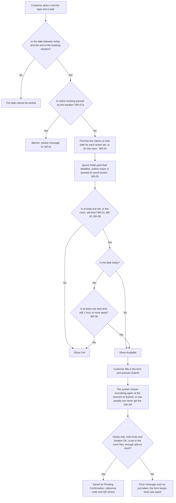

# Business Rules

> **Purpose:** The rules that decide when a date, a delivery set, the room, or an add-on can be booked, and the limits on online requests (BR-01 to BR-12). ·
> **Audience:** The developer (Super Admin) and the business owner (Admin); lines marked "Developer note" are mainly for the developer ·
> **Status:** Draft for review ·
> **Last updated:** 2026-10-21 ·
> **Depends on:** [Decision log](../00-project/decision-log.md), [Glossary](../00-project/glossary.md), [Roles and permissions](roles-and-permissions.md), [Reservation lifecycle](../02-domain/reservation-lifecycle.md), [Catalog and payments](../02-domain/catalog-and-payments.md) ·
> **Derived from:** [spec v0.2](../superpowers/specs/2026-10-21-kasoundbox-design.md) §6 (every rule and the example), with details from §2, §5, §11, and §12

## How to read this document

- **IDs.** Each rule has an ID: BR-01 to BR-12, plus BR-06a and BR-07a. The IDs are the same as in the spec. Other docs link here and cite the ID instead of repeating the rule.
- **Layout.** Each rule gives the rule itself, an example where it helps, and "Related" links. Some rules end with a short "Developer note".
- **Labels.** **[C]** confirmed decision · **[P]** proposed, accepted with the spec approval but may change · **[U]** unverified fact · **[O-nn]** open item. A rule, or part of a rule, with no label is part of the approved design (spec v0.2, approved on 2026-10-21, see D-23). To change any rule, follow "How to change a decision" in the [decision log](../00-project/decision-log.md).
- **Time.** Every date and time here is Manila time (Asia/Manila). "Today" means today's date in Manila.
- **Examples.** Names, prices, slot times, and add-on names in the examples are made up. The real slot times and on-site hours are open item O-02. The real packages, add-ons, stock, sets, and deposit amount are O-03.
- **Admins.** "An admin" means either admin account. "The Super Admin" (the developer) and "the Admin" (the business owner) mean one specific account.
- **Words.** Terms such as *hold*, *claim*, *live claim*, *block*, and *service start* are explained in the [glossary](../00-project/glossary.md).
- **Tests.** Each rule gets at least one database test (spec §17). The test plan comes in batch 4.

### What this document does not cover

| Topic | Where it lives |
|---|---|
| Statuses, status changes, and deadlines (how long a request or an approval lasts) | [Reservation lifecycle](../02-domain/reservation-lifecycle.md) |
| Prices, the price snapshot, the deposit amount, payments, and acknowledgments | [Catalog and payments](../02-domain/catalog-and-payments.md) |
| Who may do what | [Roles and permissions](roles-and-permissions.md) |
| Screens, emails, and when emails are sent | [Functional requirements](functional-requirements.md) (FR-PUB, FR-ADM, FR-NTF, FR-SYS) |
| How long data is kept | [Privacy and retention](privacy-and-retention.md) |
| Unusual situations and how the system reacts | [Edge cases](edge-cases.md) |

---

## Rules at a glance

| ID | Rule in one line | Label | Based on |
|---|---|---|---|
| BR-01 | Each delivery booking takes one delivery set for the whole day. A set can have only one live claim per date. | [C] | [D-01, D-02](../00-project/decision-log.md) |
| BR-02 | Each on-site booking takes the room for the whole day. The room can have only one live claim per date. | [C] | [D-01, D-02](../00-project/decision-log.md) |
| BR-03 | The add-ons booked on a date can never go over that add-on's daily stock. | [C] | [D-02](../00-project/decision-log.md) |
| BR-04 | A claim is live while its reservation is Pending Confirmation, Awaiting Deposit, or Confirmed, or while its block is active. | [C] | [D-04](../00-project/decision-log.md) |
| BR-05 | A hold past its deadline stops counting at once, unless its expiry is paused for proof review. | — | [D-04](../00-project/decision-log.md) |
| BR-06 | An online request must start at least 1 hour after it is sent. | [C] | [D-06](../00-project/decision-log.md) |
| BR-06a | Any reservation for today is urgent. Staff-created bookings skip the notice check, the hold limits, and the breaker. | [C] in part | [D-06](../00-project/decision-log.md) |
| BR-07 | One mobile number may have at most 1 open online request per event date, and 2 in total. | [C] | [D-16](../00-project/decision-log.md) |
| BR-07a | The 7th online request within 60 minutes is refused, and online booking pauses for 60 minutes. | [C, details P] | [D-16](../00-project/decision-log.md) |
| BR-08 | Admins can block a set, the room, or a whole date. A block uses capacity like a booking. | [C] | [D-17](../00-project/decision-log.md) |
| BR-09 | The public calendar shows only Available or Full, from today through the booking window. | [C]; window [P] | [D-14](../00-project/decision-log.md) |
| BR-10 | A catalog edit that clashes with future live claims is refused. | — | [D-23](../00-project/decision-log.md) (approved design) |
| BR-11 | Every valid Philippine mobile number is accepted and always saved in E.164 form (`+63…`). | [C] | [D-08, D-34](../00-project/decision-log.md) |
| BR-12 | A proof uploaded before the deposit deadline pauses expiry until an admin reviews it, but never past the service start. | [C]; rejection after the deadline [P] | [D-05](../00-project/decision-log.md) |

---

## 1. Capacity

### BR-01 · One delivery set per delivery booking per day

**Label:** [C] · **Based on:** [D-01, D-02](../00-project/decision-log.md)

**Rule.**
- Each delivery booking claims one specific delivery set for its event date. The customer does not pick the set; the booking is given a free one.
- A set can have only one **live** claim per date (what "live" means: BR-04). So a set serves one booking per day, and it is free again the next day.
- The delivery slot only sets the event time. The set is held for the whole day, whatever slot the customer picks.
- The delivery pool is simply the list of active delivery sets. There is no separate "number of sets" setting. With 2 active sets, delivery can take 2 bookings per date. Adding a third set makes it 3.
- Delivery sets are a separate pool from the on-site room. When delivery is full on a date, on-site can still be free, and the other way round.

**Example.** The business has 2 active sets. On Thursday 24 December 2026, Ana's delivery booking (2:00 PM slot) takes set 1. Ben's delivery booking (6:00 PM slot) takes set 2. Their slots do not overlap, but each set is held for the whole day, so delivery is now **Full** for 24 December. On Friday 25 December, both sets are free again.

**Developer note.** The pool is the active `resources` rows of kind `delivery_set`. Claims are rows in `reservation_resources`. A partial unique index allows one live claim per resource per date, and the same index covers block claims in `block_resources` (spec §11). Every capacity change first takes the single capacity lock (spec §12; see [non-functional-requirements](non-functional-requirements.md) NFR-20).

**Related:** [D-02](../00-project/decision-log.md) · BR-04 · BR-08 · BR-10 · [catalog-and-payments](../02-domain/catalog-and-payments.md) (resources: the sets and the room) · [glossary](../00-project/glossary.md) (delivery set, delivery slot)

### BR-02 · One on-site booking per day for the room

**Label:** [C] · **Based on:** [D-01, D-02, D-03](../00-project/decision-log.md)

**Rule.**
- There is one on-site room. Each on-site booking claims the room for its event date.
- The room can have only one live claim per date.
- The customer picks an arrival time within on-site hours, but the room is held for the whole day. How the arrival time becomes the service start is in [reservation-lifecycle](../02-domain/reservation-lifecycle.md).

**Example.** On Thursday 24 December 2026, delivery is Full (see the BR-01 example), but the room is still free. Carla books on-site with arrival at 5:00 PM. On-site is now also Full for 24 December.

**Related:** [D-02, D-03](../00-project/decision-log.md) · BR-04 · BR-08 · [catalog-and-payments](../02-domain/catalog-and-payments.md) (resources) · open item O-02 (on-site hours)

### BR-03 · Add-on stock is counted per day

**Label:** [C] · **Based on:** [D-02](../00-project/decision-log.md)

**Rule.**
- Each add-on has a daily stock: how many units can be booked for one date.
- The total quantity of an add-on claimed on a date, by all live reservations together, can never be more than that add-on's daily stock.
- There is one count per add-on per date. Delivery and on-site bookings on the same date share it.
- Stock is checked when a request is submitted. It is checked again when an admin changes the add-ons with "edit details" or moves a booking with "reschedule" (see [reservation-lifecycle](../02-domain/reservation-lifecycle.md)).
- A whole-date block does not claim add-on stock (BR-08).
- Add-on stock does not change the calendar label (BR-09).

**Example.** "Extra microphone" (an example add-on) has a daily stock of 4. On Saturday 19 December 2026, Ana's delivery booking has 2 of them. Ben then asks for 3 with an on-site booking. 2 + 3 = 5, which is more than 4, so his request is refused with a clear message, and his form keeps what he typed. He can ask for 2 instead.

**Related:** [D-02](../00-project/decision-log.md) · BR-04 · BR-10 (lowering the stock) · [catalog-and-payments](../02-domain/catalog-and-payments.md) (add-ons and daily stock)

### BR-04 · Which claims are live

**Label:** [C] · **Based on:** [D-04](../00-project/decision-log.md)

**Rule.**
- A claim is **live**, meaning it uses capacity, while:
  - its reservation is Pending Confirmation, Awaiting Deposit, or Confirmed; or
  - its block is active.
- A claim is released, meaning it no longer uses capacity, when its reservation becomes Rejected, Cancelled, Expired, or Completed, or when its block is removed.
- So a request uses capacity from the moment it is sent, before any admin has looked at it. This is why online requests have limits (BR-07, BR-07a).
- A hold whose deadline has passed is a special case (BR-05).

What each status means, and how a reservation moves between statuses, is in [reservation-lifecycle](../02-domain/reservation-lifecycle.md).

**Example.** If Ana's request for Thursday 24 December 2026 expires, her claim on set 1 is released, and delivery for 24 December shows **Available** again at once.

**Related:** [D-04](../00-project/decision-log.md) · BR-05 · BR-08 · [reservation-lifecycle](../02-domain/reservation-lifecycle.md) (statuses)

### BR-05 · An overdue hold stops counting at once

**Label:** — (approved design) · **Based on:** [D-04](../00-project/decision-log.md)

**Rule.**
- A hold is a reservation that is Pending Confirmation or Awaiting Deposit. Each hold has a deadline. The deadlines themselves are defined in [reservation-lifecycle](../02-domain/reservation-lifecycle.md).
- Once a hold's deadline passes, the hold stops counting at once, even before the every-minute job marks it Expired.
- **Exception.** A hold whose expiry is paused for proof review keeps counting (BR-12).
- The calendar, the booking check, the status page, and every admin action all treat an overdue hold as already expired. For example, an admin cannot approve it or record its deposit ([reservation-lifecycle](../02-domain/reservation-lifecycle.md)).

**Example.** Ana sent her request for Thursday 24 December 2026 on Saturday 12 December at 9:00 AM. No admin reviewed it, so its deadline is Tuesday 15 December at 9:00 AM (deadline rules: [reservation-lifecycle](../02-domain/reservation-lifecycle.md)). At 9:00 AM sharp, set 1 counts as free for 24 December. A customer who opens the calendar at that moment, before the job has run, already sees Available (if nothing else fills the date).

**Developer note.** The every-minute job only tidies up and sends emails; no rule depends on it having run (spec §12). Availability is never cached (spec §10). A reschedule also expires overdue holds on the target date first ([reservation-lifecycle](../02-domain/reservation-lifecycle.md)).

**Related:** [D-04](../00-project/decision-log.md) · BR-04 · BR-12 · [reservation-lifecycle](../02-domain/reservation-lifecycle.md) (deadlines) · [functional-requirements](functional-requirements.md) FR-SYS-01 (every-minute job)

### Worked example: one busy date

This is the spec §6 example. There are 2 delivery sets.

1. Ana requests Thursday 24 December 2026 for delivery and gets set 1. Ben requests the same date and gets set 2. 24 December now shows **Full** for delivery. The room may still be free, so on-site can still show Available (BR-01, BR-02).
2. Now suppose only one set had been free, and Carla and Dan pressed Submit at the same instant. The database lets only one of them through. The other sees "just taken, pick another date", and the form keeps what they typed.
3. If Ana's request expires, 24 December shows **Available** for delivery again at once (BR-04, BR-05).

---

## 2. Notice and same-day bookings

### BR-06 · At least 1 hour's notice for online requests

**Label:** [C] for the 1 hour; keeping it as a changeable setting is [P] · **Based on:** [D-06](../00-project/decision-log.md)

**Rule.**
- An online request must have its service start at least 1 hour after the moment the customer presses Submit. This is the **notice period**.
- It is the same for delivery and on-site, and it allows same-day requests.
- The service start is the start of the chosen slot (delivery) or the chosen arrival time (on-site). See [reservation-lifecycle](../02-domain/reservation-lifecycle.md).
- The 1 hour is a setting. Who may change it: [roles-and-permissions](roles-and-permissions.md).
- Bookings that admins create are exempt (BR-06a).

**Example.** Today is Saturday 19 December 2026. A customer wants the room with arrival at 7:00 PM.
- Submitted at 5:45 PM: accepted (1 hour 15 minutes' notice).
- Submitted at 6:00 PM: accepted (exactly 1 hour).
- Submitted at 6:20 PM: refused with a clear message. The customer can still message or call, and an admin can create the booking (BR-06a).

The time that counts is when Submit is pressed, not when the form was opened.

**Related:** [D-06](../00-project/decision-log.md) · BR-06a · BR-09 (when today shows Full) · [reservation-lifecycle](../02-domain/reservation-lifecycle.md) (service start) · [functional-requirements](functional-requirements.md) FR-PUB-04 (reservation form) · [edge-cases](edge-cases.md) EC-06, EC-07

### BR-06a · The urgent flag and staff-created bookings

**Label:** [C] for the urgent flag, for staff creating same-day bookings, and for deciding the deposit per booking (D-06); the other details are approved design · **Based on:** [D-06](../00-project/decision-log.md)

**Rule.**
- **Urgent [C].** Any reservation whose event date is today is flagged **urgent**, whatever its source: online, phone, walk-in, or Facebook. Urgent reservations appear in the dashboard's urgent queue ([functional-requirements](functional-requirements.md) FR-ADM-02) and are marked in admin emails (FR-NTF-13).
- **Staff-created bookings.** Admins create reservations for customers who book by phone, walk-in, or Facebook (source `phone`, `walk_in`, or `facebook`). These bookings:
  - skip the notice check (BR-06), the hold limits (BR-07), and the breaker (BR-07a);
  - do **not** skip the capacity rules (BR-01 to BR-05, BR-08). A set or the room is never double-booked;
  - do not send the admin new-request email. The customer email still goes out if an email address was given ([functional-requirements](functional-requirements.md) FR-NTF-01, FR-NTF-13).
- **Start already passed, or very soon.** If a staff-created booking's service start has already passed, or falls within the notice period, the create form finishes in one step. The booking is saved as Confirmed, either:
  - with the deposit recorded; or
  - with the deposit waived (reason required).

  The status steps behind this are in [reservation-lifecycle](../02-domain/reservation-lifecycle.md) (same-day deposit waiver).
- Otherwise, a staff-created booking follows the normal steps in [reservation-lifecycle](../02-domain/reservation-lifecycle.md).
- Who may create staff bookings and waive a deposit: [roles-and-permissions](roles-and-permissions.md).

**Examples.**
- Saturday 19 December 2026, 4:30 PM. A walk-in customer asks for the room with arrival at 5:00 PM. That is only 30 minutes away, inside the notice period. The admin fills in the create form, and it finishes in one step. The customer pays the deposit in cash, the admin records it, and the booking is Confirmed at once. If the admin decides not to ask for the deposit, they waive it and write a reason instead. The booking is urgent, because its event date is today.
- Monday 14 December 2026. Marco calls to book delivery for Saturday 26 December. The admin creates the booking. It is not urgent, and it follows the normal steps.

**Related:** [D-06](../00-project/decision-log.md) · BR-06 · BR-07 · BR-07a · [reservation-lifecycle](../02-domain/reservation-lifecycle.md) (same-day deposit waiver; the urgent flag is recomputed after a reschedule) · [roles-and-permissions](roles-and-permissions.md) · [functional-requirements](functional-requirements.md) FR-ADM-24 (staff-created bookings), FR-ADM-02 (dashboard), FR-NTF-13 · [edge-cases](edge-cases.md) EC-41, EC-45

---

## 3. Limits on online requests

### BR-07 · Hold limits

**Label:** [C]; keeping the numbers as changeable settings is [P] · **Based on:** [D-16](../00-project/decision-log.md)

**Rule.**
- **What counts:** reservations sent from the website (source `online`) that are Pending Confirmation or Awaiting Deposit, and whose deadline has not passed.
- One mobile number (in its saved form, BR-11) may have at most:
  - **1** such reservation per event date; and
  - **2** in total.
- A request that would go over a limit is refused with a clear message.
- Confirmed, Completed, Rejected, Cancelled, and Expired reservations do not count.
- Staff-created bookings are neither counted nor limited (BR-06a). Recreating an expired request is also exempt ([reservation-lifecycle](../02-domain/reservation-lifecycle.md), recreate expired).

**Example.** Lia's mobile number is 0917 123 4567.
1. Monday 14 December 2026: she sends a request for Saturday 19 December. Accepted. She has 1 open.
2. The same day, she sends another request for 19 December, this time typing +63 917 123 4567. Refused: it is the same number (BR-11) and the same date.
3. She sends a request for Saturday 26 December. Accepted. She has 2 open.
4. She tries Thursday 31 December. Refused: she already has 2 open.
5. Tuesday 15 December: her 19 December request is approved and her deposit is recorded. It is now Confirmed, so it stops counting. She has 1 open, and a request for 31 December is now accepted.

**Developer note.** The count uses source `online`, status `pending` or `awaiting_deposit`, deadline later than now, and the normalized mobile. It runs inside the booking function, under the capacity lock (spec §12).

**Related:** [D-16](../00-project/decision-log.md) · BR-07a · BR-11 · [functional-requirements](functional-requirements.md) FR-PUB-06 (reservation form) · [edge-cases](edge-cases.md) EC-09, EC-10

### BR-07a · The breaker

**Label:** [C, details P] · **Based on:** [D-16](../00-project/decision-log.md)

**Rule.**
- The system counts the reservations created online in the last 60 minutes.
- The request that would be the 7th is refused, and online booking pauses for 60 minutes. The limit and the pause length are settings [P].
- While online booking is paused:
  - the form and the calendar show "please message or call us";
  - no online request is accepted;
  - admins can still create phone, walk-in, and Facebook bookings, because staff-created bookings skip the breaker (BR-06a).
- Each pause sends one email to both admins ([functional-requirements](functional-requirements.md) FR-NTF-15) and shows a banner on the dashboard (FR-ADM-02).
- The pause ends by itself after 60 minutes. Either admin can resume online booking earlier ([roles-and-permissions](roles-and-permissions.md)).

**Example.** Saturday 19 December 2026. Between 2:00 PM and 2:40 PM, 6 online requests are created. At 2:45 PM, a 7th arrives. It is refused, and online booking is paused until 3:45 PM. Both admins get one email, and the dashboard shows a banner. The admins look at the 6 requests and reject any fake ones. At 3:45 PM, online booking reopens by itself, unless an admin resumed it earlier.

**Developer note.** A trip sets the `online_paused_until` setting to now + 60 minutes (spec §11). Resuming early is FR-ADM-29.

**Related:** [D-16](../00-project/decision-log.md) · BR-06a · BR-09 · [roles-and-permissions](roles-and-permissions.md) (resume early) · [functional-requirements](functional-requirements.md) FR-NTF-15 (breaker email), FR-ADM-02 (paused-booking banner), FR-ADM-29 (resume early) · [non-functional-requirements](non-functional-requirements.md) NFR-12 · [edge-cases](edge-cases.md) EC-15

---

## 4. Blocks

### BR-08 · Blocks on a set, the room, or a whole date

**Label:** [C] · **Based on:** [D-17](../00-project/decision-log.md) (resolves O-01)

**Rule.**
- A block makes capacity unavailable without a booking, for example while a set is being repaired. It is a capacity record with a reason.
- There are two kinds:
  - **Set or room block.** It claims one delivery set, or the room, on one date. Either admin can create one **[C]**.
  - **Whole-date block.** It claims every active set and the room on one date, but not add-on stock. Only the Super Admin can create one **[C]**.

  The permissions themselves are defined in [roles-and-permissions](roles-and-permissions.md).
- A date range creates one block per date.
- A block is refused if any set or room it would claim already has a live claim on that date. The admin must reschedule or cancel that booking first ([reservation-lifecycle](../02-domain/reservation-lifecycle.md)).
- An active block is a live claim (BR-04). The set, the room, or the whole date counts as taken.
- Removing a block needs a reason. It releases the capacity, and it is recorded in the audit log.

**Block statuses.**

| Status | Uses capacity | How a block gets there |
|---|---|---|
| `active` | Yes | An admin creates the block, with a reason |
| `removed` | No | An admin removes the block, with a reason (audited) |

**Examples.**
- Set 2 is being repaired from Monday 21 to Wednesday 23 December 2026. The Admin blocks set 2 for those dates, and the system creates 3 blocks, one per date. On those days, with 2 active sets, delivery can take only 1 booking per date (with 3 sets, it could take 2).
- Set 2 is fixed early, on 22 December. The Admin removes the 23 December block with the reason "repaired". Set 2 can be booked on 23 December again.
- Set 1 already has Ana's Pending Confirmation request on Thursday 24 December. A block on set 1 for 24 December is refused until Ana's request is rescheduled or cancelled.
- Suppose the business decides to close on Friday 25 December 2026. The Super Admin creates a whole-date block. Delivery and on-site both show Full for 25 December. If any booking already exists that day, the block is refused until that booking is rescheduled or cancelled.

**Related:** [D-17](../00-project/decision-log.md) · BR-04 · BR-09 · [roles-and-permissions](roles-and-permissions.md) · [reservation-lifecycle](../02-domain/reservation-lifecycle.md) (block statuses in brief; reschedule; cancel) · [functional-requirements](functional-requirements.md) FR-ADM-25 (blocks) · [edge-cases](edge-cases.md) EC-17, EC-18, EC-19

---

## 5. The public calendar

### BR-09 · The calendar shows Available or Full

**Label:** [C] for showing only Available or Full; the 180-day booking window default is [P] · **Based on:** [D-14](../00-project/decision-log.md)

**Rule.**
- The calendar shows each service type on its own: delivery and on-site.
- Each date shows **Available** or **Full**, and nothing else. It never shows counts, names, or any personal data.
- A date is **Full** when:
  - no delivery set is free that date (for delivery), or the room is not free (for on-site) — see BR-01 to BR-05 and BR-08; or
  - the date is today and no start time is left that meets the notice period (BR-06).
- Otherwise the date is **Available**.
- Customers can pick dates from today through the **booking window**: 180 days ahead by default, a setting [P]. Dates outside the window cannot be picked.
- Add-on stock does not change the label. It is checked when the request is submitted (BR-03).
- While online booking is paused, a banner is shown (BR-07a).
- **Available is not a promise.** The final check runs when the customer presses Submit (see the flowchart below).

**Example.** Today is Saturday 19 December 2026. Delivery slots start at 10:00 AM, 2:00 PM, and 6:00 PM (example times; the real ones are O-02). One set is still free today.
- At 4:30 PM, delivery shows Available for today: the 6:00 PM slot is 1 hour 30 minutes away.
- At 5:15 PM, delivery shows Full for today: the 6:00 PM slot is only 45 minutes away, so no slot meets the 1-hour notice, even though a set is free.
- Saturday 31 July 2027 is more than 180 days away, so it cannot be picked yet.

**How the system checks a requested date.** The top part decides the calendar label. The bottom part runs when the customer submits.

- Staff-created bookings skip the notice, hold-limit, and breaker checks (BR-06a), but never the capacity checks.
- If someone else took the last set while the customer was filling in the form, the submit fails with "just taken", the form keeps the data, and other dates are suggested ([edge-cases](edge-cases.md) EC-03).

**Developer note.** "Today" is the Asia/Manila date. The order inside the booking function is: take the capacity lock, expire stale holds, check notice, hold limits, and breaker, claim a set or the room, then check add-on stock (spec §12). Availability is always live, never cached (spec §10).

**Related:** [D-14](../00-project/decision-log.md) · BR-06 · BR-07a · BR-08 · [functional-requirements](functional-requirements.md) FR-PUB-03 (availability calendar) · [non-functional-requirements](non-functional-requirements.md) NFR-19

---

## 6. Catalog changes

### BR-10 · Catalog edits that clash with future bookings are refused

**Label:** — (approved design) · **Based on:** [D-23](../00-project/decision-log.md) (spec approval)

**Rule.**
- A catalog edit is refused if it clashes with future live claims. The system lists the reservations that clash.
- This covers:
  - lowering an add-on's daily stock below the quantity already claimed on a date;
  - archiving a package, an add-on, or a delivery slot that live reservations use;
  - deactivating a delivery set, or the room, that has future live claims.
- Catalog items are archived, never deleted ([catalog-and-payments](../02-domain/catalog-and-payments.md)).
- Changing a price is not a clash. Reservations keep the prices from when they were submitted ([catalog-and-payments](../02-domain/catalog-and-payments.md), price snapshot).
- Changing a slot's times or the on-site hours does not move existing bookings. Their service start was fixed at submission ([reservation-lifecycle](../02-domain/reservation-lifecycle.md), service start).
- Who may edit the catalog, and who may deactivate a set or the room: [roles-and-permissions](roles-and-permissions.md).

**Examples.**
- "Party lights" (an example add-on) has a daily stock of 4. On Saturday 2 January 2027, live reservations hold 3. Lowering the stock to 2 is refused, and the screen lists those reservations. Lowering it to 3 is allowed, as long as no other future date has more than 3 booked.
- Set 3 has a Confirmed booking on Saturday 2 January 2027. Deactivating set 3 now is refused, and that booking is listed.

**Related:** BR-01 · BR-02 · BR-03 · [catalog-and-payments](../02-domain/catalog-and-payments.md) · [roles-and-permissions](roles-and-permissions.md) · [functional-requirements](functional-requirements.md) FR-ADM-26 (catalog), FR-ADM-27 (sets and the room), FR-ADM-28 (settings) · [edge-cases](edge-cases.md) EC-57, EC-58, EC-59

---

## 7. Customer details

### BR-11 · Mobile numbers

**Label:** [C] for the mobile number being required (D-08); the accepted numbers and forms [C] (D-34, which changed this rule on 2026-10-21) · **Based on:** [D-08, D-34](../00-project/decision-log.md)

**Rule.**
- The mobile number is required, and it must be a valid Philippine mobile number. Email is optional (D-08).
- Every valid Philippine mobile number is accepted, including valid numbers that start with 08…. Validity is checked with the `libphonenumber-js` library, with its full metadata **[C]** (D-34).
- These forms are accepted. Spaces and dashes are ignored.
  - local: `09…` or `08…` (11 digits)
  - without the leading 0: `9…` or `8…` (10 digits)
  - with the country code: `639…` or `638…`
  - international: `+63…`
- Every number is converted to one standard form, called E.164: `+63` followed by the 10-digit mobile number, for example `+639171234567`. This happens both in the form and in the database. The database keeps only a simple format check as a backstop; the app does the real check with the library.
- The standard form is what is saved, what the hold limits count (BR-07), and what the status page compares ([functional-requirements](functional-requirements.md) FR-PUB-10).
- Anything else is rejected: a landline, a number with too few or too many digits, or an 08… number that is not a valid mobile number.

**Examples.**

| The customer types | Result |
|---|---|
| `0917 123 4567` | Saved as `+639171234567` |
| `917-123-4567` | Saved as `+639171234567` |
| `63 917 123 4567` | Saved as `+639171234567` |
| `+63 917 123 4567` | Saved as `+639171234567` |
| `0895 123 4567` (a valid 08… mobile number) | Saved as `+638951234567` |
| `0812 345 6789` (not a valid mobile number) | Rejected |
| `02 8123 4567` (a landline) | Rejected |
| `0917 123 456` (one digit short) | Rejected |

So a customer who typed `0917 123 4567` when booking can type `+63 917 123 4567` on the status page, and it still matches.

A wrong number is corrected by an admin with "edit details", with a reason ([reservation-lifecycle](../02-domain/reservation-lifecycle.md) §6.2; [edge-cases](edge-cases.md) EC-46). How long numbers are kept: [privacy-and-retention](privacy-and-retention.md).

**Related:** [D-08, D-34](../00-project/decision-log.md) · BR-07 · [reservation-lifecycle](../02-domain/reservation-lifecycle.md) (edit details) · [functional-requirements](functional-requirements.md) FR-PUB-05 (reservation form), FR-PUB-10 (status lookup) · [privacy-and-retention](privacy-and-retention.md) · [glossary](../00-project/glossary.md) (E.164)

---

## 8. Deposit proof

### BR-12 · A proof pauses expiry

**Label:** [C]; what happens when a proof is rejected after the deadline is [P] · **Based on:** [D-05](../00-project/decision-log.md)

**Rule.**
- While a reservation is Awaiting Deposit, the customer can upload a proof image on the status page. A proof uploaded **before the deposit deadline** pauses expiry until an admin reviews it **[C]**.
- While expiry is paused, the reservation keeps its set or room (BR-05), and it appears in the dashboard's "proofs to verify" list ([functional-requirements](functional-requirements.md) FR-ADM-02).
- When an admin reviews the proof:
  - **Verified.** The admin records the deposit, and the reservation becomes Confirmed. The status change is in [reservation-lifecycle](../02-domain/reservation-lifecycle.md); how a deposit is recorded is in [catalog-and-payments](../02-domain/catalog-and-payments.md).
  - **Rejected** (reason required). The original deadline applies again. If that deadline has already passed, the reservation expires at once and the customer is told why **[P]**.
- The pause never runs past the service start. If no admin has reviewed the proof by then, the reservation expires.
- Upload limits: [functional-requirements](functional-requirements.md) FR-PUB-12. When proof images are deleted: [privacy-and-retention](privacy-and-retention.md).

**Examples.**
- **A normal case.** An on-site booking for Saturday 19 December 2026, arrival at 7:00 PM, is approved on Wednesday 16 December at 3:00 PM. The deposit is due on Thursday 17 December at 3:00 PM (deadline rules: [reservation-lifecycle](../02-domain/reservation-lifecycle.md)). At 2:50 PM on Thursday, the customer pays ₱1,000 by e-wallet (an example amount; the real deposit is O-03) and uploads the proof. Expiry pauses, so nothing expires at 3:00 PM.
  - Friday 18 December, 9:00 AM: the Admin checks the e-wallet, verifies the proof, and records the deposit. The booking is Confirmed.
  - Or: the Admin rejects the proof because the reference number cannot be read. The original deadline (Thursday 3:00 PM) has passed, so the reservation expires at once, and the customer is told why **[P]**.
- **A same-day case.** A delivery booking for Saturday 19 December 2026 in the 6:00 PM slot is approved at 1:00 PM that day. Its deposit deadline is 6:00 PM, because the service start comes before approval + 24 hours. The customer uploads a proof at 5:30 PM. If no admin reviews it by 6:00 PM, the reservation expires at 6:00 PM. (For a same-day booking, an admin may also waive the deposit: [reservation-lifecycle](../02-domain/reservation-lifecycle.md).)

**Developer note.** The pause is the reservation's `expiry_paused` field. Approving, or recording a deposit, after the deadline is refused unless expiry is paused (spec §12).

**Related:** [D-05](../00-project/decision-log.md) · BR-05 · [reservation-lifecycle](../02-domain/reservation-lifecycle.md) (Awaiting Deposit, deadlines) · [catalog-and-payments](../02-domain/catalog-and-payments.md) (deposit, `verified_at`) · [privacy-and-retention](privacy-and-retention.md) (proof images) · [functional-requirements](functional-requirements.md) FR-PUB-12 (proof upload), FR-ADM-02 (proofs to verify), FR-ADM-12 (verify or reject), FR-NTF-06 (proof not accepted), FR-NTF-14 (proof uploaded) · [edge-cases](edge-cases.md) EC-27 to EC-32

---

## 9. Settings these rules use

| Setting | Default | Used by | Label |
|---|---|---|---|
| Notice period | 1 hour | BR-06, BR-09 | [C] value; kept as a setting [P] |
| Booking window | 180 days | BR-09 | [P] |
| Hold limit per event date | 1 per mobile number | BR-07 | [C] value; kept as a setting [P] |
| Hold limit in total | 2 per mobile number | BR-07 | [C] value; kept as a setting [P] |
| Breaker limit | The 7th online request within 60 minutes is refused | BR-07a | [C, details P] |
| Breaker pause length | 60 minutes | BR-07a | [P] |
| On-site hours | Not yet set (O-02) | BR-02, BR-09 | [P] |
| Online booking paused until (`online_paused_until`) | The time online booking reopens; set by the breaker when it trips | BR-07a | — |

- **Not settings.** The number of delivery sets is the list of active sets (BR-01). Each add-on's daily stock is a catalog value ([catalog-and-payments](../02-domain/catalog-and-payments.md)).
- **Who may change each setting:** [roles-and-permissions](roles-and-permissions.md).
- **Changing a setting** is recorded in the audit log. If a new value is meant to become the new standard, record it in the [decision log](../00-project/decision-log.md) too (section 4, "How to change a decision").
