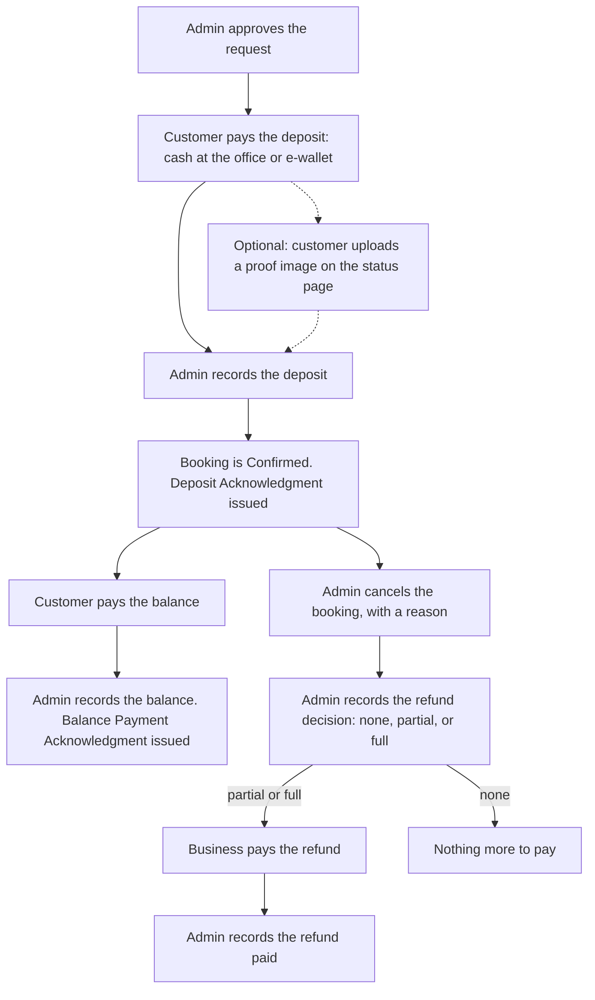

# Catalog and Payments

> **Purpose:** What the business offers and how it is priced (packages, add-ons, delivery slots, the sets and the room), and how every peso paid or refunded is recorded and acknowledged. ·
> **Audience:** The developer (Super Admin) and the business owner (Admin); written for readers without a technical background, except the lines marked "Developer note" and section 9, which are mainly for the developer ·
> **Status:** Draft for review ·
> **Last updated:** 2026-10-21 ·
> **Depends on:** [Decision log](../00-project/decision-log.md) (D-02, D-03, D-05, D-06, D-07, D-11, D-12, D-14, D-18, D-21; O-02, O-03, O-04, O-11), [Glossary](../00-project/glossary.md), [Roles and permissions](../01-requirements/roles-and-permissions.md), [Business rules](../01-requirements/business-rules.md), [Reservation lifecycle](reservation-lifecycle.md), [Functional requirements](../01-requirements/functional-requirements.md), [Privacy and retention](../01-requirements/privacy-and-retention.md) ·
> **Derived from:** [spec v0.2](../superpowers/specs/2026-10-21-kasoundbox-design.md) §8 (main source), with details from §2, §3, §4, §5, §6, §7, §9, §10, §11, §13, §14, §15, §16, §17, and §19

**How to read this document.**

- **Labels.** **[C]** confirmed decision · **[P]** proposed, accepted with the spec approval but may change · **[U]** unverified fact · **[O-nn]** open item, listed in the [decision log](../00-project/decision-log.md). A statement with no label is part of the approved design (spec v0.2, approved on 2026-10-21, see D-23).
- **"[P] (new in this doc)"** marks a small detail that spec v0.2 does not state. It was added so the rule is complete enough to build and test. It is not yet approved: please confirm or correct it in this review.
- **Citing this document.** This document has no ID prefix of its own. Other docs link here and name the section, for example "catalog-and-payments §4.6 (voiding)" or "catalog-and-payments (price snapshot)".
- **Time and money.** Every date and time is Manila time (Asia/Manila). A "year" is the calendar year in Manila. Every amount is in Philippine pesos (₱).
- **Examples.** Names, package names, prices, stock numbers, slot times, and acknowledgment numbers in the examples are made up. The real catalog, the delivery sets, the deposit amount, and the deposit texts are open item O-03. The real slot times are O-02. The examples follow the same customers as the other docs: Ana, Ben, Carla, and Dan.
- **Words.** Terms such as *snapshot*, *ledger*, *void*, and *verified* are also in the [glossary](../00-project/glossary.md).
- **Tests.** The tests for price calculation, acknowledgment numbering, voids, and payments (spec v0.2 §17) will be listed in the test plan (planned for batch 4: `06-delivery/test-plan.md`).

**The running example.** Ana books a **delivery** for **Thursday 24 December 2026**. Her reference code is `KSB-7Q2M-K9TX`. She picks Package A at ₱3,000 and 2 extra microphones at ₱200 each. Her total is ₱3,400 and her deposit is ₱1,000. She submits on Wednesday 16 December at 10:00 AM, and an admin approves on Thursday 17 December at 2:00 PM.

### What this document does not cover

| Topic | Where it lives |
|---|---|
| Who may manage the catalog, the sets and the room, and the settings; who may record or void payments | [Roles and permissions](../01-requirements/roles-and-permissions.md) (sections 2.2, 2.5, 2.6) |
| Capacity: one booking per set or room per day, add-on stock never exceeded, blocks, catalog edits that are refused | [Business rules](../01-requirements/business-rules.md) (BR-01 to BR-03, BR-08, BR-10) |
| How an uploaded proof pauses expiry | [Business rules](../01-requirements/business-rules.md) (BR-12) |
| Statuses, deadlines, and the rules of each action: approve, same-day deposit waiver, edit details, reschedule, cancel, event not held, recreate expired, service start | [Reservation lifecycle](reservation-lifecycle.md) |
| The screens and emails that use this document | [Functional requirements](../01-requirements/functional-requirements.md) (FR-PUB-02, FR-PUB-06, FR-PUB-11, FR-PUB-14, FR-ADM-11 to FR-ADM-15, FR-ADM-18, FR-ADM-19, FR-ADM-23, FR-ADM-26 to FR-ADM-28, FR-NTF-03, FR-NTF-07, FR-NTF-10) |
| The words acknowledgments must never use; the issuer-name risk; how long payment records and proof images are kept; the closure date | [Privacy and retention](../01-requirements/privacy-and-retention.md) (sections 6 and 7) |
| Unusual payment and catalog situations | [Edge cases](../01-requirements/edge-cases.md) (sections 5 and 8) |
| Tables, columns, and constraints | Data model (planned: `05-technical/data-model.md`) |

---

## In short (for the Admin)

1. **You keep the catalog up to date.** You can add and change packages, add-ons, prices, and daily stock. Delivery slots, the delivery sets and the room, and the deposit amount are set by the Super Admin.
2. **The customer pays the price they saw.** Prices and the deposit are locked when the request is sent. A price change later never changes an existing booking.
3. **Delivery is free inside the service area.** There is no delivery fee. You check each address when you review the request.
4. **The deposit is a fixed amount, paid after you approve.** It is paid in cash at the office or by e-wallet. You record the exact amount, and recording it confirms the booking.
5. **Record every peso.** Record each deposit, each balance payment, and each refund you pay out.
6. **For an e-wallet payment, type only the reference number.** Never copy the payer's name or account number from a screenshot.
7. **Mistakes are voided, never deleted.** Void a wrong payment with a reason. Its acknowledgment number is never used again.
8. **An acknowledgment is not an Official Receipt.** The system makes one for every deposit and balance payment, and the page says so.

---

## 1. Catalog structure

The catalog is what the business offers and books. It has four parts.

| Part | What it is | What it holds | Who manages it | Label |
|---|---|---|---|---|
| **Packages** | The main videoke rental offers | Name, inclusions, price, active or archived | Either admin ([roles-and-permissions](../01-requirements/roles-and-permissions.md) §2.5) | [C] (D-07, D-14) |
| **Add-ons** | Optional extras, booked with a quantity | Name, price per unit, daily stock, active or archived | Either admin ([roles-and-permissions](../01-requirements/roles-and-permissions.md) §2.5) | [C] (D-02, D-07) |
| **Delivery slots** | The time windows a delivery customer picks | Label, start time, end time, active | Super Admin, in the settings ([roles-and-permissions](../01-requirements/roles-and-permissions.md) §2.6) | [C] (D-03, D-07) |
| **Resources** | Each delivery set and the on-site room | Kind (delivery set or room), name, active | Super Admin ([roles-and-permissions](../01-requirements/roles-and-permissions.md) §2.5) | [P] |

The permissions are defined only in [roles-and-permissions](../01-requirements/roles-and-permissions.md). The real packages, add-ons, prices, stock, and sets are still open (O-03), and so are the slot times (O-02).

### 1.1 Packages

- A package is a main videoke rental offer. It has a name, a list of what it includes (its *inclusions*), and a price.
- **The same packages are offered for delivery and on-site [C]** (D-14). Both kinds of customer choose from one list.
- A customer picks one package for each reservation, plus any add-ons.
- The public packages page shows every active package with its inclusions and price ([FR-PUB-02](../01-requirements/functional-requirements.md)).
- *Example.* "Package A: ₱3,000", with its inclusions listed under the name.

### 1.2 Add-ons and daily stock

- An add-on is an optional extra that the customer adds to a package, with a quantity. It has a name, a price per unit, and a daily stock **[C]** (D-02).
- **Zero values [C]** (D-35). A package or add-on price may be ₱0, so a free extra can be offered. A daily stock of 0 means the add-on is not available: none can be booked while it is 0.
- **Daily stock** is how many units can be booked for one date, by all bookings together. Delivery and on-site bookings share it. The rule that bookings never go over it is [BR-03](../01-requirements/business-rules.md).
- Daily stock is a catalog value, not a setting. Either admin can change it. Lowering it below what is already booked on a future date is refused ([BR-10](../01-requirements/business-rules.md)).
- *Example.* "Extra microphone: ₱200 each, daily stock 4". On Thursday 24 December, Ana has 2 of them, so 2 are left for other bookings that day.

### 1.3 Delivery slots

- A delivery slot is a fixed time window that a delivery customer picks. It has a label, a start time, an end time, and an active flag.
- **The slot sets the event time, but the set is held for the whole day [C]** (D-03).
- The slot's start time becomes the booking's service start. It is computed and stored when the request is saved, so changing a slot's times later does not move existing bookings ([reservation-lifecycle](reservation-lifecycle.md), service start).
- Delivery slots are one of the reserved settings **[C]** (D-07). Who may change them: [roles-and-permissions](../01-requirements/roles-and-permissions.md) §2.6.
- Archiving a slot that live reservations use is refused ([BR-10](../01-requirements/business-rules.md)).
- On-site bookings have no slots. The customer picks an arrival time within on-site hours, which is a setting ([business-rules](../01-requirements/business-rules.md) §9).
- *Example.* "Afternoon: 2:00 PM to 6:00 PM". Dan books this slot for Thursday 24 December 2026, so his service start is 2:00 PM that day. His set is still held all day.

### 1.4 Resources: the delivery sets and the room

- A resource is something booked for a whole day. There are two kinds: a **delivery set** and the **room**. Each has a kind, a name, and an active flag.
- **Delivery sets [C]** (D-02). There are 2–3 sets, kept only for delivery. The delivery pool is simply the list of active sets. There is no separate "number of sets" setting ([BR-01](../01-requirements/business-rules.md)).
- **The room [C]** (D-02). There is one room, for on-site bookings ([BR-02](../01-requirements/business-rules.md)).
- **The customer never picks a set.** When a delivery request is saved, the system claims a free set for that date ([BR-01](../01-requirements/business-rules.md)).
- **Adding, renaming, or deactivating** a set or the room is a Super Admin task **[P]** ([roles-and-permissions](../01-requirements/roles-and-permissions.md) §2.5). Deactivating one that has future live bookings is refused ([BR-10](../01-requirements/business-rules.md)).
- **Out of service for a day** is a block, not a deactivation ([BR-08](../01-requirements/business-rules.md)).
- *Example.* The sets are named "Set 1", "Set 2", and "Set 3". Set 2 needs repair on Friday 1 January 2027, so the Admin blocks set 2 for that date (BR-08). If set 3 is later sold, the Super Admin deactivates it once it has no future bookings.

### 1.5 Delivery fee and the service area

- **Delivery is free inside the service area [C]** (D-11). The price never has a delivery fee.
- No list of areas is kept. The admins check each venue address when they review the request ([reservation-lifecycle](reservation-lifecycle.md); [FR-ADM-08](../01-requirements/functional-requirements.md)).
- The fixed wording for customers is still to be confirmed (O-04): *"Delivery is free within our service area; we confirm your address during review."* The packages page shows it **[P] (new in this doc)** ([FR-PUB-02](../01-requirements/functional-requirements.md)).

### 1.6 Changing the catalog

- **Archived, never deleted.** Packages, add-ons, and delivery slots are archived, never deleted. Archived items are no longer offered to customers. Old reservations that used them still show them, with their locked prices.
- **Edits that clash with future bookings are refused.** This covers lowering stock below what is booked, archiving an item that live reservations use, and deactivating a set or the room that has future live bookings. The screen lists the reservations that clash. The rule is [BR-10](../01-requirements/business-rules.md).
- **A price change never touches existing reservations** (section 2.2).
- **The public pages update.** After an edit, the packages page shows the change ([FR-PUB-02](../01-requirements/functional-requirements.md)).
- **Every change is recorded** in the audit log: catalog changes in the "catalog" category, slot changes in the "settings" category ([FR-ADM-26](../01-requirements/functional-requirements.md), [FR-ADM-28](../01-requirements/functional-requirements.md)).

> **Developer note.** Catalog pages are cached and refreshed whenever the catalog is edited. Availability, booking, status, and all admin pages are always live (spec v0.2 §10).

---

## 2. Prices

### 2.1 Price calculation

The server calculates the price from the catalog:

> **Total = package price + (each add-on's unit price × its quantity)**

- **Nothing else is added in the MVP.** There is no delivery fee (section 1.5). A promotions manager is on the "Later" list ([project-charter](../00-project/project-charter.md)).
- **Deposit.** The fixed deposit amount from the settings **[C]** (D-05). It is one fixed amount, not a share of the total. The amount is still open (O-03).
- **Balance due.** The total minus the deposit and balance payments recorded so far. Voided payments do not count **[C]** (D-24).

Where the amounts appear: the review step of the form shows the breakdown, the total, and the deposit ([FR-PUB-06](../01-requirements/functional-requirements.md)). The status page shows the total, the deposit, and the balance due ([FR-PUB-11](../01-requirements/functional-requirements.md)). Each acknowledgment shows the balance due after that payment (section 5.3).

*Worked example: Ana's price.*

| Item | Unit price | Quantity | Amount |
|---|---|---|---|
| Package A | ₱3,000 | 1 | ₱3,000 |
| Extra microphone | ₱200 | 2 | ₱400 |
| Delivery, inside the service area | Free | — | ₱0 |
| **Total** | | | **₱3,400** |
| Deposit, paid after approval | | | ₱1,000 |
| Balance due after the deposit | | | ₱2,400 |

> **Developer note.** The amounts saved are always the ones the server calculates from the catalog, never amounts sent by the browser. Price calculation has unit tests (spec v0.2 §17).

### 2.2 The price snapshot

**Rule [C]** (D-12). When a request is submitted, the server copies these into the reservation:

- the package price;
- each add-on's unit price, with its quantity;
- the deposit amount from the settings.

This copy is the **price snapshot**. Later changes to the catalog or to the deposit setting never change it.

- **Staff-created bookings** (phone, walk-in, Facebook) take their snapshot when the admin creates them ([FR-ADM-24](../01-requirements/functional-requirements.md)).
- *Example: a price change.* Ana submits while Package A costs ₱3,000. The next week, the price goes up to ₱3,500. Ana still pays ₱3,000.
- *Example: a deposit change.* On Monday 28 December 2026, the Super Admin raises the deposit from ₱1,000 to ₱1,500. A request sent on Saturday 26 December keeps its ₱1,000 deposit. ₱1,000 is also the only amount that can be recorded as its deposit (section 4.3).

### 2.3 How admin actions treat the snapshot

When each action is allowed, and everything else it does, is in [reservation-lifecycle](reservation-lifecycle.md). This table covers only the prices.

| Action | What happens to the prices | Label |
|---|---|---|
| **Edit details**, when the package or add-ons change | Unchanged items keep their snapshot price. Added items take the current catalog price. Stock is checked again ([BR-03](../01-requirements/business-rules.md)). | [P] |
| **Reschedule** | The snapshot is kept. | [P] |
| **Recreate an expired request** | The new reservation uses the current catalog prices and the current deposit setting, because it counts as a new submission. | [P] |

*Example: edit details.* Dan booked Package A at ₱3,000 and 1 extra microphone at ₱200, a total of ₱3,200. On Monday 21 December, he asks to add 1 party light (a made-up add-on, now ₱300). The Admin adds it with "edit details". Package A now costs ₱3,500 in the catalog, but Dan's package is unchanged, so it stays ₱3,000. His microphone stays ₱200. The new light costs ₱300. His new total is ₱3,500.

---

## 3. How money moves

The website never takes money. Every payment is made in cash at the office or by e-wallet, and an admin records it. An online payment gateway is on the "Later" list ([project-charter](../00-project/project-charter.md)).



Notes on the diagram:

- **The deposit deadline** is defined in [reservation-lifecycle](reservation-lifecycle.md) (Awaiting Deposit).
- **A proof** pauses expiry until an admin reviews it ([BR-12](../01-requirements/business-rules.md)). When the admin verifies it, they record the deposit (section 4.3).
- **A same-day booking** can be Confirmed without a deposit, with a reason (a waiver). A deposit can still be recorded afterwards ([reservation-lifecycle](reservation-lifecycle.md), same-day deposit waiver).
- **A cancellation with no deposit paid** needs no refund decision. A refund decision is also recorded when a Completed event is marked "not held" ([reservation-lifecycle](reservation-lifecycle.md), cancel; event not held).

---

## 4. The payments ledger

### 4.1 What the ledger records

**The ledger records every movement of money on a reservation [C]** (D-05). Each payment is one record, of one of three kinds:

| Kind | Recorded when | Acknowledgment |
|---|---|---|
| **Deposit** | The customer pays the deposit | Deposit Acknowledgment (section 5) |
| **Balance** | The customer pays the rest of the price | Balance Payment Acknowledgment (section 5) |
| **Refund** | The business actually pays back a refund decided at cancellation | None |

- Only an admin records a payment. Who may record each kind: [roles-and-permissions](../01-requirements/roles-and-permissions.md) §2.2.
- Payment records are never deleted. A wrong record is voided (section 4.6).
- How long the records are kept, and how a late payment or refund moves the closure date, is in [privacy-and-retention](../01-requirements/privacy-and-retention.md) §6.
- The ledger keeps full money records, as if the business were registered (it is not: D-18). That supports a later registration ([privacy-and-retention](../01-requirements/privacy-and-retention.md) §8).

### 4.2 Fields of every payment

| Field | What it holds | Required? |
|---|---|---|
| Kind | Deposit, balance, or refund | Yes |
| Amount | The amount in pesos | Yes |
| Method | Cash or e-wallet **[C]** (D-05) | Yes |
| E-wallet reference number | The transaction number of the e-wallet payment | Required for e-wallet; left empty for cash |
| Received by / paid by | The admin who recorded it: who received a deposit or balance, or who paid a refund | Saved automatically |
| Time | When it was recorded | Saved automatically |
| Note | Free text | Optional |
| Acknowledgment number | The `ACK-YYYY-NNNN` number (section 5.2) | Deposits and balances only; assigned automatically |
| Verified at | When the deposit was verified (recorded) | Deposits only; set automatically |
| Void details | That it was voided, the reason, who, and when | Only when voided (section 4.6) |

### 4.3 Deposit

- **A deposit is required [C]** (D-05). It is a fixed amount, paid after an admin approves the request, in cash at the office or by e-wallet. The one exception is a same-day booking whose deposit an admin waives, with a reason **[C]** (D-06; [reservation-lifecycle](reservation-lifecycle.md), same-day deposit waiver).
- **Exact amount, no partial deposits [P].** The amount is prefilled from the reservation's snapshot (section 2.2) and must equal it. There are no partial deposits in the MVP ([EC-34](../01-requirements/edge-cases.md)).
- **One active deposit.** A reservation has at most one active (not voided) deposit. A second one is refused ([EC-35](../01-requirements/edge-cases.md)).
- **When a deposit can be recorded.** The rules are in [reservation-lifecycle](reservation-lifecycle.md). In short:
  - on an Awaiting Deposit booking. Recording it makes the booking Confirmed. After the deadline it is refused, unless expiry is paused for proof review ([BR-12](../01-requirements/business-rules.md));
  - on a Confirmed booking whose deposit was waived. It issues an acknowledgment and does not change the status;
  - in the one-step form for a staff-created booking whose start has already passed or falls within the notice period ([BR-06a](../01-requirements/business-rules.md)).
- **Verified.** Recording a deposit marks it verified and saves the time as `verified_at`. That time starts the 7-day clock for deleting the customer's proof image **[C]** (D-21; [privacy-and-retention](../01-requirements/privacy-and-retention.md) §6).
- **A proof is not a payment record.** A proof is a picture the customer uploads while Awaiting Deposit. Verifying it means recording the deposit here; rejecting it needs a reason ([BR-12](../01-requirements/business-rules.md), [FR-ADM-12](../01-requirements/functional-requirements.md)). Proof images are deleted and never backed up, so the e-wallet reference number in the ledger is the lasting record.
- *Example.* On Friday 18 December at 10:45 AM, Ana pays ₱1,000 by e-wallet, with reference number `1234567890`. The Admin records it at 11:00 AM. Her booking becomes Confirmed, and `ACK-2026-0001` appears on her status page.

### 4.4 Balance

- **The balance is recorded too [C]** (D-05). Either admin records it on a Confirmed or Completed booking, so a balance paid after the event can still be recorded ([EC-38](../01-requirements/edge-cases.md)).
- **The amount defaults to the total minus the deposit.** The other fields are the same as for a deposit (section 4.2).
- It issues a **Balance Payment Acknowledgment** (section 5). The status does not change.
- *Example.* On Thursday 24 December, Ana pays the ₱2,400 balance in cash. The Admin records it, and `ACK-2026-0015` is issued. Her balance due is now ₱0.
- The default after a waived deposit is an open question ([edge-cases](../01-requirements/edge-cases.md) §15, question 5). So is a balance paid in parts (section 10, question 1).

### 4.5 Refunds

A refund has two separate steps.

1. **The refund decision** is recorded on the reservation when an admin cancels a booking whose deposit was paid, or marks a Completed event "not held": none, partial, or full, with the amount, decided case by case **[C]** (D-07). The rule is defined in [reservation-lifecycle](reservation-lifecycle.md) (cancel and the refund decision; event not held). It is not a payment record, so it adds nothing to the ledger.
2. **The refund paid [C]** (D-05). When the money is actually paid back, an admin records a refund in the ledger: amount, method, e-wallet reference number (for e-wallet), and an optional note. Who paid it and the time are saved automatically ([FR-ADM-19](../01-requirements/functional-requirements.md)).

- A refund gets no acknowledgment. Acknowledgments are only for deposit and balance payments (section 5.1).
- *Example.* Ben paid a ₱1,000 deposit for Sunday 27 December 2026. On Tuesday 22 December he calls to cancel. The Admin cancels with the reason "family emergency" and the refund decision "partial, ₱500". On Wednesday 23 December, Ben collects ₱500 at the office, and the Admin records a ₱500 cash refund.

### 4.6 Voiding a payment

- **A wrongly recorded payment is voided, with a reason.** Deposits can be voided (spec v0.2 §4). Either admin can also void a balance or a refund record **[C]** ([D-24](../00-project/decision-log.md)).
- **The record stays.** It is marked void, with the reason, the admin, and the time. A voided payment no longer counts: it is not the active deposit, and it is left out of the balance due.
- **Its acknowledgment number is retired.** The number is never reused, and the counter does not go back.
- **A void changes no status.** The lifecycle has no transition for it ([reservation-lifecycle](reservation-lifecycle.md)). Whether the correct deposit can then be recorded on a Confirmed booking is an open question ([functional-requirements](../01-requirements/functional-requirements.md) §7, question 3).
- Like every admin action, a void is recorded in the audit log.
- *Example.* The Admin records ₱1,000 on the wrong reservation, getting `ACK-2026-0007`. He voids it with the reason "recorded on wrong booking". Number 0007 is never used again; the next acknowledgment is `ACK-2026-0008` ([EC-33](../01-requirements/edge-cases.md)).

### 4.7 No payer details

- **Payer names and account numbers are never copied from proof screenshots.** Only the e-wallet reference number is stored.
- This also means not typing them into the payment note **[P] (new in this doc)**.
- Why: the system keeps as little personal data as it needs ([privacy-and-retention](../01-requirements/privacy-and-retention.md) §3.2).

---

## 5. Acknowledgments

**Label: [P]**, except the issuer name, which is **[C]** (D-21).

### 5.1 When one is issued

- **Every deposit and every balance payment issues a printable Payment Acknowledgment**, in the same step as recording the payment.
- It is titled **"Deposit Acknowledgment"** or **"Balance Payment Acknowledgment"**.
- This includes a deposit recorded after a same-day waiver, and a deposit recorded in a one-step staff-created booking.
- Refunds get no acknowledgment.

### 5.2 Numbering: `ACK-YYYY-NNNN`

- **YYYY** is the year the payment was recorded, in Manila time.
- **NNNN** is a counter for that year, starting at 0001. Deposit and balance acknowledgments share it.
- The system hands out numbers one at a time, so two admins recording at the same moment never get the same number ([EC-36](../01-requirements/edge-cases.md)). How this is done is in section 9.
- **A number is never reused**, not even after a void (section 4.6).
- The counter may grow past 4 digits, for example `ACK-2026-10000`.
- *Examples.* The first acknowledgment of 2026 is `ACK-2026-0001`. The first payment recorded at 12:30 AM on Friday 1 January 2027, Manila time, gets `ACK-2027-0001`, even though it is still 31 December in UTC (world standard time, 8 hours behind Manila) ([EC-37](../01-requirements/edge-cases.md)).

### 5.3 What an acknowledgment shows

| Field | What it shows | Example (Ana's deposit) |
|---|---|---|
| Title | "Deposit Acknowledgment" or "Balance Payment Acknowledgment" | Deposit Acknowledgment |
| Number | The ACK number (section 5.2) | `ACK-2026-0001` |
| Booking reference | The reservation's reference code | `KSB-7Q2M-K9TX` |
| Received from | The customer's name | Ana Reyes |
| Issued by | The issuer name setting: **DJB Kasoundbox [C]** (D-21) | DJB Kasoundbox |
| Received by | The display name of the admin who recorded it | The Admin's display name |
| Date | The date it was recorded | Friday 18 December 2026 |
| Amount | The amount paid | ₱1,000 |
| Method | Cash or e-wallet | E-wallet |
| E-wallet reference | The reference number; empty for cash | `1234567890` |
| For | "Deposit (or balance) for videoke rental on [event date], [package]" | Deposit for videoke rental on Thursday 24 December 2026, Package A |
| Balance due | What is still owed after this payment (section 2.1) | ₱2,400 |
| Deposit terms | The deposit terms text from the settings (section 7) | Still to be written (O-03) |
| Statement | *"This is an acknowledgment of payment received. It is NOT an Official Receipt or Invoice."* | Always printed |

- **Wording rules.** The words an acknowledgment must never use, and why, are in [privacy-and-retention](../01-requirements/privacy-and-retention.md) §7.1.
- **The issuer name** carries a legal risk (Act 3883), accepted knowingly; a lawyer will advise (D-21, O-11). Details: [privacy-and-retention](../01-requirements/privacy-and-retention.md) §7.2.
- **The customer's name** appears here as "received from", although the status page itself never shows it ([roles-and-permissions](../01-requirements/roles-and-permissions.md) §6).

### 5.4 Where it is shown

- **The status page** links to each acknowledgment ([FR-PUB-14](../01-requirements/functional-requirements.md)).
- **The Confirmed email** links to it ([FR-NTF-07](../01-requirements/functional-requirements.md)).
- **The admin panel.** Admins can open and print it at the office ([FR-ADM-23](../01-requirements/functional-requirements.md)).
- It is a printable web page, so the customer can print it or save it from a phone or computer browser.
- How these links are protected is an open question for the security doc (planned: `05-technical/security.md`) ([functional-requirements](../01-requirements/functional-requirements.md) §7, question 5).

### 5.5 Sample

A made-up sample, to show the content. The real layout comes with the page design.

```text
DEPOSIT ACKNOWLEDGMENT

Number:             ACK-2026-0001
Booking reference:  KSB-7Q2M-K9TX
Received from:      Ana Reyes
Issued by:          DJB Kasoundbox
Received by:        [display name of the admin who recorded it]
Date:               Friday 18 December 2026
Amount:             ₱1,000
Method:             E-wallet
E-wallet reference: 1234567890
For:                Deposit for videoke rental on Thursday 24 December 2026, Package A
Balance due:        ₱2,400

Deposit terms:      [deposit terms text from the settings, still to be written (O-03)]

This is an acknowledgment of payment received. It is NOT an Official Receipt or Invoice.
```

---

## 6. Booking Confirmation

- A printable web page for a Confirmed booking, titled **"Booking Confirmation"**.
- The status page and the Confirmed email link to it ([FR-PUB-14](../01-requirements/functional-requirements.md), [FR-NTF-07](../01-requirements/functional-requirements.md)). Admins can open and print it at the office ([FR-ADM-23](../01-requirements/functional-requirements.md)).
- It is not a payment record and has no ACK number.
- The same wording rules apply ([privacy-and-retention](../01-requirements/privacy-and-retention.md) §7.1).
- Spec v0.2 does not list what it shows. See section 10, question 6.

---

## 7. Settings for deposits and documents

These settings belong to this document. Who may change each one is defined in [roles-and-permissions](../01-requirements/roles-and-permissions.md) §2.6; all of them are Super Admin settings.

| Setting | What it is | Used in | Default | Label |
|---|---|---|---|---|
| **Deposit amount** | The fixed deposit, in pesos | The snapshot at submission (section 2.2); recording the deposit (section 4.3); the form summary ([FR-PUB-06](../01-requirements/functional-requirements.md)) | Not yet set (O-03) | [C] (D-05, D-07) |
| **Deposit instructions** | How to pay: the e-wallet name, number, and account name; the office address and hours | The approved email ([FR-NTF-03](../01-requirements/functional-requirements.md)); the status page while Awaiting Deposit ([FR-PUB-11](../01-requirements/functional-requirements.md)); the deposit reminder ([FR-NTF-04](../01-requirements/functional-requirements.md)) **[P] (new in this doc)** | Not yet set (O-03) | [P] |
| **Deposit terms text** | The conditions of the deposit | Every acknowledgment (section 5.3) | Not yet set (O-03) | [P] |
| **Acknowledgment issuer name** | The business name printed as the issuer | Every acknowledgment (section 5.3) | DJB Kasoundbox | Name [C] (D-21); kept as a setting [P] |
| **Delivery slots** | Section 1.3 | The reservation form; the service start | Not yet set (O-02) | [C] (D-03, D-07) |

- Changing the deposit amount never changes existing reservations (section 2.2).
- Every settings change is recorded in the audit log, in the "settings" category ([FR-ADM-28](../01-requirements/functional-requirements.md)).
- Prices and daily stock are catalog values, not settings (section 1).

---

## 8. Worked example: Ana's money from start to finish

| When (Manila time) | What happens | Ledger | Acknowledgment |
|---|---|---|---|
| Wed 16 Dec 2026, 10:00 AM | Ana submits. The snapshot locks Package A at ₱3,000, 2 extra microphones at ₱200, and the ₱1,000 deposit. Total ₱3,400. | Nothing yet | — |
| Thu 17 Dec, 2:00 PM | An admin approves. The approved email gives the deposit instructions and the deadline, Fri 18 Dec at 2:00 PM ([reservation-lifecycle](reservation-lifecycle.md)). | Nothing yet | — |
| Fri 18 Dec, 10:45 AM | Ana pays ₱1,000 by e-wallet, reference `1234567890`, and uploads a picture of it on her status page. | Nothing yet | — |
| Fri 18 Dec, 11:00 AM | The Admin checks the proof and records the deposit. The booking becomes Confirmed. | Deposit ₱1,000, e-wallet, `1234567890`, verified 11:00 AM | `ACK-2026-0001`, balance due ₱2,400 |
| Thu 24 Dec | The event. Ana pays the ₱2,400 balance in cash, and the Admin records it. | Balance ₱2,400, cash | `ACK-2026-0015`, balance due ₱0 |
| Fri 25 Dec, early morning | The daily job marks the booking Completed ([reservation-lifecycle](reservation-lifecycle.md)). The money records do not change. | No change | — |

- Ana's proof image is deleted 7 days after the deposit was verified **[C]** (D-21). The e-wallet reference number stays in the ledger.
- How long the ledger rows and her details are kept is in [privacy-and-retention](../01-requirements/privacy-and-retention.md) §6.

---

## 9. Developer notes

- **Tables** (outline from spec v0.2 §11; the full design goes in the data model, planned: `05-technical/data-model.md`):
  - `packages` and `addons`: the catalog. Add-ons carry `daily_stock`. Rows are archived, never deleted.
  - `delivery_slots`: label, start time, end time, active.
  - `resources`: each delivery set and the room: kind, name, active.
  - `reservations`: holds the price and deposit snapshot.
  - `reservation_addons`: add-on, date, quantity, unit-price snapshot.
  - `payments`: kind (deposit, balance, or refund), amount, method, e-wallet reference, admin, time, note, acknowledgment number, `verified_at` (deposits), and void fields.
  - `ack_counters`: one counter row per year, locked when a number is issued.
  - `payment_proofs`: storage path, upload time, review result, deletion time (rules: BR-12 and [privacy-and-retention](../01-requirements/privacy-and-retention.md)).
- **One database function per action.** Recording a deposit, a balance, or a refund, voiding a payment, and each catalog edit are single database function calls (spec v0.2 §10, §12). Each reservation action checks the current status and version. Each function writes its audit row, and any emails it causes, in the same transaction (spec v0.2 §9).
- **Acknowledgment numbers.** Inside the recording function, lock the year's `ack_counters` row (`FOR UPDATE`), increment it, and write the number on the payment. Compute the year with `now() AT TIME ZONE 'Asia/Manila'`. Pad to at least 4 digits; never truncate.
- **Deposit checks in the database.** The amount equals the reservation's deposit snapshot. At most one deposit that is not voided per reservation. The e-wallet reference is required when the method is e-wallet, and empty for cash.
- **Closure date.** Recording a payment or refund recomputes the reservation's closure date in the same function ([privacy-and-retention](../01-requirements/privacy-and-retention.md) §6.1).
- **Printable pages.** Acknowledgments and the Booking Confirmation are printable HTML pages (spec v0.2 §8).
- **Tests** (spec v0.2 §17): acknowledgment numbering under concurrency; waivers, voids, and catalog-edit refusals (BR-10) in pgTAP; price calculation in Vitest; recording a deposit and a balance, and a cancellation with a refund, in Playwright. The test cases will be in the test plan (planned for batch 4: `06-delivery/test-plan.md`).

---

## 10. Questions found while writing this document

Spec v0.2 does not answer these. They are not decided here. If the reviewers agree they need an answer, add each one to the [decision log](../00-project/decision-log.md) as a new open item (O-12 onwards), then update this document.

1. **A balance paid in parts.** Can more than one balance payment be recorded on a booking? If so, does the default for the next one subtract the earlier balance payments too?
2. **More of an add-on in "edit details".** Unchanged items keep their snapshot price, and added items take the current price (section 2.3). If an admin raises the quantity of an add-on already booked, do the extra units take the snapshot price or the current price?
3. **The refund paid and the decision.** Must the refund paid equal the amount in the refund decision? Can a refund be paid in parts?
4. **What "full" covers.** When both the deposit and the balance were paid, and the booking is then cancelled or marked "not held", does a "full" refund mean the deposit only, or everything paid? (A related question, a balance paid with no deposit, is in [reservation-lifecycle](reservation-lifecycle.md) §9, question 2.)
5. **Voided acknowledgments.** Does the status page still link to a voided acknowledgment, marked void, or is it hidden?
6. **Booking Confirmation contents.** The spec does not list what the Booking Confirmation shows, or whether it stays available after the booking is Completed or Cancelled. Both are needed for the page design.
7. **The payment date.** The payment time is the moment the admin records it, and the acknowledgment shows that date. If cash is received on Thursday but recorded on Friday, should the admin be able to enter the actual payment date?

These are already listed elsewhere, and are not repeated here: recording a deposit after a void on a Confirmed booking ([functional-requirements](../01-requirements/functional-requirements.md) §7, question 3); how the document links are protected (same list, question 5); what the admins do with a part deposit ([edge-cases](../01-requirements/edge-cases.md) §15, question 3); the default balance after a waiver (same list, question 5); and the issuer name on acknowledgments already issued ([privacy-and-retention](../01-requirements/privacy-and-retention.md) §11, question 12).

---

## 11. Changing this document

- **A change to a rule here** (for example, allowing partial deposits) is a change to a decision, usually D-05, D-12, or D-21. Update the [decision log](../00-project/decision-log.md) first, then this document, then every other document the decision lists under "Docs affected".
- **Day-to-day catalog work is not a document change.** Adding an add-on, changing a price, or changing daily stock is normal admin work in the admin panel. It is recorded in the audit log.
- **When O-02, O-03, or O-04 is answered,** record the answer in the decision log and enter the values in the admin panel. The examples in this document stay examples.
- **A detail marked "[P] (new in this doc)"** becomes plain text once the review confirms it, or is corrected.
- **The frozen spec is never edited** (D-23).
