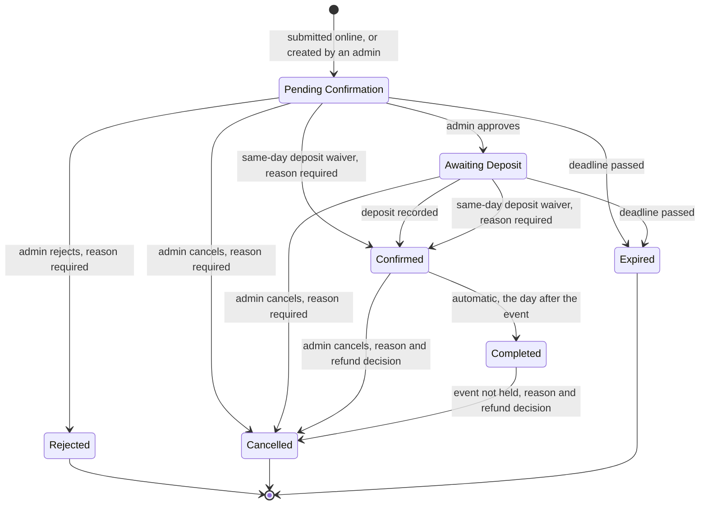

# Reservation Lifecycle

> **Purpose:** The statuses a reservation can have, every allowed status change, the deadlines, and the rules of each reservation action. This is the only place where statuses, transitions, and deadlines are defined. ·
> **Audience:** The developer (Super Admin) and the business owner (Admin). Written in plain English for both; notes marked *Developer note* are mainly for the developer ·
> **Status:** Draft for review ·
> **Last updated:** 2026-10-21 ·
> **Depends on:** [Decision log](../00-project/decision-log.md) (D-03, D-04, D-05, D-06, D-07, D-08, D-11, D-12, D-13, D-15, D-23), [Glossary](../00-project/glossary.md), [Roles and permissions](../01-requirements/roles-and-permissions.md), [Business rules](../01-requirements/business-rules.md), [Catalog and payments](catalog-and-payments.md), [Functional requirements](../01-requirements/functional-requirements.md), [Privacy and retention](../01-requirements/privacy-and-retention.md), [Edge cases](../01-requirements/edge-cases.md) ·
> **Derived from:** [spec v0.2](../superpowers/specs/2026-10-21-kasoundbox-design.md) §7 (main source: state diagram, status table, action rules), with details from §2, §5, §6, §8, §9, §11, §12, §15, and §16

## How to read this document

- **What this document owns.** The seven statuses, the state diagram, every allowed status change, the deadlines, the service start, and the rules of each reservation action (needs info, edit details, extend, waiver, reschedule, cancel, event not held, completed, recreate expired, no deletions). Other docs link here instead of repeating these rules.
- **Labels.** **[C]** confirmed decision · **[P]** proposed, accepted with the spec approval but may change · **[U]** unverified fact, to be checked in the week-1 test or before launch · **[O-nn]** open item, listed in the [decision log][dl]. A rule with no label is part of the approved design (spec v0.2, approved on 2026-10-21, [D-23][dl]).
- **Admins.** "Either admin" means the Super Admin (the developer) or the Admin (the business owner). Who may do each action is defined only in [roles-and-permissions][roles]; this document names the section there, for example "roles §2.1".
- **Customer emails** go out only if the customer gave an email address. Customers without email follow their booking on the status page ([FR-NTF-21][fr]).
- **Row numbers.** The rows in the transition table (section 4) are numbered so they are easy to find. The numbers are not IDs.
- **Time and money.** Every date and time is Manila time (Asia/Manila). Every amount is in Philippine pesos (₱). Names, prices, and slot times in the examples are made up. The real slot times and on-site hours are open item O-02; the real prices and the deposit amount are O-03.
- **Words.** Terms such as *hold*, *claim*, *live claim*, and *service start* are explained in the [glossary][gl].
- **Tests.** Every allowed and every forbidden status change gets a database test (spec v0.2 §17). The test cases will be written in the test plan (planned for batch 4: `06-delivery/test-plan.md`).

### What this document does not cover

| Topic | Where it lives |
|---|---|
| Who may do each action | [roles-and-permissions][roles] |
| Capacity, live claims, overdue holds, notice period, the urgent flag, hold limits, the breaker, blocks, the calendar, proof pausing expiry (BR-01 to BR-12) | [business-rules][br] |
| Prices, the price snapshot, the deposit amount, the payments ledger, voids, refunds paid, acknowledgments | [catalog-and-payments][cat] |
| Screens, the content of each email, how emails are sent, scheduled jobs (FR-PUB, FR-ADM, FR-NTF, FR-SYS) | [functional-requirements][fr] |
| The closure date, retention periods, legal hold, erasure | [privacy-and-retention][priv] |
| Unusual situations and how the system reacts (EC-xx) | [edge-cases][ec] |

---

## In short (for the Admin)

Every reservation has exactly one status at a time. Most bookings go through four steps:

1. **Pending Confirmation.** A customer sends a request on the website, or an admin enters one for a phone, walk-in, or Facebook customer. The request already holds its set or the room, and its add-ons. It waits for an admin to review it: up to 72 hours, but never past the start of the service.
2. **Awaiting Deposit.** An admin approves the request. The customer now has 24 hours to pay the deposit, again never past the start of the service.
3. **Confirmed.** An admin records the deposit. This is the only status that means the booking is secured. For a booking whose event is today, an admin may instead waive the deposit, with a reason.
4. **Completed.** The day after the event, the system marks the booking Completed by itself.

A reservation can also end as:

- **Rejected:** an admin declines the request, with a reason.
- **Cancelled:** an admin cancels it, with a reason. Customers cannot cancel on their own; they contact the business.
- **Expired:** a deadline passed before the next step happened. The set or the room is free again at once.

Nothing is ever deleted. A mistake is fixed with a new action and a reason, and every step is kept in the reservation's history.

*Example: Ana's booking from start to finish (reference `KSB-7Q2M-K9TX`).*

| When (2026) | What happens | Status afterwards | Next deadline |
|---|---|---|---|
| Wed 16 Dec, 10:00 AM | Ana requests a delivery for Thu 24 Dec, in the 2:00 PM slot. Package ₱3,000 plus 2 extra microphones at ₱200 each: ₱3,400 in total. Deposit ₱1,000. | Pending Confirmation | Sat 19 Dec, 10:00 AM |
| Thu 17 Dec, 2:00 PM | The Admin approves the request. | Awaiting Deposit | Fri 18 Dec, 2:00 PM |
| Fri 18 Dec, 11:00 AM | Ana pays ₱1,000 by e-wallet. The Admin records the deposit. | Confirmed | None |
| Thu 24 Dec, 2:00 PM | The event takes place. | Confirmed | None |
| Fri 25 Dec, 12:15 AM | The daily job runs. | Completed | None |

The ₱2,400 balance can be recorded while the booking is Confirmed or Completed ([catalog-and-payments][cat]).

---

## 1. Statuses

### 1.1 The seven statuses

| Code *(developer)* | Shown as | What it means | Holds capacity? | Deadline | Can it still change? |
|---|---|---|---|---|---|
| `pending` | **Pending Confirmation** | The request is waiting for an admin to review it. | Yes | Submission + 72 hours, or the service start, whichever is earlier | Yes |
| `awaiting_deposit` | **Awaiting Deposit** | An admin approved the request. The deposit has not been recorded yet. | Yes | Approval + 24 hours, or the service start, whichever is earlier. Paused while a proof awaits review ([BR-12][br]) | Yes |
| `confirmed` | **Confirmed** | The booking is secured: the deposit was recorded, or an admin waived it for a same-day booking. | Yes | None | Yes: to Cancelled or Completed |
| `completed` | **Completed** | The event date has passed. The system sets this the day after the event. | No | None | Only to Cancelled, through "event not held" (6.7) |
| `rejected` | **Rejected** | An admin declined the request, with a reason. | No | None | No. Final |
| `cancelled` | **Cancelled** | An admin cancelled the reservation, with a reason. | No | None | No. Final |
| `expired` | **Expired** | A deadline passed before the next step happened. | No | None | No. Final. An admin can make a new request from it (6.9) |

Notes:

- **"Holds capacity"** means the reservation's claims on a set or the room, and on add-on stock, are live. The rule is [BR-04][br]. A hold whose deadline has passed stops counting at once ([BR-05][br]).
- **Holds.** A reservation that is Pending Confirmation or Awaiting Deposit is called a *hold*. It uses capacity, but only until its deadline.
- **What people see.** Customers and admins see the label in the "Shown as" column, for example on the status page ([FR-PUB-11][fr]). The code is the value stored in the database.
- **Only an admin confirms.** A reservation becomes Confirmed only through an admin action: recording the deposit, or a same-day waiver. A reference code or a QR code never means the booking is approved or paid. The system changes a status on its own in only two ways: to Expired and to Completed.
- **Final statuses.** Rejected, Cancelled, and Expired end the lifecycle; nothing moves them again. Completed ends the normal path, with one correction allowed: "event not held" moves it to Cancelled. These four are the "final statuses" named in the closure-date rule ([privacy-and-retention][priv]).

### 1.2 Flags are not statuses

A reservation can carry flags. A flag never changes the status.

| Flag | What it means | Found on | Rule defined in |
|---|---|---|---|
| **Needs info** | An admin asked the customer for more information. | Pending Confirmation | This document, 6.1 **[C]** |
| **Urgent** | The event date is today (Manila date). | Any status | [BR-06a][br]; recomputed after a reschedule (6.5) |
| **Expiry paused** | A deposit proof is waiting for an admin's review. | Awaiting Deposit | [BR-12][br] |
| **Legal hold** | A written complaint, demand, or case: retention deletions wait. | Any status | [privacy-and-retention][priv] |

Only "expiry paused" affects a deadline. "Needs info" does not pause the clock **[C]** ([D-13][dl]).

---

## 2. State diagram

The diagram shows every allowed status change. **No other status changes exist.** An action that the diagram does not allow is refused ([EC-53][ec]).

How to read it:

- Each arrow is a status change. The text on the arrow names the action or event that causes it. Section 4 gives the details of each arrow.
- The starting dot is a new reservation. A new reservation is created in one of three ways: online, by an admin for a phone, walk-in, or Facebook customer, or by "recreate expired" (rows 1 to 3 in section 4).
- The ending dot marks the final statuses Rejected, Cancelled, and Expired.
- The arrow "deadline passed" from Awaiting Deposit also covers the two proof cases in [BR-12][br]: a proof still unreviewed at the service start, and a proof rejected after the original deadline has passed **[P]** (row 10).
- **One-step staff bookings.** When a staff-created booking's service start has already passed, or falls within the notice period, the create form finishes in one step, as Confirmed ([BR-06a][br]). This adds no new arrow. This document reads it as existing arrows done together: created, then approved and the deposit recorded; or created, then the deposit waived. See question 1 in section 9.

---

## 3. Service start and deadlines

### 3.1 Service start

**Label:** [C/P]; the on-site arrival time is [C] · **Based on:** [D-03][dl]

- **Delivery:** the service start is the start time of the chosen delivery slot.
- **On-site:** the service start is the arrival time the customer chose **[C]**. It must fall within on-site hours (O-02).
- The service start is worked out when the reservation is submitted, and saved. Later changes to the slot times or the on-site hours do not change it ([EC-56][ec]).
- A reschedule gives the reservation a new service start (6.5).
- **Service start and event date are different.** The service start is an exact moment (date and time). The event date is only the Manila calendar date. Deadlines use the service start. The urgent flag ([BR-06a][br]) and the same-day waiver (6.4) use the event date.
- The service start also sets the notice period for online requests ([BR-06][br]) and decides when a staff-created booking finishes in one step ([BR-06a][br]).

*Example.* Ana's delivery is in the 2:00 PM slot on Thursday 24 December 2026, so her service start is 24 December, 2:00 PM. If the Super Admin later changes that slot to start at 1:00 PM, Ana's service start stays 2:00 PM.

*Developer note.* The event date is a `date`. The service start and the deadlines are `timestamptz` (spec v0.2 §12).

### 3.2 Deadlines

**Label:** [C] · **Based on:** [D-04][dl] (holds and deadlines), [D-05][dl] (proof pause)

Each hold has one deadline. If the next step has not happened by then, the hold expires.

| Status | Deadline | Default |
|---|---|---|
| Pending Confirmation | Submission + 72 hours, or the service start, whichever is earlier | 72 hours, a reserved setting **[C]** |
| Awaiting Deposit | Approval + 24 hours, or the service start, whichever is earlier. Paused while a proof awaits review, but never past the service start ([BR-12][br]) | 24 hours, a reserved setting **[C]** |
| Every other status | No deadline | — |

Rules:

- **Never past the service start [C].** Every deadline ends at the service start at the latest. So no request is still waiting for a review or a deposit when its event begins.
- **Saved with the hold.** Each hold stores its own deadline. A later change to the 72-hour or 24-hour setting does not move the deadlines of existing holds ([FR-ADM-28][fr], [EC-56][ec]).
- **What sets or moves a deadline:**
  - submission sets the review deadline (rows 1 and 2);
  - approval sets the deposit deadline (row 4);
  - "extend a deadline" moves it later, never past the service start (6.3);
  - a reschedule can move it earlier, never later (6.5);
  - a proof upload pauses it, and a proof rejection brings back the original deadline ([BR-12][br]);
  - "recreate expired" gives the *new* reservation its own deadline (6.9).
- **Needs info does not pause it [C]** (6.1).
- **The customer sees it** on the status page, in Manila time ([FR-PUB-11][fr]). The deposit reminder is sent before the deposit deadline ([FR-NTF-04][fr]).

### 3.3 Deadlines are checked, not left to the jobs

- A hold whose deadline has passed, and whose expiry is not paused, **counts as expired at once**: on the calendar ([BR-05][br]), on the status page, and in every admin action.
- So approving it, or recording its deposit, is refused, unless expiry is paused for proof review ([BR-12][br], [EC-23][ec]). The other admin actions also treat it as Expired, so it cannot be extended, for example ([EC-26][ec]).
- The every-minute job ([FR-SYS-01][fr]) then records the Expired status and queues the expired email. It only tidies up: no rule waits for it ([EC-22][ec]).

### 3.4 Worked examples

All dates are in December 2026.

| Case | Submitted | Service start | Review deadline | Approved | Deposit deadline |
|---|---|---|---|---|---|
| Ana, booked a week ahead | Wed 16 Dec, 10:00 AM | Thu 24 Dec, 2:00 PM | Sat 19 Dec, 10:00 AM (submission + 72 h) | Thu 17 Dec, 2:00 PM | Fri 18 Dec, 2:00 PM (approval + 24 h) |
| A delivery booked the day before | Mon 21 Dec, 10:00 AM | Tue 22 Dec, 2:00 PM | Tue 22 Dec, 2:00 PM (the service start comes first) | Mon 21 Dec, 4:00 PM | Tue 22 Dec, 2:00 PM (the service start comes first) |
| Rosa, same day, the room | Sat 19 Dec, 5:30 PM | Sat 19 Dec, 7:00 PM (arrival) | Sat 19 Dec, 7:00 PM | Sat 19 Dec, 5:40 PM | Sat 19 Dec, 7:00 PM |

In Rosa's case, an admin could also waive the deposit instead of approving it (6.4). Her deposit reminder is not sent, because its moment had already passed at approval ([FR-NTF-04][fr]).

---

## 4. Status changes (transition table)

### 4.1 Rules for every status change

- **Only the changes in the table below exist** (section 2, [EC-53][ec]).
- **Who.** Each row names who may make the change. The permission itself is defined only in [roles-and-permissions][roles].
- **Overdue holds** count as expired at once (3.3).
- **Reasons.** Where a reason is required, the change cannot be saved without one. The rejection reason, the cancellation reason, and the refund decision are shown to the customer on the status page ([FR-PUB-11][fr]).
- **Two admins at once.** If both admins act on the same reservation, the second one gets "already changed, please refresh", and nothing changes ([FR-ADM-07][fr], [EC-16][ec]).
- **All or nothing, and audited.** Each change either takes full effect or changes nothing. It writes an audit entry: who acted (an admin, the customer, or the system), when, the action, the names of the changed fields, and the reason ([FR-ADM-32][fr]).
- **Emails.** The emails in the table are queued together with the change. An email problem never undoes the change ([FR-NTF-16][fr]).

### 4.2 The transition table

"Claims" means the reservation's set or room and its add-on quantities ([BR-04][br]).

| # | From → To | Action | Who | Preconditions | Effects | Emails queued | Audit actor |
|---|---|---|---|---|---|---|---|
| 1 | *(new)* → Pending Confirmation | The customer submits the online form ([FR-PUB-06][fr]) | The customer, no login ([roles §3.1][roles]) | Online booking not paused ([BR-07a][br]) Date within the booking window ([BR-09][br]) Notice period met ([BR-06][br]) Hold limits met ([BR-07][br]) Valid mobile number ([BR-11][br]) A free set or the room, and enough add-on stock ([BR-01 to BR-03, BR-05, BR-08][br]) | Takes its claims Service start saved (3.1) Deadline: submission + 72 h, capped at the service start (3.2) Urgent if the event date is today ([BR-06a][br]) Prices and deposit locked ([catalog-and-payments][cat], [D-12][dl]) Reference code and QR code issued ([FR-PUB-08][fr]) | [FR-NTF-01][fr] request received [FR-NTF-13][fr] new online request, to both admins | Customer |
| 2 | *(new)* → Pending Confirmation | An admin creates a phone, walk-in, or Facebook booking ([FR-ADM-24][fr]) | Either admin ([roles §2.3][roles]) | A free set or the room, and enough add-on stock ([BR-01 to BR-03][br]) No notice, hold-limit, or breaker check ([BR-06a][br]) | Same as row 1 If the service start has passed or is within the notice period, the form goes on to Confirmed in the same step ([BR-06a][br]; section 2) | [FR-NTF-01][fr] request received No admin email ([BR-06a][br]) | Admin |
| 3 | *(new)* → Pending Confirmation | Recreate an expired request (6.9, [FR-ADM-21][fr]) | Either admin ([roles §2.3][roles]) | The original is Expired A free set or the room, and enough add-on stock Not counted toward the hold limits ([BR-07][br]) | A **new** reservation, linked to the original New reference code and QR code Deadline: now + 72 h, capped at the service start Current prices and current deposit setting The original stays Expired | [FR-NTF-01][fr] request received | Admin |
| 4 | Pending Confirmation → Awaiting Deposit | Approve ([FR-ADM-08][fr]) | Either admin ([roles §2.1][roles]) | Deadline not passed Delivery: the admin has checked that the venue is inside the service area ([D-11][dl]) | Keeps its claims Deadline: approval + 24 h, capped at the service start Needs-info flag cleared | [FR-NTF-03][fr] approved Later, [FR-NTF-04][fr] deposit reminder | Admin |
| 5 | Pending Confirmation → Confirmed | Same-day deposit waiver (6.4, [FR-ADM-13][fr]) | Either admin ([roles §2.2][roles]) | Event date is today (Manila) when the admin acts Deadline not passed Reason | Keeps its claims No deadline No deposit; one can still be recorded later (6.4) | [FR-NTF-07][fr] confirmed | Admin, with reason |
| 6 | Awaiting Deposit → Confirmed | Record the deposit ([FR-ADM-11][fr]), including after verifying a proof ([BR-12][br], [FR-ADM-12][fr]) | Either admin ([roles §2.2][roles]) | Deadline not passed, or expiry paused for proof review ([BR-12][br]) The payment checks in [catalog-and-payments][cat] (amount, one active deposit) | Keeps its claims No deadline Deposit added to the payments ledger, with a Deposit Acknowledgment ([catalog-and-payments][cat]) | [FR-NTF-07][fr] confirmed | Admin |
| 7 | Awaiting Deposit → Confirmed | Same-day deposit waiver (6.4, [FR-ADM-13][fr]) | Either admin ([roles §2.2][roles]) | Event date is today (Manila) when the admin acts Not overdue: deadline not passed, or expiry paused ([BR-12][br]) Reason | Keeps its claims No deadline No deposit; one can still be recorded later (6.4) | [FR-NTF-07][fr] confirmed | Admin, with reason |
| 8 | Pending Confirmation → Rejected | Reject ([FR-ADM-08][fr]) | Either admin ([roles §2.1][roles]) | Deadline not passed Reason | Claims released ([BR-04][br]) Needs-info flag cleared QR code stops working ([FR-PUB-08][fr]) Reason shown on the status page | [FR-NTF-09][fr] rejected, with the reason | Admin, with reason |
| 9 | Pending Confirmation → Expired | Deadline passed (3.3, [FR-SYS-01][fr]) | The system ([roles §4][roles]) | Deadline passed (no pause applies to Pending Confirmation) | Counts as expired from the deadline itself ([BR-05][br]) Claims released Needs-info flag cleared QR code stops working | [FR-NTF-12][fr] expired | System |
| 10 | Awaiting Deposit → Expired | Deadline passed, in one of three ways: a. no deposit recorded and no proof under review; b. a proof is still unreviewed at the service start ([BR-12][br]); c. an admin rejects a proof after the original deadline has passed ([BR-12][br]) **[P]** | a, b: the system ([roles §4][roles]) c: either admin, by rejecting the proof ([roles §2.2][roles]) | c: a reason for rejecting the proof | Claims released QR code stops working | [FR-NTF-12][fr] expired c: also [FR-NTF-06][fr] proof not accepted, with the reason | a, b: System c: Admin, with reason |
| 11 | Pending Confirmation → Cancelled | Cancel (6.6, [FR-ADM-18][fr]) | Either admin ([roles §2.3][roles]) | Deadline not passed Reason | Claims released Needs-info flag cleared QR code stops working Reason shown on the status page | [FR-NTF-10][fr] cancelled | Admin, with reason |
| 12 | Awaiting Deposit → Cancelled | Cancel (6.6, [FR-ADM-18][fr]) | Either admin ([roles §2.3][roles]) | Not overdue: deadline not passed, or expiry paused Reason | Claims released QR code stops working Reason shown on the status page | [FR-NTF-10][fr] cancelled | Admin, with reason |
| 13 | Confirmed → Cancelled | Cancel with a refund decision (6.6, [FR-ADM-18][fr]) | Either admin ([roles §2.3][roles]) | Reason Refund decision, when a deposit was paid | Claims released QR code stops working Refund decision saved, with who decided and when Reason and refund decision shown on the status page | [FR-NTF-10][fr] cancelled, with the refund decision | Admin, with reason |
| 14 | Confirmed → Completed | Automatic, the day after the event (6.8, [FR-SYS-04][fr]) | The system ([roles §4][roles]) | Event date is before today (Manila), checked by the daily job at 00:15 | Claims released ([BR-04][br]) QR code stops working A balance can still be recorded ([catalog-and-payments][cat]) | None | System |
| 15 | Completed → Cancelled | Event not held (6.7, [FR-ADM-20][fr]) | Either admin ([roles §2.3][roles]) | Reason Refund decision | Refund decision saved, with who decided and when Reason and refund decision shown on the status page No capacity change: the claims were already released | Not specified ([functional-requirements][fr] section 7, question 7) | Admin, with reason |

### 4.3 Developer notes

- **One database function per action.** Each status change, and each action in section 5, is one database function call. The transaction starts and ends inside the database (spec v0.2 §12).
- **Status and version check.** Each function checks the reservation's current status and version first. A mismatch returns "already changed, please refresh".
- **One capacity lock.** Every capacity change (book, reschedule, edit, block, recreate) first takes the single capacity lock row with `FOR UPDATE`. A partial unique index allows one live claim per resource per date, across bookings and blocks ([BR-01][br]; [NFR-20][nfr]).
- **Overdue check inside every function.** "Deadline passed and `expiry_paused` is false" is treated as expired in every function. The jobs are not trusted for this.
- **Same transaction.** The audit row and the outbox rows are written in the same transaction as the change ([FR-NTF-16][fr]). The audit row stores the names of changed fields, never their values, and never customer contact data.
- **State fields on a reservation** (spec v0.2 §11): `status`, `deadline`, `expiry_paused`, the flags (urgent, needs-info, legal hold), `needs_info_message`, the refund decision (none, partial, or full; amount; who decided; when), `recreated_from`, and the closure date ([privacy-and-retention][priv]).
- **Daily job time.** The daily job runs at 00:15 Manila time (`15 16 * * *` in UTC) and works out "today" with `now() AT TIME ZONE 'Asia/Manila'`.

---

## 5. Changes that keep the status

These actions change a reservation without moving it to another status.

| Action | Allowed on | Who | What changes | Emails queued | Rules in |
|---|---|---|---|---|---|
| Flag "needs info" (with a message) | Pending Confirmation | Either admin ([roles §2.1][roles]) | Flag and message set. The deadline keeps running | [FR-NTF-02][fr] needs info | 6.1 |
| Clear "needs info" ("Info received") | Pending Confirmation | Either admin ([roles §2.1][roles]) | Flag cleared | — | 6.1 |
| Edit details (reason) | Pending Confirmation, Awaiting Deposit, Confirmed | Either admin ([roles §2.1][roles]) | Customer details, venue, package, or add-ons. Stock rechecked | [FR-NTF-08][fr] reservation updated | 6.2 |
| Extend a deadline (reason) | Pending Confirmation, Awaiting Deposit | Either admin ([roles §2.3][roles]) | A later deadline, never past the service start | [FR-NTF-05][fr] deadline extended | 6.3 |
| Reschedule | Pending Confirmation, Awaiting Deposit, Confirmed | Either admin ([roles §2.3][roles]) | Date, slot, or arrival time. New claims. The deadline may move earlier. Urgent flag recomputed | [FR-NTF-11][fr] rescheduled | 6.5 |
| Upload a deposit proof | Awaiting Deposit, before the deadline | The customer ([roles §3.1][roles]) | Expiry paused until an admin reviews the proof | [FR-NTF-14][fr] proof uploaded, to both admins | [BR-12][br] |
| Reject a proof (reason) while the original deadline is still running | Awaiting Deposit, with a proof under review | Either admin ([roles §2.2][roles]) | The original deadline applies again | [FR-NTF-06][fr] proof not accepted | [BR-12][br]; if the deadline has passed, see row 10c |
| Record a deposit after a waiver | Confirmed | Either admin ([roles §2.2][roles]) | Deposit Acknowledgment issued | — | 6.4; [catalog-and-payments][cat] |
| Record a balance payment | Confirmed, Completed | Either admin ([roles §2.2][roles]) | Balance Payment Acknowledgment issued | — | [catalog-and-payments][cat] |
| Void a payment (reason) | Any reservation with that payment | Either admin ([roles §2.2][roles]) | Payment marked void; its acknowledgment number is retired. No status change exists for a void | — | [catalog-and-payments][cat]; [functional-requirements][fr] section 7, question 3 |
| Record a refund paid | Cancelled, after a refund decision | Either admin ([roles §2.2][roles]) | Refund added to the payments ledger. The closure date is recomputed ([privacy-and-retention][priv]) | — | [catalog-and-payments][cat] |
| Add an internal note | Any | Either admin ([roles §2.1][roles]) | Note added | — | [FR-ADM-05][fr] |
| Reissue the QR code | See [FR-ADM-22][fr] and [FR-PUB-13][fr] | Either admin ([roles §2.3][roles]), or the customer on the status page | A new QR code; the old one stops working. The reference code stays | — | [FR-ADM-22][fr], [FR-PUB-13][fr] |
| Set a legal hold (reason), or clear it | Any | Super Admin only ([roles §2.7][roles]) | Retention deletions wait | — | [privacy-and-retention][priv] |

---

## 6. Action rules

### 6.1 Needs info

**Label:** [C] · **Based on:** [D-13][dl] · **Allowed on:** Pending Confirmation · **Who:** either admin ([roles §2.1][roles]) · **Screens and emails:** [FR-ADM-09][fr], [FR-NTF-02][fr]

- Needs info is a **flag** on a Pending Confirmation request, not a status. The request stays Pending Confirmation.
- The 72-hour clock **keeps running**. Asking a question never gives a request more time to hold a set or the room.
- Flagging needs a message for the customer. The message is shown on the status page and sent by email.
- Either admin clears the flag with **"Info received"**. The flag also clears on approve, reject, cancel, or expiry.

*Example.* Ana's request was submitted on Wednesday 16 December 2026 at 10:00 AM. At 11:00 AM, the Admin flags it: "Please send a nearby landmark." Her review deadline is still Saturday 19 December at 10:00 AM. Ana replies by message that afternoon. The Admin clicks "Info received", then approves on Thursday 17 December at 2:00 PM.

**Related:** [EC-24][ec] (needs info when the deadline arrives)

### 6.2 Edit details

**Label:** [P] · **Allowed on:** Pending Confirmation, Awaiting Deposit, Confirmed · **Who:** either admin ([roles §2.1][roles]) · **Screens and emails:** [FR-ADM-10][fr], [FR-NTF-08][fr]

- A reason is required.
- Changing the package or the add-ons rechecks the stock, with the same double-booking protection as a new request. If the stock is not free, the edit is refused and nothing changes ([BR-03][br]).
- Items that stay the same keep their locked price. Added items take the current catalog price ([catalog-and-payments][cat], price snapshot).
- The audit entry names the fields that changed, not their old or new values.
- The status does not change.
- The date, the slot, and the arrival time are changed with a reschedule (6.5).

*Examples.*
- Ana typed `0917 123 4576` instead of `0917 123 4567`. She calls the office. The Admin corrects the number, with the reason "customer called: typo in mobile number" ([EC-46][ec]).
- Ana asks to add 1 set of party lights. The current catalog price is ₱300. Her package (₱3,000) and her 2 microphones (₱200 each) keep their locked prices, so her new total is ₱3,700. If the party lights are fully booked on 24 December, the edit is refused, and her booking stays as it was ([EC-47][ec]).

**Related:** [EC-46][ec], [EC-47][ec] · [BR-11][br] (mobile number formats)

### 6.3 Extend a deadline

**Label:** [C] · **Based on:** [D-07][dl] · **Allowed on:** Pending Confirmation, Awaiting Deposit (the statuses that have a deadline) · **Who:** either admin ([roles §2.3][roles]) · **Screens and emails:** [FR-ADM-16][fr], [FR-NTF-05][fr]

- A reason is required.
- The new deadline can never be later than the service start. Such an extension is refused.
- A hold whose deadline has already passed counts as expired (3.3), so it cannot be extended. If capacity is still free, an admin can recreate the request instead (6.9).
- The customer is emailed the new deadline ([FR-NTF-05][fr]). The deposit reminder follows the new deadline ([FR-NTF-04][fr]).

*Example.* Dan's request was approved on Monday 21 December 2026 at 10:00 AM, so his deposit is due on Tuesday 22 December at 10:00 AM. His delivery slot starts on Thursday 24 December at 2:00 PM. The Admin extends the deadline to Wednesday 23 December at 12:00 noon, with the reason "paying at the office Wednesday morning". An extension to Thursday 24 December at 3:00 PM would be refused, because it is after the service start.

**Related:** [EC-25][ec], [EC-26][ec] · [edge-cases][ec] section 15, question 4 (an extension while expiry is paused)

### 6.4 Same-day deposit waiver

**Label:** [C] · **Based on:** [D-06][dl] · **Allowed on:** Pending Confirmation, Awaiting Deposit · **Who:** either admin ([roles §2.2][roles]) · **Screens and emails:** [FR-ADM-13][fr], [FR-NTF-07][fr]

- The waiver is available only when the event date is **today** (Manila date) at the moment the admin acts.
- A reason is required.
- The reservation becomes Confirmed without a deposit (rows 5 and 7).
- For each same-day booking, the admins decide whether to ask for the deposit or to waive it **[C]**.
- A deposit can still be recorded on the Confirmed booking later. It issues an acknowledgment, and the status stays Confirmed ([catalog-and-payments][cat]).
- A one-step staff booking can also end with a waiver ([BR-06a][br]).

*Example.* On Saturday 19 December 2026 at 5:30 PM, Rosa requests the room for a 7:00 PM arrival that evening. At 5:40 PM, instead of approving, the Admin waives the deposit, with the reason "regular customer, pays in full on arrival". The booking is Confirmed. On 19 December, a booking for Sunday 20 December offers no waiver; on 20 December, it does.

**Related:** [EC-41][ec], [EC-42][ec], [EC-43][ec], [EC-44][ec], [EC-82][ec] (the Manila date after midnight)

### 6.5 Reschedule

**Label:** [C, details P] · **Based on:** [D-07][dl], [D-08][dl] · **Allowed on:** Pending Confirmation, Awaiting Deposit, Confirmed · **Who:** either admin ([roles §2.3][roles]) · **Screens and emails:** [FR-ADM-17][fr], [FR-NTF-11][fr]

- Customers cannot reschedule online. They ask the business, and an admin decides case by case **[C]** ([D-08][dl]).
- A reschedule may change the date, the slot, or the arrival time.
- In one step, with the same protection that stops two bookings taking the last set at once, it:
  1. expires overdue holds on the target date;
  2. releases the old claims;
  3. takes the new set or room and add-on claims.

  If any new claim is not free, the whole reschedule is refused, and the booking stays exactly as it was.
- **Kept:** the reference code, the QR code, and the price snapshot ([catalog-and-payments][cat]; prices locked at submission, [D-12][dl]).
- **Changed:** the service start (3.1).
- **New deadline:** the earlier of the current deadline and the new service start. So a reschedule never gives a hold more time.
- The urgent flag is recomputed ([BR-06a][br]).

*Examples.*
- Ana's booking is Confirmed. She asks to move from Thursday 24 December 2026 to Saturday 26 December. If a set is free on 26 December, the Admin reschedules her. If both sets are held that day, the reschedule is refused, and Ana keeps 24 December ([EC-48][ec]).
- A request sent on Monday 14 December 2026 at 9:00 AM has a deadline of Thursday 17 December at 9:00 AM. On Tuesday 15 December, it is moved to a 6:00 PM slot that same day. Its deadline becomes Tuesday 15 December at 6:00 PM, and it is now urgent ([EC-49][ec]).
- A request sent on Wednesday 16 December at 10:00 AM for Thursday 24 December has a deadline of Saturday 19 December at 10:00 AM. It is moved to Saturday 26 December. Its deadline stays Saturday 19 December at 10:00 AM.

**Related:** [EC-48][ec], [EC-49][ec], [EC-50][ec] · [BR-01 to BR-05][br]

### 6.6 Cancel and the refund decision

**Label:** [C] · **Based on:** [D-07][dl], [D-08][dl] · **Allowed on:** Pending Confirmation, Awaiting Deposit, Confirmed · **Who:** either admin ([roles §2.3][roles]) · **Screens and emails:** [FR-ADM-18][fr], [FR-NTF-10][fr]

- Either admin can cancel, with a reason. Customers cannot cancel on their own; they contact the business **[C]** ([D-08][dl]).
- **Refund decision.** When a deposit was paid, the admin also records a refund decision: **none**, **partial**, or **full**, with the amount. It is decided case by case **[C]**. The system saves who decided it and when.
- Paying the refund is a separate step, "record refund paid" ([catalog-and-payments][cat], [FR-ADM-19][fr]).
- Cancelling releases the claims at once ([BR-04][br]), and the QR code stops working.
- The status page shows the reason and the refund decision ([FR-PUB-11][fr]).

*Example.* Ben paid a ₱1,000 deposit for Sunday 27 December 2026. On Tuesday 22 December, he calls to cancel. The Admin cancels with the reason "family emergency" and the refund decision "partial, ₱500". On Wednesday 23 December, Ben collects the ₱500 at the office, and the Admin records the refund paid.

**Related:** [EC-39][ec], [EC-50][ec] · question 2 in section 9

### 6.7 Event not held

**Label:** [P] · **Based on:** [D-15][dl] · **Allowed on:** Completed · **Who:** either admin ([roles §2.3][roles]) · **Screens:** [FR-ADM-20][fr]

- Either admin can move a Completed booking to Cancelled, with a reason and a refund decision.
- This is the only way out of Completed.
- Capacity does not change: the event date has passed, and the claims were already released.
- Whether it sends the cancelled email is not specified ([functional-requirements][fr] section 7, question 7). How it affects the closure date is [privacy-and-retention][priv] section 11, question 10.

*Example.* Ana's Confirmed booking for Thursday 24 December 2026 became Completed at 12:15 AM on Friday 25 December. On Saturday 26 December, the admins learn that the event never took place. The Admin marks it "event not held", with a reason and the refund decision "none".

**Related:** [EC-51][ec]

### 6.8 Completed

**Label:** [C] · **Based on:** [D-15][dl] · **Job:** [FR-SYS-04][fr]

- A daily job, at 00:15 Manila time, marks **Confirmed** bookings whose event date is before today as **Completed**.
- It touches nothing else. Pending Confirmation and Awaiting Deposit reservations are never completed. They cannot reach their event date anyway, because their deadline ends at the service start (3.2).
- A wrong Completed is corrected with "event not held" (6.7).
- A balance can still be recorded on a Completed booking ([catalog-and-payments][cat], [EC-38][ec]).

*Example.* Ana's Confirmed booking for Thursday 24 December 2026 becomes Completed at 12:15 AM on Friday 25 December.

**Related:** [EC-51][ec]

### 6.9 Recreate an expired request

**Label:** [P] · **Allowed on:** Expired · **Who:** either admin ([roles §2.3][roles]) · **Screens and emails:** [FR-ADM-21][fr], [FR-NTF-01][fr]

- It creates a **new** Pending Confirmation reservation from an Expired one, with the same booking details.
- The new reservation gets a new reference code, a new QR code, and a new 72-hour deadline, capped at the service start. It stores a link to the original (`recreated_from`).
- It uses the **current** catalog prices and the **current** deposit setting, because it counts as a new submission.
- It must find free capacity, like any new booking ([BR-01 to BR-03][br]).
- It is exempt from the online hold limits ([BR-07][br]), and it queues the request-received email.
- The expired original stays Expired.

*Example.* Carla's on-site request for Saturday 2 January 2027 (arrival 5:00 PM) expired because her deposit came too late. Its locked deposit was ₱1,000. She comes to the office on Wednesday 30 December 2026 at 9:00 AM. The room is still free, so the Admin recreates her request. She gets a new reference code. Its deadline is Saturday 2 January at 9:00 AM (72 hours later, before the 5:00 PM service start). The deposit setting has since been raised to ₱1,500, so the new request uses ₱1,500. The Admin then continues as usual: approve, then record the deposit.

**Related:** [EC-52][ec], [EC-23][ec], [EC-26][ec], [EC-32][ec] · [edge-cases][ec] section 15, question 2 (a service start that has already passed)

### 6.10 No deletions

- Reservations are never deleted. A mistake is fixed with a new action and a reason, and every step is audited ([EC-54][ec]).
- The same idea applies elsewhere: a wrong payment is voided, not deleted ([catalog-and-payments][cat]); a block is removed, not deleted (section 7); catalog items are archived, not deleted ([catalog-and-payments][cat]).
- Only the retention job changes old records later, on the schedule in [privacy-and-retention][priv].

---

## 7. Block statuses

A block makes a set, the room, or a whole date unavailable without a booking. Blocks have their own two statuses, separate from reservation statuses:

- **`active`**: the block claims capacity. An admin creates it with a reason.
- **`removed`**: the capacity is released. An admin removes it with a reason, and the removal is audited.

The only change is active → removed. The spec defines no other block status and no change back from removed. All block rules, including when a block is refused, are in [BR-08][br]. Who may create or remove each kind of block is in [roles §2.5][roles]. The screens are in [FR-ADM-25][fr].

---

## 8. Settings this document uses

| Setting | Default | Used in | Label |
|---|---|---|---|
| Review deadline | 72 hours | 3.2 | [C], reserved setting |
| Deposit deadline | 24 hours | 3.2 | [C], reserved setting |
| Delivery slots (their start times) | Not set yet (O-02) | 3.1 | [C], reserved setting; slots themselves: [catalog-and-payments][cat] |
| On-site hours | Not set yet (O-02) | 3.1 | [P] |

- Who may change each setting: [roles §2.6][roles] (the Super Admin).
- A change never moves existing reservations: each keeps its saved service start (3.1) and its saved deadline (3.2).
- Other numbers mentioned here live in their owning docs: the notice period ([BR-06][br]) and the reminder lead time ([FR-NTF-04][fr]).

---

## 9. Questions found while writing this document

Spec v0.2 does not answer these. They are not decided here. If the reviewers agree they need an answer, add each one to the [decision log][dl] as a new open item (O-12 onwards), then update this document.

1. **One-step staff bookings and the state diagram.** A staff-created booking whose service start has passed, or is within the notice period, finishes in one step as Confirmed ([BR-06a][br]). The diagram has no arrow from a new reservation straight to Confirmed. This document reads the one step as existing arrows done together: created, approved, and the deposit recorded; or created and the deposit waived (section 2). Is this reading right, and does the history show each of those steps?
2. **Refund decision when only a balance was paid.** After a same-day waiver, a balance payment can be recorded on the Confirmed booking. If that booking is then cancelled, the spec asks for a refund decision only "when a deposit was paid" (6.6). Is a refund decision also recorded when money was paid as a balance but no deposit was recorded?
3. **Needs info and the same-day waiver.** The needs-info flag clears on approve, reject, cancel, or expiry (6.1). The spec does not list the same-day waiver from Pending Confirmation (row 5). Does the waiver also clear the flag?

These questions about the lifecycle are already listed in other documents and are not repeated here:

- [functional-requirements][fr] section 7: emails for a one-step staff booking (question 1); the deposit reminder and the deadline shown while expiry is paused (question 2); recording a deposit after a void on a Confirmed booking (question 3); whether "event not held" sends the cancelled email (question 7).
- [edge-cases][ec] section 15: recreating an expired request whose service start has passed (question 2); a deadline extended while expiry is paused (question 4); the default balance after a waived deposit (question 5).
- [privacy-and-retention][priv] section 11: "event not held" and the closure date (question 10).

---

## 10. Changing this document

- **A new status, a new or removed status change, or a changed deadline** is a change to a decision (usually [D-04, D-05, D-06, D-13, or D-15][dl]). Update the decision log first, then this document, then every document that decision lists under "Docs affected", including the tests.
- **A [P] detail** in this document (for example edit details, event not held, or recreate expired) changes the same way: record it in the decision log first.
- **A setting changed in the admin panel** is recorded in the audit log. If the new value is meant to become the new standard, also record it in the decision log, so the docs stay true.
- **The frozen spec is never edited** ([D-23][dl]).

[dl]: ../00-project/decision-log.md
[gl]: ../00-project/glossary.md
[roles]: ../01-requirements/roles-and-permissions.md
[br]: ../01-requirements/business-rules.md
[fr]: ../01-requirements/functional-requirements.md
[nfr]: ../01-requirements/non-functional-requirements.md
[ec]: ../01-requirements/edge-cases.md
[priv]: ../01-requirements/privacy-and-retention.md
[cat]: catalog-and-payments.md
