# Administration

> **Purpose:** The step-by-step flows for running the business side of the system. WF-08: keeping the packages, add-ons, prices, and daily stock up to date, and the Super Admin's delivery slots, delivery sets and room, and settings, plus blocks and the early end of a breaker pause (sub-flows WF-08A to WF-08I). WF-09: admin login with two-factor authentication, the server-side permission check on every admin request, lost phones, and the Super Admin's account tools (sub-flows WF-09A to WF-09G). WF-10: what every change writes to the audit log, reading the log, legal holds, erasure requests, and the daily retention job that blanks, reduces, or deletes old data (sub-flows WF-10A to WF-10E). ·
> **Audience:** The developer (Super Admin) and the business owner (Admin). Every workflow starts with "In plain words" for the business owner; the "Developer notes" subsections are mainly for the developer ·
> **Status:** Draft for review ·
> **Last updated:** 2026-10-21 ·
> **Depends on:** [Glossary][gl], [Decision log][dl], [Project charter][charter], [Roles and permissions][roles], [Business rules][br], [Functional requirements][fr], [Non-functional requirements][nfr], [Edge cases][ec], [Privacy and retention][priv], [Reservation lifecycle][lc], [Catalog and payments][cat]; sibling workflows [booking-and-submission][wf-book] (WF-01, WF-02), [lookup-and-review][wf-review] (WF-03, WF-04), [availability-and-conflicts][wf-avail] (WF-05), [changes-and-expiry][wf-change] (WF-06), [notifications-and-tracking][wf-notify] (WF-07) ·
> **Derived from:** [roles-and-permissions][roles] §1, §2.4 to §2.8, §4 to §8; [functional-requirements][fr] FR-ADM-01, FR-ADM-02, FR-ADM-04, FR-ADM-07, FR-ADM-25 to FR-ADM-33, FR-PUB-02, FR-PUB-03, FR-NTF-15 to FR-NTF-17, FR-SYS-05, FR-SYS-06, FR-SYS-09, FR-SYS-10; [business-rules][br] BR-01 to BR-05, BR-07a, BR-08 to BR-10, §9; [catalog-and-payments][cat] §1, §2.1 to §2.3, §4.6, §7, §9; [reservation-lifecycle][lc] §3.1, §3.2, §4.1, §4.3, §5, §6.2, §6.10, §7, §8; [non-functional-requirements][nfr] NFR-03, NFR-09 to NFR-11, NFR-13, NFR-15, NFR-19 to NFR-22, NFR-24, NFR-25, NFR-29; [privacy-and-retention][priv] §3.1, §5.4 to §5.6, §6.1 to §6.4, §11; [edge-cases][ec] EC-15 to EC-19, EC-40, EC-54 to EC-59, EC-62, EC-71 to EC-77, EC-81, EC-83 to EC-85; [decision-log][dl] D-02, D-07, D-12, D-16, D-17, D-20, D-21, D-23, D-24, and §4; background: [spec v0.2][spec] §3, §4, §6, §10, §11, §13, §14, §15, §17 (frozen, never edited)

## How to read this document

- **What this document owns.** Only the step sequences WF-08 (WF-08A to WF-08I), WF-09 (WF-09A to WF-09G), and WF-10 (WF-10A to WF-10E). Every rule, permission, status, deadline, price, retention period, requirement, and edge case is owned by a batch-1 document. Each step names the rule by its ID (BR-xx, FR-…, NFR-xx, EC-xx, D-xx) and links to the owning doc. Numbers appear only in short brackets, such as "account lock (5 failures, 15 minutes by default, NFR-11)". If a number here and the owning doc ever differ, the owning doc is right.
- **No new rules.** Every step traces to a batch-1 document. Where a flow needs something that batch-1 docs do not define, it is listed under [Open questions](#open-questions) instead of being decided here. The two small proposals this document makes are marked **[P] (new in this doc)** and are also open questions 4 and 7. Nothing marked that way is decided until the review confirms it.
- **Labels.** **[C]** confirmed decision · **[P]** proposed, accepted with the spec approval but may change · **[U]** unverified fact · **[O-nn]** open item in the [decision log][dl]. They keep their batch-1 meaning.
- **IDs.** Workflows are WF-08, WF-09, and WF-10. Sub-flows are WF-08A to WF-08I, WF-09A to WF-09G, and WF-10A to WF-10E. Steps are numbered within each sub-flow, for example "WF-09A step 6".
- **Diagram colours.** In every flowchart: **blue** = the customer, **grey** = the system (website, database, or scheduled job), **orange** = an admin, **green** = a status or a saved result, **red** = a refusal or failure.
- **Who acts.** "An admin" or "either admin" means the Super Admin (the developer) or the Admin (the business owner). Many actions in this document are for the **Super Admin only**; each sub-flow says which. The permissions themselves are defined only in [roles-and-permissions][roles] (§2.4 to §2.7 and §5).
- **Time and money.** Every date and time is Manila time (Asia/Manila, [NFR-19][nfr]). Every amount is in pesos (₱). Names, prices, stock, and slot times in the examples are made up. The real slot times and on-site hours are O-02; the real packages, add-ons, prices, stock, sets, and deposit amount are O-03.
- **Developer names** (functions, server actions, routes, audit actions, email types) are indicative; final names come in api-specification, batch 3 (planned: `05-technical/api-specification.md`).

### Where the neighbouring steps live

| Before or after this document | Workflow | Document |
|---|---|---|
| The online request that trips the breaker, and the pause itself | WF-01C | [booking-and-submission][wf-book] |
| Opening a reservation; the admin's review and decisions; staff-created bookings | WF-03, WF-04 | [lookup-and-review][wf-review] |
| The shared capacity check inside blocks, catalog edits, and set or room deactivation (the lock and the clash search) | WF-05B | [availability-and-conflicts][wf-avail] |
| Two admins acting on the same reservation | WF-05E | [availability-and-conflicts][wf-avail] |
| Cancel, reschedule, and edit details (often needed to clear a clash first); voiding a payment; expiry; Completed | WF-06 | [changes-and-expiry][wf-change] |
| Emails in general, the status page, and tracking a request | WF-07 | [notifications-and-tracking][wf-notify] |
| The health panel | No workflow | Screen: [FR-ADM-33][fr] |
| Step-by-step runbooks: the setup script, the break-glass script, backup and restore | Planned | Deployment and operations (planned: `07-operations/deployment-and-operations.md`) |

---

## Workflows at a glance

| ID | Workflow | Who may do it ([roles][roles]) | Starts when | Ends when |
|---|---|---|---|---|
| [WF-08](#wf-08--package-and-add-on-management) | Package and add-on management (with slots, sets, settings, and blocks) | See each sub-flow | Something about the offer or the capacity changes | The change is saved and audited, or refused with a reason |
| [WF-08A](#wf-08a--add-or-edit-a-package-or-an-add-on) | Add or edit a package or an add-on | Either admin | A new offer, or a new name, inclusions, or price | Saved; the packages page shows it |
| [WF-08B](#wf-08b--change-an-add-ons-daily-stock) | Change an add-on's daily stock | Either admin | The business has more or fewer units | Saved, or refused with the clashing bookings listed |
| [WF-08C](#wf-08c--archive-a-package-or-an-add-on) | Archive a package or an add-on | Either admin | The business stops offering an item | Archived, or refused with the bookings that use it listed |
| [WF-08D](#wf-08d--manage-the-delivery-slots) | Manage the delivery slots | Super Admin only | A slot is added, changed, or stopped | Saved, or the archive is refused |
| [WF-08E](#wf-08e--add-rename-or-deactivate-a-delivery-set-or-the-room) | Add, rename, or deactivate a delivery set or the room | Super Admin only | Equipment is bought, renamed, or taken out of use for good | Saved, or the deactivation is refused |
| [WF-08F](#wf-08f--change-a-setting) | Change a setting | Super Admin only | A setting value must change | Saved and audited |
| [WF-08G](#wf-08g--resume-online-booking-early) | Resume online booking early | Either admin | The breaker has paused online booking | Online booking accepts requests again |
| [WF-08H](#wf-08h--create-a-block) | Create a block | Set or room: either admin. Whole date: Super Admin only | A set, the room, or the whole business is unavailable on a date | Active block, or refused with the clash named |
| [WF-08I](#wf-08i--remove-a-block) | Remove a block | As for creating that kind of block | A block is no longer needed | Block removed; the capacity is free at once |
| [WF-09](#wf-09--authentication-roles-and-permissions) | Authentication, roles, and permissions | See each sub-flow | An admin wants to use the admin panel | The admin is working, or is refused |
| [WF-09A](#wf-09a--log-in-with-a-password-and-a-two-factor-code) | Log in with a password and a two-factor code | Either admin | An admin opens the admin panel | A session exists, or the login is refused or locked |
| [WF-09B](#wf-09b--set-up-two-factor-login-and-backup-codes) | Set up two-factor login and backup codes | The admin themselves | A new account's first login, or after a reset or the break-glass script | 2FA works and the backup codes are stored offline |
| [WF-09C](#wf-09c--the-server-checks-every-admin-request) | The server checks every admin request | — (applies to every admin request) | Any admin page, action, or route is called | The request runs, or is refused |
| [WF-09D](#wf-09d--an-admin-loses-the-phone-with-the-2fa-app) | An admin loses the phone with the 2FA app | The admin; then the Super Admin | The phone with the authenticator app is lost | The admin can log in again |
| [WF-09E](#wf-09e--the-break-glass-script) | The break-glass script | Super Admin (developer), outside the app | The Super Admin has no 2FA phone and no backup codes | The Super Admin's 2FA is reset and set up again |
| [WF-09F](#wf-09f--create-an-admin-account) | Create an Admin account | Super Admin only | A new person becomes the Admin | The account exists; the person sets up 2FA |
| [WF-09G](#wf-09g--disable-reset-or-sign-out-an-admin-account) | Disable, reset, or sign out an admin account | Super Admin only | A person leaves, forgets their access, or loses a device | The account is disabled, reset, or signed out |
| [WF-10](#wf-10--administrative-changes-and-audit-logging) | Administrative changes and audit logging | See each sub-flow | Anything changes | The change can be traced: who, when, and why |
| [WF-10A](#wf-10a--every-change-writes-an-audit-entry) | Every change writes an audit entry | — (every change) | Any admin, customer, or system change is saved | One audit entry, saved together with the change |
| [WF-10B](#wf-10b--view-the-audit-log-and-a-reservations-history) | View the audit log and a reservation's history | Either admin | An admin wants to know what happened | The entries are on screen |
| [WF-10C](#wf-10c--set-or-clear-a-legal-hold) | Set or clear a legal hold | Super Admin only | A written complaint, demand, or case about a booking | Retention deletions for that booking wait, or resume |
| [WF-10D](#wf-10d--process-an-erasure-request) | Process an erasure request | Super Admin only | A customer asks for their personal data to be erased | Contact and venue details blanked; the payment ledger kept |
| [WF-10E](#wf-10e--the-daily-retention-job) | The daily retention job | The system (daily retention job) | Every day at 00:15 Manila | Old data blanked, reduced, or deleted on the schedule; held bookings skipped |

**The running example.** The business has two active delivery sets, "Set 1" and "Set 2", and the room. Package A costs ₱3,000. The add-on "Extra microphone" costs ₱200 and has a daily stock of 4. Delivery slots start at 10:00 AM, 2:00 PM, and 6:00 PM. Ana (`KSB-7Q2M-K9TX`) has a delivery on Thursday 24 December 2026 in the 2:00 PM slot, with 2 extra microphones; Dan has a delivery the same day with 1 extra microphone. All of these figures are made up (O-02, O-03).

---

## WF-08 · Package and add-on management

### In plain words

The catalog is what the business offers: packages, add-ons with their prices and daily stock, delivery slots, and the sets and the room. The Admin keeps the packages, add-ons, prices, and stock up to date himself. The delivery slots, the sets and the room, and every setting are for the Super Admin. Three things always hold: nothing is ever deleted (items are archived or switched off), a change that clashes with live bookings is refused and the clashing bookings are listed, and a price or setting change never changes a booking that already exists. Blocks make a set, the room, or a whole date unavailable for a day without a booking; either admin can block a set or the room, and only the Super Admin can block a whole date. Every change is recorded in the audit log (WF-10A).

### How the sub-flows fit together

| The admin wants to… | Sub-flow | Refused when… | Rule |
|---|---|---|---|
| Add a package or an add-on, or change its name, inclusions, or price | WF-08A | Never because of bookings: prices are locked in each booking | [D-12][dl], [BR-10][br] |
| Change an add-on's daily stock | WF-08B | A future date already has more units booked than the new stock | [BR-10][br], [EC-57][ec] |
| Stop offering a package or an add-on | WF-08C | A live reservation uses it | [BR-10][br], [EC-58][ec] |
| Add, change, or stop a delivery slot | WF-08D | Stopping (archiving) a slot that live reservations use | [BR-10][br], [EC-58][ec] |
| Add, rename, or switch off a set or the room | WF-08E | Switching off one with future live bookings | [BR-10][br], [EC-59][ec] |
| Change a setting, such as the deposit amount | WF-08F | The person is not the Super Admin | [roles §2.6][roles], [EC-74][ec] |
| End a breaker pause early | WF-08G | — | [BR-07a][br], [FR-ADM-29][fr] |
| Make a set, the room, or a date unavailable for a day | WF-08H | Something already holds that set or room on that date | [BR-08][br], [EC-18][ec] |
| Make it available again | WF-08I | — | [BR-08][br] |

Every sub-flow starts with the server-side login, 2FA, and role check of WF-09C, and ends with the audit entry of WF-10A. The capacity part of WF-08B, WF-08C, WF-08D, WF-08E, WF-08H, and WF-08I (the shared lock and the clash search) is drawn once, in [availability-and-conflicts][wf-avail] WF-05B; this document shows the whole admin task around it.

---

## WF-08A · Add or edit a package or an add-on

### In plain words

Either admin can add a new package (its name, what it includes, and its price) or a new add-on (its name, its price per unit, and its daily stock), and can change the name, the inclusions, or the price later. A price change never touches bookings that already exist: each one keeps the prices it had when it was sent ([D-12][dl]). Right after the save, the public packages page shows the change. *Example:* Package A costs ₱3,000. On Monday 4 January 2027, the Admin raises it to ₱3,500. Ana, who sent her request on Wednesday 16 December 2026, still pays ₱3,000; a customer who submits on Tuesday 5 January sees and locks ₱3,500 ([catalog-and-payments §2.2][cat], [EC-55][ec]). Changing an existing add-on's daily stock is WF-08B.

### Actors and responsibilities

| Actor | Responsibilities in this sub-flow |
|---|---|
| Admin or Super Admin | Enters the new item or the change. Either admin may do it ([roles §2.5][roles]). |
| Next.js server | Checks the login, 2FA, and role on the server (WF-09C), validates the input, makes one database call, and refreshes the cached catalog pages after the save ([NFR-03][nfr], [NFR-21][nfr]). |
| Postgres function | Checks the input again, saves the package or add-on, and writes the audit entry in the same transaction ([FR-ADM-26][fr], [NFR-21][nfr]). |
| Customer (browser) | Sees the change the next time the packages page opens ([FR-PUB-02][fr]). A new request locks the price that is current at Submit ([catalog-and-payments §2.2][cat]). |

### Trigger and preconditions

- **Trigger:** the business adds an offer, or changes the name, inclusions, or price of one. The real list is still O-03.
- **Preconditions:**
  - The admin is logged in with 2FA (WF-09A), and the role allows the change: either admin ([roles §2.5][roles]).
  - For an edit, the item exists. Whether an archived item can be edited or brought back is open question 14.

### Flowchart

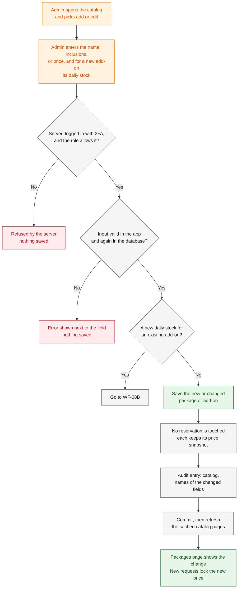

### Sequence diagram

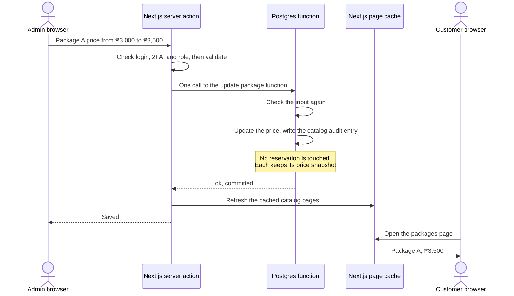

### Steps

| Step | Actor | What happens | Data created, updated, or read | Rules and requirements |
|---|---|---|---|---|
| 1 | Admin | Opens the catalog in the admin panel and picks "add package", "add add-on", or an existing item. | Read: packages, add-ons | [FR-ADM-26][fr] |
| 2 | Admin | Enters the fields. A package has a name, its inclusions, and a price. An add-on has a name, a price per unit, and, when it is new, a daily stock. The same packages are offered for delivery and on-site. | — | [FR-ADM-26][fr], [catalog-and-payments §1.1, §1.2][cat], [D-14][dl] |
| 3 | Next.js server | Checks the login, 2FA, and role on the server (WF-09C). | Read: session | [roles §2.5, §7][roles], [NFR-10][nfr] |
| 4 | Next.js server | Validates the input, then makes one call to one database function. | — | [NFR-21][nfr] ("checked twice"), [FR-ADM-07][fr] |
| 5 | Database | Checks the input again and creates or updates the package or add-on. Items are never deleted; stopping an item is WF-08C. | Create or update: package or add-on | [FR-ADM-26][fr], [NFR-22][nfr] |
| 6 | Database | Touches no reservation. A price change is never a clash: every reservation keeps its price snapshot. If an admin later adds this item to an existing booking with "edit details", the added item takes the current price. | — | [BR-10][br], [D-12][dl], [catalog-and-payments §2.2, §2.3][cat], [EC-55][ec] |
| 7 | Database | Writes the audit entry: category `catalog`, the acting admin, the action, and the names of the changed fields (for example "price"), never their values. The change and the entry commit together. | Create: audit entry | [FR-ADM-26][fr], [FR-ADM-32][fr], WF-10A |
| 8 | Next.js server | After the commit, refreshes the cached catalog pages. | Cached packages page | [catalog-and-payments §1.6][cat] (developer note), [NFR-03][nfr], [FR-PUB-02][fr] |
| 9 | Customer | Opens the packages page and sees the change. Active items are offered; the reservation form and the review step are live pages. At Submit, the server works out the price from the catalog and locks it. | Read: packages, add-ons | [FR-PUB-02][fr], [FR-PUB-06][fr], [catalog-and-payments §2.1, §2.2][cat] |

### Decision points and validation

| Decision | Yes | No | Rule |
|---|---|---|---|
| Logged in with 2FA, and the role allows it? | Continue | Refused by the server | [roles §2.5, §7][roles], [NFR-10][nfr], [EC-73][ec] |
| Input valid, in the app and in the database? | Continue | Error shown; nothing saved. A price may be ₱0 and a daily stock 0 **[C]** ([D-35][dl]); the other bounds are in the [data model][data] | [NFR-21][nfr] |
| A new daily stock for an existing add-on? | WF-08B | Continue | [BR-10][br] |
| Does a price change clash with existing bookings? | Never: each keeps its snapshot | — | [BR-10][br], [D-12][dl] |

### Failure and exception paths

| Situation | What happens | Edge case |
|---|---|---|
| A visitor who is not logged in opens the catalog, or calls the action directly | Redirected to the login page; a direct call is refused | [EC-73][ec] |
| A price changes after customers have submitted | They keep the price from their submission | [EC-55][ec] |
| The deposit amount must change | It is a setting, not a catalog value: WF-08F | [EC-55][ec] |
| Both admins edit the same item at the same moment | Not settled in batch-1 docs: open question 12 | — |
| The cache refresh fails after the save | Not settled: open question 15. The price locked at Submit is always the server's current catalog price | — |

### Status transitions involved

None. A catalog edit changes no reservation and no status ([reservation-lifecycle §4 and §5][lc]); every reservation keeps its price snapshot.

### Developer notes

- **Database functions:** `app.create_package`, `app.update_package`, `app.create_addon`, `app.update_addon` (the last one is shared with WF-08B and named as in [availability-and-conflicts][wf-avail] WF-05B).
- **Server actions:** one per action in the admin module tree, each starting with the session, 2FA, and role check ([roles §7][roles]), for example `updatePackageAction`.
- **Cache:** after the function returns `ok`, refresh the catalog pages with a tag or path refresh (for example `revalidateTag('catalog')`). Never refresh before the commit. Availability, booking, status, and admin pages are never cached ([NFR-03][nfr]).
- **Audit:** category `catalog`; actions such as `package.created`, `package.updated`, `addon.created`, `addon.updated`; changed field names such as `price`, `name`, `inclusions`.
- **Outbox:** none. A catalog edit sends no email.
- **Tests:** a database test that a price change leaves every reservation snapshot as it was (spec v0.2 §17, price snapshot; test plan, batch 4).

*(indicative; final names in api-specification, batch 3)*

---

## WF-08B · Change an add-on's daily stock

### In plain words

Either admin can change how many units of an add-on can be booked for one date. Raising the number is always fine. Lowering it is refused if any future date already has more units booked than the new number; the screen then lists those reservations, and nothing changes. Requests whose deadline has passed no longer count ([BR-05][br]). *Example:* the extra microphone has a daily stock of 4. On Thursday 24 December 2026, Ana has 2 and Dan has 1, so 3 are booked. On Monday 21 December the Admin tries to lower the stock to 2: refused, and Ana's and Dan's bookings are listed. Lowering it to 3 is allowed, if no other future date has more than 3 booked ([BR-10][br], [EC-57][ec]).

### Actors and responsibilities

| Actor | Responsibilities in this sub-flow |
|---|---|
| Admin or Super Admin | Enters the new daily stock. Either admin may do it ([roles §2.5][roles]). Decides what to do if the change is refused. |
| Next.js server | Checks the login, 2FA, and role (WF-09C), validates, makes one database call, shows the result, and refreshes the cached catalog pages after a save. |
| Postgres function | Looks for clashes with future live claims, then saves or refuses, with the audit entry, in one transaction ([BR-10][br], [NFR-21][nfr]). The shared capacity check is WF-05B. |

### Trigger and preconditions

- **Trigger:** the business has more or fewer units of an add-on, for example a microphone broke for good.
- **Preconditions:** logged in with 2FA, and the role allows it (either admin). The add-on exists. Batch-1 docs have one daily stock per add-on ([BR-03][br]) and no way to lower it for a single date (a block claims no add-on stock, [BR-08][br]): open question 18.

### Flowchart

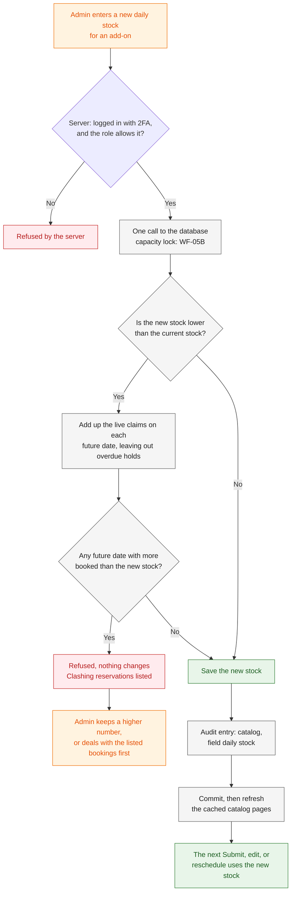

### Sequence diagram

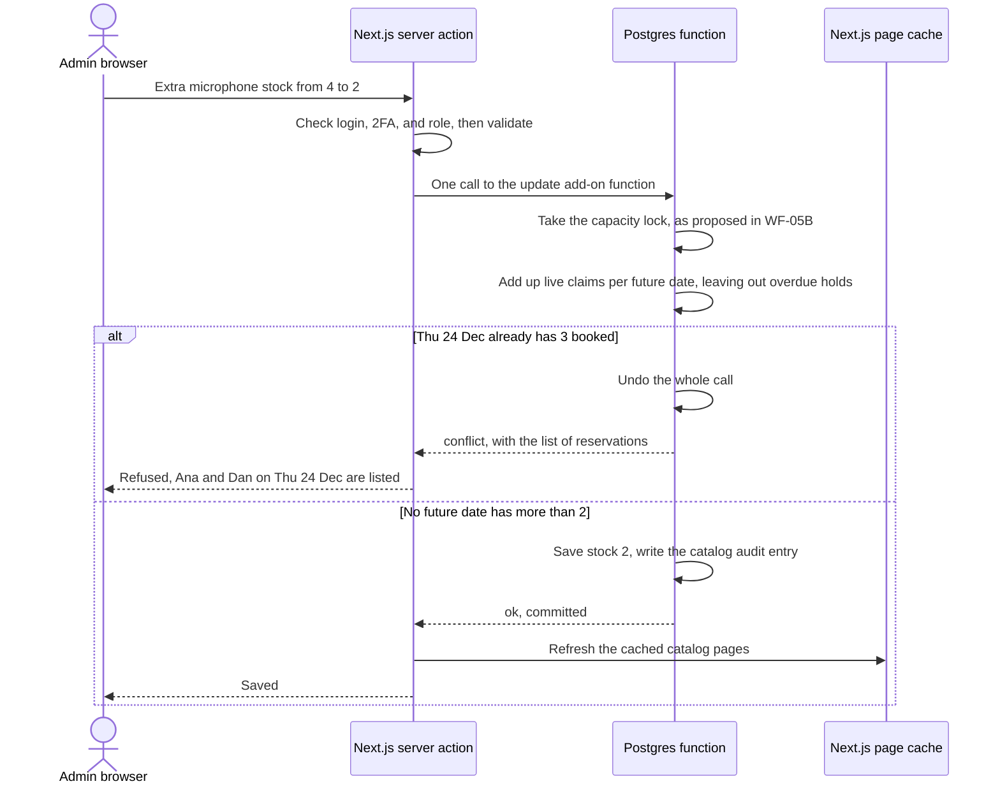

### Steps

| Step | Actor | What happens | Data created, updated, or read | Rules and requirements |
|---|---|---|---|---|
| 1 | Admin | Opens the add-on and enters the new daily stock. | Read: add-on | [FR-ADM-26][fr], [catalog-and-payments §1.2][cat] |
| 2 | Next.js server | Checks the login, 2FA, and role on the server (WF-09C), validates the number, and makes one database call. | Read: session | [roles §2.5, §7][roles], [NFR-21][nfr] |
| 3 | Database | Takes the capacity lock, so no booking can slip in between the check and the save. For catalog edits this is a proposal of WF-05B, not yet a batch-1 rule. | Lock row | [NFR-20][nfr]; [availability-and-conflicts][wf-avail] WF-05B step 15 and its open question 2 |
| 4 | Database | If the new stock is not lower than the current one, goes straight to step 7: raising the stock never clashes. | Read: add-on | [BR-10][br] |
| 5 | Database | For each future date, adds up the units claimed by live reservations. Holds whose deadline has passed do not count, unless their expiry is paused for proof review. Whether today counts as "future" is open in WF-05 (open question 7 there). | Read: add-on claims, reservations | [BR-03][br], [BR-04][br], [BR-05][br], [BR-12][br] |
| 6 | Database, Next.js server | If any date has more claimed than the new stock: refused, nothing changes, and the clashing reservations are listed. The admin keeps a higher number, or first deals with the listed bookings (for example with edit details or a cancellation, [changes-and-expiry][wf-change]) and tries again. | — | [BR-10][br], [FR-ADM-26][fr], [EC-57][ec] |
| 7 | Database | Saves the new stock and writes the audit entry: category `catalog`, the acting admin, the field name "daily stock". The change and the entry commit together; the commit releases the lock. | Update: add-on; create: audit entry | [FR-ADM-26][fr], [FR-ADM-32][fr], WF-10A |
| 8 | Next.js server | Refreshes the cached catalog pages and shows "Saved". | Cached packages page | [catalog-and-payments §1.6][cat], [NFR-03][nfr] |
| 9 | Database (later) | Every later Submit, edit details, and reschedule checks add-on stock against the new number. The calendar label does not depend on add-on stock. | Read: add-on | [BR-03][br], [BR-09][br], [EC-05][ec] |

### Decision points and validation

| Decision | Yes | No | Rule |
|---|---|---|---|
| Logged in with 2FA, and the role allows it? | Continue | Refused by the server | [roles §2.5][roles], [EC-73][ec] |
| Is the new stock lower than the current one? | Look for clashes | Save | [BR-10][br] |
| Does any future date have more live units claimed than the new stock (overdue holds left out)? | Refused; clashing reservations listed | Save | [BR-10][br], [BR-05][br], [EC-57][ec] |

### Failure and exception paths

| Situation | What happens | Edge case |
|---|---|---|
| Lowering the stock below what is booked on a future date | Refused; the clashing reservations are listed | [EC-57][ec] |
| A customer submits at the same moment as the stock change | Only one of them goes first under the capacity lock; the other sees the result of the first ([NFR-20][nfr]) | [EC-03][ec], [EC-17][ec] (same idea, for blocks) |
| A booking that holds the stock up has an overdue deadline | It no longer counts, so it does not block the change | [EC-22][ec] |
| Both admins change the same add-on at the same moment | Not settled: open question 12 | — |

### Status transitions involved

None. The change touches no reservation ([reservation-lifecycle §5][lc] lists no catalog actions).

### Developer notes

- **Database function:** `app.update_addon(addon_id, …, daily_stock)`; result codes `ok` or `conflict` with the list of clashing reservations (the codes of WF-05B).
- **Server action:** `updateAddonAction` in the admin module tree.
- **Clash query:** sum the quantities in `reservation_addons` for live reservations on dates from today (Manila) onwards, using the shared "is live" and "is overdue" helpers of WF-05A, grouped by date; compare each sum with the new stock.
- **Audit:** category `catalog`, action `addon.stock_changed`, changed field `daily_stock`. **Outbox:** none.
- **Tests:** catalog-edit refusals (BR-10) in pgTAP (spec v0.2 §17).

*(indicative; final names in api-specification, batch 3)*

---

## WF-08C · Archive a package or an add-on

### In plain words

When the business stops offering a package or an add-on, either admin archives it. It is never deleted. Archived items are no longer offered on the website, but old bookings that used them still show them, with their locked prices. Archiving is refused while any live booking still uses the item; the screen lists those bookings. *Example:* on Monday 28 December 2026 the Admin tries to archive Package B. Marco's Confirmed delivery for Saturday 2 January 2027 uses it, so the archive is refused and Marco's booking is listed. After Marco's event, his booking becomes Completed and no longer counts, so the Admin can archive Package B then ([BR-10][br], [EC-58][ec]).

### Actors and responsibilities

| Actor | Responsibilities in this sub-flow |
|---|---|
| Admin or Super Admin | Archives the item. Either admin may do it ([roles §2.5][roles]). |
| Next.js server | Checks the login, 2FA, and role (WF-09C), makes one database call, shows the result, and refreshes the cached catalog pages after a save. |
| Postgres function | Looks for live reservations that use the item, then archives or refuses, with the audit entry, in one transaction ([BR-10][br]). |
| Customer (browser) | No longer sees the item on the packages page or in the form ([FR-PUB-02][fr]). |

### Trigger and preconditions

- **Trigger:** the business stops offering a package or an add-on.
- **Preconditions:** logged in with 2FA, and the role allows it (either admin). The item is active.

### Flowchart

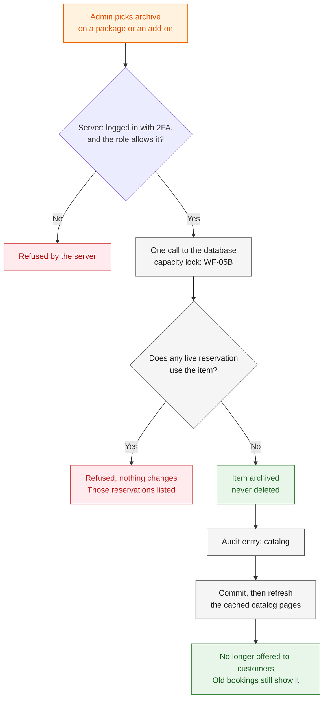

### Sequence diagram

No separate diagram: the parties and calls are the same as in WF-08B. Only the check in the database differs (does a live reservation use the item?).

### Steps

| Step | Actor | What happens | Data created, updated, or read | Rules and requirements |
|---|---|---|---|---|
| 1 | Admin | Picks "archive" on the package or add-on. | Read: package or add-on | [FR-ADM-26][fr] |
| 2 | Next.js server | Checks the login, 2FA, and role on the server (WF-09C), and makes one database call. | Read: session | [roles §2.5, §7][roles] |
| 3 | Database | Takes the capacity lock (proposed in WF-05B, open question 2 there). | Lock row | [NFR-20][nfr], [availability-and-conflicts][wf-avail] WF-05B step 15 |
| 4 | Database | Looks for live reservations that use the item: Pending Confirmation, Awaiting Deposit, or Confirmed, leaving out holds whose deadline has passed (unless paused for proof review). | Read: reservations, add-on claims | [BR-10][br], [BR-04][br], [BR-05][br] |
| 5 | Database, Next.js server | If any: refused, nothing changes, and those reservations are listed. | — | [BR-10][br], [FR-ADM-26][fr], [EC-58][ec] |
| 6 | Database | Otherwise archives the item and writes the audit entry (category `catalog`). The commit releases the lock. | Update: package or add-on (archived); create: audit entry | [FR-ADM-26][fr], [catalog-and-payments §1.6][cat], [NFR-22][nfr], WF-10A |
| 7 | Next.js server | Refreshes the cached catalog pages. The item is no longer offered. Old reservations, including Completed and Cancelled ones, still show it with their locked prices. | Cached packages page | [catalog-and-payments §1.6][cat], [FR-PUB-02][fr], [NFR-03][nfr] |

### Decision points and validation

| Decision | Yes | No | Rule |
|---|---|---|---|
| Logged in with 2FA, and the role allows it? | Continue | Refused by the server | [roles §2.5][roles] |
| Does a live reservation use the item (overdue holds left out)? | Refused; those reservations listed | Archive | [BR-10][br], [EC-58][ec] |

### Failure and exception paths

| Situation | What happens | Edge case |
|---|---|---|
| A live reservation uses the item | Refused; the reservations are listed | [EC-58][ec] |
| An admin wants to delete an item | Not possible: items are archived, never deleted | [EC-54][ec], [NFR-22][nfr] |
| The business wants to offer an archived item again | Not settled: open question 14 | — |
| A recreated request would use an archived item | Not settled: [changes-and-expiry][wf-change] open question 9c | — |

### Status transitions involved

None. Archiving changes no reservation status.

### Developer notes

- **Database function:** `app.archive_catalog_item(kind, item_id)`, shared with delivery slots in WF-08D (name as in WF-05B). Result `ok` or `conflict` with the list.
- **Server action:** `archiveCatalogItemAction`.
- **Audit:** category `catalog`, actions `package.archived`, `addon.archived`. **Outbox:** none.
- **Data:** an `archived` flag (or archived time) on `packages` and `addons`; rows are never deleted ([catalog-and-payments §9][cat]).

*(indicative; final names in api-specification, batch 3)*

---

## WF-08D · Manage the delivery slots

### In plain words

Delivery slots are the time windows a delivery customer picks, such as "Afternoon: 2:00 PM to 6:00 PM". They are one of the reserved settings, so only the Super Admin adds, changes, or stops them; the Admin asks the Super Admin ([roles §2.6, §2.8][roles]). Changing a slot's times never moves bookings that already exist, because each booking saved its own start time when it was sent. Stopping (archiving) a slot is refused while live bookings use it. *Example:* Ana booked the 2:00 PM slot for Thursday 24 December 2026. If the Super Admin changes that slot to start at 1:00 PM, Ana's start stays 2:00 PM ([reservation-lifecycle §3.1][lc], [EC-56][ec]).

### Actors and responsibilities

| Actor | Responsibilities in this sub-flow |
|---|---|
| Super Admin | Adds a slot, changes its label or times, or archives it ([roles §2.6][roles]). |
| Admin | Cannot change slots; the server refuses ([EC-74][ec]). Asks the Super Admin instead. |
| Next.js server | Checks the login, 2FA, and role (WF-09C), validates, and makes one database call. |
| Postgres function | Saves, or refuses an archive that clashes (under the capacity lock, as proposed in WF-05B), with the audit entry ([BR-10][br], [FR-ADM-28][fr]). |
| Customer (browser) | The form and the calendar are live pages, so they use the active slots at once ([NFR-03][nfr], [BR-09][br]). |

### Trigger and preconditions

- **Trigger:** the business sets its slot times (still O-02), adds a slot, changes one, or stops offering one.
- **Preconditions:** logged in with 2FA as the **Super Admin**.

### Flowchart

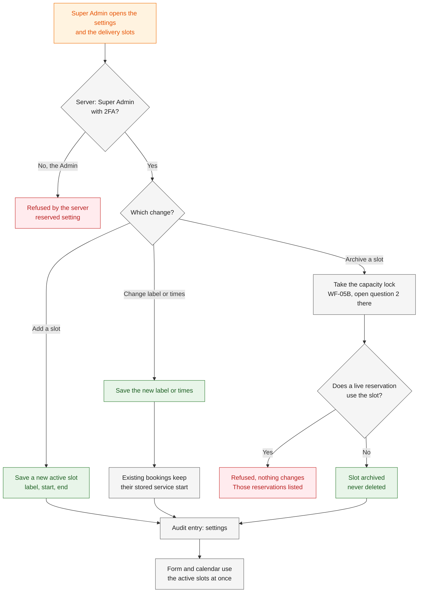

### Sequence diagram

No separate diagram: the parties are the Super Admin's browser, the Next.js server action, and one Postgres function, as in WF-08F.

### Steps

| Step | Actor | What happens | Data created, updated, or read | Rules and requirements |
|---|---|---|---|---|
| 1 | Super Admin | Opens the delivery slots in the settings and picks add, change, or archive. | Read: delivery slots | [FR-ADM-28][fr], [catalog-and-payments §1.3][cat] |
| 2 | Next.js server | Checks the login, 2FA, and role: Super Admin only. The Admin is refused. | Read: session | [roles §2.6][roles], [EC-74][ec] |
| 3 | Database | **Add:** saves a new active slot with its label, start time, and end time. | Create: delivery slot | [catalog-and-payments §1.3][cat] |
| 4 | Database | **Change:** saves the new label or times. Existing bookings do not move: each stored its service start at submission. What existing bookings then show as their slot is open question 16. | Update: delivery slot | [BR-10][br], [reservation-lifecycle §3.1][lc], [EC-56][ec] |
| 5 | Database | **Archive:** takes the capacity lock (proposed in WF-05B, open question 2 there), then looks for live reservations that use the slot (overdue holds left out). If any, refused, nothing changes, and they are listed; otherwise the slot is archived, never deleted. The commit releases the lock. | Lock row; read: reservations; update: delivery slot | [BR-10][br], [FR-ADM-28][fr], [EC-58][ec], [NFR-22][nfr], [NFR-20][nfr], [availability-and-conflicts][wf-avail] WF-05B step 15 |
| 6 | Database | Writes the audit entry in the `settings` category, with the field names changed. The change and the entry commit together. | Create: audit entry | [catalog-and-payments §1.6][cat], [FR-ADM-28][fr], WF-10A |
| 7 | Next.js server | Shows the result. The reservation form and the calendar are live, so from now on they offer the active slots and use their start times for the today check. | — | [NFR-03][nfr], [BR-09][br], [FR-PUB-04][fr] |

### Decision points and validation

| Decision | Yes | No | Rule |
|---|---|---|---|
| Logged in with 2FA as the Super Admin? | Continue | Refused by the server | [roles §2.6][roles], [EC-74][ec] |
| Archive: does a live reservation use the slot? | Refused; listed | Archive | [BR-10][br], [EC-58][ec] |
| Change of times: does it move existing bookings? | Never | — | [BR-10][br], [EC-56][ec] |
| Valid times (for example, start before end)? | Continue | Error; the bounds in the [data model][data] ([D-35][dl]) | [NFR-21][nfr] |

### Failure and exception paths

| Situation | What happens | Edge case |
|---|---|---|
| The Admin tries to change a slot | Refused by the server | [EC-74][ec] |
| Slot times change after bookings exist | The bookings keep their stored service start | [EC-56][ec] |
| Archiving a slot that live reservations use | Refused; the reservations are listed | [EC-58][ec] |
| A reschedule or recreate onto an archived slot | Not settled: [availability-and-conflicts][wf-avail] open question 5 | — |

### Status transitions involved

None. A slot change moves no booking and changes no status.

### Developer notes

- **Database functions:** `app.create_delivery_slot`, `app.update_delivery_slot`, and `app.archive_catalog_item('delivery_slot', …)`.
- **Server actions:** in the settings part of the admin module tree.
- **Audit:** category `settings` (not `catalog`, [catalog-and-payments §1.6][cat]); actions such as `slot.created`, `slot.updated`, `slot.archived`. **Outbox:** none.
- **Data:** `delivery_slots` (label, start time, end time, active). Reservations store their own `service_start`, so no reservation row needs updating.

*(indicative; final names in api-specification, batch 3)*

---

## WF-08E · Add, rename, or deactivate a delivery set or the room

### In plain words

The delivery sets and the room are the "resources" that bookings take for a whole day. Only the Super Admin adds a set, renames a set or the room, or switches one off for good (deactivates it) ([roles §2.5][roles]). The number of delivery bookings per day is simply the number of active sets: adding a third set lets delivery take 3 bookings a day ([BR-01][br]). Switching off a set or the room is refused while it has future live bookings; those bookings are listed. A set that is only out of use for a day is blocked instead (WF-08H). *Example:* on Monday 4 January 2027 the Super Admin adds "Set 3". Later the family decides to sell set 3, but it has a Confirmed booking on Saturday 16 January 2027, so deactivating it is refused, and that booking is listed ([BR-10][br], [EC-59][ec]).

### Actors and responsibilities

| Actor | Responsibilities in this sub-flow |
|---|---|
| Super Admin | Adds, renames, or deactivates a set or the room ([roles §2.5][roles]). |
| Admin | Cannot do it; the server refuses ([EC-74][ec]). For a one-day problem he blocks the set (WF-08H). |
| Next.js server | Checks the login, 2FA, and role (WF-09C), and makes one database call. |
| Postgres function | Saves, or refuses a deactivation that clashes, with the audit entry ([BR-10][br], [FR-ADM-27][fr]). |

### Trigger and preconditions

- **Trigger:** the business buys, renames, or retires a set, or the room changes. The real sets are O-03.
- **Preconditions:** logged in with 2FA as the **Super Admin**. There is one room ([D-02][dl] [C]); adding a second room would change D-02 and goes through the [decision log][dl] (§4) first.

### Flowchart

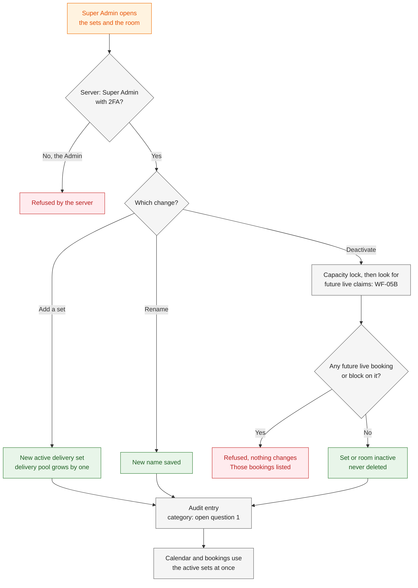

### Sequence diagram

No separate diagram: the parties and calls are the same as in WF-08B, with the clash search for a deactivation drawn in [availability-and-conflicts][wf-avail] WF-05B.

### Steps

| Step | Actor | What happens | Data created, updated, or read | Rules and requirements |
|---|---|---|---|---|
| 1 | Super Admin | Opens the sets and the room, and picks add, rename, or deactivate. | Read: resources | [FR-ADM-27][fr], [catalog-and-payments §1.4][cat] |
| 2 | Next.js server | Checks the login, 2FA, and role: Super Admin only. | Read: session | [roles §2.5][roles], [EC-74][ec] |
| 3 | Database | **Add a set:** saves a new active delivery set. The delivery pool is the list of active sets, so delivery capacity per date grows by one; there is no separate "number of sets" setting. A whole-date block that already exists does not cover the new set: [availability-and-conflicts][wf-avail] open question 6. | Create: resource | [BR-01][br], [FR-ADM-27][fr] |
| 4 | Database | **Rename:** saves the new name. Bookings keep their claim on the same set. | Update: resource | [FR-ADM-27][fr] |
| 5 | Database | **Deactivate:** takes the capacity lock (proposed in WF-05B) and looks for future live claims on the set or the room: bookings and active blocks, overdue holds left out. | Lock row; read: claims | [BR-10][br], [BR-04][br], [BR-05][br], [availability-and-conflicts][wf-avail] WF-05B steps 15 to 17 |
| 6 | Database, Next.js server | If any: refused, nothing changes, and those bookings are listed. Batch-1 docs have no action that moves a booking to another set on the same date: open question 18. Otherwise the set or the room becomes inactive; it is never deleted. | Update: resource (inactive) | [BR-10][br], [FR-ADM-27][fr], [EC-59][ec] |
| 7 | Database | Writes the audit entry. [FR-ADM-27][fr] requires one but names no category: open question 1. | Create: audit entry | [FR-ADM-27][fr], WF-10A |
| 8 | Next.js server | Shows the result. The calendar and every booking check read the active sets live, so the change applies at once. | — | [BR-09][br], [NFR-03][nfr] |

### Decision points and validation

| Decision | Yes | No | Rule |
|---|---|---|---|
| Logged in with 2FA as the Super Admin? | Continue | Refused by the server | [roles §2.5][roles], [EC-74][ec] |
| Deactivate: any future live claim on it? | Refused; listed | Deactivate | [BR-10][br], [EC-59][ec] |
| Is the set only out of use for a day? | Use a block instead: WF-08H | Continue | [catalog-and-payments §1.4][cat], [BR-08][br] |

### Failure and exception paths

| Situation | What happens | Edge case |
|---|---|---|
| Deactivating a set or the room with future live bookings | Refused; the bookings are listed | [EC-59][ec] |
| The Admin tries to add, rename, or deactivate | Refused by the server | [EC-74][ec] |
| A set is out of use for one day | A block, not a deactivation | [BR-08][br] |
| A set is added after a whole-date block exists | Not settled: [availability-and-conflicts][wf-avail] open question 6 | — |
| A deactivated set is needed again | Not settled: open question 14 | — |

### Status transitions involved

None for reservations. The resource's `active` flag changes; it is not a reservation or block status.

### Developer notes

- **Database functions:** `app.create_resource`, `app.rename_resource`, `app.deactivate_resource` (name as in WF-05B).
- **Server actions:** in the settings part of the admin module tree, Super Admin only.
- **Audit:** category not yet named (open question 1); actions such as `resource.created`, `resource.renamed`, `resource.deactivated`. **Outbox:** none.
- **Data:** `resources` (kind `delivery_set` or `room`, name, active).

*(indicative; final names in api-specification, batch 3)*

---

## WF-08F · Change a setting

### In plain words

Settings are values that can change without new code, such as the deposit amount, the deadlines, the notice period, the email caps, and the retention periods. Only the Super Admin changes them ([roles §2.6][roles]); the one thing the Admin can do is end a breaker pause early (WF-08G). A setting change never changes bookings that already exist: they keep their locked deposit, their saved start time, and their saved deadline. Every change is recorded in the audit log. If the new value is meant to become the new standard, the Super Admin also records it in the decision log. *Example:* on Monday 28 December 2026, the Super Admin raises the deposit from ₱1,000 to ₱1,500. A request sent on Saturday 26 December keeps its ₱1,000 deposit; a request sent on 29 December gets ₱1,500 ([FR-ADM-28][fr], [EC-55][ec]).

### Actors and responsibilities

| Actor | Responsibilities in this sub-flow |
|---|---|
| Super Admin | Changes the setting. If it becomes the new standard, records it in the [decision log][dl] too. |
| Admin | Cannot change any setting; the server refuses ([EC-74][ec]). |
| Next.js server | Checks the login, 2FA, and role (WF-09C), validates the value, and makes one database call. |
| Postgres function | Saves the setting and writes the audit entry in one transaction ([FR-ADM-28][fr]). |

### Trigger and preconditions

- **Trigger:** a value must change, for example when an open item is answered (O-02 slot times, O-03 deposit amount and texts) or after the lawyer's review (O-08, retention periods).
- **Preconditions:** logged in with 2FA as the **Super Admin**.

The settings groups and where each rule is defined ([FR-ADM-28][fr]):

| Group | Settings | Rule defined in |
|---|---|---|
| Reserved settings **[C]** | Deposit amount; the review and deposit deadlines; delivery slots (WF-08D); business info | [catalog-and-payments][cat], [reservation-lifecycle][lc] |
| Booking rules **[P]** | Notice period; on-site hours; booking window; hold limits; breaker numbers | [BR-06][br], [BR-07][br], [BR-07a][br], [BR-09][br] |
| Notifications **[P]** | Reminder lead time; daily and monthly email caps; admin reserve; maximum send attempts | [FR-NTF-04][fr], [FR-NTF-18][fr], [FR-NTF-20][fr] |
| Security **[P]** | Rate-limit thresholds | [NFR-11][nfr] |
| Privacy **[P]** | Retention periods | [privacy-and-retention][priv] |
| Payments **[P]** | Acknowledgment issuer name; deposit instructions; deposit terms text | [catalog-and-payments §7][cat], [privacy-and-retention §7.2][priv] |

### Flowchart

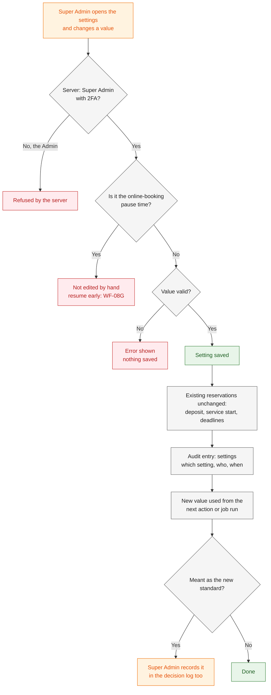

### Sequence diagram

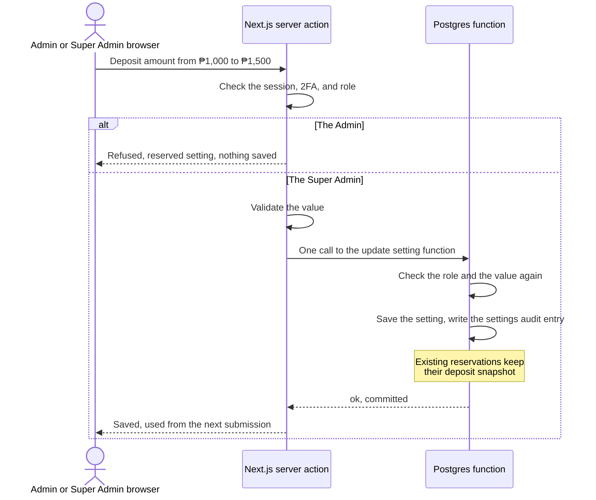

### Steps

| Step | Actor | What happens | Data created, updated, or read | Rules and requirements |
|---|---|---|---|---|
| 1 | Super Admin | Opens the settings and changes one value. | Read: settings | [FR-ADM-28][fr] |
| 2 | Next.js server | Checks the login, 2FA, and role: only the roles allowed in [roles §2.6][roles] can save each setting. The Admin is refused. | Read: session | [roles §2.6][roles], [FR-ADM-28][fr], [EC-74][ec] |
| 3 | Next.js server | The online-booking pause time is not offered for editing: only the breaker sets it and only "resume early" clears it (WF-08G). | — | [FR-ADM-28][fr], [BR-07a][br] |
| 4 | Next.js server, database | Validates the value in the app and again in the database. The valid ranges are those proposed in the [data model][data], kept until the developer reviews them **[C]** ([D-35][dl]). | — | [NFR-21][nfr] |
| 5 | Database | Saves the setting. No reservation is changed: locked prices and deposit, stored service start, and stored deadlines stay as they were. | Update: setting | [FR-ADM-28][fr], [catalog-and-payments §2.2][cat], [reservation-lifecycle §3.2, §8][lc], [EC-55][ec], [EC-56][ec] |
| 6 | Database | Writes the audit entry in the `settings` category: which setting, who, and when. The entry stores the setting's name, not the old or new value. | Create: audit entry | [FR-ADM-28][fr], [FR-ADM-32][fr], WF-10A |
| 7 | System (later) | The next action or job run uses the new value. For example: the next submission locks the new deposit; the next retention run uses a new retention period; the next login attempt uses a new rate limit. | Read: setting | [catalog-and-payments §2.2][cat], [FR-SYS-05][fr], [NFR-11][nfr] |
| 8 | Super Admin | If the new value is meant to become the new standard, records it in the [decision log][dl] as well, so the docs stay true. For retention periods changed after the lawyer's advice, the decision log comes first. | Decision log (a document, not the system) | [decision-log §4][dl] ("Settings"), [business-rules §9][br], [privacy-and-retention §6.4][priv] |

### Decision points and validation

| Decision | Yes | No | Rule |
|---|---|---|---|
| Logged in with 2FA as the Super Admin? | Continue | Refused by the server | [roles §2.6][roles], [EC-74][ec] |
| Is it the online-booking pause time? | Not editable here; WF-08G | Continue | [FR-ADM-28][fr] |
| Value valid? | Save | Error; the ranges of the [data model][data] ([D-35][dl]) | [NFR-21][nfr] |
| Meant as the new standard? | Also record in the decision log | Done | [decision-log §4][dl] |

### Failure and exception paths

| Situation | What happens | Edge case |
|---|---|---|
| The Admin tries to change a reserved or other setting | Refused by the server | [EC-74][ec] |
| The deposit amount changes after customers have submitted | They keep the deposit from their submission; only that amount can be recorded as their deposit | [EC-55][ec] |
| A deadline setting, slot times, or on-site hours change after bookings exist | Existing bookings do not move | [EC-56][ec] |
| A cached public page shows a setting value | Not settled: open question 15 | — |
| The issuer name changes after acknowledgments were issued | Not settled: [privacy-and-retention §11][priv], question 12 | — |
| A retention period changes | The next daily run uses the new period (WF-10E); a change advised by the lawyer is recorded in the decision log first ([privacy-and-retention §6.4][priv]) | — |
| Both admins, or two tabs, save the same setting at once | Not settled: open question 12 | — |

### Status transitions involved

None. A setting change never changes a reservation ([FR-ADM-28][fr]).

### Developer notes

- **Database function:** `app.update_setting(key, value)`, with one validator per key (types and ranges as the data model proposes, [D-35][dl]). It checks the acting admin's role again (WF-09C step 9).
- **Server action:** `updateSettingAction` in the settings part of the admin module tree.
- **Audit:** category `settings`, action `setting.updated`, changed field = the setting key (for example `deposit_amount`), never the value.
- **Outbox:** none.
- **Not editable:** `online_paused_until` ([FR-ADM-28][fr]); only the breaker (WF-01C) and `app.resume_online_booking` (WF-08G) write it.

*(indicative; final names in api-specification, batch 3)*

---

## WF-08G · Resume online booking early

### In plain words

If many online requests arrive in a short time, the "breaker" pauses online booking for a while, and both admins get one email and see a banner on the dashboard ([BR-07a][br]). After checking the requests, and rejecting any fake ones, either admin can press "Resume online booking" on the banner, and the form and calendar accept requests again at once. Otherwise the pause ends by itself. *Example:* on Saturday 19 December 2026, a 7th online request at 2:45 PM is refused, and online booking pauses until 3:45 PM. At 3:10 PM the Admin has rejected two fake requests and presses Resume; customers can book online again from 3:10 PM ([EC-15][ec], [FR-ADM-29][fr]).

### Actors and responsibilities

| Actor | Responsibilities in this sub-flow |
|---|---|
| Admin or Super Admin | Presses "Resume online booking" ([roles §2.4][roles]: the one settings-like action open to both). |
| Next.js server | Shows the button on the dashboard banner while online booking is paused; checks the login, 2FA, and role; makes one database call ([FR-ADM-02][fr], [FR-ADM-29][fr]). |
| Postgres function | Clears the pause and writes the audit entry ([FR-ADM-29][fr]). |
| Customer (browser) | The form and calendar accept requests again at once ([FR-ADM-29][fr]). |

### Trigger and preconditions

- **Trigger:** the breaker has paused online booking (WF-01C in [booking-and-submission][wf-book]); the admins have looked at the recent requests.
- **Preconditions:** logged in with 2FA, either admin. The dashboard shows the paused-booking banner ([FR-ADM-02][fr]).

### Flowchart

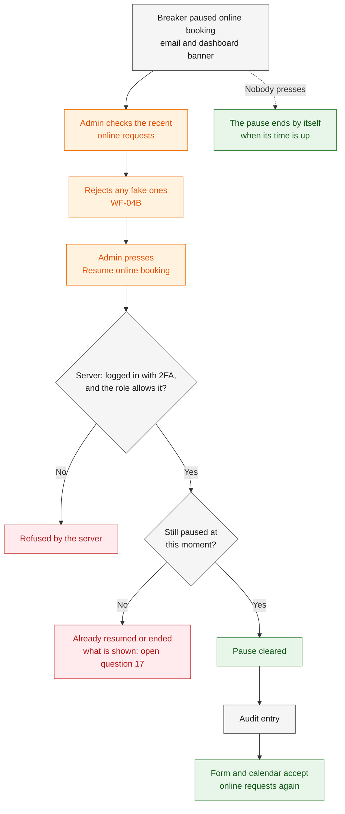

### Sequence diagram

No separate diagram: one admin browser, one server action, and one database call, as in WF-08F (without the role branch, because both admins may do it).

### Steps

| Step | Actor | What happens | Data created, updated, or read | Rules and requirements |
|---|---|---|---|---|
| 1 | System | The breaker has paused online booking until a set time, sent one email to both admins, and shows the banner on the dashboard. | Read: `online_paused_until` | [BR-07a][br], [FR-NTF-15][fr], [FR-ADM-02][fr] |
| 2 | Admin | Looks at the recent online requests and rejects any fake ones (WF-04B in [lookup-and-review][wf-review]). This is what the pause is for; batch-1 docs do not make it a condition of resuming. | Read: reservations | [BR-07a][br] (example), [EC-14][ec] |
| 3 | Admin | Presses "Resume online booking" on the banner. The dashboard does not refresh itself, so the page may be older than the pause ([FR-ADM-02][fr]). | — | [FR-ADM-29][fr] |
| 4 | Next.js server | Checks the login, 2FA, and role (either admin), and makes one database call. | Read: session | [roles §2.4][roles] |
| 5 | Database | If online booking is still paused, clears the pause. If the pause has already ended, or the other admin resumed first: open question 17. | Update: `online_paused_until` | [FR-ADM-28][fr], [FR-ADM-29][fr] |
| 6 | Database | Writes the audit entry. [FR-ADM-29][fr] requires one but names no category: open question 1. | Create: audit entry | [FR-ADM-29][fr], WF-10A |
| 7 | Customer | The form and the calendar accept online requests again at once. The breaker keeps counting online requests in the trailing window, so it may trip again soon: open question 17. | Read: `online_paused_until` | [FR-ADM-29][fr], [BR-07a][br] |
| 8 | System | If nobody presses Resume, the pause ends by itself when its time is up. | — | [BR-07a][br], [FR-ADM-29][fr] |

### Decision points and validation

| Decision | Yes | No | Rule |
|---|---|---|---|
| Logged in with 2FA, either admin? | Continue | Refused by the server | [roles §2.4][roles] |
| Still paused at this moment? | Clear the pause | Open question 17 | [FR-ADM-29][fr] |

### Failure and exception paths

| Situation | What happens | Edge case |
|---|---|---|
| A flood of requests trips the breaker | Online booking pauses; staff-created bookings still work | [EC-15][ec], [EC-45][ec] |
| The pause has already ended when Resume is pressed, or both admins press it | Not settled: open question 17 | — |
| Right after the resume, the next online request is again over the breaker limit | Not settled: open question 17 | — |

### Status transitions involved

None. The pause is a setting, not a reservation status.

### Developer notes

- **Database function:** `app.resume_online_booking()`; it sets `online_paused_until` to null (or to now) only if it is in the future.
- **Server action:** `resumeOnlineBookingAction`, shown only while paused.
- **Audit:** category not yet named (open question 1); action `booking.resumed_early`. **Outbox:** none.
- **Tests:** the breaker's early resume is a pgTAP test (spec v0.2 §17).

*(indicative; final names in api-specification, batch 3)*

---

## WF-08H · Create a block

### In plain words

A block makes capacity unavailable for a day without a booking, for example while a set is being repaired. Either admin can block one set or the room; only the Super Admin can block a whole date, which takes every active set and the room. A block needs a reason. A date range makes one block per date. A block is refused if a booking or another block already holds that set or room on that date: the admin must reschedule or cancel that booking first. The calendar shows the block at once. *Example:* set 2 is being repaired from Monday 21 to Wednesday 23 December 2026. The Admin blocks set 2 for those dates with the reason "repair", and the system makes 3 blocks, one per date. If the business closes on Friday 25 December, only the Super Admin can block that whole date ([BR-08][br], [EC-19][ec]).

### Actors and responsibilities

| Actor | Responsibilities in this sub-flow |
|---|---|
| Admin or Super Admin | Blocks a single set or the room, with a reason ([roles §2.5][roles]). |
| Super Admin | Blocks a whole date, with a reason ([roles §2.5][roles], [D-17][dl]). |
| Next.js server | Checks the login, 2FA, and role for that kind of block (WF-09C), checks the reason, and makes one database call. |
| Postgres function | Takes the capacity lock, looks for live claims on each target, and creates the blocks or refuses, with the audit entries ([BR-08][br], [NFR-20][nfr]). |
| Customer (browser) | The calendar shows the blocked capacity at once ([FR-ADM-25][fr], [BR-09][br]). |

### Trigger and preconditions

- **Trigger:** a set or the room cannot be used on a date (repair, private use), or the business closes for a day.
- **Preconditions:** logged in with 2FA; for a whole-date block, as the Super Admin. A reason is ready. Whether a block can be made for a past date or beyond the booking window is open question 19.

### Flowchart

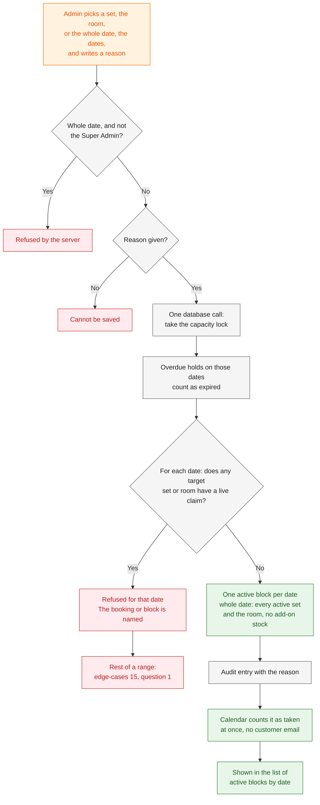

### Sequence diagram

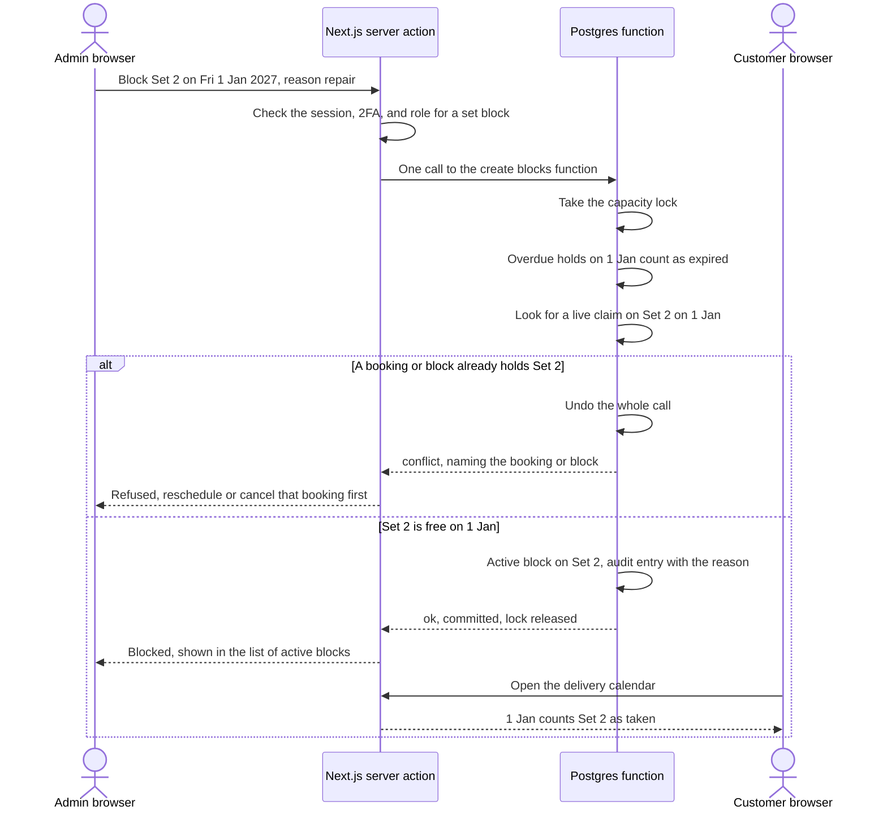

### Steps

| Step | Actor | What happens | Data created, updated, or read | Rules and requirements |
|---|---|---|---|---|
| 1 | Admin | Picks the kind of block (one set, the room, or the whole date), the date or date range, and writes a reason. | — | [FR-ADM-25][fr], [BR-08][br] |
| 2 | Next.js server | Checks the login, 2FA, and role for that kind: a set or the room, either admin; a whole date, Super Admin only. | Read: session | [roles §2.5][roles], [EC-19][ec], [EC-74][ec] |
| 3 | Next.js server | Checks that a reason is given; without one, the block cannot be saved. Makes one database call. | — | [BR-08][br], [FR-ADM-07][fr] |
| 4 | Database | Takes the single capacity lock. | Lock row | [NFR-20][nfr], [reservation-lifecycle §4.3][lc] |
| 5 | Database | Treats holds whose deadline has passed on those dates as expired. Whether the function first marks them Expired is a WF-05B proposal (open question 1 there). | Read: holds; maybe update: overdue holds | [BR-05][br], [availability-and-conflicts][wf-avail] WF-05B step 16 |
| 6 | Database | For each date: looks for a live claim (a live booking or an active block) on each target. A whole-date block targets every active set and the room. | Read: claims, reservations, blocks | [BR-08][br], [BR-04][br] |
| 7 | Database, Next.js server | If a target is taken: refused for that date, and the message names the booking or block that clashes ([P] in FR-ADM-25). The admin must reschedule or cancel that booking first ([changes-and-expiry][wf-change]). For a range where only some dates clash, the outcome is open ([edge-cases §15][ec], question 1). | — | [BR-08][br], [FR-ADM-25][fr], [EC-18][ec] |
| 8 | Database | Otherwise creates one active block per date, with its reason and who created it. A whole-date block claims every active set and the room, but no add-on stock. | Create: blocks, block claims | [BR-08][br], [reservation-lifecycle §7][lc] |
| 9 | Database | Writes the audit entry with the reason. Batch-1 docs name no category for blocks: open question 1. Commits; the lock is released. | Create: audit entries | [FR-ADM-07][fr], [FR-ADM-32][fr], WF-10A |
| 10 | Next.js server | Shows the result and the list of active blocks by date. The public calendar counts the block at once. No customer email is sent. | Read: blocks | [FR-ADM-25][fr], [BR-09][br] |

### Decision points and validation

| Decision | Yes | No | Rule |
|---|---|---|---|
| Whole-date block by someone who is not the Super Admin? | Refused by the server | Continue | [roles §2.5][roles], [EC-19][ec] |
| Reason given? | Continue | Cannot be saved | [BR-08][br] |
| Any target set or room already has a live claim on that date (overdue holds left out)? | Refused; the clash is named | Create the block | [BR-08][br], [BR-05][br], [EC-18][ec] |
| Range where only some dates clash? | Not settled ([edge-cases §15][ec], question 1) | — | [BR-08][br] |

### Failure and exception paths

| Situation | What happens | Edge case |
|---|---|---|
| The target set already has a booking (for example Ana's request on set 1 for 24 December) | Refused until that booking is rescheduled or cancelled | [EC-18][ec] |
| The Admin tries to block a whole date | Refused by the server | [EC-19][ec] |
| An admin blocks a set at the same moment a customer books it | Only one succeeds; if the booking wins, the block is refused | [EC-17][ec] |
| A range where one date clashes | Not settled | [edge-cases §15][ec], question 1 |
| A set is added after a whole-date block exists | Not settled | [availability-and-conflicts][wf-avail] open question 6 |

### Status transitions involved

A new block starts as `active` ([reservation-lifecycle §7][lc]). No reservation status changes, apart from overdue holds that may be recorded as Expired first ([lifecycle rows 9 and 10][lc]; WF-05B).

### Developer notes

- **Database function:** `app.create_blocks(kind, resource_id, from_date, to_date, reason)` (name as in WF-05B). It inserts into `blocks` and `block_resources`; the shared live-claim guard is the backstop ([NFR-20][nfr]).
- **Server action:** `createBlockAction`; the role check depends on `kind` (`whole_date` needs the Super Admin).
- **Result codes:** `ok`, `conflict` (naming the reservation or block), `not_allowed`.
- **Audit:** category not yet named (open question 1); action `block.created`, with the reason. **Outbox:** none.
- **Tests:** blocks: creation, refusal when the target is taken, and permissions by kind (spec v0.2 §17).

*(indicative; final names in api-specification, batch 3)*

---

## WF-08I · Remove a block

### In plain words

When a block is no longer needed, an admin removes it, with a reason. The capacity is free at once, and the calendar shows it. The removed block stays in the records with its reason; it is never deleted, and it cannot be switched back on (a new block is made instead). The Admin can remove a set or room block; only the Super Admin can remove a whole-date block. *Example:* set 2 was blocked from 21 to 23 December 2026, but it is fixed early, on 22 December. The Admin removes the 23 December block with the reason "repaired", and set 2 can be booked on 23 December again ([BR-08][br]).

### Actors and responsibilities

| Actor | Responsibilities in this sub-flow |
|---|---|
| Admin or Super Admin | Removes a set or room block, with a reason ([roles §2.5][roles]: "block or unblock"). |
| Super Admin | Removes a whole-date block, with a reason ([roles §2.5][roles]). |
| Next.js server | Checks the login, 2FA, and role for that kind of block, checks the reason, and makes one database call. |
| Postgres function | Changes the block from `active` to `removed` and writes the audit entry ([BR-08][br], [reservation-lifecycle §7][lc]). |

### Trigger and preconditions

- **Trigger:** the reason for the block has ended.
- **Preconditions:** the block is `active`; logged in with 2FA, with the role for that kind of block.

### Flowchart

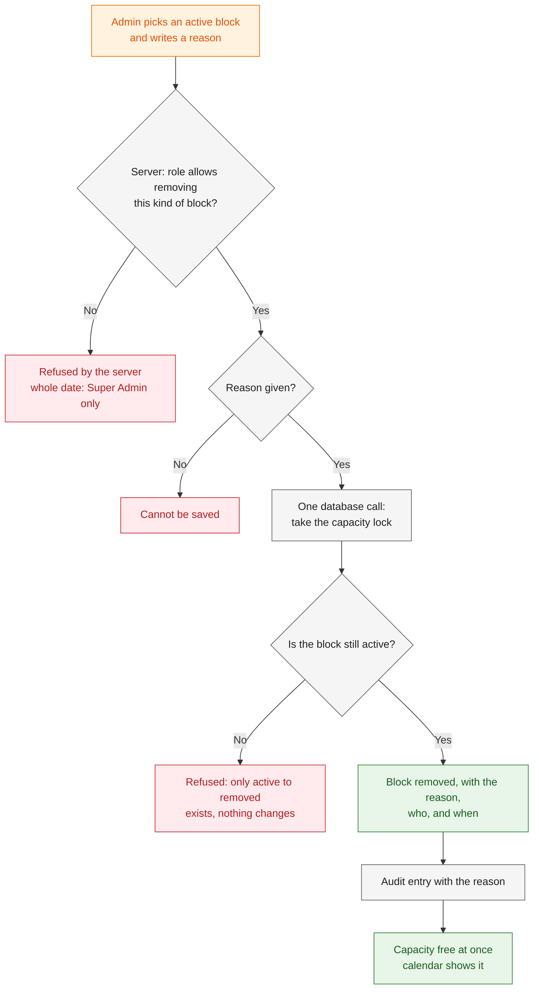

### Sequence diagram

No separate diagram: the parties and calls are the same as in WF-08H, with no clash search.

### Steps

| Step | Actor | What happens | Data created, updated, or read | Rules and requirements |
|---|---|---|---|---|
| 1 | Admin | Opens the list of active blocks, picks one, and writes a reason. | Read: blocks | [FR-ADM-25][fr] |
| 2 | Next.js server | Checks the login, 2FA, and role for that kind of block: set or room, either admin; whole date, Super Admin only. | Read: session | [roles §2.5][roles], [EC-74][ec] |
| 3 | Next.js server | Checks that a reason is given, then makes one database call. | — | [BR-08][br] |
| 4 | Database | Takes the capacity lock, because the change frees capacity. | Lock row | [NFR-20][nfr], [availability-and-conflicts][wf-avail] WF-05B (Part 2 table) |
| 5 | Database | Checks that the block is still `active`. A removed block cannot change again (for example, if the other admin removed it a moment ago): refused, nothing changes. | Read: block | [reservation-lifecycle §7][lc] |
| 6 | Database | Sets the block to `removed`, with the reason, who removed it, and when. The capacity it claimed is released at once. | Update: block, block claims | [BR-08][br], [BR-04][br], [FR-ADM-25][fr] |
| 7 | Database | Writes the audit entry with the reason (category: open question 1). Commits. | Create: audit entry | [BR-08][br], [FR-ADM-25][fr], WF-10A |
| 8 | Next.js server | Shows the result. The calendar shows the freed capacity at once. To block the set again, the admin creates a new block (WF-08H). | — | [BR-09][br], [FR-ADM-25][fr], [reservation-lifecycle §7][lc] |

### Decision points and validation

| Decision | Yes | No | Rule |
|---|---|---|---|
| Role allows removing this kind of block? | Continue | Refused by the server | [roles §2.5][roles] |
| Reason given? | Continue | Cannot be saved | [BR-08][br] |
| Block still active? | Remove | Refused; nothing changes | [reservation-lifecycle §7][lc] |

### Failure and exception paths

| Situation | What happens | Edge case |
|---|---|---|
| The Admin tries to remove a whole-date block | Refused by the server | [EC-19][ec], [EC-74][ec] |
| The block was already removed (for example by the other admin) | Refused; only `active` → `removed` exists | [EC-16][ec] (same idea, for reservations) |
| An admin removed the wrong block | Nothing is deleted; the admin creates a new block with a reason | [EC-54][ec] |

### Status transitions involved

Block `active` → `removed`, the only block transition ([reservation-lifecycle §7][lc]). No reservation status changes.

### Developer notes

- **Database function:** `app.remove_block(block_id, reason)` (name as in WF-05B); result `ok`, `not_allowed`, or `already_removed`.
- **Server action:** `removeBlockAction`; the role check depends on the block's kind.
- **Audit:** category not yet named (open question 1); action `block.removed`, with the reason. **Outbox:** none.
- **Tests:** block removal (spec v0.2 §17).

*(indicative; final names in api-specification, batch 3)*

---

## WF-09 · Authentication, roles, and permissions

### In plain words

There are two admin accounts, the Super Admin (the developer) and the Admin (the business owner); there is no public sign-up, and customers never log in ([D-07][dl], [D-08][dl]). To open the admin panel, an admin types an email address and a password, then a code from an authenticator app on their own phone; the admin area stays closed until both steps pass. After too many wrong passwords, the account is locked for a while. Every admin page and every button press is checked again on the server: being logged in is not enough, the role must also allow that action. If a phone is lost, the admin logs in with a backup code printed at setup, or the Super Admin resets the account. Only the Super Admin creates, disables, resets, or signs out admin accounts, and every account change is recorded in the audit log.

### How the sub-flows fit together

| Situation | Sub-flow | What follows |
|---|---|---|
| An admin starts work on a phone or laptop | WF-09A | Every later request goes through WF-09C |
| A new account logs in for the first time, or after a reset or the break-glass script | WF-09B, inside WF-09A | The admin area opens |
| Every admin page, action, and admin route | WF-09C | The action's own flow (WF-03 to WF-08, WF-10) |
| The phone with the authenticator app is lost | WF-09D | Backup code; or a reset (WF-09G); or the break-glass script (WF-09E) |
| The Super Admin has no 2FA phone and no backup codes | WF-09E | WF-09B |
| A new person becomes the Admin | WF-09F | WF-09A and WF-09B for that person |
| A person leaves, has forgotten their access, or a device is lost | WF-09G | — |

### Sequence diagram: log in, pass 2FA, then a protected action

*Example.* On Monday 28 December 2026 at 9:00 AM, the Admin logs in on his phone. He blocks set 2 for Friday 1 January 2027 for repair, which either admin may do. Then he tries to block the whole of 1 January, which only the Super Admin may do ([roles §2.5][roles], [EC-19][ec]).

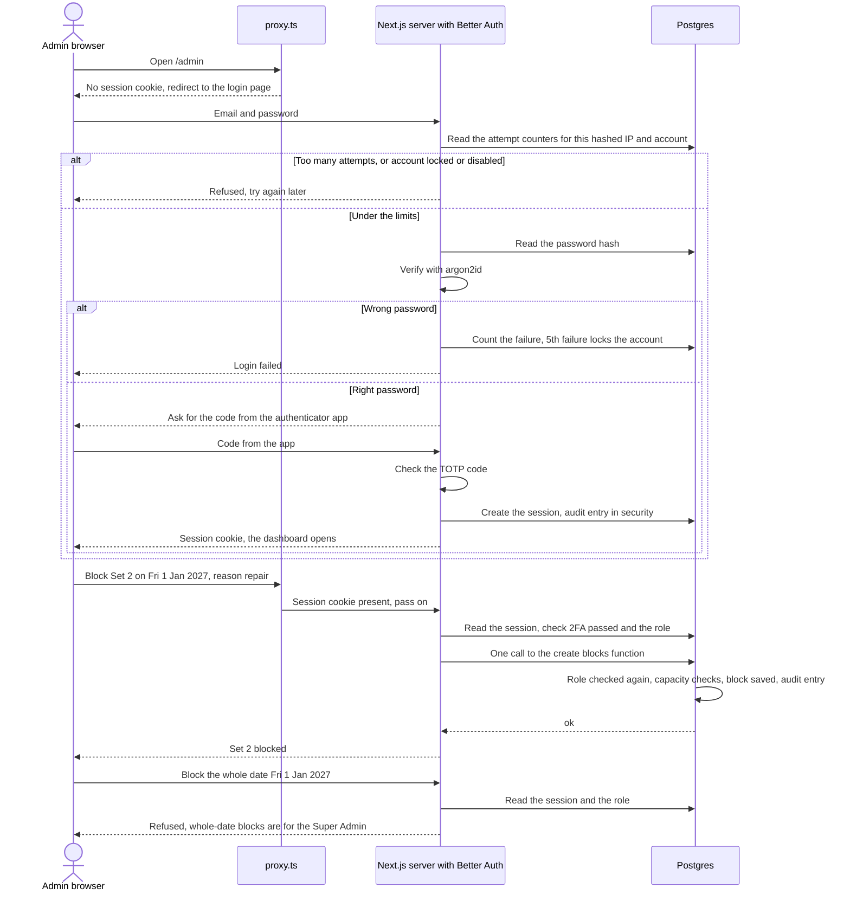

---

## WF-09A · Log in with a password and a two-factor code

### In plain words

An admin opens the admin panel and, if not logged in, is sent to the login page. They type their email address and password, then the code shown in the authenticator app on their own phone. Only then does the admin area open. After several wrong passwords the account is locked for a while, even if the next password is right (5 failures, 15 minutes by default, [NFR-11][nfr]); too many attempts from one phone or computer are also stopped. The admin logs out when done. *Example (with the default lock settings):* on Monday 28 December 2026, someone types wrong passwords for the Admin account 5 times between 9:00 and 9:05 AM. The account is locked until 9:20 AM. At 9:10 AM the real Admin types the right password and is still refused; at 9:25 AM he logs in normally ([EC-72][ec]).

### Actors and responsibilities

| Actor | Responsibilities in this sub-flow |
|---|---|
| Admin or Super Admin | Types the email, password, and the code from their own authenticator app, or a backup code (WF-09D). Logs out when done. |
| `proxy.ts` (Next.js middleware) | Sends a visitor without a session to the login page. Only a redirect, never the security check ([roles §7][roles]). |
| Next.js server with Better Auth | Checks the rate limits and the lock, verifies the password hash and the code, creates and ends sessions ([NFR-09][nfr], [NFR-11][nfr]). |
| Postgres | Holds the admin accounts, password hashes, 2FA secrets, backup codes, sessions, rate-limit counters, and the audit log ([privacy-and-retention §3.1][priv]). |

### Trigger and preconditions

- **Trigger:** an admin opens any address under `/admin`, or the login page.
- **Preconditions:**
  - The person has an admin account that is not disabled ([roles §5.1][roles]). The first accounts come from the setup script; later ones from WF-09F.
  - The authenticator app on their phone, or an unused backup code.

### Flowchart

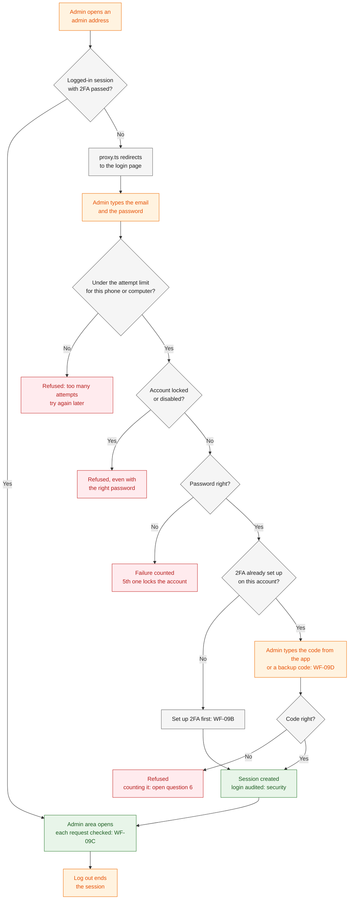

### Sequence diagram: the account lock

The normal login is drawn in the WF-09 sequence diagram above. This one shows the lock in the example.

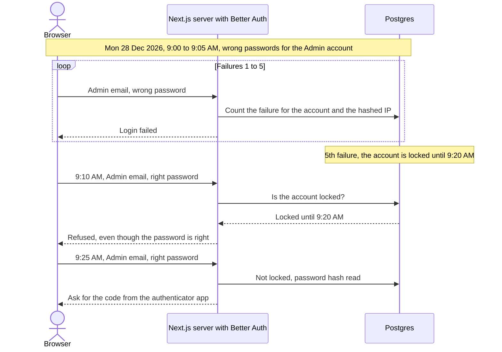

### Steps

| Step | Actor | What happens | Data created, updated, or read | Rules and requirements |
|---|---|---|---|---|
| 1 | Admin | Opens any `/admin` address on a phone or laptop. | — | [FR-ADM-01][fr] |
| 2 | `proxy.ts` | No session: redirects to the login page. This is a convenience, not the security boundary. The job routes are left out of these redirects. | — | [roles §7][roles], [FR-ADM-01][fr], [FR-SYS-09][fr], [EC-73][ec] |
| 3 | Admin | Types the email address and password. There is no sign-up or "create account" link. | — | [FR-ADM-01][fr], [roles §5.1][roles] |
| 4 | Next.js server | Checks the attempt limit for this phone or computer (20 per IP address per hour by default). Over the limit: refused. The counter is kept under an HMAC of the IP address, never the address itself, and deleted after 24 hours. | Read and update: rate-limit counters | [NFR-11][nfr], [NFR-13][nfr], [FR-SYS-06][fr], [privacy-and-retention §6.2][priv] |
| 5 | Next.js server | Checks the account: locked (5 failures, 15 minutes by default) or disabled. Either way: refused, even if the password is right. | Read: account, counters | [NFR-11][nfr], [roles §5.1][roles], [EC-72][ec], [EC-76][ec] |
| 6 | Better Auth | Verifies the password against its argon2id hash. Wrong: the failure is counted, and the 5th failure locks the account. What the screen says is open question 6. | Update: counters | [NFR-09][nfr], [NFR-11][nfr], [EC-72][ec] |
| 7 | Better Auth | Right password, but no 2FA on the account yet (a new account, or after a reset or the break-glass script): WF-09B first. | Read: 2FA state | [FR-ADM-01][fr], [roles §5.1, §5.2][roles] |
| 8 | Admin | Types the code from the authenticator app, or one unused backup code (WF-09D). | — | [FR-ADM-01][fr], [roles §5.2][roles] |
| 9 | Better Auth | Checks the code. Wrong: refused (whether it counts toward the lock is open question 6). Right: creates the session, and the admin area opens. The admin area never opens before this step passes. | Create: session | [FR-ADM-01][fr], [NFR-09][nfr] |
| 10 | Database | Records the login in the audit log, category `security` (a [P] detail of FR-ADM-01). Whether failed logins and locks are also recorded is open question 3. | Create: audit entry | [FR-ADM-01][fr], [privacy-and-retention §6.2][priv] (security events), WF-10A |
| 11 | Admin | Works. Every page and action is checked on the server (WF-09C). How long a session lasts is open question 5. | Read: session | [NFR-10][nfr] |
| 12 | Admin | Logs out: the session ends. | Delete: session | [FR-ADM-01][fr], [NFR-09][nfr] |

### Decision points and validation

| Decision | Yes | No | Rule |
|---|---|---|---|
| A session with 2FA passed already exists? | Admin area | Login page | [FR-ADM-01][fr] |
| Under the attempt limit for this IP? | Continue | Refused, try later | [NFR-11][nfr] |
| Account locked or disabled? | Refused | Continue | [NFR-11][nfr], [roles §5.1][roles] |
| Password right? | Continue | Failure counted; 5th locks | [NFR-09][nfr], [NFR-11][nfr] |
| 2FA set up? | Ask for the code | WF-09B | [FR-ADM-01][fr] |
| Code (or backup code) right? | Session created | Refused | [FR-ADM-01][fr], [roles §5.2][roles] |

### Failure and exception paths

| Situation | What happens | Edge case |
|---|---|---|
| Many wrong passwords | The account is locked for a while; attempts per phone or computer are limited | [EC-72][ec] |
| A visitor who is not logged in opens an admin page | Sent to the login page | [EC-73][ec] |
| The phone with the authenticator app is lost | WF-09D | [EC-71][ec] |
| The account was disabled | Refused; the person can no longer log in | [EC-76][ec] |
| Many wrong 2FA codes | Not settled: open question 6 | — |

### Status transitions involved

None. Login changes no reservation. Account states (active, locked, disabled) are account rules in [roles §5.1][roles], not reservation statuses.

### Developer notes

- **Library:** Better Auth 1.7.x with email and password, the admin plugin (two roles), and the two-factor plugin with TOTP required; argon2id through `@node-rs/argon2`, fallback scrypt ([NFR-09][nfr]; [spec v0.2][spec] §10).
- **Routes:** the login page under `/admin` (left out of the proxy redirect) and the Better Auth handler route. Exact paths come with the page inventory (planned: `04-design/ux-and-sitemap.md`).
- **Rate limits:** the database `rate_limits` counters keyed by an HMAC of the IP address and of the account; the key rotates daily ([NFR-11][nfr], [FR-SYS-06][fr]).
- **Audit:** category `security`, action `auth.login` (a [P] detail of [FR-ADM-01][fr]); `auth.logout` and failures: open question 3. **Outbox:** none.
- **Tests:** an end-to-end test where an admin logs in with 2FA; security tests for the login limits (spec v0.2 §17; test plan, batch 4).

*(indicative; final names in api-specification, batch 3)*

---

## WF-09B · Set up two-factor login and backup codes

### In plain words

Before an account can open the admin area for the first time, its owner sets up two-factor login: they add the account to an authenticator app on their own phone. The system then gives them a set of one-time backup codes, which they print or write down and keep somewhere safe at home, away from the phone. The same setup happens again after the Super Admin resets an account, and after the break-glass script. A new or reset password is changed first, at that login **[C]** ([D-36][dl]). *Example:* on Monday 4 January 2027, the new Admin logs in for the first time, adds the account to the authenticator app on his phone, prints his backup codes, and puts them in a drawer at home ([roles §5.2][roles]).

### Actors and responsibilities

| Actor | Responsibilities in this sub-flow |
|---|---|
| Admin or Super Admin | Adds the account to the authenticator app on their own phone, and stores the backup codes offline ([roles §5.2][roles]). |
| Next.js server with Better Auth | Shows the setup, checks the first code, makes the backup codes, and opens the admin area only afterwards ([FR-ADM-01][fr]). |
| Postgres | Stores the 2FA secret and the backup codes as admin account data ([privacy-and-retention §3.1][priv]), and the audit entry. |

### Trigger and preconditions

- **Trigger:** the password was right in WF-09A step 7, but the account has no 2FA yet: a new account (setup script or WF-09F), or after a reset (WF-09G) or the break-glass script (WF-09E).
- **Preconditions:** the person has their own phone with an authenticator app.

### Flowchart

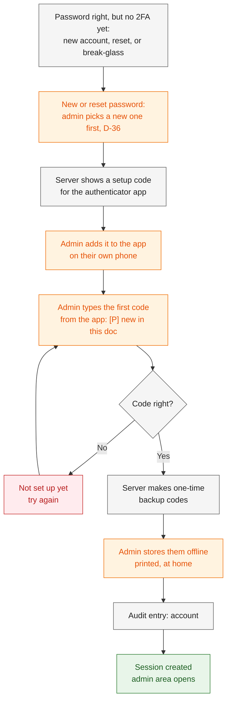

### Sequence diagram

No separate diagram: the parties are the admin's browser, the Next.js server with Better Auth, and Postgres, as in WF-09A. The break-glass case is drawn in WF-09E.

### Steps

| Step | Actor | What happens | Data created, updated, or read | Rules and requirements |
|---|---|---|---|---|
| 1 | Better Auth | After a right password, sees that the account has no 2FA. The admin area stays closed. | Read: account | [FR-ADM-01][fr], [roles §5.1][roles] |
| 1a | Admin, Next.js server | If the password is new or was reset (the app's `must_change_password` flag), the admin first chooses a new password; only then does the setup go on **[C]** ([D-36][dl]). | Update: password hash; the flag cleared | [FR-ADM-01][fr], [roles §5.1][roles] |
| 2 | Better Auth | Shows a setup code (usually a QR picture) to add to an authenticator app. | Create: 2FA secret, not yet active | [FR-ADM-01][fr], [NFR-09][nfr] |
| 3 | Admin | Adds it to the authenticator app on their own phone. | — | [roles §5.1][roles] |
| 4 | Admin | Types the first code from the app, to prove the setup works **[P] (new in this doc)**, open question 7. | — | — |
| 5 | Better Auth | Wrong code: not set up; the admin tries again. Right code: 2FA is on. | Update: 2FA state | [FR-ADM-01][fr] |
| 6 | Better Auth | Makes a set of ten one-time backup codes and shows them once. A new set needs the password and a current code, and ends the old set ([security][sec] §4.1, accepted in [D-38][dl]). | Create: backup codes | [roles §5.2][roles], [FR-ADM-01][fr] |
| 7 | Admin | Stores the codes offline, for example printed and kept in a safe place at home. | — | [roles §5.2][roles] |
| 8 | Database | Writes the audit entry. This document reads 2FA setup as an account change, so the category is `account` ([FR-ADM-01][fr]); see open question 1. | Create: audit entry | [FR-ADM-01][fr], [FR-ADM-30][fr], WF-10A |
| 9 | Better Auth | Creates the session; the admin area opens (as WF-09A step 9). | Create: session | [FR-ADM-01][fr] |

### Decision points and validation

| Decision | Yes | No | Rule |
|---|---|---|---|
| Does the account already have 2FA? | WF-09A step 8 | This sub-flow | [FR-ADM-01][fr] |
| First code right? | Backup codes, then the admin area | Try again | **[P] (new in this doc)**, open question 7 |

### Failure and exception paths

| Situation | What happens | Edge case |
|---|---|---|
| The admin closes the page before finishing | The admin area never opened; next login starts the setup again ([FR-ADM-01][fr]) | — |
| The backup codes are lost later, while the phone still works | They are never shown again; the admin makes a new set with the password and a current code, which ends the old set ([security][sec] §4.1, [D-38][dl]) | — |
| The phone is lost later | WF-09D | [EC-71][ec] |

### Status transitions involved

None.

### Developer notes

- **Library:** the Better Auth two-factor plugin (TOTP enrolment and backup codes).
- **Storage:** the 2FA secret and backup codes are admin account data, kept while the person is an admin and deleted with the credentials ([privacy-and-retention §6.2][priv]). Backup codes are stored encrypted rather than hashed, which meets the aim of [NFR-13][nfr] ("hashed where stored") ([security][sec] §4.1, accepted in [D-38][dl]). The `must_change_password` flag is the app's own column on the user row ([data-model][data] §5.19; [D-36][dl]).
- **Audit:** category `account`, action `account.2fa_enabled`. **Outbox:** none.

*(indicative; final names in api-specification, batch 3)*

---

## WF-09C · The server checks every admin request

### In plain words

Being logged in opens the admin area, but it does not let anyone do everything. Every admin page and every button press asks the system again who is asking and whether their role allows it. The login page is only a convenience: even if someone gets around it, the system still refuses. The database checks the role once more. The Admin's screens offer only the actions he may do; if he tries a Super-Admin-only action anyway, it is refused and nothing changes. *Example:* the Admin opens Ben's reservation. He does not see "Set legal hold", which is for the Super Admin only. Even if someone tries that action from his login anyway, the system refuses it ([FR-ADM-04][fr], [EC-74][ec]).

### Actors and responsibilities

| Actor | Responsibilities in this sub-flow |
|---|---|
| Admin or Super Admin (browser) | Opens pages and presses buttons. |
| `proxy.ts` | Redirects a page request without a session to the login page. Not the security boundary ([roles §7][roles]). |
| Next.js server (page, server action, or route) | At the top of every admin page, action, and route: checks the session, the 2FA step, and the role, then validates the input and makes one database call ([roles §7][roles], [NFR-10][nfr]). |
| Postgres function | Checks the role again, runs the action's own checks, and saves the change with its audit entry, or refuses ([roles §7][roles], [NFR-21][nfr]). |

### Trigger and preconditions

- **Trigger:** any admin page is opened, any admin form is sent (server action), or any admin route is called.
- **Preconditions:** none; the check is the precondition of every admin action in WF-03 to WF-10.

### Flowchart

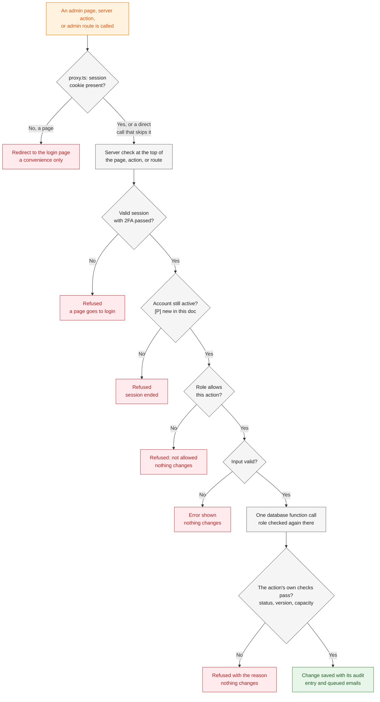

### Sequence diagram

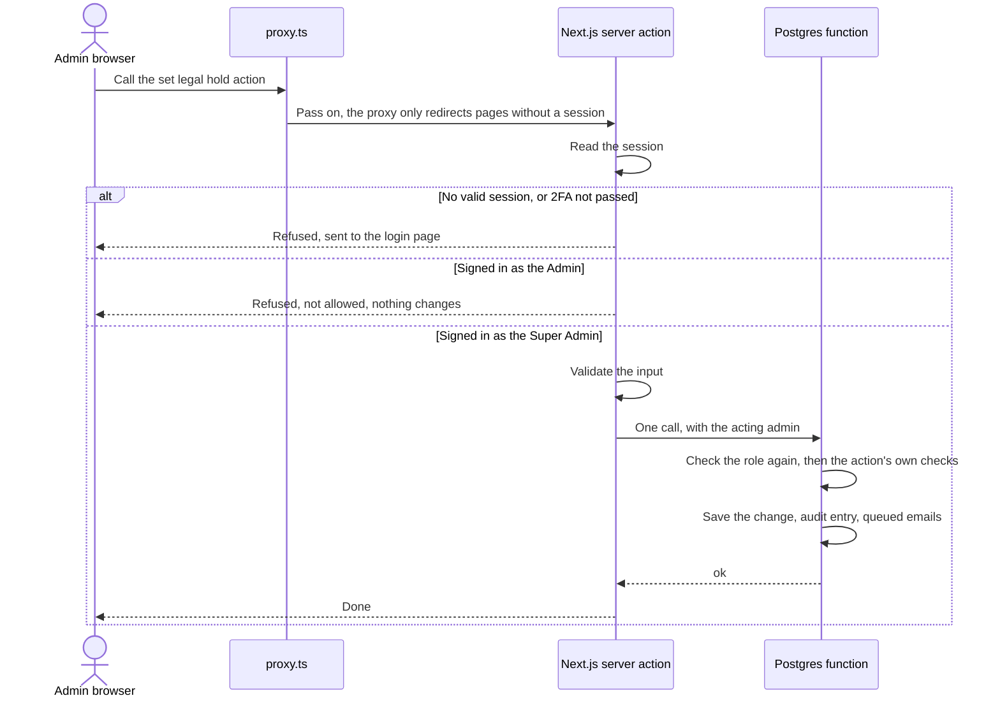

### Steps

| Step | Actor | What happens | Data created, updated, or read | Rules and requirements |
|---|---|---|---|---|
| 1 | Admin browser | Opens an admin page, sends an admin form (server action), or calls an admin route. A reservation form also sends the version it showed (WF-05E). | — | [roles §7][roles], [FR-ADM-07][fr] |
| 2 | `proxy.ts` | A page request without a session cookie is redirected to the login page. Nothing else is decided here. The job routes are left out of the redirects and use their own secret instead ([FR-SYS-09][fr]). | — | [roles §7][roles], [FR-ADM-01][fr] |
| 3 | Next.js server | At the top of the page, action, or route: reads the session. No valid session, or 2FA not passed: refused (a page goes to the login page). | Read: session | [roles §7][roles], [NFR-10][nfr], [FR-ADM-01][fr], [EC-73][ec] |
| 4 | Next.js server | Checks that the account is still active; a disabled account is refused and its session ended **[P] (new in this doc)**, open question 4. | Read: account | [roles §5.1][roles] |
| 5 | Next.js server | Checks that the role allows this action, using the permission matrix. No: refused with "not allowed", and nothing changes. | — | [roles §2, §7][roles], [EC-74][ec] |
| 6 | Next.js server | When building a page, offers only the actions the reservation's status and the admin's role allow (a [P] detail of FR-ADM-04). A hidden action that is called anyway is refused at step 5. | — | [FR-ADM-04][fr] |
| 7 | Next.js server | Validates the input. | — | [NFR-21][nfr] |
| 8 | Next.js server | Makes one call to one database function. Admin server code lives in its own module tree. | — | [roles §7][roles], [NFR-21][nfr], [NFR-32][nfr] |
| 9 | Database | Checks the acting admin's role again: role permissions are tested for each database function ([roles §7][roles]; database tests in spec v0.2 §17). How the function learns who is acting is open question 22. The app's database role can only call the app's functions ([NFR-10][nfr]). | Read: admin role | [roles §7][roles], [NFR-10][nfr] |
| 10 | Database | Runs the action's own checks (status and version, deadlines, capacity: WF-05B and WF-05E). Then saves the change with its audit entry and queued emails, or refuses and changes nothing. | Create or update: the action's data; create: audit entry, outbox rows | [FR-ADM-07][fr], [NFR-21][nfr], WF-10A |
| 11 | Next.js server | Shows the result and sends the queued emails after the reply. | Update: outbox | [FR-NTF-16][fr] |

### Decision points and validation

| Decision | Step | If it fails | Rule |
|---|---|---|---|
| Valid session, with 2FA passed? | 3 | Refused; a page goes to login | [roles §7][roles], [FR-ADM-01][fr], [EC-73][ec] |
| Account still active? | 4 | Refused, session ended **[P] (new in this doc)** | [roles §5.1][roles]; open question 4 |
| Does the role allow the action? | 5, 9 | Refused: "not allowed" | [roles §2][roles], [EC-74][ec] |
| Input valid? | 7 | Error shown | [NFR-21][nfr] |
| The action's own checks pass? | 10 | Refused with the reason | [FR-ADM-07][fr], [EC-16][ec], [EC-53][ec] |

### Failure and exception paths

| Situation | What happens | Edge case |
|---|---|---|
| A visitor who is not logged in opens an admin page, or calls an admin action directly | The page redirects to login; the direct call is refused by the server check | [EC-73][ec] |
| The Admin tries a Super-Admin-only action (a whole-date block, a reserved setting, an account change, a legal hold) | Refused by the server | [EC-74][ec], [EC-19][ec] |
| Both admins act on the same reservation | The second gets "already changed, please refresh" (WF-05E) | [EC-16][ec] |
| Someone calls a job route without its secret | Nothing runs; job routes are not admin requests | [EC-78][ec] |
| A refused request: is it recorded anywhere? | Not settled: open question 3 | — |

### Status transitions involved

None of its own. The action that passes the check makes its own transitions (WF-04, WF-06, WF-08).

### Developer notes

- **Guard:** one helper such as `requireAdmin(allowedRoles)` called first in every admin page, server action, and route handler under the admin module tree; it reads the Better Auth session, checks the 2FA step, the account state, and the role.
- **Database:** the function receives the acting admin's ID (open question 22) and checks the role from the user table; the app's database role has `EXECUTE` on the app functions only ([NFR-10][nfr]).
- **Result:** `not_allowed` for a role refusal; refusals write no change ([NFR-21][nfr]). Whether a refusal writes a security audit entry is open question 3.
- **Tests:** security tests call every admin endpoint while logged out and with the wrong role, and expect a refusal; pgTAP tests check role permissions for each function ([roles §7][roles], [NFR-10][nfr]; test plan, batch 4).

*(indicative; final names in api-specification, batch 3)*

---

## WF-09D · An admin loses the phone with the 2FA app

### In plain words

If an admin loses the phone that has the authenticator app, they log in with one of the backup codes they stored at setup; each code works only once. Then they can move 2FA to the new phone themselves, with the password and a backup code; this is recorded, and the Super Admin gets an email, unless it is his own account **[C]** ([D-36][dl]). If the Admin (the business owner) has no codes left, he asks the Super Admin to reset his account: he gets a new password, sets up 2FA again on his new phone, and is signed out everywhere else. If the Super Admin (the developer) has no codes left, he runs the break-glass script (WF-09E). The Super Admin can also sign out the lost phone's sessions, so whoever finds it cannot use the admin panel. *Example:* on Saturday 2 January 2027, the Admin's phone is stolen. He has used all his backup codes. He calls his son, the Super Admin, who first signs out his sessions and then resets his account; the Admin sets up 2FA on his new phone that afternoon ([EC-71][ec]).

### Actors and responsibilities

| Actor | Responsibilities in this sub-flow |
|---|---|
| The admin who lost the phone | Uses a backup code, or asks the Super Admin for a reset ([roles §5.2][roles]). |
| Super Admin | Resets the Admin's account and signs out his sessions (WF-09G); for his own account, uses a backup code or the break-glass script (WF-09E). |
| Next.js server with Better Auth | Accepts each backup code once (WF-09A step 9). |

### Trigger and preconditions

- **Trigger:** the phone with the authenticator app is lost, stolen, or broken.
- **Preconditions:** the person still knows their password. A forgotten password: the Super Admin resets the Admin's account (WF-09G), and the break-glass script can set a new one for the Super Admin ([security][sec] §4.1, accepted in [D-38][dl]).

### Flowchart

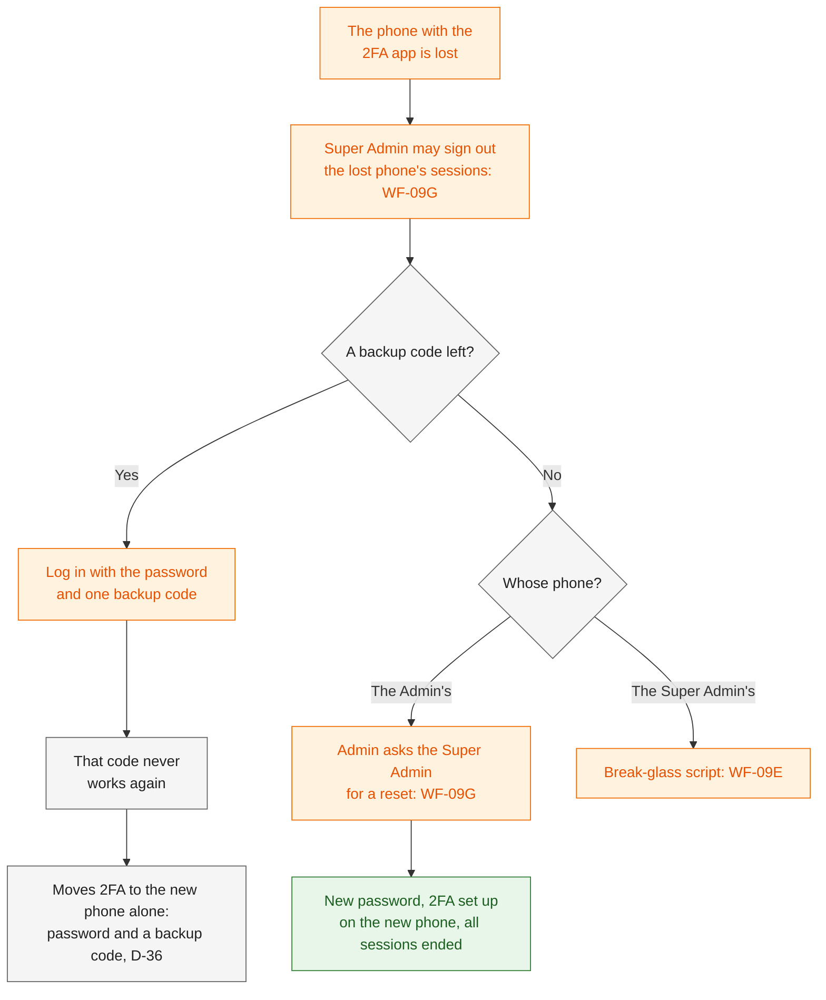

### Sequence diagram

No separate diagram: this sub-flow is a choice between WF-09A (with a backup code), WF-09G (reset and sign out), and WF-09E (break-glass), each drawn there.

### Steps

| Step | Actor | What happens | Data created, updated, or read | Rules and requirements |
|---|---|---|---|---|
| 1 | Admin | Loses the phone with the authenticator app. | — | [EC-71][ec] |
| 2 | Super Admin | May sign out the lost phone's sessions at once (WF-09G), for example after a phone or laptop is lost. Whether one session or all are ended is open question 10. | Delete: sessions | [roles §5.1][roles], [EC-71][ec] |
| 3 | Admin | If a backup code is left: logs in with the password and one backup code (WF-09A steps 3 to 9). That code never works again. | Update: backup code used | [roles §5.2][roles], [glossary][gl] (backup codes) |
| 4 | Admin | May then move 2FA to the new phone alone, with the password and a backup code, and the first code from the new phone. The old 2FA stops working. The change is recorded in the `security` category, and the Super Admin gets an email; when the Super Admin moves his own, no email is sent **[C]** ([D-36][dl]). | Update: 2FA secret, backup codes; create: audit entry, outbox row | [FR-ADM-30][fr], [FR-NTF-22][fr] |
| 5 | Admin (the business owner) | No codes left: asks the Super Admin to reset the account (WF-09G). He gets a new password, sets up 2FA again on his new phone (WF-09B), and is signed out everywhere. | See WF-09G | [roles §5.2][roles], [EC-71][ec] |
| 6 | Super Admin (the developer) | No codes left for his own account: runs the break-glass script (WF-09E). | See WF-09E | [roles §5.2][roles], [EC-71][ec] |

### Decision points and validation

| Decision | Yes | No | Rule |
|---|---|---|---|
| A backup code left? | Log in with it | Reset or break-glass | [roles §5.2][roles] |
| Is it the Admin's phone? | Reset by the Super Admin (WF-09G) | The Super Admin's: break-glass (WF-09E) | [roles §5.2][roles] |

### Failure and exception paths

| Situation | What happens | Edge case |
|---|---|---|
| The lost phone is still logged in | The Super Admin signs out its sessions | [EC-71][ec] |
| A backup code is typed a second time | Refused: each code works once | [EC-71][ec] |
| The password is also forgotten | The Admin: a reset by the Super Admin (WF-09G). The Super Admin: the break-glass script sets a new password ([security][sec] §4.1, [D-38][dl]) | — |

### Status transitions involved

None.

### Developer notes

- **Backup codes:** the Better Auth two-factor plugin marks a used code so it cannot be used again.
- **Audit:** the reset and sign-out are `account` entries (WF-09G). Moving 2FA writes a `security` entry, `account.2fa_moved`, and queues the email to the Super Admin ([D-36][dl]). Whether using a backup code is recorded is open question 3.

*(indicative; final names in api-specification, batch 3)*

---

## WF-09E · The break-glass script

### In plain words

The Super Admin is the only person who can reset accounts. So if he loses his own 2FA phone and has no backup codes left, nobody inside the app can help him. For this case there is a documented emergency script, the "break-glass" script. The developer runs it from his own computer with the database credentials. It resets the Super Admin's 2FA and writes an entry in the audit log. He then logs in with his password and sets up 2FA again on his new phone. *Example:* on Sunday 3 January 2027, the developer's phone breaks and his backup codes are at his old flat. He follows the runbook, runs the script, logs in, sets up 2FA on his new phone, and prints new backup codes ([roles §5.2][roles], [EC-71][ec]).

### Actors and responsibilities

| Actor | Responsibilities in this sub-flow |
|---|---|
| Super Admin (the developer) | Runs the script with the database credentials, following the runbook (planned: `07-operations/deployment-and-operations.md`). |
| Postgres | Resets the Super Admin's 2FA and writes the audit entry ([roles §5.2][roles]). |
| Next.js server with Better Auth | Handles the next login and the new 2FA setup (WF-09A, WF-09B). |

### Trigger and preconditions

- **Trigger:** the Super Admin has no working 2FA device and no backup codes left.
- **Preconditions:** the developer has the database credentials and the runbook. The break-glass script is a script, not a screen in the admin panel ([FR-ADM-30][fr]).

### Flowchart

```mermaid
flowchart TD
    A["Super Admin: no 2FA phone<br/>and no backup codes"] --> B["Developer follows the runbook<br/>planned in the operations docs"]
    B --> C["Runs the break-glass script<br/>with the database credentials"]
    C --> D{"Connected with the right<br/>database credentials?"}
    D -->|"No"| DF["Nothing changes<br/>check the runbook"]
    D -->|"Yes"| E["Super Admin's 2FA reset"]
    E --> F["Audit entry written<br/>actor and category: open question 9"]
    F --> G["Super Admin logs in with the password<br/>and sets up 2FA again: WF-09B"]
    G --> H["New backup codes<br/>stored offline"]
    classDef customer fill:#e3f2fd,stroke:#1565c0,color:#0d47a1
    classDef system fill:#f5f5f5,stroke:#616161,color:#212121
    classDef admin fill:#fff3e0,stroke:#ef6c00,color:#e65100
    classDef status fill:#e8f5e9,stroke:#2e7d32,color:#1b5e20
    classDef failure fill:#ffebee,stroke:#c62828,color:#b71c1c
    class A,B,C,G admin
    class D,F system
    class E,H status
    class DF failure
```

### Sequence diagram

```mermaid
sequenceDiagram
    actor D as Developer terminal
    participant DB as Postgres
    actor B as Super Admin browser
    participant W as Next.js server with Better Auth
    D->>DB: Run the break-glass script with the database credentials
    DB->>DB: Reset the Super Admin's 2FA
    DB->>DB: Write the audit entry
    DB-->>D: Done
    B->>W: Email and password
    W->>DB: Check the limits and the password
    W-->>B: No 2FA on the account, start the setup
    B->>W: First code from the app on the new phone
    W->>DB: Save the new 2FA secret and backup codes, audit entry
    W-->>B: Backup codes, then the dashboard
```

### Steps

| Step | Actor | What happens | Data created, updated, or read | Rules and requirements |
|---|---|---|---|---|
| 1 | Super Admin | Has no working 2FA device and no backup codes left. | — | [roles §5.2][roles], [EC-71][ec] |
| 2 | Super Admin | Follows the step-by-step runbook (planned: `07-operations/deployment-and-operations.md`). | — | [roles §5.2][roles] |
| 3 | Super Admin | Runs the documented break-glass script with the database credentials. It is a script, not an admin screen. | — | [roles §5.2][roles], [FR-ADM-30][fr] |
| 4 | Database | Resets the Super Admin's 2FA. Whether it also ends his sessions, and what happens if the password is also forgotten, is open question 9. | Update: Super Admin's 2FA records | [roles §5.2][roles] |
| 5 | Database | Writes an audit entry. Which actor kind and category it uses is open question 9. | Create: audit entry | [roles §5.2][roles], [EC-71][ec] |
| 6 | Super Admin | Logs in with the password (WF-09A). The account has no 2FA now, so he sets it up again (WF-09B) and stores new backup codes offline. | See WF-09A, WF-09B | [FR-ADM-01][fr], [roles §5.2][roles] |

### Decision points and validation

| Decision | Yes | No | Rule |
|---|---|---|---|
| A backup code left? | Use it instead (WF-09D) | Break-glass | [roles §5.2][roles] |
| Script run with the database credentials? | 2FA reset, audited | Nothing changes | [roles §5.2][roles] |

### Failure and exception paths

| Situation | What happens | Edge case |
|---|---|---|
| The Super Admin loses his 2FA phone and has no codes | This sub-flow | [EC-71][ec] |
| The lost phone still has an open session | Not settled: open question 9 | — |
| The Super Admin's password is forgotten too | Not settled: open question 9 | — |

### Status transitions involved

None.

### Developer notes

- **Script:** for example `scripts/break-glass-reset-2fa.ts` (or a SQL file), run locally against the database through the session pooler with credentials that are never stored in the repository ([NFR-13][nfr]). It deletes the Super Admin's two-factor rows and inserts one audit row, in one transaction.
- **Audit:** action `account.2fa_reset_break_glass`; actor and category: open question 9. **Outbox:** none.
- **Runbook:** where the database credentials are kept, and how to run the script safely, belong in the operations docs (planned).

*(indicative; final names in api-specification, batch 3)*

---

## WF-09F · Create an Admin account

### In plain words

There is at most one Super Admin and one active Admin, and nobody can sign up. The first accounts are made by a setup script. After that, only the Super Admin can create an Admin account, and only when no Admin is active. To replace the Admin, the Super Admin first disables the old account (WF-09G). The new Admin then logs in and sets up 2FA before the admin area opens. *Example:* the business owner hands the daily work to a family member. On Monday 4 January 2027, the Super Admin disables the old Admin account, then creates the new one; the new Admin logs in that afternoon and sets up 2FA ([roles §5.1][roles], [EC-75][ec]).

### Actors and responsibilities

| Actor | Responsibilities in this sub-flow |
|---|---|
| Super Admin | Creates the Admin account ([roles §2.7][roles]). Gives the person their first password in person; the person changes it at the first login ([D-36][dl]). |
| Next.js server | Checks the login, 2FA, and role: Super Admin only (WF-09C). |
| Postgres function | Checks that no Admin is active, creates the account with the Admin role, and writes the audit entry ([roles §5.1][roles], [FR-ADM-30][fr]). |
| The new Admin | Logs in and sets up 2FA (WF-09A, WF-09B). |

### Trigger and preconditions

- **Trigger:** a new person becomes the Admin.
- **Preconditions:** logged in with 2FA as the Super Admin. No Admin account is active ([roles §5.1][roles]). The first accounts at launch come from the setup script, not from this flow ([NFR-09][nfr]; runbook planned).

### Flowchart

```mermaid
flowchart TD
    A["Super Admin opens the accounts<br/>screen and picks create Admin"] --> B{"Server: Super Admin<br/>with 2FA?"}
    B -->|"No"| BF["Refused by the server"]
    B -->|"Yes"| C{"Is an Admin account<br/>already active?"}
    C -->|"Yes"| CF["Refused<br/>disable the old Admin first: WF-09G"]
    C -->|"No"| D["Super Admin enters the name,<br/>email, and first password"]
    D --> E["Account created with the Admin role<br/>password stored only as a hash"]
    E --> AU["Audit entry: account"]
    AU --> F["Password handed over in person<br/>changed at first login, D-36"]
    F --> G["New Admin logs in and<br/>sets up 2FA: WF-09B"]
    classDef customer fill:#e3f2fd,stroke:#1565c0,color:#0d47a1
    classDef system fill:#f5f5f5,stroke:#616161,color:#212121
    classDef admin fill:#fff3e0,stroke:#ef6c00,color:#e65100
    classDef status fill:#e8f5e9,stroke:#2e7d32,color:#1b5e20
    classDef failure fill:#ffebee,stroke:#c62828,color:#b71c1c
    class A,D,F,G admin
    class B,C,AU system
    class E status
    class BF,CF failure
```

### Sequence diagram

No separate diagram: the parties are the Super Admin's browser, the Next.js server action, and one Postgres function, as in WF-09G.

### Steps

| Step | Actor | What happens | Data created, updated, or read | Rules and requirements |
|---|---|---|---|---|
| 1 | Super Admin | Opens the accounts screen and picks "Create Admin". | Read: accounts | [FR-ADM-30][fr] |
| 2 | Next.js server | Checks the login, 2FA, and role: Super Admin only (WF-09C). | Read: session | [roles §2.7][roles], [EC-74][ec] |
| 3 | Database | Checks that no Admin account is active. If one is: refused; the Super Admin disables the old account first (WF-09G). | Read: accounts | [roles §5.1][roles], [EC-75][ec] |
| 4 | Super Admin | Enters the person's name and email address, and a first password. | — | [roles §5.1][roles], [privacy-and-retention §3.1][priv] (admin account data) |
| 5 | Database | Creates the account with the Admin role. The password is stored only as an argon2id hash. The account has no 2FA yet. | Create: user, account | [NFR-09][nfr], [roles §7][roles] |
| 6 | Database | Writes the audit entry, category `account`. | Create: audit entry | [FR-ADM-30][fr], [roles §5.1][roles] |
| 7 | Super Admin | Hands the first password to the person, in person ([security][sec] §4.1, accepted in [D-38][dl]). The person must change it at the first login **[C]** ([D-36][dl]). | — | [roles §5.1][roles] |
| 8 | New Admin | Logs in (WF-09A) and sets up 2FA (WF-09B) before the admin area opens. | See WF-09A, WF-09B | [FR-ADM-01][fr] |

### Decision points and validation

| Decision | Yes | No | Rule |
|---|---|---|---|
| Logged in with 2FA as the Super Admin? | Continue | Refused by the server | [roles §2.7][roles], [EC-74][ec] |
| An Admin already active? | Refused | Create | [roles §5.1][roles], [EC-75][ec] |

### Failure and exception paths

| Situation | What happens | Edge case |
|---|---|---|
| The Super Admin tries to create a second Admin while one is active | Refused | [EC-75][ec] |
| The Admin tries to create an account | Refused by the server | [EC-74][ec] |
| A disabled former Admin comes back | The Super Admin re-enables the account (WF-09G), if no other Admin is active **[C]** ([D-37][dl]) | — |

### Status transitions involved

None.

### Developer notes

- **Function:** `app.create_admin_account(name, email, password_hash)` or the Better Auth admin plugin's create-user call wrapped in one transaction with the "no active Admin" check and the audit row.
- **Server action:** `createAdminAction`, Super Admin only.
- **Audit:** category `account`, action `account.created`. **Outbox:** none; there is no welcome email in batch-1 docs.

*(indicative; final names in api-specification, batch 3)*

---

## WF-09G · Disable, reset, or sign out an admin account

### In plain words

The Super Admin has three tools for the other admin account. **Disable** stops a person from logging in at all, for example when they stop being an admin; it is done the same day they leave, and their login details are deleted within a set time (30 days, [privacy-and-retention §6.2][priv]). **Reset** gives the person a new password, makes them set up 2FA again, and signs them out everywhere. **Sign out** ends their sessions, for example after a phone or laptop is lost. The Super Admin can never disable his own account, and there is no "change role" action. He can also **re-enable** a disabled account **[C]** ([D-37][dl]). Every one of these actions is recorded in the audit log. *Example:* on Saturday 2 January 2027 the Admin's phone is stolen and he has no backup codes left. The Super Admin signs out his sessions at once, then resets his account; the Admin sets up 2FA on his new phone ([roles §5.1][roles], [EC-71][ec]).

### Actors and responsibilities

| Actor | Responsibilities in this sub-flow |
|---|---|
| Super Admin | Disables, resets, or signs out an account ([roles §2.7][roles]). |
| Next.js server | Checks the login, 2FA, and role: Super Admin only (WF-09C). |
| Postgres function | Applies the change to the account and its sessions and writes the audit entry ([FR-ADM-30][fr]). |
| The other admin | After a reset, logs in with the new password and sets up 2FA (WF-09B). After a disable, can no longer log in. |

### Trigger and preconditions

- **Trigger:** a person stops being an admin (disable), has lost access (reset), or a device is lost (sign out).
- **Preconditions:** logged in with 2FA as the Super Admin.

### Flowchart

```mermaid
flowchart TD
    A["Super Admin opens the accounts<br/>screen and picks an account"] --> B{"Server: Super Admin<br/>with 2FA?"}
    B -->|"No"| BF["Refused by the server"]
    B -->|"Yes"| K{"Which action?"}
    K -->|"Disable"| D{"Own account?"}
    D -->|"Yes"| DF["Refused: the Super Admin<br/>cannot disable itself"]
    D -->|"No"| D1["Account disabled: no more logins<br/>sessions ended: [P] new in this doc"]
    D1 --> D2["Retention job deletes login details<br/>30 days later; user row kept, D-37"]
    K -->|"Re-enable"| E1["Account active again<br/>if no other Admin is active, D-37"]
    K -->|"Reset"| R1["New password, 2FA must be<br/>set up again, all sessions ended"]
    R1 --> R2["Person logs in and<br/>sets up 2FA: WF-09B"]
    K -->|"Sign out"| S1["That person's sessions end<br/>all or one: open question 10"]
    D1 --> AU["Audit entry: account"]
    R1 --> AU
    S1 --> AU
    E1 --> AU
    AU --> N["Next request from an ended<br/>session is refused: WF-09C"]
    classDef customer fill:#e3f2fd,stroke:#1565c0,color:#0d47a1
    classDef system fill:#f5f5f5,stroke:#616161,color:#212121
    classDef admin fill:#fff3e0,stroke:#ef6c00,color:#e65100
    classDef status fill:#e8f5e9,stroke:#2e7d32,color:#1b5e20
    classDef failure fill:#ffebee,stroke:#c62828,color:#b71c1c
    class A,R2 admin
    class B,K,D,D2,AU,N system
    class D1,R1,S1,E1 status
    class BF,DF failure
```

### Sequence diagram

```mermaid
sequenceDiagram
    actor S as Super Admin browser
    participant W as Next.js server action
    participant DB as Postgres
    actor L as Lost Admin phone
    S->>W: Sign out the Admin, then reset his account
    W->>W: Check the session, 2FA, and role Super Admin
    W->>DB: One call to the sign-out function
    DB->>DB: Delete the Admin's sessions, audit entry in account
    W->>DB: One call to the reset function
    DB->>DB: New password hash, 2FA removed, all sessions ended
    DB->>DB: Audit entry in account
    DB-->>W: ok
    W-->>S: Done, hand over the new password
    L->>W: Next request with the old session cookie
    W->>DB: Read the session
    DB-->>W: No such session
    W-->>L: Refused, sent to the login page
```

### Steps

| Step | Actor | What happens | Data created, updated, or read | Rules and requirements |
|---|---|---|---|---|
| 1 | Super Admin | Opens the accounts screen, picks an account and an action. | Read: accounts, sessions | [FR-ADM-30][fr] |
| 2 | Next.js server | Checks the login, 2FA, and role: Super Admin only (WF-09C). | Read: session | [roles §2.7][roles], [EC-74][ec] |
| 3 | Database | **Disable:** refuses if it is the Super Admin's own account. | Read: account | [roles §5.1][roles], [EC-75][ec] |
| 4 | Database | **Disable:** marks the account disabled; the person can no longer log in (WF-09A step 5). It also ends all their sessions at once **[P] (new in this doc)**, open question 4. This is done the same day the person stops being an admin. | Update: account; delete: sessions | [roles §5.1][roles], [privacy-and-retention §6.2][priv], [EC-76][ec] |
| 5 | System (the daily retention job) | 30 days after the disable, the job deletes the person's login details (password hash, 2FA secret, backup codes, sessions). The user row is scrubbed and kept, so the audit entries and "received by" still name the person **[C]** ([D-37][dl]; WF-10E). | Delete: credentials; update: user row | [privacy-and-retention §6.2][priv], [EC-76][ec] |
| 5a | Database | **Re-enable:** clears the disable, if no other account of that role is active. If the login details were already deleted, the Super Admin also gives the email and a new password, and the person sets up 2FA again **[C]** ([D-37][dl]). | Update: account | [roles §5.1][roles], [FR-ADM-30][fr] |
| 6 | Database | **Reset:** sets a new password, removes the 2FA so it must be set up again, and ends all of that person's sessions. | Update: password hash, 2FA; delete: sessions | [roles §5.1][roles], [FR-ADM-30][fr], [NFR-09][nfr] |
| 7 | Super Admin, then the person | Hands over the new password in person ([security][sec] §4.1, [D-38][dl]). The person logs in, changes the password ([D-36][dl]), and sets up 2FA on their phone (WF-09A, WF-09B). | — | [roles §5.2][roles] |
| 8 | Database | **Sign out:** ends that admin's sessions, for example after a phone or laptop is lost. Whether one session can be picked is open question 10. | Delete: sessions | [roles §5.1][roles], [EC-71][ec] |
| 9 | Database | For each action, writes the audit entry, category `account`. | Create: audit entry | [FR-ADM-30][fr], [roles §5.1][roles] |
| 10 | Next.js server (later) | The next request from an ended session finds no session and is refused (WF-09C step 3). | Read: session | [NFR-09][nfr], [roles §7][roles] |

### Decision points and validation

| Decision | Yes | No | Rule |
|---|---|---|---|
| Logged in with 2FA as the Super Admin? | Continue | Refused by the server | [roles §2.7][roles], [EC-74][ec] |
| Disable: is it the Super Admin's own account? | Refused | Disable | [roles §5.1][roles], [EC-75][ec] |

### Failure and exception paths

| Situation | What happens | Edge case |
|---|---|---|
| The Super Admin tries to disable or demote his own account | Refused | [EC-75][ec] |
| A person stops being an admin | Disabled the same day; the retention job deletes the login details 30 days later ([D-37][dl]) | [EC-76][ec] |
| An admin loses a 2FA phone | Sign out and reset (this sub-flow), or a backup code (WF-09D) | [EC-71][ec] |
| The Admin tries any account action | Refused by the server | [EC-74][ec] |
| A disabled account should come back | Re-enable (step 5a) **[C]** ([D-37][dl]) | — |

### Status transitions involved

None for reservations. The account becomes disabled, or its password, 2FA, and sessions change ([roles §5.1][roles]).

### Developer notes

- **Functions:** the Better Auth admin plugin's ban (disable), set-password, and revoke-sessions calls, each wrapped with the matching audit row; or `app.disable_admin`, `app.reset_admin`, `app.sign_out_admin`.
- **Server actions:** `disableAdminAction`, `resetAdminAction`, `signOutAdminAction`, Super Admin only; each refuses when the target is the acting Super Admin where the rule says so.
- **Audit:** category `account`; actions `account.disabled`, `account.reset`, `account.signed_out`. **Outbox:** none.
- **Credential deletion:** the daily retention job (WF-10E), 30 days after the disable **[C]** ([D-37][dl]). **Re-enable:** `reenableAdminAccount` → `app.reenable_admin` ([api-specification][api] §3.8).

*(indicative; final names in api-specification, batch 3)*

---

## WF-10 · Administrative changes and audit logging

### In plain words

The audit log is the system's diary. Every status change and every admin action adds one entry: when it happened (Manila time), what kind of change it was, which booking or item it was about, who did it (an admin, the customer, or the system itself), what was done, which fields changed, and the reason where one is needed ([NFR-25][nfr], [FR-ADM-32][fr]). It names the fields that changed, never their old or new values, and it never stores a customer's name, mobile number, email, or address. Entries are only ever added, never edited or deleted in the app; both admins can read them, and each reservation's history is simply its own entries. Only the Super Admin can put a booking under a legal hold, which stops the system from deleting anything about it, or process a customer's request to erase their personal data. Old entries are removed by the daily retention job, on the schedule in [privacy-and-retention][priv].

### How the sub-flows fit together

| What happens | Sub-flow | Who |
|---|---|---|
| Any change is saved: the entry is written in the same step | WF-10A | Inside every database function |
| Someone wants to know what happened | WF-10B | Either admin |
| A complaint, demand, or case arrives about a booking | WF-10C | Super Admin only |
| A customer asks to have their data erased | WF-10D | Super Admin only |
| Data reaches the end of its retention period | WF-10E | The system, daily |

---

## WF-10A · Every change writes an audit entry

### In plain words

Whenever anything changes, whether an admin presses a button, a customer sends a request, or a scheduled job expires a hold, the same database step that makes the change also writes one audit entry. If the change fails or is refused, nothing is written, so the log never shows something that did not happen. The emails a change causes are queued in the same step, each tied to that entry, so an email is never sent twice for one change ([FR-NTF-17][fr]). *Example:* on Tuesday 22 December 2026 at 3:14 PM, the Admin cancels Ben's booking with the reason "family emergency" and the refund decision "partial, ₱500". One entry is written, and Ben's history shows it as "Tue 22 Dec 2026, 3:14 PM · Admin · Cancel · reason: family emergency · refund decision recorded". The entry lists the changed fields by name (such as the status and the refund decision); Ben's name and mobile number are not in it ([FR-ADM-32][fr]).

### Actors and responsibilities

| Actor | Responsibilities in this sub-flow |
|---|---|
| Admin or Super Admin | Makes changes through the admin panel (actor kind `admin`, with the admin's ID). |
| Customer | Sends an online request, or reissues the QR code on the status page (actor kind `customer`, no ID). |
| The system (scheduled jobs) | Expires overdue holds, marks events Completed, pauses online booking when the breaker trips (actor kind `system`) ([roles §4][roles]). |
| Postgres function | Writes the change, the audit entry, and the queued emails in one transaction, or nothing at all ([NFR-21][nfr], [reservation-lifecycle §4.3][lc]). |
| Resend | Sends the queued emails after the commit ([FR-NTF-16][fr]). |

### Trigger and preconditions

- **Trigger:** any change is saved: a status change, an admin action, a customer action, or a system job ([NFR-25][nfr]).
- **Preconditions:** the change passed its own checks (WF-09C for admins; WF-01C for customers; the job's own rules for the system).

### Flowchart

```mermaid
flowchart TD
    A1["Admin action"] --> F["One database function call"]
    A2["Customer action:<br/>online request or QR reissue"] --> F
    A3["Scheduled job:<br/>expiry or Completed"] --> F
    F --> C{"All checks pass?"}
    C -->|"No"| CF["Refused: nothing changes<br/>refused attempts: open question 3"]
    C -->|"Yes"| W["Write the change"]
    W --> AU["Write one audit entry: time, category,<br/>what it is about, actor kind and ID,<br/>action, changed field names, reason"]
    AU --> NV["Only field names: never values,<br/>never customer contact data"]
    NV --> OB["Queue the emails,<br/>each keyed to this entry"]
    OB --> CM{"Commit succeeds?"}
    CM -->|"No"| CMF["All undone: no change,<br/>no entry, no email"]
    CM -->|"Yes"| LOG["Entry in the audit log<br/>and the reservation history"]
    LOG --> SE["Emails sent after the reply<br/>an email problem never undoes it"]
    classDef customer fill:#e3f2fd,stroke:#1565c0,color:#0d47a1
    classDef system fill:#f5f5f5,stroke:#616161,color:#212121
    classDef admin fill:#fff3e0,stroke:#ef6c00,color:#e65100
    classDef status fill:#e8f5e9,stroke:#2e7d32,color:#1b5e20
    classDef failure fill:#ffebee,stroke:#c62828,color:#b71c1c
    class A1 admin
    class A2 customer
    class A3,F,C,W,AU,NV,OB,CM,SE system
    class LOG status
    class CF,CMF failure
```

### Sequence diagram

```mermaid
sequenceDiagram
    actor A as Admin browser
    actor C as Customer browser
    participant W as Next.js server
    participant J as pg_cron
    participant DB as Postgres functions
    participant E as Resend
    A->>W: Cancel Ben's booking, reason family emergency
    W->>DB: One call to the cancel function, with the acting admin
    DB->>DB: Change, audit entry with actor admin and the reason,<br/>cancelled email keyed to that entry
    DB-->>W: ok, all committed together
    W->>E: Send the queued email after the reply
    C->>W: Submit an online request
    W->>DB: One call to the booking function
    DB->>DB: New reservation, audit entry with actor customer
    DB-->>W: ok
    J->>DB: Every minute, expire overdue holds
    DB->>DB: Status Expired, audit entry with actor system
    Note over DB: Every entry stores field names, never values,<br/>and never customer contact data
```

### What each kind of change writes

Batch-1 docs name five categories: `security`, `booking`, `catalog`, `settings`, and `account` ([FR-ADM-32][fr]). They assign some of them by name; the rest is open question 1. "Not named" below means batch-1 docs require an audit entry but name no category.

| What changed | Actor kind | Category | Reason in the entry | Source |
|---|---|---|---|---|
| A reservation's status, or an admin action on a reservation: approve, reject, needs info, edit details, deposit, proof review, waiver, extend, reschedule, cancel with refund decision, event not held, recreate, staff-created booking, internal note, QR reissue | admin, with ID | `booking`: this document's reading of "booking events" in [privacy-and-retention §6.2][priv]; open question 1 | Where the action needs one ([reservation-lifecycle §4.2, §5][lc]) | [FR-ADM-07][fr], [reservation-lifecycle §4.1][lc] |
| A payment recorded (deposit, balance, refund paid), or voided | admin, with ID | `booking` (indicative, as above; not assigned in FR-ADM-32: open question 1) | Void: yes ([D-24][dl]) | [catalog-and-payments §4.6][cat], [FR-ADM-07][fr] |
| An online request sent by a customer | customer | `booking` (as above) | — | [reservation-lifecycle §4.2][lc] row 1 |
| A QR code reissued by the customer on the status page | customer | `booking` (as above) | — | [EC-62][ec] |
| A proof uploaded by the customer | customer | Whether it is audited: [notifications-and-tracking][wf-notify] open question 16 | — | [reservation-lifecycle §5][lc] |
| An overdue hold marked Expired; a Confirmed booking marked Completed | system | `booking` (as above) | — | [FR-SYS-01][fr], [FR-SYS-04][fr], [reservation-lifecycle §4.2][lc] rows 9, 10, 14 |
| The breaker pausing online booking | system | Not named (open question 1) | — | [roles §4][roles], [BR-07a][br] |
| Online booking resumed early (WF-08G) | admin, with ID | Not named | — | [FR-ADM-29][fr] |
| Packages, add-ons, prices, daily stock, archiving (WF-08A to WF-08C) | admin, with ID | `catalog` | — | [FR-ADM-26][fr], [catalog-and-payments §1.6][cat] |
| Delivery slots and every other setting (WF-08D, WF-08F) | admin (Super Admin) | `settings`: which setting, who, when | — | [FR-ADM-28][fr], [catalog-and-payments §1.6][cat] |
| Sets and the room (WF-08E) | admin (Super Admin) | Not named | — | [FR-ADM-27][fr] |
| Blocks created or removed (WF-08H, WF-08I) | admin, with ID | Not named | Yes, both | [BR-08][br], [FR-ADM-25][fr] |
| Account created, disabled, reset, signed out; 2FA set up (WF-09B, WF-09F, WF-09G) | admin (Super Admin; the person themselves for 2FA setup) | `account` | — | [FR-ADM-30][fr], [FR-ADM-01][fr] |
| Admin logins (WF-09A) | admin, with ID | `security` (a [P] detail of FR-ADM-01) | — | [FR-ADM-01][fr] |
| The break-glass script (WF-09E) | Not named (open question 9) | Not named | — | [roles §5.2][roles] |
| Legal hold set or cleared (WF-10C) | admin (Super Admin) | Not named | Set: yes. Clear: yes, a [P] detail of privacy §5.6 | [privacy-and-retention §5.6][priv] |
| Erasure processed (WF-10D) | admin (Super Admin) | Not named | Not stated | [privacy-and-retention §5.5][priv], [FR-ADM-31][fr] |
| The daily retention job | system | Whether it writes audit entries, or only its counts-only run log: open question 2 | — | [FR-SYS-05][fr], [roles §4][roles], [privacy-and-retention §6.4][priv] |

### Steps

| Step | Actor | What happens | Data created, updated, or read | Rules and requirements |
|---|---|---|---|---|
| 1 | Admin, customer, or scheduled job | Starts a change: an admin action (after WF-09C), a customer action (after WF-01C), or a job run. | — | [NFR-25][nfr], [roles §4][roles] |
| 2 | Next.js server or `pg_cron` | Makes one call to one database function. | — | [NFR-21][nfr], [reservation-lifecycle §4.3][lc] |
| 3 | Database | Runs the action's checks. If any fails, the call is refused and nothing is written: no change, no entry, no email. | — | [NFR-21][nfr], [FR-ADM-07][fr] |
| 4 | Database | Writes the change. | Create or update: the action's data | [FR-ADM-07][fr] |
| 5 | Database | Writes one audit entry: the time; the category; what it is about (for example a reservation and its reference code); the actor kind and, for an admin, the admin's ID; the action; the names of the changed fields; and the reason where one is required. | Create: audit entry | [FR-ADM-32][fr], [FR-ADM-07][fr], [reservation-lifecycle §4.1][lc] |
| 6 | Database | Stores field **names** only, never old or new values, and never customer contact data. For example, an edit of a wrong mobile number records the field name "mobile", not the numbers. | — | [FR-ADM-32][fr], [reservation-lifecycle §6.2][lc], [NFR-15][nfr], [EC-46][ec] |
| 7 | Database | Queues the emails the change causes, each with a unique key that includes this audit entry. | Create: outbox rows | [FR-NTF-16][fr], [FR-NTF-17][fr] |
| 8 | Database | Commits the change, the entry, and the emails together, or undoes all of them. | — | [NFR-21][nfr], [reservation-lifecycle §4.3][lc] |
| 9 | Next.js server | Shows the result; sends the queued emails after the reply. An email problem never undoes the change. | Update: outbox | [FR-NTF-16][fr], [NFR-33][nfr], [EC-66][ec] |
| 10 | — | The entry is now in the audit log (WF-10B) and, for a reservation, in its history. It is never edited or deleted in the app; only the retention job removes it later (WF-10E). | — | [FR-ADM-32][fr], [NFR-22][nfr] |

### Decision points and validation

| Decision | Yes | No | Rule |
|---|---|---|---|
| Do the action's checks pass? | Change, entry, and emails are written | Nothing is written | [NFR-21][nfr] |
| Does the action need a reason? | The entry stores it; without one, the action cannot be saved | No reason field | [FR-ADM-07][fr], [reservation-lifecycle §4.1][lc] |
| Does the commit succeed? | All three saved together | All undone | [NFR-21][nfr] |

### Failure and exception paths

| Situation | What happens | Edge case |
|---|---|---|
| An admin makes a mistake | Nothing is deleted; it is fixed with a new action and a reason, and both steps are in the log | [EC-54][ec] |
| The second of two admins acts on a stale page | Refused; no entry is written for the refused action | [EC-16][ec] |
| The email service fails after the change | The change and its entry stand; the email is retried or marked failed | [EC-66][ec] |
| A refused or forbidden attempt | Not settled whether it is recorded: open question 3 | [EC-73][ec], [EC-74][ec] |

### Status transitions involved

Every reservation transition in [reservation-lifecycle §4.2][lc] writes one entry, with the "Audit actor" named in that table's last column. Block changes ([reservation-lifecycle §7][lc]) are audited too. This sub-flow adds no transition.

### Developer notes

- **Table:** `audit_log` (append-only): category, entity type, entity ID, actor kind (`admin`, `system`, `customer`), actor ID (nullable), action, changed field names (for example a `text[]`), reason, time ([spec v0.2][spec] §11).
- **Helper:** one SQL helper such as `app.write_audit(category, entity_type, entity_id, actor_kind, actor_id, action, changed_fields, reason)` called inside every function, returning the entry ID that the outbox key uses ([FR-NTF-17][fr]).
- **Append-only:** the app's database role may insert into `audit_log` but never update or delete it; only the retention function (WF-10E) deletes ([NFR-22][nfr], [NFR-10][nfr]).
- **No contact data:** the helper takes field names, never values; a test checks that no audit row contains a mobile number or email pattern ([NFR-15][nfr], [NFR-25][nfr]).
- **Tests:** "every action writes an audit entry with the right fields" ([NFR-25][nfr]; test plan, batch 4).

*(indicative; final names in api-specification, batch 3)*

---

## WF-10B · View the audit log and a reservation's history

### In plain words

Both admins can open the audit log to see who did what, when, and why. It can be filtered by category and by date. Each reservation page also shows that booking's history, which is simply its own audit entries. The log can only be read: there is no button to edit or delete an entry. *Example:* on Wednesday 23 December 2026, the Super Admin wants to know why Ben's booking was cancelled. He opens Ben's reservation; the history shows "Tue 22 Dec 2026, 3:14 PM · Admin · Cancel · reason: family emergency · refund decision recorded" ([FR-ADM-32][fr]).

### Actors and responsibilities

| Actor | Responsibilities in this sub-flow |
|---|---|
| Admin or Super Admin | Opens the audit log, or a reservation's history ([roles §2.1][roles]). |
| Next.js server | Checks the login, 2FA, and role (WF-09C); reads the entries live, never from a cache ([NFR-03][nfr]). |
| Postgres | Returns the entries; it changes nothing. |

### Trigger and preconditions

- **Trigger:** an admin wants to know what happened, for example after a customer complains, or to check a colleague's change.
- **Preconditions:** logged in with 2FA; either admin may view ([roles §2.1][roles]).

### Flowchart

```mermaid
flowchart TD
    A["Admin opens the audit log"] --> B{"Server: logged in<br/>with 2FA?"}
    A2["Admin opens a reservation"] --> B
    B -->|"No"| BF["Sent to the login page"]
    B -->|"Yes"| F["Admin filters by category<br/>and date: [P] in FR-ADM-32"]
    F --> R["Server reads the entries live"]
    R --> S["Each entry: Manila time, category, subject,<br/>actor kind and admin name, action,<br/>field names, reason"]
    B -->|"Yes, from a reservation"| H["History: that reservation's<br/>own entries"]
    H --> S
    S --> N["Read only: no edit<br/>or delete controls"]
    classDef customer fill:#e3f2fd,stroke:#1565c0,color:#0d47a1
    classDef system fill:#f5f5f5,stroke:#616161,color:#212121
    classDef admin fill:#fff3e0,stroke:#ef6c00,color:#e65100
    classDef status fill:#e8f5e9,stroke:#2e7d32,color:#1b5e20
    classDef failure fill:#ffebee,stroke:#c62828,color:#b71c1c
    class A,A2,F admin
    class B,R,H system
    class S,N status
    class BF failure
```

### Sequence diagram

No separate diagram: one admin browser, one server page, and one read from Postgres. Reads write nothing.

### Steps

| Step | Actor | What happens | Data created, updated, or read | Rules and requirements |
|---|---|---|---|---|
| 1 | Admin | Opens the audit log screen, or a reservation page (WF-03). | — | [FR-ADM-32][fr], [FR-ADM-04][fr] |
| 2 | Next.js server | Checks the login and 2FA (WF-09C). Both admins may view. | Read: session | [roles §2.1][roles], [NFR-10][nfr] |
| 3 | Admin | On the audit log screen, filters by category and by date (a [P] detail of FR-ADM-32). Other search options are open question 21. | — | [FR-ADM-32][fr] |
| 4 | Next.js server | Reads the entries live. | Read: audit log | [NFR-03][nfr] |
| 5 | Next.js server | Shows each entry: the time in Manila time; the category; what it is about (for example a reservation and its reference code); the actor kind, and the admin's name if an admin acted; the action; the names of the changed fields; and the reason. | — | [FR-ADM-32][fr], [NFR-19][nfr] |
| 6 | Next.js server | On a reservation page, shows the history: that reservation's own entries. | Read: audit log | [FR-ADM-04][fr], [FR-ADM-32][fr] |
| 7 | — | Offers no way to edit or delete an entry. Entries of an admin who has left still show their ID and display name. | — | [FR-ADM-32][fr], [NFR-22][nfr], [privacy-and-retention §6.2][priv] |

### Decision points and validation

| Decision | Yes | No | Rule |
|---|---|---|---|
| Logged in with 2FA (either admin)? | Show | Login page | [roles §2.1][roles], [EC-73][ec] |
| Filter chosen? | Only matching entries | All entries | [FR-ADM-32][fr] |

### Failure and exception paths

| Situation | What happens | Edge case |
|---|---|---|
| A visitor who is not logged in opens the log | Sent to the login page | [EC-73][ec] |
| An entry is older than its retention period | It is no longer there; the retention run log keeps counts only (WF-10E) | [privacy-and-retention §6.2][priv] |
| An admin wants to correct an entry | Not possible; the fix is a new action with a reason | [EC-54][ec] |
| Should viewing be logged? | Not settled: open question 21 (opening a reservation: [lookup-and-review][wf-review] open question 3) | — |

### Status transitions involved

None. Reading changes nothing.

### Developer notes

- **Query:** `audit_log` filtered by category and time range, newest first, joined to the admin's display name; a reservation's history filters by entity ID. Paging is open question 21.
- **Route:** the audit log page in the admin area, always dynamic ([NFR-03][nfr]).
- **Audit:** none (reads). **Outbox:** none.

*(indicative; final names in api-specification, batch 3)*

---

## WF-10C · Set or clear a legal hold

### In plain words

If a written complaint, a demand letter, or a court case arrives about a booking, the system must not delete anything about that booking until the matter is over. The Admin passes such a letter to the Super Admin, who sets a "legal hold" on the reservation, with a reason. While the hold is set, the daily retention job skips that booking completely, and an erasure request does not blank its fields. When the matter is settled, the Super Admin clears the hold, and the next daily run catches up on anything already past its period. *Example:* Ben's contact data would normally be blanked from Saturday 23 December 2028. On Thursday 30 November 2028, a demand letter from Ben arrives. The Super Admin sets a legal hold with the reason "demand letter received 30 Nov 2028". On 23 December 2028 nothing is blanked. The matter is settled, and on Thursday 15 March 2029 the Super Admin clears the hold; the next daily run blanks Ben's contact data ([privacy-and-retention §5.6][priv], [EC-83][ec]).

### Actors and responsibilities

| Actor | Responsibilities in this sub-flow |
|---|---|
| Admin | Passes any written complaint, demand, or case to the Super Admin ([privacy-and-retention][priv], "In short", point 7). Cannot set a hold ([roles §2.7][roles]). |
| Super Admin | Sets the hold with a reason, and clears it when the matter is settled ([roles §2.7][roles]). |
| Next.js server | Offers the action only to the Super Admin and checks the role (WF-09C) ([FR-ADM-04][fr]). |
| Postgres function | Sets or clears the flag and its reason, and writes the audit entry ([privacy-and-retention §5.6][priv]). |
| Daily retention job | Skips every reservation under legal hold (WF-10E) ([FR-SYS-05][fr]). |

### Trigger and preconditions

- **Trigger:** a written complaint, demand, or case concerns a reservation ([privacy-and-retention §5.6][priv]).
- **Preconditions:** logged in with 2FA as the Super Admin. The reservation may have any status ([reservation-lifecycle §5][lc]).

### Flowchart

```mermaid
flowchart TD
    A["Written complaint, demand,<br/>or case about a booking"] --> B["Admin passes it to<br/>the Super Admin"]
    B --> C["Super Admin opens the reservation<br/>and picks set legal hold"]
    C --> D{"Server: Super Admin<br/>with 2FA?"}
    D -->|"No"| DF["Refused by the server<br/>not offered to the Admin"]
    D -->|"Yes"| E{"Reason given?"}
    E -->|"No"| EF["Cannot be saved"]
    E -->|"Yes"| F["Legal hold flag and reason saved<br/>audit entry written"]
    F --> G["Reservation page shows the flag"]
    G --> H["Daily retention job skips it:<br/>no blanking, no proof deletion,<br/>no audit entry removal"]
    H --> I{"Matter settled?"}
    I -->|"No"| H
    I -->|"Yes"| J["Super Admin clears the hold<br/>reason: [P] in privacy §5.6"]
    J --> K["Next daily run processes anything<br/>already past its period"]
    classDef customer fill:#e3f2fd,stroke:#1565c0,color:#0d47a1
    classDef system fill:#f5f5f5,stroke:#616161,color:#212121
    classDef admin fill:#fff3e0,stroke:#ef6c00,color:#e65100
    classDef status fill:#e8f5e9,stroke:#2e7d32,color:#1b5e20
    classDef failure fill:#ffebee,stroke:#c62828,color:#b71c1c
    class A,B,C,J admin
    class D,E,H,I,K system
    class F,G status
    class DF,EF failure
```

### Sequence diagram

```mermaid
sequenceDiagram
    actor S as Super Admin browser
    participant W as Next.js server action
    participant DB as Postgres
    participant J as pg_cron
    S->>W: Set legal hold on Ben's reservation, reason demand letter
    W->>W: Check the session, 2FA, and role Super Admin
    W->>DB: One call to the legal hold function
    DB->>DB: Flag and reason saved, audit entry
    DB-->>W: ok
    W-->>S: The flag shows on the reservation page
    J->>DB: Daily at 00:15, the retention job
    DB->>DB: Skip every reservation under legal hold
    S->>W: Later, clear the hold, with a reason
    W->>DB: One call to the clear function
    DB->>DB: Flag cleared, audit entry
    J->>DB: Next daily run
    DB->>DB: Blank Ben's contact data, already past 2 years
```

### Steps

| Step | Actor | What happens | Data created, updated, or read | Rules and requirements |
|---|---|---|---|---|
| 1 | Admin | Receives a written complaint, demand, or case about a booking and passes it to the Super Admin. | — | [privacy-and-retention][priv] ("In short", point 7; §5.6) |
| 2 | Super Admin | Opens the reservation (WF-03) and picks "Set legal hold". The Admin does not see this action. | Read: reservation | [FR-ADM-31][fr], [FR-ADM-04][fr] |
| 3 | Next.js server | Checks the login, 2FA, and role: Super Admin only (WF-09C). Checks that a reason is given. | Read: session | [roles §2.7][roles], [EC-74][ec], [privacy-and-retention §5.6][priv] |
| 4 | Database | Sets the legal hold flag on the reservation, with its reason. The status does not change. | Update: reservation (legal hold flag, reason) | [privacy-and-retention §5.6][priv], [reservation-lifecycle §1.2, §5][lc] |
| 5 | Database | Writes the audit entry (category: open question 1). No email is queued. | Create: audit entry | [privacy-and-retention §5.6][priv] (developer note), [reservation-lifecycle §5][lc] |
| 6 | Next.js server | The reservation page shows the legal hold flag. | — | [FR-ADM-31][fr], [FR-ADM-04][fr] |
| 7 | Daily retention job | Skips the reservation entirely: no blanking of contact data, no proof deletion, no reduction to statistics, no deletion of its booking audit entries (WF-10E). An erasure request does not blank its fields (WF-10D). | Read: legal hold flag | [privacy-and-retention §5.6][priv], [FR-SYS-05][fr], [EC-83][ec] |
| 8 | Super Admin | When the matter is settled, clears the hold, with a reason (a [P] detail of privacy §5.6, new in that doc). The server check and the audit entry are as in steps 3 and 5. | Update: reservation; create: audit entry | [privacy-and-retention §5.6][priv], [roles §2.7][roles] (footnote 3) |
| 9 | Daily retention job | From its next run, treats the reservation like any other. Anything already past its period is processed then. | Update: blanked fields, deleted proofs, and so on | [privacy-and-retention §5.6][priv] |

### Decision points and validation

| Decision | Yes | No | Rule |
|---|---|---|---|
| Logged in with 2FA as the Super Admin? | Continue | Refused by the server | [roles §2.7][roles], [EC-74][ec] |
| Reason given (to set; to clear: [P])? | Save | Cannot be saved | [privacy-and-retention §5.6][priv] |
| Is the matter settled? | Clear the hold | Keep it | [privacy-and-retention §5.6][priv] |

### Failure and exception paths

| Situation | What happens | Edge case |
|---|---|---|
| A complaint arrives about a booking whose data is due for deletion | The hold stops every deletion for it until cleared | [EC-83][ec] |
| The Admin tries to set a hold | Not offered; refused by the server | [EC-74][ec] |
| An erasure request arrives for a held booking | The fields are not blanked while the hold is set (WF-10D) | [EC-84][ec] |
| Data was already blanked before the hold was set | The hold cannot bring it back: a blanked value is gone, not hidden ([privacy-and-retention][priv], "How to read"); the hold only pauses further deletions (§5.6) | — |

### Status transitions involved

None. The legal hold is a flag, not a status ([reservation-lifecycle §1.2][lc]); it can be set on any status ([reservation-lifecycle §5][lc]).

### Developer notes

- **Database functions:** `app.set_legal_hold(reservation_id, reason)` and `app.clear_legal_hold(reservation_id, reason)`.
- **Server actions:** `setLegalHoldAction`, `clearLegalHoldAction`, Super Admin only.
- **Data:** the `legal_hold` flag and its reason on `reservations` ([privacy-and-retention §5.6][priv]).
- **Retention filter:** the retention function filters out held reservations before touching any of their rows, including `payment_proofs` and their audit entries (WF-10E).
- **Audit:** category not yet named (open question 1); actions `reservation.legal_hold_set`, `reservation.legal_hold_cleared`, with the reason. **Outbox:** none.
- **Tests:** the retention job skips legal-hold rows (spec v0.2 §17).

*(indicative; final names in api-specification, batch 3)*

---

## WF-10D · Process an erasure request

### In plain words

A customer may ask the business to erase their personal data. The Super Admin first checks that the request really comes from that customer, using the reference code and the full mobile number, the same pair the status page asks for. Unless the booking is under a legal hold, the system then blanks the customer's name, mobile number, email address, street, and landmarks at once. The payment records are kept, because they are financial records the law asks the business to keep. The customer is told what was kept and why. *Example:* on Monday 1 February 2027, Ana emails the privacy contact and asks for her data to be deleted, giving `KSB-7Q2M-K9TX` and `0917 123 4567`. Her event is over and there is no legal hold. The Super Admin processes the erasure; her name, mobile, email, street, and landmarks are blanked at once. Her ₱1,000 deposit and ₱2,400 balance records stay until 31 December 2032 ([privacy-and-retention §5.5][priv], [EC-84][ec]).

### Actors and responsibilities

| Actor | Responsibilities in this sub-flow |
|---|---|
| Customer | Sends the request to the privacy contact (O-09), with the reference code and mobile number ([roles §3.1][roles]). |
| Super Admin | Checks the requester, processes the erasure, and tells the customer what was kept and why ([roles §2.7][roles], [privacy-and-retention §5.5][priv]). |
| Next.js server | Checks the login, 2FA, and role: Super Admin only (WF-09C). |
| Postgres function | Blanks the fields unless a legal hold applies, keeps the ledger, and writes the audit entry ([FR-ADM-31][fr]). |

### Trigger and preconditions

- **Trigger:** a customer asks for their personal data to be erased ([privacy-and-retention §5.4][priv]).
- **Preconditions:** logged in with 2FA as the Super Admin. The reservation can be found by its reference code. Whether an erasure is possible while the booking is still Pending Confirmation, Awaiting Deposit, or Confirmed is [privacy-and-retention §11][priv], question 5.

### Flowchart

```mermaid
flowchart TD
    A["Customer asks the privacy contact<br/>to erase their data"] --> B["Super Admin opens the reservation<br/>from the reference code"]
    B --> C{"Reference code and full<br/>mobile number match?"}
    C -->|"No"| CF["Not processed<br/>no data given out"]
    C -->|"Yes"| D{"Server: Super Admin<br/>with 2FA?"}
    D -->|"No"| DF["Refused by the server"]
    D -->|"Yes"| E{"Legal hold on<br/>the reservation?"}
    E -->|"Yes"| EF["Fields not blanked<br/>while the hold is set"]
    E -->|"No"| F["Blank name, mobile, email,<br/>street, and landmarks at once"]
    F --> G["Keep the payment ledger"]
    G --> H["Audit entry: names of the<br/>blanked fields only"]
    H --> I["Tell the customer what was kept<br/>and why: how is open"]
    I --> J["Status lookup for that booking<br/>no longer works"]
    classDef customer fill:#e3f2fd,stroke:#1565c0,color:#0d47a1
    classDef system fill:#f5f5f5,stroke:#616161,color:#212121
    classDef admin fill:#fff3e0,stroke:#ef6c00,color:#e65100
    classDef status fill:#e8f5e9,stroke:#2e7d32,color:#1b5e20
    classDef failure fill:#ffebee,stroke:#c62828,color:#b71c1c
    class A customer
    class B,I admin
    class C,D,E,G,H system
    class F,J status
    class CF,DF,EF failure
```

### Sequence diagram

```mermaid
sequenceDiagram
    actor C as Customer
    actor S as Super Admin browser
    participant W as Next.js server action
    participant DB as Postgres
    C->>S: Request to the privacy contact, with the reference code and mobile number
    S->>W: Open the reservation, check the code and the full mobile number
    S->>W: Process the erasure
    W->>W: Check the session, 2FA, and role Super Admin
    W->>DB: One call to the erasure function
    alt Legal hold set
        DB-->>W: Not blanked while the hold is set
    else No legal hold
        DB->>DB: Blank name, mobile, email, street, and landmarks
        DB->>DB: Keep the payment ledger, audit entry with field names only
        DB-->>W: ok
    end
    W-->>S: Result
    S-->>C: What was kept and why, the channel is an open question
```

### Steps

| Step | Actor | What happens | Data created, updated, or read | Rules and requirements |
|---|---|---|---|---|
| 1 | Customer | Asks the privacy contact (O-09) to erase their personal data, giving the reference code and the mobile number. | — | [privacy-and-retention §5.4][priv], [roles §3.1][roles] |
| 2 | Super Admin | Opens the reservation and checks that the reference code and the **full** mobile number match it, as on the status page. How the tool supports this check is open question 20. No match: the request is not processed, and no data is given out. | Read: reservation | [privacy-and-retention §5.4, §5.5][priv] (step 1), [FR-ADM-31][fr], [BR-11][br] |
| 3 | Next.js server | Checks the login, 2FA, and role: Super Admin only (WF-09C). | Read: session | [roles §2.7][roles], [EC-74][ec] |
| 4 | Database | If the reservation is under a legal hold: the fields are not blanked while the hold is set. What the customer is told then is open question 20. | Read: legal hold flag | [privacy-and-retention §5.5][priv] (step 2), [privacy-and-retention §5.6][priv] |
| 5 | Database | Otherwise blanks, at once, the contact fields (name, mobile number, email address) and the venue details (street and landmarks). Whether the notes and the barangay are blanked too is [privacy-and-retention §11][priv], question 4. | Update: reservation fields set to null | [privacy-and-retention §5.5][priv] (step 3), [FR-ADM-31][fr] |
| 6 | Database | Keeps the payment ledger: acknowledgment numbers, amounts, dates, methods, e-wallet reference numbers, and the admin who received each payment. | — | [privacy-and-retention §5.5][priv] (step 4), [catalog-and-payments §4][cat] |
| 7 | Database | Writes the audit entry, naming the fields changed, not their values (category: open question 1). | Create: audit entry | [privacy-and-retention §5.5][priv] (step 6), WF-10A |
| 8 | Super Admin | Tells the customer what was kept and why. How, when the email address was just blanked, is [privacy-and-retention §11][priv], question 6. | — | [privacy-and-retention §5.5][priv] (step 5) |
| 9 | — | Afterwards, the status lookup no longer works for that booking (it needs the mobile number), and admins see blanks. Deleted data may remain in encrypted backups for up to 30 days, as the privacy notice says. | — | [privacy-and-retention §5.5, §5.1][priv], [roles §6][roles], [EC-84][ec] |

### Decision points and validation

| Decision | Yes | No | Rule |
|---|---|---|---|
| Reference code and full mobile number match? | Continue | Not processed | [privacy-and-retention §5.4][priv] |
| Logged in with 2FA as the Super Admin? | Continue | Refused by the server | [roles §2.7][roles] |
| Legal hold on the reservation? | Fields not blanked | Blank them | [privacy-and-retention §5.5, §5.6][priv] |

### Failure and exception paths

| Situation | What happens | Edge case |
|---|---|---|
| A customer asks for erasure | This sub-flow; the ledger is kept | [EC-84][ec] |
| The booking is under a legal hold | Not blanked while the hold is set | [EC-83][ec] |
| The booking is still active | Not settled: [privacy-and-retention §11][priv], question 5 | — |
| The database is later restored from a backup made before the erasure | Not settled: [privacy-and-retention §11][priv], question 7 | [EC-81][ec] |
| The same customer has several reservations | Not settled: open question 20 | — |
| The Admin tries to process an erasure | Refused by the server | [EC-74][ec] |

### Status transitions involved

None. Erasure blanks fields; the status stays as it was ([reservation-lifecycle §1][lc]).

### Developer notes

- **Database function:** `app.process_erasure(reservation_id)`; result `ok` or `legal_hold`.
- **Server action:** `processErasureAction`, Super Admin only.
- **Data:** sets the customer contact fields and the venue details to null (a hash is not enough, [privacy-and-retention §6.2][priv]); `payments` rows are untouched.
- **Audit:** category not yet named (open question 1); action `reservation.erased`, changed fields such as `customer_name`, `mobile`, `email`, `venue_street`, `venue_landmarks`. **Outbox:** none decided (open question 20; [privacy-and-retention §11][priv], question 6).

*(indicative; final names in api-specification, batch 3)*

---

## WF-10E · The daily retention job

### In plain words

Personal data and old records are not kept forever. Every night, the retention job applies the schedule in [privacy-and-retention][priv]: it deletes payment-proof pictures once they are no longer needed, blanks a closed booking's contact details, notes, and venue details after their period, and, at the booking's ledger end, reduces the booking and its payments to anonymous statistics and counts and then deletes its audit entries. Security entries are deleted after their period, and short-lived data such as rate-limit counters and duplicate-submission keys are deleted too (periods and ledger end: [privacy-and-retention §6.1, §6.2][priv]). Anything about a booking under legal hold is skipped. The job writes a short run log with counts only, never personal data. *Example (default periods, [privacy-and-retention §6.3][priv], example A):* Ana's proof was verified on Friday 18 December 2026 at 11:00 AM, so the first run after 7 days, early on Saturday 26 December, deletes the picture. Her booking closed on Friday 25 December 2026, so her name, mobile, email, notes, street, and landmarks are blanked from Monday 25 December 2028, and the first run after her ledger end, early on Saturday 1 January 2033, blanks the barangay, reduces her records to statistics, and counts and deletes her booking's audit entries.

### Actors and responsibilities

| Actor | Responsibilities in this sub-flow |
|---|---|
| `pg_cron` (Supabase Cron) | Starts the retention job every day at 00:15 Manila time ([FR-SYS-05][fr]). |
| Retention function | Applies the retention schedule, skips legal holds first, and writes the run log and the job run record ([privacy-and-retention §6.4][priv], [FR-SYS-05][fr], [FR-SYS-10][fr]). |
| Supabase Storage | Hard-deletes the proof images the job names; proofs are never backed up ([privacy-and-retention §6.2][priv], [NFR-27][nfr]). |
| Super Admin (developer) | Can start the job by hand, and runs it after any restore before the system reopens ([FR-SYS-05][fr], [NFR-29][nfr]); sets and clears legal holds (WF-10C); changes the periods (WF-08F). |
| Admins | See the job's last run on the health panel ([FR-ADM-33][fr]). |
| Sentry | Alerts the developer if the job run records stop ([NFR-24][nfr]). |

### Trigger and preconditions

- **Trigger:** the daily run at 00:15 Manila; or a manual run, for example after a restore ([FR-SYS-05][fr], [EC-81][ec]).
- **Preconditions:** the retention periods are settings (WF-08F, [FR-ADM-28][fr]); the closure date is stored on each closed reservation ([privacy-and-retention §6.1][priv]); legal holds are flagged on the reservation ([privacy-and-retention §5.6][priv]).

### Flowchart

```mermaid
flowchart TD
    A["Daily at 00:15 Manila:<br/>pg_cron starts the retention job"] --> B["Leave out every reservation<br/>under legal hold, with all its rows"]
    A -.->|"Job did not run"| XF["Health panel shows the last run<br/>heartbeat alert to the developer"]
    B --> P1{"Proof image past its period?<br/>verified, or booking ended unverified"}
    P1 -->|"Yes"| P2["Hard-deleted from storage<br/>deletion logged"]
    B --> K1{"Contact, notes, and venue details<br/>past their period after closure?"}
    K1 -->|"Yes"| K2["Set to null<br/>a hash does not count"]
    B --> L1{"Reservation past<br/>its ledger end?"}
    L1 -->|"Yes"| L2["Barangay set to null, city kept<br/>records reduced to statistics"]
    L2 --> L3["Booking audit entries counted<br/>per month and action, then deleted"]
    B --> S1{"Security entry past<br/>its period?"}
    S1 -->|"Yes"| S2["Deleted"]
    B --> T1["Rate-limit counters and duplicate<br/>keys past their period deleted"]
    B --> E["Catalog, settings, account entries:<br/>no period yet, open question"]
    P1 -->|"No"| KP["Kept until a later run"]
    K1 -->|"No, or no closure date yet"| KP
    L1 -->|"No"| KP
    S1 -->|"No"| KP
    P2 --> R["Write the retention run log<br/>counts only"]
    K2 --> R
    L3 --> R
    S2 --> R
    T1 --> R
    R --> JR["Write the job run record<br/>health panel and heartbeat"]
    classDef customer fill:#e3f2fd,stroke:#1565c0,color:#0d47a1
    classDef system fill:#f5f5f5,stroke:#616161,color:#212121
    classDef admin fill:#fff3e0,stroke:#ef6c00,color:#e65100
    classDef status fill:#e8f5e9,stroke:#2e7d32,color:#1b5e20
    classDef failure fill:#ffebee,stroke:#c62828,color:#b71c1c
    class A,B,P1,K1,L1,L3,S1,T1,E,R,JR system
    class P2,K2,L2,S2,KP status
    class XF failure
```

### Sequence diagram

```mermaid
sequenceDiagram
    participant J as pg_cron
    participant DB as Retention function
    participant S as Supabase Storage
    participant AL as audit_log table
    participant RR as retention_runs table
    participant JR as job_runs table
    J->>DB: Daily at 00:15 Manila
    DB->>DB: Today in Manila time, leave out reservations under legal hold
    DB->>S: Delete proof images past their period
    S-->>DB: Deleted
    DB->>DB: Log each deletion, keep the deletion time on the proof row
    DB->>DB: Blank contact, notes, and venue details past their period
    DB->>DB: Past ledger end: blank the barangay, reduce to statistics
    DB->>AL: Read booking entries of reservations past ledger end
    DB->>RR: Add the monthly per-action counts
    DB->>AL: Delete those booking entries
    DB->>AL: Delete security entries past their period
    DB->>DB: Delete old rate-limit counters and duplicate-submission keys
    DB->>RR: Write the run log, counts only
    DB->>JR: Job run record for the health panel and the heartbeat
    Note over J,JR: If the run records stop, Sentry alerts the developer
```

### Steps

| Step | Actor | What happens | Data created, updated, or read | Rules and requirements |
|---|---|---|---|---|
| 1 | `pg_cron` | Starts the retention job at 00:15 Manila time (or the developer starts it by hand). | — | [FR-SYS-05][fr], [NFR-19][nfr] |
| 2 | Database | Works out "today" as the Manila date, and each closed reservation's closure date and ledger end (definitions: [privacy-and-retention §6.1][priv]). Reservations without a closure date (still open) have no period started. | Read: reservations, closure dates, retention settings | [privacy-and-retention §6.1][priv] |
| 3 | Database | Leaves out every reservation under legal hold, before touching any of its rows, including its proofs and audit entries. | Read: legal hold flags | [privacy-and-retention §5.6][priv], [FR-SYS-05][fr], [EC-83][ec] |
| 4 | Database, Storage | **Proof images:** a verified proof past its period after the deposit was verified **[C]** ([D-21][dl]); an unverified proof past its period after the reservation became Rejected, Expired, or Cancelled **[P]**. Each is hard-deleted from storage, and the deletion is logged. (A proof never verified on a booking that went ahead: [privacy-and-retention §11][priv], question 1.) | Delete: proof image; update: proof row (deletion time) | [privacy-and-retention §6.2, §6.4][priv], [catalog-and-payments §4.3][cat], [EC-85][ec] |
| 5 | Database | **Contact and notes:** the customer's name, mobile, email, and note, the admins' internal notes, and the venue street and landmarks are set to null once past their period after closure. | Update: reservation contact, note, and venue fields | [privacy-and-retention §6.2][priv], [FR-ADM-05][fr] |
| 6 | Database | **Ledger end:** the venue barangay is set to null, keeping the city; the booking details, amounts, and payments are reduced to anonymous statistics. | Update: reservation, payments | [privacy-and-retention §6.2][priv] |
| 7 | Database | **Booking audit entries:** for each reservation past its ledger end, adds its entries to monthly per-action counts in the retention run log, then deletes them. | Create: counts; delete: audit entries | [privacy-and-retention §6.2][priv] |
| 8 | Database | **Security audit entries:** deletes those past their rolling period. | Delete: audit entries | [privacy-and-retention §6.2][priv] |
| 9 | Database | **Short-lived data:** deletes rate-limit counters and duplicate-submission keys past their period. (The daily rotation of the IP key is its own job, [FR-SYS-06][fr].) | Delete: counters, keys | [privacy-and-retention §6.2][priv], [FR-SYS-05][fr] |
| 10 | Database | **Admin login details:** deletes a disabled admin's password hash, 2FA secret, backup codes, and sessions 30 days after the disable, and scrubs the user row, which is kept **[C]** ([D-37][dl]). **No rule yet:** catalog, settings, and account audit entries ([privacy-and-retention §11][priv], question 2); outbox rows (question 3). | Delete: credentials; update: user row | [privacy-and-retention §6.2, §11][priv] |
| 11 | Database | Writes the retention run log: the date and counts per category, never personal data. Run logs are kept until ledger end (which ledger end: [privacy-and-retention §11][priv], question 11). | Create: retention run | [FR-SYS-05][fr], [privacy-and-retention §6.2, §6.4][priv] |
| 12 | Database | Writes the job run record. The health panel shows the last run; if the records stop, an alert goes to the developer. | Create: job run | [FR-SYS-10][fr], [FR-ADM-33][fr], [NFR-24][nfr] |
| 13 | Developer | After any restore from a backup, runs the job before the system reopens, so a restore never brings back data that should be gone. | — | [NFR-29][nfr], [FR-SYS-05][fr], [EC-81][ec] |
| 14 | Database (a later run) | When a legal hold is cleared (WF-10C), the next run treats that reservation like any other: anything already past its period is processed then. | — | [privacy-and-retention §5.6][priv] |

### Decision points and validation

| Decision | Yes | No | Rule |
|---|---|---|---|
| Is the reservation under legal hold? | Skip it and all its rows | Continue | [privacy-and-retention §5.6][priv], [EC-83][ec] |
| Does the reservation have a closure date? | Its periods apply | No period has started | [privacy-and-retention §6.1][priv] |
| Is a proof image past its period (verified, or the booking ended unverified)? | Hard-delete and log it | Keep | [privacy-and-retention §6.2][priv], [EC-85][ec] |
| Are the contact, note, and venue details past their period after closure? | Set to null | Keep | [privacy-and-retention §6.2][priv] |
| Is the reservation past its ledger end? | Blank the barangay, reduce to statistics, count and delete its booking audit entries | Keep | [privacy-and-retention §6.1, §6.2][priv] |
| Is a security entry past its period? | Delete | Keep | [privacy-and-retention §6.2][priv] |

### Failure and exception paths

| Situation | What happens | Edge case |
|---|---|---|
| A booking under legal hold | Skipped until the hold is cleared, including its proofs and audit entries | [EC-83][ec] |
| A proof was never verified, because the booking was rejected, expired, or cancelled | Deleted once past its period after that status; the deletion is logged | [EC-85][ec] |
| A proof was never verified, but the booking went ahead | No rule yet | [privacy-and-retention §11][priv], question 1 |
| The database is restored from a backup | The job runs before the system reopens | [EC-81][ec] |
| The scheduled job stops running | The health panel shows the last run; the heartbeat alert fires | [EC-77][ec] |
| A payment is recorded after closure | The closure date moves, and so do the periods | [EC-40][ec] |
| Entries of other categories, outbox rows | No period yet | [privacy-and-retention §11][priv], questions 2 and 3 |

### Status transitions involved

None. The job blanks, reduces, or deletes old records; it changes no status.

### Developer notes

- **Function:** `app.run_retention()`, scheduled with `pg_cron` at `15 16 * * *` (UTC) and computing dates with `now() AT TIME ZONE 'Asia/Manila'` ([NFR-19][nfr]).
- **Filter first:** exclude reservations with `legal_hold` before touching any related row, including `audit_log` and `payment_proofs` ([privacy-and-retention §5.6][priv], developer note).
- **Proof files:** removing a file goes through the Supabase Storage API, not a table delete; whether that part runs in the database job or in a server route is for api-specification (batch 3). The `payment_proofs` row keeps its deletion time ([privacy-and-retention §6.4][priv] developer note).
- **Blanking:** set the fields to null; a hash does not count as anonymized ([privacy-and-retention §6.2][priv]).
- **Tables:** `audit_log` (deletes), `retention_runs` (date and counts per category, plus the monthly per-action counts), `job_runs` ([FR-SYS-10][fr]).
- **The only delete:** the retention function is the only code that deletes from `audit_log` (WF-10A).
- **Audit:** whether the job writes audit entries of its own is open question 2. **Outbox:** none.
- **Tests:** the retention job: blanking after 2 years, proof deletion, and skipping legal-hold rows (spec v0.2 §17).

*(indicative; final names in api-specification, batch 3)*

---

## Source notes: batch-1 docs and the frozen spec

Where spec v0.2 and the batch-1 docs differ on a point this document uses, the batch-1 docs win ([D-23][dl]). The spec is not edited. Differences noticed while writing this document:

1. **Delivery slots as a reserved setting.** Spec §4 and §19 put delivery slots among the settings the owner reserved for the Super Admin, but spec §11's settings list ("Owner-reserved [C]: deposit amount, 72 h and 24 h deadlines, business info") leaves them out, because slots have their own table. [Roles §2.6][roles], [FR-ADM-28][fr], and [catalog-and-payments §1.3][cat] make slots a reserved setting, Super Admin only, audited in the `settings` category. This document follows batch-1 (WF-08D).
2. **Sets and the room under "Settings".** Spec §3 lists "Settings: including delivery slots and resources (sets and room)". Batch-1 keeps the same permission (Super Admin only) but places sets and the room with the catalog ([roles §2.5][roles], [FR-ADM-27][fr]), apart from the settings ([FR-ADM-28][fr]). No difference in behavior; this document gives them their own sub-flow (WF-08E).
3. **Maximum email send attempts.** Spec §11 lists it as a notification setting; the spec §4 matrix does not name it. [Roles §2.6][roles] (footnote 2) treats it as Super Admin only **[P]**. This document follows roles (WF-08F).
4. **A reason to clear a legal hold.** Spec §14 asks for a reason only to set the hold. [Privacy-and-retention §5.6][priv] and [roles §2.7][roles] (footnote 3) add a reason to clear it, **[P] (new in privacy-and-retention)**. This document follows batch-1 (WF-10C step 8).
5. **Logins in the audit log.** Spec §11 names a `security` category but not what goes in it. [FR-ADM-01][fr] records logins there, **[P] (new in that doc)**. This document follows FR-ADM-01 (WF-09A step 10).
6. **Naming the clash when a block is refused.** Spec §6 (BR-08) says only that the block is refused. [FR-ADM-25][fr] adds that the message names the clashing booking or block, **[P] (new in that doc)**. This document follows FR-ADM-25 (WF-08H step 7).
7. **Audit log filters and offered actions.** Spec §3 and §10 do not mention filtering the audit log, or hiding actions a role cannot use; the spec relies on the server check alone. [FR-ADM-32][fr] adds filters by category and date and [FR-ADM-04][fr] shows only the allowed actions, both **[P] (new in those docs)**. This document follows batch-1 (WF-10B step 3, WF-09C step 6), and the server check still decides.
8. **Who may void a payment.** Spec §4 names only "record or void a deposit". [D-24][dl] lets either admin void a deposit, a balance, or a refund record. The WF-10A table follows D-24, as [changes-and-expiry][wf-change] does.

---

## Open questions

These are not decided here. If the reviewers agree an answer is needed, add each one to the [decision log][dl] as a new open item (O-12 onwards), or settle it in the batch-3 doc named, then update the owning doc and this document.

1. **Audit categories.** [FR-ADM-32][fr] has five categories (security, booking, catalog, settings, account) but assigns only some of them by name (WF-10A table). Which category do these use: reservation actions and status changes (this document reads them as `booking`, from "booking events" in [privacy-and-retention §6.2][priv]); payments and voids; blocks; sets and the room; the breaker pause and the early resume; the legal hold; erasure; the break-glass script; 2FA setup (read here as `account`)? This is the one place this question is kept; the sibling docs ([availability-and-conflicts][wf-avail], [changes-and-expiry][wf-change], [lookup-and-review][wf-review]) use `booking` for payments and voids as an indicative reading and link here. It matters for retention, because only security and booking entries have a period.
2. **Which customer and system changes write an entry.** [Roles §4][roles] says the system's scheduled changes are recorded with the actor "system", and lists sending emails and the retention job among them. [FR-SYS-05][fr] and [privacy-and-retention §6.4][priv] describe the retention job writing only a counts-only run log. Does the retention job write audit entries (for example one per reservation it blanks, with field names), and does sending an email? (Whether a customer's proof upload is audited is [notifications-and-tracking][wf-notify] open question 16.)
3. **What goes in the `security` category.** Logins are recorded there (a [P] detail of [FR-ADM-01][fr]). Are failed logins, account locks, backup-code use, logouts, and refused requests (logged out, wrong role) recorded too? They would be the main evidence after a breach ([privacy-and-retention §5.7][priv]). (security, batch 3)
4. **[P] (new in this doc) Disabling ends sessions at once.** [Roles §5.1][roles] says a disabled person "can no longer log in", but not whether a session that is already open keeps working. This document proposes that disabling ends all of that person's sessions, and that the server check refuses any request from a disabled account (WF-09C step 4, WF-09G step 4). If accepted, add it to roles §5.1.
5. **Session lifetime.** How long does an admin session last? Does it end after a time without use? Is 2FA asked again after some days, or on a new device? (security, batch 3)
6. **Lock details.** Does a wrong 2FA code or backup code count toward the 5-failure lock ([NFR-11][nfr])? Does the lock also block a correct backup code? Does the screen say the same thing for a wrong email and a wrong password, and does it say the account is locked? Can the Super Admin end a lock early?
7. **[P] (new in this doc) 2FA setup and backup codes.** Answered: [D-36][dl] (moving 2FA alone) and [D-38][dl] (the backup-code rules of [security][sec] open question 5); the first-code step stays **[P]**. This document proposes that the setup finishes only after the admin types a first correct code from the app (WF-09B step 4). Also: how many backup codes are made; are they shown only once; can an admin make new ones (making the old ones stop working); and after logging in with a backup code, can an admin move 2FA to a new phone alone, or is a reset by the Super Admin needed (WF-09D step 4)?
8. **Passwords.** Answered: [D-36][dl] (changed at the next login) and [D-38][dl] (the rest, [security][sec] open question 4). How does a first or reset password reach the person (shown once to the Super Admin, who hands it over in person)? Must it be changed at the next login? Is there a minimum length? Can an admin change their own password? Batch-1 docs describe no "forgot password" link: confirm that a reset by the Super Admin is the only way, and say what the Super Admin does if he forgets his own password.
9. **The setup script and the break-glass script.** Which actor kind and category does their audit entry use? None of `admin`, `system`, and `customer` fits exactly. Does the break-glass script also end the Super Admin's sessions, for example on the lost phone? Does the setup script write audit entries for the first accounts? (Runbooks: planned `07-operations/deployment-and-operations.md`.)
10. **Sign out: one session or all?** [Roles §5.1][roles] says the Super Admin "can end an admin's sessions"; [EC-71][ec] speaks of "the lost phone's sessions". Can the Super Admin pick one session, such as the lost phone, or are all ended? Can the Super Admin end his own other sessions?
11. **Disabled accounts.** Answered ([D-37][dl]): re-enable is possible; the retention job deletes the login details 30 days after a disable; there is no role-change action. Can a disabled account be enabled again, or is a new account always created (WF-09F)? Who or what deletes a former admin's credentials within 30 days ([privacy-and-retention §6.2][priv]): the retention job, or a manual step by the Super Admin? [Roles §5.1][roles] says the Super Admin cannot "demote" itself: is there a role-change action at all?
12. **Two admins changing the same catalog item, setting, or block.** Reservations have a version check ([FR-ADM-07][fr], WF-05E). Do packages, add-ons, slots, sets, settings, and blocks have one too, or does the last save win? (WF-08A to WF-08I)
13. **Valid values.** Answered ([D-35][dl]): prices may be ₱0 and daily stock 0; the other ranges stay as the [data model][data] proposes until the developer reviews them. Which values are allowed for prices (can a price be ₱0?), daily stock (can it be 0?), slot times, deadlines, the notice period, email caps, rate limits, and retention periods? (api-specification, batch 3)
14. **Bringing items back.** Can an archived package, add-on, or delivery slot, or a deactivated set or room, be made active again? If so, is it audited the same way? Can an archived item still be edited? (WF-08A, WF-08C to WF-08E)
15. **Cached pages.** Do any cached public pages show a setting value (for example the business info on the contact page, or the deposit amount)? If so, a settings change must refresh them too (WF-08F). And if the cache refresh fails after a catalog save, how long may the packages page show the old price? (The price locked at Submit is always the server's current price, [catalog-and-payments §2.1][cat].)
16. **What a booking shows after its slot changes.** A booking keeps its stored service start when the slot's times change ([reservation-lifecycle §3.1][lc]). What do the reservation page, the status page, and the emails then show as its slot: the stored time, or the slot's new label and times? (WF-08D step 4)
17. **Resuming online booking early.** (a) The breaker counts online reservations created in the trailing 60 minutes ([BR-07a][br]). Right after an early resume, that count can still be 6, so the next online request trips the breaker again at once. Should a resume restart the count? (b) If the button is pressed after the pause has already ended, or by both admins, what is shown, and is an audit entry written? (WF-08G)
18. **Capacity tools that do not exist.** (a) Batch-1 docs have no action that moves a booking to another free set on the same date. That leaves only reschedule, cancel, or waiting when a set must be blocked or deactivated (WF-08E, WF-08H). Is such an action needed? (b) There is also no way to lower an add-on's stock for one date only, for example when one microphone is broken for a day (WF-08B).
19. **Blocks and dates.** Can a block be created for a date in the past, or beyond the booking window? Can a block be removed on or after its date? (WF-08H, WF-08I)
20. **Erasure details.** (a) Does the erasure tool itself check the reference code and full mobile number, or does the Super Admin compare them by eye? (b) If the same customer has several reservations, is each one erased separately, after its own check? (c) What is the customer told when a legal hold stops the erasure? (WF-10D)
21. **The audit log screen.** Besides category and date, can it be searched by reference code? How is it paged and sorted? Is viewing the log itself recorded? (Logging who opened a reservation is [lookup-and-review][wf-review] open question 3.) (WF-10B)
22. **How a database function knows who is acting.** Role permissions are tested for each database function ([roles §7][roles]). Does the server pass the acting admin's ID into each function, or set it for the database session? And how does the function check the role from it? (WF-09C step 9; security and api-specification, batch 3)

These are already open in other documents and are not repeated here: how long catalog, settings, and account entries are kept ([privacy-and-retention §11][priv], question 2); what an erasure blanks (question 4); erasure on an active booking (question 5); telling the customer after an erasure (question 6); erasures and restores (question 7); which ledger end applies to run logs (question 11); the issuer name on acknowledgments already issued (question 12); a block over a date range where one date clashes ([edge-cases §15][ec], question 1); overdue holds before a block, and which actions take the capacity lock ([availability-and-conflicts][wf-avail] open questions 1 and 2); a whole-date block and a set added later (open question 6 there); whether today counts as "future" in BR-10 (open question 7 there); logging who opened a reservation ([lookup-and-review][wf-review] open question 3); recreating a request whose package, add-on, or slot was archived ([changes-and-expiry][wf-change] open question 9c).

[gl]: ../00-project/glossary.md
[dl]: ../00-project/decision-log.md
[charter]: ../00-project/project-charter.md
[roles]: ../01-requirements/roles-and-permissions.md
[br]: ../01-requirements/business-rules.md
[fr]: ../01-requirements/functional-requirements.md
[nfr]: ../01-requirements/non-functional-requirements.md
[ec]: ../01-requirements/edge-cases.md
[priv]: ../01-requirements/privacy-and-retention.md
[lc]: ../02-domain/reservation-lifecycle.md
[cat]: ../02-domain/catalog-and-payments.md
[spec]: ../superpowers/specs/2026-10-21-kasoundbox-design.md
[wf-book]: booking-and-submission.md
[wf-review]: lookup-and-review.md
[wf-avail]: availability-and-conflicts.md
[wf-change]: changes-and-expiry.md
[wf-notify]: notifications-and-tracking.md
[sec]: ../05-technical/security.md
[data]: ../05-technical/data-model.md
[api]: ../05-technical/api-specification.md
