# Availability and Conflict Prevention

> **Purpose:** The step-by-step flows for WF-05: how the public calendar decides Available or Full, how every action that uses capacity checks it, and how the system stops double bookings and clashing changes (sub-flows WF-05A to WF-05E). ·
> **Audience:** The developer (Super Admin) and the business owner (Admin). Every sub-flow starts with "In plain words" for the business owner; the "Developer notes" subsections are mainly for the developer ·
> **Status:** Draft for review ·
> **Last updated:** 2026-10-21 ·
> **Depends on:** [Glossary][gl], [Decision log][dl], [Roles and permissions][roles], [Business rules][br], [Functional requirements][fr], [Non-functional requirements][nfr], [Edge cases][ec], [Reservation lifecycle][lc], [Catalog and payments][cat]; sibling workflows [booking-and-submission][wf-book] (WF-01, WF-02), [lookup-and-review][wf-review] (WF-03, WF-04), [changes-and-expiry][wf-change] (WF-06), [notifications-and-tracking][wf-notify] (WF-07), [administration][wf-admin] (WF-08 to WF-10) ·
> **Derived from:** [business-rules][br] BR-01 to BR-10, BR-12; [reservation-lifecycle][lc] §1.1, §3, §4, §5, §6.2, §6.5, §6.9, §7; [functional-requirements][fr] FR-PUB-03, FR-PUB-06, FR-PUB-11, FR-ADM-02, FR-ADM-07, FR-ADM-10, FR-ADM-17, FR-ADM-21, FR-ADM-24 to FR-ADM-27, FR-SYS-01, FR-SYS-03, FR-SYS-08 to FR-SYS-10; [non-functional-requirements][nfr] NFR-03, NFR-19 to NFR-21, NFR-24; [edge-cases][ec] EC-03 to EC-08, EC-15 to EC-19, EC-22 to EC-28, EC-31, EC-45, EC-47 to EC-49, EC-53, EC-57 to EC-59, EC-77, EC-78; background: [spec v0.2][spec] §6, §10, §11, §12, §15, §16 (frozen, never edited)

## How to read this document

- **What this document owns.** Only the step sequences WF-05A to WF-05E. Every rule, permission, status, deadline, price, requirement, and edge case is owned by a batch-1 document. Each step names the rule by its ID (BR-xx, FR-…, NFR-xx, EC-xx, D-xx) and links to the owning doc. Numbers appear only in short brackets, such as "notice period (1 hour by default, BR-06)". If a number here and the owning doc ever differ, the owning doc is right.
- **No new rules.** Every step traces to a batch-1 document. Where a flow needs a step that batch-1 docs do not state, the step is marked **[P] (new in this doc)** and is also listed under [Open questions](#open-questions). Nothing marked that way is decided until the review confirms it.
- **Labels.** **[C]** confirmed decision · **[P]** proposed, accepted with the spec approval but may change · **[U]** unverified fact · **[O-nn]** open item in the [decision log][dl]. They keep their batch-1 meaning.
- **IDs.** WF-05 has five sub-flows, WF-05A to WF-05E. Steps are numbered within each sub-flow, for example "WF-05C step 4".
- **Diagram colours.** In every flowchart: **blue** = the customer, **grey** = the system (website or database), **orange** = an admin, **green** = a status or a result that is shown or saved, **red** = a refusal or failure.
- **Time and money.** Every date and time is Manila time (Asia/Manila, [NFR-19][nfr]). Every amount is in pesos (₱). Names, prices, stock, and slot times in the examples are made up. The real slot times and on-site hours are O-02; the real packages, add-ons, stock, sets, and deposit are O-03.
- **Admins.** "An admin" means either admin account. Who may do each action is defined only in [roles-and-permissions][roles].
- **Developer names** (functions, server actions, routes, result codes, audit actions, email types) are indicative; final names come in api-specification, batch 3 (planned: `05-technical/api-specification.md`).

### Where the neighbouring steps live

This document shows only the availability and conflict part of each action. The rest of each action's steps are in the sibling workflow documents.

| Before or after this document | Workflow | Document |
|---|---|---|
| Browsing, the reservation form, Submit, the reference code and QR code | WF-01, WF-02 | [booking-and-submission][wf-book] |
| Opening a reservation; the admin's review and decisions (approve, reject, record a deposit, verify a proof) | WF-03, WF-04 | [lookup-and-review][wf-review] |
| Cancel, reschedule, expiry, and recreating an expired request | WF-06 | [changes-and-expiry][wf-change] |
| Emails in general, the status page, and tracking a request | WF-07 | [notifications-and-tracking][wf-notify] |
| The catalog, login and roles, and the audit log | WF-08 to WF-10 | [administration][wf-admin] |

---

## WF-05 at a glance

### In plain words

The calendar shows each date as Available or Full, worked out live every time someone looks. Available is not a promise: the final check happens when someone presses Submit or an admin saves a change. Only one such action at a time can take the last set, so nothing is ever double-booked. A request whose deadline has passed stops holding its set at once. When both admins act on the same booking, the second one is told to refresh.

| ID | Sub-flow | Starts when | What it protects |
|---|---|---|---|
| WF-05A | Public availability calendar | A customer opens the calendar | Customers see a true Available or Full, and no personal data ([BR-09][br]) |
| WF-05B | The capacity check inside every capacity-changing action | An online request, a staff-created booking, a recreate, a reschedule, an edit, an approval or deposit, a block, a catalog edit, or a set or room deactivation | No set, room, or add-on stock is ever over-booked ([NFR-20][nfr]); clashing changes are refused ([BR-08][br], [BR-10][br]) |
| WF-05C | Two customers submit for the last set at the same instant | Two calls need the same last set at once | Exactly one of them gets it ([EC-04][ec]) |
| WF-05D | Overdue holds stop counting at once (recording Expired: [WF-06F][wf-change]) | A hold's deadline passes | No hold counts after its deadline, even if the job is late ([BR-05][br], [EC-22][ec]) |
| WF-05E | Two admins act on the same reservation | Two admin actions reach one reservation | The second action never overwrites the first ([EC-16][ec]) |

**The running example.** The business has 2 active delivery sets (Set 1 and Set 2) and the room. Delivery slots start at 10:00 AM, 2:00 PM, and 6:00 PM. The add-on "Extra microphone" costs ₱200 and has a daily stock of 4. The busy date is **Thursday 24 December 2026**. All of these figures are made up (O-02, O-03).

---

## WF-05A · Public availability calendar

### In plain words

A customer picks delivery or on-site and sees each date marked **Available** or **Full**. The system works out each label at that moment, from the free sets or the room, the bookings and blocks that hold them, and, for today, whether any start time is still at least 1 hour away. A request whose deadline has passed no longer holds its set, even before the system tidies it up. The calendar never shows names or how many sets are left. *Example:* on Saturday 19 December 2026, Ana and Ben hold both sets for Thursday 24 December, so that date shows Full for delivery but can still show Available for on-site. Available is not a promise: the final check runs when the customer presses Submit (WF-05B and WF-05C).

### Actors and responsibilities

| Actor | Responsibilities in this sub-flow |
|---|---|
| Customer (browser) | Picks a service type, reads the labels, and picks an Available date. No login ([roles §3.1][roles]). |
| Next.js server | Builds the calendar live on every visit, never from a cache ([NFR-03][nfr]). Shows the paused banner. Does not let dates outside the booking window be picked. |
| Postgres availability function | Works out one label per date from the live data ([BR-09][br]). It only reads; it changes nothing. |
| Admins (indirectly) | Their staff-created bookings, blocks, and set or room changes are part of the live data the calendar reads ([BR-06a][br], [BR-08][br], [BR-10][br]). |
| The system (indirectly) | The breaker sets the online-booking pause that the calendar reads ([BR-07a][br]). |

### Trigger and preconditions

- **Trigger:** a customer opens the calendar page, switches the service type, or moves to another month ([FR-PUB-03][fr]).
- **Preconditions:**
  - None for the customer: the calendar is public.
  - The settings it reads exist: the booking window, the notice period, the on-site hours, the delivery slots, and the online-booking pause time ([business-rules §9][br]). The real slot times and on-site hours are still O-02.

### Flowchart

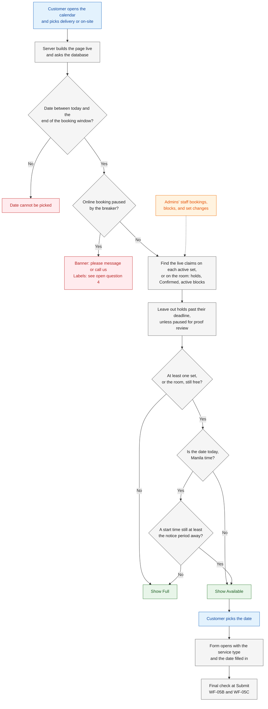

The order of the first two checks follows the flowchart in [BR-09][br].

### Sequence diagram

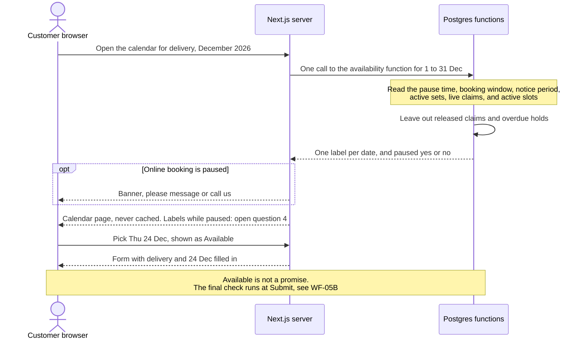

### Steps

| Step | Actor | What happens | Data created, updated, or read | Rules and requirements |
|---|---|---|---|---|
| 1 | Customer | Opens the calendar and picks delivery or on-site. | — | [FR-PUB-03][fr] |
| 2 | Next.js server | Builds the page live and makes one call to the availability function, for that service type and the dates on screen. | — | [FR-PUB-03][fr], [NFR-03][nfr] |
| 3 | Database | Works out "today" as the Manila date, and the last date of the booking window (180 days by default, BR-09). | Read: booking window setting | [BR-09][br], [NFR-19][nfr], [EC-82][ec] |
| 4 | Database | Checks whether online booking is paused. | Read: `online_paused_until` setting | [BR-07a][br] |
| 5 | Database | For each date, lists the active resources of that type: the active delivery sets, or the room. | Read: resources | [BR-01][br], [BR-02][br] |
| 6 | Database | Finds the live claims on those resources for that date: reservations that are Pending Confirmation, Awaiting Deposit, or Confirmed, and active blocks. A whole-date block claims every active set and the room. | Read: set and room claims, reservations, blocks | [BR-04][br], [BR-08][br] |
| 7 | Database | Leaves out holds whose deadline has passed, unless their expiry is paused for proof review. Nothing is written. | Read: each hold's deadline and expiry-paused flag | [BR-05][br], [BR-12][br], WF-05D |
| 8 | Database | Labels the date **Full** if no set (or the room) is free. If the date is today, it is also Full when no start time is left that meets the notice period (1 hour by default, BR-06): an active slot start for delivery, or an arrival time within on-site hours for on-site. Otherwise the date is **Available**. Add-on stock does not change the label. | Read: active delivery slots, on-site hours, notice period setting | [BR-09][br], [BR-06][br], [BR-03][br], [EC-07][ec] |
| 9 | Database | Returns only each date's label, and whether online booking is paused. No counts, names, or other data. | — | [BR-09][br], [NFR-15][nfr] |
| 10 | Next.js server | Shows the labels. Dates outside the booking window cannot be picked. While online booking is paused, shows the banner "please message or call us". | — | [BR-09][br], [BR-07a][br], [FR-PUB-03][fr], [EC-08][ec], [EC-15][ec] |
| 11 | Customer | Picks an Available date. The form opens with the service type and the date already filled in (a [P] detail of FR-PUB-03), and WF-01 continues. | — | [FR-PUB-03][fr], [FR-PUB-04][fr], [booking-and-submission][wf-book] |
| 12 | Database (later, at Submit) | Checks everything again at the moment of Submit, under the capacity lock. | See WF-05B | [BR-09][br] ("Available is not a promise"), [EC-03][ec] |

### Decision points and validation

| Decision | Yes | No | Rule |
|---|---|---|---|
| Is the date between today and the end of the booking window? | The date can be shown and picked | The date cannot be picked | [BR-09][br], [EC-08][ec] |
| Is online booking paused (the pause time is later than now)? | Banner "please message or call us" (labels: open question 4) | The calendar works as normal | [BR-07a][br], [FR-PUB-03][fr] |
| After leaving out released claims and overdue holds, is at least one set (or the room) free? | Go on to the today check | Full | [BR-01][br], [BR-02][br], [BR-04][br], [BR-05][br], [BR-08][br] |
| Is the date today (Manila date)? | Check the notice period | Available | [BR-09][br], [NFR-19][nfr] |
| Is at least one start time still at least the notice period away? | Available | Full | [BR-06][br], [BR-09][br], [EC-07][ec] |
| Is there enough add-on stock? | Not checked here: it never changes the label | Checked at Submit | [BR-03][br], [EC-05][ec] |

### Failure and exception paths

| Situation | What the customer sees | Edge case |
|---|---|---|
| A hold's deadline passed a few seconds ago, and the every-minute job has not run yet | Its set already counts as free: Available, if nothing else holds the date | [EC-22][ec]; WF-05D |
| A hold has a proof waiting for review past its deadline | The hold still counts, so the date may stay Full | [EC-27][ec], [BR-12][br] |
| Today, a set is free, but every slot left is less than the notice period away | Full for today | [EC-07][ec] |
| A date beyond the booking window | It cannot be picked | [EC-08][ec] |
| The calendar showed Available, but someone took the last set before Submit | "Just taken" at Submit; the form keeps the data and suggests other dates | [EC-03][ec]; WF-05C |
| The calendar showed Available, but the add-on stock is short | Refused at Submit with a clear message; the form keeps the data | [EC-05][ec] |
| The breaker has paused online booking | A banner asking the customer to message or call; an admin can still create the booking | [EC-15][ec], [EC-45][ec] |
| A set or the room is blocked, or the whole date is blocked | That set or the room counts as taken; a whole-date block makes both service types Full | [BR-08][br], [EC-18][ec] |
| The time is between midnight and 8:00 AM Manila time, when UTC still shows the day before | "Today" is the Manila date | [EC-82][ec] |

### Status transitions involved

None. The calendar only reads. It counts the claims of reservations in the statuses that hold capacity, and of active blocks ([reservation-lifecycle §1.1][lc], "Holds capacity?"; block statuses in [§7][lc]). Overdue holds are recorded as Expired by a claiming action (WF-05B step 6) or by the expiry job ([WF-06F][wf-change]), not here.

### Developer notes

- **Database function:** `app.availability_calendar(service_type, from_date, to_date)`. It returns one `(event_date, label)` row per date and an `online_paused` flag. It is read-only (`STABLE`) and granted to the app's database role ([NFR-10][nfr]).
- **Route:** the public calendar page, rendered dynamically with no caching (for example `export const dynamic = 'force-dynamic'`), one database call per page view and no polling ([NFR-03][nfr], [NFR-06][nfr]). The page path comes with the page inventory (planned: `04-design/ux-and-sitemap.md`).
- **One shared predicate.** Use the same SQL helper for "this claim is live" and "this hold is overdue" here, in every capacity function (WF-05B), and in the expiry job ([WF-06F][wf-change]). Then the calendar and the Submit check can never disagree. For example `app.is_live_claim(...)` and `app.hold_is_overdue(...)`.
- **Time.** Compare with the database clock (`now()`); derive "today" with `now() AT TIME ZONE 'Asia/Manila'` ([NFR-19][nfr]).
- **Whole-date blocks** hold one block claim per active set and for the room ([spec v0.2][spec] §11, `block_resources`), so the calendar needs no special case for them. A set added after the block is the subject of open question 6.
- **Audit:** none; reads are not audited. **Outbox:** none.

*(indicative; final names in api-specification, batch 3)*

---

## WF-05B · The capacity check inside every capacity-changing action

### In plain words

Every action that takes, moves, or blocks a set, the room, or add-on units runs the same check inside the database, as one step. It first makes sure no other booking change is looking at the same free set at the same moment. It then ignores requests whose deadline has passed, checks that what the action needs is still free, and saves the change with its history and emails; if anything is not free, nothing changes and the person sees a clear reason. Approving a request or recording its deposit needs no lock, because the request keeps its set, but it is refused once the request's deadline has passed. Blocks, catalog edits, and switching off a set are refused when they clash with live bookings, and the screen lists those bookings. *Example:* Ana's booking for Thursday 24 December 2026 is Confirmed, and she asks to move it to Saturday 26 December; if both sets are already held on 26 December, the reschedule is refused and she keeps 24 December ([EC-48][ec]).

### Actors and responsibilities

| Actor | Responsibilities in this sub-flow |
|---|---|
| Customer (browser) | Sends an online request ([FR-PUB-06][fr]); the full steps are WF-01C. |
| Admin or Super Admin | Creates staff bookings, recreates expired requests, reschedules, edits details, approves, records deposits, creates or removes blocks, and edits the catalog. Some of these are Super Admin only, for example whole-date blocks and set or room deactivation ([roles §2.5][roles]). |
| Next.js server | Validates the input. For an admin action, checks the login, 2FA, and role on the server. Then makes one call to one database function ([FR-ADM-07][fr], [NFR-10][nfr], [NFR-21][nfr]). Sends the queued emails after the reply ([FR-NTF-16][fr]). |
| Postgres function | Takes the capacity lock when needed, runs the checks, claims or refuses, and writes the change, the audit entry, and the queued emails in one transaction ([NFR-20][nfr], [NFR-21][nfr]). |
| Resend | Sends the queued emails ([FR-NTF-16][fr]). |

### Trigger and preconditions

- **Trigger:** any action in the two tables below.
- **Preconditions:**
  - For an admin action: a logged-in admin whose role allows it ([roles §2][roles]).
  - For a reservation action: a status that allows it ([reservation-lifecycle §4 and §5][lc]); any other action is refused ([EC-53][ec]).

### Which checks each action runs

**Part 1: actions on reservations.**

| Action | Takes the capacity lock | Overdue holds | Online-only checks | Set or room | Add-on stock | Requirement |
|---|---|---|---|---|---|---|
| Online request | Yes | Marked Expired first ([BR-09][br] and [FR-PUB-06][fr] developer notes; which ones: [booking-and-submission][wf-book] open question 8) | Booking window, notice, hold limits, breaker | Claims a free one | Checked | [FR-PUB-06][fr]; [lifecycle row 1][lc] |
| Staff-created booking (phone, walk-in, Facebook) | Yes | Marked Expired first **[P] (new in this doc)** | Skipped ([BR-06a][br]) | Claims a free one | Checked | [FR-ADM-24][fr]; [lifecycle row 2][lc] |
| Recreate an expired request | Yes | Marked Expired first **[P] (new in this doc)** | Not counted toward the hold limits ([BR-07][br]) | Claims a free one | Checked | [FR-ADM-21][fr]; [lifecycle §6.9][lc] |
| Reschedule | Yes | Marked Expired first, on the target date ([lifecycle §6.5][lc]) | Not stated (open question 5) | Releases the old claims, then claims a free one | Checked | [FR-ADM-17][fr]; [lifecycle §6.5][lc] |
| Edit details, when the package or add-ons change | Yes | Do not count ([BR-05][br]) | — | Unchanged: the date is not edited here | Checked again | [FR-ADM-10][fr]; [lifecycle §6.2][lc] |
| Approve; record a deposit; same-day waiver; extend a deadline | No: the claims are kept | This hold itself is refused if overdue, unless expiry is paused where the lifecycle allows it | — | Kept | Kept | [FR-ADM-07][fr], [FR-ADM-08][fr], [FR-ADM-11][fr], [FR-ADM-13][fr], [FR-ADM-16][fr]; [lifecycle rows 4 to 7, §6.3][lc] |

**Part 2: blocks, catalog edits, and sets and the room.**

| Action | Who ([roles §2.5, §2.6][roles]) | Takes the capacity lock | Refused when | On success | Requirement |
|---|---|---|---|---|---|
| Block a set or the room (one block per date in a range) | Either admin | Yes | That set or the room already has a live claim on that date | Block `active`; the set or the room counts as taken | [BR-08][br], [FR-ADM-25][fr], [EC-18][ec] |
| Block a whole date | Super Admin only | Yes | Any active set or the room already has a live claim on that date | Block `active` on every active set and the room | [BR-08][br], [EC-19][ec] |
| Remove a block (reason required) | The same as for creating it | Yes ([NFR-20][nfr]: it frees capacity) | — | Block `removed`; the capacity is free at once | [BR-08][br], [lifecycle §7][lc] |
| Lower an add-on's daily stock | Either admin | **[P] (new in this doc)** | A future date already has more of it claimed than the new stock | New stock saved | [BR-10][br], [FR-ADM-26][fr], [EC-57][ec] |
| Archive a package, an add-on, or a delivery slot | Either admin; slots: Super Admin | **[P] (new in this doc)** | A live reservation uses it | Archived; no longer offered | [BR-10][br], [FR-ADM-26][fr], [FR-ADM-28][fr], [EC-58][ec] |
| Deactivate a delivery set or the room | Super Admin only | **[P] (new in this doc)** | It has future live claims | Inactive; a set leaves the delivery pool | [BR-10][br], [FR-ADM-27][fr], [EC-59][ec] |
| Change a price, a slot's times, or the on-site hours | Per [roles §2.5, §2.6][roles] | No | Never a clash: bookings keep their price snapshot and stored service start | Saved | [BR-10][br], [EC-55][ec], [EC-56][ec] |

### Flowchart: actions on reservations

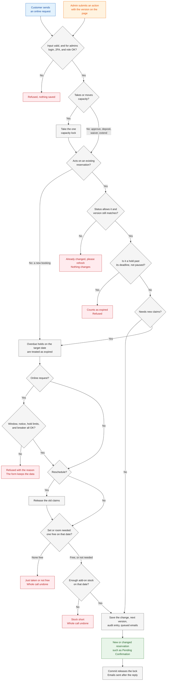

### Flowchart: blocks, catalog edits, and sets and the room

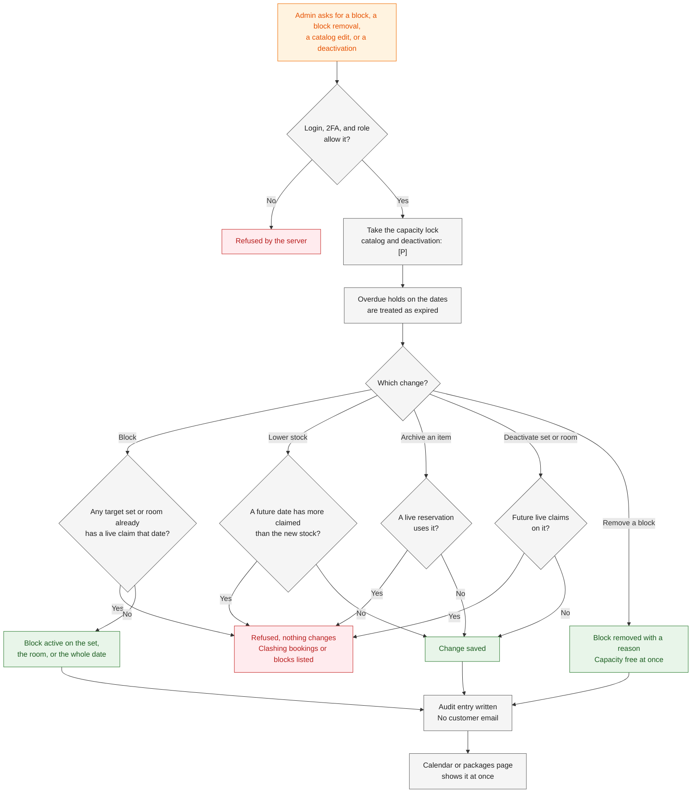

### Sequence diagram: a staff booking and a block race for one set

The full reschedule, with its own capacity part, is drawn in [WF-06C][wf-change].

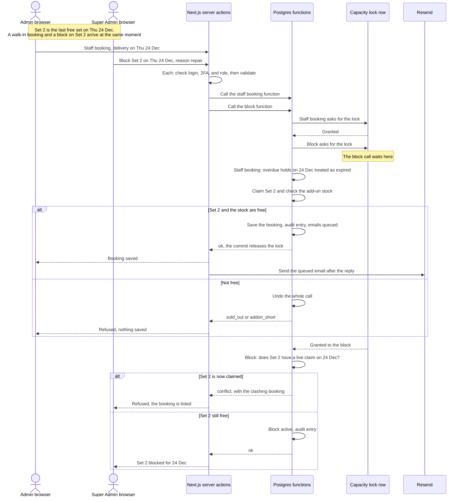

### Steps

**Part 1: actions on reservations** (steps 1 to 12).

| Step | Actor | What happens | Data created, updated, or read | Rules and requirements |
|---|---|---|---|---|
| 1 | Customer or admin | Submits the action. An admin page sends the version of the reservation it showed (WF-05E). | — | [FR-PUB-06][fr], [FR-ADM-07][fr] |
| 2 | Next.js server | Validates the input. For an admin: checks the login, 2FA, and role on the server. For an online request: the rate limit and bot checks of WF-01C. Then makes one call to one database function. | — | [FR-ADM-07][fr], [NFR-10][nfr], [NFR-11][nfr], [NFR-12][nfr], [NFR-21][nfr] |
| 3 | Database | If the action takes or moves capacity, takes the single capacity lock. Any other call that needs it now waits (WF-05C). | Lock row | [NFR-20][nfr], [reservation-lifecycle §4.3][lc] |
| 4 | Database | For an existing reservation: checks that its status allows the action and that its version still matches. If not: "already changed, please refresh", and nothing changes (WF-05E). | Read: reservation status and version | [FR-ADM-07][fr], [EC-16][ec], [EC-53][ec] |
| 5 | Database | If the reservation is a hold past its deadline, and its expiry is not paused, refuses: it counts as expired. | Read: deadline, expiry-paused flag | [BR-05][br], [reservation-lifecycle §3.3][lc], [EC-23][ec], [EC-26][ec] |
| 6 | Database | Treats overdue holds as expired. Before claiming a set or the room, it marks them Expired. Each one is the normal "deadline passed" change of lifecycle rows 9 and 10, so it writes its audit entry and queues the expired email, as every status change does (lifecycle §4.1). Which holds: for a reschedule, those on the target date (lifecycle §6.5); for an online request, the booking function expires stale holds ([BR-09][br] and [FR-PUB-06][fr] developer notes), and whether only those on the requested date is [booking-and-submission][wf-book] open question 8; for a staff-created booking and a recreate, the step itself is **[P] (new in this doc)** (open question 1). | Update: overdue holds → Expired, their claims released; create: audit entries, outbox rows | [BR-05][br], [lifecycle §4.1, rows 9 and 10][lc], [FR-NTF-12][fr] |
| 7 | Database | Online request only: checks the booking window, the notice period, the hold limits, and the breaker. A refusal names the reason. The full steps are WF-01C. | Read: settings, open online requests for this mobile number | [BR-09][br], [BR-06][br], [BR-07][br], [BR-07a][br], [lifecycle row 1][lc] |
| 8 | Database | Reschedule only: releases the old set or room claim and the old add-on claims. | Update: set or room claim, add-on claims | [lifecycle §6.5][lc] |
| 9 | Database | Claims a free set (the system picks it) or the room for the date. If none is free: "just taken" or "not free", and the whole call is undone. The unique index on live claims is the backstop (WF-05C step 10). | Create: set or room claim | [BR-01][br], [BR-02][br], [BR-08][br], [NFR-20][nfr], [EC-03][ec], [EC-48][ec] |
| 10 | Database | Checks that the add-ons claimed on that date, by all live reservations together, stay within each add-on's daily stock. Overdue holds do not count. If the stock is short, the whole call is undone. | Create or update: add-on claims | [BR-03][br], [BR-05][br], [EC-05][ec], [EC-47][ec] |
| 11 | Database | Saves the change as each action defines it: the new or changed reservation, its service start, deadline, urgent flag, and prices, the next version, the audit entry, and the queued emails. The commit releases the lock. | Create or update: reservation; create: audit entry, outbox rows | [reservation-lifecycle §3, §4.2, §6][lc], [catalog-and-payments §2.3][cat], [BR-06a][br], [FR-ADM-32][fr], [FR-NTF-16][fr] |
| 12 | Next.js server | Shows the result: success, or a clear reason with the typed data kept. Sends the queued emails after the reply. | Update: outbox status | [FR-PUB-06][fr], [FR-ADM-17][fr], [FR-NTF-16][fr], [NFR-33][nfr] |

Approve, record a deposit, the same-day waiver, and extend a deadline run steps 1, 2, 4, 5, 11, and 12 only: they keep their claims. Edit details runs steps 1 to 5 and 10 to 12: it changes no set or room claim.

**Part 2: blocks, catalog edits, and sets and the room** (steps 13 to 19).

| Step | Actor | What happens | Data created, updated, or read | Rules and requirements |
|---|---|---|---|---|
| 13 | Admin | Asks for a block (one set, the room, or a whole date; a date range makes one block per date), a block removal, a catalog edit, or a set or room deactivation, with a reason where one is required. | — | [FR-ADM-25][fr], [FR-ADM-26][fr], [FR-ADM-27][fr], [BR-08][br] |
| 14 | Next.js server | Checks the login, 2FA, and role on the server. For example, the Admin cannot block a whole date or deactivate a set. | — | [roles §2.5][roles], [EC-19][ec], [EC-74][ec] |
| 15 | Database | Takes the capacity lock: for blocks and block removal per [NFR-20][nfr]; for catalog edits and deactivation **[P] (new in this doc)**. | Lock row | [NFR-20][nfr] |
| 16 | Database | Treats overdue holds on the affected dates as expired. For a block, marks them Expired first, as in step 6 **[P] (new in this doc)**. | As step 6 | [BR-05][br] |
| 17 | Database | Looks for clashes: a live claim on the block's target set or room that date; a future date with more of the add-on claimed than the new stock; a live reservation that uses the item to be archived; future live claims on the set or room to be deactivated. | Read: claims, reservations, blocks | [BR-08][br], [BR-10][br] |
| 18 | Database, Next.js server | If anything clashes: refused, nothing changes, and the clashing reservations or blocks are listed. The admin reschedules or cancels them first. | — | [BR-08][br], [BR-10][br], [FR-ADM-25][fr], [EC-18][ec], [EC-57][ec], [EC-58][ec], [EC-59][ec] |
| 19 | Database, Next.js server | Otherwise saves the change and its audit entry, and commits. A block or a block removal shows on the calendar at once; a catalog edit shows on the packages page. No customer email is sent. | Create: blocks and block claims; or update: add-ons, packages, delivery slots, resources, block status; create: audit entry | [FR-ADM-25][fr], [FR-ADM-26][fr], [FR-ADM-27][fr], [FR-PUB-02][fr], [BR-09][br] |

### Decision points and validation

| Decision | Step | If it fails | Rule |
|---|---|---|---|
| Do the login and role allow the action? | 2, 14 | Refused by the server | [roles §2, §7][roles], [NFR-10][nfr], [EC-73][ec], [EC-74][ec] |
| Does the status allow the action, and does the version still match? | 4 | "Already changed, please refresh", or the action is not offered | [FR-ADM-07][fr], [FR-ADM-04][fr], [EC-16][ec], [EC-53][ec] |
| Is the reservation a hold past its deadline, not paused? | 5 | Counts as expired: refused | [BR-05][br], [BR-12][br], [EC-23][ec], [EC-26][ec] |
| Online request: booking window, notice, hold limits, breaker? | 7 | Refused with the reason; the form keeps the data | [BR-06][br], [BR-07][br], [BR-07a][br], [BR-09][br], [EC-06][ec], [EC-08][ec], [EC-09][ec], [EC-10][ec], [EC-15][ec] |
| Is a set or the room free on that date? | 9 | "Just taken" or "not free"; the whole call is undone | [BR-01][br], [BR-02][br], [BR-08][br], [EC-03][ec], [EC-48][ec] |
| Is there enough add-on stock on that date? | 10 | Refused; the whole call is undone | [BR-03][br], [EC-05][ec], [EC-47][ec] |
| Is a block's target set or room free of live claims? | 17 | Refused; the clashing booking or block is listed | [BR-08][br], [FR-ADM-25][fr], [EC-18][ec] |
| Does a catalog edit or deactivation clash with future live claims? | 17 | Refused; the clashing reservations are listed | [BR-10][br], [EC-57][ec], [EC-58][ec], [EC-59][ec] |
| Is it a price, slot-time, or on-site-hours change? | — | Never a clash | [BR-10][br], [EC-55][ec], [EC-56][ec] |

### Failure and exception paths

| Situation | What the system does | Edge case |
|---|---|---|
| A reschedule into a date that is full | Refused; the booking stays exactly as it was. A date that looked full only because of an overdue hold can still be used | [EC-48][ec] |
| A reschedule to today, or to a date before the current deadline | Allowed if capacity is free; the deadline can only move earlier, and the urgent flag is recomputed | [EC-49][ec] |
| An edit adds an add-on that is sold out on that date | Refused; nothing changes | [EC-47][ec] |
| Approving a request, or recording its deposit, after its deadline | Refused, unless expiry is paused for proof review; an admin can recreate the request instead | [EC-23][ec], [EC-52][ec] |
| Extending a deadline that has already passed | Refused | [EC-26][ec] |
| A staff-created booking while online booking is paused, or for a customer with 2 open online requests | Allowed; capacity is still checked | [EC-45][ec] |
| A block on a set that already has a live claim | Refused | [EC-18][ec] |
| The Admin tries to block a whole date | Refused by the server | [EC-19][ec] |
| A block and a booking on the same set at the same moment | Only one succeeds | [EC-17][ec]; WF-05C |
| Lowering an add-on's stock below what is booked on a future date | Refused; the clashing reservations are listed | [EC-57][ec] |
| Archiving a package, add-on, or slot that live reservations use | Refused; the reservations are listed | [EC-58][ec] |
| Deactivating a set or the room that has future live bookings | Refused; the bookings are listed | [EC-59][ec] |
| The email service fails after the change is saved | The change stands; the email is retried or marked failed | [EC-66][ec] |
| A block over a date range where only one date clashes | Not settled in batch-1 docs | [edge-cases §15][ec], question 1 |
| Recreating an expired request whose service start has passed | Not settled in batch-1 docs | [edge-cases §15][ec], question 2 |

### Status transitions involved

- *(new)* → **Pending Confirmation**: online request, staff-created booking, and recreate ([reservation-lifecycle §4.2][lc], rows 1 to 3). A staff-created booking whose start has passed, or is within the notice period, finishes as **Confirmed** in one step ([BR-06a][br]; [lifecycle §2][lc], note on one-step staff bookings).
- **Overdue holds → Expired** (other reservations, in steps 6 and 16): rows 9 and 10.
- Approve, record a deposit, the waiver: rows 4 to 7. Reschedule, edit details, and extend: no status change ([lifecycle §5][lc]).
- Blocks: `active` → `removed` ([lifecycle §7][lc]). Catalog edits and deactivation change no status.

### Developer notes

- **Database functions:** `app.book_reservation(...)` (named in [FR-PUB-06][fr]); `app.create_staff_reservation` (as in [WF-04G][wf-review], which owns that flow), `app.recreate_expired`, `app.reschedule_reservation`, `app.edit_reservation_details`, `app.approve_reservation`, `app.record_deposit`, `app.waive_deposit`, `app.extend_deadline`; `app.create_blocks`, `app.remove_block`; `app.update_addon`, `app.archive_catalog_item`, `app.deactivate_resource`.
- **Server actions:** one per action, in the admin module tree, each starting with the session and role check ([roles §7][roles]). The public submit action is in WF-01C.
- **The lock:** one row, taken with `SELECT … FOR UPDATE` as the first statement of each function that changes claims ([NFR-20][nfr]). Proposed order **[P] (new in this doc)**: the capacity lock first, then the reservation row (`FOR UPDATE`) with the status and version compare, so every function takes its locks in the same order (open question 10).
- **Why step 6 marks holds Expired.** A partial unique index cannot use `now()` in its condition, so a claim stays "live" for the index until its reservation's status changes. A function that claims a set or the room must therefore mark overdue holds on that date Expired before it claims. Counting add-on stock (step 10) can simply leave overdue holds out.
- **Result codes:** `ok`, `duplicate`, `sold_out` ([spec v0.2][spec] §12), `addon_short`, `too_soon`, `outside_window`, `hold_limit_date`, `hold_limit_total`, `paused`, `breaker_tripped`, `stale_version`, `overdue`, `not_allowed`, `not_free`, `conflict` (with the list of clashing reservations or blocks), matching the names in WF-01C where they overlap.
- **Audit:** category `booking` for reservation actions, and for the expiries in step 6 (actor `system`); category `catalog` for packages and add-ons; category `settings` for delivery slots ([catalog-and-payments §1.6][cat]). Blocks and sets have no category named in [FR-ADM-32][fr] yet ([administration][wf-admin] open question 1). Actions such as `reservation.rescheduled`, `block.created`, `addon.stock_changed`.
- **Outbox email types:** `request_received` ([FR-NTF-01][fr]), `admin_new_request` (online requests only, [FR-NTF-13][fr]), `approved` ([FR-NTF-03][fr]), `confirmed` ([FR-NTF-07][fr]), `deadline_extended` ([FR-NTF-05][fr]), `reservation_updated` ([FR-NTF-08][fr]), `rescheduled` ([FR-NTF-11][fr]), `expired` ([FR-NTF-12][fr]). Blocks, catalog edits, and deactivation queue no email.
- **Tests** (test plan, batch 4): blocks (creation, removal, refusal, permissions by kind), catalog-edit refusals, reschedule, edit details, recreate, and role permissions for each function ([spec v0.2][spec] §17).

*(indicative; final names in api-specification, batch 3)*

---

## WF-05C · Two customers submit for the last set at the same instant

### In plain words

Only one delivery set is still free on Thursday 24 December 2026, and Carla and Dan press Submit at the same moment. The database lets their requests through one at a time: whichever request reaches the database first gets the set; the other waits a fraction of a second. When it is Dan's turn, no set is free, so he sees "just taken, pick another date", and his form keeps everything he typed. A second guard in the database allows only one live claim per set per date, so even a programming mistake cannot give the set to both. The same happens when an admin blocks a set, enters a walk-in booking, or reschedules a booking into that date at the same moment.

### Actors and responsibilities

| Actor | Responsibilities in this sub-flow |
|---|---|
| Carla and Dan (customer browsers) | Each sends a request for the same date and service type. |
| Next.js server | Handles the two requests separately; each makes one call to the booking function ([NFR-21][nfr]). |
| Capacity lock (one database row) | Lets only one capacity-changing call run its checks at a time ([NFR-20][nfr]). |
| Postgres booking function | Runs every check and claim for one request while it holds the lock (WF-05B). |
| Unique index on live claims | The hard guard: rejects a second live claim on the same set or room for the same date ([NFR-20][nfr]). |
| Resend | Sends the winner's queued emails after the reply ([FR-NTF-16][fr]). |

### Trigger and preconditions

- **Trigger:** two or more capacity-changing calls that need the same last set (or the room, or the last add-on units) reach the database at overlapping times.
- **Preconditions:**
  - Ana's request holds Set 1 for Thursday 24 December 2026; Set 2 is the last free set.
  - Both requests pass the server checks of WF-01C.
  - They come from different customers. The same customer pressing Submit twice is not a race: the duplicate-submission key returns the same reservation ([EC-01][ec], WF-01C).

### Flowchart

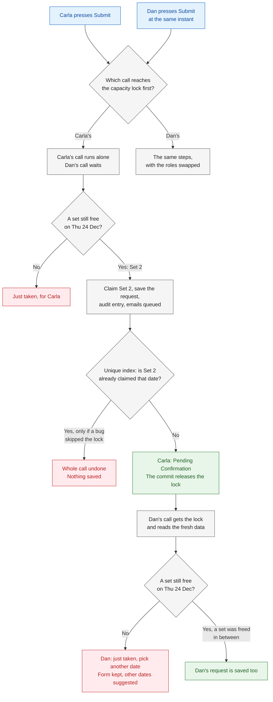

### Sequence diagram

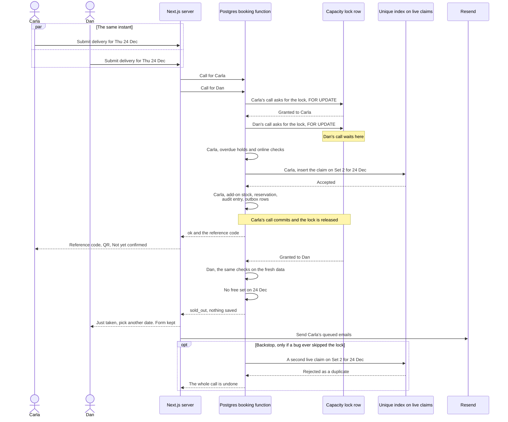

### Steps

| Step | Actor | What happens | Data created, updated, or read | Rules and requirements |
|---|---|---|---|---|
| 1 | Carla, Dan | On Wednesday 16 December 2026 at 3:00 PM, both press Submit for a delivery on Thursday 24 December. | — | [FR-PUB-06][fr] |
| 2 | Next.js server | Handles the two requests separately. Each passes the server checks and makes one call to the booking function. | — | [NFR-21][nfr]; WF-01C steps 1 to 5 |
| 3 | Database | Carla's call reaches the capacity lock first and takes it. Dan's call asks for the same lock and waits. Nobody chooses the order: it is whichever call arrives first. | Lock row | [NFR-20][nfr] |
| 4 | Database (Carla's call) | Runs WF-05B steps 6 to 10: overdue holds, the online checks, finds Set 2 free, claims it, and checks the add-on stock. | Create: claim on Set 2 for 24 Dec; add-on claims | [BR-01][br], [BR-03][br], [BR-04][br], [BR-05][br] |
| 5 | Database (Carla's call) | Saves her request as Pending Confirmation, with its deadline, reference code, audit entry, and queued emails. Commits; the lock is released. | Create: reservation, audit entry, outbox rows | [lifecycle row 1][lc], [FR-PUB-08][fr] |
| 6 | Next.js server | Shows Carla her reference code, her QR code, and "Not yet confirmed". Sends her queued emails after the reply. | Update: outbox status | [FR-PUB-07][fr], [FR-NTF-01][fr], [FR-NTF-13][fr] |
| 7 | Database (Dan's call) | Gets the lock and runs the same checks on the data Carla's call just saved. No set is free on 24 December. | Read: claims | [BR-01][br] |
| 8 | Database (Dan's call) | Returns "sold out". Nothing is saved for Dan, and the lock is released. | — | [NFR-21][nfr] |
| 9 | Next.js server | Shows Dan "just taken, pick another date". His form keeps everything he typed, and other dates are suggested. | — | [FR-PUB-06][fr], [EC-03][ec], [EC-04][ec] |
| 10 | Database (backstop) | If a programming mistake ever skipped the lock, the unique index would reject the second live claim on Set 2 for 24 December, and that whole call would be undone. | — | [NFR-20][nfr] |

### Decision points and validation

| Decision | Result | Rule |
|---|---|---|
| Which call reaches the capacity lock first? | That call runs its checks; the other waits for the commit | [NFR-20][nfr] |
| Is a set still free on that date, after leaving out overdue holds? | Yes: claim it. No: "just taken", nothing saved | [BR-01][br], [BR-04][br], [BR-05][br], [EC-04][ec] |
| Is there still enough add-on stock? (also checked under the lock) | No: refused, nothing saved | [BR-03][br], [NFR-20][nfr], [EC-05][ec] |
| Does the unique index accept the claim? | No (only after a bug): the whole call is undone | [NFR-20][nfr] |

### Failure and exception paths

| Situation | What the system does | Edge case |
|---|---|---|
| Two customers press Submit at the same instant for the last set | Exactly one gets it; the other sees "just taken, pick another date", with the form kept | [EC-04][ec] |
| Someone took the set while the customer was still filling in the form | The same "just taken" at Submit; other dates are suggested | [EC-03][ec] |
| An admin blocks the set at the same moment a customer books it | Only one succeeds. If the booking wins, the block is refused; if the block wins, the customer sees "just taken" | [EC-17][ec], [EC-18][ec] |
| An admin enters a walk-in booking for the last set while a customer submits online | The same lock decides; the staff booking skips the notice, hold-limit, and breaker checks, but never the capacity check | [EC-45][ec], [BR-06a][br] |
| An admin reschedules a booking into the last set while a customer submits | The same lock decides; the loser's call is refused and changes nothing | [EC-48][ec], [EC-03][ec] |
| Two requests need the last add-on units on the same date | The stock check runs under the lock; the second request is refused | [EC-05][ec], [BR-03][br] |
| The same customer double-clicks or retries | Not a race: the duplicate-submission key returns the same reservation | [EC-01][ec] |
| The unique index ever rejects a claim (a bug) | The whole call is undone. What the customer sees then: open question 11 | — |
| Bookings for different dates at the same moment | They also take turns on the one lock; each wait is very short ([NFR-20][nfr], "why one lock is enough") | — |

### Status transitions involved

- Carla: *(new)* → **Pending Confirmation** ([reservation-lifecycle §4.2][lc], row 1).
- Dan: none. A refused request creates no reservation.
- Any overdue hold on 24 December that the winning call marks Expired: rows 9 and 10.

### Developer notes

- **Function:** `app.book_reservation(...)`, as in WF-01C. The first statement is the lock: for example `SELECT 1 FROM app.capacity_lock WHERE id = 1 FOR UPDATE` on a one-row table ([spec v0.2][spec] §12). The lock is held until commit, so keep these functions short and make no network calls inside them; emails go through the outbox.
- **Isolation level.** Keep Postgres's default `READ COMMITTED`. After Dan's call gets the lock, each later statement takes a new snapshot and sees Carla's committed claim. Under `REPEATABLE READ`, Dan's call would keep reading the data from before Carla's commit, and only the unique index would stop it.
- **The unique index.** [spec v0.2][spec] §11 wants one live-claim index across `reservation_resources` and `block_resources`. A Postgres index covers one table, and its condition can use only that table's columns, without `now()`. So the data model needs one shared claims table (or an equivalent) that carries its own "live" flag, kept in step with the reservation and block status. This is for the data model (planned: `05-technical/data-model.md`); see open question 12.
- **Result codes:** `sold_out` ([spec v0.2][spec] §12), shown as "just taken, pick another date" ([FR-PUB-06][fr]). A unique violation (SQLSTATE `23505`) on the claim: proposed to show the same message and send an error report to Sentry **[P] (new in this doc)** (open question 11).
- **Audit:** Carla's request: category `booking`, actor kind `customer`, action such as `reservation.submitted`. Dan's refusal writes no audit entry: nothing changes ([NFR-21][nfr]).
- **Outbox:** Carla's `request_received` (if she gave an email) and `admin_new_request`. Nothing for Dan.
- **Tests:** two simultaneous bookings for the last set, where exactly one wins: a database test, and week-1 item 2 on the real database ([NFR-20][nfr]).

*(indicative; final names in api-specification, batch 3)*

---

## WF-05D · Overdue holds stop counting at once

### In plain words

Every request that is waiting for a review or a deposit has a deadline. The moment the deadline passes, the request stops holding its set everywhere at once: on the calendar, for the next booking, on the status page, and on the admin screens, even before anything is written down. A booking or a reschedule that needs that date marks the request Expired itself, before it takes the set. Recording Expired in the normal way, the expired email, and the daily backup run are part of expiry, [WF-06F][wf-change] in changes-and-expiry. The one exception is a request whose deposit proof is waiting for review: it keeps its set until an admin reviews it, but never past the service start. *Example (from BR-05):* Eva's unreviewed request for Thursday 24 December 2026 has a deadline of Tuesday 15 December at 9:00 AM, so from 9:00 AM her set (Set 2) counts as free, and a customer who opens the calendar at 9:00:20 AM can already book it, before the every-minute job runs.

### Actors and responsibilities

| Actor | Responsibilities in this sub-flow |
|---|---|
| Postgres functions (every reader) | The calendar, the booking check, the status page, and the admin screens treat an overdue hold as expired, without writing anything ([BR-05][br], [lifecycle §3.3][lc]). |
| Postgres capacity functions | A booking or a reschedule on that date marks the overdue hold Expired before it claims, under the capacity lock (WF-05B step 6). |
| Customer | Sees the date free on the calendar, and the hold as Expired on the status page ([FR-PUB-03][fr], [FR-PUB-11][fr]). |
| Admins | See the hold as expired on the dashboard and in the list; actions on it are refused ([FR-ADM-02][fr], [FR-ADM-03][fr], [FR-ADM-07][fr]). |
| The system: the every-minute job | Records Expired for holds that no capacity action has already marked; its steps are [WF-06F][wf-change] ([FR-SYS-01][fr]). |

### Trigger and preconditions

- **Trigger:** a hold's deadline passes and its expiry is not paused; or a paused hold reaches its service start with no review ([BR-12][br]).
- **Preconditions:** the reservation is Pending Confirmation or Awaiting Deposit, with its stored deadline ([reservation-lifecycle §3.2][lc]).

### Flowchart

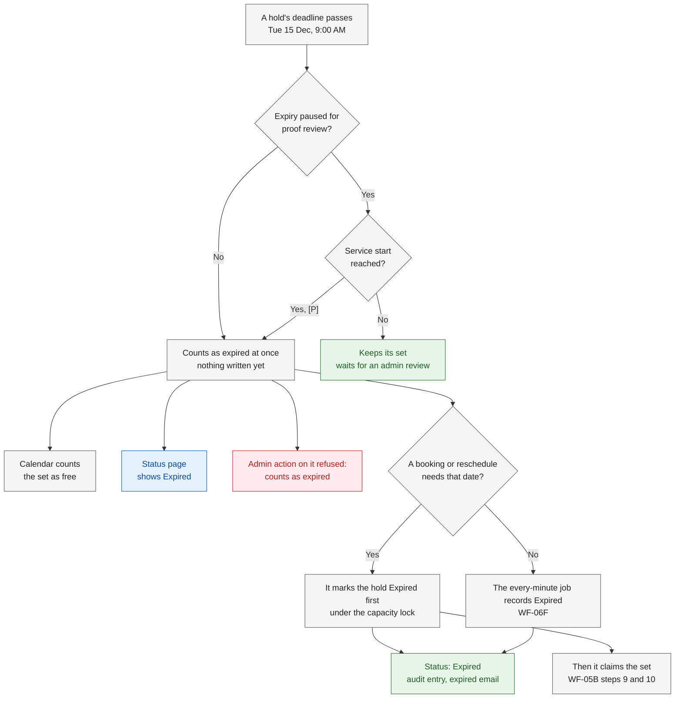

### Sequence diagram

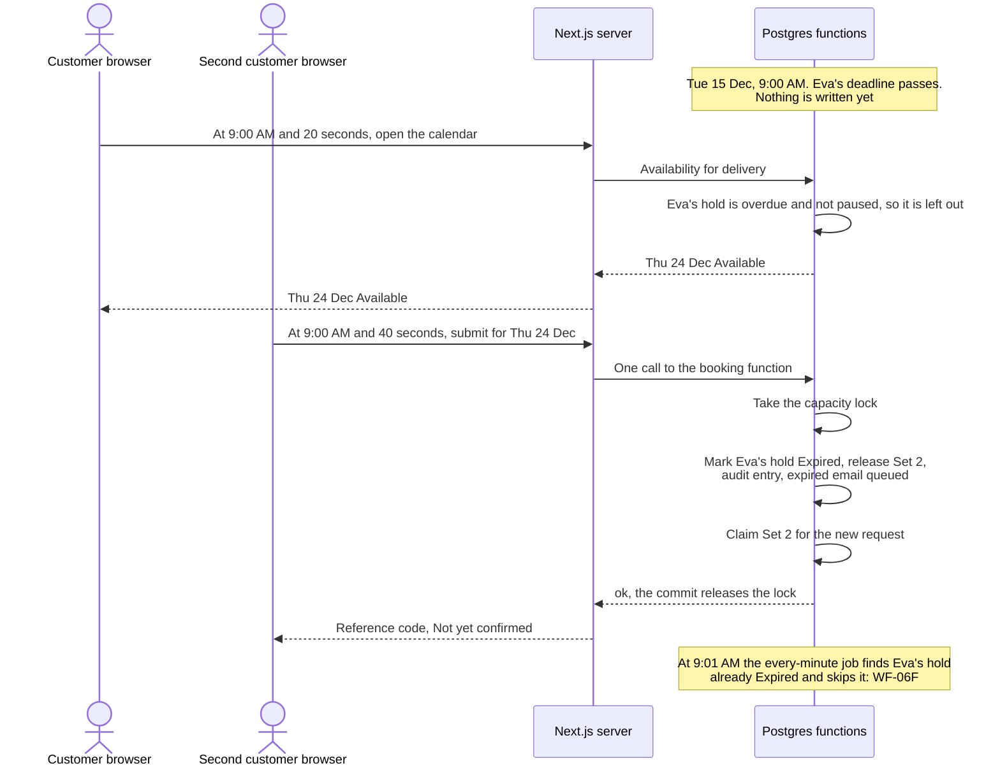

### Steps

| Step | Actor | What happens | Data created, updated, or read | Rules and requirements |
|---|---|---|---|---|
| 1 | — (time passes) | Eva's deadline passes at 9:00 AM on Tuesday 15 December. Nothing is written yet. | — | [reservation-lifecycle §3.2][lc] |
| 2 | Database (every read) | From that moment, every check treats the hold as expired: the calendar counts Set 2 as free (WF-05A step 7), the status page shows Expired, and the dashboard and the list show it as expired. | Read: deadline, expiry-paused flag | [BR-05][br], [FR-PUB-03][fr], [FR-PUB-11][fr], [FR-ADM-02][fr], [FR-ADM-03][fr], [EC-22][ec] |
| 3 | Database (admin actions) | Admin actions on this hold are refused, because it counts as expired. The full list is [WF-06F][wf-change] step 3. If the customer still wants the date, an admin can recreate the request ([WF-06G][wf-change] in changes-and-expiry). The hold already counts as Expired ([BR-05][br]); whether Recreate is offered before Expired is recorded is [changes-and-expiry][wf-change] open question 9e. | — | [reservation-lifecycle §3.3, §4.2][lc], [EC-23][ec], [EC-26][ec], [EC-52][ec] |
| 4 | Database (capacity actions) | A booking or a reschedule that needs that date marks the hold Expired itself, under the lock, before claiming (WF-05B step 6). It is the normal "deadline passed" change, with its audit entry and expired email. | Update: reservation → Expired, claims released; create: audit entry, outbox row | [lifecycle §4.1, §6.5, rows 9 and 10][lc], [BR-09][br] developer note |
| 5 | Database | **Paused case.** A hold whose proof was uploaded before its deadline is paused: it keeps counting after the deadline, until an admin reviews the proof ([WF-04E][wf-review]). | Read: expiry-paused flag | [BR-12][br], [EC-27][ec] |
| 6 | Database | **Paused case.** If no admin reviews the proof by the service start, the pause ends. From that moment the hold counts as expired everywhere **[P] (new in this doc)** (open question 3). | Read: expiry-paused flag, service start | [BR-12][br], [EC-31][ec] |
| 7 | — | Recording Expired for any hold that no capacity action has marked, the expired email, the daily backup sweep, and the heartbeat: [WF-06F][wf-change] steps 5 to 10 and 13. | — | [FR-SYS-01][fr], [FR-SYS-08][fr], [FR-SYS-10][fr] |

### Decision points and validation

| Decision | Yes | No | Rule |
|---|---|---|---|
| Has the hold's deadline passed? | Go on | The hold counts as normal | [reservation-lifecycle §3.2][lc] |
| Is the expiry paused for proof review? | Keeps counting until review, or until the service start | Counts as expired at once | [BR-05][br], [BR-12][br] |
| For a paused hold: has the service start arrived? | Counts as expired (step 6, [P]) | Keeps counting | [BR-12][br], [FR-SYS-01][fr] |
| Does a booking or a reschedule need that date? | It marks the hold Expired first (step 4) | The every-minute job records it ([WF-06F][wf-change]) | [lifecycle §6.5][lc], [BR-09][br] developer note |

### Failure and exception paths

| Situation | What the system does | Edge case |
|---|---|---|
| The hold's deadline passed, but the job has not run yet | It counts as expired everywhere at once | [EC-22][ec] |
| The every-minute job stops or runs late | No capacity rule depends on it; the backup sweep and the alert are in [WF-06F][wf-change] | [EC-77][ec] |
| An admin tries to approve, or to record the deposit, after the deadline | Refused, unless expiry is paused for proof review | [EC-23][ec] |
| An admin tries to extend a deadline that has passed | Refused; the admin can recreate the request if capacity is free | [EC-26][ec], [EC-52][ec] |
| A proof is waiting for review past the deadline | The hold keeps counting, so the date may stay Full | [EC-27][ec] |
| A proof is still unreviewed at the service start | The hold stops counting then (step 6) | [EC-31][ec] |
| The job and a booking both try to expire the same hold | Only one does; the customer gets one expired email | [EC-68][ec] |

### Status transitions involved

- **Pending Confirmation → Expired**: [reservation-lifecycle §4.2][lc], row 9; **Awaiting Deposit → Expired**: row 10, ways a and b. Here they are recorded only by a capacity action on that date (step 4); otherwise by the job in [WF-06F][wf-change].
- Deadlines are checked, not left to the jobs: [lifecycle §3.3][lc].

### Developer notes

- **Overdue predicate.** [Lifecycle §4.3][lc] gives "deadline passed and `expiry_paused` is false". This doc adds "`expiry_paused` is true and the service start has passed" **[P] (new in this doc)** (open question 3). Use one shared SQL helper, for example `app.hold_is_overdue(...)`, in the readers (WF-05A), the capacity functions (WF-05B), and the expiry job (`app.expire_overdue_holds()`, [WF-06F][wf-change]).
- **Readers never write.** The calendar, the status page, and the admin lists only treat an overdue hold as expired; recording Expired is done by a capacity function (step 4) or by the job ([spec v0.2][spec] §12: "the every-minute job only cleans up").
- **Idempotent expiry.** `UPDATE … WHERE status IN ('pending', 'awaiting_deposit') AND <overdue>`. The row lock makes the job and a booking function take turns on the same reservation; whoever comes second changes nothing. The outbox unique key (reservation + type + audit entry, [FR-NTF-17][fr]) keeps it to one expired email per expiry.
- **Audit:** category `booking`, actor kind `system`, action such as `reservation.expired`. **Outbox:** `expired` ([FR-NTF-12][fr]).
- **Tests:** the overdue-hold release (BR-05), proof pausing expiry, and deadlines capped at the service start ([spec v0.2][spec] §17).

*(indicative; final names in api-specification, batch 3)*

---

## WF-05E · Two admins act on the same reservation

### In plain words

The Admin and the Super Admin may have the same reservation open at the same time, for example on a phone and on a laptop. Each page remembers which version of the reservation it showed. The first action to reach the database wins, and it changes the version. When the second admin then acts from the old page, the database sees that the version no longer matches, changes nothing, and shows "already changed, please refresh". *Example:* on Thursday 17 December 2026 at 2:00 PM, the Admin approves Ana's request on his phone; a moment later the Super Admin, whose laptop still shows Pending Confirmation, clicks Reject, and the reject is refused.

### Actors and responsibilities

| Actor | Responsibilities in this sub-flow |
|---|---|
| Admin (phone) and Super Admin (laptop) | Each opens the reservation and submits an action from that page. |
| Next.js server actions | Check the login, 2FA, and role, and send the action with the version the page showed ([FR-ADM-07][fr]). |
| Postgres functions | Lock the reservation row, compare the status and the version, then act or refuse ([FR-ADM-07][fr], [NFR-21][nfr]). |
| Resend | Sends the email that the winning action queued ([FR-NTF-16][fr]). |

### Trigger and preconditions

- **Trigger:** an admin submits any reservation action ([FR-ADM-08][fr] to [FR-ADM-24][fr]).
- **Preconditions:**
  - Both admins are logged in with 2FA ([FR-ADM-01][fr]).
  - Each reservation page was loaded with the version it shows. Admin pages do not refresh themselves ([FR-ADM-02][fr]), so a page can show an old version.

### Flowchart

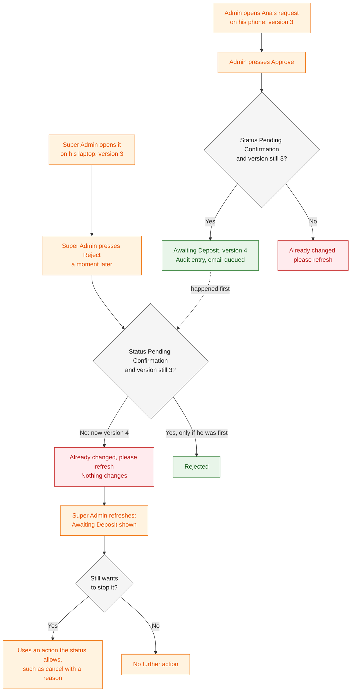

### Sequence diagram

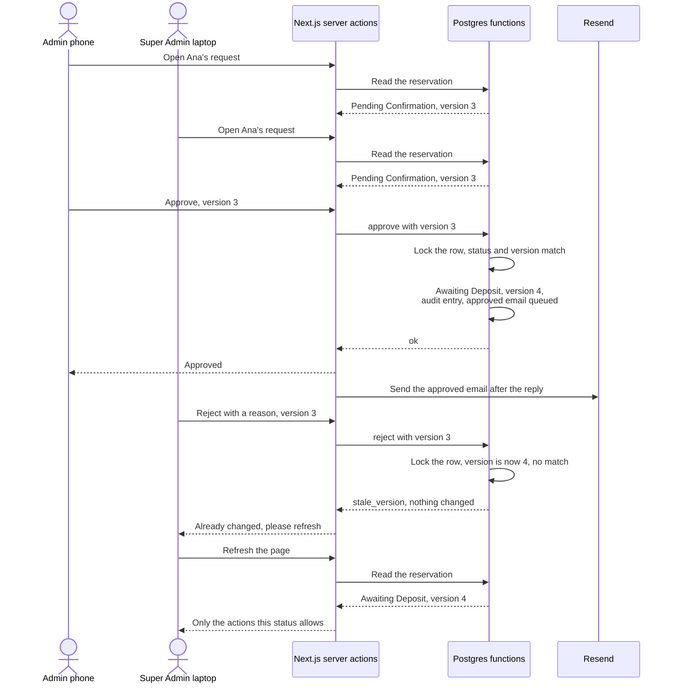

### Steps

| Step | Actor | What happens | Data created, updated, or read | Rules and requirements |
|---|---|---|---|---|
| 1 | Admin, Super Admin | Both open Ana's request. Each page shows Pending Confirmation and carries version 3. | Read: reservation | [FR-ADM-04][fr] |
| 2 | Admin | On Thursday 17 December 2026 at 2:00 PM, presses Approve. The page sends the action with version 3. | — | [FR-ADM-08][fr] |
| 3 | Next.js server | Checks the login, 2FA, and role, then calls the approve function with version 3. | — | [FR-ADM-07][fr], [NFR-10][nfr] |
| 4 | Database | Locks Ana's row. The status is Pending Confirmation and the version is 3: they match. The deadline has not passed. | Read: reservation | [FR-ADM-07][fr], [BR-05][br] |
| 5 | Database | Approves: Awaiting Deposit, a new deposit deadline, version 4, an audit entry, and the approved email queued. Commits. | Update: reservation; create: audit entry, outbox row | [lifecycle row 4][lc], [FR-NTF-03][fr] |
| 6 | Super Admin | A moment later, presses Reject on his old page, with a reason. The page sends version 3. | — | [FR-ADM-08][fr] |
| 7 | Database | Locks Ana's row; it waits if step 5 is still running. Finds version 4 and the status Awaiting Deposit: no match. | Read: reservation | [FR-ADM-07][fr], [NFR-21][nfr] |
| 8 | Database | Returns "already changed". Nothing changes: no audit entry and no email. | — | [EC-16][ec], [NFR-21][nfr] |
| 9 | Next.js server | Shows the Super Admin "already changed, please refresh". | — | [FR-ADM-07][fr] |
| 10 | Super Admin | Refreshes and sees Awaiting Deposit. The page offers only the actions that this status and his role allow; Reject is no longer offered. | Read: reservation | [FR-ADM-04][fr], [EC-53][ec] |
| 11 | Super Admin | If he still wants to stop the booking, he uses an action that is allowed now, for example cancel with a reason. It runs the same checks with version 4. | — | [lifecycle row 12][lc], [FR-ADM-18][fr] |

### Decision points and validation

| Decision | If it fails | Rule |
|---|---|---|
| Do the login and role allow the action? | Refused by the server | [roles §7][roles], [NFR-10][nfr], [EC-74][ec] |
| Does the status still allow the action? | Refused; after a refresh the action is not offered | [reservation-lifecycle §4.1][lc], [FR-ADM-04][fr], [EC-53][ec] |
| Does the version still match the one on the page? | "Already changed, please refresh"; nothing changes | [FR-ADM-07][fr], [EC-16][ec] |
| Is the reservation a hold past its deadline, not paused? | Counts as expired: refused | [BR-05][br], [EC-23][ec] |

### Failure and exception paths

| Situation | What the system does | Edge case |
|---|---|---|
| Both admins act on the same reservation at the same time | The first action wins; the second sees "already changed, please refresh", and nothing changes | [EC-16][ec] |
| After refreshing, the admin tries an action the new status does not allow | Refused; only the allowed actions are offered | [EC-53][ec] |
| The hold expired while the page was open (marked by the job or by a booking) | The status no longer matches: "already changed, please refresh" | [EC-22][ec], [EC-77][ec] |
| The hold is overdue, but not yet marked Expired | Refused: it counts as expired | [EC-22][ec], [EC-23][ec] |
| The customer uploaded a proof while the admin's page was open | Whether this counts as "already changed" is open question 9 | [EC-27][ec] |
| The same admin double-clicks, or the browser retries the action | The second call carries the old version, so it is refused with "already changed"; the first stands | [EC-16][ec] |
| Two admins act on different reservations that need the same last set | Not a version case: the capacity lock decides (WF-05C) | [EC-17][ec], [NFR-20][nfr] |
| An admin makes a mistake | Nothing is deleted; it is fixed with a new action and a reason | [EC-54][ec] |

### Status transitions involved

- The winning action makes its own change, for example **Pending Confirmation → Awaiting Deposit** ([reservation-lifecycle §4.2][lc], row 4). Any of rows 4 to 8, 11 to 13, and 15, and the changes in [§5][lc], can be the winning action.
- The refused action makes no status change ([lifecycle §4.1][lc], "Two admins at once").

### Developer notes

- **Version:** the `version` field on the reservation ([spec v0.2][spec] §11), an integer increased by 1 on every successful change. Admin forms send it as a hidden field.
- **Compare-and-set**, inside the action's database function: either `SELECT … FOR UPDATE` and compare the status and version, or `UPDATE … WHERE id = $1 AND version = $2 AND status = ANY($3)` and check the row count. Result code `stale_version`, shown as "already changed, please refresh".
- **A refusal writes nothing:** no audit entry and no outbox row ([NFR-21][nfr]).
- **Which changes increase the version** (admin actions, and maybe customer and system changes) is open question 9.
- **Server actions:** in the admin module tree, each starting with the session and role check ([roles §7][roles]).
- **Audit:** on success only, category `booking`, actor kind `admin`, with the admin's ID ([FR-ADM-32][fr]). **Outbox:** the winning action's email, for example `approved` ([FR-NTF-03][fr]).

*(indicative; final names in api-specification, batch 3)*

---

## Source notes: batch-1 docs and the frozen spec

Where spec v0.2 and the batch-1 docs differ on a point this document uses, the batch-1 docs win ([D-23][dl]). The spec is not edited.

1. **The every-minute job and paused holds.** Spec §15 describes the job as expiring overdue holds "(not paused)". [FR-SYS-01][fr] also has the job expire a paused hold when its service start arrives, following BR-12. This document follows FR-SYS-01 (WF-05D step 6; the job's own steps are [WF-06F][wf-change] step 13).
2. **The booking window at Submit.** Spec §12 lists the booking function's checks as the notice period, the hold limits, and the breaker. [Lifecycle row 1][lc] also makes "date within the booking window" a precondition of a submission. This document follows the lifecycle (WF-05B step 7).
3. **Which changes take the capacity lock.** Spec §12 says every "capacity change (book, reschedule, edit, block, recreate)". [NFR-20][nfr] widens this to every change that "uses or frees" capacity, with the same list. This document follows NFR-20 for block removal and asks about the rest in open question 2.
4. **The BR-05 example and the running example.** [BR-05][br]'s example has Ana's request for Thursday 24 December 2026 sent on Saturday 12 December and expiring on Tuesday 15 December, while the running example in [reservation-lifecycle §3.4][lc] has Ana submit on Wednesday 16 December. This document keeps the BR-05 dates but gives that case to another customer, Eva (WF-05D), so Ana's story stays the same across the workflow docs.

## Open questions

These are not decided here. If the reviewers agree an answer is needed, add each one to the [decision log][dl] as a new open item (O-12 onwards), then update the owning doc and this document.

1. **[P] Overdue holds before a claim, in every claiming action.** The booking function ([BR-09][br] and [FR-PUB-06][fr] developer notes; which holds is [booking-and-submission][wf-book] open question 8) and the reschedule ([lifecycle §6.5][lc], on the target date) mark overdue holds Expired before claiming. For staff-created bookings, recreate, and blocks, batch-1 docs state only the outcome (an overdue hold does not count, [BR-05][br]). This document proposes the same step there (WF-05B steps 6 and 16), because the unique index sees a claim as live until its status changes. If accepted, add it to [lifecycle rows 2 and 3][lc] and [BR-08][br].
2. **[P] Which actions take the capacity lock.** This document proposes that lowering an add-on's stock, archiving a catalog item, and deactivating a set or the room also take the lock (WF-05B step 15), so that no booking can slip in between the [BR-10][br] clash check and the change. Do reject, cancel, and the expiry job, which only free capacity, also take it, as the wording of [NFR-20][nfr] suggests?
3. **[P] A paused hold at its service start.** Answered ([D-25][dl]): confirmed. [Lifecycle §4.3][lc] treated a hold as expired when "the deadline passed and expiry is not paused". Read together with [BR-12][br] (the pause never runs past the service start) and [FR-SYS-01][fr], this document treats a paused hold as expired everywhere from its service start, not only once the job has run (WF-05D step 6). The lifecycle developer note now says so, through the shared helper `app.hold_is_overdue(…, at)`.
4. **The calendar while online booking is paused.** The [BR-09][br] flowchart shows only the banner, and [FR-PUB-03][fr] says the calendar "shows a banner". Are the Available and Full labels still shown under the banner, or hidden?
5. **Admin actions and the online-only checks.** [Lifecycle §6.5 and §6.9][lc], [FR-ADM-17][fr], [FR-ADM-21][fr], and [FR-ADM-24][fr] name only capacity checks for a reschedule, a recreate, and a staff-created booking. Do these check the booking window, an archived or inactive delivery slot, or the on-site hours? Can a reschedule move a booking to a service start that is already past, or within the notice period? (Recreating a request whose start has passed is already [edge-cases §15][ec], question 2.)
6. **A whole-date block and a set added later.** A whole-date block claims every set that is active when it is created ([BR-08][br]; spec §11, `block_resources`). If a set is added afterwards, should the block also cover it? As written, that date would show Available for delivery.
7. **"Future" in BR-10.** When lowering stock, archiving an item, or deactivating a set, does a live claim for today count as a "future" live claim?
8. **On-site start times left today.** For the today check in [BR-09][br] on-site, which arrival times can a customer choose (for example, every 30 minutes), and is the closing time itself a valid arrival? This is needed together with O-02.
9. **Which changes increase a reservation's version.** Admin actions do. Do a customer's proof upload or QR reissue, and the system's expiry, also count as "already changed" for an admin page opened before them (WF-05E)?
10. **[P] The order of the first checks in a function.** [Lifecycle §4.3][lc] says each function checks the status and version "first"; spec §12 and [NFR-20][nfr] say each capacity change "first" takes the lock. This document proposes the capacity lock first, then the locked reservation row with the status and version compare, so every function takes its locks in the same order (WF-05B developer notes).
11. **[P] What the customer sees if the unique index ever fires.** If the backstop rejects a second live claim (only after a bug, WF-05C step 10), this document proposes the same "just taken, pick another date" message, plus an error report to Sentry.
12. **One index across bookings and blocks.** Spec §11 wants one live-claim unique index across `reservation_resources` and `block_resources`. A Postgres index covers one table, and its condition can use only that table's columns. Confirm that the data model (planned: `05-technical/data-model.md`) will use one shared claims table, or an equivalent, with its own live flag.

These are already open in other documents and are not repeated here: which overdue holds the booking function expires ([booking-and-submission][wf-book] open question 8); audit categories, including blocks and sets ([administration][wf-admin] open question 1); whether Recreate is offered before an overdue hold is recorded as Expired ([changes-and-expiry][wf-change] open question 9e); a block over a date range where one date clashes ([edge-cases §15][ec], question 1); recreating a request whose service start has passed (same list, question 2); a deadline extended while expiry is paused (same list, question 4); the reminder and the deadline shown while expiry is paused ([functional-requirements §7][fr], question 2).

[dl]: ../00-project/decision-log.md
[gl]: ../00-project/glossary.md
[roles]: ../01-requirements/roles-and-permissions.md
[br]: ../01-requirements/business-rules.md
[fr]: ../01-requirements/functional-requirements.md
[nfr]: ../01-requirements/non-functional-requirements.md
[ec]: ../01-requirements/edge-cases.md
[lc]: ../02-domain/reservation-lifecycle.md
[cat]: ../02-domain/catalog-and-payments.md
[spec]: ../superpowers/specs/2026-10-21-kasoundbox-design.md
[wf-book]: booking-and-submission.md
[wf-review]: lookup-and-review.md
[wf-change]: changes-and-expiry.md
[wf-notify]: notifications-and-tracking.md
[wf-admin]: administration.md
