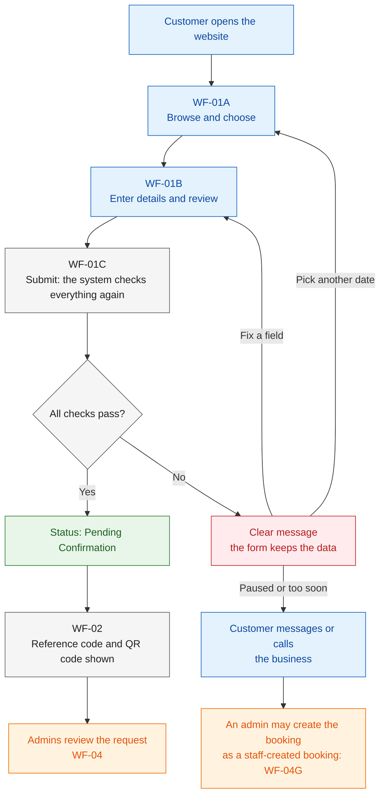
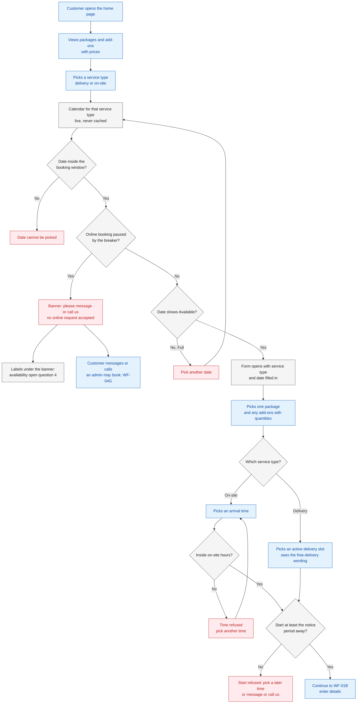
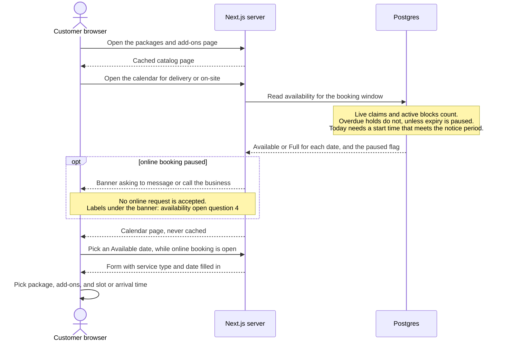
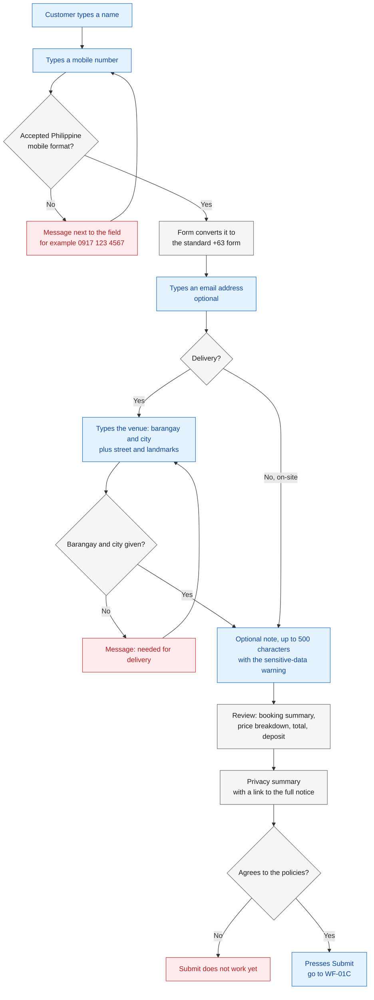
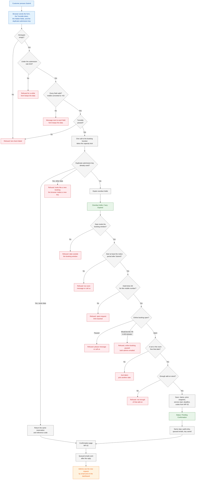
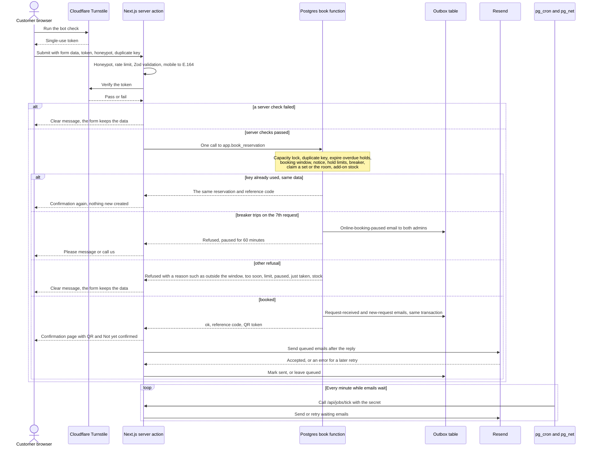
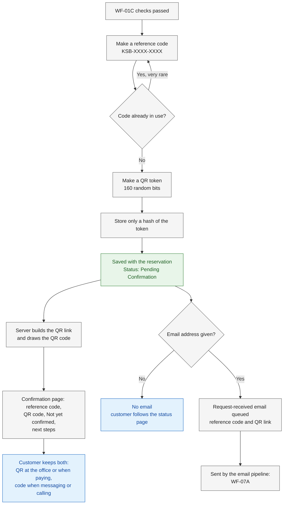
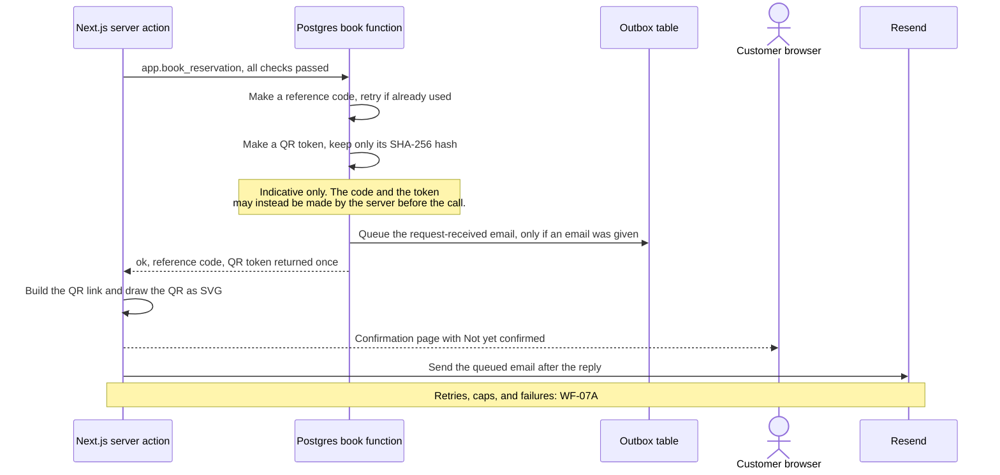

# Booking and Submission

> **Purpose:** The step-by-step flows for a customer who browses the website and sends a reservation request (WF-01, with sub-flows WF-01A to WF-01C), and for how the reference code and QR code are made, shown, and emailed (WF-02). ·
> **Audience:** The developer (Super Admin) and the business owner (Admin). Every workflow starts with "In plain words" for the business owner; the "Developer notes" subsections are mainly for the developer ·
> **Status:** Draft for review ·
> **Last updated:** 2026-10-21 ·
> **Depends on:** [Glossary][gl], [Decision log][dl], [Project charter][charter], [Roles and permissions][roles], [Business rules][br], [Functional requirements][fr], [Non-functional requirements][nfr], [Edge cases][ec], [Privacy and retention][priv], [Reservation lifecycle][lc], [Catalog and payments][cat]; sibling workflows [availability-and-conflicts](availability-and-conflicts.md) (WF-05), [lookup-and-review](lookup-and-review.md) (WF-03, WF-04), [changes-and-expiry](changes-and-expiry.md) (WF-06), [notifications-and-tracking](notifications-and-tracking.md) (WF-07), [administration](administration.md) (WF-08 to WF-10) ·
> **Derived from:** [functional-requirements][fr] FR-PUB-01 to FR-PUB-09, FR-NTF-01, FR-NTF-13, FR-NTF-15 to FR-NTF-21, FR-SYS-03; [business-rules][br] BR-01 to BR-11; [reservation-lifecycle][lc] §3, §4.1, and §4.2 rows 1, 9, and 10; [catalog-and-payments][cat] §1 and §2; [non-functional-requirements][nfr] NFR-03, NFR-11 to NFR-13, NFR-17 to NFR-21; [edge-cases][ec] EC-01 to EC-17, EC-22, EC-60 to EC-62, EC-66 to EC-68; [privacy-and-retention][priv] §3, §5.1, §6.2; background: [spec v0.2][spec] §5, §6, §9, §10, §11, §12, §13, §16 (frozen, never edited)

## How to read this document

- **What this document owns.** Only the step sequences WF-01 (WF-01A, WF-01B, WF-01C) and WF-02. Every rule, permission, status, deadline, price, retention period, requirement, and edge case is owned by a batch-1 document. This document names the rule by its ID (BR-xx, FR-…, NFR-xx, EC-xx, D-xx) and links to the owning doc. Numbers appear only in short brackets, such as "notice period (1 hour by default, BR-06)". If a number here and the owning doc ever differ, the owning doc is right.
- **No new rules.** Every step traces to a batch-1 document. Where a flow needs something that batch-1 docs do not define, it is listed under [Open questions](#open-questions) instead of being decided here. This document makes no new proposals.
- **Labels.** **[C]** confirmed decision · **[P]** proposed, accepted with the spec approval but may change · **[U]** unverified fact · **[O-nn]** open item in the [decision log][dl]. They keep their batch-1 meaning.
- **IDs.** Workflows are WF-01 and WF-02. Sub-flows are WF-01A, WF-01B, and WF-01C. Steps are numbered within each sub-flow, for example "WF-01C step 7".
- **Diagram colours.** In every flowchart: **blue** = the customer, **grey** = the system (website or database), **orange** = an admin, **green** = a status or a saved result, **red** = a refusal or failure.
- **Time and money.** Every date and time is Manila time (Asia/Manila, [NFR-19][nfr]). Every amount is in pesos (₱). Names, prices, and slot times in the examples are made up. The real slot times and on-site hours are O-02; the real packages, prices, stock, and deposit are O-03.
- **Developer names** (functions, server actions, routes, audit actions, email types) are indicative; final names come in api-specification, batch 3 (planned: `05-technical/api-specification.md`).

### Where the neighbouring steps live

| Before or after this document | Workflow | Document |
|---|---|---|
| How availability is worked out, and how two bookings at once are kept apart | WF-05 | [availability-and-conflicts](availability-and-conflicts.md) |
| Opening a reservation by QR scan or search; the admin's review and decision | WF-03, WF-04 | [lookup-and-review](lookup-and-review.md) |
| Cancel, reschedule, expiry, and recreating an expired request | WF-06 | [changes-and-expiry](changes-and-expiry.md) |
| Emails in general, the status page, and tracking a request | WF-07 | [notifications-and-tracking](notifications-and-tracking.md) |
| Admin reissue of a QR code ([FR-ADM-22][fr]) | WF-03D | [lookup-and-review](lookup-and-review.md) |
| Customer reissue of a QR code on the status page ([FR-PUB-13][fr]) | WF-07D steps 9 to 11 | [notifications-and-tracking](notifications-and-tracking.md) |
| A staff-created booking (phone, walk-in, Facebook) | WF-04G | [lookup-and-review](lookup-and-review.md) |
| Ending a breaker pause early | WF-08G | [administration](administration.md) |

---

## Workflows at a glance

| ID | Workflow | Starts when | Ends when |
|---|---|---|---|
| WF-01 | Customer browses and submits a reservation request | A customer opens the website | The request is saved as Pending Confirmation, or the customer gets a clear reason why not |
| WF-01A | Browse and choose the booking | The customer opens the home page or the packages page | The customer has a service type, a date, a package, any add-ons, and a slot or an arrival time |
| WF-01B | Enter details and review | The booking choices are made | The customer has agreed to the policies and presses Submit |
| WF-01C | Submit and server checks | The customer presses Submit | The request is saved, the same request is returned again, or the request is refused with a reason |
| WF-02 | Reference code and QR code | WF-01C has passed every check | The confirmation page is shown and the request-received email is queued (if an email was given) |

---

## WF-01 · Customer browses and submits a reservation request

### In plain words

A customer books on the website without an account. They look at the packages, pick delivery or on-site, and pick a date that shows **Available**. They choose a package, any add-ons, and a delivery slot or an arrival time, then type their name, mobile number, and, for delivery, where the event is. Before sending, they see the full price and the deposit and agree to the privacy terms. When they press Submit, the system checks everything again in one step: it either saves the request as **Pending Confirmation** with a reference code and a QR code, or explains clearly why not, without losing what they typed.

*Running example.* Ana books a delivery for Thursday 24 December 2026, in the 2:00 PM slot. She picks Package A (₱3,000) and 2 extra microphones (₱200 each): ₱3,400 in total, with a ₱1,000 deposit after approval. She types her mobile as `0917 123 4567`. She presses Submit on Wednesday 16 December at 10:00 AM. Her request is saved as Pending Confirmation with reference `KSB-7Q2M-K9TX`, and the admins have until Saturday 19 December at 10:00 AM to review it ([reservation-lifecycle][lc] §3.4).

### How the sub-flows fit together

Each sub-flow below (WF-01A, WF-01B, WF-01C) has the full set of sections: actors, trigger, diagrams, steps, decisions, failures, status changes, and developer notes.

| Sub-flow | Who mostly acts | What it covers | Status change |
|---|---|---|---|
| [WF-01A](#wf-01a--browse-and-choose-the-booking) | Customer, with live availability from the database | Packages page, service type, calendar, date, package, add-ons, slot or arrival time | None |
| [WF-01B](#wf-01b--enter-details-and-review) | Customer, in the browser | Name, mobile number, email, venue, note, review with price breakdown and privacy summary | None |
| [WF-01C](#wf-01c--submit-and-server-checks) | The server and the database | Bot checks, validation, duplicate submissions, notice, hold limits, breaker, capacity, saving, emails | *(new)* → Pending Confirmation |
| [WF-02](#wf-02--reference-code-and-qr-code) | The database and the server | Making the reference code and QR code, the confirmation page, the request-received email | None of its own |

---

## WF-01A · Browse and choose the booking

### In plain words

The customer looks at the packages and add-ons with their prices, then picks delivery or on-site. The calendar shows each date as **Available** or **Full**, and never shows names or counts. The customer picks an Available date, one package, any add-ons, and either a delivery slot or an arrival time. A start time that is too soon, or an arrival outside on-site hours, is refused straight away. "Available" is not a promise yet: the final check happens when the customer presses Submit (WF-01C).

*Example.* On Saturday 19 December 2026 at 5:30 PM, Ben wants the room for tonight. An arrival at 6:00 PM is refused, because it is less than the notice period away. An arrival at 7:00 PM is accepted ([FR-PUB-04][fr]).

### Actors and responsibilities

| Actor | Responsibilities in this sub-flow |
|---|---|
| Customer (no login, [roles][roles] §3.1) | Reads the packages, picks the service type, date, package, add-ons, and slot or arrival time |
| Website (Next.js server) | Serves the cached catalog pages; shows the calendar, the paused banner, and the form |
| Database (Postgres) | Works out Available or Full for each date, live (details in [WF-05](availability-and-conflicts.md)) |

### Trigger and preconditions

- **Trigger:** the customer opens the home page, the packages page, or the calendar.
- **Preconditions:**
  - The website and database are up ([NFR-04][nfr]).
  - At least one active package exists, and the delivery slots and on-site hours are set (O-02, O-03).
  - Nothing else: customers need no account **[C]** ([D-08][dl]).

### Flowchart

The order of the first two checks (booking window, then the pause) follows the flowchart in [BR-09][br], as in [WF-05A](availability-and-conflicts.md).

### Sequence diagram

### Steps

| Step | Actor | What happens | Data created, updated, or read | Rules and requirements |
|---|---|---|---|---|
| 1 | Customer | Opens the home page. It names both services **[C]** and links to the packages page, the calendar, the form, the status page, the privacy notice, and contact and FAQ (the links are **[P]**, new in [FR-PUB-01][fr]). | Nothing personal | [FR-PUB-01][fr], [D-01][dl] |
| 2 | Customer, Website | Opens the packages and add-ons page: each active package with its inclusions and price, each active add-on with its price. Archived items are not shown. The free-delivery wording is shown (O-04; on this page **[P]**, new in [FR-PUB-02][fr]). | Read: packages, add-ons (cached) | [FR-PUB-02][fr], [catalog-and-payments][cat] §1.1, §1.2, §1.5, [D-14][dl], [NFR-03][nfr] |
| 3 | Customer | Picks a service type: delivery or on-site. | — | [FR-PUB-03][fr], [D-01][dl] |
| 4 | Website, Database | Shows the calendar for that service type: **Available** or **Full** for each date from today through the booking window (180 days by default, BR-09). Dates outside the window cannot be picked. Always live; no names or counts. | Read: active sets and the room, live claims, active blocks, hold deadlines, settings | [BR-09][br], [BR-01 to BR-05][br], [BR-08][br], [FR-PUB-03][fr]; how it is worked out: [WF-05A](availability-and-conflicts.md) |
| 5 | Website | If the breaker has paused online booking, shows the banner "please message or call us", and no online request is accepted. Whether the Available and Full labels still show under the banner is [availability-and-conflicts](availability-and-conflicts.md) open question 4. | Read: the online-booking pause setting | [BR-07a][br], [BR-09][br], [FR-PUB-03][fr], [FR-PUB-06][fr] |
| 6 | Customer | Picks an Available date. The form opens with the service type and date filled in (**[P]**, new in [FR-PUB-03][fr]). A Full date does not continue; dates outside the booking window cannot be picked. | — | [FR-PUB-03][fr], [EC-07][ec], [EC-08][ec] |
| 7 | Customer | Picks one package. | Read: packages | [FR-PUB-04][fr], [catalog-and-payments][cat] §1.1 |
| 8 | Customer | Adds add-ons, with a quantity for each (optional). The calendar does not look at add-on stock; the stock is checked at Submit (WF-01C step 14). | Read: add-ons | [FR-PUB-04][fr], [BR-03][br], [BR-09][br], [EC-05][ec] |
| 9a | Customer | **Delivery:** picks one active delivery slot and sees the free-delivery wording (on the form **[P]**, new in [FR-PUB-04][fr]). The slot sets the event time; the set is held all day **[C]**. | Read: delivery slots | [FR-PUB-04][fr], [D-03][dl], [catalog-and-payments][cat] §1.3, O-02, O-04 |
| 9b | Customer | **On-site:** picks an arrival time. A time outside on-site hours is refused **[C]**. | Read: on-site hours setting | [FR-PUB-04][fr], [D-03][dl], O-02 |
| 10 | Website | **Same day:** a start less than the notice period away (1 hour by default, BR-06) is refused. The time that counts is the moment of Submit, so the database checks it again in WF-01C step 10. | Read: notice period setting | [BR-06][br], [FR-PUB-04][fr], [EC-06][ec] |
| 11 | Customer | Continues to WF-01B. The draft is kept in the browser session. | Browser session: the draft | [FR-PUB-06][fr], [EC-02][ec] |

### Decision points and validation

| Decision | If yes | If no | Rule |
|---|---|---|---|
| Is the date inside the booking window? | It can be picked | It cannot be picked | [BR-09][br] |
| Is online booking paused by the breaker? | Banner: please message or call us; no request is accepted. Labels under the banner: [availability-and-conflicts](availability-and-conflicts.md) open question 4 | The calendar works as normal | [BR-07a][br], [BR-09][br], [FR-PUB-03][fr] |
| Does the date show Available? | The form opens | Pick another date | [BR-09][br], [FR-PUB-03][fr] |
| Delivery or on-site? | Delivery: pick a slot | On-site: pick an arrival time | [FR-PUB-04][fr], [D-03][dl] |
| Is the arrival time inside on-site hours? | Accepted | Refused | [FR-PUB-04][fr] |
| Is the start at least the notice period away? | Accepted | Refused | [BR-06][br], [FR-PUB-04][fr] |
| Is there enough add-on stock? | Not decided here: checked at Submit | — | [BR-03][br], [FR-PUB-04][fr] |

### Failure and exception paths

| Situation | What the customer sees | Edge case |
|---|---|---|
| Online booking is paused by the breaker | "Please message or call us". Admins can still create phone, walk-in, and Facebook bookings ([BR-06a][br]). | [EC-15][ec] |
| The date is beyond the booking window | The date cannot be picked. | [EC-08][ec] |
| Today shows Full although a set or the room is free, because no start time left meets the notice period | Full for today. | [EC-07][ec] |
| The chosen start is too soon | Refused with a clear message. The customer can message or call, and an admin can create the booking ([WF-04G](lookup-and-review.md)). | [EC-06][ec], [EC-41][ec] |
| A hold on that date has passed its deadline, but the every-minute job has not run yet | The date already shows Available. | [EC-22][ec] |
| The calendar showed Available, but the add-on stock is short, or someone takes the last set while the customer is choosing | Found at Submit (WF-01C). | [EC-03][ec], [EC-05][ec] |

### Status transitions involved

None. This sub-flow only reads. The calendar treats an overdue hold as already expired without changing its status ([BR-05][br]; [reservation-lifecycle][lc] §3.3).

### Developer notes

- **Pages.** The packages page is cached and refreshed when the catalog is edited; the calendar and the form's availability are live, never cached; no polling ([NFR-03][nfr], [FR-PUB-02][fr], [FR-PUB-03][fr]).
- **Database function:** an availability read, `app.availability_calendar(service_type, from_date, to_date)` (the same name as in [WF-05A](availability-and-conflicts.md), which owns the calendar). It must treat "deadline passed and `expiry_paused` false" as free ([BR-05][br]) and use the Manila date for "today" ([NFR-19][nfr]).
- **Routes:** public pages such as `/packages`, `/availability`, and `/book`.
- **Audit category / outbox email type:** none; this sub-flow writes nothing.
- **Shared schema.** The form uses the Zod schemas shared with the server ([FR-PUB-06][fr] developer note).

*(indicative; final names in api-specification, batch 3)*

---

## WF-01B · Enter details and review

### In plain words

The customer types their name and mobile number; an email address is optional. A mobile number typed in any of the usual Philippine ways is accepted and stored in one standard form, so `0917 123 4567` becomes `+639171234567`. For a delivery, the customer also gives the barangay and city or municipality of the venue, plus the street and landmarks. Before sending, the customer sees a summary with the full price breakdown and the deposit, reads a short privacy summary, and ticks that they agree. Nothing is sent to the business until they press Submit.

*Example.* Ana's review shows: Package A ₱3,000 + 2 × extra microphone ₱200 = **₱3,400 total**. Delivery inside the service area is free. Deposit **₱1,000**, paid after approval ([FR-PUB-06][fr]; [catalog-and-payments][cat] §2.1).

### Actors and responsibilities

| Actor | Responsibilities in this sub-flow |
|---|---|
| Customer | Types the details, checks the summary, reads the privacy summary, agrees to the policies |
| Website (in the browser) | Checks each field as it is typed, converts the mobile number, shows the summary and the privacy summary, keeps the draft in the browser session |

### Trigger and preconditions

- **Trigger:** the customer finishes WF-01A.
- **Preconditions:** a service type, a date, one package, and a slot (delivery) or an arrival time (on-site) are chosen.

### Flowchart

### Sequence diagram

Not needed. Every step of this sub-flow happens in the customer's browser; batch-1 docs define no server call before Submit. The server and the database check everything again in WF-01C ([FR-PUB-06][fr]).

### Steps

| Step | Actor | What happens | Data created, updated, or read | Rules and requirements |
|---|---|---|---|---|
| 1 | Customer | Types a name. | Browser session: the draft | [FR-PUB-05][fr] |
| 2 | Customer, Website | Types a mobile number (required **[C]**). The form accepts any valid Philippine mobile number in a BR-11 form, checked with `libphonenumber-js` **[C]** (D-34), ignores spaces and dashes, and converts the number to the standard E.164 form `+63…`. Anything else gets a clear message next to the field. *Example:* `0917 123 4567` → `+639171234567`; `0895 123 4567` → `+638951234567`; `12345` is refused. | Browser session: the draft | [BR-11][br], [FR-PUB-05][fr], [D-08][dl], [NFR-17][nfr] (item 4) |
| 3 | Customer | Types an email address, or leaves it empty **[C]**. Without one, the booking still works: no customer emails are sent, and the customer follows the booking on the status page. | Browser session: the draft | [D-08][dl], [FR-PUB-05][fr], [FR-NTF-21][fr], [EC-12][ec] |
| 4 | Customer | **Delivery only:** types the venue. The barangay and city or municipality are required, plus the street and landmarks (whether those two are required is still open: [functional-requirements][fr] §7, question 6). The system does not check the service area; an admin does during review **[C]**. | Browser session: the draft | [FR-PUB-05][fr], [D-11][dl], [EC-13][ec] |
| 5 | Customer | Optionally types an "Additional requirements" note (up to 500 characters). The box warns: do not enter IDs, birthdates, health, or religious information. The form asks for no other personal data. | Browser session: the draft | [FR-PUB-05][fr], [privacy-and-retention][priv] §2, §3.2 |
| 6 | Website | Shows the review: service type, date, slot or arrival time, package, add-ons with quantities, the price breakdown, the total, and the deposit amount. Delivery has no fee. | Read: catalog prices, deposit amount setting | [FR-PUB-06][fr], [catalog-and-payments][cat] §1.5, §2.1 |
| 7 | Website | Shows the short privacy summary above the Submit button, with a link to the full privacy notice. | — | [FR-PUB-06][fr], [FR-PUB-15][fr], [privacy-and-retention][priv] §5.1 |
| 8 | Customer | Agrees to the policies. Submit works only after this. | Browser session: the draft | [FR-PUB-06][fr] |
| 9 | Customer | Presses Submit, which starts WF-01C. | — | [FR-PUB-06][fr] |

### Decision points and validation

| Decision | If yes | If no | Rule |
|---|---|---|---|
| Is it a valid Philippine mobile number in an accepted form? | Converted to the standard `+63…` form | Clear message next to the field | [BR-11][br], [FR-PUB-05][fr] |
| Was an email address given? | Customer emails will be sent | No customer emails; status page only | [D-08][dl], [FR-NTF-21][fr] |
| Is it a delivery? | The venue fields appear | No venue is asked for | [FR-PUB-05][fr] |
| Are the barangay and city or municipality given? | Continue | Clear message | [FR-PUB-05][fr] |
| Is the note 500 characters or fewer? | Accepted | A longer note cannot be entered | [FR-PUB-05][fr] |
| Has the customer agreed to the policies? | Submit works | Submit does not work | [FR-PUB-06][fr] |

### Failure and exception paths

| Situation | What happens | Edge case |
|---|---|---|
| A landline, or a number one digit short | Rejected with a clear message | [EC-11][ec] |
| No email address | The booking works normally; the status page is the source of truth | [EC-12][ec] |
| The venue may be outside the service area | Not checked here; an admin checks during review and approves or rejects | [EC-13][ec] |
| A new website version goes live while the form is open | The page asks the customer to reload; the draft is kept in the browser's session storage and the duplicate-submission key in its local storage | [EC-02][ec] |
| The customer types sensitive data in the note despite the warning | Not defined yet: [privacy-and-retention][priv] §11, question 9 | — |

### Status transitions involved

None. Nothing is saved in the database until WF-01C.

### Developer notes

- **Validation.** React Hook Form with the Zod resolver **[P]** ([spec v0.2][spec] §10); the same Zod schemas run again on the server ([FR-PUB-06][fr]). The mobile conversion runs in the form and again in the database ([BR-11][br]).
- **Draft and key.** The draft lives in browser session storage. The hidden duplicate-submission key, a random UUID made when the draft starts, lives in local storage, so a second tab of the same browser sends the same key ([FR-PUB-06][fr], [EC-01][ec], [EC-02][ec]; [security][sec] §4.4; [api-specification][api] §1.8; reconciled 2026-10-21).
- **Display only.** The review's amounts are shown from the catalog; the amounts saved are always calculated by the server at Submit, never taken from the browser ([catalog-and-payments][cat] §2.1 developer note, [NFR-21][nfr]).
- **Accessibility.** Visible labels, "required" in words, errors next to the field and read out by screen readers ([NFR-17][nfr]).
- **Database function / server action / audit category / outbox email type:** none in this sub-flow.

*(indicative; final names in api-specification, batch 3)*

---

## WF-01C · Submit and server checks

### In plain words

When the customer presses Submit, the website first checks that a person, not a bot, sent the form, and that every field is valid. Then the database checks everything again in one step, at the exact moment of Submit: the booking window, the notice period, the limits on open requests per mobile number, whether online booking is paused, a free set or the room, and enough add-on stock. If all is well, the request is saved as **Pending Confirmation**, the prices are locked, and the customer sees the confirmation page (WF-02); both admins get an email. If not, the customer sees a clear reason, and the form keeps everything they typed. Pressing Submit twice, or again after a network error, never makes a second request.

*Example.* Only one delivery set is still free on Thursday 24 December 2026. Carla and Dan press Submit at the same instant. Carla gets the set. Dan sees "just taken, pick another date", and his form keeps his details ([EC-04][ec]; step by step in [WF-05C](availability-and-conflicts.md)).

### Actors and responsibilities

| Actor | Responsibilities in this sub-flow |
|---|---|
| Customer (browser) | Runs the bot check, sends the form with its hidden duplicate-submission key, reads the result |
| Cloudflare Turnstile | The free bot check: gives the browser a token and confirms it to the server ([NFR-12][nfr]) |
| Next.js server action | Honeypot, rate limit, field validation, Turnstile check, one call to the booking function, the reply page, sending queued emails after the reply |
| Postgres booking function | Every booking rule in one transaction: lock, duplicate key, overdue holds, notice, hold limits, breaker, capacity, stock, saving, audit entry, queued emails |
| Outbox (database table) | Holds each email saved in the same step as the change ([FR-NTF-16][fr]) |
| Resend | Sends the emails ([FR-NTF-16 to FR-NTF-20][fr]) |
| pg_cron and pg_net | Every minute, call the email-sending job while emails are waiting ([FR-SYS-03][fr]) |
| Admins (both) | Receive the new-request email and see the request on the dashboard; they review it in [WF-04](lookup-and-review.md) |

### Trigger and preconditions

- **Trigger:** the customer presses Submit (WF-01B step 9).
- **Preconditions:**
  - The customer has agreed to the policies ([FR-PUB-06][fr]).
  - JavaScript is on, because Turnstile needs it ([NFR-18][nfr]).
  - The form carries its duplicate-submission key ([FR-PUB-06][fr]).

### Flowchart

The order of the checks inside the database follows [BR-09][br] (developer note): lock, overdue holds, notice, hold limits and breaker, set or room, then add-on stock. That note does not place the booking-window check, which [reservation-lifecycle][lc] §4.2 row 1 makes a precondition of a submission; its place here, just before the notice check, is indicative. The order of the first server checks is set in [api-specification][api] §2.3: honeypot, rate limit, fields, Turnstile, then the one call to the booking function, which checks the duplicate key (reconciled 2026-10-21; open question 5).

### Sequence diagram: submission end to end

### Steps

| Step | Actor | What happens | Data created, updated, or read | Rules and requirements |
|---|---|---|---|---|
| 1 | Customer browser | Runs the Turnstile check and sends the form data, the Turnstile token, the honeypot field, and the duplicate-submission key. | Browser: the draft (session storage) and the key (local storage) | [FR-PUB-06][fr], [NFR-12][nfr] |
| 2 | Next.js server | **Honeypot, then rate limit.** The honeypot must be empty, else the bot check fails. Then too many submissions from one internet address (5 per IP per hour by default, NFR-11) are refused for a while; a repeat with the same key counts too. | Read and update: rate-limit counter, keyed by an HMAC of the IP | [NFR-12][nfr], [NFR-11][nfr], [FR-SYS-06][fr], [EC-14][ec] |
| 3 | Next.js server | **Fields.** Every field is validated again with the shared schema, and the mobile number is converted to the standard form. | — | [FR-PUB-06][fr], [BR-11][br], [NFR-21][nfr] |
| 4 | Next.js server | **Turnstile.** The Turnstile token must pass, checked with Cloudflare. | — | [NFR-12][nfr], [FR-PUB-06][fr], [EC-14][ec] |
| 5 | Next.js server | Makes **one** call to the booking function. The rest of the submission happens inside it, all or nothing. | — | [FR-PUB-06][fr], [NFR-21][nfr] |
| 6 | Database | Takes the single capacity lock. | Lock row | [NFR-20][nfr], [BR-09][br] developer note |
| 7 | Database | **Duplicate submission.** If this key already belongs to a reservation and the request's data is the same, returns that reservation and its reference code; with other data, refuses it (`submission_key_mismatch`), and the browser makes a new key ([api-specification][api] §1.8). Nothing new is created. | Read: duplicate-submission keys (hashed) | [FR-PUB-06][fr], [EC-01][ec] |
| 8 | Database | Marks overdue holds Expired before claiming. Each one is the normal "deadline passed" change of lifecycle rows 9 and 10, so it writes its audit entry and queues the expired email, as every status change does. Which overdue holds (every one, or only those on the requested date): open question 8. | Update: overdue holds → Expired; create: their audit entries and outbox rows | [BR-05][br], [BR-09][br] developer note, [FR-PUB-06][fr] developer note, [reservation-lifecycle][lc] §4.1 and §4.2 rows 9 and 10, [FR-NTF-12][fr] |
| 9 | Database | **Booking window.** The event date must be within the booking window. The form checked it first (step 4); the database checks it again at the moment of Submit. | Read: booking window setting | [BR-09][br], [reservation-lifecycle][lc] §4.2 row 1, [EC-08][ec] |
| 10 | Database | **Notice.** The service start must be at least the notice period after the moment of Submit. | Read: notice period setting | [BR-06][br], [EC-06][ec] |
| 11 | Database | **Hold limits.** Counts this mobile number's open online requests (1 per date and 2 in total, BR-07). | Read: open online reservations for the standard-form mobile | [BR-07][br], [BR-11][br], [EC-09][ec], [EC-10][ec] |
| 12 | Database | **Breaker.** If online booking is paused, refuses. If this request would be the 7th online request within 60 minutes (BR-07a), refuses it, pauses online booking, and queues one email to both admins. Either admin can end the pause early ([WF-08G](administration.md)). | Read: online requests of the last 60 minutes, the pause setting. On a trip: update the pause setting; queue the paused email; audit entry, actor "system" | [BR-07a][br], [FR-NTF-15][fr], [roles][roles] §4, [EC-15][ec] |
| 13 | Database | **Capacity.** Claims a free delivery set (delivery) or the room (on-site) for the event date. The customer never picks the set. | Create: set or room claim | [BR-01][br], [BR-02][br], [BR-04][br], [BR-08][br], [EC-03][ec], [EC-04][ec], [EC-17][ec] |
| 14 | Database | **Add-on stock.** Checks the stock for that date and claims the quantities. | Create: add-on claims, with unit-price snapshot | [BR-03][br], [EC-05][ec] |
| 15 | Database | **Saves the reservation:** status Pending Confirmation, source `online`, service start, deadline (submission + 72 hours, capped at the service start), the price and deposit snapshot, the customer details, and the reference code and QR hash from WF-02. "Urgent" is not stored: it is worked out whenever the event date is today [P] (reconciled 2026-10-21; [data-model](../05-technical/data-model.md)). | Create: reservation | [reservation-lifecycle][lc] §3.1, §3.2, §4.2 row 1; [catalog-and-payments][cat] §2.2; [D-12][dl]; [BR-06a][br] |
| 16 | Database | In the same step: writes the audit entry (actor "customer"); queues the request-received email (only if an email was given) and the new-online-request email to both admins (urgent ones marked); saves the key against the reservation. | Create: audit entry, outbox rows, duplicate-submission key | [FR-PUB-06][fr], [FR-ADM-32][fr], [FR-NTF-01][fr], [FR-NTF-13][fr], [FR-NTF-16][fr] |
| 17 | Next.js server | Shows the confirmation page (WF-02). | — | [FR-PUB-07][fr] |
| 18 | Next.js server, Resend | Right after the reply, tries to send the queued emails. The every-minute job sends anything still waiting, with retries and caps: the email pipeline, [WF-07A](notifications-and-tracking.md). | Update: outbox status | [FR-NTF-16 to FR-NTF-20][fr], [FR-SYS-03][fr] |
| 19 | Admins | See the new request on the dashboard, urgent ones marked, and in their email. They review it in [WF-04](lookup-and-review.md). | Read | [FR-ADM-02][fr], [FR-NTF-13][fr], [BR-06a][br] |

### Decision points and validation

| Decision | If it fails | What the customer sees | Rule |
|---|---|---|---|
| Honeypot empty? | Refused | A bot-check message | [NFR-12][nfr], [FR-PUB-06][fr] |
| Under the submission rate limit? | Refused for a while | A clear message; the form keeps the data | [NFR-11][nfr] |
| Every field valid (mobile form, venue for delivery, note length, a date inside the booking window, an active slot, an arrival inside on-site hours)? | Refused | Messages next to the fields; the form keeps the data | [FR-PUB-04][fr], [FR-PUB-05][fr], [BR-09][br], [BR-11][br], [reservation-lifecycle][lc] §4.2 row 1 |
| Turnstile passed? | Refused | The same bot-check message | [NFR-12][nfr], [FR-PUB-06][fr] |
| Is the duplicate-submission key new? | Not a failure if the data is the same: the same reservation is returned. With other data: refused | The same confirmation and reference code; or "This looks like a new booking" | [FR-PUB-06][fr], [EC-01][ec]; [api-specification][api] §1.8 |
| Is the event date inside the booking window, at the moment of Submit (database)? | Refused | A clear message; the form keeps the data | [BR-09][br], [reservation-lifecycle][lc] §4.2 row 1, [EC-08][ec] |
| Start at least the notice period after Submit? | Refused | "Too soon"; message or call the business | [BR-06][br] |
| Hold limits met for this mobile number? | Refused | A clear message | [BR-07][br] |
| Online booking open, and not the 7th online request in 60 minutes? | Refused; on the 7th, online booking also pauses | "Please message or call us" | [BR-07a][br] |
| A set or the room free on that date? | Refused | "Just taken, pick another date"; other dates are suggested | [BR-01][br], [BR-02][br], [BR-08][br], [FR-PUB-06][fr] |
| Enough stock of each add-on on that date? | Refused | A clear message; the form keeps the data | [BR-03][br] |

### Failure and exception paths

| Situation | What the system does | Edge case |
|---|---|---|
| Double click, a retry after a network error, or a second tab | The same reservation and reference code come back; no second request is created | [EC-01][ec] |
| A new website version went live while the form was open | After the reload, the kept draft and key are sent; a repeat cannot create a second request | [EC-02][ec] |
| Someone else took the set, the room, or the stock while the customer was filling in the form | "Just taken"; the form keeps the data and suggests other dates | [EC-03][ec] |
| Two customers press Submit at the same instant for the last set | Exactly one gets it; the other sees "just taken" ([WF-05C](availability-and-conflicts.md)) | [EC-04][ec] |
| Not enough add-on stock, although the calendar showed Available | Refused with a clear message; the form keeps the data | [EC-05][ec] |
| The start is too soon at the moment of Submit | Refused; the customer can message or call, and an admin can create the booking ([WF-04G](lookup-and-review.md)) | [EC-06][ec], [EC-41][ec] |
| The same mobile number, typed differently, for a date where it already has an open request | Refused: the numbers are compared in the standard form | [EC-09][ec] |
| A mobile number that already has 2 open online requests | Refused | [EC-10][ec] |
| An invalid mobile number reaches the server | Refused with a clear message | [EC-11][ec] |
| A bot floods the form | Turnstile, the honeypot, and the rate limit stop most; hold limits and the breaker catch the rest; admins reject fakes | [EC-14][ec] |
| The 7th online request within 60 minutes | Refused; online booking pauses; both admins get one email; the dashboard shows a banner; either admin can end the pause early ([WF-08G](administration.md)) | [EC-15][ec] |
| An admin blocks the same set at the same moment | Only one succeeds; if the block wins, the customer sees "just taken" | [EC-17][ec] |
| An overdue hold sits on the date | It counts as expired; this request can take the set | [EC-22][ec] |
| The email service fails, the daily cap is reached, or a send is retried | The request stands; the email is retried, held until the next day, or marked failed; never sent twice | [EC-66][ec], [EC-67][ec], [EC-68][ec] |

### Status transitions involved

- *(new)* → **Pending Confirmation**: [reservation-lifecycle][lc] §4.2, row 1 (actor "customer"). The deadline rules are in §3.2.
- **Overdue holds → Expired** (other reservations, tidied up in step 8): rows 9 and 10, actor "system", each with its audit entry and expired email ([reservation-lifecycle][lc] §3.3, §4.1). Recording Expired in general is [WF-06F](changes-and-expiry.md).
- **Refusals** create no reservation and change no status. A breaker trip changes the online-booking pause setting, not a status ([BR-07a][br]).

### Developer notes

- **Server action:** `submitReservation`, in the public module tree, apart from admin code ([roles][roles] §7).
- **Database function:** `app.book_reservation(...)` (the name used in [FR-PUB-06][fr]). It returns either `ok` with the reservation ID, reference code, and QR token, or a refusal reason such as `duplicate`, `outside_window`, `too_soon`, `hold_limit_date`, `hold_limit_total`, `paused`, `breaker_tripped`, `sold_out`, or `addon_short` ([spec v0.2][spec] §12 names `sold_out`).
- **Breaker trip must commit.** On a trip, the function should return a refusal result rather than raise an error. Otherwise the transaction would roll back, and the pause, its admin email, and its audit entry would be lost ([BR-07a][br]).
- **Duplicate key.** Store only its hash; it is deleted after 72 hours by the retention job ([privacy-and-retention][priv] §6.2). The check must be atomic with the insert, because a double click sends two requests at once: check it inside the function after the lock, or rely on a unique index on the hash. A Turnstile token is single-use, so a retry with the same duplicate key needs a fresh token from the browser.
- **Rate limit.** The counters live in the database ([spec v0.2][spec] §10), keyed by an HMAC of the IP with a daily key ([NFR-11][nfr], [FR-SYS-06][fr]). Whether the check runs in its own call or inside `app.book_reservation` is for api-specification.
- **Prices** are calculated inside the function from the catalog, never from the browser ([catalog-and-payments][cat] §2.1, [NFR-21][nfr]).
- **Audit:** category `booking`, actor kind `customer`, action such as `reservation.submitted`; field names only, never contact data ([FR-ADM-32][fr]). Breaker trip: actor `system`, action such as `online_booking.paused`.
- **Outbox email types:** `request_received` ([FR-NTF-01][fr], customer priority), `admin_new_request` ([FR-NTF-13][fr], urgent marked), `admin_online_paused` ([FR-NTF-15][fr]). Unique key: reservation + type + audit entry ([FR-NTF-17][fr]).
- **Sending after the reply:** for example Next.js `after()`; then `pg_cron` with `pg_net` calls `/api/jobs/tick` with the bearer secret ([FR-SYS-03][fr], [FR-SYS-09][fr]).
- **Time.** "Today", the urgent flag, and the notice check use Manila time; the service start and the deadline are `timestamptz` ([NFR-19][nfr], [EC-82][ec]).
- **Errors** go to Sentry with personal data scrubbed ([NFR-23][nfr]).
- **Tests** (test plan, batch 4): two simultaneous submissions for the last set, hold limits, the breaker, mobile normalization, outbox de-duplication ([spec v0.2][spec] §17).

*(indicative; final names in api-specification, batch 3)*

---

## WF-02 · Reference code and QR code

### In plain words

Every new request gets two things: a **reference code**, such as `KSB-7Q2M-K9TX`, and a **QR code**. The confirmation page shows both, with a clear **"Not yet confirmed"** notice and the next steps. The customer shows the QR code at the office or when paying, and quotes the reference code when messaging or calling; the QR code is not used on event day **[C]** ([D-09][dl]). Neither one means the booking is approved or paid. If the customer gave an email address, the same reference code and a link to the QR code are also emailed.

*Example.* Ana's confirmation page shows `KSB-7Q2M-K9TX` in large text, her QR code, "Not yet confirmed", and the next steps: an admin will review her request; after approval, the deposit is due within 24 hours or before the service start if that is sooner, in cash at the office or by e-wallet; she can check progress on the status page with her reference code and full mobile number ([FR-PUB-07][fr]).

### Actors and responsibilities

| Actor | Responsibilities in this workflow |
|---|---|
| Postgres booking function | Makes the reference code (retrying on a clash) and stores only a hash of the QR token, in the same step as WF-01C |
| Next.js server | Builds the QR link, draws the QR code, shows the confirmation page, sends the queued email after the reply |
| Customer | Keeps the reference code and the QR code and uses them as [D-09][dl] says |
| Outbox, Resend, pg_cron | Hold, send, and retry the request-received email: the email pipeline, [WF-07A](notifications-and-tracking.md) ([FR-NTF-16 to FR-NTF-20][fr]) |

### Trigger and preconditions

- **Trigger:** WF-01C has passed every check (step 14) and is saving the reservation (step 15).
- **Preconditions:** none beyond WF-01C. The same steps also run when an admin creates a booking ([FR-ADM-24][fr]) or recreates an expired request ([FR-ADM-21][fr]); those admin flows are in the sibling workflow docs ([lookup-and-review](lookup-and-review.md), [changes-and-expiry](changes-and-expiry.md)).

### Flowchart

Sending, retries, the caps, failed emails, and the admins' health panel are the email pipeline, [WF-07A](notifications-and-tracking.md).

### Sequence diagram

### Steps

| Step | Actor | What happens | Data created, updated, or read | Rules and requirements |
|---|---|---|---|---|
| 1 | Database | Makes the **reference code** in the form `KSB-XXXX-XXXX` from the 31 allowed characters **[P]**, with a cryptographically secure random generator. If the code is already used, it tries again. | Create: reference code (unique) | [FR-PUB-08][fr], [NFR-13][nfr] |
| 2 | Database | Makes the **QR token** (160 random bits **[P]**) and stores only its SHA-256 hash, so a leaked database reveals no working QR links. | Create: QR token hash | [FR-PUB-08][fr], [NFR-13][nfr] |
| 3 | Database | Saves both with the reservation, in the same step as WF-01C step 15. | Create: reservation (reference code, QR token hash) | [reservation-lifecycle][lc] §4.2 row 1 |
| 4 | Next.js server | Receives the reference code and the QR token once. Builds the QR link `https://<domain>/r/<token>` **[P]** (the domain is O-05) and draws the QR code. The token itself is not stored. | — | [FR-PUB-08][fr], O-05, [NFR-31][nfr] |
| 5 | Next.js server | Shows the **confirmation page**: the reference code as text, the QR code, a clear "Not yet confirmed" notice, and the next steps. Nothing on the page says or suggests that the booking is approved or paid. | — | [FR-PUB-07][fr], [D-09][dl], [NFR-17][nfr] (item 6), [project-charter][charter] §2 (criterion 3) |
| 6 | Database | If an email address was given, the **request-received email** (reference code, QR link, "not yet confirmed") was queued in WF-01C step 16. | Create: outbox row | [FR-NTF-01][fr], [FR-NTF-16][fr] |
| 7 | Next.js server, Resend, pg_cron | Sent through the email pipeline, [WF-07A](notifications-and-tracking.md): after the reply, with retries, caps, and failures handled there. | Update: outbox status | [FR-NTF-16 to FR-NTF-20][fr], [FR-SYS-03][fr] |
| 8 | Customer | Keeps the reference code and the QR code. Shows the QR at the office or when paying; quotes the code when messaging or calling; checks the status page with the code and the full mobile number ([WF-07D](notifications-and-tracking.md)). | — | [D-09][dl], [FR-PUB-10][fr] |

**What happens later** (other workflows): opening the QR link ([FR-PUB-09][fr]) and admin scanning ([FR-ADM-06][fr]) are in [WF-03](lookup-and-review.md). Admin reissue ([FR-ADM-22][fr]): WF-03D in [lookup-and-review](lookup-and-review.md); customer reissue on the status page ([FR-PUB-13][fr]): WF-07D steps 9 to 11 in [notifications-and-tracking](notifications-and-tracking.md). The QR link stops working when the reservation becomes Rejected, Cancelled, Expired, or Completed ([FR-PUB-08][fr]; [reservation-lifecycle][lc] §4.2).

### Decision points and validation

| Decision | If yes | If no | Rule |
|---|---|---|---|
| Is the new reference code already used? | Make another one | Keep it | [FR-PUB-08][fr] |
| Did the customer give an email address? | Queue the request-received email | No email; the status page is the source of truth | [FR-NTF-01][fr], [FR-NTF-21][fr] |
| Was the email accepted by Resend? | Marked sent | Retried, held, or marked failed, as in [WF-07A](notifications-and-tracking.md) | [FR-NTF-18][fr], [FR-NTF-20][fr] |
| Is this a repeat of an earlier submission (same key)? | The same reference code is shown again (how the QR is shown: open question 2) | New codes are made | [FR-PUB-06][fr], [EC-01][ec] |

### Failure and exception paths

| Situation | What happens | Edge case or rule |
|---|---|---|
| The new reference code clashes with an existing one | Another code is made; the customer never notices | [FR-PUB-08][fr] |
| The customer gave no email | No email is sent and nothing fails; the customer follows the status page | [EC-12][ec] |
| The email service is down or refuses the email | The request stands; the email is retried or marked failed and shown on the health panel | [EC-66][ec] |
| The daily or monthly email cap is reached | Customer emails go first; leftovers go out the next day | [EC-67][ec] |
| The same email is queued twice, or a send is retried | The customer receives it only once | [EC-68][ec] |
| The customer thinks the QR code means "confirmed" | The page and the email say "Not yet confirmed"; only an admin action confirms | [FR-PUB-07][fr], [reservation-lifecycle][lc] §1.1 |
| The customer loses or shares the QR code | A new QR code can be issued; the old one stops working. Admin reissue ([FR-ADM-22][fr]): WF-03D in [lookup-and-review](lookup-and-review.md); customer reissue on the status page ([FR-PUB-13][fr]): WF-07D steps 9 to 11 in [notifications-and-tracking](notifications-and-tracking.md) | [EC-62][ec] |
| Someone else scans the QR code, or opens a guessed link | "Present this at our office", or "not found / no longer valid"; no data shown ([WF-03](lookup-and-review.md)) | [EC-60][ec], [EC-61][ec] |

### Status transitions involved

None of its own. The codes are saved with the reservation as it enters **Pending Confirmation** ([reservation-lifecycle][lc] §4.2, row 1). The QR link works while the reservation is Pending Confirmation, Awaiting Deposit, or Confirmed, and stops working at Rejected, Cancelled, Expired, or Completed ([FR-PUB-08][fr]; lifecycle rows 8 to 14).

### Developer notes

- **Where codes are made.** Inside `app.book_reservation` (for example with `gen_random_bytes`) or by the server before the call (Node `crypto`); either way, a cryptographically secure generator ([FR-PUB-08][fr]). Map random bytes to the 31-character alphabet without modulo bias.
- **Reference code.** Unique constraint, retry on a unique-violation. Lookups uppercase the input and ignore spaces and dashes ([FR-PUB-08][fr]; used by the status lookup in WF-07 and the admin search in WF-03).
- **QR token.** 20 random bytes (160 bits), base64url in the link; column such as `qr_token_hash` holding the SHA-256 ([NFR-13][nfr]).
- **QR drawing.** `uqr` draws the SVG on the server ([spec v0.2][spec] §10). The link page is the route `/r/[token]` ([FR-PUB-09][fr], WF-03).
- **Domain.** The QR link uses the site's own address; with the free `vercel.app` address, a later move off Vercel would change every QR link (O-05, [NFR-31][nfr]).
- **Database function:** `app.book_reservation` (WF-01C). **Server action:** `submitReservation` (WF-01C). **Route:** `/r/[token]`.
- **Audit category:** covered by the `booking` entry of WF-01C; batch-1 docs define no separate entry for making the codes.
- **Outbox email type:** `request_received` ([FR-NTF-01][fr]). Pass the outbox unique key to Resend as its idempotency key ([FR-NTF-17][fr]; [spec v0.2][spec] §20 links Resend's idempotency keys).
- **The raw token** exists only in memory after step 4. See open questions 1 and 2 for the email link and repeat submissions.

*(indicative; final names in api-specification, batch 3)*

---

## Source notes: batch-1 docs and the frozen spec

Where the two differ, batch-1 docs win ([D-23][dl]). Differences noticed while writing this document:

1. **"Slot taken" versus "set taken".** [Spec v0.2][spec] §16 says "Slot taken while the customer was filling in the form". Batch-1 ([EC-03][ec], [FR-PUB-06][fr]) says the **set, the room, or the add-on stock** was taken. A slot only sets the event time; capacity is one set or the room per day ([BR-01][br]). This document follows batch-1.
2. **Delivery slots as a reserved setting.** [Spec v0.2][spec] §11 lists the owner-reserved settings as the deposit amount, the deadlines, and business info, without delivery slots. Spec §4, [roles-and-permissions][roles] §2.6, [FR-ADM-28][fr], and [catalog-and-payments][cat] §1.3 include delivery slots. This document follows batch-1 (WF-01A step 9a).

No other difference affects WF-01 or WF-02.

---

## Open questions

These are not decided here. If the reviewers agree they need an answer, add each one to the [decision log][dl] as a new open item (O-12 onwards), or settle it in the batch-3 doc named.

1. **The QR link in the request-received email.** Resolved (reconciled 2026-10-21): the server makes the token and encrypts the link; the outbox row keeps only the ciphertext, which is erased once the email is sent or the QR code stops working (option B of [security][sec] §4.5.4; [api-specification][api] §1.13).
2. **The QR code on a repeat submission.** A double click or a retry returns the same reservation and reference code ([FR-PUB-06][fr], [EC-01][ec]). The original QR code cannot be rebuilt from its hash, and after a network error the browser never received it. Should the repeat show the QR code (for example by issuing a new one), show only the reference code, or something else?
3. **The duplicate-submission key across tabs, and a second booking.** Resolved (reconciled 2026-10-21): the key is kept in local storage, so a second tab sends the same key, and the draft in session storage; a new key is made after a refusal or a success; the same key with other data is refused with `submission_key_mismatch` ([security][sec] §4.4; [api-specification][api] §1.8). The "browser session" wording of [FR-PUB-06][fr], [EC-01][ec], and [EC-02][ec] still needs the matching update.
4. **The catalog changes while the form is open.** The saved prices are the ones the server calculates at Submit ([catalog-and-payments][cat] §2.1), but the customer pays the price they saw ([D-12][dl]). If a price changes between the review and Submit, or the chosen package, add-on, or delivery slot is archived, should Submit refuse and show the new details, or accept?
5. **The first server checks.** Resolved (reconciled 2026-10-21): honeypot, rate limit, field validation, Turnstile, then `app.book_reservation`, which checks the duplicate key ([api-specification][api] §2.3); a repeat with the same key counts toward the rate limit; both bot checks give one generic message (`bot_check_failed`).
6. **Recording the policy agreement.** The customer must agree to the policies before Submit ([FR-PUB-06][fr]). Is the agreement stored (for example the time and the version of the notice), and if so, for how long? ([privacy-and-retention][priv]; lawyer review, O-08.)
7. **Is the name required?** [FR-PUB-05][fr] lists the name but does not say whether it is required (the mobile number is required, the email optional). Acknowledgments print it as "received from" ([catalog-and-payments][cat] §5.3).
8. **Which overdue holds the booking function expires.** [BR-09][br] and [FR-PUB-06][fr] (developer notes) say the function expires stale holds before it claims (WF-01C step 8). Does it expire every overdue hold, or only those on the requested date and service type? (Each one is the normal "deadline passed" change, with its audit entry and expired email: [reservation-lifecycle][lc] §4.1 and rows 9 and 10. A reschedule expires those on the target date, lifecycle §6.5.) This is the one place this question is kept; [availability-and-conflicts](availability-and-conflicts.md) WF-05B, [changes-and-expiry](changes-and-expiry.md) WF-06F, and [notifications-and-tracking](notifications-and-tracking.md) WF-07B link here. (api-specification, batch 3.)
9. **The form without a date.** The home page links straight to the reservation form ([FR-PUB-01][fr]), but [FR-PUB-03][fr] describes reaching the form from the calendar with the date filled in. Does the form have its own date picker, or send the customer to the calendar first? (planned: `04-design/ux-and-sitemap.md`.)
10. **"Suggests other dates".** After "just taken", the form suggests other dates ([FR-PUB-06][fr], [EC-03][ec]). How: a link back to the calendar, or a short list of nearby Available dates? (planned: `04-design/ux-and-sitemap.md`.)
11. **Saving the QR code.** A customer without email has only the confirmation page and the status page. Can the QR code be downloaded or saved from the confirmation page, or is a screenshot expected? (planned: `04-design/ux-and-sitemap.md`.)

Already listed in batch-1 docs, and not repeated here: whether the venue street and landmarks are required ([functional-requirements][fr] §7, question 6); what admins do with sensitive data typed into the note ([privacy-and-retention][priv] §11, question 9).

[gl]: ../00-project/glossary.md
[dl]: ../00-project/decision-log.md
[charter]: ../00-project/project-charter.md
[roles]: ../01-requirements/roles-and-permissions.md
[br]: ../01-requirements/business-rules.md
[fr]: ../01-requirements/functional-requirements.md
[nfr]: ../01-requirements/non-functional-requirements.md
[ec]: ../01-requirements/edge-cases.md
[priv]: ../01-requirements/privacy-and-retention.md
[lc]: ../02-domain/reservation-lifecycle.md
[cat]: ../02-domain/catalog-and-payments.md
[api]: ../05-technical/api-specification.md
[sec]: ../05-technical/security.md
[spec]: ../superpowers/specs/2026-10-21-kasoundbox-design.md
