# Changes and Expiry

> **Purpose:** The step-by-step flows for WF-06: how an admin cancels, reschedules, extends, or edits a reservation, records a refund paid, or voids a payment; how holds expire; how an expired request is recreated; how bookings become Completed; how a Completed event that did not happen is corrected; and how a balance payment is recorded (sub-flows WF-06A to WF-06K). ·
> **Audience:** The developer (Super Admin) and the business owner (Admin). Every sub-flow starts with "In plain words" for the business owner; the "Developer notes" subsections are mainly for the developer ·
> **Status:** Draft for review ·
> **Last updated:** 2026-10-21 ·
> **Depends on:** [Glossary][gl], [Decision log][dl], [Project charter][charter], [Roles and permissions][roles], [Business rules][br], [Functional requirements][fr], [Non-functional requirements][nfr], [Edge cases][ec], [Privacy and retention][priv], [Reservation lifecycle][lc], [Catalog and payments][cat]; sibling workflows [booking-and-submission][wf-book] (WF-01, WF-02), [lookup-and-review][wf-review] (WF-03, WF-04), [availability-and-conflicts][wf-avail] (WF-05), [notifications-and-tracking][wf-notify] (WF-07), [administration][wf-admin] (WF-08 to WF-10) ·
> **Derived from:** [reservation-lifecycle][lc] §1, §3, §4.2 rows 3 and 9 to 15, §4.3, §5, §6.2, §6.3, §6.5 to §6.10; [catalog-and-payments][cat] §2, §3, §4.1 to §4.7, §5.1 to §5.4, §8, §9, §10; [functional-requirements][fr] FR-ADM-04, FR-ADM-07, FR-ADM-10, FR-ADM-14 to FR-ADM-21, FR-ADM-23, FR-PUB-08, FR-PUB-09, FR-PUB-11, FR-PUB-14, FR-NTF-01, FR-NTF-04, FR-NTF-05, FR-NTF-08, FR-NTF-10 to FR-NTF-12, FR-NTF-16 to FR-NTF-21, FR-SYS-01 to FR-SYS-04, FR-SYS-08 to FR-SYS-10; [business-rules][br] BR-01 to BR-07, BR-09, BR-11, BR-12; [roles-and-permissions][roles] §2.1 to §2.3, §3.2, §4, §7; [non-functional-requirements][nfr] NFR-10, NFR-19 to NFR-22, NFR-24, NFR-25, NFR-33; [edge-cases][ec] EC-11, EC-12, EC-16, EC-20 to EC-28, EC-31 to EC-33, EC-35 to EC-40, EC-46 to EC-56, EC-60, EC-66, EC-68, EC-69, EC-77, EC-78, EC-82, EC-85; [privacy-and-retention][priv] §5.4, §6.1, §6.2; [decision-log][dl] D-04, D-05, D-07, D-08, D-12, D-13, D-15, D-24; background: [spec v0.2][spec] §4, §6, §7, §8, §9, §11, §12, §15, §16 (frozen, never edited)

## How to read this document

- **What this document owns.** Only the step sequences WF-06A to WF-06K. Every rule, permission, status, deadline, price, retention period, requirement, and edge case is owned by a batch-1 document. Each step names the rule by its ID (BR-xx, FR-…, NFR-xx, EC-xx, D-xx) and links to the owning doc. Numbers appear only in short brackets, such as "review deadline (72 hours by default, lifecycle §3.2)". If a number here and the owning doc ever differ, the owning doc is right.
- **No new rules.** Every step traces to a batch-1 document. Where a flow needs a step that batch-1 docs do not state, the step is marked **[P] (new in this doc)** and is also listed under [Open questions](#open-questions). There are two such marks in this document (WF-06D step 5 and WF-06J step 5). Nothing marked that way is decided until the review confirms it.
- **Labels.** **[C]** confirmed decision · **[P]** proposed, accepted with the spec approval but may change · **[U]** unverified fact · **[O-nn]** open item in the [decision log][dl]. They keep their batch-1 meaning.
- **IDs.** WF-06 has eleven sub-flows, WF-06A to WF-06K. Steps are numbered within each sub-flow, for example "WF-06C step 9".
- **Diagram colours.** In every flowchart: **blue** = the customer, **grey** = the system (website or database), **orange** = an admin, **green** = a status or a saved result, **red** = a refusal or failure.
- **Time and money.** Every date and time is Manila time (Asia/Manila, [NFR-19][nfr]). Every amount is in pesos (₱). Names, prices, and slot times in the examples are made up. The real slot times and on-site hours are O-02; the real packages, prices, stock, and deposit are O-03.
- **Admins.** "An admin" means either admin account. Who may do each action is defined only in [roles-and-permissions][roles]. Every action in this document is open to both admins.
- **Developer names** (functions, server actions, routes, result codes, audit actions, email types) are indicative; final names come in api-specification, batch 3 (planned: `05-technical/api-specification.md`).

### Where the neighbouring steps live

This document shows the change itself. The capacity check inside a change, and the steps before and after it, are in the sibling workflow documents.

| Before or after this document | Workflow | Document |
|---|---|---|
| Opening a reservation by QR scan, search, or the list | WF-03 | [lookup-and-review][wf-review] |
| Approve, reject, record a deposit, verify or reject a proof (including a proof rejected after the deadline), same-day waiver | WF-04A to WF-04F | [lookup-and-review][wf-review] |
| The capacity check inside a reschedule, an edit, or a recreate; how overdue holds stop counting at once; two admins at once | WF-05B, WF-05D, WF-05E | [availability-and-conflicts][wf-avail] |
| Making a reference code and QR code (also used by a recreate) | WF-02 | [booking-and-submission][wf-book] |
| Emails in general, the status page, and tracking a request | WF-07 | [notifications-and-tracking][wf-notify] |
| Admin reissue of a QR code ([FR-ADM-22][fr]) | WF-03D (not a WF-06 sub-flow) | [lookup-and-review][wf-review] |
| Customer reissue of a QR code on the status page ([FR-PUB-13][fr]) | WF-07D steps 9 to 11 | [notifications-and-tracking][wf-notify] |

---

## WF-06 at a glance

Customers cannot cancel, reschedule, or change a booking themselves **[C]** ([D-08][dl]). They message or call the business, quote their reference code, and an admin acts. Two sub-flows (WF-06F and WF-06H) run on their own, on a timer.

**Which sub-flow fits?** This map helps an admin choose. It is not the state diagram; that one lives only in [reservation-lifecycle §2][lc].

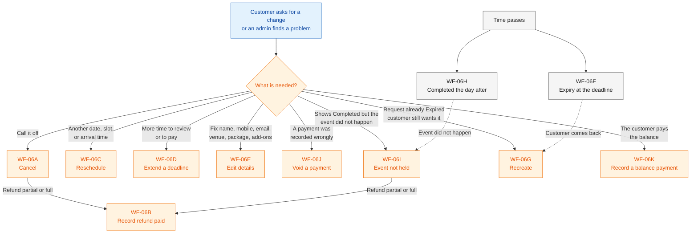

| ID | Sub-flow | Who acts | Allowed on | Status change | Capacity | Customer email |
|---|---|---|---|---|---|---|
| [WF-06A](#wf-06a--cancel-a-reservation) | Cancel, with a reason and a refund decision | Either admin ([roles §2.3][roles]) | Pending Confirmation, Awaiting Deposit, Confirmed | → Cancelled | Released at once | Cancelled ([FR-NTF-10][fr]) |
| [WF-06B](#wf-06b--record-a-refund-paid) | Record a refund paid | Either admin ([roles §2.2][roles]) | Cancelled, after a refund decision | None | No change | None |
| [WF-06C](#wf-06c--reschedule) | Reschedule | Either admin ([roles §2.3][roles]) | Pending Confirmation, Awaiting Deposit, Confirmed | None | Old claims released, new claims taken, in one step | Rescheduled ([FR-NTF-11][fr]) |
| [WF-06D](#wf-06d--extend-a-deadline) | Extend a deadline | Either admin ([roles §2.3][roles]) | Pending Confirmation, Awaiting Deposit | None | Kept | Deadline extended ([FR-NTF-05][fr]) |
| [WF-06E](#wf-06e--edit-details) | Edit details | Either admin ([roles §2.1][roles]) | Pending Confirmation, Awaiting Deposit, Confirmed | None | Set or room kept; add-on stock checked again | Reservation updated ([FR-NTF-08][fr]) |
| [WF-06F](#wf-06f--expiry) | Expiry | The system ([roles §4][roles]); an admin for a late proof rejection | Pending Confirmation, Awaiting Deposit | → Expired | Released, counting from the deadline itself | Expired ([FR-NTF-12][fr]) |
| [WF-06G](#wf-06g--recreate-an-expired-request) | Recreate an expired request | Either admin ([roles §2.3][roles]) | Expired | A new reservation → Pending Confirmation; the original stays Expired | New claims taken | Request received ([FR-NTF-01][fr]) |
| [WF-06H](#wf-06h--automatic-completed-the-day-after-the-event) | Automatic Completed | The system ([roles §4][roles]) | Confirmed, event date before today | → Completed | Released | None |
| [WF-06I](#wf-06i--event-not-held) | Event not held | Either admin ([roles §2.3][roles]) | Completed | → Cancelled | No change (already released) | Not specified ([FR §7][fr], question 7) |
| [WF-06J](#wf-06j--void-a-payment) | Void a payment | Either admin ([roles §2.2][roles], [D-24][dl]) | Any reservation with that payment | None | No change | None |
| [WF-06K](#wf-06k--record-a-balance-payment) | Record a balance payment | Either admin ([roles §2.2][roles]) | Confirmed, Completed | None | No change | None |

**Rules common to every admin action here** ([FR-ADM-07][fr]): the server checks the login and role first; a required reason cannot be left out; if both admins act on the same reservation, the second one sees "already changed, please refresh" and nothing changes ([EC-16][ec]); a hold past its deadline (not paused) counts as expired ([reservation-lifecycle §3.3][lc]); each action takes full effect or none; each writes an audit entry; and its emails are saved together with the change, so an email problem never undoes it ([FR-NTF-16][fr], [NFR-33][nfr]). Customers without an email address get no email; the admin copies a prepared message instead ([FR-NTF-21][fr], [EC-12][ec]). Nothing is ever deleted ([NFR-22][nfr], [EC-54][ec]).

---

## WF-06A · Cancel a reservation

### In plain words

Customers cannot cancel on the website; they message or call the business, and an admin cancels for them. An admin can cancel a request that is Pending Confirmation or Awaiting Deposit, or a Confirmed booking, and must always type a reason. When a deposit was paid, the admin also records a refund decision: none, partial, or full, with the amount, decided case by case. The set or the room is free again at once, the QR code stops working, and the customer sees the reason and the refund decision on the status page and in the cancelled email. Paying the money back is a separate step, later (WF-06B).

*Example.* Ben paid a ₱1,000 deposit for a delivery on Sunday 27 December 2026. On Tuesday 22 December he calls to cancel. The Admin cancels with the reason "family emergency" and the refund decision "partial, ₱500" ([reservation-lifecycle §6.6][lc]). Delivery for 27 December can show Available again at once.

### Actors and responsibilities

| Actor | Responsibilities in this sub-flow |
|---|---|
| Customer | Asks to cancel by message or call, quoting the reference code ([EC-50][ec], [roles §3.2][roles]) |
| Admin or Super Admin | Decides, types the reason, and records the refund decision when a deposit was paid ([roles §2.3][roles]) |
| Next.js server action | Checks the login, 2FA, and role on the server, validates the input, and makes one database call ([FR-ADM-07][fr], [NFR-10][nfr]); sends the queued email after the reply |
| Postgres function | Checks the status, version, and deadline; cancels, releases the claims, stops the QR code, saves the reason and refund decision, writes the audit entry and the queued email in one transaction ([NFR-21][nfr]) |
| Resend | Sends the cancelled email, if the customer gave an address ([FR-NTF-10][fr]) |

### Trigger and preconditions

- **Trigger:** the customer asks to cancel, or an admin decides to cancel ([reservation-lifecycle §6.6][lc]: either admin can cancel, with a reason).
- **Preconditions:**
  - The status is Pending Confirmation, Awaiting Deposit, or Confirmed ([FR-ADM-18][fr]; [lifecycle rows 11 to 13][lc]). Any other status: not offered, and refused if tried ([EC-53][ec]).
  - A hold is not overdue: its deadline has not passed, or, for Awaiting Deposit, its expiry is paused for proof review ([lifecycle rows 11 and 12][lc]).
  - A reason; and a refund decision when a deposit was paid ([lifecycle row 13][lc]).

### Flowchart

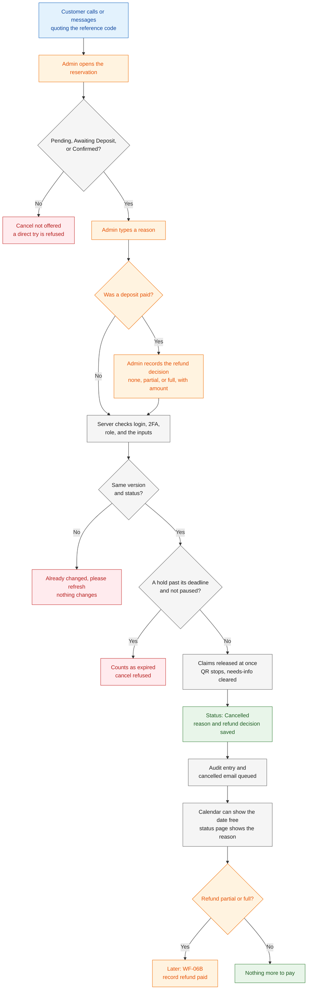

### Sequence diagram

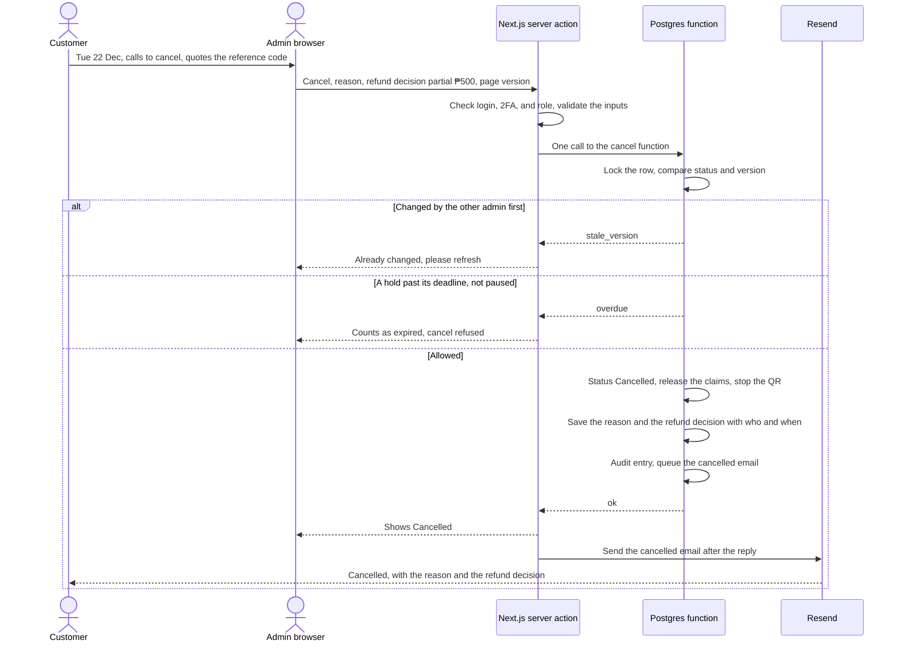

### Steps

| Step | Actor | What happens | Data created, updated, or read | Rules and requirements |
|---|---|---|---|---|
| 1 | Customer | Messages or calls the business to cancel and quotes the reference code. There is no online cancel **[C]**. | — | [D-08][dl], [EC-50][ec], [FR-PUB-16][fr] |
| 2 | Admin | Opens the reservation by QR scan, search, or the list (WF-03). The page offers "Cancel" only on Pending Confirmation, Awaiting Deposit, and Confirmed reservations. | Read: reservation, payments | [FR-ADM-04][fr], [FR-ADM-18][fr], [lookup-and-review][wf-review] |
| 3 | Admin | Types the reason. The customer will see it. | — | [FR-ADM-18][fr], [lifecycle §4.1][lc] |
| 4 | Admin | If a deposit was paid, also records the refund decision: none, partial, or full, with the amount, decided case by case **[C]**. | — | [lifecycle §6.6, row 13][lc], [D-07][dl], [catalog-and-payments §4.5][cat] |
| 5 | Next.js server | Checks the login, 2FA, and role on the server, and that the reason (and the refund decision, when needed) is there. Then makes one call to one database function. | — | [roles §2.3, §7][roles], [FR-ADM-07][fr], [NFR-10][nfr], [NFR-21][nfr] |
| 6 | Database | Checks that the status still allows a cancel and that the version still matches. If not: "already changed, please refresh", and nothing changes. | Read: status, version | [FR-ADM-07][fr], [EC-16][ec], [EC-53][ec] |
| 7 | Database | If the reservation is a hold whose deadline has passed and whose expiry is not paused: refused, because it counts as expired. The expiry is then recorded by WF-06F. | Read: deadline, expiry-paused flag | [lifecycle rows 11 and 12, §3.3][lc], [BR-05][br], [EC-22][ec] |
| 8 | Database | Sets the status to Cancelled. Releases the set or room claim and the add-on claims at once. The QR code stops working, by its status. Clears the needs-info flag (Pending Confirmation). Saves the reason, and for a Confirmed booking with a deposit, the refund decision with who decided and when. The reservation now has a closure date. | Update: reservation (status, reason, refund decision, flags, version); claims released | [lifecycle rows 11 to 13][lc], [BR-04][br], [FR-PUB-08][fr], [privacy-and-retention §6.1][priv] |
| 9 | Database | Writes the audit entry with the reason, and queues the cancelled email with the reason and the refund decision, in the same transaction. | Create: audit entry, outbox row | [FR-ADM-32][fr], [FR-NTF-10][fr], [FR-NTF-16][fr] |
| 10 | Next.js server | Shows the result and sends the queued email after the reply. Without an email address, the page shows a prepared message to copy into SMS or Messenger. | Update: outbox status | [FR-NTF-16][fr], [FR-NTF-21][fr], [NFR-33][nfr] |
| 11 | Public site | The calendar counts the set or room as free at once. The status page shows Cancelled, the reason, and the refund decision. The old QR link shows "no longer valid". A deposit reminder that falls due later is skipped. | Read | [FR-ADM-18][fr], [BR-09][br], [FR-PUB-11][fr], [FR-PUB-09][fr], [FR-NTF-19][fr], [EC-60][ec], [EC-69][ec] |
| 12 | Admin | If the refund decision is partial or full, records the refund when it is actually paid (WF-06B). | — | [lifecycle §6.6][lc], [FR-ADM-19][fr] |

### Decision points and validation

| Decision | If yes | If no | Rule |
|---|---|---|---|
| Is the status Pending Confirmation, Awaiting Deposit, or Confirmed? | "Cancel" is offered | Not offered; a direct try is refused | [FR-ADM-18][fr], [lifecycle rows 11 to 13][lc], [FR-ADM-04][fr] |
| Is a reason given? | Continue | Cannot be saved | [FR-ADM-07][fr], [FR-ADM-18][fr] |
| Was a deposit paid? | A refund decision is required: none, partial, or full, with the amount | No refund decision is needed | [lifecycle row 13][lc], [FR-ADM-18][fr], [catalog-and-payments §3][cat] |
| Does the version still match? | Continue | "Already changed, please refresh" | [FR-ADM-07][fr], [NFR-21][nfr] |
| Is it a hold past its deadline, not paused? | Refused: counts as expired | Cancelled | [lifecycle rows 11 and 12, §3.3][lc], [BR-05][br], [BR-12][br] |

### Failure and exception paths

| Situation | What the system does | Edge case |
|---|---|---|
| The customer looks for a cancel button online | There is none; the customer messages or calls the business | [EC-50][ec] |
| A customer who paid the deposit asks to cancel | The admin cancels and records a refund decision; paying it is a later step | [EC-39][ec] |
| Both admins act on the same reservation | The second one is refused; nothing changes | [EC-16][ec] |
| Cancel on a Rejected, Expired, Cancelled, or Completed reservation | Not offered; refused. A Completed booking whose event did not happen uses WF-06I | [EC-53][ec], [EC-51][ec] |
| The hold's deadline has passed, but the job has not marked it yet | Refused: it already counts as expired. If the customer still wants the date, an admin can recreate it (WF-06G) | [EC-22][ec], [EC-52][ec] |
| An Awaiting Deposit request with a proof under review is cancelled | Allowed: the hold is not overdue. The unverified proof image is deleted 7 days later (privacy §6.2, [P]); whether it leaves "proofs to verify" is open question 2 | [EC-27][ec], [EC-85][ec] |
| A Confirmed booking after a waiver, where only a balance was paid | Whether a refund decision is recorded is not settled | [lifecycle §9][lc], question 2 |
| The email service fails | The cancel stands; the email is retried or marked failed | [EC-66][ec] |
| The customer gave no email address | Nothing is sent; the admin copies the prepared message | [EC-12][ec] |
| A deposit reminder falls due after the cancel | Skipped | [EC-69][ec] |
| Someone opens the old QR link | "Not found / no longer valid" | [EC-60][ec] |
| An admin cancels the wrong booking | Cancelled is final ([lifecycle §1.1][lc]); nothing is deleted. Batch-1 docs define no undo (open question 1) | [EC-54][ec] |

### Status transitions involved

- **Pending Confirmation → Cancelled**: [reservation-lifecycle §4.2][lc], row 11.
- **Awaiting Deposit → Cancelled**: row 12.
- **Confirmed → Cancelled**: row 13.
- Cancelled is final ([lifecycle §1.1][lc]). The full state diagram is in [lifecycle §2][lc].

### Developer notes

- **Database function:** `app.cancel_reservation(reservation_id, expected_version, reason, refund_decision, refund_amount)`.
- **Server action:** `cancelReservation`, in the admin module tree, starting with the session and role check ([roles §7][roles]). Page: `/admin/reservations/[id]`.
- **"A deposit was paid"** means an active (not voided) deposit exists: a voided payment is not the active deposit ([catalog-and-payments §4.6][cat]).
- **Refund decision fields:** kind (none, partial, or full), amount, decided by, decided at ([lifecycle §4.3][lc]; [spec v0.2][spec] §11).
- **Lock.** Whether a cancel, which only frees capacity, also takes the capacity lock is [availability-and-conflicts][wf-avail] open question 2.
- **QR:** no hash change; the status alone makes the QR code invalid, so the link shows "no longer valid" (WF-03A step 8 in [lookup-and-review][wf-review]; [FR-PUB-08][fr], [FR-PUB-09][fr]).
- **Audit:** category `booking`, actor kind `admin`, action `reservation.cancelled`, changed field names (for example `status`, `refund_decision`), and the reason; never values or contact data ([FR-ADM-32][fr]).
- **Outbox email type:** `cancelled` ([FR-NTF-10][fr]). A queued `reminder` for this reservation is skipped at send time ([FR-NTF-19][fr]).
- **Result codes:** `ok`, `stale_version`, `overdue`, `not_allowed`, `reason_required`, `refund_decision_required`.

*(indicative; final names in api-specification, batch 3)*

---

## WF-06B · Record a refund paid

### In plain words

When the business actually pays back a refund that was decided at cancellation, an admin records it, so the money records stay complete. The admin enters the amount, whether it was paid in cash or by e-wallet, and, for an e-wallet payment, only its reference number. A refund gets no acknowledgment, and the status stays Cancelled. Recording it can move the date from which old personal data is later erased, because that date counts from the last money movement. A refund recorded by mistake is voided, never deleted (WF-06J).

*Example.* Ben's booking was cancelled with the refund decision "partial, ₱500" (WF-06A). On Wednesday 23 December 2026 he collects ₱500 at the office, and the Admin records a ₱500 cash refund. If Ben instead collects it on Monday 4 January 2027, recording it then moves his closure date to 4 January 2027 ([EC-40][ec]).

### Actors and responsibilities

| Actor | Responsibilities in this sub-flow |
|---|---|
| Customer | Receives the refund, in cash at the office or by e-wallet ([catalog-and-payments §4.5][cat]) |
| Admin or Super Admin | Pays the refund and records it ([roles §2.2][roles]) |
| Next.js server action | Checks the login, 2FA, and role; validates the fields; one database call ([FR-ADM-07][fr]) |
| Postgres function | Checks the status and version, adds the refund to the payments ledger, recomputes the closure date, writes the audit entry ([NFR-21][nfr]) |

### Trigger and preconditions

- **Trigger:** the business pays back money it decided to refund.
- **Preconditions:**
  - The reservation is Cancelled and has a refund decision, from WF-06A or WF-06I ([lifecycle §5][lc], "Record a refund paid"; [FR-ADM-19][fr]).
  - Whether a refund can be recorded when the decision is "none" is open question 10. Whether it must equal the decided amount, or can be paid in parts, is [catalog-and-payments §10][cat], question 3.

### Flowchart

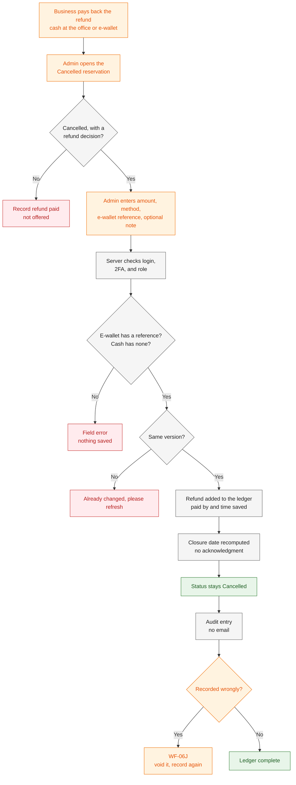

### Sequence diagram

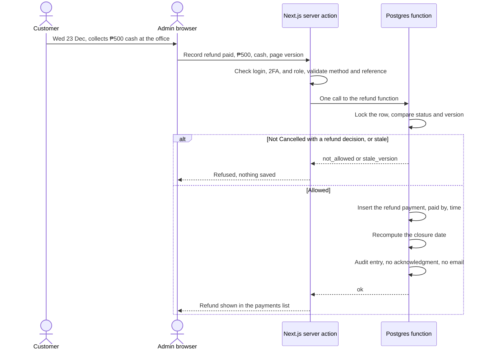

### Steps

| Step | Actor | What happens | Data created, updated, or read | Rules and requirements |
|---|---|---|---|---|
| 1 | Admin, customer | The business pays back the refund, in cash at the office or by e-wallet. | — | [catalog-and-payments §4.2, §4.5][cat], [D-05][dl] |
| 2 | Admin | Opens the Cancelled reservation and sees the refund decision. | Read: reservation, refund decision, payments | [FR-ADM-04][fr] |
| 3 | Admin | Enters the amount, the method (cash or e-wallet), the e-wallet reference number (required for e-wallet, empty for cash), and an optional note. Never the payer's name or account number, not even in the note (the note rule is [P] in [catalog-and-payments §4.7][cat]). | — | [FR-ADM-19][fr], [catalog-and-payments §4.2, §4.7][cat] |
| 4 | Next.js server | Checks the login, 2FA, and role on the server, validates the fields, and makes one call. | — | [roles §2.2, §7][roles], [FR-ADM-07][fr] |
| 5 | Database | Checks that the reservation is Cancelled with a refund decision, and that the version still matches. | Read: status, refund decision, version | [lifecycle §5][lc], [FR-ADM-07][fr], [EC-16][ec] |
| 6 | Database | Adds the refund to the payments ledger. The admin who paid it and the time are saved automatically. No acknowledgment number is issued. | Create: payment (kind refund) | [catalog-and-payments §4.1, §4.5, §5.1][cat], [FR-ADM-19][fr] |
| 7 | Database | Recomputes the closure date, so the retention periods count from this later date. | Update: reservation closure date | [privacy-and-retention §6.1][priv], [FR-ADM-19][fr], [EC-40][ec] |
| 8 | Database | Writes the audit entry. No email is queued; the status stays Cancelled. | Create: audit entry | [FR-ADM-32][fr], [lifecycle §5][lc] |
| 9 | Next.js server | Shows the refund in the reservation's payments list. | — | [FR-ADM-04][fr] |
| 10 | Admin | If the record is wrong, voids it with a reason (WF-06J) and records the correct one. | — | [catalog-and-payments §4.6][cat], [D-24][dl] |

### Decision points and validation

| Decision | If yes | If no | Rule |
|---|---|---|---|
| Is the reservation Cancelled, with a refund decision? | "Record refund paid" is offered | Not offered; refused | [lifecycle §5][lc], [FR-ADM-19][fr] |
| Is the method e-wallet? | The reference number is required | Cash: the reference stays empty | [catalog-and-payments §4.2][cat] |
| Does the version still match? | Saved | "Already changed, please refresh" | [FR-ADM-07][fr] |
| Must the amount equal the refund decision? | Not settled | — | [catalog-and-payments §10][cat], question 3 |

### Failure and exception paths

| Situation | What the system does | Edge case |
|---|---|---|
| The refund is paid weeks after the cancel, for example in the new year | Allowed; the closure date moves to the refund date | [EC-40][ec] |
| The refund was recorded with the wrong amount or on the wrong booking | It is voided with a reason, never deleted (WF-06J) | [EC-33][ec], [EC-54][ec] |
| The reservation is not Cancelled | Not offered; refused | [EC-53][ec] |
| Both admins record at the same moment | The second one is refused | [EC-16][ec] |
| The refund is paid in two parts | Not settled | [catalog-and-payments §10][cat], question 3 |

### Status transitions involved

None. The reservation stays **Cancelled** ([lifecycle §5][lc], "Record a refund paid").

### Developer notes

- **Database function:** `app.record_refund(reservation_id, expected_version, amount, method, ewallet_ref, note)`.
- **Server action:** `recordRefundPaid`, in the admin module tree ([roles §7][roles]).
- **Database checks:** the e-wallet reference is required when the method is e-wallet and empty for cash ([catalog-and-payments §4.2, §9][cat]).
- **Closure date:** recomputed inside the same function ([catalog-and-payments §9][cat]; [privacy-and-retention §6.4][priv] developer note).
- **Audit:** category `booking` (indicative; not assigned in [FR-ADM-32][fr], see [administration][wf-admin] open question 1), action `payment.refund_recorded`.
- **Outbox email type:** none.

*(indicative; final names in api-specification, batch 3)*

---

## WF-06C · Reschedule

### In plain words

Customers cannot move a booking themselves; they ask the business, and an admin decides case by case. An admin can move a Pending Confirmation, Awaiting Deposit, or Confirmed reservation to another date, slot, or arrival time. In one step, the system frees the old date and takes a set or the room, and the add-ons, on the new date; if anything is not free there, nothing changes at all. The reference code, the QR code, and the locked prices stay the same. A waiting request never gets more time from a move: its deadline stays the same or moves earlier, and the urgent flag is worked out again.

*Example.* Ana's booking for Thursday 24 December 2026 is Confirmed. She asks to move to Saturday 26 December. If a set is free on 26 December, the Admin reschedules her. If both sets are held that day, the reschedule is refused, and Ana keeps 24 December ([EC-48][ec]).

**Deadline recap.** The examples come from [reservation-lifecycle §6.5][lc]; the rule is "the earlier of the current deadline and the new service start".

| Case | Deadline before the move | Deadline after the move | Why |
|---|---|---|---|
| Ana, Confirmed, moved from 24 to 26 December | None | None | A Confirmed booking has no deadline |
| Sent Mon 14 Dec at 9:00 AM; on Tue 15 Dec moved to a 6:00 PM slot that same day | Thu 17 Dec, 9:00 AM | Tue 15 Dec, 6:00 PM, and now urgent | The new service start comes first ([EC-49][ec]) |
| Sent Wed 16 Dec at 10:00 AM for Thu 24 Dec; moved to Sat 26 Dec | Sat 19 Dec, 10:00 AM | Sat 19 Dec, 10:00 AM | A move never gives a hold more time |

### Actors and responsibilities

| Actor | Responsibilities in this sub-flow |
|---|---|
| Customer | Asks to move the booking, quoting the reference code ([roles §3.2][roles], [EC-50][ec]) |
| Admin or Super Admin | Decides case by case, picks the new date, slot, or arrival time ([roles §2.3][roles], [D-07][dl], [D-08][dl]) |
| Next.js server action | Checks the login, 2FA, and role; validates; one database call; sends the queued email after the reply |
| Postgres function | Takes the capacity lock, checks status, version, and deadline, expires overdue holds on the new date, releases the old claims, takes the new ones, and saves everything in one transaction ([NFR-20][nfr], [NFR-21][nfr]); the capacity check in detail is [WF-05B][wf-avail] |
| Resend | Sends the rescheduled email ([FR-NTF-11][fr]) |

### Trigger and preconditions

- **Trigger:** the customer asks to move the booking, and an admin agrees.
- **Preconditions:**
  - The status is Pending Confirmation, Awaiting Deposit, or Confirmed ([FR-ADM-17][fr]; [lifecycle §5][lc]).
  - A hold is not overdue ([lifecycle §3.3][lc]).
  - Which other checks apply to the new date (booking window, an inactive slot, on-site hours, a start already past or within the notice period) is [availability-and-conflicts][wf-avail] open question 5. Changing the service type is open question 3.

### Flowchart

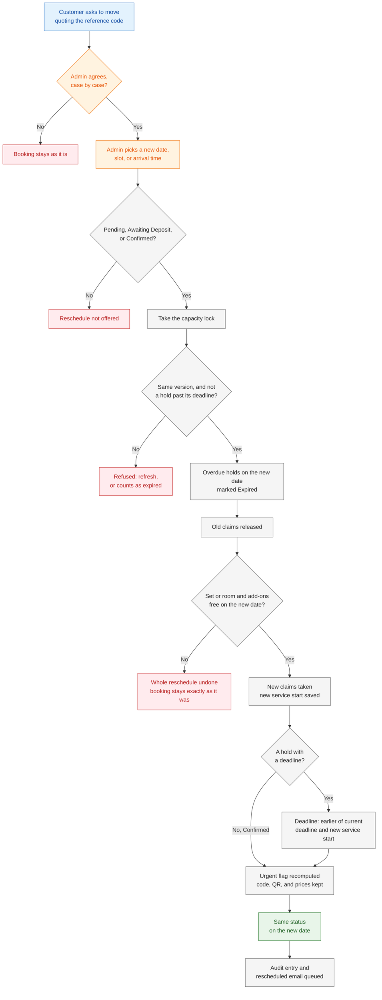

### Sequence diagram

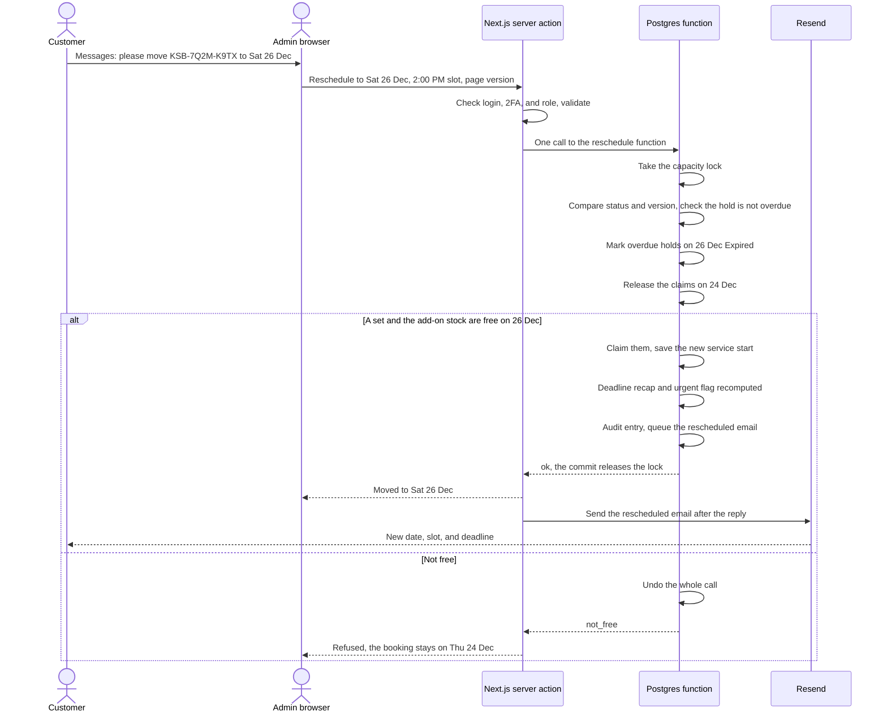

### Steps

| Step | Actor | What happens | Data created, updated, or read | Rules and requirements |
|---|---|---|---|---|
| 1 | Customer | Messages or calls the business and quotes the reference code. There is no online reschedule **[C]**. | — | [D-08][dl], [EC-50][ec], [roles §3.2][roles] |
| 2 | Admin | Decides case by case **[C]**. Opens the reservation (WF-03). "Reschedule" is offered only on Pending Confirmation, Awaiting Deposit, and Confirmed. | Read: reservation | [D-07][dl], [D-08][dl], [FR-ADM-17][fr], [FR-ADM-04][fr] |
| 3 | Admin | Picks the new date, the new delivery slot, or the new arrival time. These are never changed with "edit details". | — | [lifecycle §6.5][lc], [FR-ADM-17][fr], [FR-ADM-10][fr] |
| 4 | Next.js server | Checks the login, 2FA, and role on the server, validates, and makes one call. | — | [roles §2.3, §7][roles], [FR-ADM-07][fr], [NFR-21][nfr] |
| 5 | Database | Takes the single capacity lock. | Lock row | [NFR-20][nfr], [lifecycle §4.3][lc], [WF-05B][wf-avail] step 3 |
| 6 | Database | Checks that the status allows it and the version matches; refuses a hold past its deadline (not paused), because it counts as expired. | Read: status, version, deadline, expiry-paused flag | [FR-ADM-07][fr], [EC-16][ec], [lifecycle §3.3][lc] |
| 7 | Database | Marks overdue holds on the new date Expired first. Each is the normal "deadline passed" change, with its own audit entry and expired email. | Update: other reservations → Expired, their claims released; create: audit entries, outbox rows | [lifecycle §4.1, §6.5, rows 9 and 10][lc], [BR-05][br], [WF-05B][wf-avail] step 6 |
| 8 | Database | Releases this reservation's old set or room claim and add-on claims. | Update: claims | [lifecycle §6.5][lc] |
| 9 | Database | Claims a free set (the system picks it) or the room, and the add-ons, on the new date. If any is not free, the whole reschedule is undone and the booking stays exactly as it was. | Create: claims | [BR-01][br], [BR-02][br], [BR-03][br], [BR-08][br], [EC-48][ec] |
| 10 | Database | Saves the new service start. For a hold, the deadline becomes the earlier of the current deadline and the new service start; a Confirmed booking keeps no deadline. Recomputes the urgent flag from the new event date. Keeps the reference code, the QR code, and the price snapshot. | Update: reservation (event date, slot or arrival time, service start, deadline, urgent flag, version) | [lifecycle §3.1, §3.2, §6.5][lc], [BR-06a][br], [catalog-and-payments §2.3][cat], [D-12][dl], [EC-49][ec] |
| 11 | Database | Writes the audit entry and queues the rescheduled email with the new date, slot or arrival time, and deadline. Commits, which releases the lock. | Create: audit entry, outbox row | [FR-ADM-32][fr], [FR-NTF-11][fr], [FR-NTF-16][fr] |
| 12 | Next.js server | Shows the result and sends the email after the reply; or the prepared message, for a customer without email. | Update: outbox status | [FR-ADM-17][fr], [FR-NTF-21][fr] |
| 13 | Public site | The calendar counts the old date's set or room as free and the new one as taken. The status page shows the new date, slot or arrival time, and deadline. | Read | [BR-04][br], [BR-09][br], [FR-PUB-11][fr] |

### Decision points and validation

| Decision | If yes | If no | Rule |
|---|---|---|---|
| Does the admin agree to the move? | Continue | The booking stays as it is | [D-08][dl], [FR-ADM-17][fr] |
| Is the status Pending Confirmation, Awaiting Deposit, or Confirmed? | "Reschedule" is offered | Not offered; refused | [FR-ADM-17][fr], [EC-53][ec] |
| Does the version still match? | Continue | "Already changed, please refresh" | [FR-ADM-07][fr] |
| Is it a hold past its deadline, not paused? | Refused: counts as expired | Continue | [lifecycle §3.3][lc], [BR-05][br] |
| Are a set or the room, and the add-on stock, free on the new date? | New claims taken | Whole reschedule refused; nothing changes | [lifecycle §6.5][lc], [BR-01 to BR-03][br], [EC-48][ec] |
| Is it a hold with a deadline? | Deadline = earlier of the current one and the new service start | No deadline (Confirmed) | [lifecycle §6.5][lc], [EC-49][ec] |
| Is the new event date today (Manila date)? | Flagged urgent | Not urgent | [BR-06a][br], [EC-82][ec] |

### Failure and exception paths

| Situation | What the system does | Edge case |
|---|---|---|
| The new date is full | Refused; the booking stays exactly as it was. A date full only because of an overdue hold can still be used | [EC-48][ec] |
| The move is to today, or to a date before the current deadline | Allowed if free; the deadline moves earlier, never later, and the urgent flag is recomputed | [EC-49][ec] |
| The customer wants to reschedule online | No online option; the customer messages or calls | [EC-50][ec] |
| The hold's deadline has already passed | Refused: it counts as expired; recreate instead (WF-06G) if wanted | [EC-22][ec], [EC-52][ec] |
| Both admins act at once | The second one is refused | [EC-16][ec] |
| Slot times changed after the booking was made | Only a reschedule gives the booking a new service start; settings changes never move it | [EC-56][ec] |
| The email service fails | The reschedule stands; the email is retried or marked failed | [EC-66][ec] |
| An Awaiting Deposit deadline moves earlier | Whether a deposit reminder is sent for the new deadline is open question 4 | [EC-70][ec] |
| The customer wants delivery instead of on-site, or the other way round | Not covered by reschedule or edit details (open question 3) | — |

### Status transitions involved

- None for this reservation: a reschedule keeps its status ([lifecycle §5][lc], "Reschedule").
- Other overdue holds on the new date: **Pending Confirmation → Expired** or **Awaiting Deposit → Expired** ([lifecycle §4.2][lc], rows 9 and 10).

### Developer notes

- **Database function:** `app.reschedule_reservation(reservation_id, expected_version, new_event_date, new_slot_id, new_arrival_time)` (same name as in [WF-05B][wf-avail]).
- **Server action:** `rescheduleReservation`, in the admin module tree ([roles §7][roles]).
- **Order inside the function:** the capacity lock, then the row lock with the status and version compare (proposal in [availability-and-conflicts][wf-avail] open question 10), then expire, release, claim.
- **Deadline:** `least(current_deadline, new_service_start)` for `pending` and `awaiting_deposit`; null stays null for `confirmed`. Urgent: new event date equals `(now() AT TIME ZONE 'Asia/Manila')::date` ([NFR-19][nfr]).
- **Audit:** category `booking`, action `reservation.rescheduled`, changed field names such as `event_date`, `service_start`, `deadline`, `urgent`.
- **Outbox email types:** `rescheduled` ([FR-NTF-11][fr]); `expired` for each overdue hold expired in step 7 ([FR-NTF-12][fr]).
- **Result codes:** `ok`, `stale_version`, `overdue`, `not_allowed`, `not_free`, `addon_short`.

*(indicative; final names in api-specification, batch 3)*

---

## WF-06D · Extend a deadline

### In plain words

An admin can give a waiting request more time, for example when a customer will pay at the office the next morning. This works only while the request is Pending Confirmation or Awaiting Deposit and its deadline has not yet passed, and it always needs a reason. The new deadline can never be later than the service start; such an extension is refused. The customer gets an email with the new deadline, the status page shows it, and the deposit reminder follows the new deadline. Once a deadline has passed, the request counts as expired and cannot be extended; if the date is still free, an admin can recreate it instead (WF-06G).

*Example.* Dan's request was approved on Monday 21 December 2026 at 10:00 AM, so his deposit is due on Tuesday 22 December at 10:00 AM. His delivery slot starts on Thursday 24 December at 2:00 PM. The Admin extends the deadline to Wednesday 23 December at 12:00 noon, with the reason "paying at the office Wednesday morning". An extension to Thursday 24 December at 3:00 PM would be refused, because it is after the service start ([reservation-lifecycle §6.3][lc]).

### Actors and responsibilities

| Actor | Responsibilities in this sub-flow |
|---|---|
| Customer | Asks for more time, by message or call |
| Admin or Super Admin | Decides, enters the new deadline and a reason ([roles §2.3][roles]) |
| Next.js server action | Checks the login, 2FA, and role; validates; one database call; sends the queued email |
| Postgres function | Checks status, version, the current deadline, and the service start; saves the new deadline, the audit entry, and the queued email ([NFR-21][nfr]) |
| pg_cron | Later queues the deposit reminder for the new deadline ([FR-SYS-02][fr]) |
| Resend | Sends the deadline-extended email and, later, the reminder ([FR-NTF-05][fr], [FR-NTF-04][fr]) |

### Trigger and preconditions

- **Trigger:** a customer needs more time, and an admin agrees.
- **Preconditions:**
  - The status is Pending Confirmation or Awaiting Deposit, the statuses that have a deadline ([FR-ADM-16][fr]; [lifecycle §6.3][lc]).
  - The current deadline has not passed, or expiry is paused for proof review ([lifecycle §3.3][lc]; [EC-26][ec]). An extension while expiry is paused is [edge-cases §15][ec], question 4.
  - A reason, and a new deadline no later than the service start ([EC-25][ec]).

### Flowchart

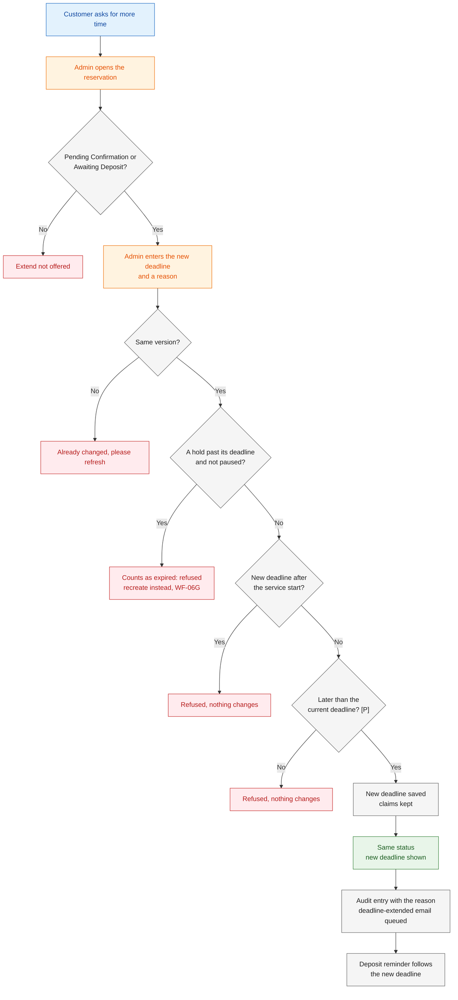

### Sequence diagram

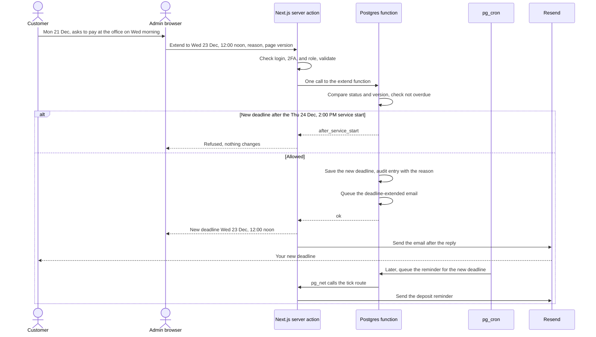

### Steps

| Step | Actor | What happens | Data created, updated, or read | Rules and requirements |
|---|---|---|---|---|
| 1 | Customer | Asks for more time, by message or call. | — | [lifecycle §6.3][lc] (example) |
| 2 | Admin | Opens the reservation. "Extend" is offered only on Pending Confirmation and Awaiting Deposit. | Read: reservation, deadline, service start | [FR-ADM-16][fr], [FR-ADM-04][fr] |
| 3 | Admin | Enters the new deadline, in Manila time, and a reason. | — | [FR-ADM-16][fr], [NFR-19][nfr] |
| 4 | Next.js server | Checks the login, 2FA, and role on the server, validates, and makes one call. | — | [roles §2.3, §7][roles], [FR-ADM-07][fr] |
| 5 | Database | Checks the status and version. Refuses if the hold is past its deadline and not paused, if the new deadline is later than the service start, or if the new deadline is not later than the current one **[P] (new in this doc)**. Each refusal changes nothing. | Read: status, version, deadline, expiry-paused flag, service start | [FR-ADM-07][fr], [FR-ADM-16][fr], [lifecycle §3.2, §3.3, §6.3][lc], [EC-25][ec], [EC-26][ec] |
| 6 | Database | Saves the new deadline. The claims are kept. Writes the audit entry with the reason. | Update: reservation (deadline, version); create: audit entry | [lifecycle §5][lc], [FR-ADM-32][fr] |
| 7 | Database | Queues the deadline-extended email with the new deadline. | Create: outbox row | [FR-NTF-05][fr], [FR-NTF-16][fr] |
| 8 | Next.js server | Shows the new deadline and sends the email after the reply, or shows the prepared message. | Update: outbox status | [FR-NTF-21][fr] |
| 9 | pg_cron, Database | Awaiting Deposit only: the deposit reminder follows the new deadline. It is worked out from the current deadline when it falls due, and each deadline gets its own reminder. | Create: reminder outbox row when due | [FR-NTF-04][fr], [FR-NTF-17][fr], [FR-SYS-02][fr] |
| 10 | Public site | The status page shows the new deadline in Manila time. | Read | [FR-PUB-11][fr] |

### Decision points and validation

| Decision | If yes | If no | Rule |
|---|---|---|---|
| Is the status Pending Confirmation or Awaiting Deposit? | "Extend" is offered | Not offered; refused | [FR-ADM-16][fr], [EC-53][ec] |
| Is a reason given? | Continue | Cannot be saved | [FR-ADM-16][fr] |
| Does the version still match? | Continue | "Already changed, please refresh" | [FR-ADM-07][fr] |
| Is it a hold past its deadline, not paused? | Refused: counts as expired | Continue | [lifecycle §3.3, §6.3][lc], [EC-26][ec] |
| Is the new deadline later than the service start? | Refused, nothing changes | Continue | [lifecycle §6.3][lc], [EC-25][ec] |
| Is the new deadline later than the current one? | Saved | Refused **[P] (new in this doc)** | [lifecycle §3.2][lc] ("moves it later"); open question 5 |

### Failure and exception paths

| Situation | What the system does | Edge case |
|---|---|---|
| The event is close, and the new deadline would be after the service start | Refused; at most up to the service start | [EC-25][ec] |
| The deadline has already passed | Refused; the admin can recreate the request if the date is free | [EC-26][ec], [EC-52][ec] |
| A request flagged "needs info" | Needs info never adds time by itself; only an extension does, with a reason | [EC-24][ec], [D-13][dl] |
| A proof is under review when the admin extends | Which deadline applies if the proof is then rejected is not settled | [EC-27][ec]; [edge-cases §15][ec], question 4 |
| Both admins act at once | The second one is refused | [EC-16][ec] |
| The email service fails | The extension stands; the email is retried or marked failed | [EC-66][ec] |

### Status transitions involved

None. The reservation keeps its status and its claims ([lifecycle §5][lc], "Extend a deadline").

### Developer notes

- **Database function:** `app.extend_deadline(reservation_id, expected_version, new_deadline, reason)` (same name as in [WF-05B][wf-avail]). No capacity lock: the claims are kept.
- **Server action:** `extendDeadline`, in the admin module tree ([roles §7][roles]).
- **Reminder key:** reservation + "reminder" + deadline, so the new deadline gets its own reminder and no deadline gets two ([FR-NTF-17][fr]).
- **Audit:** category `booking`, action `reservation.deadline_extended`, changed field `deadline`, with the reason.
- **Outbox email type:** `deadline_extended` ([FR-NTF-05][fr]); later `reminder` ([FR-NTF-04][fr]).
- **Result codes:** `ok`, `stale_version`, `overdue`, `after_service_start`, `not_later` (the last one only if open question 5 is accepted), `not_allowed`.

*(indicative; final names in api-specification, batch 3)*

---

## WF-06E · Edit details

### In plain words

An admin fixes or changes a reservation's details when the customer asks or a mistake is found: a mistyped mobile number, a new email address, the venue, another package, or more add-ons. It works on Pending Confirmation, Awaiting Deposit, and Confirmed reservations, always needs a reason, and never changes the status. Adding or changing add-ons checks the stock again; if it is not free, the edit is refused and nothing changes. Items that stay keep their locked price, and added items take the current catalog price. The date, the slot, and the arrival time are not changed here; that is a reschedule (WF-06C).

*Examples.* Ana typed `0917 123 4576` instead of `0917 123 4567`. She calls the office, and the Admin corrects it with the reason "customer called: typo in mobile number" ([EC-46][ec]). Later, Ana asks to add 1 set of party lights, now ₱300 in the catalog. Her package (₱3,000) and her 2 microphones (₱200 each) keep their locked prices, so her new total is ₱3,700. If the party lights are fully booked on 24 December, the edit is refused, and her booking stays as it was ([reservation-lifecycle §6.2][lc]).

### Actors and responsibilities

| Actor | Responsibilities in this sub-flow |
|---|---|
| Customer | Reports a mistake or asks for a change; cannot change details online ([roles §3.2][roles]) |
| Admin or Super Admin | Makes the change and types a reason ([roles §2.1][roles]) |
| Next.js server action | Checks the login, 2FA, and role; validates the fields (shared Zod schemas, mobile format); one database call |
| Postgres function | When the package or add-ons change, takes the capacity lock first; checks status, version, and deadline; then checks the stock again if needed; saves the change, the audit entry, and the queued email ([NFR-21][nfr]) |
| Resend | Sends the reservation-updated email ([FR-NTF-08][fr]) |

### Trigger and preconditions

- **Trigger:** a customer asks to correct or change a detail, or an admin finds a mistake ([privacy-and-retention §5.4][priv]: a customer's request to correct a detail).
- **Preconditions:**
  - The status is Pending Confirmation, Awaiting Deposit, or Confirmed ([FR-ADM-10][fr]; [lifecycle §5][lc]).
  - A hold is not overdue ([lifecycle §3.3][lc]).
  - A reason.

### Flowchart

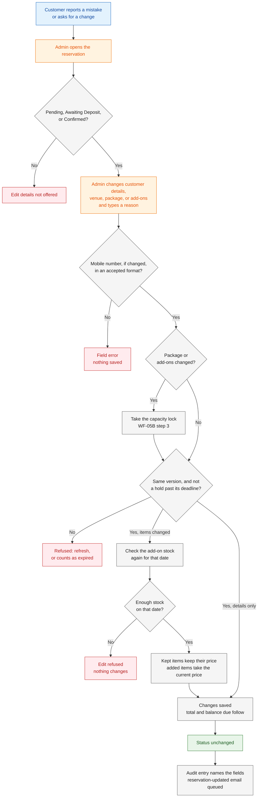

### Sequence diagram

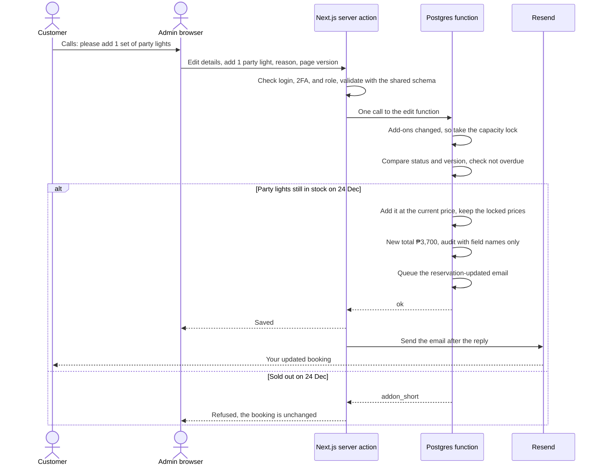

### Steps

| Step | Actor | What happens | Data created, updated, or read | Rules and requirements |
|---|---|---|---|---|
| 1 | Customer | Reports a mistake or asks for a change, by message or call. | — | [roles §3.2][roles], [privacy-and-retention §5.4][priv] |
| 2 | Admin | Opens the reservation. "Edit details" is offered only on Pending Confirmation, Awaiting Deposit, and Confirmed. | Read: reservation | [FR-ADM-10][fr], [FR-ADM-04][fr] |
| 3 | Admin | Changes the customer's details, the venue, the package, or the add-ons, and types a reason. The date, slot, and arrival time are not on this screen (WF-06C). | — | [lifecycle §6.2][lc], [FR-ADM-10][fr] |
| 4 | Browser, Next.js server | A changed mobile number is accepted only if it is a valid Philippine mobile number in a BR-11 form, and saved in the standard `+63…` form ([D-34][dl]). Checks the login, 2FA, and role on the server; makes one call. | — | [BR-11][br], [FR-ADM-10][fr], [roles §2.1, §7][roles], [FR-ADM-07][fr] |
| 5 | Database | If the package or add-ons change: takes the capacity lock first ([WF-05B][wf-avail] step 3). | Lock row | [NFR-20][nfr], [lifecycle §4.3, §6.2][lc], [WF-05B][wf-avail] step 3 |
| 6 | Database | Checks the status and version; refuses a hold past its deadline (not paused). Then, if the package or add-ons change, checks the add-on stock for the event date again. If it is short, the edit is refused and nothing changes. | Read: status, version, deadline; create or update: add-on claims | [FR-ADM-07][fr], [lifecycle §3.3][lc], [EC-16][ec], [BR-03][br], [lifecycle §6.2][lc], [WF-05B][wf-avail] step 10, [EC-47][ec] |
| 7 | Database | Prices: unchanged items keep their locked price, added items take the current catalog price. The locked deposit does not change. The total and the balance due follow from the new items. (More units of an add-on already booked: [catalog-and-payments §10][cat], question 2.) | Update: reservation items and prices | [catalog-and-payments §2.1 to §2.3][cat], [D-12][dl], [EC-55][ec] |
| 8 | Database | Saves the change. The status does not change. Writes the audit entry with the names of the changed fields, never their old or new values. | Update: reservation (version); create: audit entry | [lifecycle §6.2][lc], [FR-ADM-32][fr], [NFR-25][nfr] |
| 9 | Database | Queues the reservation-updated email. | Create: outbox row | [FR-NTF-08][fr], [FR-NTF-16][fr] |
| 10 | Next.js server | Shows the result and sends the email after the reply, or shows the prepared message. | Update: outbox status | [FR-NTF-21][fr] |
| 11 | Customer | If the mobile number changed, the status lookup now uses the corrected number. | Read | [EC-46][ec], [FR-PUB-10][fr] |

### Decision points and validation

| Decision | If yes | If no | Rule |
|---|---|---|---|
| Is the status Pending Confirmation, Awaiting Deposit, or Confirmed? | "Edit details" is offered | Not offered; refused | [FR-ADM-10][fr], [EC-53][ec] |
| Is a reason given? | Continue | Cannot be saved | [lifecycle §6.2][lc] |
| Is a changed mobile number in an accepted form? | Saved in the standard form | Field error; nothing saved | [BR-11][br], [EC-11][ec] |
| Does the version match, and is it not an overdue hold? | Continue | Refused | [FR-ADM-07][fr], [lifecycle §3.3][lc] |
| Did the package or add-ons change? | Lock and check the stock again | No capacity check | [lifecycle §6.2][lc], [BR-03][br] |
| Is there enough add-on stock on that date? | Saved | Refused; nothing changes | [BR-03][br], [EC-47][ec] |

### Failure and exception paths

| Situation | What the system does | Edge case |
|---|---|---|
| The customer entered a wrong mobile number | Corrected with a reason; the lookup uses the new number | [EC-46][ec] |
| An added add-on is sold out on that date | Refused; nothing changes | [EC-47][ec] |
| The new mobile number is not a Philippine mobile number | Rejected with a clear message | [EC-11][ec] |
| The catalog price changed since submission | Kept items keep the locked price | [EC-55][ec] |
| The customer types the number differently on the status page later | Still matches | [EC-64][ec] |
| The customer wants another date or time | Not here: reschedule (WF-06C) | [EC-48][ec] |
| The edit changes the mobile number on an online hold, or the email address | Effects on hold limits and on the email recipient are open questions 6 and 7 | — |
| Both admins act at once | The second one is refused | [EC-16][ec] |
| The email service fails | The edit stands; the email is retried or marked failed | [EC-66][ec] |

### Status transitions involved

None. The reservation keeps its status ([lifecycle §5][lc], "Edit details").

### Developer notes

- **Database function:** `app.edit_reservation_details(reservation_id, expected_version, changes, reason)` (same name as in [WF-05B][wf-avail]). It takes the capacity lock only when the package or add-ons change.
- **Order inside the function:** the capacity lock first (only when the items change), then the row lock with the status and version compare, then the stock check. Order as proposed in [availability-and-conflicts][wf-avail] open question 10, so an edit and a reschedule on the same reservation take their locks in the same order.
- **Server action:** `editReservationDetails`, in the admin module tree; the Zod schemas are shared with the public form ([FR-PUB-06][fr] developer note).
- **Mobile:** normalised to E.164 in the form and in the database ([BR-11][br]).
- **Audit:** category `booking`, action `reservation.details_edited`, changed field names only; never values or contact data ([lifecycle §4.3][lc], [FR-ADM-32][fr]).
- **Outbox email type:** `reservation_updated` ([FR-NTF-08][fr]).
- **Result codes:** `ok`, `stale_version`, `overdue`, `not_allowed`, `invalid_mobile`, `addon_short`.

*(indicative; final names in api-specification, batch 3)*

---

## WF-06F · Expiry

### In plain words

Every request waiting for a review or a deposit has a deadline. If the next step has not happened by then, the request expires: its set or room is free again at once, even before the system has written "Expired" anywhere. Within about a minute, the every-minute job records Expired, stops the QR code, and emails the customer. A request whose deposit proof is waiting for review is the one exception: it keeps its set until an admin reviews the proof, but never past the service start. An expired request is final; if the customer still wants the date and it is free, an admin recreates it (WF-06G).

*Example.* Eva's deposit was due on Tuesday 22 December 2026 at 10:00 AM, and nothing was recorded. At 10:00 AM her set counts as free on the calendar, and her status page shows Expired. Within a minute the job marks her booking Expired and queues the expired email ([FR-SYS-01][fr]). In a proof case, a delivery in a 6:00 PM slot on Saturday 19 December is approved at 1:00 PM; the proof arrives at 5:30 PM; if nobody reviews it by 6:00 PM, the booking expires at 6:00 PM ([EC-31][ec]).

### Actors and responsibilities

| Actor | Responsibilities in this sub-flow |
|---|---|
| The system: pg_cron | Runs the expiry job every minute, and calls the email-sending route while emails wait ([FR-SYS-01][fr], [FR-SYS-03][fr]) |
| Postgres functions | Every read and every action treats an overdue hold as expired; the job, or a capacity action on that date, records Expired ([BR-05][br], [lifecycle §3.3][lc]) |
| Next.js server | Sends the queued emails through `/api/jobs/tick`; `/api/jobs/daily` is the daily backup sweep ([FR-SYS-03][fr], [FR-SYS-08][fr]) |
| Resend | Sends the expired email ([FR-NTF-12][fr]) |
| Customer | Sees Expired on the status page; may contact the business ([FR-PUB-11][fr]) |
| Admin | Reviews a proof while expiry is paused (WF-04); a rejection after the deadline expires the hold at once ([lifecycle row 10c][lc]) |
| Sentry | Alerts the developer if the job's run records stop ([NFR-24][nfr]) |

### Trigger and preconditions

- **Trigger:** one of three ways ([lifecycle rows 9 and 10][lc]):
  - the deadline passes and expiry is not paused (row 9; row 10a);
  - a paused hold reaches its service start with no review (row 10b);
  - an admin rejects a proof after the original deadline (row 10c, **[P]**; the review steps are WF-04E in [lookup-and-review][wf-review]).
- **Preconditions:** the reservation is Pending Confirmation or Awaiting Deposit, with its stored deadline, which is never later than the service start ([lifecycle §3.2][lc], [EC-20][ec], [EC-21][ec]).

### Flowchart

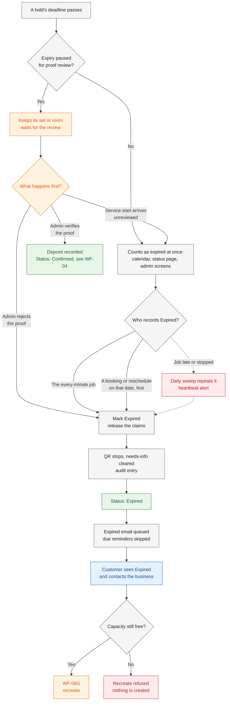

### Sequence diagram

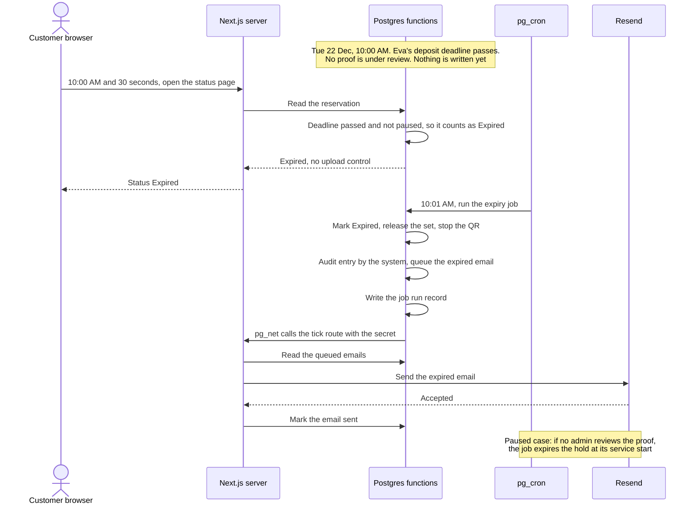

### Steps

| Step | Actor | What happens | Data created, updated, or read | Rules and requirements |
|---|---|---|---|---|
| 1 | — (time passes) | The hold's deadline passes. Nothing is written yet. | — | [lifecycle §3.2][lc] |
| 2 | Database (every read) | If expiry is not paused, the hold counts as expired at once: the calendar counts its set or room as free, the status page shows Expired with no upload control, and the dashboard and the list show it as expired. Details: [WF-05D][wf-avail] step 2. | Read: deadline, expiry-paused flag | [BR-05][br], [FR-PUB-03][fr], [FR-PUB-11][fr], [FR-ADM-02][fr], [FR-ADM-03][fr], [EC-22][ec], [EC-32][ec] |
| 3 | Database (admin actions) | Admin actions on it are refused, because it counts as expired: approve, record a deposit, waive, extend, reject, cancel, reschedule, edit. If the customer still wants the date, an admin can recreate the request (WF-06G; whether before Expired is recorded: open question 9e). | — | [lifecycle §3.3][lc], [FR-ADM-07][fr], [EC-23][ec], [EC-26][ec] |
| 4 | Database (capacity actions) | A booking or reschedule that needs that date marks the hold Expired first, under the capacity lock, with its audit entry and expired email (for staff-created bookings, recreate, and blocks this is a [P] in [WF-05B][wf-avail]; which holds a booking expires is [booking-and-submission][wf-book] open question 8). | Update: reservation → Expired; create: audit entry, outbox row | [BR-09][br] developer note, [lifecycle §4.1, §6.5, rows 9 and 10][lc], [WF-05B][wf-avail] step 6 |
| 5 | pg_cron | Every minute, runs the expiry job. | — | [FR-SYS-01][fr] |
| 6 | Database (job) | Marks each overdue hold that is still Pending Confirmation or Awaiting Deposit as Expired: releases its claims, stops its QR code, clears the needs-info flag, writes an audit entry with the actor "system", and queues the expired email. A hold already expired in step 4 is skipped. | Update: reservations, claims; create: audit entries, outbox rows | [lifecycle rows 9 and 10a][lc], [FR-SYS-01][fr], [FR-PUB-08][fr], [FR-NTF-12][fr], [roles §4][roles], [EC-24][ec] |
| 7 | Database (job) | Writes its run record, the heartbeat. | Create: job run record | [FR-SYS-10][fr] |
| 8 | pg_cron, Next.js server, Resend | While emails wait, `/api/jobs/tick` sends the expired email. Without an email address, the status page is the source of truth. | Update: outbox status | [FR-SYS-03][fr], [FR-NTF-16 to FR-NTF-18][fr], [FR-NTF-21][fr] |
| 9 | Next.js server | A deposit reminder that falls due after the expiry is skipped. | Update: outbox status (skipped) | [FR-NTF-19][fr], [EC-69][ec] |
| 10 | Vercel Cron, Sentry | If the every-minute job is late or stopped, the daily sweep repeats the expiry and the email flush, and the developer is alerted. | Read: job run records | [FR-SYS-08][fr], [FR-SYS-10][fr], [NFR-24][nfr], [EC-77][ec] |
| 11 | Database | **Paused case.** A proof uploaded before the deadline pauses expiry: the hold keeps its set and appears on "proofs to verify". | Read: expiry-paused flag | [BR-12][br], [EC-27][ec], [FR-ADM-02][fr] |
| 12 | Admin | **Paused case.** Verified: the deposit is recorded and the booking becomes Confirmed (WF-04E; row 6). Rejected after the original deadline: the hold expires at once, and the customer gets the proof-not-accepted email and the expired email **[P]** (row 10c). | Update: reservation | [BR-12][br], [lifecycle rows 6 and 10c][lc], [FR-ADM-12][fr], [FR-NTF-06][fr], [EC-28][ec] |
| 13 | Database (job) | **Paused case.** If no admin has reviewed the proof by the service start, the hold expires then, and the job records it (row 10b). Whether it counts as expired everywhere from that moment is [availability-and-conflicts][wf-avail] open question 3. | Update: reservation → Expired | [BR-12][br], [lifecycle row 10b][lc], [FR-SYS-01][fr], [EC-31][ec] |
| 14 | — | Afterwards: the reservation has a closure date. An unverified proof image is deleted 7 days after the reservation became Expired **[P]**. The customer may contact the business, and an admin may recreate the request (WF-06G). | — | [privacy-and-retention §6.1, §6.2][priv], [EC-85][ec], [EC-52][ec] |

### Decision points and validation

| Decision | If yes | If no | Rule |
|---|---|---|---|
| Has the deadline passed? | Go on | The hold counts as normal | [lifecycle §3.2][lc] |
| Is expiry paused for proof review? | Keeps counting until the review or the service start | Counts as expired at once | [BR-05][br], [BR-12][br] |
| Paused: what comes first? | Verified: Confirmed. Rejected: expires at once **[P]**. Service start: expires | — | [BR-12][br], [lifecycle rows 6, 10b, 10c][lc] |
| When the job runs: still Pending Confirmation or Awaiting Deposit? | Mark Expired | Nothing to do | [FR-SYS-01][fr], [lifecycle rows 9 and 10][lc] |
| Did the every-minute job run on time? | — | Daily sweep and heartbeat alert | [FR-SYS-08][fr], [FR-SYS-10][fr], [EC-77][ec] |

### Failure and exception paths

| Situation | What the system does | Edge case |
|---|---|---|
| Nobody reviews a request whose event is less than 72 hours away | Its deadline is the service start; it expires then | [EC-20][ec] |
| A request is approved close to the event | The deposit deadline is the service start, if that comes first | [EC-21][ec] |
| The deadline passed, but the job has not run yet | It counts as expired everywhere at once | [EC-22][ec] |
| An admin tries to approve, or to record the deposit, after the deadline | Refused, unless expiry is paused for proof review | [EC-23][ec] |
| A request flagged "needs info" reaches its deadline | The clock kept running; it expires, and the flag clears | [EC-24][ec] |
| An admin tries to extend after the deadline | Refused; recreate instead | [EC-26][ec] |
| A proof was uploaded just before the deadline | Expiry pauses until the review | [EC-27][ec] |
| A proof is rejected after the deadline | The reservation expires at once | [EC-28][ec] |
| A proof is still unreviewed at the service start | The reservation expires then | [EC-31][ec] |
| The customer tries to upload a proof after the deadline | Status page shows Expired; no upload | [EC-32][ec] |
| The job and a booking both try to expire the same hold | Only one does; one expired email | [EC-68][ec] |
| The every-minute job stops, or two runs start together | The daily sweep and an alert; runs never overlap | [EC-77][ec], [EC-78][ec] |
| The email service fails | Expired stands; the email is retried or marked failed | [EC-66][ec] |
| Someone opens the expired booking's QR link | "Not found / no longer valid" | [EC-60][ec] |

### Status transitions involved

- **Pending Confirmation → Expired**: [reservation-lifecycle §4.2][lc], row 9 (actor "system").
- **Awaiting Deposit → Expired**: row 10, ways a and b (actor "system") and way c (an admin, by rejecting a proof after the deadline, **[P]**).
- Expired is final; an admin can make a new request from it (WF-06G; [lifecycle §1.1][lc]).

### Developer notes

- **Job function:** `app.expire_overdue_holds()`, scheduled by `pg_cron` every minute (`* * * * *`); the same overdue predicate as the readers and the capacity functions ([WF-05D][wf-avail] developer notes).
- **Idempotent:** `UPDATE … WHERE status IN ('pending', 'awaiting_deposit') AND <overdue>`; the row lock lets the job and a booking take turns, and the outbox unique key keeps it to one expired email ([FR-NTF-17][fr]).
- **Readers never write.** The calendar, the status page, and the admin lists only treat an overdue hold as expired ([spec v0.2][spec] §12).
- **QR:** no hash change; the status alone makes the QR code invalid (WF-03A step 8 in [lookup-and-review][wf-review]).
- **Late proof rejection (row 10c):** done inside the WF-04 function, for example `app.reject_proof`, which queues `proof_not_accepted` ([FR-NTF-06][fr]) and `expired`.
- **Which moment is stored** as the time the hold reached Expired is open question 8.
- **Job routes:** `/api/jobs/tick` and `/api/jobs/daily`, bearer secret compared in constant time, advisory lock ([FR-SYS-09][fr]); run records in `job_runs` ([FR-SYS-10][fr]).
- **Audit:** category `booking`, actor kind `system` (admin for row 10c), action `reservation.expired`.
- **Outbox email type:** `expired` ([FR-NTF-12][fr]).

*(indicative; final names in api-specification, batch 3)*

---

## WF-06G · Recreate an expired request

### In plain words

An expired request cannot be brought back, but an admin can make a new request from it when the customer comes back and the date is still free. The new request copies the booking details, gets its own reference code and QR code, and starts with a new review deadline, never later than the service start. Because it counts as a new submission, it uses today's prices and today's deposit amount. The original stays Expired, and each reservation page links to the other. The admin then carries on as usual: approve, then record the deposit.

*Example.* Carla's on-site request for Saturday 2 January 2027 (arrival 5:00 PM) expired because her deposit came too late. Its locked deposit was ₱1,000. She comes to the office on Wednesday 30 December 2026 at 9:00 AM. The room is still free, so the Admin recreates her request. It gets a new reference code and a deadline of Saturday 2 January at 9:00 AM, before the 5:00 PM service start. The deposit setting has since been raised to ₱1,500, so the new request uses ₱1,500 ([reservation-lifecycle §6.9][lc]).

### Actors and responsibilities

| Actor | Responsibilities in this sub-flow |
|---|---|
| Customer | Comes back after the expiry and still wants the date ([EC-52][ec]) |
| Admin or Super Admin | Recreates the request, then continues with the usual steps ([roles §2.3][roles]) |
| Next.js server action | Checks the login, 2FA, and role; one database call; sends the queued email; opens the new reservation |
| Postgres function | Takes the capacity lock, checks the original, claims capacity, creates the new reservation with its own code, QR token, prices, and deadline, the audit entry, and the queued email ([NFR-20][nfr], [NFR-21][nfr]) |
| Resend | Sends the request-received email ([FR-NTF-01][fr]) |

### Trigger and preconditions

- **Trigger:** the customer of an expired request comes back, and an admin decides to recreate it.
- **Preconditions:**
  - The original is Expired ([FR-ADM-21][fr]; [lifecycle row 3][lc]). Any other status: not offered ([EC-53][ec]).
  - A set or the room, and the add-on stock, are free on that date ([BR-01 to BR-03][br]).
  - A service start that has already passed is [edge-cases §15][ec], question 2. Other open details are open question 9.

### Flowchart

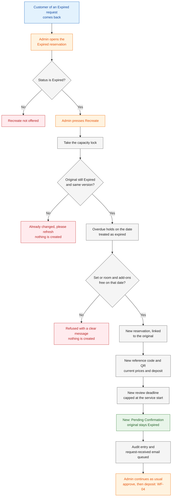

### Sequence diagram

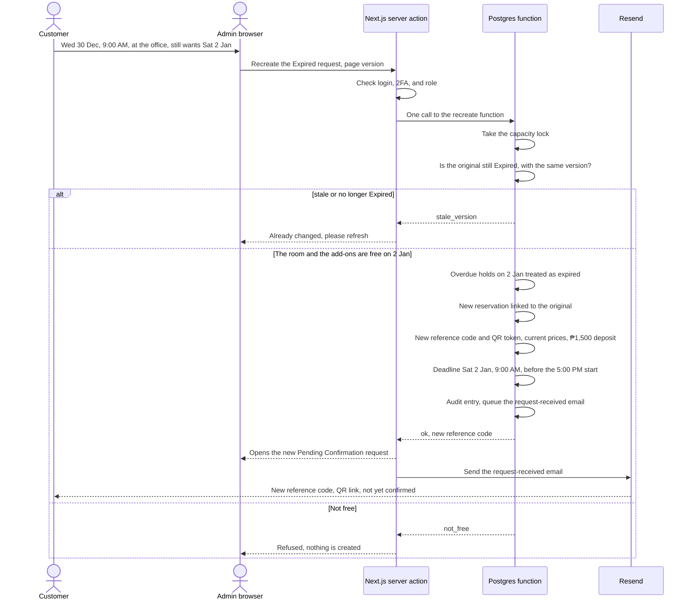

### Steps

| Step | Actor | What happens | Data created, updated, or read | Rules and requirements |
|---|---|---|---|---|
| 1 | Customer | Comes back after the expiry, for example at the office, and still wants the date. | — | [EC-52][ec], [EC-32][ec] |
| 2 | Admin | Opens the Expired reservation. "Recreate" is offered only on Expired reservations. | Read: reservation | [FR-ADM-21][fr], [FR-ADM-04][fr] |
| 3 | Admin | Presses "Recreate". | — | [FR-ADM-21][fr] |
| 4 | Next.js server | Checks the login, 2FA, and role on the server, and makes one call. | — | [roles §2.3, §7][roles], [FR-ADM-07][fr] |
| 5 | Database | Takes the capacity lock. Checks that the original is still Expired and its version matches. | Lock row; read: original | [NFR-20][nfr], [FR-ADM-07][fr], [EC-16][ec] |
| 6 | Database | Treats overdue holds on that date as expired (marking them Expired first is a [P] in [WF-05B][wf-avail] step 6). | Update: other overdue holds | [BR-05][br] |
| 7 | Database | Claims a free set or the room, and the add-on stock. If anything is not free, refused with a clear message, and nothing is created. | Create: claims | [BR-01 to BR-03][br], [FR-ADM-21][fr] |
| 8 | Database | Does not check the online hold limits. | — | [BR-07][br], [lifecycle row 3][lc] |
| 9 | Database | Creates a **new** reservation with the same booking details, linked to the original. It gets a new reference code and QR code (as in WF-02), the current catalog prices and the current deposit setting, and a new review deadline (72 hours by default), capped at the service start. It is urgent if its event date is today. | Create: reservation (status Pending Confirmation, link to the original), price snapshot, QR token hash | [lifecycle §6.9, row 3][lc], [catalog-and-payments §2.3][cat], [FR-PUB-08][fr], [BR-06a][br], [booking-and-submission][wf-book] |
| 10 | Database | The original stays Expired. Writes the audit entry and queues the request-received email. | Create: audit entry, outbox row | [lifecycle row 3][lc], [FR-ADM-32][fr], [FR-NTF-01][fr] |
| 11 | Next.js server | Opens the new reservation; each reservation page links to the other. Sends the email after the reply, or shows the prepared message. | Update: outbox status | [FR-ADM-21][fr], [FR-ADM-04][fr], [FR-NTF-21][fr] |
| 12 | Admin | Continues as usual: approve (WF-04A), then record the deposit (WF-04D). | — | [lifecycle §6.9][lc], [lookup-and-review][wf-review] |

### Decision points and validation

| Decision | If yes | If no | Rule |
|---|---|---|---|
| Is the original Expired? | "Recreate" is offered | Not offered; refused | [FR-ADM-21][fr], [EC-53][ec] |
| Does the original's version still match? | Continue | "Already changed, please refresh" | [FR-ADM-07][fr] |
| Are a set or the room, and the add-ons, free on that date? | New reservation created | Refused; nothing is created | [BR-01 to BR-03][br], [FR-ADM-21][fr] |
| Online hold limits | Not checked | — | [BR-07][br], [lifecycle row 3][lc] |
| Has the service start already passed? | Not settled | — | [edge-cases §15][ec], question 2 |

### Failure and exception paths

| Situation | What the system does | Edge case |
|---|---|---|
| The customer's request expired because the deposit came too late | Recreated if capacity is still free, at the current prices and deposit setting | [EC-52][ec] |
| The set or room, or the add-on stock, has been taken since | Refused; nothing is created | [EC-52][ec], [EC-03][ec] |
| An admin tries to approve the Expired original instead | Refused | [EC-23][ec], [EC-53][ec] |
| An admin tried to extend the deadline after it passed | Refused; this sub-flow is the way back | [EC-26][ec] |
| The customer tried to upload a proof after the deadline | No upload; the customer contacts the business | [EC-32][ec] |
| Both admins press Recreate at once | The second one is refused | [EC-16][ec] |
| The service start has already passed | Not settled | [edge-cases §15][ec], question 2 |
| The email service fails | The new request stands; the email is retried or marked failed | [EC-66][ec] |

### Status transitions involved

- **(new) → Pending Confirmation** for the new reservation: [reservation-lifecycle §4.2][lc], row 3.
- The original stays **Expired** ([lifecycle §1.1, row 3][lc]).

### Developer notes

- **Database function:** `app.recreate_expired(reservation_id, expected_version)` (same name as in [WF-05B][wf-avail]); returns the new reservation's ID and reference code.
- **Server action:** `recreateExpiredReservation`, in the admin module tree ([roles §7][roles]).
- **Link:** `recreated_from` on the new reservation ([lifecycle §4.3][lc]).
- **Codes:** reference code from a secure random generator with a unique constraint and a retry; QR token of 160 random bits, only its SHA-256 hash stored ([FR-PUB-08][fr]).
- **Audit:** category `booking`, action `reservation.recreated`, on the new reservation, naming the original.
- **Outbox email type:** `request_received` ([FR-NTF-01][fr]). No `admin_new_request`: that email is only for online submissions ([FR-NTF-13][fr]).
- **Result codes:** `ok`, `stale_version`, `not_allowed`, `not_free`, `addon_short`.

*(indicative; final names in api-specification, batch 3)*

---

## WF-06H · Automatic Completed the day after the event

### In plain words

Nobody has to mark finished events by hand. Every night at 00:15 Manila time, the system marks each Confirmed booking whose event date is before today as Completed. The set or the room is released, the QR code stops working, and no email is sent. Requests still waiting for a review or a deposit are never completed; their deadline ends at the service start anyway. A balance paid after the event can still be recorded on a Completed booking, and a booking whose event did not happen is corrected with "event not held" (WF-06I).

*Example.* Ana's Confirmed booking for Thursday 24 December 2026 becomes Completed at 12:15 AM on Friday 25 December ([reservation-lifecycle §6.8][lc]). Her closure date is 25 December 2026 ([privacy-and-retention §6.3][priv], example A).

### Actors and responsibilities

| Actor | Responsibilities in this sub-flow |
|---|---|
| The system: pg_cron | Starts the daily job at 00:15 Manila time ([FR-SYS-04][fr]) |
| Postgres function | Works out today's Manila date and marks finished Confirmed bookings Completed ([lifecycle §6.8][lc], [NFR-19][nfr]) |
| Sentry | Alerts the developer if the job run records stop ([FR-SYS-10][fr], [NFR-24][nfr]) |
| Admin | Later records a balance paid after the event, or corrects a wrong Completed (WF-06I) ([EC-38][ec], [EC-51][ec]) |
| Customer | Sees Completed on the status page ([FR-PUB-11][fr]) |

### Trigger and preconditions

- **Trigger:** the daily job at 00:15 Manila time ([FR-SYS-04][fr]).
- **Preconditions:** the booking is Confirmed and its event date is before today's Manila date ([lifecycle row 14][lc]).

### Flowchart

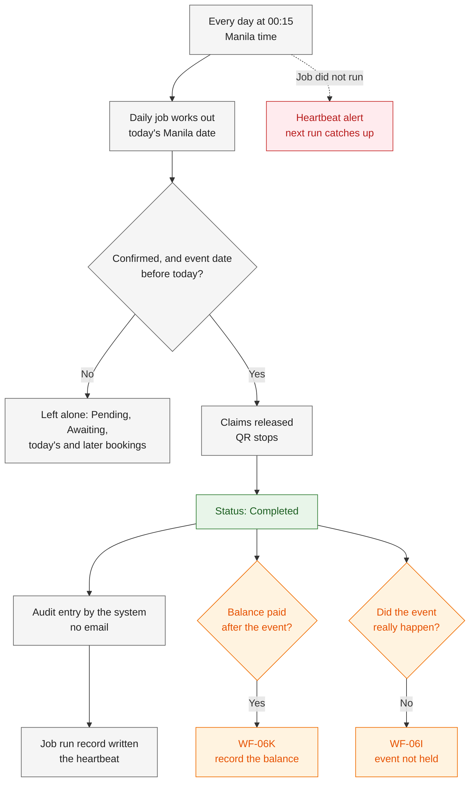

### Sequence diagram

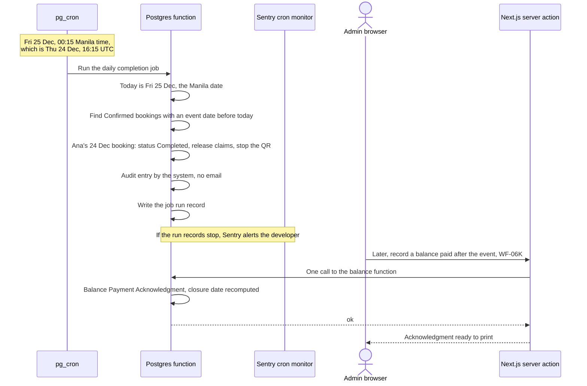

### Steps

| Step | Actor | What happens | Data created, updated, or read | Rules and requirements |
|---|---|---|---|---|
| 1 | pg_cron | Starts the daily job at 00:15 Manila time. | — | [FR-SYS-04][fr], [lifecycle §4.3][lc], [NFR-19][nfr] |
| 2 | Database | Works out "today" as the Manila date, not the UTC date. | — | [NFR-19][nfr], [EC-82][ec] |
| 3 | Database | Finds every Confirmed booking whose event date is before today. It touches nothing else: Pending Confirmation and Awaiting Deposit reservations are left alone. | Read: reservations | [lifecycle §6.8][lc], [FR-SYS-04][fr] |
| 4 | Database | Marks each one Completed: releases its claims, stops its QR code, and writes an audit entry with the actor "system". No email is queued. | Update: reservations, claims; create: audit entries | [lifecycle row 14][lc], [BR-04][br], [FR-PUB-08][fr], [roles §4][roles] |
| 5 | Database | The booking now has a closure date: the latest of the Completed date, the event date, and the last payment. | Update: closure date | [privacy-and-retention §6.1][priv] |
| 6 | Database | Writes the job run record. If the records stop, Sentry alerts the developer. | Create: job run record | [FR-SYS-10][fr], [NFR-24][nfr] |
| 7 | Public site | The status page shows Completed. The QR link shows "no longer valid". | Read | [FR-PUB-11][fr], [FR-PUB-09][fr], [EC-60][ec] |
| 8 | Admin | Later, may record a balance paid after the event (WF-06K); this issues an acknowledgment and recomputes the closure date. | Create: payment; update: closure date | [FR-ADM-14][fr], [catalog-and-payments §4.4][cat], [privacy-and-retention §6.1][priv], [EC-38][ec] |
| 9 | Admin | If the event did not happen, corrects the status with "event not held" (WF-06I). | — | [lifecycle §6.7][lc], [EC-51][ec] |

### Decision points and validation

| Decision | If yes | If no | Rule |
|---|---|---|---|
| Is the booking Confirmed? | Check its date | Left alone | [lifecycle §6.8][lc], [FR-SYS-04][fr] |
| Is its event date before today (Manila date)? | Completed | Left alone (today or later) | [lifecycle row 14][lc], [NFR-19][nfr] |
| Is a balance paid after the event? | Recorded on the Completed booking | — | [EC-38][ec], [FR-ADM-14][fr] |
| Did the event really happen? | Nothing more | WF-06I | [EC-51][ec] |

### Failure and exception paths

| Situation | What the system does | Edge case |
|---|---|---|
| The event did not happen | An admin marks it "event not held" (WF-06I) | [EC-51][ec] |
| The customer pays the balance after the event | Allowed on a Completed booking | [EC-38][ec] |
| The job runs between midnight and 8:00 AM Manila time, when the UTC date is still yesterday | "Today" is the Manila date | [EC-82][ec] |
| The daily job does not run one night | The developer is alerted. The next run picks up every Confirmed booking whose event date is before today, so it catches up. Whether the Vercel daily sweep should also repeat this job is open question 12 | [EC-77][ec] |
| Two runs start together | They never overlap | [EC-78][ec] |
| Someone opens a Completed booking's QR link | "Not found / no longer valid" | [EC-60][ec] |

### Status transitions involved

- **Confirmed → Completed**: [reservation-lifecycle §4.2][lc], row 14 (actor "system").
- The only way out of Completed is WF-06I ([lifecycle §6.7][lc]).

### Developer notes

- **Job function:** `app.complete_finished_events()`, scheduled by `pg_cron` at `15 16 * * *` (UTC), which is 00:15 Manila time ([lifecycle §4.3][lc], [NFR-19][nfr]).
- **Today:** `(now() AT TIME ZONE 'Asia/Manila')::date`; select `status = 'confirmed' AND event_date < today`.
- **Effects:** release the claims (they stop being live, [BR-04][br]). QR: no hash change; the status alone makes the QR code invalid (WF-03A step 8 in [lookup-and-review][wf-review]; [FR-PUB-08][fr]).
- **Run record:** a `job_runs` row; advisory lock so two runs never overlap ([FR-SYS-09][fr], [FR-SYS-10][fr]).
- **Audit:** category `booking`, actor kind `system`, action `reservation.completed`.
- **Outbox email type:** none ([lifecycle row 14][lc]).

*(indicative; final names in api-specification, batch 3)*

---

## WF-06I · Event not held

### In plain words

Sometimes the system marks a booking Completed although the event never took place, for example because the party was called off and nobody told the office in time. An admin then marks it "event not held", and the booking moves from Completed to Cancelled. A reason and a refund decision are always required, even if the decision is "none". Nothing changes on the calendar, because the date has passed and the set was already released. If money is to be paid back, the admin records it when it is paid (WF-06B).

*Example.* Ana's Confirmed booking for Thursday 24 December 2026 became Completed at 12:15 AM on Friday 25 December. On Saturday 26 December, the admins learn that the event never took place. The Admin marks it "event not held", with a reason and the refund decision "none" ([reservation-lifecycle §6.7][lc]).

### Actors and responsibilities

| Actor | Responsibilities in this sub-flow |
|---|---|
| Admin or Super Admin | Marks the event not held, with a reason and a refund decision ([roles §2.3][roles]) |
| Next.js server action | Checks the login, 2FA, and role; validates; one database call |
| Postgres function | Checks the status and version, moves the booking to Cancelled, saves the reason and refund decision, writes the audit entry ([NFR-21][nfr]) |
| Customer | Sees Cancelled, the reason, and the refund decision on the status page ([FR-PUB-11][fr]) |

### Trigger and preconditions

- **Trigger:** the admins learn that a Completed booking's event did not take place ([EC-51][ec]).
- **Preconditions:** the status is Completed ([FR-ADM-20][fr]; [lifecycle row 15][lc]); a reason and a refund decision.

### Flowchart

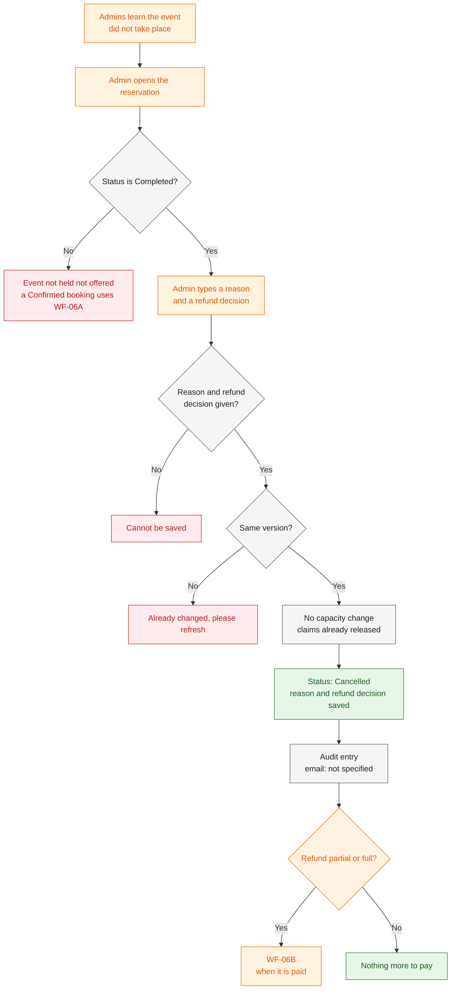

### Sequence diagram

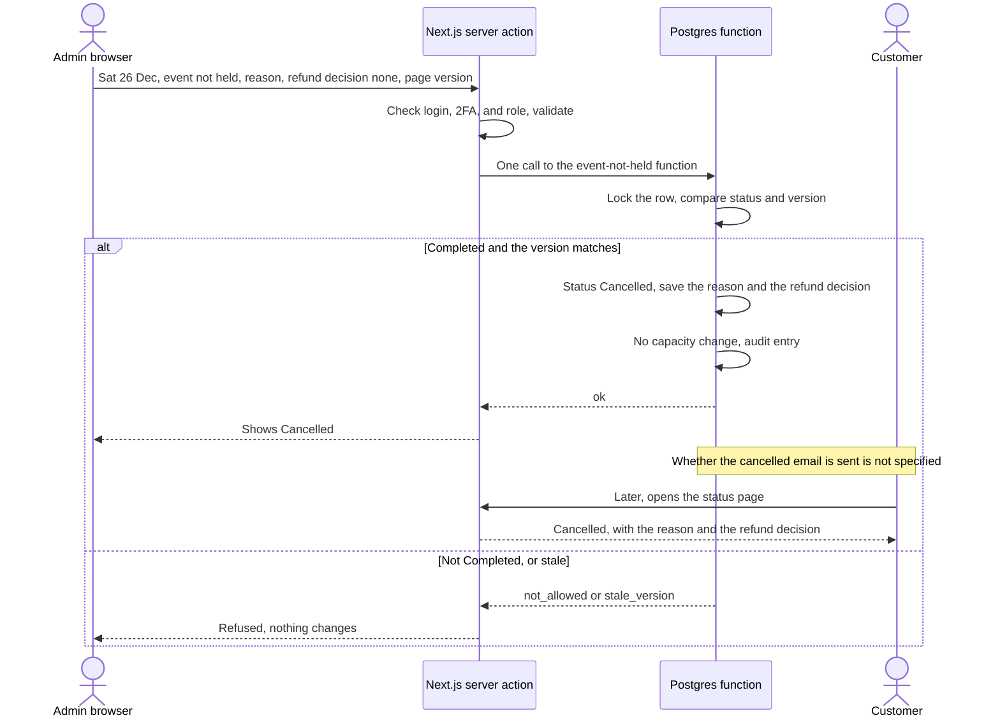

### Steps

| Step | Actor | What happens | Data created, updated, or read | Rules and requirements |
|---|---|---|---|---|
| 1 | Admin | Learns that the event of a Completed booking did not take place. | — | [EC-51][ec] |
| 2 | Admin | Opens the reservation. "Event not held" is offered only on Completed bookings. | Read: reservation | [FR-ADM-20][fr], [FR-ADM-04][fr] |
| 3 | Admin | Types a reason and a refund decision (none, partial, or full, with the amount), decided case by case. Both are required. | — | [lifecycle §6.7, row 15][lc], [FR-ADM-20][fr], [catalog-and-payments §4.5][cat] |
| 4 | Next.js server | Checks the login, 2FA, and role on the server, validates, and makes one call. | — | [roles §2.3, §7][roles], [FR-ADM-07][fr] |
| 5 | Database | Checks that the status is Completed and the version matches. | Read: status, version | [FR-ADM-07][fr], [EC-16][ec], [EC-53][ec] |
| 6 | Database | Sets the status to Cancelled. Saves the reason, and the refund decision with who decided and when. No capacity change: the claims were already released. | Update: reservation (status, reason, refund decision, version) | [lifecycle row 15][lc] |
| 7 | Database | Writes the audit entry with the reason. Whether the cancelled email is queued is not specified. | Create: audit entry | [FR-ADM-32][fr]; [FR §7][fr], question 7 |
| 8 | Public site | The status page shows Cancelled, the reason, and the refund decision. | Read | [FR-PUB-11][fr], [FR-ADM-20][fr] |
| 9 | — | How this affects the closure date is not settled. | — | [privacy-and-retention §11][priv], question 10 |
| 10 | Admin | If the refund decision is partial or full, records the refund when it is paid (WF-06B). | — | [FR-ADM-19][fr], [catalog-and-payments §3][cat] |

### Decision points and validation

| Decision | If yes | If no | Rule |
|---|---|---|---|
| Is the status Completed? | "Event not held" is offered | Not offered; refused. A Confirmed booking is cancelled with WF-06A | [FR-ADM-20][fr], [lifecycle §6.7][lc], [EC-53][ec] |
| Are a reason and a refund decision given? | Continue | Cannot be saved | [FR-ADM-20][fr], [lifecycle row 15][lc] |
| Does the version still match? | Saved | "Already changed, please refresh" | [FR-ADM-07][fr] |
| Is the refund partial or full? | WF-06B when paid | Nothing more to pay | [catalog-and-payments §3, §4.5][cat] |

### Failure and exception paths

| Situation | What the system does | Edge case |
|---|---|---|
| A booking became Completed, but the event did not happen | This sub-flow: Completed → Cancelled | [EC-51][ec] |
| Both admins act at once | The second one is refused | [EC-16][ec] |
| Tried on a status other than Completed | Refused | [EC-53][ec] |
| Marked "not held" by mistake | Cancelled is final; nothing is deleted; batch-1 docs define no undo (open question 1) | [EC-54][ec] |
| Whether the customer gets the cancelled email | Not specified | [FR §7][fr], question 7 |

### Status transitions involved

- **Completed → Cancelled**: [reservation-lifecycle §4.2][lc], row 15. This is the only way out of Completed ([lifecycle §6.7][lc]).

### Developer notes

- **Database function:** `app.mark_event_not_held(reservation_id, expected_version, reason, refund_decision, refund_amount)`. No capacity lock: nothing is claimed or released.
- **Server action:** `markEventNotHeld`, in the admin module tree ([roles §7][roles]).
- **Audit:** category `booking`, action `reservation.event_not_held`, with the reason.
- **Outbox email type:** none until [FR §7][fr] question 7 is answered; `cancelled` ([FR-NTF-10][fr]) if the answer is yes.
- **Result codes:** `ok`, `stale_version`, `not_allowed`, `reason_required`, `refund_decision_required`.

*(indicative; final names in api-specification, batch 3)*

---

## WF-06J · Void a payment

### In plain words

If a payment was recorded by mistake, for example on the wrong booking or with the wrong amount, an admin voids it with a reason. It is never deleted: the record stays in the list, marked void, with who voided it, when, and why. A voided payment no longer counts, so it is no longer the deposit and is left out of the balance due; its acknowledgment number is retired and never used again. Voiding never changes the reservation's status. Either admin can void a deposit, a balance payment, or a refund record **[C]** ([D-24][dl]).

*Example.* The Admin records ₱1,000 on the wrong reservation and gets `ACK-2026-0007`. He voids it with the reason "recorded on wrong booking". Number 0007 is never used again; the next acknowledgment is `ACK-2026-0008` ([EC-33][ec]). He then records the ₱1,000 on the right booking.

### Actors and responsibilities

| Actor | Responsibilities in this sub-flow |
|---|---|
| Admin or Super Admin | Voids the wrong record with a reason, then records the correct payment where it belongs ([roles §2.2][roles], [D-24][dl]) |
| Next.js server action | Checks the login, 2FA, and role; one database call |
| Postgres function | Marks the payment void, retires its acknowledgment number, writes the audit entry ([NFR-21][nfr], [NFR-22][nfr]) |
| Customer | Sees the updated balance due on the status page ([FR-PUB-11][fr]) |

### Trigger and preconditions

- **Trigger:** an admin finds a deposit, balance, or refund record that was recorded wrongly ([FR-ADM-15][fr]).
- **Preconditions:** the payment exists on a reservation, in any status ([lifecycle §5][lc], "Void a payment"); a reason.

### Flowchart

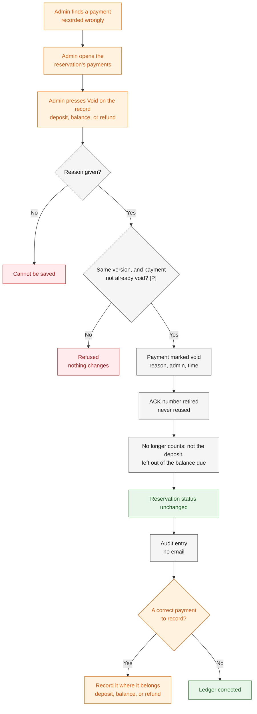

### Sequence diagram

```mermaid
sequenceDiagram
    actor A as Admin browser
    participant N as Next.js server action
    participant DB as Postgres function
    actor C as Customer
    A->>N: Void ACK-2026-0007, reason recorded on wrong booking, page version
    N->>N: Check login, 2FA, and role, reason given
    N->>DB: One call to the void function
    DB->>DB: Lock the row, compare version, payment still active
    alt Allowed
        DB->>DB: Mark void with the reason, admin, and time
        DB->>DB: ACK-2026-0007 retired, the counter does not go back
        DB->>DB: Audit entry, no email, status unchanged
        DB-->>N: ok
        N-->>A: Shown as void in the payments list
        C->>N: Later, opens the status page
        N-->>C: Balance due without the voided payment
    else Already void, or stale
        DB-->>N: refused
        N-->>A: Refused, nothing changes
    end
```

### Steps

| Step | Actor | What happens | Data created, updated, or read | Rules and requirements |
|---|---|---|---|---|
| 1 | Admin | Finds a payment recorded wrongly, for example on the wrong booking. | — | [EC-33][ec] |
| 2 | Admin | Opens the reservation's payments: kind, amount, method, e-wallet reference, admin, time, note, ACK number, and void details. | Read: payments | [FR-ADM-04][fr] |
| 3 | Admin | Presses "Void" on the deposit, balance, or refund record, and types a reason. | — | [FR-ADM-15][fr], [D-24][dl] |
| 4 | Next.js server | Checks the login, 2FA, and role on the server, and that the reason is there. Makes one call. | — | [roles §2.2, §7][roles], [FR-ADM-07][fr] |
| 5 | Database | Checks the version, and that the payment is not already void **[P] (new in this doc)**. | Read: reservation version, payment | [FR-ADM-07][fr], [EC-16][ec] |
| 6 | Database | Marks the payment void, with the reason, the admin, and the time. The record stays in the ledger. | Update: payment (void fields) | [catalog-and-payments §4.6][cat], [D-24][dl], [NFR-22][nfr] |
| 7 | Database | Retires its acknowledgment number (deposits and balances only): it is never reused, and the counter does not go back. | — | [catalog-and-payments §4.6, §5.2][cat], [EC-36][ec] |
| 8 | Database | The voided payment no longer counts: it is not the active deposit, and it is left out of the balance due. | — | [catalog-and-payments §2.1, §4.6][cat], [D-24][dl] |
| 9 | Database | The reservation's status does not change. Writes the audit entry. No email. | Create: audit entry | [lifecycle §5][lc], [catalog-and-payments §4.6][cat], [FR-ADM-32][fr] |
| 10 | Public site | The status page shows the balance due without the voided payment. Whether it still links to a voided acknowledgment is not settled. | Read | [FR-PUB-11][fr]; [catalog-and-payments §10][cat], question 5 |
| 11 | Admin | Records the correct payment where it belongs: a deposit ([lookup-and-review][wf-review], WF-04D), a balance (WF-06K), or a refund (WF-06B). A reservation has at most one active deposit. Recording a deposit again on a Confirmed booking after a void is not settled. | Create: payment | [EC-35][ec]; [FR §7][fr], question 3 |

### Decision points and validation

| Decision | If yes | If no | Rule |
|---|---|---|---|
| Is the record a deposit, balance, or refund? | Either admin can void it | — | [D-24][dl], [FR-ADM-15][fr] |
| Is a reason given? | Continue | Cannot be saved | [FR-ADM-15][fr] |
| Does the version still match? | Continue | "Already changed, please refresh" | [FR-ADM-07][fr] |
| Is the payment already void? | Refused **[P] (new in this doc)** | Voided | open question 11 |

### Failure and exception paths

| Situation | What the system does | Edge case |
|---|---|---|
| A payment was recorded on the wrong booking | Voided with a reason; the ACK number is retired | [EC-33][ec] |
| After voiding, the admin records the deposit again | Allowed only as the one active deposit; on a Confirmed booking this is not settled | [EC-35][ec]; [FR §7][fr], question 3 |
| Two payments are recorded at the same moment afterwards | Each gets its own number; the voided number is skipped | [EC-36][ec] |
| Both admins act at once | The second one is refused | [EC-16][ec] |
| An admin wants to delete the wrong payment | Not possible; voiding is the fix | [EC-54][ec] |

### Status transitions involved

None. The lifecycle has no status change for a void ([lifecycle §5][lc], "Void a payment"; [catalog-and-payments §4.6][cat]).

### Developer notes

- **Database function:** `app.void_payment(payment_id, expected_version, reason)`; `expected_version` is the reservation's version ([FR-ADM-07][fr]).
- **Server action:** `voidPayment`, in the admin module tree ([roles §7][roles]).
- **Data:** the void fields on `payments` (voided, reason, admin, time) ([catalog-and-payments §9][cat]). The active deposit is "kind deposit and not voided"; the balance due sums only payments that are not voided.
- **Acknowledgments:** `ack_counters` is never decremented ([catalog-and-payments §9][cat]).
- **Closure date:** whether a void recomputes it is open question 11.
- **Audit:** category `booking` (indicative; not assigned in [FR-ADM-32][fr], see [administration][wf-admin] open question 1), action `payment.voided`, with the reason.
- **Outbox email type:** none.

*(indicative; final names in api-specification, batch 3)*

---

## WF-06K · Record a balance payment

### In plain words

The balance is the rest of the price, after the deposit. When the customer pays it, usually on event day or after, an admin records it, so the money records stay complete. It can be recorded on a Confirmed or a Completed booking; the amount is filled in for the admin as the total minus the deposit, and the admin adds whether it was cash or e-wallet and, for an e-wallet payment, only its reference number. Recording it issues a **Balance Payment Acknowledgment** with the next acknowledgment number, which the customer can open on the status page. The status does not change and no email is sent. A balance recorded by mistake is voided, never deleted (WF-06J).

*Example.* On Thursday 24 December 2026, Ana pays her ₱2,400 balance in cash. The Admin opens her Confirmed booking; the amount is already filled in: ₱3,400 total minus the ₱1,000 deposit. He records it, and `ACK-2026-0015` is issued. Her balance due is now ₱0 ([catalog-and-payments §4.4, §8][cat]). Had she paid on Monday 28 December instead, after her booking became Completed, it could still be recorded, and her closure date would move to 28 December ([EC-38][ec], [EC-40][ec]).

### Actors and responsibilities

| Actor | Responsibilities in this sub-flow |
|---|---|
| Customer | Pays the balance, in cash at the office or by e-wallet ([catalog-and-payments §4.2, §4.4][cat]) |
| Admin or Super Admin | Records the balance and prints the acknowledgment if wanted ([roles §2.2][roles], [FR-ADM-23][fr]) |
| Next.js server action | Checks the login, 2FA, and role; validates the fields; one database call ([FR-ADM-07][fr]) |
| Postgres function | Checks the status and version, adds the balance to the payments ledger, takes the next acknowledgment number, recomputes the closure date, writes the audit entry, in one transaction ([NFR-21][nfr], [catalog-and-payments §9][cat]) |

### Trigger and preconditions

- **Trigger:** the customer pays the balance ([FR-ADM-14][fr]).
- **Preconditions:**
  - The status is Confirmed or Completed ([FR-ADM-14][fr]; [lifecycle §5][lc], "Record a balance payment"). Any other status: not offered, and refused if tried ([EC-53][ec]).
  - Whether a balance can be paid in parts is [catalog-and-payments §10][cat], question 1. The default amount after a waived deposit is [edge-cases §15][ec], question 5.

### Flowchart

```mermaid
flowchart TD
    K0["Customer pays the balance<br/>cash at the office or e-wallet"] --> K1["Admin opens the reservation"]
    K1 --> Q1{"Confirmed or Completed?"}
    Q1 -->|"No"| X1["Record balance not offered<br/>a direct try is refused"]
    Q1 -->|"Yes"| K2["Amount filled in:<br/>total minus deposit"]
    K2 --> K3["Admin checks the amount, enters<br/>method, e-wallet reference, note"]
    K3 --> S1["Server checks login,<br/>2FA, and role"]
    S1 --> Q2{"E-wallet has a reference?<br/>Cash has none?"}
    Q2 -->|"No"| X2["Field error<br/>nothing saved"]
    Q2 -->|"Yes"| Q3{"Same version, still<br/>Confirmed or Completed?"}
    Q3 -->|"No"| X3["Already changed, please refresh<br/>nothing saved"]
    Q3 -->|"Yes"| S2["Balance added to the ledger<br/>received by and time saved"]
    S2 --> S3["Next ACK number from<br/>the Manila-year counter"]
    S3 --> S4["Closure date recomputed<br/>none yet while Confirmed"]
    S4 --> ST["Status unchanged<br/>Balance Payment Acknowledgment"]
    ST --> S5["Audit entry<br/>no email"]
    S5 --> Q4{"Recorded wrongly?"}
    Q4 -->|"Yes"| J1["WF-06J<br/>void it, record again"]
    Q4 -->|"No"| OK1["Printed at the office<br/>linked on the status page"]
    classDef customer fill:#e3f2fd,stroke:#1565c0,color:#0d47a1
    classDef system fill:#f5f5f5,stroke:#616161,color:#212121
    classDef admin fill:#fff3e0,stroke:#ef6c00,color:#e65100
    classDef status fill:#e8f5e9,stroke:#2e7d32,color:#1b5e20
    classDef failure fill:#ffebee,stroke:#c62828,color:#b71c1c
    class K0 customer
    class K1,K3,Q4,J1 admin
    class Q1,K2,S1,Q2,Q3,S2,S3,S4,S5 system
    class ST,OK1 status
    class X1,X2,X3 failure
```

### Sequence diagram

```mermaid
sequenceDiagram
    actor C as Customer
    actor A as Admin browser
    participant N as Next.js server action
    participant DB as Postgres function
    C->>A: Thu 24 Dec, pays the ₱2,400 balance in cash
    A->>N: Record balance, ₱2,400, cash, page version
    N->>N: Check login, 2FA, and role, validate method and reference
    N->>DB: One call to the balance function
    DB->>DB: Lock the row, compare status and version
    alt Not Confirmed or Completed, or stale
        DB-->>N: not_allowed or stale_version
        N-->>A: Refused, nothing saved
    else Allowed
        DB->>DB: Lock the 2026 acknowledgment counter, take the next number
        DB->>DB: Insert the balance payment, received by, time
        DB->>DB: Recompute the closure date, if the booking has one
        DB->>DB: Audit entry, no email, status unchanged
        DB-->>N: ok, ACK-2026-0015
        N-->>A: Balance Payment Acknowledgment to print
        C->>N: Later, opens the status page
        N-->>C: Balance due ₱0, link to the acknowledgment
    end
```

### Steps

| Step | Actor | What happens | Data created, updated, or read | Rules and requirements |
|---|---|---|---|---|
| 1 | Customer, admin | The customer pays the balance, in cash at the office or by e-wallet. | — | [catalog-and-payments §4.2, §4.4][cat], [D-05][dl] |
| 2 | Admin | Opens the reservation (WF-03). "Record balance" is offered only on Confirmed and Completed bookings. | Read: reservation, payments | [FR-ADM-14][fr], [FR-ADM-04][fr], [lifecycle §5][lc] |
| 3 | Next.js server | Fills in the amount as the total minus the deposit. (After a waived deposit: [edge-cases §15][ec], question 5. A balance in parts: [catalog-and-payments §10][cat], question 1.) | Read: price snapshot, payments | [FR-ADM-14][fr], [catalog-and-payments §2.1, §4.4][cat], [EC-38][ec] |
| 4 | Admin | Checks the amount and enters the method (cash or e-wallet), the e-wallet reference number (required for e-wallet, empty for cash), and an optional note. Never the payer's name or account number, not even in the note (the note rule is [P] in [catalog-and-payments §4.7][cat]). | — | [FR-ADM-14][fr], [catalog-and-payments §4.2, §4.7][cat] |
| 5 | Next.js server | Checks the login, 2FA, and role on the server, validates the fields, and makes one call. | — | [roles §2.2, §7][roles], [FR-ADM-07][fr] |
| 6 | Database | Checks that the status is still Confirmed or Completed and that the version still matches. If not: refused, nothing saved. | Read: status, version | [lifecycle §4.3, §5][lc], [FR-ADM-07][fr], [EC-16][ec], [EC-53][ec] |
| 7 | Database | Adds the balance to the payments ledger. The admin who received it and the time are saved automatically. | Create: payment (kind balance) | [catalog-and-payments §4.1, §4.2, §4.4][cat], [FR-ADM-14][fr] |
| 8 | Database | Takes the next acknowledgment number from the counter of the Manila year in which it is recorded; deposits and balances share the counter. Two admins recording at once never get the same number, and a number is never reused. | Update: year counter; the number on the payment | [catalog-and-payments §5.1, §5.2][cat], [EC-36][ec], [EC-37][ec] |
| 9 | Database | Recomputes the closure date, so the retention periods count from this later payment. A Confirmed booking has no closure date yet; a Completed one does. | Update: reservation closure date | [privacy-and-retention §6.1][priv], [catalog-and-payments §9][cat], [EC-40][ec] |
| 10 | Database | Writes the audit entry. No email is queued; the status does not change. | Create: audit entry | [FR-ADM-32][fr], [FR-ADM-07][fr], [lifecycle §5][lc] |
| 11 | Next.js server | Shows the Balance Payment Acknowledgment, ready to print. The status page links to it, and the balance due follows. | Read: payment, acknowledgment | [FR-ADM-23][fr], [FR-PUB-14][fr], [FR-PUB-11][fr], [catalog-and-payments §5.3, §5.4][cat] |
| 12 | Admin | If the record is wrong, voids it with a reason (WF-06J) and records the correct one. | — | [catalog-and-payments §4.6][cat], [D-24][dl] |

### Decision points and validation

| Decision | If yes | If no | Rule |
|---|---|---|---|
| Is the booking Confirmed or Completed? | "Record balance" is offered | Not offered; refused | [FR-ADM-14][fr], [lifecycle §5][lc], [EC-53][ec] |
| Is the method e-wallet? | The reference number is required | Cash: the reference stays empty | [catalog-and-payments §4.2][cat] |
| Does the version still match? | Saved | "Already changed, please refresh" | [FR-ADM-07][fr] |
| Does the booking have a closure date (Completed)? | It is recomputed | None yet; nothing to recompute | [privacy-and-retention §6.1][priv] |
| Can the balance be paid in parts? | Not settled | — | [catalog-and-payments §10][cat], question 1 |
| What is the default after a waived deposit? | Not settled | — | [edge-cases §15][ec], question 5 |

### Failure and exception paths

| Situation | What the system does | Edge case |
|---|---|---|
| The customer pays the balance after the event | Allowed on a Completed booking | [EC-38][ec] |
| The balance is recorded long after the booking closed | The closure date moves, and so do the retention periods | [EC-40][ec] |
| Both admins record payments at the same moment, on different bookings | Each acknowledgment gets its own number | [EC-36][ec] |
| A balance is recorded just after midnight on 1 January | The number uses the Manila year, and the counter starts again | [EC-37][ec] |
| The balance was recorded on the wrong booking or with the wrong amount | It is voided with a reason, never deleted (WF-06J) | [EC-33][ec], [EC-54][ec] |
| Both admins act on the same reservation at once | The second one is refused | [EC-16][ec] |
| The booking is not Confirmed or Completed | Not offered; refused | [EC-53][ec] |
| Cash received one day but recorded the next | The acknowledgment shows the recording date; not settled | [catalog-and-payments §10][cat], question 7 |

### Status transitions involved

None. The reservation stays **Confirmed** or **Completed** ([lifecycle §5][lc], "Record a balance payment"; [catalog-and-payments §4.4][cat]).

### Developer notes

- **Database function:** `app.record_balance(reservation_id, expected_version, amount, method, ewallet_ref, note)`.
- **Server action:** `recordBalancePayment`, in the admin module tree ([roles §7][roles]).
- **Acknowledgment number:** inside the function, lock the year's `ack_counters` row (`FOR UPDATE`), increment it, and write the number on the payment; the year from `now() AT TIME ZONE 'Asia/Manila'`; pad to at least 4 digits, never truncate ([catalog-and-payments §9][cat]).
- **Database checks:** the e-wallet reference is required when the method is e-wallet and empty for cash ([catalog-and-payments §9][cat]). The default amount is shown by the page; the saved amount is the one the admin confirms.
- **Closure date:** recomputed inside the same function ([catalog-and-payments §9][cat]; [privacy-and-retention §6.4][priv] developer note).
- **Audit:** category `booking` (indicative; not assigned in [FR-ADM-32][fr], see [administration][wf-admin] open question 1), action `payment.balance_recorded`.
- **Outbox email type:** none ([lifecycle §5][lc]).
- **Result codes:** `ok`, `stale_version`, `not_allowed`, `invalid_ewallet_ref`.
- **Tests:** acknowledgment numbering under concurrency, and recording a balance end to end ([catalog-and-payments §9][cat]).

*(indicative; final names in api-specification, batch 3)*

---

## Source notes: batch-1 docs and the frozen spec

Where spec v0.2 and the batch-1 docs differ on a point this document uses, the batch-1 docs win ([D-23][dl]). The spec is not edited.

1. **Who may void, and what.** Spec §4's permission matrix names only "record or void a deposit", and spec §8 says only that "a wrongly recorded payment is voided". [D-24][dl], [roles §2.2][roles], and [FR-ADM-15][fr] let either admin void a deposit, a balance, or a refund record. This document follows D-24 (WF-06J).
2. **The every-minute job and paused holds.** Spec §15 describes the job as expiring overdue holds "(not paused)". [FR-SYS-01][fr] and [lifecycle row 10b][lc] also have it expire a paused hold when its service start arrives (BR-12). This document follows the batch-1 docs (WF-06F step 13), as [availability-and-conflicts][wf-avail] does.
3. **What the cancelled email contains.** Spec §9 lists "cancelled, with the refund decision". [FR-NTF-10][fr] adds the reason, marked [P] (new in that doc). This document follows FR-NTF-10 (WF-06A step 9).
4. **Recreate and the hold limits.** Spec §7 and [BR-07][br] say a recreate is "exempt" from the online hold limits; [FR-ADM-21][fr] says it "is not refused by" them; [lifecycle row 3][lc] says it is "not counted toward" them. These readings are close but not the same; see open question 9a.

## Open questions

These are not decided here. If the reviewers agree an answer is needed, add each one to the [decision log][dl] as a new open item (O-12 onwards), then update the owning doc and this document.

1. **Undoing a mistaken cancel.** Cancelled is final ([lifecycle §1.1][lc]), and nothing is deleted ([EC-54][ec]). If an admin cancels the wrong booking (WF-06A) or marks the wrong event "not held" (WF-06I), what is the fix? For example, a new staff-created booking ([FR-ADM-24][fr]), which would take a new reference code and the current prices?
2. **Unreviewed proofs after a cancel or an expiry.** "Proofs to verify" lists every reservation with an uploaded proof that no admin has reviewed ([FR-ADM-02][fr]). Does a proof that was never reviewed leave the list when its reservation becomes Cancelled (WF-06A) or Expired (WF-06F)? (When its image is deleted is [privacy-and-retention §6.2][priv], [P].)
3. **Changing the service type.** A reschedule changes the date, slot, or arrival time ([lifecycle §6.5][lc]); edit details changes the customer details, venue, package, or add-ons ([lifecycle §6.2][lc]). Neither moves a booking from delivery to on-site or back. Is that allowed, and through which action, or is it a cancel and a new booking?
4. **The deposit reminder after a reschedule.** A reschedule can move an Awaiting Deposit deadline earlier (WF-06C step 10). [FR-NTF-04][fr] and [FR-NTF-17][fr] cover the reminder after approval and after an extension only. Is a reminder sent for the new deadline, and what if its moment has already passed when the admin reschedules?
5. **[P] (new in this doc) An extension must be later.** [Lifecycle §3.2][lc] says "extend a deadline" moves the deadline later. This document treats a new deadline that is not later than the current one as refused (WF-06D step 5). Confirm, or say whether "extend" may also shorten a deadline.
6. **Edit details and the hold limits.** If an admin changes the mobile number on an online hold (WF-06E), do the [BR-07][br] limits apply to the new number?
7. **Edit details and the email address.** If an edit changes or removes the email address, which address receives the reservation-updated email ([FR-NTF-08][fr]), and what happens to emails already queued for the old address?
8. **The moment a hold expires.** [Lifecycle row 9][lc] says a hold counts as expired "from the deadline itself", but the Expired status is recorded later, by the job or by a booking (WF-06F steps 4 and 6). Which moment is stored as the time it reached Expired? It decides the closure date ([privacy-and-retention §6.1][priv]; example C there uses the deadline date), the 7-day clock for an unverified proof (§6.2), and the time on the audit entry.
9. **Recreate details** (WF-06G).
   a. Which source does the new reservation get, and does it count toward the hold limits of later online requests from the same number (see source note 4)?
   b. Is its service start copied from the original, or worked out again from the current slot times or on-site hours ([lifecycle §3.1][lc])?
   c. What if the original's package or an add-on has been archived since (the slot is part of [availability-and-conflicts][wf-avail] open question 5)?
   d. Can one Expired reservation be recreated more than once?
   e. A hold whose deadline has passed already counts as Expired for every admin action ([BR-05][br]), but [lifecycle row 3][lc] requires the original to be Expired. Is "Recreate" offered at once, before the every-minute job or a booking has recorded Expired (for example, by recording it in the same step), or only afterwards?
10. **Recording a refund when the decision is "none".** [Lifecycle §5][lc] allows "record a refund paid" on a Cancelled reservation "after a refund decision". Is it refused when the decision is "none" (WF-06B)?
11. **Voids and the closure date; a second void.** The closure date includes the latest payment or refund date and is recomputed when one is recorded ([privacy-and-retention §6.1][priv]). Is it also recomputed when that payment is voided? This document also treats voiding a record that is already void as refused **[P] (new in this doc)** (WF-06J step 5).
12. **The daily Completed job and the backup sweep.** The Vercel daily sweep repeats only the expiry sweep and the email flush ([FR-SYS-08][fr]). Should it also repeat the Completed job (WF-06H), or is the next nightly run enough?

These are already open in other documents and are not repeated here: audit categories, including payments and voids ([administration][wf-admin] open question 1); which overdue holds the booking function expires ([booking-and-submission][wf-book] open question 8); a balance paid in parts ([catalog-and-payments §10][cat], question 1); the default balance after a waived deposit ([edge-cases §15][ec], question 5); the payment date when cash is recorded a day later ([catalog-and-payments §10][cat], question 7); a refund decision when only a balance was paid ([lifecycle §9][lc], question 2); more units of an add-on in "edit details" ([catalog-and-payments §10][cat], question 2); whether the refund paid must equal the decision, and refunds in parts (same list, question 3); what "full" covers (question 4); voided acknowledgments on the status page (question 5); the reminder and the deadline shown while expiry is paused ([FR §7][fr], question 2); recording a deposit after a void on a Confirmed booking (question 3); whether "event not held" sends the cancelled email (question 7); recreating a request whose service start has passed ([edge-cases §15][ec], question 2); a deadline extended while expiry is paused (question 4); "event not held" and the closure date ([privacy-and-retention §11][priv], question 10); which actions take the capacity lock, a paused hold at its service start, the online-only checks for a reschedule or a recreate, and which changes increase the version ([availability-and-conflicts][wf-avail] open questions 2, 3, 5, and 9).

[dl]: ../00-project/decision-log.md
[gl]: ../00-project/glossary.md
[charter]: ../00-project/project-charter.md
[roles]: ../01-requirements/roles-and-permissions.md
[br]: ../01-requirements/business-rules.md
[fr]: ../01-requirements/functional-requirements.md
[nfr]: ../01-requirements/non-functional-requirements.md
[ec]: ../01-requirements/edge-cases.md
[priv]: ../01-requirements/privacy-and-retention.md
[lc]: ../02-domain/reservation-lifecycle.md
[cat]: ../02-domain/catalog-and-payments.md
[spec]: ../superpowers/specs/2026-10-21-kasoundbox-design.md
[wf-book]: booking-and-submission.md
[wf-review]: lookup-and-review.md
[wf-avail]: availability-and-conflicts.md
[wf-notify]: notifications-and-tracking.md
[wf-admin]: administration.md
