# Lookup and Review

> **Purpose:** The step-by-step flows for how an admin opens a reservation, by QR scan or by search, and adds an internal note (WF-03, with sub-flows WF-03A to WF-03E), and for how an admin reviews a request and acts on it: approve, reject, needs info, record a deposit, verify or reject an uploaded proof, waive the deposit for a same-day booking, and create a booking for a phone, walk-in, or Facebook customer (WF-04, with sub-flows WF-04A to WF-04G). ·
> **Audience:** The developer (Super Admin) and the business owner (Admin). Every workflow starts with "In plain words" for the business owner; the "Developer notes" subsections are mainly for the developer ·
> **Status:** Draft for review ·
> **Last updated:** 2026-10-21 ·
> **Depends on:** [Glossary][gl], [Decision log][dl], [Project charter][charter], [Roles and permissions][roles], [Business rules][br], [Functional requirements][fr], [Non-functional requirements][nfr], [Edge cases][ec], [Privacy and retention][priv], [Reservation lifecycle][lc], [Catalog and payments][cat]; sibling workflows [booking-and-submission](booking-and-submission.md) (WF-01, WF-02), [availability-and-conflicts](availability-and-conflicts.md) (WF-05), [changes-and-expiry](changes-and-expiry.md) (WF-06), [notifications-and-tracking](notifications-and-tracking.md) (WF-07), [administration](administration.md) (WF-08 to WF-10) ·
> **Derived from:** [functional-requirements][fr] FR-PUB-08, FR-PUB-09, FR-PUB-12, FR-PUB-13, FR-ADM-01 to FR-ADM-13, FR-ADM-22 to FR-ADM-24, FR-ADM-32, FR-NTF-01 to FR-NTF-07, FR-NTF-09, FR-NTF-12 to FR-NTF-14, FR-NTF-16 to FR-NTF-21, FR-SYS-01 to FR-SYS-03; [business-rules][br] BR-01 to BR-06a, BR-08, BR-11, BR-12; [reservation-lifecycle][lc] §1, §3, §4.2 rows 2 and 4 to 10, §5, §6.1, §6.4; [catalog-and-payments][cat] §2.2, §4.2, §4.3, §4.6, §4.7, §5; [roles-and-permissions][roles] §2.1 to §2.3, §6, §7; [non-functional-requirements][nfr] NFR-10, NFR-13, NFR-14, NFR-17 to NFR-21; [edge-cases][ec] EC-12 to EC-17, EC-21 to EC-24, EC-27 to EC-37, EC-41 to EC-45, EC-53, EC-54, EC-60 to EC-64, EC-66, EC-69, EC-70, EC-73, EC-82; [privacy-and-retention][priv] §5.6, §6.2; background: [spec v0.2][spec] §2, §3, §4, §6, §7, §8, §9, §11, §12, §13, §16, §17 (frozen, never edited)

## How to read this document

- **What this document owns.** Only the step sequences WF-03 (WF-03A to WF-03E) and WF-04 (WF-04A to WF-04G). Every rule, permission, status, deadline, price, retention period, requirement, and edge case is owned by a batch-1 document. This document names the rule by its ID (BR-xx, FR-…, NFR-xx, EC-xx, D-xx) and links to the owning doc. Numbers appear only in short brackets, such as "deposit deadline (24 hours or the service start, lifecycle §3.2)". If a number here and the owning doc ever differ, the owning doc is right.
- **No new rules.** Every step traces to a batch-1 document. Where a flow needs something that batch-1 docs do not define, it is listed under [Open questions](#open-questions) instead of being decided here. This document makes no new proposals.
- **Labels.** **[C]** confirmed decision · **[P]** proposed, accepted with the spec approval but may change · **[U]** unverified fact · **[O-nn]** open item in the [decision log][dl]. They keep their batch-1 meaning.
- **IDs.** Workflows are WF-03 and WF-04. Sub-flows are WF-03A to WF-03E and WF-04A to WF-04G. Steps are numbered within each sub-flow, for example "WF-04A step 7".
- **Diagram colours.** In every flowchart: **blue** = the customer, **grey** = the system (website or database), **orange** = an admin, **green** = a status or a saved result, **red** = a refusal or failure.
- **Who acts.** "An admin" or "either admin" means the Super Admin or the Admin. Every action in this document is allowed to both; the permissions are defined only in [roles-and-permissions][roles] (§2.1 to §2.3).
- **Time and money.** Every date and time is Manila time (Asia/Manila, [NFR-19][nfr]). Every amount is in pesos (₱). Names, prices, and slot times in the examples are made up. The real slot times and on-site hours are O-02; the real packages, prices, stock, and deposit are O-03.
- **Developer names** (functions, server actions, routes, audit actions, email types) are indicative; final names come in api-specification, batch 3 (planned: `05-technical/api-specification.md`).

### Where the neighbouring steps live

| Before or after this document | Workflow | Document |
|---|---|---|
| The customer sends a request; the reference code and QR code are made | WF-01, WF-02 | [booking-and-submission](booking-and-submission.md) |
| How availability is worked out, and how two bookings at once are kept apart (used by WF-04G) | WF-05 | [availability-and-conflicts](availability-and-conflicts.md) |
| Cancel, reschedule, extend a deadline, expiry, and recreating an expired request | WF-06 | [changes-and-expiry](changes-and-expiry.md) |
| Emails in general, the status page, and the customer's proof upload (the start of WF-04E) | WF-07 | [notifications-and-tracking](notifications-and-tracking.md) |
| Admin login with two-factor authentication, and the audit log | WF-09, WF-10 | [administration](administration.md) |
| Voiding a payment; recording a refund paid | WF-06J, WF-06B | [changes-and-expiry](changes-and-expiry.md) |
| Recording a balance payment ([FR-ADM-14][fr]) | WF-06K | [changes-and-expiry](changes-and-expiry.md) |
| The customer's own QR reissue on the status page ([FR-PUB-13][fr]) | WF-07D steps 9 to 11 | [notifications-and-tracking](notifications-and-tracking.md) |

---

## Workflows at a glance

| ID | Workflow | Starts when | Ends when |
|---|---|---|---|
| [WF-03](#wf-03--open-a-reservation-by-qr-scan-or-search) | Open a reservation by QR scan or search | An admin needs a particular booking on screen | The reservation page is open, or the admin sees "not found / no longer valid" |
| [WF-03A](#wf-03a--scan-a-qr-code-at-the-office) | Scan a QR code at the office | A customer shows their QR code | The reservation page opens, or "not found / no longer valid" |
| [WF-03B](#wf-03b--someone-opens-the-qr-link) | Someone opens the QR link | Anyone opens the QR code's web link | An admin sees the reservation; anyone else sees "present this at our office" or "not found / no longer valid" |
| [WF-03C](#wf-03c--search-and-filter-the-reservation-list) | Search and filter the reservation list | A customer messages or calls with a reference code, or an admin looks for a booking | The admin opens the right reservation, or finds no match |
| [WF-03D](#wf-03d--reissue-a-qr-code-from-the-reservation-page) | Reissue a QR code from the reservation page | A customer lost or shared their QR code | A new QR code exists and the old one no longer works |
| [WF-03E](#wf-03e--add-an-internal-note) | Add an internal note | An admin wants to keep information about a booking for the other admin | The note is saved with its author and time |
| [WF-04](#wf-04--review-a-request-and-decide) | Review a request and decide | A request is Pending Confirmation | The booking is Confirmed, Rejected, or Expired, or is still waiting for the next step |
| [WF-04A](#wf-04a--approve-a-request) | Approve a request | An admin decides to accept a Pending Confirmation request | Awaiting Deposit, deposit deadline set, approved email queued |
| [WF-04B](#wf-04b--reject-a-request-with-a-reason) | Reject a request with a reason | An admin decides to decline a Pending Confirmation request | Rejected, capacity freed, rejected email queued |
| [WF-04C](#wf-04c--flag-or-clear-needs-info) | Flag or clear needs info | An admin needs more information | The flag is set with a message, or cleared with "Info received" |
| [WF-04D](#wf-04d--record-a-deposit) | Record a deposit | The customer has paid the deposit | Confirmed, with a Deposit Acknowledgment |
| [WF-04E](#wf-04e--verify-or-reject-an-uploaded-proof) | Verify or reject an uploaded proof | A customer uploaded a payment proof | Confirmed (verified), or back to Awaiting Deposit or Expired (rejected) |
| [WF-04F](#wf-04f--same-day-deposit-waiver) | Same-day deposit waiver | A booking's event date is today and the admins decide not to ask for the deposit | Confirmed without a deposit |
| [WF-04G](#wf-04g--staff-created-booking) | Staff-created booking | A customer books by phone, walk-in, or Facebook | Pending Confirmation, or Confirmed in one step |

---

## WF-03 · Open a reservation by QR scan or search

### In plain words

When a customer comes to the office, pays, messages, or calls, the admin needs the right booking on screen quickly. There are three ways in: scan the customer's QR code on the admin scan page (or upload a screenshot of it), search by reference code, name, or mobile number, or open a request straight from the dashboard. All of them open the **same reservation page**, which shows everything about the booking and only the actions its status allows. A QR code only opens the record; it never approves or confirms anything. If someone who is not logged in opens the QR code's link, they see only "present this at our office".

*Running example.* Ana (`KSB-7Q2M-K9TX`) has a delivery booked for Thursday 24 December 2026. On Thursday 17 December she messages "Hi, about ksb 7q2m k9tx". The Admin types that into the search and opens her reservation ([FR-ADM-03][fr], [EC-64][ec]).

### How the sub-flows fit together

Each sub-flow below has the full set of sections: actors, trigger, diagrams, steps, decisions, failures, status changes, and developer notes.

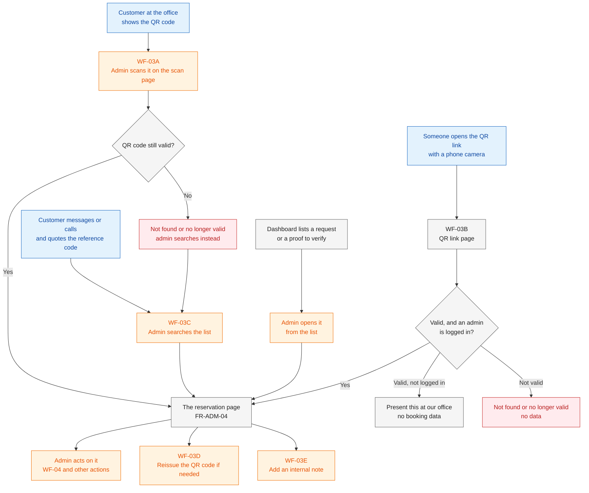

| Sub-flow | Who mostly acts | What it covers | Status change |
|---|---|---|---|
| [WF-03A](#wf-03a--scan-a-qr-code-at-the-office) | Admin, at the office | Scan page, camera, screenshot fallback, token lookup | None |
| [WF-03B](#wf-03b--someone-opens-the-qr-link) | Anyone with the QR code | The public QR link page: admin, not logged in, or invalid | None |
| [WF-03C](#wf-03c--search-and-filter-the-reservation-list) | Admin | Search by reference code, name, or mobile; filters by status, service type, event date | None |
| [WF-03D](#wf-03d--reissue-a-qr-code-from-the-reservation-page) | Admin | A new QR code; the old one stops working | None (a change that keeps the status) |
| [WF-03E](#wf-03e--add-an-internal-note) | Admin | A private note for the admins, with author and time | None (a change that keeps the status) |

**The reservation page** ([FR-ADM-04][fr]) is where every path ends. It shows the status, source, flags (urgent, needs info, legal hold, expiry paused), the current deadline in Manila time, the booking, the customer's details, payments, proofs, the refund decision, internal notes, the history, and the prepared message for customers without email. It offers only the actions that the status and the admin's role allow (**[P]**, new in [FR-ADM-04][fr]). Both admins see the same data ([roles][roles] §6).

---

## WF-03A · Scan a QR code at the office

### In plain words

The customer shows their QR code at the office or when paying **[C]** ([D-09][dl]). The admin opens the scan page in the admin panel and points the phone's or laptop's camera at it. If the camera does not work, the admin uploads a screenshot of the QR code instead, or simply types the reference code into the search. A valid QR code opens the reservation page straight away. A QR code that is unknown, has been replaced by a newer one, or belongs to a booking that is Rejected, Cancelled, Expired, or Completed shows "not found / no longer valid", with no data.

*Example.* Ben's delivery request for Sunday 27 December 2026 was approved on Sunday 20 December at 4:00 PM, so his deposit is due by Monday 21 December at 4:00 PM. On Monday at 10:00 AM he comes to the office with ₱1,000 in cash and shows his QR code. The Admin scans it, Ben's reservation opens showing **Awaiting Deposit**, and the Admin records the cash deposit ([WF-04D](#wf-04d--record-a-deposit)).

### Actors and responsibilities

| Actor | Responsibilities in this sub-flow |
|---|---|
| Customer | Shows the QR code; reads out the reference code if scanning fails |
| Admin (either admin, [roles][roles] §2.1) | Opens the scan page, scans or uploads a screenshot, checks the reservation that opens |
| Admin's browser | Uses the camera on the scan page and reads the QR code |
| Next.js server | Checks the login (with 2FA) and the role; takes the token from the link and hashes it; asks the database |
| Postgres | Finds the reservation whose stored token hash matches, and returns its status |

### Trigger and preconditions

- **Trigger:** a customer shows their QR code at the office or when paying ([D-09][dl]).
- **Preconditions:**
  - The admin is logged in with two-factor authentication ([FR-ADM-01][fr]).
  - For camera scanning: the site runs on a secure (HTTPS) address and the browser has camera permission ([NFR-18][nfr]). The screenshot fallback needs neither.
  - The QR code is not used on event day **[C]**, so the delivery crew needs no scanning step ([D-09][dl]).

### Flowchart

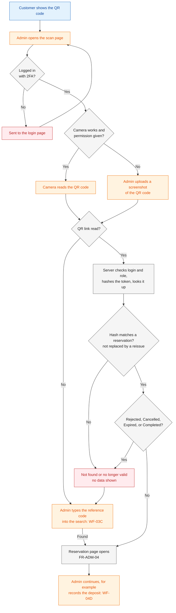

### Sequence diagram

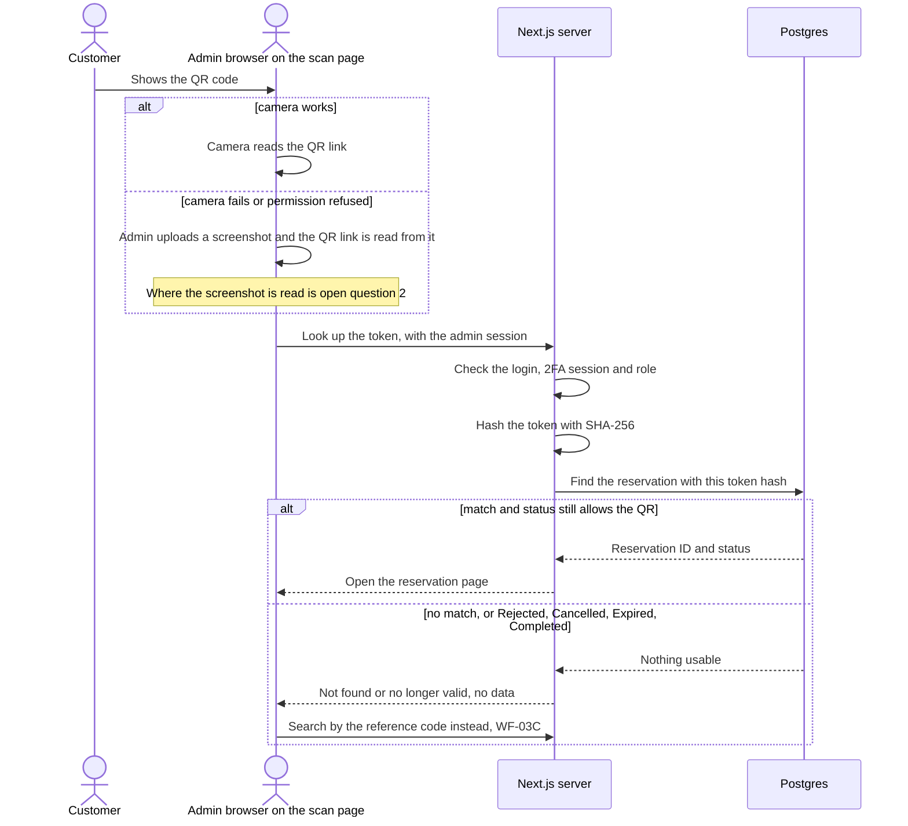

### Steps

| Step | Actor | What happens | Data created, updated, or read | Rules and requirements |
|---|---|---|---|---|
| 1 | Customer | Shows the QR code at the office or when paying **[C]**. | — | [D-09][dl], [FR-PUB-07][fr] |
| 2 | Admin | Opens the scan page in the admin panel. A visitor who is not logged in is sent to the login page first. | Read: admin session | [FR-ADM-06][fr], [FR-ADM-01][fr], [roles][roles] §2.1, [EC-73][ec] |
| 3 | Admin's browser | Uses the phone's or laptop's camera to read the QR code. | Browser only | [FR-ADM-06][fr], [NFR-16][nfr], [NFR-18][nfr] |
| 4 | Admin | **Fallback:** if the camera does not work, uploads a screenshot of the QR code; the QR link is read from it (where it is read, and whether the image is kept: open question 2). | The screenshot (see open question 2) | [FR-ADM-06][fr], [EC-63][ec] |
| 5 | Admin | If no QR link can be read, types the reference code into the search instead (WF-03C). The reference code is always shown next to the QR code as text, so the customer can read it out. | — | [FR-ADM-06][fr], [FR-ADM-03][fr], [NFR-17][nfr] (item 6), [EC-63][ec] |
| 6 | Next.js server | Checks the login (2FA passed) and the role on the server. Takes the token from the link (`https://<domain>/r/<token>`, the domain is O-05) and computes its SHA-256 hash. | — | [roles][roles] §7, [NFR-10][nfr], [FR-PUB-08][fr], [NFR-13][nfr] |
| 7 | Database | Finds the reservation whose stored token hash matches. A token replaced by a reissue no longer matches. | Read: reservation (QR token hash, status) | [FR-PUB-08][fr], [FR-ADM-22][fr], [FR-PUB-13][fr] |
| 8 | Next.js server | If nothing matches, or the status is Rejected, Cancelled, Expired, or Completed, shows "not found / no longer valid", with no data. The admin can still find the reservation by its reference code (step 5). | — | [FR-ADM-06][fr], [FR-PUB-08][fr], [FR-PUB-09][fr], [EC-60][ec] |
| 9 | Next.js server | Otherwise opens the reservation page ([FR-ADM-04][fr]). An overdue hold is shown as Expired at once (whether its QR code still opens it: open question 1). | Read: reservation, payments, proofs, notes, audit entries | [FR-ADM-04][fr], [roles][roles] §6, [BR-05][br] |
| 10 | Admin | Continues with what the customer came for, for example recording the deposit ([WF-04D](#wf-04d--record-a-deposit)). The scan itself changes nothing and confirms nothing. | — | [project-charter][charter] §2 (criterion 3), [reservation-lifecycle][lc] §1.1 |

### Decision points and validation

| Decision | If yes | If no | Rule |
|---|---|---|---|
| Is the admin logged in with 2FA? | The scan page opens | Sent to the login page | [FR-ADM-01][fr], [roles][roles] §7 |
| Does the camera work, with permission? | Scan with the camera | Upload a screenshot | [FR-ADM-06][fr], [NFR-18][nfr] |
| Was a QR link read from the camera or the screenshot? | Look up the token | Search by the reference code | [FR-ADM-06][fr], [FR-ADM-03][fr] |
| Does the token hash match a reservation, not replaced by a reissue? | Check the status | "Not found / no longer valid" | [FR-PUB-08][fr], [FR-ADM-22][fr] |
| Is the status Rejected, Cancelled, Expired, or Completed? | "Not found / no longer valid" | The reservation page opens | [FR-PUB-08][fr], [FR-ADM-06][fr] |

### Failure and exception paths

| Situation | What happens | Edge case |
|---|---|---|
| The camera cannot read the QR code, or camera permission is refused | The admin uploads a screenshot, or searches by the reference code | [EC-63][ec] |
| An invalid, revoked, or guessed QR code, or one for a Rejected, Cancelled, Expired, or Completed booking | "Not found / no longer valid", no data. The reservation itself still exists and can be found by search | [EC-60][ec] |
| The customer lost the QR code or shared it by mistake | An admin reissues it ([WF-03D](#wf-03d--reissue-a-qr-code-from-the-reservation-page)), or the customer does it on the status page ([FR-PUB-13][fr]; WF-07D in [notifications-and-tracking](notifications-and-tracking.md)) | [EC-62][ec] |
| The admin is not logged in, or calls the lookup directly | Sent to the login page; a direct call is refused on the server | [EC-73][ec] |
| A hold's deadline has passed but the every-minute job has not yet marked it Expired | The reservation page shows Expired at once; whether the QR code still opens it is open question 1 | [EC-22][ec] |
| Someone wants to scan on event day | Not part of the process: the QR code is not used on event day **[C]** | [D-09][dl] |

### Status transitions involved

None. This sub-flow only reads. An overdue hold is treated as already expired without its status being changed here ([BR-05][br]; [reservation-lifecycle][lc] §3.3).

### Developer notes

- **Route:** the admin scan page, for example `/admin/scan`. `@yudiel/react-qr-scanner` is loaded on this page only ([FR-ADM-06][fr]; [spec v0.2][spec] §10).
- **Server action:** for example `lookupReservationByQr(token)` in the admin module tree. It checks the session (2FA passed) and the role first ([roles][roles] §7).
- **Lookup:** SHA-256 of the token compared with the stored hash, for example in `app.find_reservation_by_qr(token_hash)`. Use the same lookup as the public QR link page (WF-03B), so both give the same answer. A QR code that is not a link to this site's `/r/` path is treated as invalid.
- **Audit category / outbox email type:** none. Batch-1 docs define audit entries for changes, not for opening a reservation (open question 3).
- **Never cached:** admin pages are always live ([NFR-03][nfr]).
- **Tests:** scanning on the real phone and laptop in the week-1 test (item 6); an end-to-end test of QR lookup through the screenshot fallback ([spec v0.2][spec] §17).

*(indicative; final names in api-specification, batch 3)*

---

## WF-03B · Someone opens the QR link

### In plain words

The QR code is a web link, so anyone can open it with a phone camera, for example a guest at a party. A person who is not logged in sees only "present this at our office" and nothing about the booking. A logged-in admin who opens it goes straight to the reservation in the admin panel. A link that is unknown, has been replaced, or belongs to a booking that is Rejected, Cancelled, Expired, or Completed shows "not found / no longer valid", with no data.

*Example.* At Ana's party on Thursday 24 December 2026, a guest scans the QR code on Ana's phone. The page says "present this at our office" and shows nothing about the booking ([EC-61][ec]). At 12:15 AM on Friday 25 December the booking becomes Completed ([reservation-lifecycle][lc] §6.8), so from then on the same link shows "no longer valid".

### Actors and responsibilities

| Actor | Responsibilities in this sub-flow |
|---|---|
| Visitor (anyone, not logged in) | Opens the link; sees only the limited page |
| Admin (logged in, [roles][roles] §2.1) | Opens the link on a device where they are logged in; lands on the reservation page |
| Next.js server (QR link route) | Hashes the token, asks the database, checks for an admin session, chooses the page |
| Postgres | Finds the reservation by token hash and returns its status |

### Trigger and preconditions

- **Trigger:** someone opens `https://<domain>/r/<token>` (the domain is O-05), usually by pointing a phone camera at the QR code.
- **Preconditions:** none. The page is public; what it shows depends on the token and on whether an admin is logged in ([FR-PUB-09][fr]).

### Flowchart

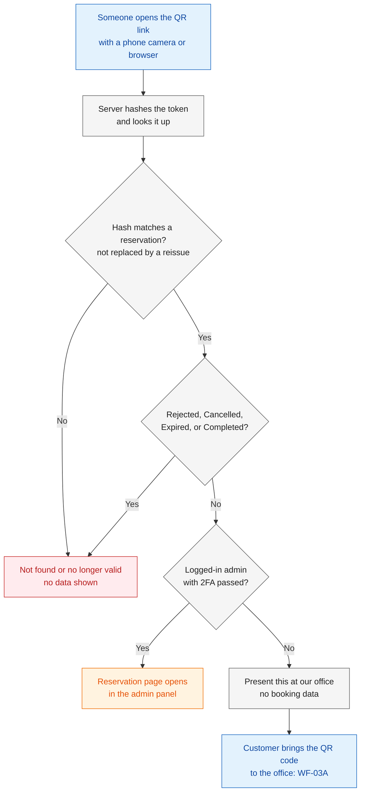

### Sequence diagram

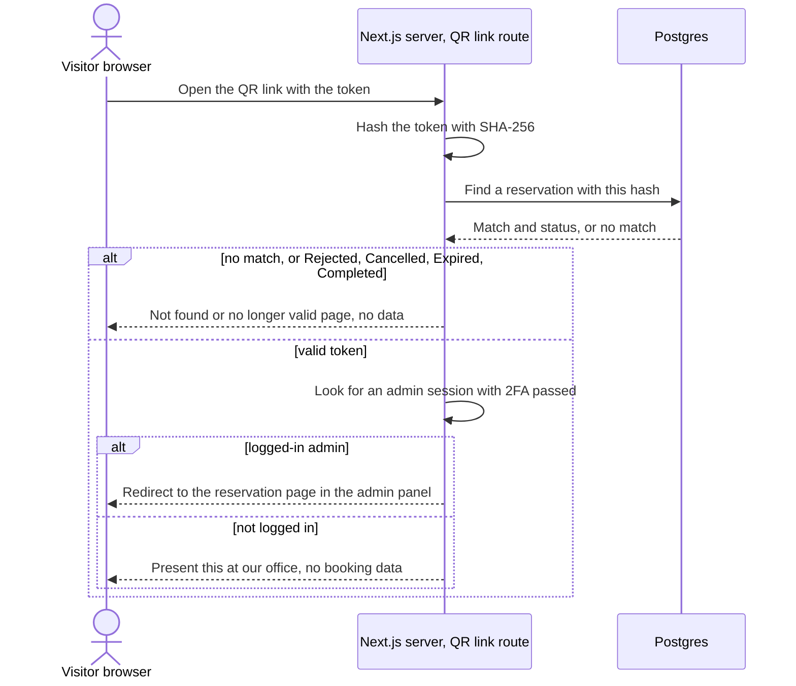

### Steps

| Step | Actor | What happens | Data created, updated, or read | Rules and requirements |
|---|---|---|---|---|
| 1 | Visitor | Opens the QR link. | — | [FR-PUB-08][fr], O-05 |
| 2 | Next.js server | Hashes the token and looks for a reservation with that hash. | Read: reservation (QR token hash, status) | [FR-PUB-08][fr], [NFR-13][nfr] |
| 3 | Next.js server | No match (unknown, guessed, or replaced token), or the status is Rejected, Cancelled, Expired, or Completed: shows "not found / no longer valid", with no data. | — | [FR-PUB-09][fr], [FR-PUB-08][fr], [EC-60][ec] |
| 4 | Next.js server | Valid token and a logged-in admin (2FA passed): opens the reservation in the admin panel. | Read: admin session | [FR-PUB-09][fr], [FR-ADM-06][fr], [FR-ADM-01][fr] |
| 5 | Next.js server | Valid token and nobody logged in: shows "present this at our office", with no booking data. | — | [FR-PUB-09][fr], [roles][roles] §6, [NFR-15][nfr], [EC-61][ec] |
| 6 | Customer | Brings the QR code to the office or shows it when paying (WF-03A). | — | [D-09][dl] |

### Decision points and validation

| Decision | If yes | If no | Rule |
|---|---|---|---|
| Does the token hash match a reservation, not replaced by a reissue? | Check the status | "Not found / no longer valid" | [FR-PUB-08][fr], [FR-PUB-09][fr] |
| Is the status Rejected, Cancelled, Expired, or Completed? | "Not found / no longer valid" | Check who is looking | [FR-PUB-08][fr] |
| Is a logged-in admin (2FA passed) looking? | The reservation page opens | "Present this at our office" | [FR-PUB-09][fr], [FR-ADM-01][fr] |

### Failure and exception paths

| Situation | What happens | Edge case |
|---|---|---|
| A guest at the party, or anyone not logged in, scans a valid QR code | "Present this at our office"; no booking data | [EC-61][ec] |
| A guessed, revoked, or unknown token, or a booking that is now Rejected, Cancelled, Expired, or Completed | "Not found / no longer valid"; no data. A token has 160 random bits, so guessing one is not practical | [EC-60][ec], [NFR-13][nfr] |
| The customer reissued the QR code after sharing it | The old link shows "no longer valid" at once | [EC-62][ec] |
| An admin opens the link on a phone where they are not logged in | They see "present this at our office", like any visitor; they can log in and scan in the admin panel (WF-03A). Whether the page offers a login link is open question 4 | [EC-61][ec] |
| A hold whose deadline has passed but which is not yet marked Expired | Open question 1 | [EC-22][ec] |

### Status transitions involved

None. The page only reads. The token stops working through status changes made elsewhere: [reservation-lifecycle][lc] §4.2 rows 8 to 14, and reissues ([FR-PUB-13][fr], [FR-ADM-22][fr]).

### Developer notes

- **Route:** `/r/[token]`, public ([FR-PUB-09][fr]; WF-02 developer notes in [booking-and-submission](booking-and-submission.md)). It reads the Better Auth session on the server; a valid admin session redirects to the admin reservation page, for example `/admin/reservations/[id]`.
- **No caching.** The answer depends on the current status and the current token hash, so the page must be rendered live ([FR-PUB-08][fr]; [NFR-03][nfr]).
- **No data on the public pages.** Neither "present this at our office" nor "not found" may include any booking or personal data ([NFR-15][nfr]).
- **Rate limit:** none is defined for this route (open question 5).
- **Audit category / outbox email type:** none.
- **Tests:** security test with revoked QR tokens ([spec v0.2][spec] §17; [NFR-13][nfr]); a test that the page shows no personal data ([NFR-15][nfr], **[P]** new in that doc).

*(indicative; final names in api-specification, batch 3)*

---

## WF-03C · Search and filter the reservation list

### In plain words

When a customer messages or calls, they quote their reference code. The admin types it, or the customer's name or mobile number, into the search. The reference code can be typed in any case, with or without spaces and dashes, and the mobile number in any of the usual Philippine forms. The list can also be filtered by status, service type, and event date. Every result opens the same reservation page as a QR scan.

*Example.* The Admin types `0917-123-4567`. The system turns it into `+639171234567` and finds Ana's reservation ([FR-ADM-03][fr]; [BR-11][br]).

### Actors and responsibilities

| Actor | Responsibilities in this sub-flow |
|---|---|
| Customer | Quotes the reference code when messaging or calling **[C]** ([D-09][dl]) |
| Admin (either admin, [roles][roles] §2.1) | Types the search, sets filters, opens the right reservation |
| Next.js server | Checks the login and the role; tidies the search text; asks the database |
| Postgres | Searches all reservations, live; treats overdue holds as Expired |

### Trigger and preconditions

- **Trigger:** a customer messages or calls quoting a reference code, an admin email names a reference code ([FR-NTF-13][fr], [FR-NTF-14][fr]), or an admin needs to find a booking.
- **Preconditions:** the admin is logged in with 2FA ([FR-ADM-01][fr]).

### Flowchart

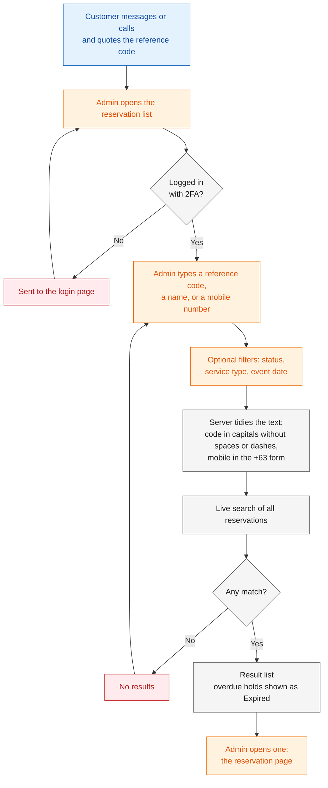

### Sequence diagram

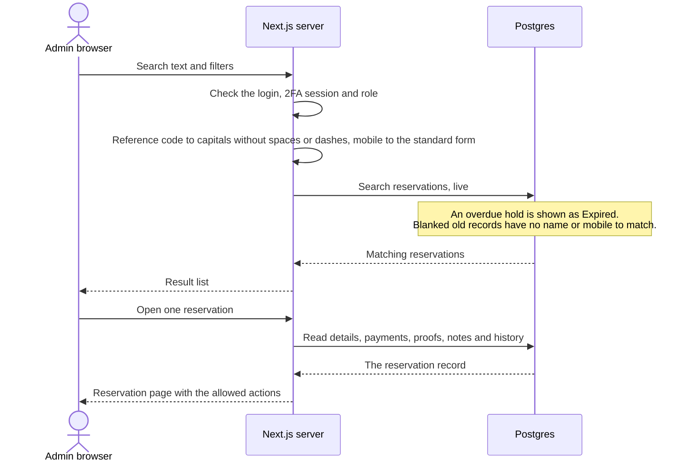

### Steps

| Step | Actor | What happens | Data created, updated, or read | Rules and requirements |
|---|---|---|---|---|
| 1 | Customer | Messages or calls and quotes the reference code **[C]**. | — | [D-09][dl] |
| 2 | Admin | Opens the reservation list. A visitor who is not logged in is sent to the login page. | Read: admin session | [FR-ADM-03][fr], [FR-ADM-01][fr], [roles][roles] §2.1 |
| 3 | Admin | Types a reference code, a customer name, or a mobile number (search fields **[P]**, new in [FR-ADM-03][fr]). | — | [FR-ADM-03][fr] |
| 4 | Admin | Optionally filters by status, service type, and event date (filters **[P]**, new in [FR-ADM-03][fr]). | — | [FR-ADM-03][fr] |
| 5 | Next.js server | Checks the login and the role. Tidies the text: a reference code is matched with case, spaces, and dashes ignored; a mobile number is converted to the standard form first. | — | [roles][roles] §7, [FR-PUB-08][fr], [BR-11][br], [EC-64][ec] |
| 6 | Database | Searches all reservations, live. A hold whose deadline has passed shows as Expired at once. | Read: reservations | [FR-ADM-03][fr], [BR-05][br], [NFR-03][nfr] |
| 7 | Next.js server | Shows the result list. | — | [FR-ADM-03][fr] |
| 8 | Admin | Opens the right reservation: the reservation page with the allowed actions. | Read: reservation, payments, proofs, notes, audit entries | [FR-ADM-04][fr] |

### Decision points and validation

| Decision | If yes | If no | Rule |
|---|---|---|---|
| Is the admin logged in with 2FA? | The list opens | Sent to the login page | [FR-ADM-01][fr] |
| Does the text look like a reference code or a mobile number? | It is tidied before matching | Matched as typed (for example a name); how names match is open question 6 | [FR-PUB-08][fr], [BR-11][br], [FR-ADM-03][fr] |
| Any match? | Result list | "No results"; try another field | [FR-ADM-03][fr] |
| Is a pending or awaiting-deposit result past its deadline? | Shown as Expired | Shown with its status | [BR-05][br], [FR-ADM-03][fr] |

### Failure and exception paths

| Situation | What happens | Edge case or rule |
|---|---|---|
| The code or number is typed differently than at booking (lowercase, spaces, dashes, `+63` instead of `0`) | It still matches | [EC-64][ec], [BR-11][br] |
| An old reservation whose contact details were blanked by the retention job | It cannot be found by name or mobile number; the reference code still finds it until ledger end. Blank fields show as blanks | [privacy-and-retention][priv] §6.2, [FR-ADM-04][fr] |
| The customer quotes a wrong code | No match; the admin can try the mobile number or the name | [FR-ADM-03][fr] |
| A hold's deadline has passed but the job has not run | It shows as Expired at once | [EC-22][ec] |
| The admin is not logged in, or calls the search directly | Refused on the server | [EC-73][ec] |

### Status transitions involved

None. This sub-flow only reads ([BR-05][br]; [reservation-lifecycle][lc] §3.3).

### Developer notes

- **Route:** the admin list, for example `/admin/reservations`, with the search text and filters as query parameters.
- **Database function:** for example `app.search_reservations(text, status, service_type, event_date)`. Normalize the reference code (upper case, no spaces or dashes) and the mobile number (the same normalizer as [BR-11][br], in the app and the database) before comparing. Compute the shown status with the overdue rule ([BR-05][br]), never from the stored status alone.
- **Always live, never cached** ([FR-ADM-03][fr], [NFR-03][nfr]).
- **Audit category / outbox email type:** none (open question 3).

*(indicative; final names in api-specification, batch 3)*

---

## WF-03D · Reissue a QR code from the reservation page

### In plain words

If a customer has lost their QR code, or has shared it with someone by mistake, an admin can make a new one from the reservation page. The old QR code stops working at once, and the reference code stays the same. Customers can also do this themselves on the status page ([FR-PUB-13][fr]; WF-07D in [notifications-and-tracking](notifications-and-tracking.md)). How the customer receives a QR code that an admin made is not decided yet ([functional-requirements][fr] §7, question 4).

*Example.* On Tuesday 22 December 2026, Ana says she posted a photo of her QR code in a family group chat. The Admin finds her Confirmed booking by its reference code (WF-03C) and reissues the QR code. The old link now shows "no longer valid"; `KSB-7Q2M-K9TX` stays the same ([EC-62][ec]).

### Actors and responsibilities

| Actor | Responsibilities in this sub-flow |
|---|---|
| Customer | Tells the business the QR code was lost or shared |
| Admin (either admin, [roles][roles] §2.3, **[P]**) | Opens the reservation and reissues the QR code |
| Next.js server action | Checks the login and the role; calls the database once |
| Postgres function | Checks the status and version, makes the new token, stores only its hash, writes the audit entry |

### Trigger and preconditions

- **Trigger:** a customer reports a lost or shared QR code ([EC-62][ec]).
- **Preconditions:**
  - The admin is logged in and has the reservation open (WF-03A or WF-03C).
  - Which statuses allow an admin reissue is not defined (open question 7).

### Flowchart

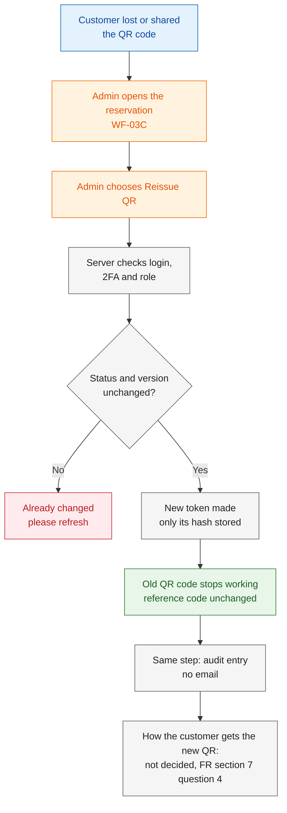

### Sequence diagram

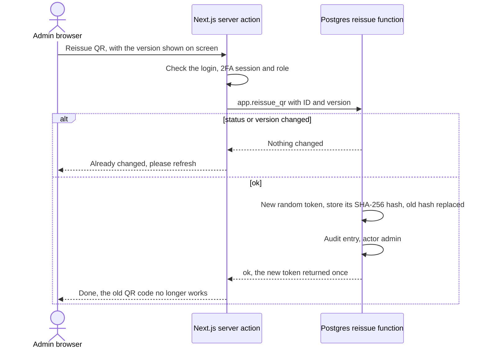

### Steps

| Step | Actor | What happens | Data created, updated, or read | Rules and requirements |
|---|---|---|---|---|
| 1 | Customer | Reports a lost or shared QR code, by message, call, or at the office. | — | [EC-62][ec] |
| 2 | Admin | Opens the reservation (WF-03C, or WF-03A if the old QR code is at hand) and chooses "Reissue QR". | Read: reservation | [FR-ADM-22][fr], [FR-ADM-04][fr] |
| 3 | Next.js server | Checks the login and the role. | — | [roles][roles] §2.3, §7, [FR-ADM-07][fr] |
| 4 | Database | Checks the status and the version; a mismatch returns "already changed, please refresh". | Read: status, version | [FR-ADM-07][fr], [EC-16][ec] |
| 5 | Database | Makes a new token and stores only its hash. The old token stops working at once. The reference code does not change. | Update: QR token hash, version | [FR-ADM-22][fr], [FR-PUB-08][fr], [NFR-13][nfr] |
| 6 | Database | In the same step, writes the audit entry. No email is queued. | Create: audit entry | [FR-ADM-22][fr], [FR-ADM-32][fr], [reservation-lifecycle][lc] §5 |
| 7 | Admin | The customer needs the new QR code; how they receive it is not specified. | — | [functional-requirements][fr] §7, question 4 |

### Decision points and validation

| Decision | If yes | If no | Rule |
|---|---|---|---|
| Are the status and version unchanged since the page was opened? | Reissue | "Already changed, please refresh" | [FR-ADM-07][fr] |
| Is reissue allowed on this status? | Not defined | Not defined | Open question 7 |

### Failure and exception paths

| Situation | What happens | Edge case or rule |
|---|---|---|
| The other admin changed the reservation a moment earlier | "Already changed, please refresh"; nothing changes | [EC-16][ec] |
| Someone opens the old QR link afterwards | "Not found / no longer valid" | [EC-60][ec], [EC-62][ec] |
| The customer has no email | How they get the new QR code is open in batch-1 | [functional-requirements][fr] §7, question 4 |

### Status transitions involved

None. Reissuing is a change that keeps the status ([reservation-lifecycle][lc] §5, row "Reissue the QR code").

### Developer notes

- **Database function:** for example `app.reissue_qr(reservation_id, expected_version)`; **server action:** `reissueQr`. One call, status and version check, all or nothing ([FR-ADM-07][fr]).
- **Token:** 160 random bits, only the SHA-256 stored ([FR-PUB-08][fr], [NFR-13][nfr]); the raw token is returned once. The same generator as WF-02 ([booking-and-submission](booking-and-submission.md)).
- **Audit:** category `booking`, actor `admin`, action such as `qr.reissued`; field names only ([FR-ADM-32][fr]).
- **Outbox email type:** none ([reservation-lifecycle][lc] §5).

*(indicative; final names in api-specification, batch 3)*

---

## WF-03E · Add an internal note

### In plain words

An admin can write a private note on any reservation, for example something a customer said on the phone, so the other admin knows it too. Either admin can add one, on a booking in any status. The note is saved with who wrote it and when, and both admins see it on the reservation page. Customers never see internal notes: not on the status page, not in emails, and not on printed documents. Like the customer's details, notes are blanked later on the retention schedule, and adding one is recorded in the audit log without the note's text.

*Example.* On Wednesday 23 December 2026 at 9:15 AM, Ana calls the office about her delivery. The Admin finds her Confirmed booking by its reference code (WF-03C) and adds the note "gate is blue, call on arrival". The reservation page now shows the note with the Admin's name and "Wed 23 Dec 2026, 9:15 AM". Ana's status page and emails never show it ([FR-ADM-05][fr]).

### Actors and responsibilities

| Actor | Responsibilities in this sub-flow |
|---|---|
| Admin (either admin, [roles][roles] §2.1) | Opens the reservation and types the note |
| Next.js server action | Checks the login, 2FA, and role (the server check of [WF-09C](administration.md)); calls the database once |
| Postgres function | Checks the version, saves the note with its author and time, writes the audit entry, in one transaction |
| Customer | Never sees the note ([roles][roles] §6) |

### Trigger and preconditions

- **Trigger:** an admin wants to keep information about a booking for the other admin.
- **Preconditions:**
  - The admin is logged in with two-factor authentication ([FR-ADM-01][fr]) and has the reservation open (WF-03A or WF-03C).
  - Any status: a note can be added to every reservation ([reservation-lifecycle][lc] §5, "Add an internal note").

### Flowchart

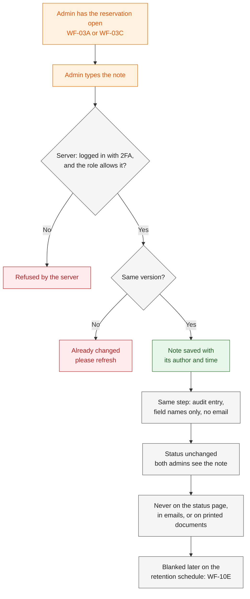

### Sequence diagram

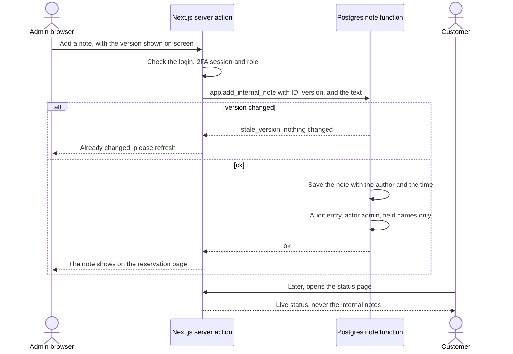

### Steps

| Step | Actor | What happens | Data created, updated, or read | Rules and requirements |
|---|---|---|---|---|
| 1 | Admin | Opens the reservation (WF-03A or WF-03C). The page shows the existing internal notes. | Read: reservation, notes | [FR-ADM-04][fr], [FR-ADM-05][fr] |
| 2 | Admin | Types the note. | — | [FR-ADM-05][fr] |
| 3 | Next.js server | Checks the login (2FA passed) and the role on the server: either admin may add a note. | Read: admin session | [roles][roles] §2.1, §7, [FR-ADM-07][fr] |
| 4 | Database | Checks the version; a mismatch returns "already changed, please refresh", and nothing changes. | Read: version | [reservation-lifecycle][lc] §4.3, [EC-16][ec] |
| 5 | Database | Saves the note with its author and the time. The status does not change. | Create: internal note | [FR-ADM-05][fr], [reservation-lifecycle][lc] §5 |
| 6 | Database | In the same step, writes the audit entry with the names of the changed fields only, never the note's text. No email is queued. | Create: audit entry | [FR-ADM-07][fr], [FR-ADM-32][fr], [reservation-lifecycle][lc] §5 |
| 7 | Next.js server | Shows the note on the reservation page, to both admins. | — | [FR-ADM-04][fr], [roles][roles] §6 |
| 8 | Customer | Never sees it: the status page, the emails, the acknowledgments, and the Booking Confirmation leave notes out. | — | [FR-ADM-05][fr], [roles][roles] §6, [FR-PUB-11][fr] |
| 9 | System | Later, the daily retention job blanks the note with the customer's details (closure + 2 years by default, [privacy-and-retention][priv] §6.2; [WF-10E](administration.md) step 5). | Later: note set to null | [FR-ADM-05][fr], [privacy-and-retention][priv] §6.2, [FR-SYS-05][fr] |

### Decision points and validation

| Decision | If yes | If no | Rule |
|---|---|---|---|
| Is the admin logged in with 2FA, and does the role allow it? | Continue | Refused by the server | [roles][roles] §2.1, §7, [EC-73][ec] |
| Does the version still match? | Saved | "Already changed, please refresh" | [reservation-lifecycle][lc] §4.3, [EC-16][ec] |
| Is the reservation in a status that allows a note? | Always: any status | — | [reservation-lifecycle][lc] §5 |

### Failure and exception paths

| Situation | What happens | Edge case or rule |
|---|---|---|
| The other admin changed the reservation a moment earlier | "Already changed, please refresh"; nothing is saved | [EC-16][ec] |
| The admin is not logged in, or calls the action directly | Sent to the login page; a direct call is refused on the server | [EC-73][ec] |
| A note was typed on the wrong booking, or with a mistake | Nothing is deleted ([EC-54][ec]); whether a note can be corrected or removed is open question 15 | [EC-54][ec] |
| The booking is under a legal hold | The note is kept until the hold is cleared | [privacy-and-retention][priv] §5.6 |

### Status transitions involved

None. Adding a note is a change that keeps the status ([reservation-lifecycle][lc] §5, row "Add an internal note").

### Developer notes

- **Database function:** for example `app.add_internal_note(reservation_id, expected_version, body)`; **server action:** `addInternalNote`, in the admin module tree ([roles][roles] §7).
- **Data:** a notes table or field with the author's admin ID and the time ([FR-ADM-05][fr]); the details come with the data model (planned: `05-technical/data-model.md`). Whether a note increases the reservation's version is [availability-and-conflicts](availability-and-conflicts.md) open question 9.
- **Customer-safe views:** the status page function (for example `app.lookup_status`, [WF-07D](notifications-and-tracking.md)) and the email and document templates never read the notes ([FR-ADM-05][fr]).
- **Audit:** category `booking`, actor `admin`, action such as `note.added`; field names only, never the note's text ([FR-ADM-32][fr]).
- **Outbox email type:** none ([reservation-lifecycle][lc] §5).
- **Retention:** blanked by the retention job with the contact fields ([privacy-and-retention][priv] §6.2; [WF-10E](administration.md)).

*(indicative; final names in api-specification, batch 3)*

---

## WF-04 · Review a request and decide

### In plain words

Every new request waits on the dashboard as **Pending Confirmation**; same-day ones are marked urgent. An admin opens it (WF-03) and checks the details; for a delivery, they check that the venue is inside the service area. Then they decide: ask the customer for more information (needs info), approve it, reject it with a reason, or, for a booking whose event is today, confirm it without a deposit (a waiver). After approval, the customer pays the deposit; the admin records it, or checks the picture of the payment that the customer uploaded, and the booking becomes **Confirmed**. Bookings that arrive by phone, walk-in, or Facebook are entered by an admin, then follow the same steps, or are confirmed in one step when the start is very close.

*Running example: Ana's request, from review to Confirmed.*

| When (2026) | What happens | Sub-flow | Status afterwards |
|---|---|---|---|
| Wed 16 Dec, 10:00 AM | Ana submits; review deadline Sat 19 Dec, 10:00 AM | [WF-01](booking-and-submission.md) | Pending Confirmation |
| Wed 16 Dec, 11:00 AM | The Admin flags it: "Please send a nearby landmark." | WF-04C | Pending Confirmation (flagged) |
| Wed 16 Dec, afternoon | Ana replies by message; the Admin clicks "Info received" | WF-04C | Pending Confirmation |
| Thu 17 Dec, 2:00 PM | The Admin approves; deposit due Fri 18 Dec, 2:00 PM | WF-04A | Awaiting Deposit |
| Fri 18 Dec, 8:00 AM | The deposit reminder is sent | [WF-07C](notifications-and-tracking.md) | Awaiting Deposit |
| Fri 18 Dec, 10:45 AM | Ana pays ₱1,000 by e-wallet and uploads a picture of it | WF-04E (upload: [WF-07](notifications-and-tracking.md)) | Awaiting Deposit, expiry paused |
| Fri 18 Dec, 11:00 AM | The Admin checks the proof and records the deposit; `ACK-2026-0001` | WF-04E, WF-04D | Confirmed |

Sources: [reservation-lifecycle][lc] §6.1 and §3.4; [FR-NTF-04][fr]; [catalog-and-payments][cat] §8.

### How the sub-flows fit together

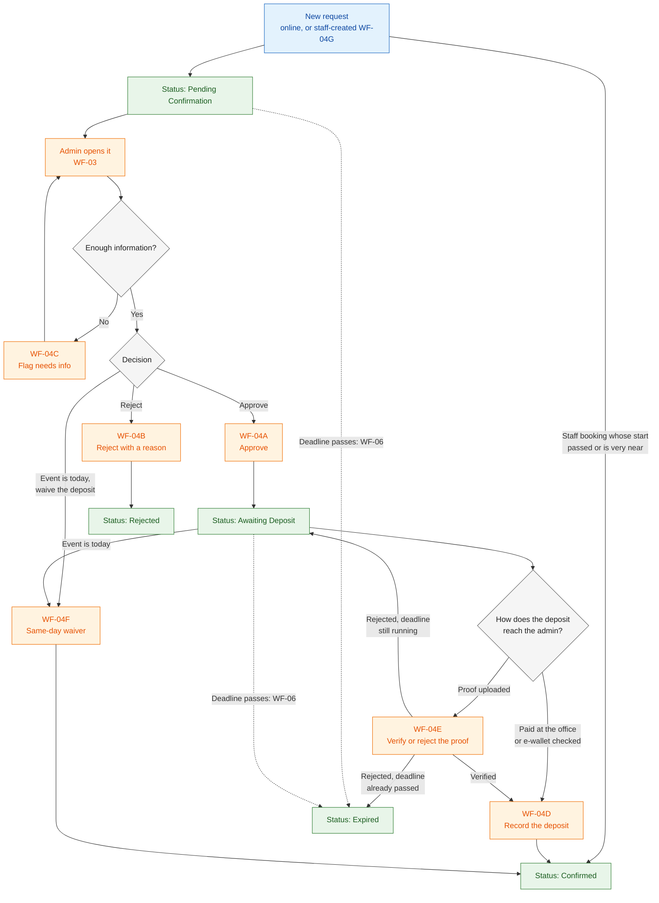

| Sub-flow | Who mostly acts | What it covers | Status change ([reservation-lifecycle][lc] §4.2) |
|---|---|---|---|
| [WF-04A](#wf-04a--approve-a-request) | Admin | Address check, approve, deposit deadline, approved email, reminder | Pending Confirmation → Awaiting Deposit (row 4) |
| [WF-04B](#wf-04b--reject-a-request-with-a-reason) | Admin | Reject with a reason | Pending Confirmation → Rejected (row 8) |
| [WF-04C](#wf-04c--flag-or-clear-needs-info) | Admin, customer | Needs-info message, "Info received" | None (a flag, §5) |
| [WF-04D](#wf-04d--record-a-deposit) | Admin | Record the deposit, acknowledgment | Awaiting Deposit → Confirmed (row 6); after a waiver, none (§5) |
| [WF-04E](#wf-04e--verify-or-reject-an-uploaded-proof) | Admin | Proof review: verify or reject | → Confirmed (row 6), none (§5), or → Expired (row 10c) |
| [WF-04F](#wf-04f--same-day-deposit-waiver) | Admin | Confirm without a deposit, with a reason | → Confirmed (rows 5 and 7) |
| [WF-04G](#wf-04g--staff-created-booking) | Admin | Phone, walk-in, and Facebook bookings; one-step booking | *(new)* → Pending Confirmation (row 2), or Confirmed in one step |

**What every WF-04 action does first.** These checks come from [FR-ADM-07][fr] and apply to each sub-flow below; their exact place is shown in each steps table.

- The server checks the login (2FA passed) and the role at the top of the action ([roles][roles] §7).
- A required reason or message must be given ([FR-ADM-07][fr]).
- The database checks the current status and version; if the other admin acted first, the answer is "already changed, please refresh" and nothing changes ([EC-16][ec]).
- An overdue hold counts as expired; approving it, recording its deposit, or waiving it is refused, unless expiry is paused for proof review where the lifecycle allows it ([reservation-lifecycle][lc] §3.3, [EC-23][ec]).
- Each action is one database call: it takes full effect or changes nothing, writes its audit entry, and queues its emails in the same step. A failed email never undoes the change ([NFR-21][nfr], [FR-NTF-16][fr], [EC-66][ec]).

### Sequence diagram: the main path, approve and then record the deposit

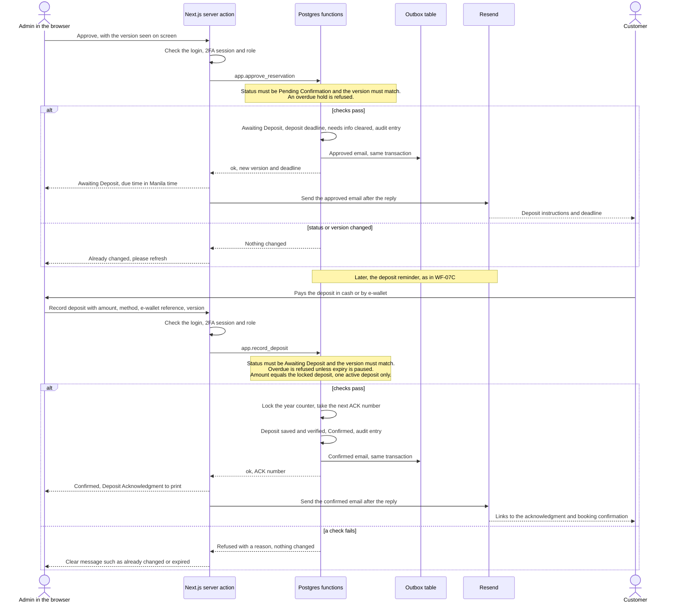

---

## WF-04A · Approve a request

### In plain words

The admin opens a Pending Confirmation request and checks it. For a delivery, they look at the barangay, city, and venue details to make sure the address is inside the service area; there is no list of areas, the admin decides **[C]** ([D-11][dl]). Approving moves the request to **Awaiting Deposit** and starts the deposit deadline (24 hours, or the service start if that is sooner: [reservation-lifecycle][lc] §3.2). The customer gets an email with the deposit instructions and the deadline, and later a reminder. A request whose deadline has already passed cannot be approved.

*Example.* The Admin approves Ana's request on Thursday 17 December 2026 at 2:00 PM. Her deposit is due by Friday 18 December at 2:00 PM, and her reminder goes out at 8:00 AM that Friday ([FR-ADM-08][fr], [FR-NTF-04][fr]).

### Actors and responsibilities

| Actor | Responsibilities in this sub-flow |
|---|---|
| Admin (either admin, [roles][roles] §2.1) | Reviews the request, checks the venue for a delivery, approves |
| Next.js server action | Checks the login and the role; calls the database once; sends queued emails after the reply |
| Postgres approve function | Status and version check, overdue check, new status and deadline, audit entry, queued email |
| Outbox, Resend | Hold and send the approved email ([FR-NTF-16][fr] to [FR-NTF-20][fr]) |
| pg_cron and pg_net | Queue the deposit reminder when it is due, and send waiting emails ([WF-07C](notifications-and-tracking.md), [WF-07A](notifications-and-tracking.md); [FR-SYS-02][fr], [FR-SYS-03][fr]) |
| Customer | Receives the approved email, or a message the admin copies; sees the deposit instructions on the status page |

### Trigger and preconditions

- **Trigger:** an admin opens a Pending Confirmation request from the dashboard's urgent and pending queue, a new-request email, or a search ([FR-ADM-02][fr], [FR-NTF-13][fr], WF-03).
- **Preconditions:**
  - Status Pending Confirmation, and its deadline has not passed ([reservation-lifecycle][lc] §4.2 row 4).
  - For a delivery: the admin has checked that the venue is inside the service area ([D-11][dl]).

### Flowchart

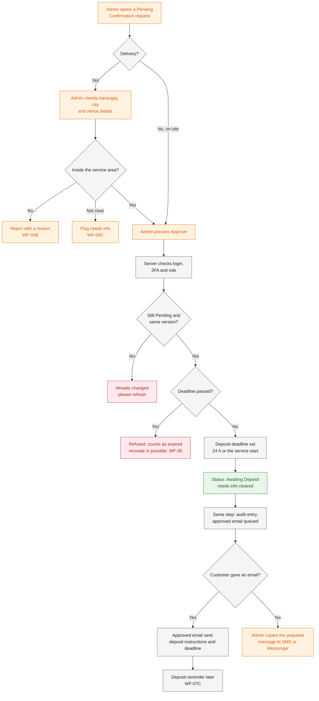

### Sequence diagram

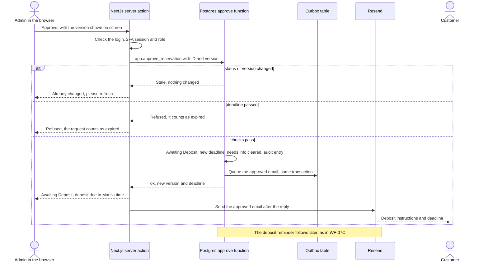

### Steps

| Step | Actor | What happens | Data created, updated, or read | Rules and requirements |
|---|---|---|---|---|
| 1 | Admin | Opens the request from the dashboard's urgent and pending queue, a new-request email, or a search (WF-03). Urgent requests are clearly marked. | Read: reservation | [FR-ADM-02][fr], [FR-NTF-13][fr], [BR-06a][br], [FR-ADM-04][fr] |
| 2 | Admin | Reads the details. For a delivery, checks the barangay, city, and venue details against the service area; there is no area list **[C]**. If it is unclear, flags needs info (WF-04C); if it is outside, rejects (WF-04B). For a same-day request, may waive the deposit instead (WF-04F). | Read: venue fields | [FR-ADM-08][fr], [D-11][dl], [EC-13][ec], [reservation-lifecycle][lc] §4.2 row 4 |
| 3 | Admin | Presses "Approve". It is offered only on Pending Confirmation. | — | [FR-ADM-04][fr], [roles][roles] §2.1 |
| 4 | Next.js server | Checks the login (2FA passed) and the role. | Read: admin session | [roles][roles] §7, [FR-ADM-07][fr], [NFR-10][nfr] |
| 5 | Database | Checks the status and the version; if the other admin acted first, "already changed, please refresh". | Read: status, version | [FR-ADM-07][fr], [EC-16][ec], [EC-53][ec] |
| 6 | Database | Checks the deadline. If it has passed, the request counts as expired and approving is refused. | Read: deadline | [FR-ADM-08][fr], [BR-05][br], [reservation-lifecycle][lc] §3.3, [EC-23][ec] |
| 7 | Database | Sets **Awaiting Deposit**. The deposit deadline is approval + 24 hours, capped at the service start ([reservation-lifecycle][lc] §3.2). The claims stay. The needs-info flag is cleared. | Update: status, deadline, needs-info flag, version | [reservation-lifecycle][lc] §4.2 row 4, [EC-21][ec] |
| 8 | Database | In the same step: writes the audit entry (actor admin) and queues the approved email, if the customer gave an email address. | Create: audit entry, outbox row | [FR-ADM-32][fr], [FR-NTF-03][fr], [FR-NTF-16][fr] |
| 9 | Next.js server | Shows the reservation as Awaiting Deposit, with the deposit deadline in Manila time. | — | [FR-ADM-04][fr], [NFR-19][nfr] |
| 10 | Next.js server, Resend | Sends the approved email after the reply; retries, caps, and failures follow the outbox rules. | Update: outbox status | [FR-NTF-16][fr] to [FR-NTF-20][fr], [FR-SYS-03][fr] |
| 11 | Admin | If the customer gave no email, copies the prepared message (deposit instructions and deadline) into SMS or Messenger. | Read: prepared message | [FR-NTF-21][fr], [EC-12][ec] |
| 12 | System | The deposit reminder follows, as in WF-07C ([notifications-and-tracking](notifications-and-tracking.md)). | Create, later: outbox reminder row | [FR-SYS-02][fr], [FR-NTF-04][fr], [FR-NTF-17][fr], [FR-NTF-19][fr], [EC-69][ec], [EC-70][ec] |
| 13 | Customer | Sees Awaiting Deposit, the deadline, and the deposit instructions on the status page; pays (WF-04D) or uploads a proof (WF-04E; upload in [WF-07](notifications-and-tracking.md)). | Read | [FR-PUB-11][fr], [FR-PUB-12][fr] |

### Decision points and validation

| Decision | If yes | If no | Rule |
|---|---|---|---|
| Delivery? | Check the venue against the service area | No address check | [FR-ADM-08][fr], [D-11][dl] |
| Is the venue inside the service area? | Continue | Reject with a reason (WF-04B), or ask for details (WF-04C) | [D-11][dl], [EC-13][ec] |
| Still Pending Confirmation, same version? | Continue | "Already changed, please refresh" | [FR-ADM-07][fr], [EC-16][ec] |
| Has the deadline passed? | Refused: it counts as expired | Approve | [FR-ADM-08][fr], [BR-05][br] |
| Did the customer give an email? | Approved email queued | Prepared message for SMS or Messenger | [FR-NTF-03][fr], [FR-NTF-21][fr] |
| Is the reminder moment still ahead at approval? | Reminder queued when due | No reminder | [FR-NTF-04][fr] |

### Failure and exception paths

| Situation | What happens | Edge case |
|---|---|---|
| The venue may be outside the service area | The admin checks and approves, or rejects with a reason | [EC-13][ec] |
| Both admins act at once | The second gets "already changed, please refresh" | [EC-16][ec] |
| Approved close to the event | The deposit deadline is the service start | [EC-21][ec] |
| Approving after the deadline | Refused; if the customer still wants it, an admin can recreate the request ([WF-06](changes-and-expiry.md)) | [EC-23][ec] |
| Approving a request that is not Pending Confirmation | Refused | [EC-53][ec] |
| The email service fails or the cap is reached | The approval stands; the email is retried, held, or marked failed | [EC-66][ec], [EC-67][ec] |
| A same-day request approved after its reminder moment | No reminder is sent | [EC-70][ec] |
| No email address | Prepared message; the status page is the source of truth | [EC-12][ec] |

### Status transitions involved

Pending Confirmation → **Awaiting Deposit**: [reservation-lifecycle][lc] §4.2, row 4. Deadline rules: §3.2.

### Developer notes

- **Database function:** for example `app.approve_reservation(reservation_id, expected_version)`; **server action:** `approveReservation`, in the admin module tree ([roles][roles] §7).
- **Deadline:** the earlier of now + the 24-hour setting and the stored service start ([reservation-lifecycle][lc] §3.2); stored on the reservation as `timestamptz` ([NFR-19][nfr]).
- **Errors:** return codes such as `stale_version`, `not_allowed`, and `overdue`, so the screen can show the right message ([EC-16][ec], [EC-53][ec], [EC-23][ec]).
- **Audit:** category `booking`, actor `admin`, action such as `reservation.approved`; field names only ([FR-ADM-32][fr]).
- **Outbox email types:** `approved` ([FR-NTF-03][fr]); later `reminder` ([FR-NTF-04][fr]) with the unique key reservation + "reminder" + deadline ([FR-NTF-17][fr]).
- **Address check:** how it is recorded is open question 8.

*(indicative; final names in api-specification, batch 3)*

---

## WF-04B · Reject a request with a reason

### In plain words

If a request cannot be accepted, for example the venue is outside the service area or the request looks fake, the admin rejects it and must write a reason. The customer sees the reason on the status page and in the rejected email. The set or the room, and the add-ons, are free again at once, and the QR code stops working. Only a Pending Confirmation request can be rejected; a booking that has already been approved is ended with Cancel instead ([WF-06](changes-and-expiry.md)).

*Example.* On Saturday 19 December 2026, after the breaker paused online booking, the admins look at the 6 requests that came in. One has a made-up name and a venue that does not exist. The Admin rejects it with the reason "could not verify the request" ([BR-07a][br] example; [EC-14][ec]).

### Actors and responsibilities

| Actor | Responsibilities in this sub-flow |
|---|---|
| Admin (either admin, [roles][roles] §2.1) | Decides to reject and writes the reason |
| Next.js server action | Checks the login and the role; calls the database once |
| Postgres reject function | Status, version, and deadline checks; Rejected; claims released; audit entry; queued email |
| Outbox, Resend | Send the rejected email |
| Customer | Sees the reason on the status page or in the email |

### Trigger and preconditions

- **Trigger:** an admin decides not to accept a Pending Confirmation request (WF-04A step 2).
- **Preconditions:** status Pending Confirmation, deadline not passed, and a reason ([reservation-lifecycle][lc] §4.2 row 8).

### Flowchart

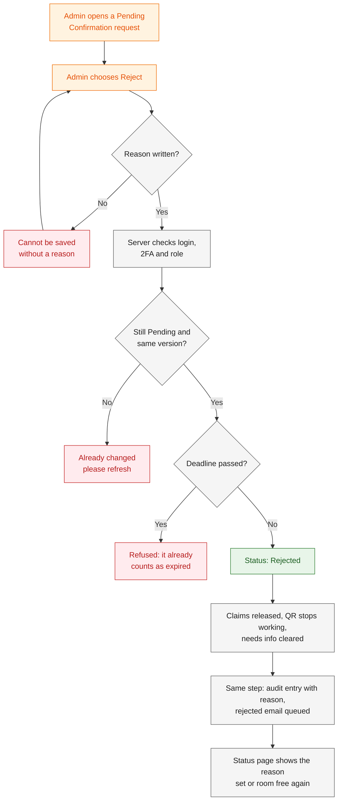

### Sequence diagram

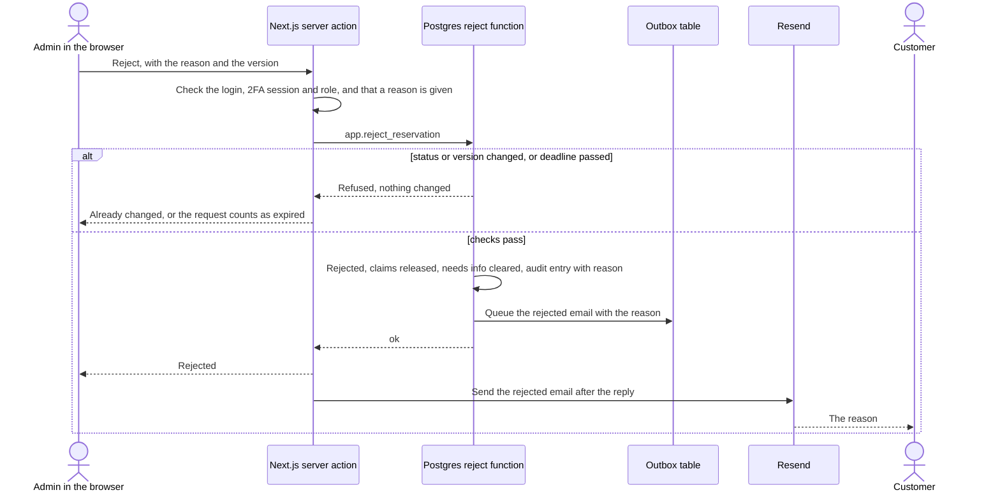

### Steps

| Step | Actor | What happens | Data created, updated, or read | Rules and requirements |
|---|---|---|---|---|
| 1 | Admin | Chooses "Reject" on a Pending Confirmation request. | Read: reservation | [FR-ADM-08][fr], [FR-ADM-04][fr] |
| 2 | Admin | Writes the reason. It cannot be saved without one. | — | [FR-ADM-08][fr], [FR-ADM-07][fr] |
| 3 | Next.js server | Checks the login and the role. | Read: admin session | [roles][roles] §2.1, §7 |
| 4 | Database | Checks the status, the version, and the deadline. | Read: status, version, deadline | [FR-ADM-07][fr], [reservation-lifecycle][lc] §4.2 row 8 |
| 5 | Database | Sets **Rejected**. The claims on the set or room and the add-ons are released. The needs-info flag is cleared. The QR code stops working. | Update: status, claims, flag, version | [reservation-lifecycle][lc] §4.2 row 8, [BR-04][br], [FR-PUB-08][fr] |
| 6 | Database | In the same step: writes the audit entry with the reason, and queues the rejected email with the reason (if an email was given). | Create: audit entry, outbox row | [FR-ADM-32][fr], [FR-NTF-09][fr], [FR-NTF-16][fr] |
| 7 | Next.js server, Resend | Sends the email after the reply. | Update: outbox status | [FR-NTF-16][fr] to [FR-NTF-20][fr] |
| 8 | Customer | Sees the reason on the status page; the calendar shows the date free again, unless something else fills it. | Read | [FR-PUB-11][fr], [BR-09][br] |
| 9 | Admin | If the customer gave no email, copies the prepared message. | Read: prepared message | [FR-NTF-21][fr] |

### Decision points and validation

| Decision | If yes | If no | Rule |
|---|---|---|---|
| Is a reason written? | Continue | Cannot be saved | [FR-ADM-08][fr] |
| Still Pending Confirmation, same version? | Continue | "Already changed, please refresh", or not allowed | [FR-ADM-07][fr], [EC-53][ec] |
| Has the deadline passed? | Refused: it already counts as expired | Rejected | [reservation-lifecycle][lc] §3.3, row 8 |

### Failure and exception paths

| Situation | What happens | Edge case |
|---|---|---|
| Venue outside the service area | Rejected with a reason | [EC-13][ec] |
| Fake requests after a bot flood or a breaker trip | Admins reject them | [EC-14][ec], [EC-15][ec] |
| Both admins act at once | The second gets "already changed, please refresh" | [EC-16][ec] |
| The request is already Awaiting Deposit or Confirmed | Reject is not allowed; use Cancel ([WF-06](changes-and-expiry.md)) | [EC-53][ec] |
| The deadline passed a moment ago | It already counts as expired; nothing to reject | [EC-22][ec] |
| The email fails | The rejection stands | [EC-66][ec] |

### Status transitions involved

Pending Confirmation → **Rejected**: [reservation-lifecycle][lc] §4.2, row 8.

### Developer notes

- **Database function:** for example `app.reject_reservation(reservation_id, expected_version, reason)`; **server action:** `rejectReservation`.
- **QR:** no hash change; the status alone makes the QR code invalid (WF-03A step 8; [FR-PUB-08][fr]).
- **Audit:** category `booking`, action such as `reservation.rejected`, with the reason ([FR-ADM-32][fr]).
- **Outbox email type:** `rejected` ([FR-NTF-09][fr]).

*(indicative; final names in api-specification, batch 3)*

---

## WF-04C · Flag or clear needs info

### In plain words

When something is missing or unclear, the admin flags the request "needs info" and writes a message for the customer, for example "Please send a nearby landmark." The request stays Pending Confirmation, and its review deadline keeps running; asking a question never gives a request more time **[C]** ([D-13][dl]). The customer sees the message on the status page and by email, and replies by message or call. When the answer arrives, the admin clicks "Info received" to clear the flag, then decides (WF-04A or WF-04B).

*Example.* Ana's request was submitted on Wednesday 16 December 2026 at 10:00 AM. At 11:00 AM, the Admin flags it: "Please send a nearby landmark." Her review deadline is still Saturday 19 December at 10:00 AM. Ana replies by message that afternoon. The Admin clicks "Info received", then approves on Thursday 17 December at 2:00 PM ([reservation-lifecycle][lc] §6.1).

### Actors and responsibilities

| Actor | Responsibilities in this sub-flow |
|---|---|
| Admin (either admin, [roles][roles] §2.1) | Writes the message and flags; later clicks "Info received" |
| Next.js server action | Checks the login and the role; calls the database |
| Postgres function | Status, version, and deadline checks; sets or clears the flag; audit entry; queued email |
| Outbox, Resend | Send the needs-info email |
| Customer | Reads the message; replies by message or call, outside the system |

### Trigger and preconditions

- **Trigger:** an admin needs more information before deciding (WF-04A step 2).
- **Preconditions:** status Pending Confirmation, deadline not passed. Flagging needs a message for the customer ([reservation-lifecycle][lc] §6.1; [FR-ADM-09][fr]).

### Flowchart

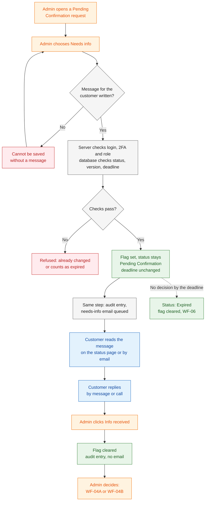

### Sequence diagram

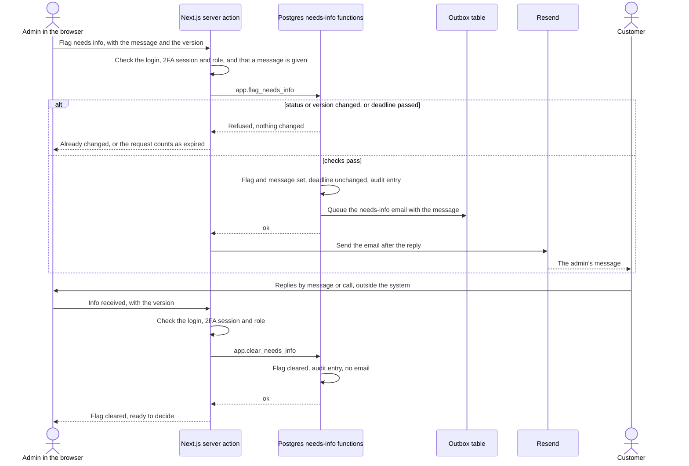

### Steps

| Step | Actor | What happens | Data created, updated, or read | Rules and requirements |
|---|---|---|---|---|
| 1 | Admin | Chooses "Needs info" on a Pending Confirmation request. It is offered only on that status. | Read: reservation | [FR-ADM-09][fr], [FR-ADM-04][fr] |
| 2 | Admin | Writes the message for the customer. It cannot be saved without one. | — | [FR-ADM-09][fr], [reservation-lifecycle][lc] §6.1 |
| 3 | Next.js server | Checks the login and the role. | Read: admin session | [roles][roles] §2.1, §7 |
| 4 | Database | Checks the status, the version, and the deadline. | Read: status, version, deadline | [FR-ADM-07][fr] |
| 5 | Database | Sets the flag and the message. The status stays Pending Confirmation, and the deadline does not change **[C]**. | Update: needs-info flag, needs-info message, version | [reservation-lifecycle][lc] §6.1, §5, [D-13][dl] |
| 6 | Database | In the same step: writes the audit entry and queues the needs-info email with the message (if an email was given). | Create: audit entry, outbox row | [FR-ADM-09][fr], [FR-NTF-02][fr], [FR-ADM-32][fr] |
| 7 | Customer | Sees the message on the status page, or in the email; without email, the admin copies the prepared message. | Read | [FR-PUB-11][fr], [FR-NTF-21][fr] |
| 8 | Customer | Replies by message or call. The reply is not entered through the system. | — | [reservation-lifecycle][lc] §6.1 (example) |
| 9 | Admin | Clicks "Info received". The same checks run (steps 3 and 4). | Read: status, version | [FR-ADM-09][fr], [FR-ADM-07][fr] |
| 10 | Database | Clears the flag and writes the audit entry. No email is queued. | Update: needs-info flag, version; create: audit entry | [reservation-lifecycle][lc] §5, [FR-ADM-09][fr] |
| 11 | Admin | Decides: approve (WF-04A) or reject (WF-04B). Approve, reject, cancel, and expiry also clear the flag on their own. | — | [reservation-lifecycle][lc] §6.1 |

### Decision points and validation

| Decision | If yes | If no | Rule |
|---|---|---|---|
| Is the request Pending Confirmation? | "Needs info" is offered | Not offered | [FR-ADM-09][fr] |
| Is a message written? | Continue | Cannot be saved | [FR-ADM-09][fr] |
| Same version, deadline not passed? | Flag set | Refused | [FR-ADM-07][fr] |
| Has the customer answered? | "Info received", then decide | The deadline keeps running | [reservation-lifecycle][lc] §6.1 |

### Failure and exception paths

| Situation | What happens | Edge case or rule |
|---|---|---|
| The customer has not answered when the deadline arrives | The request expires and the flag clears ([WF-06](changes-and-expiry.md)) | [EC-24][ec] |
| Both admins act at once | The second gets "already changed, please refresh" | [EC-16][ec] |
| An admin tries "needs info" on an Awaiting Deposit booking | Not offered; refused if tried | [EC-53][ec] |
| No email address | Prepared message; the status page shows the message | [EC-12][ec] |
| The admin wants to change the message while flagged | Not defined (open question 9) | — |
| A same-day waiver on a flagged request | Whether it clears the flag is open in batch-1 | [reservation-lifecycle][lc] §9, question 3 |

### Status transitions involved

None. "Needs info" is a flag, not a status ([reservation-lifecycle][lc] §1.2 and §5, rows "Flag needs info" and "Clear needs info").

### Developer notes

- **Database functions:** for example `app.flag_needs_info(reservation_id, expected_version, message)` and `app.clear_needs_info(reservation_id, expected_version)`; **server actions:** `flagNeedsInfo`, `clearNeedsInfo`.
- **Fields:** the needs-info flag and `needs_info_message` on the reservation ([reservation-lifecycle][lc] §4.3).
- **Audit:** category `booking`, actions such as `reservation.needs_info_flagged` and `reservation.needs_info_cleared`; the message text is a field value, so the audit entry names the field only ([FR-ADM-32][fr]).
- **Outbox email type:** `needs_info` ([FR-NTF-02][fr]); the unique key includes the audit entry, so each flagging is its own email ([FR-NTF-17][fr]).

*(indicative; final names in api-specification, batch 3)*

---

## WF-04D · Record a deposit

### In plain words

After approval, the customer pays the fixed deposit, in cash at the office or by e-wallet. The admin checks the money (counts the cash, or finds the e-wallet transaction) and records it: the amount is filled in from the booking's locked deposit and must match it exactly, and for an e-wallet payment the admin types only the reference number. Recording the deposit makes the booking **Confirmed** and issues a Deposit Acknowledgment with its own number, which the admin can print for the customer. A deposit cannot be recorded once the deadline has passed, unless a proof is waiting for review.

*Example.* On Friday 18 December 2026 at 10:45 AM, Ana pays ₱1,000 by e-wallet, reference number `1234567890`. The Admin records it at 11:00 AM. Her booking becomes Confirmed, and `ACK-2026-0001` appears on her status page ([catalog-and-payments][cat] §4.3).

### Actors and responsibilities

| Actor | Responsibilities in this sub-flow |
|---|---|
| Customer | Pays the deposit in cash at the office or by e-wallet, using the deposit instructions |
| Admin (either admin, [roles][roles] §2.2) | Checks the payment, enters the method and reference, records the deposit, prints the acknowledgment if wanted |
| Next.js server action | Checks the login and the role; validates the fields; calls the database once |
| Postgres deposit function | Status, version, deadline, amount, and one-deposit checks; acknowledgment number; payment record; Confirmed; audit entry; queued email |
| Outbox, Resend | Send the confirmed email |

### Trigger and preconditions

- **Trigger:** the customer has paid the deposit (at the office, often after a QR scan in WF-03A, or by e-wallet), or a proof was verified (WF-04E).
- **Preconditions:**
  - Status Awaiting Deposit, and its deadline not passed or expiry paused for proof review ([reservation-lifecycle][lc] §4.2 row 6; [BR-12][br]); or Confirmed after a same-day waiver ([reservation-lifecycle][lc] §5).
  - No other active deposit on the reservation ([catalog-and-payments][cat] §4.3).

### Flowchart

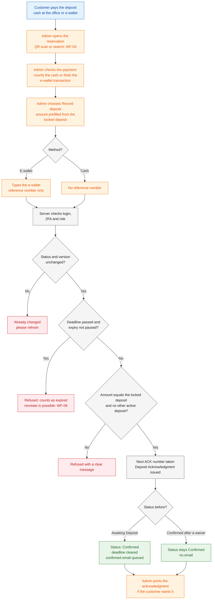

### Sequence diagram

```mermaid
sequenceDiagram
    actor C as Customer
    actor A as Admin in the browser
    participant N as Next.js server action
    participant DB as Postgres deposit function
    participant O as Outbox table
    participant R as Resend
    C->>A: Shows the QR code and pays in cash
    A->>N: Scan opens the reservation, WF-03A
    A->>N: Record deposit with amount, method, reference, note and version
    N->>N: Check the login, 2FA session and role, validate the fields
    N->>DB: app.record_deposit
    Note over DB: Status and version check.<br/>Overdue is refused unless expiry is paused.<br/>Amount equals the snapshot. One active deposit.<br/>E-wallet reference only for e-wallet.
    alt a check fails
        DB-->>N: Refused with a reason, nothing changed
        N-->>A: Clear message
    else all checks pass
        DB->>DB: Lock the year counter, take the next ACK number
        DB->>DB: Add the deposit, set verified at, set Confirmed, audit entry
        DB->>O: Queue the confirmed email, same transaction
        DB-->>N: ok, ACK number
        N-->>A: Confirmed, acknowledgment ready to print
        A-->>C: Printed acknowledgment, if wanted
        N->>R: Send the confirmed email after the reply
        R-->>C: Links to the acknowledgment and booking confirmation
    end
```

### Steps

| Step | Actor | What happens | Data created, updated, or read | Rules and requirements |
|---|---|---|---|---|
| 1 | Customer | Pays the deposit in cash at the office or by e-wallet, using the deposit instructions from the approved email or the status page **[C]**. | — | [D-05][dl], [catalog-and-payments][cat] §4.3, §7, [FR-NTF-03][fr], [FR-PUB-11][fr] |
| 2 | Admin | Opens the reservation: QR scan at the office (WF-03A) or search (WF-03C). | Read: reservation | [FR-ADM-06][fr], [FR-ADM-03][fr], [D-09][dl] |
| 3 | Admin | Checks the payment: counts the cash, or finds the transaction in the e-wallet account. | — (outside the system) | [glossary][gl] (verified), [BR-12][br] (example) |
| 4 | Admin | Chooses "Record deposit". The amount is prefilled from the reservation's locked deposit **[P]**. | Read: deposit snapshot | [FR-ADM-11][fr], [catalog-and-payments][cat] §2.2, §4.3 |
| 5 | Admin | Picks the method: cash or e-wallet. For e-wallet, types the reference number, and nothing else from the payment: never the payer's name or account number, not even in the note. Adds an optional note. | — | [FR-ADM-11][fr], [catalog-and-payments][cat] §4.2, §4.7 |
| 6 | Next.js server | Checks the login and the role; validates the fields. | Read: admin session | [roles][roles] §2.2, §7, [NFR-21][nfr] |
| 7 | Database | Checks the status and the version. Checks the deadline: an overdue hold is refused, unless expiry is paused for proof review. | Read: status, version, deadline, expiry paused | [FR-ADM-07][fr], [FR-ADM-11][fr], [BR-12][br], [EC-23][ec] |
| 8 | Database | Checks the payment: the amount equals the locked deposit, there is no other active deposit, and the e-wallet reference is present for e-wallet and empty for cash. | Read: deposit snapshot, payments | [catalog-and-payments][cat] §4.3, §9, [EC-34][ec], [EC-35][ec] |
| 9 | Database | Takes the next acknowledgment number for the Manila year (for example `ACK-2026-0001`); numbers are handed out one at a time. | Update: year counter | [catalog-and-payments][cat] §5.2, [EC-36][ec], [EC-37][ec] |
| 10 | Database | Adds the deposit to the payments ledger, with the admin, the time, and the time it was verified. From Awaiting Deposit, sets **Confirmed** with no deadline. After a waiver, the status stays Confirmed. | Create: payment; update: status, deadline, version | [reservation-lifecycle][lc] §4.2 row 6, §5, [catalog-and-payments][cat] §4.2, §4.3 |
| 11 | Database | In the same step: writes the audit entry and, from Awaiting Deposit only, queues the confirmed email (if an email was given). | Create: audit entry, outbox row | [FR-ADM-32][fr], [FR-NTF-07][fr], [reservation-lifecycle][lc] §5 |
| 12 | Next.js server | Shows Confirmed and the Deposit Acknowledgment. The admin prints it if the customer wants a copy. | Read: payment | [FR-ADM-23][fr], [catalog-and-payments][cat] §5 |
| 13 | Next.js server, Resend | Sends the confirmed email after the reply, with links to the acknowledgment and the booking confirmation. | Update: outbox status | [FR-NTF-07][fr], [FR-NTF-16][fr] |
| 14 | System | A deposit reminder that falls due later is skipped. If the customer uploaded a proof, its image is deleted 7 days after this verification by the retention job **[C]**. | Update: outbox row skipped; later: proof image deleted | [FR-NTF-19][fr], [EC-69][ec], [privacy-and-retention][priv] §6.2, [D-21][dl] |
| 15 | Customer | Sees Confirmed and the acknowledgment on the status page; without email, the admin can copy the prepared message. | Read | [FR-PUB-11][fr], [FR-PUB-14][fr], [FR-NTF-21][fr] |

### Decision points and validation

| Decision | If yes | If no | Rule |
|---|---|---|---|
| E-wallet? | Reference number required | Cash: reference left empty | [FR-ADM-11][fr], [catalog-and-payments][cat] §4.2 |
| Same status and version? | Continue | "Already changed, please refresh" | [FR-ADM-07][fr] |
| Deadline passed and expiry not paused? | Refused | Continue | [FR-ADM-11][fr], [BR-12][br] |
| Amount equals the locked deposit? | Continue | Refused; no partial deposits **[P]** | [catalog-and-payments][cat] §4.3, [EC-34][ec] |
| Another active deposit already? | Refused | Continue | [catalog-and-payments][cat] §4.3, [EC-35][ec] |
| Status Awaiting Deposit or Confirmed after a waiver? | Awaiting: becomes Confirmed and the email is queued. Waiver: stays Confirmed, no email | — | [reservation-lifecycle][lc] row 6, §5 |

### Failure and exception paths

| Situation | What happens | Edge case or rule |
|---|---|---|
| Recording after the deadline, with no proof under review | Refused; an admin can recreate the request if capacity is free ([WF-06](changes-and-expiry.md)) | [EC-23][ec] |
| The customer paid only part of the deposit | Cannot be recorded as the deposit; what to do with the part payment is open in batch-1 | [EC-34][ec]; [edge-cases][ec] §15, question 3 |
| A second deposit on the same reservation | Refused | [EC-35][ec] |
| Both admins record payments at the same moment | Each gets its own acknowledgment number | [EC-36][ec] |
| A payment recorded just after midnight on 1 January | The number uses the new Manila year | [EC-37][ec] |
| The deposit was recorded on the wrong booking | An admin voids it with a reason ([FR-ADM-15][fr]); whether the correct deposit can then be recorded on a Confirmed booking is open in batch-1 | [EC-33][ec]; [functional-requirements][fr] §7, question 3 |
| The customer pays after a waiver | Recorded; acknowledgment issued; status stays Confirmed | [EC-44][ec] |
| Both admins act at once | The second gets "already changed, please refresh" | [EC-16][ec] |
| Cash received one day but recorded the next | The acknowledgment shows the recording date; open in batch-1 | [catalog-and-payments][cat] §10, question 7 |

### Status transitions involved

- Awaiting Deposit → **Confirmed**: [reservation-lifecycle][lc] §4.2, row 6.
- Confirmed (after a waiver) → Confirmed: §5, row "Record a deposit after a waiver".
- One-step staff bookings record the deposit inside WF-04G ([BR-06a][br]).

### Developer notes

- **Database function:** for example `app.record_deposit(reservation_id, expected_version, amount, method, ewallet_ref, note)`; **server action:** `recordDeposit`.
- **Checks in the database:** amount equals the snapshot; at most one deposit that is not voided per reservation; e-wallet reference required for e-wallet and empty for cash ([catalog-and-payments][cat] §9).
- **ACK number:** lock the year's `ack_counters` row `FOR UPDATE`, increment, pad to at least 4 digits, never truncate; the year from `now() AT TIME ZONE 'Asia/Manila'` ([catalog-and-payments][cat] §9).
- **Payment row:** kind deposit, `verified_at` set; the closure-date recompute runs in the same function ([catalog-and-payments][cat] §9), although a Confirmed booking has no closure date yet ([privacy-and-retention][priv] §6.1).
- **Audit:** category indicative `booking`; not assigned in [FR-ADM-32][fr], see [administration](administration.md) open question 1. Action such as `payment.deposit_recorded`.
- **Outbox email type:** `confirmed` ([FR-NTF-07][fr]), only when the status changes to Confirmed.
- **Printable acknowledgment:** an HTML page ([FR-ADM-23][fr]; [catalog-and-payments][cat] §9); how its links are protected is open in batch-1 ([functional-requirements][fr] §7, question 5).
- **Tests:** acknowledgment numbering under concurrency; an end-to-end test where an admin records a deposit ([spec v0.2][spec] §17).

*(indicative; final names in api-specification, batch 3)*

---

## WF-04E · Verify or reject an uploaded proof

### In plain words

A customer who paid by e-wallet can upload a picture of the payment on the status page. If they upload it before the deposit deadline, the booking does not expire while it waits for an admin, but never past the service start **[C]** ([BR-12][br]). The proof appears in the dashboard's "proofs to verify" list, and both admins get an email. The admin opens the picture, checks the e-wallet account, and either **verifies** it, which records the deposit and confirms the booking, or **rejects** it with a reason. After a rejection, the original deadline counts again; if it has already passed, the booking expires at once and the customer is told why **[P]**.

*Example.* Ana's deposit is due on Friday 18 December 2026 at 2:00 PM. She uploads a proof at 1:50 PM. The Admin reviews it at 4:30 PM. If he verifies it, he records the ₱1,000 deposit and the booking becomes Confirmed. If he rejects it, the 2:00 PM deadline has already passed, so the booking expires at once **[P]**, and Ana gets the proof-not-accepted email with the reason and the expired email ([FR-ADM-12][fr]).

### Actors and responsibilities

| Actor | Responsibilities in this sub-flow |
|---|---|
| Customer | Uploads the proof before the deadline ([WF-07](notifications-and-tracking.md)); may upload once more after a rejection |
| Admin (either admin, [roles][roles] §2.2) | Opens the proof, checks the e-wallet account, verifies or rejects with a reason |
| Next.js server action | Checks the login and the role; gets a short-lived link to the image; calls the database |
| Supabase Storage | Holds the image in a private bucket; gives a short-lived link |
| Postgres proof functions | Review result, deposit and Confirmed (verify), deadline restored or Expired (reject), audit entry, queued emails |
| Outbox, Resend | Send the confirmed, proof-not-accepted, and expired emails |
| pg_cron | Expires a paused hold whose service start arrives without a review ([FR-SYS-01][fr]) |

### Trigger and preconditions

- **Trigger:** [WF-07E](notifications-and-tracking.md) step 8 has recorded the customer's proof, paused expiry, put the reservation in "proofs to verify", and emailed both admins ([FR-PUB-12][fr], [BR-12][br], [FR-ADM-02][fr], [FR-NTF-14][fr]). The upload itself is drawn there.
- **Preconditions:**
  - Status Awaiting Deposit, with expiry paused for this proof ([BR-12][br]).
  - The admin is logged in with 2FA ([FR-ADM-01][fr]).
  - The service start has not arrived; at the service start the pause ends ([reservation-lifecycle][lc] §3.2).

### Flowchart

```mermaid
flowchart TD
    ST1["WF-07E step 8: proof recorded,<br/>expiry paused, both admins told"] --> E3["Admin opens the proof<br/>through a short-lived link"]
    E3 --> E4["Admin checks the e-wallet<br/>account for the payment"]
    E4 --> S1["Server checks login,<br/>2FA, and role"]
    S1 --> D0{"Same version, and service<br/>start not reached?"}
    D0 -->|"No"| X1["Already changed, please refresh<br/>or counts as expired"]
    D0 -->|"Yes"| D1{"Payment found<br/>and correct?"}
    D1 -->|"Yes"| E5["Verify: record the deposit<br/>WF-04D checks"]
    E5 --> D5{"Amount equals the locked deposit<br/>and no other active deposit?"}
    D5 -->|"No"| X2["Refused with a clear message"]
    D5 -->|"Yes"| ST2["Status: Confirmed<br/>proof leaves the list"]
    D1 -->|"No"| E6["Reject with a reason"]
    E6 --> D2{"Original deadline<br/>already passed?"}
    D2 -->|"No"| ST3["Stays Awaiting Deposit<br/>original deadline applies again<br/>proof-not-accepted email"]
    D2 -->|"Yes"| ST4["Status: Expired at once<br/>proof-not-accepted and expired emails"]
    ST3 --> E7["Customer may upload once more<br/>at most 2 uploads ever"]
    ST1 -.->|"No review by the service start"| ST5["Status: Expired<br/>by the every-minute job"]
    ST1 -.->|"Event is today"| E8["Admin may waive instead<br/>WF-04F"]
    classDef customer fill:#e3f2fd,stroke:#1565c0,color:#0d47a1
    classDef system fill:#f5f5f5,stroke:#616161,color:#212121
    classDef admin fill:#fff3e0,stroke:#ef6c00,color:#e65100
    classDef status fill:#e8f5e9,stroke:#2e7d32,color:#1b5e20
    classDef failure fill:#ffebee,stroke:#c62828,color:#b71c1c
    class E7 customer
    class E3,E4,E5,E6,E8 admin
    class S1,D0,D1,D5,D2 system
    class ST1,ST2,ST3,ST4,ST5 status
    class X1,X2 failure
```

### Sequence diagram

```mermaid
sequenceDiagram
    actor A as Admin in the browser
    participant N as Next.js server action
    participant S as Supabase Storage
    participant DB as Postgres proof functions
    participant O as Outbox table
    participant R as Resend
    participant J as pg_cron
    actor C as Customer
    A->>N: Open the proof from proofs to verify
    N->>N: Check the login, 2FA session and role
    N->>S: Create a short-lived signed link to the private image
    S-->>N: Signed link
    N-->>A: Show the image
    A->>A: Check the e-wallet account outside the system
    alt verify
        A->>N: Verify, with the deposit fields and the version
        N->>DB: app.verify_proof
        Note over DB: Status and version check.<br/>Expiry is paused, so it works after the original deadline.<br/>Same checks and ACK number as record deposit.
        alt status or version changed, or service start reached
            DB-->>N: stale_version or overdue
            N-->>A: Already changed, please refresh
        else amount wrong or another active deposit
            DB-->>N: Refused with a reason, nothing changed
            N-->>A: Clear message
        else checks pass
            DB->>O: Queue the confirmed email
            DB-->>N: ok, Confirmed, ACK number
            N->>R: Send after the reply
            R-->>C: Confirmed email
        end
    else reject with a reason
        A->>N: Reject, with the reason and the version
        N->>DB: app.reject_proof
        alt status or version changed
            DB-->>N: stale_version
            N-->>A: Already changed, please refresh
        else original deadline still running
            DB->>O: Queue the proof-not-accepted email
            DB-->>N: ok, Awaiting Deposit, original deadline again
            N->>R: Send after the reply
            R-->>C: The reason
        else original deadline already passed
            DB->>O: Queue proof-not-accepted and expired emails
            DB-->>N: ok, Expired, claims released
            N->>R: Send after the reply
            R-->>C: The reason and the expiry
        end
    end
    J->>DB: Every minute, expire a paused hold whose service start has come
```

### Steps

| Step | Actor | What happens | Data created, updated, or read | Rules and requirements |
|---|---|---|---|---|
| 1 | Admin | Opens the proof from the list or the reservation page; the image opens through a short-lived link. | Read: proof image | [FR-ADM-12][fr], [NFR-14][nfr], [roles][roles] §6 |
| 2 | Admin | Checks the e-wallet account for the payment. Never copies the payer's name or account number. | — (outside the system) | [BR-12][br] (example), [catalog-and-payments][cat] §4.7 |
| 3 | Next.js server | Checks the login and the role. | Read: admin session | [roles][roles] §2.2, §7 |
| 4 | Database | Checks the status and the version, and that the service start has not arrived. If not: "already changed, please refresh", or the hold counts as expired; nothing changes. | Read: status, version, service start | [FR-ADM-07][fr], [BR-12][br], [EC-16][ec] |
| 5 | Admin, Database | **Verify:** the admin enters the deposit fields and the deposit is recorded as in WF-04D steps 7 to 13; an amount that is not the locked deposit, or a second active deposit, is refused ([EC-34][ec], [EC-35][ec]). This works after the original deadline, because expiry was paused. The proof is marked verified and leaves the list; the booking is **Confirmed**. | Create: payment; update: proof review result, status, expiry paused | [FR-ADM-12][fr], [FR-ADM-11][fr], [reservation-lifecycle][lc] §4.2 row 6, [EC-27][ec] |
| 6 | Admin, Database | **Reject:** the admin writes a reason; it cannot be saved without one. The proof is marked rejected with the reason and leaves the list. The original deadline applies again. | Update: proof review result, expiry paused | [FR-ADM-12][fr], [BR-12][br] |
| 7 | Database | If the original deadline is still running: the booking stays Awaiting Deposit, and the proof-not-accepted email is queued. The customer may upload once more (at most 2 uploads per reservation, ever). | Create: outbox row | [reservation-lifecycle][lc] §5, [FR-NTF-06][fr], [FR-PUB-12][fr], [EC-29][ec] |
| 8 | Database | If the original deadline has passed: the booking is **Expired** at once **[P]**, its claims are released, and the QR code stops working. The proof-not-accepted email (with the reason) and the expired email are queued. | Update: status, claims; create: outbox rows | [reservation-lifecycle][lc] §4.2 row 10c, [FR-NTF-06][fr], [FR-NTF-12][fr], [EC-28][ec] |
| 9 | Database | Writes the audit entry for the review in the same step. | Create: audit entry | [FR-ADM-32][fr] |
| 10 | System | If no admin reviews the proof by the service start, the pause ends and the booking expires; the every-minute job records it. For a same-day booking, an admin may waive the deposit before that moment (WF-04F). | Update: status, claims; create: outbox row | [BR-12][br], [FR-SYS-01][fr], [reservation-lifecycle][lc] §4.2 row 10b, [EC-31][ec] |
| 11 | System | The proof image is deleted later by the daily retention job ([WF-10E](administration.md) step 4): 7 days after verification **[C]**, or 7 days after the booking became Rejected, Expired, or Cancelled for an unverified proof **[P]**. | Later: image deleted, deletion logged | [privacy-and-retention][priv] §6.2, [FR-SYS-05][fr], [EC-85][ec] |

### Decision points and validation

| Decision | If yes | If no | Rule |
|---|---|---|---|
| Was the proof uploaded before the deadline? | Expiry is paused | No pause; the upload is not offered after the deadline | [BR-12][br], [EC-32][ec] |
| Has the service start arrived? | The pause has ended; the booking expires | The review can go ahead | [BR-12][br], [EC-31][ec] |
| Is the payment found and correct? | Verify (record the deposit) | Reject with a reason | [FR-ADM-12][fr] |
| Is a reason written (reject)? | Continue | Cannot be saved | [FR-ADM-12][fr] |
| Has the original deadline passed (reject)? | Expired at once **[P]** | Back to the original deadline | [BR-12][br] |
| Fewer than 2 uploads so far (after a rejection)? | The customer may upload again | No more uploads | [FR-PUB-12][fr], [EC-30][ec] |

### Failure and exception paths

| Situation | What happens | Edge case or rule |
|---|---|---|
| A proof uploaded just before the deadline is reviewed after it | Verify still works, because expiry was paused | [EC-27][ec] |
| A proof rejected after the original deadline | Expired at once; two emails | [EC-28][ec] |
| A proof rejected while the deadline is still running | Back to the original deadline; one more upload allowed | [EC-29][ec] |
| A third upload, a wrong file type, or a file over the size limit | Refused on the customer side | [EC-30][ec] |
| No review by the service start | The booking expires at the service start | [EC-31][ec] |
| An upload attempt after the deadline | Not offered; the hold already counts as expired | [EC-32][ec] |
| Both admins review the same proof at once | The second gets "already changed, please refresh" | [EC-16][ec] |
| The deadline was extended while the proof was under review, and the proof is then rejected | Which deadline applies is open in batch-1 | [edge-cases][ec] §15, question 4 |
| The reminder and the deadline shown while expiry is paused | Open in batch-1 | [functional-requirements][fr] §7, question 2 |
| The booking is confirmed another way while a proof is under review | Open question 10 | [privacy-and-retention][priv] §11, question 1 |

### Status transitions involved

- Verify: Awaiting Deposit → **Confirmed**: [reservation-lifecycle][lc] §4.2, row 6.
- Reject while the deadline runs: no status change ([reservation-lifecycle][lc] §5, row "Reject a proof").
- Reject after the deadline: Awaiting Deposit → **Expired**: row 10c **[P]**.
- No review by the service start: Awaiting Deposit → **Expired**: row 10b.

### Developer notes

- **Database functions:** for example `app.verify_proof(proof_id, expected_version, amount, method, ewallet_ref, note)`, which runs the same deposit logic as `app.record_deposit` in one transaction, and `app.reject_proof(proof_id, expected_version, reason)`. The version is the reservation's.
- **Server actions:** `verifyProof`, `rejectProof`; plus one that issues the short-lived signed link from the private bucket (`createSignedUrl`); its lifetime is open question 5.
- **Fields:** `payment_proofs` review result (verified or rejected, with a reason); the reservation's `expiry_paused` is cleared on either result ([catalog-and-payments][cat] §9; [reservation-lifecycle][lc] §4.3).
- **Audit:** category `booking`, actions such as `proof.verified` (with `payment.deposit_recorded`, whose category is indicative: not assigned in [FR-ADM-32][fr], see [administration](administration.md) open question 1) and `proof.rejected` with the reason.
- **Outbox email types:** `confirmed` ([FR-NTF-07][fr]), `proof_not_accepted` ([FR-NTF-06][fr]), `expired` ([FR-NTF-12][fr]).
- **Tests:** proof pausing expiry and rejection after the deadline in pgTAP; an end-to-end test of a proof upload with the admin verifying it ([spec v0.2][spec] §17).

*(indicative; final names in api-specification, batch 3)*

---

## WF-04F · Same-day deposit waiver

### In plain words

For a booking whose event is today, there may be no time to collect a deposit. The admins decide per booking whether to ask for it or to waive it **[C]** ([D-06][dl]). To waive it, the admin writes a reason, and the booking becomes **Confirmed** straight away, with no deposit. This works from Pending Confirmation or Awaiting Deposit, only while the event date is today in Manila, and only before the hold has expired. The customer gets the confirmed email. If the customer pays a deposit later anyway, the admin can still record it (WF-04D).

*Example.* On Saturday 19 December 2026 at 5:30 PM, Rosa requests the room for a 7:00 PM arrival that evening. At 5:40 PM, instead of approving, the Admin waives the deposit, with the reason "regular customer, pays in full on arrival". The booking is Confirmed. On 19 December, a booking for Sunday 20 December offers no waiver; on 20 December, it does ([reservation-lifecycle][lc] §6.4).

### Actors and responsibilities

| Actor | Responsibilities in this sub-flow |
|---|---|
| Admin (either admin, [roles][roles] §2.2) | Decides to waive, writes the reason |
| Next.js server action | Checks the login and the role; calls the database once |
| Postgres waiver function | Today check, status, version, and overdue checks; Confirmed; audit entry with reason; queued email |
| Outbox, Resend | Send the confirmed email |
| Customer | Receives the confirmed email, or a message the admin copies |

### Trigger and preconditions

- **Trigger:** an urgent request (event date today) is on the dashboard, or a same-day booking is Awaiting Deposit ([FR-ADM-02][fr], [EC-42][ec]).
- **Preconditions** ([reservation-lifecycle][lc] §4.2 rows 5 and 7):
  - The event date is today (Manila date) at the moment the admin acts.
  - Status Pending Confirmation (deadline not passed) or Awaiting Deposit (deadline not passed, or expiry paused).
  - A reason.

### Flowchart

```mermaid
flowchart TD
    F1["Same-day request<br/>marked urgent on the dashboard"] --> F2["Admin opens it: WF-03"]
    F2 --> D1{"Event date is today<br/>in Manila right now?"}
    D1 -->|"No"| X1["Waiver not offered<br/>a direct try is refused"]
    D1 -->|"Yes"| D2{"Ask for the deposit<br/>or waive it?"}
    D2 -->|"Ask"| F3["Approve, then record<br/>the deposit: WF-04A, WF-04D"]
    D2 -->|"Waive"| F4["Admin writes the reason"]
    F4 --> S1["Server checks login,<br/>2FA and role"]
    S1 --> D3{"Pending or Awaiting Deposit,<br/>same version?"}
    D3 -->|"No"| X2["Already changed<br/>or not allowed"]
    D3 -->|"Yes"| D4{"Deadline passed and<br/>not paused for a proof?"}
    D4 -->|"Yes"| X3["Refused: counts as expired"]
    D4 -->|"No"| ST1["Status: Confirmed<br/>no deposit, no deadline"]
    ST1 --> S2["Same step: audit entry with reason,<br/>confirmed email queued"]
    S2 --> F5["A later deposit can still<br/>be recorded: WF-04D"]
    classDef customer fill:#e3f2fd,stroke:#1565c0,color:#0d47a1
    classDef system fill:#f5f5f5,stroke:#616161,color:#212121
    classDef admin fill:#fff3e0,stroke:#ef6c00,color:#e65100
    classDef status fill:#e8f5e9,stroke:#2e7d32,color:#1b5e20
    classDef failure fill:#ffebee,stroke:#c62828,color:#b71c1c
    class F1,D1,S1,D3,D4,S2 system
    class F2,D2,F3,F4,F5 admin
    class ST1 status
    class X1,X2,X3 failure
```

### Sequence diagram

```mermaid
sequenceDiagram
    actor A as Admin in the browser
    participant N as Next.js server action
    participant DB as Postgres waiver function
    participant O as Outbox table
    participant R as Resend
    actor C as Customer
    A->>N: Waive the deposit, with the reason and the version
    N->>N: Check the login, 2FA session and role, and that a reason is given
    N->>DB: app.waive_deposit
    Note over DB: Event date is today in Manila.<br/>Status Pending or Awaiting Deposit, version matches.<br/>Not overdue, unless expiry is paused.
    alt a check fails
        DB-->>N: Refused, nothing changed
        N-->>A: Not allowed, already changed, or expired
    else checks pass
        DB->>DB: Confirmed, no deadline, audit entry with the reason
        DB->>O: Queue the confirmed email
        DB-->>N: ok
        N-->>A: Confirmed, deposit waived
        N->>R: Send the confirmed email after the reply
        R-->>C: Booking confirmation link
    end
```

### Steps

| Step | Actor | What happens | Data created, updated, or read | Rules and requirements |
|---|---|---|---|---|
| 1 | System | Shows a same-day request as urgent on the dashboard and in the admin email. | Read: event date | [BR-06a][br], [FR-ADM-02][fr], [FR-NTF-13][fr], [EC-42][ec] |
| 2 | Admin | Opens it (WF-03) and decides whether to ask for the deposit (WF-04A then WF-04D) or to waive it **[C]**. | Read: reservation | [D-06][dl], [reservation-lifecycle][lc] §6.4 |
| 3 | Next.js server | Offers "Waive deposit" only when the event date is today (Manila) and the status is Pending Confirmation or Awaiting Deposit. | Read: event date, status | [FR-ADM-13][fr], [EC-43][ec], [EC-82][ec] |
| 4 | Admin | Writes the reason. It cannot be saved without one. | — | [FR-ADM-13][fr] |
| 5 | Next.js server | Checks the login and the role. | Read: admin session | [roles][roles] §2.2, §7 |
| 6 | Database | Checks again that the event date is today, then the status, the version, and that the hold is not overdue (expiry paused counts as not overdue for Awaiting Deposit). | Read: event date, status, version, deadline, expiry paused | [reservation-lifecycle][lc] §4.2 rows 5 and 7, [FR-ADM-07][fr] |
| 7 | Database | Sets **Confirmed**, with no deadline and no deposit in the ledger. The claims stay. | Update: status, deadline, version | [reservation-lifecycle][lc] rows 5 and 7, [FR-ADM-13][fr] |
| 8 | Database | In the same step: writes the audit entry with the reason, and queues the confirmed email. | Create: audit entry, outbox row | [FR-ADM-13][fr], [FR-NTF-07][fr], [FR-ADM-32][fr] |
| 9 | Next.js server, Resend | Sends the email after the reply. | Update: outbox status | [FR-NTF-16][fr] |
| 10 | Admin | "Record a deposit" is still offered on the Confirmed booking (WF-04D). Without email, the admin copies the prepared message. | — | [FR-ADM-13][fr], [FR-ADM-11][fr], [FR-NTF-21][fr] |

### Decision points and validation

| Decision | If yes | If no | Rule |
|---|---|---|---|
| Is the event date today (Manila) right now? | The waiver is offered | Not offered; a direct try is refused | [reservation-lifecycle][lc] §6.4, [EC-43][ec] |
| Ask for the deposit, or waive it? | Ask: WF-04A and WF-04D | Waive: continue | [D-06][dl] |
| Is a reason written? | Continue | Cannot be saved | [FR-ADM-13][fr] |
| Pending Confirmation or Awaiting Deposit, same version? | Continue | Refused | [FR-ADM-07][fr], [EC-53][ec] |
| Overdue and not paused? | Refused: counts as expired | Confirmed | [reservation-lifecycle][lc] rows 5 and 7 |

### Failure and exception paths

| Situation | What happens | Edge case or rule |
|---|---|---|
| The event is not today | No waiver | [EC-43][ec] |
| Just after midnight, while the UTC date is still yesterday | The Manila date counts, so a booking for today is offered the waiver | [EC-82][ec] |
| The customer pays after the waiver | The deposit is recorded; the status stays Confirmed | [EC-44][ec] |
| A proof is under review when the waiver is given | Not defined (open question 10) | [privacy-and-retention][priv] §11, question 1 |
| The request is flagged needs info | Whether the waiver clears the flag is open in batch-1 | [reservation-lifecycle][lc] §9, question 3 |
| The default balance after a waiver | Open in batch-1 | [edge-cases][ec] §15, question 5 |
| Both admins act at once | The second gets "already changed, please refresh" | [EC-16][ec] |

### Status transitions involved

Pending Confirmation → **Confirmed** (row 5) and Awaiting Deposit → **Confirmed** (row 7): [reservation-lifecycle][lc] §4.2. Rules: §6.4.

### Developer notes

- **Database function:** for example `app.waive_deposit(reservation_id, expected_version, reason)`; **server action:** `waiveDeposit`.
- **Today:** compare the event date with `(now() AT TIME ZONE 'Asia/Manila')::date` inside the function, not only in the page ([NFR-19][nfr], [EC-82][ec]).
- **Audit:** category `booking`, action such as `reservation.deposit_waived`, with the reason.
- **Outbox email type:** `confirmed` ([FR-NTF-07][fr]); there is no acknowledgment link, because no payment was recorded.

*(indicative; final names in api-specification, batch 3)*

---

## WF-04G · Staff-created booking

### In plain words

Customers who phone, walk in, or message the business on Facebook are booked by an admin in the admin panel, so every booking uses the same calendar. The admin picks where the booking came from and fills in the same details as the website form; the mobile number is required and the email is optional. The system checks the sets, the room, and the add-on stock exactly as for an online request, so nothing is ever double-booked, but it skips the notice period, the limits on open requests, and the online-booking pause ([BR-06a][br]). Normally the booking is saved as **Pending Confirmation**, and the admin then approves it as usual. If the start has already passed, or is closer than the notice period, the form finishes in one step: the booking is saved as **Confirmed**, with the deposit recorded or waived with a reason.

*Examples* ([FR-ADM-24][fr]):
- On Sunday 20 December 2026 at 6:40 PM, Carla walks in and wants the room at 7:00 PM. That is less than the notice period away, so the Admin finishes the booking in one step. He records her ₱1,000 cash deposit, and the booking is Confirmed with `ACK-2026-0012`.
- On Monday 21 December, Dan phones to book a delivery for Saturday 2 January 2027. The Admin creates it as Pending Confirmation, then approves it (WF-04A).

### Actors and responsibilities

| Actor | Responsibilities in this sub-flow |
|---|---|
| Customer | Books by phone, walk-in, or Facebook; gives the details; pays the deposit if one-step with a deposit |
| Admin (either admin, [roles][roles] §2.3) | Picks the source, enters the details, chooses deposit or waiver in a one-step booking |
| Next.js server action | Checks the login and the role; validates the fields with the shared schema; calls the database once |
| Postgres staff booking function | Capacity lock, overdue holds, set or room, add-on stock, price snapshot, codes, status, payment or waiver, audit entry, queued emails |
| Outbox, Resend | Send the customer emails; no admin new-request email |

### Trigger and preconditions

- **Trigger:** a customer phones, walks in, or messages the business on Facebook ([BR-06a][br]). This includes times when online booking is paused, or when the customer already has open online requests ([EC-45][ec]).
- **Preconditions:**
  - The admin is logged in ([FR-ADM-01][fr]).
  - A set or the room, and enough add-on stock, are free on the date ([reservation-lifecycle][lc] §4.2 row 2).
  - No notice, hold-limit, or breaker check applies ([BR-06a][br]).

### Flowchart

```mermaid
flowchart TD
    G1["Customer phones, walks in,<br/>or messages on Facebook"] --> G2["Admin opens Create booking<br/>and picks the source"]
    G2 --> G3["Admin fills in the booking<br/>and customer details<br/>mobile required, email optional"]
    G3 --> D1{"Start already passed or within<br/>the notice period?"}
    D1 -->|"Yes"| D2{"Deposit or waiver?"}
    D2 -->|"Deposit"| G4["Admin adds the deposit:<br/>amount, method, reference"]
    D2 -->|"Waiver"| G5["Admin writes the reason"]
    D1 -->|"No"| G6["Normal booking"]
    G4 --> S1["Server checks login, 2FA, role<br/>and the fields"]
    G5 --> S1
    G6 --> S1
    S1 --> S2["One call: capacity lock,<br/>overdue holds do not count"]
    S2 --> D3{"A set or the room free<br/>and enough add-on stock?"}
    D3 -->|"No"| X1["Refused: not free<br/>nothing created"]
    D3 -->|"Yes"| S3["Saved: claims, price snapshot,<br/>service start, urgent flag,<br/>reference code and QR"]
    S3 --> D4{"One-step?"}
    D4 -->|"No"| ST1["Status: Pending Confirmation<br/>request-received email if an email"]
    ST1 --> G7["Admin continues:<br/>WF-04A, WF-04B, or WF-04C"]
    D4 -->|"Yes, deposit"| ST2["Status: Confirmed<br/>deposit and acknowledgment"]
    D4 -->|"Yes, waiver"| ST3["Status: Confirmed<br/>deposit waived, reason saved"]
    ST2 --> G8["Which customer emails:<br/>open in batch-1"]
    ST3 --> G8
    classDef customer fill:#e3f2fd,stroke:#1565c0,color:#0d47a1
    classDef system fill:#f5f5f5,stroke:#616161,color:#212121
    classDef admin fill:#fff3e0,stroke:#ef6c00,color:#e65100
    classDef status fill:#e8f5e9,stroke:#2e7d32,color:#1b5e20
    classDef failure fill:#ffebee,stroke:#c62828,color:#b71c1c
    class G1 customer
    class G2,G3,D2,G4,G5,G6,G7 admin
    class D1,S1,S2,D3,S3,D4,G8 system
    class ST1,ST2,ST3 status
    class X1 failure
```

### Sequence diagram

```mermaid
sequenceDiagram
    actor A as Admin in the browser
    participant N as Next.js server action
    participant DB as Postgres staff booking function
    participant O as Outbox table
    participant R as Resend
    actor C as Customer
    A->>N: Create booking with source, details, and deposit or waiver if one-step
    N->>N: Check the login, 2FA session and role, validate with the shared schema
    N->>DB: app.create_staff_reservation
    Note over DB: Capacity lock, overdue holds do not count,<br/>claim a set or the room, check add-on stock.<br/>No notice, hold-limit, or breaker check.
    alt not free
        DB-->>N: Refused, nothing created
        N-->>A: Clear message, the form keeps the data
    else normal booking
        DB->>DB: Pending Confirmation, snapshot, codes, deadline, audit entry
        DB->>O: Queue request received, if an email was given
        DB-->>N: ok, reference code
        N-->>A: Reservation page, continue with WF-04A
    else one-step booking
        DB->>DB: Confirmed with the deposit and ACK number, or with the waiver reason
        DB->>O: Queue the customer emails, see open question in batch-1
        DB-->>N: ok, reference code, ACK number if any
        N-->>A: Confirmed, acknowledgment ready to print
    end
    N->>R: Send queued emails after the reply
    R-->>C: Customer email, only if an email was given
```

### Steps

| Step | Actor | What happens | Data created, updated, or read | Rules and requirements |
|---|---|---|---|---|
| 1 | Customer | Phones, walks in, or messages the business on Facebook. | — | [BR-06a][br], [D-06][dl] |
| 2 | Admin | Opens "Create booking" and picks the source: phone, walk-in, or Facebook. | — | [FR-ADM-24][fr], [roles][roles] §2.3 |
| 3 | Admin | Fills in the same booking fields as the public form (service type, date, package, add-ons, slot or arrival time) and customer fields (name, mobile number required **[C]**, email optional **[C]**, venue for delivery, note). | Read: catalog, slots, on-site hours | [FR-ADM-24][fr], [FR-PUB-04][fr], [FR-PUB-05][fr], [BR-11][br], [D-08][dl] |
| 4 | Admin | If the service start has already passed or falls within the notice period, the form finishes in one step: the admin adds the deposit (as in WF-04D step 5) or writes a waiver reason. | — | [BR-06a][br], [FR-ADM-24][fr] |
| 5 | Next.js server | Checks the login and the role, and validates the fields with the shared schema. The public form's bot checks do not apply. | Read: admin session | [roles][roles] §7, [NFR-21][nfr], [FR-ADM-24][fr] |
| 6 | Database | Takes the capacity lock. Overdue holds do not count. Claims a free set (delivery) or the room (on-site) and checks the add-on stock, exactly as for an online request. No notice, hold-limit, or breaker check. | Create: set or room claim, add-on claims | [BR-01][br] to [BR-05][br], [BR-08][br], [BR-06a][br], [NFR-20][nfr]; how it works: [WF-05](availability-and-conflicts.md) |
| 7 | Database | Saves the reservation with its source, the price and deposit snapshot taken now, the service start, the urgent flag if the event date is today, and a reference code and QR token hash (as in WF-02). | Create: reservation | [catalog-and-payments][cat] §2.2, [D-12][dl], [reservation-lifecycle][lc] §3.1, [BR-06a][br], [FR-PUB-08][fr] |
| 8 | Database | **Normal booking:** status **Pending Confirmation**, with the deadline as for an online request. Audit entry (actor admin). The request-received email is queued if an email was given; no admin new-request email. | Update: status, deadline; create: audit entry, outbox row | [reservation-lifecycle][lc] §4.2 row 2, §3.2, [FR-NTF-01][fr], [BR-06a][br] |
| 9 | Database | **One-step with a deposit:** **Confirmed**, the deposit recorded with its acknowledgment number (WF-04D checks). **One-step with a waiver:** **Confirmed**, reason saved. Which customer emails are sent is open in batch-1. | Create: payment (deposit), audit entry, outbox rows; update: status | [BR-06a][br], [catalog-and-payments][cat] §4.3, §5.1, [reservation-lifecycle][lc] §2 and §6.4; [functional-requirements][fr] §7, question 1 |
| 10 | Admin | Sees the new reservation. For a normal booking, continues with the usual actions (WF-04A, WF-04B, WF-04C). For a one-step deposit, prints the acknowledgment if wanted. | Read: reservation | [FR-ADM-24][fr], [FR-ADM-23][fr] |
| 11 | Admin | If the customer gave no email, copies the prepared message into SMS or Messenger (how such a customer gets the QR code: open question 14). | Read: prepared message | [FR-NTF-21][fr] |
| 12 | Next.js server, Resend | Sends queued emails after the reply. | Update: outbox status | [FR-NTF-16][fr] to [FR-NTF-20][fr] |

### Decision points and validation

| Decision | If yes | If no | Rule |
|---|---|---|---|
| Is the mobile number in an accepted Philippine form? | Converted to the standard form | Refused with a clear message | [BR-11][br], [EC-11][ec] |
| Is the arrival time inside on-site hours (on-site)? | Continue | Refused | [FR-PUB-04][fr] |
| Has the service start passed, or is it within the notice period? | One-step: deposit or waiver | Normal booking: Pending Confirmation | [BR-06a][br] |
| Deposit or waiver (one-step)? | Deposit: WF-04D checks | Waiver: reason required | [BR-06a][br], [reservation-lifecycle][lc] §6.4 |
| Is a set or the room free, with enough add-on stock? | Saved | Refused; nothing created | [BR-01][br] to [BR-03][br] |
| Is the event date today? | Urgent flag | Not urgent | [BR-06a][br] |
| Was an email given? | Customer emails queued | Prepared message | [FR-NTF-01][fr], [FR-NTF-21][fr] |

### Failure and exception paths

| Situation | What happens | Edge case or rule |
|---|---|---|
| A walk-in for a time that has already started, or starts within the notice period | One step: Confirmed with a deposit or a waiver; capacity still checked; urgent | [EC-41][ec] |
| Online booking is paused, or the customer already has open online requests | Allowed: staff bookings skip the breaker and the hold limits | [EC-45][ec] |
| The set, room, or stock was taken while the admin was typing | Refused; nothing created | [BR-01][br] to [BR-03][br], [EC-03][ec] |
| An admin blocks the same set at the same moment | Only one succeeds | [EC-17][ec] |
| A wrong mobile number format | Refused with a clear message | [EC-11][ec] |
| The admin presses Create twice | Not defined for the admin form (open question 11) | — |
| How the one-step booking's history shows its steps | Open in batch-1 | [reservation-lifecycle][lc] §9, question 1 |

### Status transitions involved

- *(new)* → **Pending Confirmation**: [reservation-lifecycle][lc] §4.2, row 2 (actor admin).
- One-step booking: read as existing rows done together, either created, approved, and the deposit recorded (rows 2, 4, 6) or created and the deposit waived (rows 2, 5) ([reservation-lifecycle][lc] §2, "One-step staff bookings"; question 1 in §9).

### Developer notes

- **Database function:** for example `app.create_staff_reservation(source, booking, customer, one_step)`, where `one_step` carries either the deposit fields or the waiver reason. It can share its capacity core with `app.book_reservation` (WF-01C) without the online-only checks ([BR-06a][br]).
- **Server action:** `createStaffReservation`, in the admin module tree ([roles][roles] §7).
- **Prices** are calculated in the function from the catalog, never from the browser ([catalog-and-payments][cat] §2.1; [NFR-21][nfr]).
- **Audit:** category `booking`, actor `admin`, action such as `reservation.created_by_staff`; plus `payment.deposit_recorded` (category indicative `booking`; not assigned in [FR-ADM-32][fr], see [administration](administration.md) open question 1) or `reservation.deposit_waived` for a one-step booking.
- **Outbox email types:** `request_received` ([FR-NTF-01][fr]) for a normal booking; for a one-step booking, see [functional-requirements][fr] §7, question 1. Never `admin_new_request` ([BR-06a][br]).
- **Tests:** a staff-created booking end to end; same-day notice in Manila time, including a walk-in after the start ([spec v0.2][spec] §17).

*(indicative; final names in api-specification, batch 3)*

---

## Source notes: batch-1 docs and the frozen spec

Where the two differ, batch-1 docs win ([D-23][dl]). Differences noticed while writing this document:

1. **One-step staff bookings.** [Spec v0.2][spec] §16 lists only a "Walk-in or phone booking for a time that has already started", which is "Created as Confirmed in one step, with a deposit or a waiver". [BR-06a][br], [EC-41][ec], and spec §6 (BR-06a) also include a start that falls **within the notice period**, and Facebook bookings. This document follows batch-1 (WF-04G).
2. **Overdue checks on the waiver.** Spec §7 allows the same-day waiver "from Pending or Awaiting Deposit, with a reason" and does not name a deadline condition. [Reservation-lifecycle][lc] rows 5 and 7 add "deadline not passed" (row 7: "or expiry paused"), in line with spec §12. No contradiction; this document follows batch-1 (WF-04F step 6).
3. **Search fields.** Spec §3 says only "list and search". The search fields and filters come from [FR-ADM-03][fr] and are **[P]**, new in that doc. This document follows batch-1 (WF-03C).
4. **Telling the customer after a late proof rejection.** Spec §6 (BR-12) says "the customer is told why **[P]**". Batch-1 makes that the proof-not-accepted email with the reason plus the expired email ([FR-ADM-12][fr], [EC-28][ec], lifecycle row 10c). This document follows batch-1 (WF-04E step 8).

No other difference affects WF-03 or WF-04.

---

## Open questions

These are not decided here. If the reviewers agree they need an answer, add each one to the [decision log][dl] as a new open item (O-12 onwards), or settle it in the batch-3 doc named.

1. **The QR code of an overdue hold.** [FR-PUB-08][fr] says the QR link stops working when the reservation *becomes* Expired, while [BR-05][br] says an overdue hold counts as expired at once everywhere. Does a scan or a QR link for a hold whose deadline has passed, but which the every-minute job has not yet marked, open the reservation or show "no longer valid"? (WF-03A step 9, WF-03B step 3)
2. **The screenshot fallback.** Where is the screenshot read: in the admin's browser, or on the server? Is the image kept anywhere, even briefly? [Privacy-and-retention][priv] §6.2 has no row for it. (WF-03A step 4; security, planned: `05-technical/security.md`)
3. **Logging who opened a reservation.** Audit entries cover changes ([FR-ADM-07][fr], [FR-ADM-32][fr]). Should opening a reservation by QR scan, QR link, or search also be logged, since it shows personal data? (security, batch 3)
4. **Admins on the "present this at our office" page.** Should that page offer a login link that returns to the reservation, for an admin who is not logged in on that phone? (WF-03B step 5; planned: `04-design/ux-and-sitemap.md`)
5. **Security settings that batch-1 docs do not set.** A rate limit for the public QR link page ([NFR-11][nfr] lists none), and the lifetime of the short-lived link to a proof image ([FR-ADM-12][fr]). (security, batch 3)
6. **Search details.** How does a name match (part of a name, upper or lower case)? Can part of a mobile number be searched? Is the event-date filter one date or a range? In what order are results shown, and are they paged? ([FR-ADM-03][fr], **[P]** new in that doc; ux-and-sitemap and api-specification, batch 3)
7. **Statuses for an admin reissue.** [FR-ADM-22][fr] and [reservation-lifecycle][lc] §5 do not say on which statuses an admin can reissue a QR code. A QR code stops working at Rejected, Cancelled, Expired, and Completed ([FR-PUB-08][fr]). Is reissue offered only on Pending Confirmation, Awaiting Deposit, and Confirmed? (WF-03D)
8. **Recording the service-area check.** The approve precondition is that the admin "has checked" the venue ([reservation-lifecycle][lc] row 4, [D-11][dl]). Is the check recorded (for example a tick box saved with the approval), or is it only the admin's judgment? (WF-04A step 2)
9. **Changing the needs-info message.** While a request is flagged, can an admin flag it again with a new message, and does that send a second needs-info email? Is the message kept after "Info received"? ([reservation-lifecycle][lc] §6.1, [FR-NTF-02][fr]; WF-04C)
10. **A proof under review when the booking is confirmed another way.** If the customer then pays cash and the deposit is recorded through WF-04D, or a same-day waiver is given (allowed while expiry is paused, lifecycle row 7), what happens to the proof's review result, the "proofs to verify" list, and the expiry-paused flag? (When its image is deleted is already [privacy-and-retention][priv] §11, question 1.) (WF-04D, WF-04E, WF-04F)
11. **Double submission of the staff form.** The public form has a duplicate-submission key ([FR-PUB-06][fr], [EC-01][ec]); [FR-ADM-24][fr] says nothing for the admin's create form. Does a double click there need the same protection? (WF-04G; api-specification, batch 3)
12. **The booking window for staff bookings.** Lifecycle row 2 lists only capacity checks for staff-created bookings. Does the booking window ([BR-09][br]) still limit how far ahead an admin can book? (WF-04G step 3)
13. **When exactly a staff booking finishes in one step.** (a) Is one-step mode decided by the form or by the database at the moment of saving, and what happens if they differ, for example a start just over the notice period away that is saved a minute later? (b) A booking created at 11:30 PM for a 12:15 AM start is within the notice period but its event date is tomorrow, while the waiver needs the event date to be today ([reservation-lifecycle][lc] §6.4). Is a one-step waiver allowed then? ([BR-06a][br]; WF-04G step 4)
14. **The QR code for a staff booking without email.** Only the token's hash is stored, and the raw token is returned once at creation (WF-02 step 4 in [booking-and-submission](booking-and-submission.md)). How does a phone or Facebook customer without email get their QR code: shown on the admin's screen, inside the prepared message, or not at all? (Related: open question 1 in [booking-and-submission](booking-and-submission.md), and [functional-requirements][fr] §7, question 4.) (WF-04G step 11)
15. **Correcting or removing an internal note.** [FR-ADM-05][fr] defines only adding a note, and nothing is ever deleted ([EC-54][ec]). Can an admin correct or remove a note, for example one typed on the wrong booking or with sensitive data, and is there a length limit? (WF-03E; planned: `04-design/ux-and-sitemap.md`)

Already listed in other documents, and not repeated here: audit categories, including payments ([administration](administration.md) open question 1); which changes increase a reservation's version, for example adding a note ([availability-and-conflicts](availability-and-conflicts.md) open question 9); emails for a one-step staff booking ([functional-requirements][fr] §7, question 1); the reminder and the deadline shown while expiry is paused (same list, question 2); recording a deposit after a void on a Confirmed booking (question 3); how the customer receives a QR code an admin reissued (question 4); how the document links are protected (question 5); the history of a one-step booking and whether a waiver clears needs info ([reservation-lifecycle][lc] §9, questions 1 and 3); a part deposit, a deadline extended while expiry is paused, and the default balance after a waiver ([edge-cases][ec] §15, questions 3 to 5); the payment date ([catalog-and-payments][cat] §10, question 7); deleting a proof image on a booking that went ahead ([privacy-and-retention][priv] §11, question 1).

[gl]: ../00-project/glossary.md
[dl]: ../00-project/decision-log.md
[charter]: ../00-project/project-charter.md
[roles]: ../01-requirements/roles-and-permissions.md
[br]: ../01-requirements/business-rules.md
[fr]: ../01-requirements/functional-requirements.md
[nfr]: ../01-requirements/non-functional-requirements.md
[ec]: ../01-requirements/edge-cases.md
[priv]: ../01-requirements/privacy-and-retention.md
[lc]: ../02-domain/reservation-lifecycle.md
[cat]: ../02-domain/catalog-and-payments.md
[spec]: ../superpowers/specs/2026-10-21-kasoundbox-design.md
