# Notifications and Tracking

> **Purpose:** The step-by-step flows for how the system tells customers and admins what happened, and how a customer follows a booking without an account (WF-07, with sub-flows WF-07A to WF-07F): the email pipeline, which event sends which email, the deposit reminder, the status page lookup, the deposit-proof upload, and customers without email. ·
> **Audience:** The developer (Super Admin) and the business owner (Admin). Every workflow starts with "In plain words" for the business owner; the "Developer notes" subsections are mainly for the developer ·
> **Status:** Draft for review ·
> **Last updated:** 2026-10-21 ·
> **Depends on:** [Glossary][gl], [Decision log][dl], [Project charter][charter], [Roles and permissions][roles], [Business rules][br], [Functional requirements][fr], [Non-functional requirements][nfr], [Edge cases][ec], [Privacy and retention][priv], [Reservation lifecycle][lc], [Catalog and payments][cat]; sibling workflows [booking-and-submission][wf-book] (WF-01, WF-02), [lookup-and-review][wf-review] (WF-03, WF-04), [availability-and-conflicts][wf-avail] (WF-05), [changes-and-expiry][wf-change] (WF-06), [administration][wf-admin] (WF-08 to WF-10) ·
> **Derived from:** [functional-requirements][fr] FR-PUB-05, FR-PUB-07, FR-PUB-08, FR-PUB-10 to FR-PUB-14, FR-ADM-02, FR-ADM-04, FR-ADM-07, FR-ADM-12, FR-ADM-16, FR-ADM-28, FR-ADM-33, FR-NTF-01 to FR-NTF-21, FR-SYS-01 to FR-SYS-03, FR-SYS-06, FR-SYS-08 to FR-SYS-10; [business-rules][br] BR-05, BR-06a, BR-07a, BR-11, BR-12; [reservation-lifecycle][lc] §1.2, §3.2, §3.3, §4.1, §4.2, §5, §6.3; [catalog-and-payments][cat] §4.3, §5, §6, §7; [roles-and-permissions][roles] §2.1, §2.6, §3.1, §4, §6; [non-functional-requirements][nfr] NFR-02, NFR-03, NFR-11, NFR-13 to NFR-15, NFR-19, NFR-23, NFR-24, NFR-26, NFR-27, NFR-33; [edge-cases][ec] EC-12, EC-22, EC-25, EC-27 to EC-32, EC-46, EC-60, EC-62, EC-64 to EC-70, EC-77, EC-78, EC-80, EC-85; [privacy-and-retention][priv] §3.2, §5.5, §6.2; [decision-log][dl] D-05, D-08, D-09, D-10, D-21; background: [spec v0.2][spec] §5, §9, §10, §11, §12, §13, §15, §16, §17, §20 (frozen, never edited)

## How to read this document

- **What this document owns.** Only the step sequences WF-07 and its sub-flows WF-07A to WF-07F. Every rule, permission, status, deadline, price, retention period, requirement, and edge case is owned by a batch-1 document. This document names the rule by its ID (BR-xx, FR-…, NFR-xx, EC-xx, D-xx) and links to the owning doc. Numbers appear only in short brackets, such as "reminder lead time (6 hours by default, FR-NTF-04)". If a number here and the owning doc ever differ, the owning doc is right.
- **No new rules.** Every step traces to a batch-1 document. Where a flow needs something that batch-1 docs do not define, it is listed under [Open questions](#open-questions) instead of being decided here. This document makes no new proposals. Mechanisms shown only in "Developer notes" and in diagrams marked "indicative" are suggestions for the batch-3 docs, not rules.
- **Labels.** **[C]** confirmed decision · **[P]** proposed, accepted with the spec approval but may change · **[U]** unverified fact · **[O-nn]** open item in the [decision log][dl]. They keep their batch-1 meaning.
- **IDs.** The workflow is WF-07. Sub-flows are WF-07A to WF-07F. Steps are numbered within each sub-flow, for example "WF-07E step 8".
- **Diagram colours.** In every flowchart: **blue** = the customer, **grey** = the system (website or database), **orange** = an admin, **green** = a status or a saved result, **red** = a refusal or failure.
- **Who acts.** "An admin" or "either admin" means the Super Admin or the Admin. The permissions are defined only in [roles-and-permissions][roles]. Only the Super Admin changes the notification settings (reminder lead time, email caps, admin reserve, maximum send attempts; [roles][roles] §2.6).
- **Customer emails** go out only if the customer gave an email address ([FR-NTF-21][fr]). The status page is always the source of truth ([NFR-33][nfr]).
- **Time and money.** Every date and time is Manila time (Asia/Manila, [NFR-19][nfr]). Every amount is in pesos (₱). Names, prices, and slot times in the examples are made up. The real slot times and on-site hours are O-02; the real packages, prices, stock, deposit, and deposit instructions are O-03.
- **Developer names** (functions, server actions, routes, audit actions, email types) are indicative; final names come in api-specification, batch 3 (planned: `05-technical/api-specification.md`).

### Where the neighbouring steps live

| Before or after this document | Workflow | Document |
|---|---|---|
| The customer sends a request; the reference code and QR code are made; the first emails are queued | WF-01, WF-02 | [booking-and-submission][wf-book] |
| Opening a reservation (where the prepared message is shown); approve, reject, needs info, record a deposit; verifying or rejecting an uploaded proof (the end of WF-07E) | WF-03, WF-04 | [lookup-and-review][wf-review] |
| The every-minute expiry job and the expired email | WF-06F | [changes-and-expiry][wf-change] |
| Cancel, reschedule, extend a deadline, edit details, expiry, recreate, Completed, event not held, void | WF-06 | [changes-and-expiry][wf-change] |
| Settings (including the notification settings), admin login, and the audit log | WF-08 to WF-10 | [administration][wf-admin] |

---

## Workflows at a glance

| ID | Workflow | Starts when | Ends when |
|---|---|---|---|
| [WF-07](#wf-07--customer-notification-and-status-tracking) | Customer notification and status tracking | Something happens to a reservation, or a customer wants to know where a booking stands | The right people were told, or the customer has seen the live status |
| [WF-07A](#wf-07a--the-email-pipeline) | The email pipeline | A change queues an email in the outbox | The email is sent, skipped, or failed, and the health panel shows it |
| [WF-07B](#wf-07b--which-event-sends-which-email) | Which event sends which email | A status change, an admin action, a customer action, or a job event happens | The right customer and admin emails are queued, or none |
| [WF-07C](#wf-07c--deposit-reminder-timing) | Deposit reminder timing | An admin approves a request, which sets the deposit deadline | The reminder is sent, skipped, or not needed |
| [WF-07D](#wf-07d--status-page-lookup) | Status page lookup | A customer opens the status page | The customer sees the live status page (and may get a new QR code), or sees no data |
| [WF-07E](#wf-07e--deposit-proof-upload-from-the-status-page) | Deposit-proof upload from the status page | A customer who owes a deposit has paid by e-wallet | The proof is stored, expiry is paused, and both admins are told; or the upload is refused |
| [WF-07F](#wf-07f--customers-without-email) | Customers without email | A reservation has no email address | Staff have the prepared message to send by SMS or Messenger; the customer follows the status page |

---

## WF-07 · Customer notification and status tracking

### In plain words

The system keeps people informed in two ways. It sends **emails**: customers get one at each important step of their booking, if they gave an email address, and both admins get one for each new online request, each uploaded proof, and each pause of online booking. And every customer can open the **status page** at any time with the reference code and the full mobile number; it always shows the true, live status, even if an email is late or never arrives. From the status page, a customer who owes a deposit can also upload a picture of the payment. Customers without email are helped by a ready-made message that staff copy into SMS or Messenger. An email problem never changes or undoes a booking.

*Example: Ana's emails and status page (reference `KSB-7Q2M-K9TX`).*

| When (2026) | What happens | Email | Ana's status page shows |
|---|---|---|---|
| Wed 16 Dec, 10:00 AM | Ana submits a delivery request for Thu 24 Dec | Request received to Ana; new online request to both admins (WF-07B) | Pending Confirmation, review deadline Sat 19 Dec, 10:00 AM |
| Thu 17 Dec, 2:00 PM | The Admin approves | Approved, with the deposit instructions and the deadline | Awaiting Deposit, due Fri 18 Dec, 2:00 PM, with the deposit instructions |
| Fri 18 Dec, 8:00 AM | The reminder moment (6 hours before the deadline) | Deposit reminder (WF-07C) | No change |
| Fri 18 Dec, 10:45 AM | Ana pays ₱1,000 by e-wallet and uploads a picture (WF-07E) | Proof uploaded, to both admins | Awaiting Deposit; the proof is waiting for review |
| Fri 18 Dec, 11:00 AM | The Admin verifies the proof and records the deposit ([WF-04E][wf-review]) | Confirmed, with links to `ACK-2026-0001` and the Booking Confirmation | Confirmed, total ₱3,400, balance due ₱2,400, links to both documents |

### How the sub-flows fit together

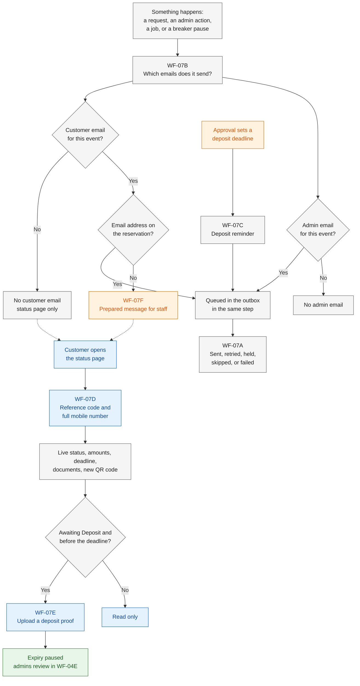

| Sub-flow | Who mostly acts | What it covers | Status change |
|---|---|---|---|
| [WF-07A](#wf-07a--the-email-pipeline) | The database, the server, pg_cron, Resend | Outbox, send after the reply, the every-minute tick, retries, failed and skipped emails, caps and the admin reserve, the health panel | None |
| [WF-07B](#wf-07b--which-event-sends-which-email) | The database | Which event queues which customer and admin email | None of its own |
| [WF-07C](#wf-07c--deposit-reminder-timing) | pg_cron and the database | When the deposit reminder is queued, sent, or skipped | None |
| [WF-07D](#wf-07d--status-page-lookup) | The customer and the server | Lookup with the reference code and the full mobile number, rate limits, what is shown, documents, a new QR code | None (display only) |
| [WF-07E](#wf-07e--deposit-proof-upload-from-the-status-page) | The customer's browser, the server, storage | Signed upload link, browser re-save, limits, proofs to verify, the expiry pause | None (the expiry-paused flag is set) |
| [WF-07F](#wf-07f--customers-without-email) | An admin | The status page and the prepared message for staff | None |

---

## WF-07A · The email pipeline

### In plain words

Every email starts as a row in a waiting list in the database, called the **outbox**. The row is saved in the same step as the change that causes it: if the change is saved, the email is saved; if the change fails, there is no email. The website first answers the person who acted, then tries to send the email straight away; every minute, the database also wakes the email sender for anything still waiting. If the email service has a short problem, the system tries again, waiting longer each time; after the last try, or if the email service refuses the email outright, the email is marked **failed** and shown on the health panel. An email whose reason no longer holds is **skipped**, and the free plan's limits are respected: customer emails go first; once a day's count reaches the admin reserve (90 by default, [FR-NTF-20][fr]), admin emails wait so the rest of the daily allowance stays free for customers; leftovers go out the next day.

*Examples.* The Admin approves Ana's request while the email service is down. The approval is saved, and Ana's status page shows Awaiting Deposit at once; the approved email goes out when the service is back ([FR-NTF-16][fr]). On a very busy Saturday, 90 emails have gone out by 8:00 PM. A new online request arrives: its customer email is sent, but the admin email waits until the next day; the request still shows on the dashboard at once ([FR-NTF-20][fr]).

### Actors and responsibilities

| Actor | Responsibilities in this sub-flow |
|---|---|
| Postgres action functions | Write the change, its audit entry, and its outbox rows in one transaction ([FR-NTF-16][fr], [FR-ADM-07][fr]) |
| Outbox table | Holds each email with its unique key, type, recipient, priority, status, attempts, and next attempt time ([FR-NTF-16][fr], [FR-NTF-17][fr]) |
| Next.js server | Answers the person who acted, then sends the emails it has just queued ([FR-NTF-16][fr]) |
| pg_cron | Every minute, checks whether emails are waiting ([FR-SYS-03][fr]) |
| pg_net | Calls `/api/jobs/tick` with the secret ([FR-SYS-03][fr], [FR-SYS-09][fr]) |
| Tick route `/api/jobs/tick` | Refuses a call without the secret; never runs twice at once; sends or retries due emails, applies the skips and the caps, writes the job run record ([FR-SYS-03][fr], [FR-SYS-09][fr], [FR-SYS-10][fr]) |
| Vercel Cron and `/api/jobs/daily` | Once a day, repeats the email flush and checks the heartbeat ([FR-SYS-08][fr]) |
| Resend | Accepts or refuses each email; free plan, limits **[U]** ([NFR-33][nfr]) |
| Admins (both) | See the last runs, failed emails, the queue, and cap usage on the health panel ([FR-ADM-33][fr], [roles][roles] §2.1) |
| Super Admin | Changes the caps, the admin reserve, and the maximum send attempts ([FR-ADM-28][fr], [roles][roles] §2.6) |
| Sentry | Alerts the developer if the job run records stop ([NFR-24][nfr]) |

### Trigger and preconditions

- **Trigger:** a change that queues an email (the event table in WF-07B), or the reminder job queuing a reminder (WF-07C).
- **Preconditions:**
  - The change itself was saved. A change that fails queues nothing ([FR-NTF-16][fr]).
  - For a customer email, the reservation has an email address ([FR-NTF-21][fr]).
  - The job-route secret is set in Supabase Vault and as a Vercel environment variable ([FR-SYS-09][fr]).

### Flowchart

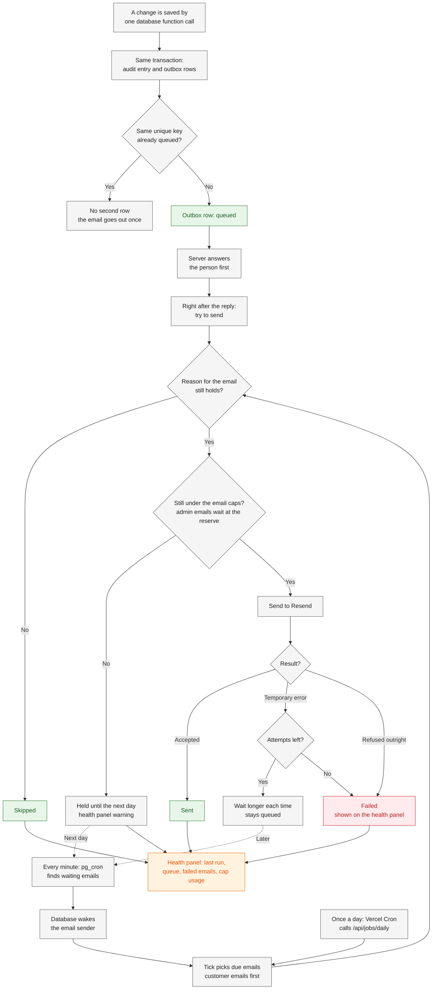

The order of the two send-time checks (stale first, then caps) is indicative; batch-1 docs say only that both apply at send time ([FR-NTF-19][fr], [FR-NTF-20][fr]).

### Sequence diagram

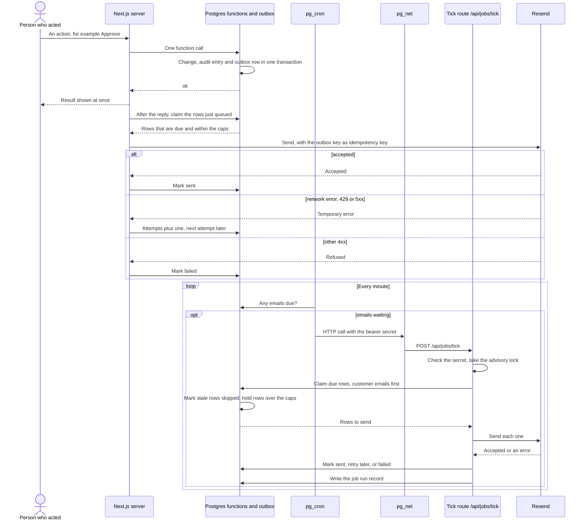

### Steps

| Step | Actor | What happens | Data created, updated, or read | Rules and requirements |
|---|---|---|---|---|
| 1 | Database (action function) | A change is saved by one database function call: a customer submission or upload, an admin action, or a system job. | — | [NFR-21][nfr], [FR-ADM-07][fr] |
| 2 | Database | In the same transaction, writes the audit entry and one outbox row for each email the event sends (WF-07B): type, recipient, customer or admin priority, status queued. If the change fails, nothing is queued. | Create: audit entry, outbox rows | [FR-NTF-16][fr], [FR-ADM-07][fr], [reservation-lifecycle][lc] §4.1 |
| 3 | Database | Each row has a unique key: reservation + email type + the audit entry that caused it; for a reminder, reservation + "reminder" + deadline. A second row with the same key is not created. | Read: unique keys | [FR-NTF-17][fr], [EC-68][ec] |
| 4 | Next.js server | Answers the person who acted first. The change is visible at once, for example on the status page. | — | [FR-NTF-16][fr], [NFR-33][nfr] |
| 5 | Next.js server | Right after the reply, tries to send the emails it has just queued (steps 8 to 11). | Update: outbox rows | [FR-NTF-16][fr] |
| 6 | pg_cron, pg_net | Every minute, while emails are waiting, calls `/api/jobs/tick` with the secret. | Read: outbox (any due rows) | [FR-SYS-03][fr], [FR-SYS-09][fr] |
| 7 | Tick route | Refuses a call without the right secret, and never runs twice at the same time. Picks the due emails, customer emails first. | Read: outbox | [FR-SYS-09][fr], [FR-NTF-20][fr], [EC-78][ec] |
| 8 | Tick route or server | **Stale check.** At send time, an email whose reason no longer holds is marked **skipped**, not failed. *Example:* a reminder after the booking was confirmed. | Update: outbox status skipped | [FR-NTF-19][fr], [EC-69][ec] |
| 9 | Tick route or server | **Caps.** Counts today's and this month's emails against the caps (defaults 100 a day and 3,000 a month **[U]**). Once the day's count reaches the admin reserve (default 90), admin emails wait; customer emails go on until the cap. Emails left over at a cap wait until the next day. | Read: send counts; update: next attempt time | [FR-NTF-20][fr], [NFR-33][nfr], [EC-67][ec] |
| 10 | Tick route or server, Resend | Sends the email. | — | [FR-NTF-16][fr], [D-10][dl] |
| 11 | Tick route or server | **Result.** Accepted: marked **sent**, with the time. Network error, 429, or 5xx: tried again later, waiting longer each time, up to the maximum number of attempts (a setting); after the last attempt, marked **failed**. Any other 4xx: **failed** at once, without retries. | Update: status, attempts, next attempt, last error, sent time | [FR-NTF-18][fr], [EC-66][ec] |
| 12 | Tick route | Writes its job run record (start, finish, result, counts): the heartbeat. | Create: job run record | [FR-SYS-10][fr] |
| 13 | Vercel Cron, daily route | Once a day, `/api/jobs/daily` repeats the email flush and checks the heartbeat, in case the every-minute job missed anything. | Read: job run records, outbox | [FR-SYS-08][fr], [EC-77][ec] |
| 14 | Sentry | If the job run records stop, alerts the developer. | — | [NFR-24][nfr] |
| 15 | Admins | Open the health panel: the last run of the email-sending job and its result, failed emails, the email queue, cap usage today and this month, and a warning when emails are held until the next day. | Read: job run records, outbox | [FR-ADM-33][fr], [NFR-26][nfr] |
| 16 | Tick route (next day) | Held emails are sent in the usual order. The stale check (step 8) runs again at send time. | Update: outbox | [FR-NTF-20][fr], [FR-NTF-19][fr] |
| 17 | Everyone | The booking change stands in every case. The status page shows the true status (WF-07D), and admin alerts that wait still show on the dashboard at once. | — | [FR-NTF-18][fr], [NFR-33][nfr], [FR-ADM-02][fr] |

### Decision points and validation

| Decision | If yes | If no | Rule |
|---|---|---|---|
| Was the change saved? | Its outbox rows exist | No email is queued | [FR-NTF-16][fr] |
| Is an email with the same unique key already queued? | No second row; sent only once | A new row is queued | [FR-NTF-17][fr], [EC-68][ec] |
| Does the call to the tick route carry the right secret? | It runs | It refuses and does nothing | [FR-SYS-09][fr], [EC-78][ec] |
| Does the reason for the email still hold at send time? | Go on | Skipped | [FR-NTF-19][fr] |
| Is there room under the daily and monthly caps (and, for an admin email, under the admin reserve)? | Send | Held until the next day; health-panel warning | [FR-NTF-20][fr] |
| Did Resend accept the email? | Sent | Temporary error: retried later; other 4xx: failed | [FR-NTF-18][fr] |
| Are attempts left (after a temporary error)? | Retried with a longer wait | Failed; shown on the health panel | [FR-NTF-18][fr], [FR-ADM-33][fr] |

### Failure and exception paths

| Situation | What happens | Edge case or rule |
|---|---|---|
| The email service is down when the email is sent | The change stands; the email is retried, waiting longer each time | [EC-66][ec] |
| The email service refuses the email outright (another 4xx) | Marked failed at once and shown on the health panel | [EC-66][ec], [FR-NTF-18][fr] |
| Every attempt fails | Marked failed and shown on the health panel; what the admins then do is open question 5 | [FR-NTF-18][fr] |
| The same email is queued twice, or a send is retried after a network error | The customer receives it only once | [EC-68][ec] |
| The daily or monthly cap is reached | Customer emails go first; admin emails wait from the admin reserve; leftovers go out the next day with a health-panel warning | [EC-67][ec] |
| An email falls due after its reason has gone, such as a reminder after Confirmed | Skipped, not sent | [EC-69][ec], [FR-NTF-19][fr] |
| The every-minute job stops or runs late | New changes still try to send right after the reply; the daily sweep repeats the flush; the developer gets an alert; the health panel shows the last run | [EC-77][ec] |
| Someone calls the tick route without the secret, or two runs start together | Nothing runs without the secret; two runs never overlap | [EC-78][ec] |
| The website is down (for example, Vercel pauses the project) | The emails wait in the outbox in Supabase and go out once the site is back | [EC-80][ec], [NFR-04][nfr] |
| An admin alert waits at the admin reserve | The dashboard already shows the request, proof, or pause | [FR-NTF-20][fr], [FR-ADM-02][fr] |

### Status transitions involved

None. Sending an email never changes a reservation's status, and a failed email never undoes one ([NFR-33][nfr]). The outbox rows have their own statuses: queued, sent, failed, and skipped ([FR-NTF-16][fr], [FR-NTF-18][fr], [FR-NTF-19][fr]; [spec v0.2][spec] §11).

### Developer notes

- **Table** `notifications_outbox`: unique key, type, recipient, priority, status (`queued`, `sent`, `failed`, `skipped`), attempts, next attempt, last error, sent time ([spec v0.2][spec] §11). How long rows are kept is open ([privacy-and-retention][priv] §11, question 3).
- **Queueing helper:** for example `app.enqueue_email(type, reservation_id, audit_id, recipient, priority)`, called inside each action function; `INSERT … ON CONFLICT (unique_key) DO NOTHING` gives the "only once" of [FR-NTF-17][fr].
- **Claiming rows:** for example `app.claim_due_emails(limit)` with `FOR UPDATE SKIP LOCKED`, ordered by priority (customer first), so the after-reply sender and the tick never pick the same row at once. The outbox unique key is also passed to Resend as its idempotency key ([FR-NTF-17][fr]; [spec v0.2][spec] §20 links Resend's idempotency keys).
- **After the reply:** Next.js `after()`. The tick route runs on the Node.js runtime in `sin1` ([NFR-02][nfr]), with a time limit on every call to Resend ([NFR-03][nfr]).
- **pg_cron:** a job every minute (`* * * * *`) that calls `net.http_post` to `/api/jobs/tick` only when due rows exist, with the bearer secret read from Supabase Vault. The route compares it in constant time and takes an advisory lock ([FR-SYS-09][fr]).
- **Caps:** counted from the `sent` rows per Manila day and month ([NFR-19][nfr]); see open question 2. Default maximum attempts and the wait schedule: open question 1.
- **Health panel:** `/admin/health` reads `job_runs` and `notifications_outbox` ([FR-ADM-33][fr], [FR-SYS-10][fr]).
- **Audit:** sending is not an audit event; each tick writes a `job_runs` row. Errors go to Sentry with personal data scrubbed ([NFR-23][nfr]).
- **Outbox email types:** the full list is in WF-07B developer notes.
- **Tests:** outbox de-duplication, retry, and skip in pgTAP ([spec v0.2][spec] §17); an end-to-end test that an email marked failed appears on the health panel ([NFR-26][nfr]).

*(indicative; final names in api-specification, batch 3)*

---

## WF-07B · Which event sends which email

### In plain words

Each kind of event sends a fixed set of emails. Customers get an email at each step of their booking: when the request is received, when the admins need more information, when it is approved, before the deposit deadline, when the deadline is extended, when a proof is not accepted, and when the booking is confirmed, updated, rejected, cancelled, rescheduled, or expired. Both admins get an email for each new **online** request (urgent ones marked), each uploaded proof, and each pause of online booking; each of these also shows on the dashboard at once. Some events send no email at all, for example the automatic Completed the day after the event. What each email must contain is defined only in [functional-requirements][fr] (FR-NTF-01 to FR-NTF-15); this sub-flow only says which event queues which email.

*Example.* An admin enters Dan's phone booking. Dan gets the request-received email if he gave an address, but the admins get no new-request email, because staff-created bookings send none ([BR-06a][br]).

### Actors and responsibilities

| Actor | Responsibilities in this sub-flow |
|---|---|
| Postgres action and job functions | Queue the emails the event sends, in the same transaction as the change (WF-07A step 2) |
| Customer | Receives the customer emails, if an email address was given |
| Admins (both) | Receive the admin emails; see the same events on the dashboard ([FR-ADM-02][fr]) |

### Trigger and preconditions

- **Trigger:** one of the events in the table below.
- **Preconditions:** the event's own action succeeded, in its own workflow (named in the table). For a customer email, the reservation has an email address ([FR-NTF-21][fr]).

### Flowchart

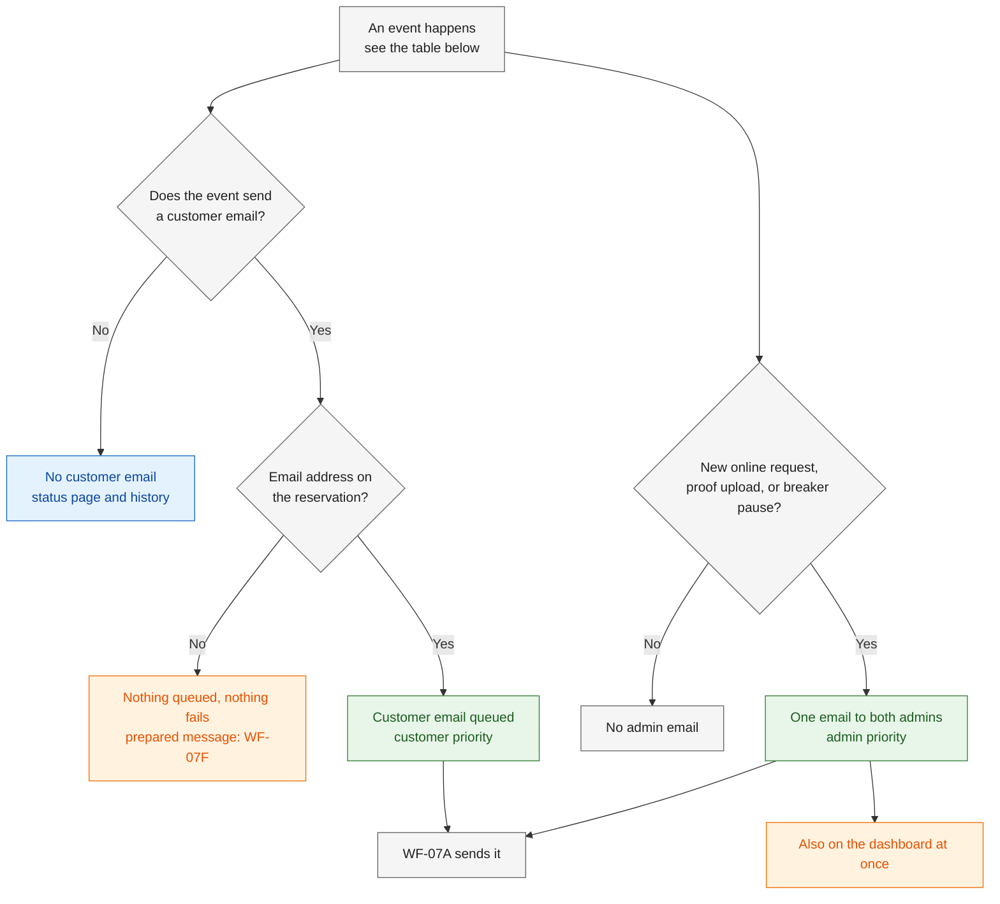

No sequence diagram here: the routing happens inside one database function call, and the sending is the WF-07A sequence diagram.

### Which event sends which email

"Row" means the row of the transition table in [reservation-lifecycle][lc] §4.2; "§5" means the table of changes that keep the status.

| # | Event | Lifecycle | Customer email | Admin email (both admins) | Where the steps live |
|---|---|---|---|---|---|
| 1 | A customer submits an online request | Row 1 | [FR-NTF-01][fr] request received | [FR-NTF-13][fr] new online request, urgent ones marked | [WF-01C][wf-book] |
| 2 | An admin creates a phone, walk-in, or Facebook booking | Row 2 | [FR-NTF-01][fr] request received (one-step bookings: [FR §7][fr], question 1) | None ([BR-06a][br]) | [WF-04G][wf-review] |
| 3 | An admin recreates an expired request | Row 3 | [FR-NTF-01][fr] request received | None | [WF-06G][wf-change] |
| 4 | The breaker pauses online booking | [BR-07a][br] (no status change) | None | [FR-NTF-15][fr] online booking paused, one per pause | [WF-01C][wf-book] |
| 5 | An admin flags "needs info" | §5 | [FR-NTF-02][fr] needs info | None | [WF-04C][wf-review] |
| 6 | An admin approves | Row 4 | [FR-NTF-03][fr] approved; later [FR-NTF-04][fr] deposit reminder | None | [WF-04A][wf-review]; reminder: WF-07C |
| 7 | The reminder moment arrives | [FR-SYS-02][fr] | [FR-NTF-04][fr] deposit reminder | None | WF-07C |
| 8 | An admin extends a deadline | §5 | [FR-NTF-05][fr] deadline extended | None | [WF-06D][wf-change] |
| 9 | A customer uploads a proof | §5 | None | [FR-NTF-14][fr] proof uploaded | WF-07E |
| 10 | An admin rejects a proof while the deadline still runs | §5 | [FR-NTF-06][fr] proof not accepted | None | [WF-04E][wf-review] |
| 11 | An admin rejects a proof after the original deadline | Row 10c **[P]** | [FR-NTF-06][fr] proof not accepted and [FR-NTF-12][fr] expired | None | [WF-04E][wf-review] |
| 12 | An admin records the deposit, including after verifying a proof | Row 6 | [FR-NTF-07][fr] confirmed | None | [WF-04D, WF-04E][wf-review] |
| 13 | An admin waives the deposit for a same-day booking | Rows 5 and 7 | [FR-NTF-07][fr] confirmed | None | [WF-04F][wf-review] |
| 14 | An admin edits the details | §5 | [FR-NTF-08][fr] reservation updated | None | [WF-06E][wf-change] |
| 15 | An admin rejects a request | Row 8 | [FR-NTF-09][fr] rejected | None | [WF-04B][wf-review] |
| 16 | An admin cancels | Rows 11 to 13 | [FR-NTF-10][fr] cancelled | None | [WF-06A][wf-change] |
| 17 | An admin reschedules | §5 | [FR-NTF-11][fr] rescheduled | None | [WF-06C][wf-change] |
| 18 | A hold expires (by the job, or by a booking or reschedule on that date) | Rows 9, 10a, 10b | [FR-NTF-12][fr] expired | None | [WF-06F][wf-change] (which holds a booking expires: [booking-and-submission][wf-book] open question 8) |
| 19 | The booking becomes Completed the day after the event | Row 14 | None | None | [WF-06H][wf-change] |
| 20 | An admin marks a Completed event "not held" | Row 15 | Not specified ([FR §7][fr], question 7) | None | [WF-06I][wf-change] |
| 21 | Other changes that keep the status: "info received", a deposit after a waiver, a balance, a void, a refund paid, an internal note, a QR reissue (by an admin or the customer), a legal hold | §5 | None | None | [WF-04C, WF-04D, WF-03D, WF-03E][wf-review], [WF-06B, WF-06J, WF-06K][wf-change], WF-07D, [WF-10C][wf-admin] |
| 22 | The Super Admin processes an erasure request | [privacy-and-retention][priv] §5.5 | Not an FR-NTF email; the customer is told what was kept and why (how: [privacy-and-retention][priv] §11, question 6) | None | Tool: [FR-ADM-31][fr] |

### Steps

| Step | Actor | What happens | Data created, updated, or read | Rules and requirements |
|---|---|---|---|---|
| 1 | Database | The event's own function runs, in its own workflow (table above). | — | [reservation-lifecycle][lc] §4.2, §5 |
| 2 | Database | Finds the emails for this event: the "Emails queued" column of [reservation-lifecycle][lc] §4.2 and §5, and FR-NTF-01 to FR-NTF-15. | — | [FR-NTF-01 to FR-NTF-15][fr] |
| 3 | Database | **Customer email:** queued with customer priority, only if the reservation has an email address. Without one, nothing is queued and nothing fails (WF-07F). | Create: outbox row | [FR-NTF-21][fr], [FR-NTF-20][fr], [EC-12][ec] |
| 4 | Database | **Admin email:** for a new online request, an uploaded proof, or a breaker pause, one email to both admins, with admin priority. Staff-created bookings send none. The breaker sends exactly one per pause. | Create: outbox row | [FR-NTF-13 to FR-NTF-15][fr], [BR-06a][br], [BR-07a][br] |
| 5 | Dashboard | The same requests, proofs, and pauses show on the dashboard at once, whether or not the admin email has gone out yet. | Read | [FR-ADM-02][fr], [FR-NTF-20][fr] |
| 6 | Email content | Every customer email shows the reference code **[P]** (new in [functional-requirements][fr] §4.1), Manila times, and pesos, and never internal notes or other customers' data. The full contents are defined only in FR-NTF-01 to FR-NTF-12. | — | [FR-NTF-01 to FR-NTF-12][fr] (common criteria), [NFR-19][nfr] |
| 7 | WF-07A | Sends the queued emails. | Update: outbox | [FR-NTF-16 to FR-NTF-20][fr] |

### Decision points and validation

| Decision | If yes | If no | Rule |
|---|---|---|---|
| Does the event send a customer email (table above)? | Go on | No customer email; the status page shows the change | [reservation-lifecycle][lc] §4.2, §5 |
| Does the reservation have an email address? | Customer email queued | Nothing queued; prepared message (WF-07F) | [FR-NTF-21][fr] |
| Is it a new **online** request, an uploaded proof, or a breaker pause? | One email to both admins | No admin email | [FR-NTF-13 to FR-NTF-15][fr], [BR-06a][br] |
| Has this pause already sent its admin email? | No second one | Queue it | [BR-07a][br] |

### Failure and exception paths

| Situation | What happens | Edge case or rule |
|---|---|---|
| The customer gave no email address | No customer email; nothing fails; the admin copies the prepared message | [EC-12][ec], WF-07F |
| A staff-created booking is created as Confirmed in one step | Which customer emails it sends is open in batch-1 | [FR §7][fr], question 1 |
| An admin marks a Completed event "not held" | Whether the cancelled email is sent is open in batch-1 | [FR §7][fr], question 7 |
| The same event is processed twice, for example the job and a booking both expire one hold | One expired email, thanks to the unique key | [EC-68][ec], [WF-06F][wf-change] |
| An admin email waits at the admin reserve | The dashboard shows the event at once | [EC-67][ec] |
| An admin changes or removes the email address with edit details | Which address gets later emails, and what happens to queued ones, is open | [changes-and-expiry][wf-change] open question 7 |

### Status transitions involved

This sub-flow changes no status. Which transition queues which email is defined in the "Emails queued" column of [reservation-lifecycle][lc] §4.2, and for changes that keep the status in §5.

### Developer notes

- **Outbox email types** and their priority (FR-NTF-20):

  | Type | FR | Priority |
  |---|---|---|
  | `request_received` | [FR-NTF-01][fr] | Customer |
  | `needs_info` | [FR-NTF-02][fr] | Customer |
  | `approved` | [FR-NTF-03][fr] | Customer |
  | `reminder` | [FR-NTF-04][fr] | Customer |
  | `deadline_extended` | [FR-NTF-05][fr] | Customer |
  | `proof_not_accepted` | [FR-NTF-06][fr] | Customer |
  | `confirmed` | [FR-NTF-07][fr] | Customer |
  | `reservation_updated` | [FR-NTF-08][fr] | Customer |
  | `rejected` | [FR-NTF-09][fr] | Customer |
  | `cancelled` | [FR-NTF-10][fr] | Customer |
  | `rescheduled` | [FR-NTF-11][fr] | Customer |
  | `expired` | [FR-NTF-12][fr] | Customer |
  | `admin_new_request` | [FR-NTF-13][fr] | Admin |
  | `admin_proof_uploaded` | [FR-NTF-14][fr] | Admin |
  | `admin_online_paused` | [FR-NTF-15][fr] | Admin |

- **Where the event-to-email mapping lives:** inside each action function, so the email is queued in the same transaction ([FR-NTF-16][fr]). A test per function checks that it queues exactly the types in the table above.
- **Admin recipients:** the two admin accounts. The unique key of an admin email, and of the breaker email, which has no reservation, is open question 6.
- **Audit:** the audit entry belongs to the event's own action; its ID is part of each outbox key ([FR-NTF-17][fr]).

*(indicative; final names in api-specification, batch 3)*

---

## WF-07C · Deposit reminder timing

### In plain words

After approval, the customer has until the deposit deadline to pay. A reminder email goes out a set time before that deadline (6 hours by default, a setting) **[C]** ([D-10][dl]), with the deadline and how to pay. It is worked out from the deadline as it stands when the reminder falls due, so if an admin extends the deadline, the reminder follows the new one; each deadline gets at most one reminder. No reminder goes out if its moment had already passed when the request was approved, for example a same-day booking approved shortly before the start. If the booking is already Confirmed, Cancelled, or Expired when the reminder falls due, it is skipped.

*Examples.*

| Case | Deposit deadline | Reminder moment | What happens |
|---|---|---|---|
| Ana, approved Thu 17 Dec, 2:00 PM | Fri 18 Dec, 2:00 PM | Fri 18 Dec, 8:00 AM | Sent at 8:00 AM ([FR-NTF-04][fr]) |
| Ana pays early | Fri 18 Dec, 2:00 PM | Fri 18 Dec, 8:00 AM | Her deposit is recorded at 7:30 AM, so the reminder is skipped ([FR-NTF-19][fr], [EC-69][ec]) |
| Rosa's same-day room request, if approved on Sat 19 Dec at 5:40 PM instead of waived (see [WF-04F][wf-review]) | Sat 19 Dec, 7:00 PM (the service start) | Sat 19 Dec, 1:00 PM | Already passed at approval: no reminder ([EC-70][ec]; [reservation-lifecycle][lc] §3.4) |
| Dan, approved Mon 21 Dec, 10:00 AM, then extended on Mon 21 Dec at 5:00 PM to Wed 23 Dec, 12:00 noon | Wed 23 Dec, 12:00 noon | Wed 23 Dec, 6:00 AM | One reminder, for the new deadline. Had the extension come after the Tue 22 Dec 4:00 AM reminder was sent, Dan would get a second reminder for the new deadline ([FR-NTF-17][fr]; extension rules: [reservation-lifecycle][lc] §6.3) |

### Actors and responsibilities

| Actor | Responsibilities in this sub-flow |
|---|---|
| Admin (either admin) | Approves, which sets the deposit deadline ([WF-04A][wf-review]); may extend it ([WF-06D][wf-change]) or reschedule ([WF-06C][wf-change]) |
| Super Admin | Sets the reminder lead time ([FR-ADM-28][fr], [roles][roles] §2.6) |
| pg_cron | Runs the reminder job every minute ([FR-SYS-02][fr]) |
| Postgres reminder job | Queues each reminder whose moment has come, never twice for one deadline ([FR-SYS-02][fr], [FR-NTF-17][fr]) |
| Tick route, Resend | Send the reminder, or skip it if it is stale (WF-07A) |
| Customer | Receives the reminder, if an email was given; otherwise sees the deadline on the status page (WF-07D) |

### Trigger and preconditions

- **Trigger:** every minute, the reminder job runs ([FR-SYS-02][fr]). The underlying event is an approval that set a deposit deadline ([reservation-lifecycle][lc] §4.2 row 4).
- **Preconditions:**
  - The reservation is Awaiting Deposit, with a stored deadline ([reservation-lifecycle][lc] §3.2).
  - The reservation has an email address ([FR-NTF-21][fr]).

### Flowchart

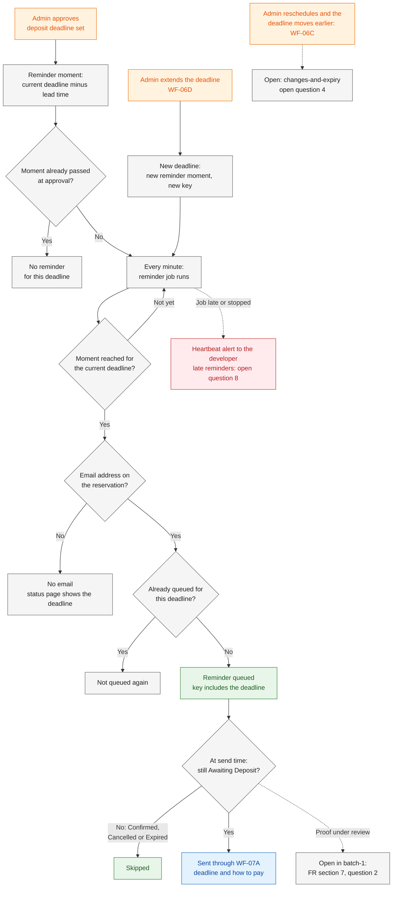

### Sequence diagram

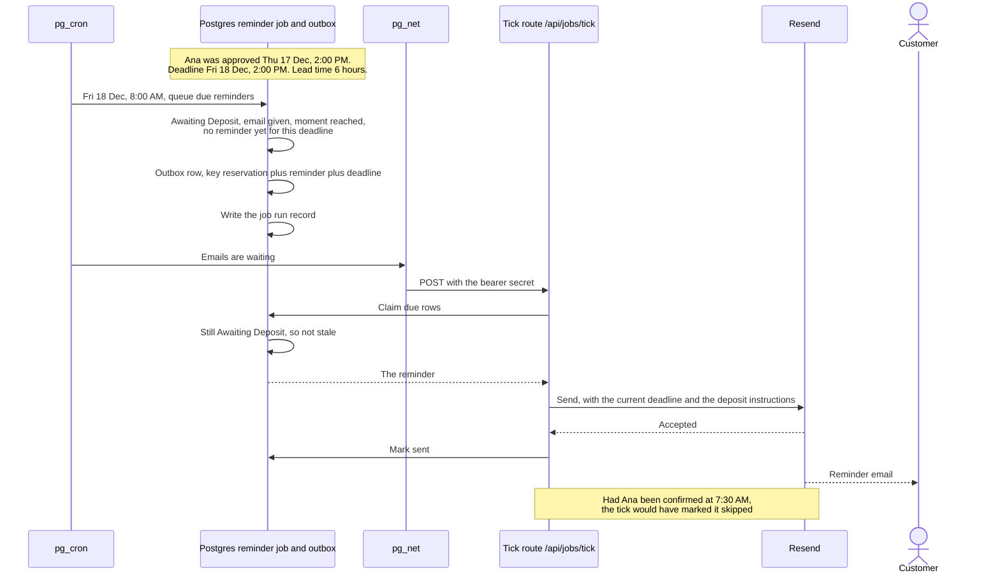

### Steps

| Step | Actor | What happens | Data created, updated, or read | Rules and requirements |
|---|---|---|---|---|
| 1 | Admin | Approves the request ([WF-04A][wf-review]). The deposit deadline is set (approval + 24 hours, or the service start if sooner). | Update: status, deadline | [reservation-lifecycle][lc] §3.2, §4.2 row 4 |
| 2 | Database | The reminder moment is the **current** deadline minus the lead time (6 hours by default, a setting). | Read: lead time setting, deadline | [FR-NTF-04][fr], [FR-ADM-28][fr], [roles][roles] §2.6 |
| 3 | Database | If that moment had already passed when the request was approved, no reminder is sent for this deadline. | Read: approval time | [FR-NTF-04][fr], [EC-70][ec] |
| 4 | pg_cron | Every minute, runs the reminder job. | — | [FR-SYS-02][fr] |
| 5 | Database (job) | For each Awaiting Deposit reservation with an email address whose reminder moment has come, queues the reminder with the key reservation + "reminder" + deadline. A reminder is never queued twice for the same deadline. | Create: outbox row | [FR-SYS-02][fr], [FR-NTF-17][fr], [FR-NTF-21][fr] |
| 6 | Database (job) | Writes its job run record. | Create: job run record | [FR-SYS-10][fr] |
| 7 | WF-07A | Sends the reminder. At send time, if the booking is already Confirmed, Cancelled, or Expired, it is skipped. The caps apply, with customer priority. | Update: outbox status | [FR-NTF-19][fr], [FR-NTF-04][fr], [FR-NTF-20][fr], [EC-69][ec] |
| 8 | Customer | Receives the reminder, with the deadline and the deposit instructions **[P]** (new in [FR-NTF-04][fr] and [catalog-and-payments][cat] §7). | — | [FR-NTF-04][fr], [catalog-and-payments][cat] §7 |
| 9 | Admin | Extends the deadline ([WF-06D][wf-change]). The reminder follows the new deadline. The new deadline has its own key, so it can get its own reminder. | Update: deadline | [FR-ADM-16][fr], [FR-NTF-04][fr], [FR-NTF-17][fr], [EC-25][ec] |
| 10 | Admin | Reschedules so the deadline moves earlier ([WF-06C][wf-change]). Whether a reminder is sent for the new deadline is open ([changes-and-expiry][wf-change] open question 4). | Update: deadline | [reservation-lifecycle][lc] §6.5 |
| 11 | Customer | Uploads a proof before the deadline (WF-07E), so expiry is paused. Whether the reminder is still sent is open in batch-1 ([FR §7][fr], question 2). | — | [BR-12][br] |
| 12 | Customer without email | Gets no reminder. The status page shows the deadline (WF-07D), and the dashboard's deadline alerts show the hold to the admins. | Read | [FR-NTF-21][fr], [FR-PUB-11][fr], [FR-ADM-02][fr] |

### Decision points and validation

| Decision | If yes | If no | Rule |
|---|---|---|---|
| Had the reminder moment already passed at approval? | No reminder for this deadline | The reminder can be queued when its moment comes | [FR-NTF-04][fr], [EC-70][ec] |
| Has the moment come, for the current deadline? | Go on | Wait for a later run | [FR-NTF-04][fr], [FR-SYS-02][fr] |
| Does the reservation have an email address? | Go on | No reminder email | [FR-NTF-21][fr] |
| Is a reminder already queued for this deadline? | Not queued again | Queue it | [FR-NTF-17][fr] |
| At send time, is the booking still Awaiting Deposit? | Send | Skipped | [FR-NTF-04][fr], [FR-NTF-19][fr] |
| Is expiry paused for a proof under review? | Open in batch-1 | Normal reminder | [FR §7][fr], question 2 |

### Failure and exception paths

| Situation | What happens | Edge case or rule |
|---|---|---|
| A same-day request is approved after its reminder moment | No reminder | [EC-70][ec] |
| The deposit is recorded, or the booking is cancelled or expired, before the reminder is sent | Skipped | [EC-69][ec] |
| The deadline is extended | The reminder follows the new deadline; each deadline gets at most one | [EC-25][ec], [FR-NTF-17][fr] |
| The extension's new reminder moment has already passed, or a reminder for the old deadline is still waiting | Not defined (open question 7) | [FR-NTF-04][fr] |
| The reminder job runs late or stops | The developer gets an alert; whether late reminders are still queued is open question 8 | [EC-77][ec], [FR-SYS-10][fr] |
| The daily cap is reached | The reminder waits until the next day, ahead of admin emails; if by then the booking is no longer Awaiting Deposit, it is skipped | [FR-NTF-20][fr], [FR-NTF-19][fr], [EC-67][ec] |
| The reminder is queued twice, or its send is retried | Received only once | [EC-68][ec] |
| The customer gave no email address | No reminder; status page and dashboard deadline alerts | [EC-12][ec], [FR-ADM-02][fr] |

### Status transitions involved

None. The reminder belongs to Awaiting Deposit ([reservation-lifecycle][lc] §4.2 row 4). It is skipped once the booking has left that status by rows 6, 7, 10, or 12.

### Developer notes

- **Job function:** for example `app.queue_due_reminders()`, scheduled by `pg_cron` every minute; it can share the every-minute schedule with `app.expire_overdue_holds()` ([spec v0.2][spec] §15 lists both in one row).
- **Condition (indicative):** `status = 'awaiting_deposit'`, email not null, `now() >= deadline - lead_time`, and the reminder moment was after the approval time. Insert with the key `reservation_id + 'reminder' + deadline` and `ON CONFLICT DO NOTHING` ([FR-NTF-17][fr]). Where the approval time is stored comes with the data model (planned: `05-technical/data-model.md`).
- **Stale rule for `reminder`:** skipped when the status is no longer `awaiting_deposit` ([FR-NTF-04][fr]). A queued reminder whose key's deadline differs from the current deadline is open question 7.
- **Content:** formatted with `Intl.DateTimeFormat` and `timeZone: 'Asia/Manila'` ([NFR-19][nfr]); deposit instructions from the settings ([catalog-and-payments][cat] §7).
- **Audit:** the reminder job writes a `job_runs` row; batch-1 docs define no audit entry for queuing a reminder.
- **Outbox email type:** `reminder` ([FR-NTF-04][fr]).
- **Tests:** reminder timing in pgTAP ([spec v0.2][spec] §17), including the same-day case (EC-70) and an extension (EC-25).

*(indicative; final names in api-specification, batch 3)*

---

## WF-07D · Status page lookup

### In plain words

Customers have no accounts, so the status page is how they follow their booking **[C]** ([D-08][dl]). They type the reference code and their full mobile number, in any of the accepted ways of writing it. If both match the same reservation, they see its live status, the booking details, the amounts, the current deadline in Manila time, any message from the admins, and links to their payment acknowledgments and booking confirmation. The page never shows the customer's name, mobile number, or address, and too many wrong tries are refused for a while. From this page the customer can also get a new QR code, which stops the old one from working, and, while a deposit is due, upload a proof of payment (WF-07E).

*Example.* On Thursday 17 December 2026 at 3:00 PM, Ana types `ksb 7q2m k9tx` and `+63 917 123 4567`, although she booked with `0917 123 4567`. It still matches ([EC-64][ec]). She sees **Awaiting Deposit**, the deadline "Friday 18 December 2026, 2:00 PM", the deposit instructions, and the upload control.

### Actors and responsibilities

| Actor | Responsibilities in this sub-flow |
|---|---|
| Customer (no login, [roles][roles] §3.1) | Types the reference code and the full mobile number; reads the page; opens documents; asks for a new QR code |
| Next.js server | Cleans up the input, shows the live status page (never cached), draws the new QR code |
| Postgres functions | Rate limits, the lookup, the overdue rule, the customer-safe view, the QR reissue and its audit entry |
| Admins | Correct a wrong mobile number with edit details, when the customer asks ([WF-06E][wf-change]) |

### Trigger and preconditions

- **Trigger:** the customer opens the status page, for example from the link on the confirmation page or in an email ([FR-PUB-07][fr]), or from the home page ([FR-PUB-01][fr]).
- **Preconditions:**
  - The customer has the reference code and the mobile number saved on the booking ([FR-PUB-10][fr]).
  - The contact details have not been blanked by an erasure or by the retention job ([privacy-and-retention][priv] §5.5, §6.2).

### Flowchart

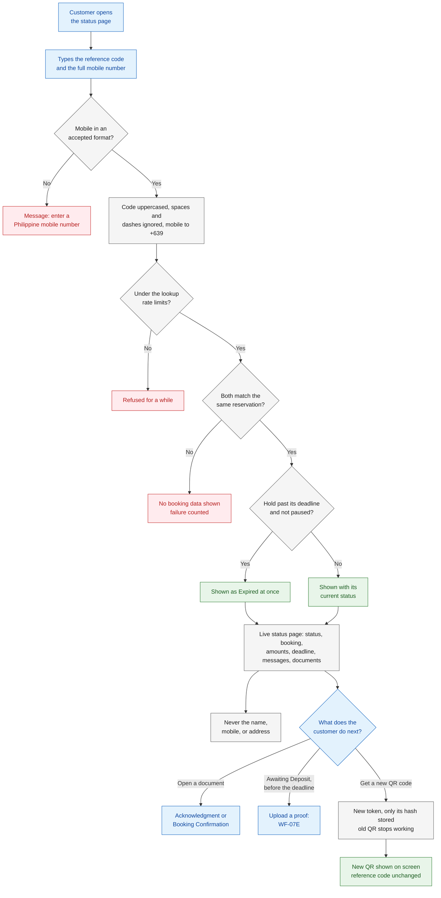

The order of the format check and the rate-limit check is indicative; batch-1 docs do not fix it.

### Sequence diagram

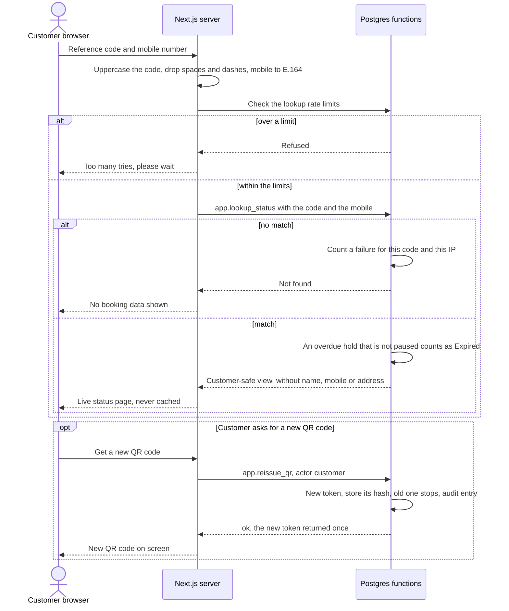

### Steps

| Step | Actor | What happens | Data created, updated, or read | Rules and requirements |
|---|---|---|---|---|
| 1 | Customer | Opens the status page and types the reference code and the **full** mobile number. | — | [FR-PUB-10][fr], [D-08][dl] |
| 2 | Next.js server | Uppercases the reference code and ignores spaces and dashes; converts the mobile number to the standard form. A number not in an accepted form is refused with a clear message. | — | [FR-PUB-08][fr], [FR-PUB-10][fr], [BR-11][br], [EC-64][ec] |
| 3 | Database | **Rate limits.** Lookups per internet address, and failed lookups per reference code (10 per IP per 15 minutes; 5 failures per code per hour, NFR-11). Over a limit, the lookup is refused for a while. | Read and update: rate-limit counters, keyed by an HMAC | [NFR-11][nfr], [FR-SYS-06][fr], [EC-65][ec] |
| 4 | Database | Looks for one reservation that matches both. No match: no booking data is shown, and the failure is counted. | Read: reservation | [FR-PUB-10][fr], [EC-65][ec] |
| 5 | Database | Match: reads the live reservation. A hold whose deadline has passed, and whose expiry is not paused, is shown as **Expired** at once, even before the every-minute job has run. | Read: status, deadline, expiry-paused flag | [BR-05][br], [FR-PUB-11][fr], [EC-22][ec] |
| 6 | Next.js server | Shows the status page with the fields listed in [FR-PUB-11][fr]. It never shows the customer's name, mobile number, or address. It is always live, never cached, and shows Manila times whatever the phone's time zone. | — | [FR-PUB-11][fr], [NFR-03][nfr], [NFR-15][nfr], [NFR-19][nfr], [roles][roles] §6 |
| 7 | Customer | Reads what applies to the status: the needs-info message when flagged; the deadline, the deposit instructions, and the upload control while Awaiting Deposit (WF-07E); the reason and the refund decision when Rejected or Cancelled. | Read | [FR-PUB-11][fr], [FR-PUB-12][fr], [reservation-lifecycle][lc] §4.1 |
| 8 | Customer | Opens a payment acknowledgment (one per recorded deposit or balance payment) or the booking confirmation. Each is a printable page. | Read: payments, acknowledgment numbers | [FR-PUB-14][fr], [catalog-and-payments][cat] §5, §6 |
| 9 | Customer | Asks for a new QR code, for example after losing it or sharing it by mistake. | — | [FR-PUB-13][fr], [EC-62][ec] |
| 10 | Database | Makes a new token and stores only its hash. The old QR code stops working at once. The reference code does not change. Writes an audit entry with the actor "customer". | Update: QR token hash; create: audit entry | [FR-PUB-13][fr], [FR-PUB-08][fr], [NFR-13][nfr], [reservation-lifecycle][lc] §5 |
| 11 | Next.js server | Shows the new QR code on screen. No email is queued. | — | [FR-PUB-13][fr], [reservation-lifecycle][lc] §5 |
| 12 | Customer | If the booking cannot be found, or something looks wrong, contacts the business and quotes the reference code. An admin corrects a wrong mobile number with edit details ([WF-06E][wf-change]); from then on the corrected number works. | — | [D-09][dl], [EC-46][ec] |

### Decision points and validation

| Decision | If yes | If no | Rule |
|---|---|---|---|
| Is the mobile number in an accepted form? | Go on | A clear message | [BR-11][br] |
| Is the visitor under the lookup rate limits? | Go on | Refused for a while | [NFR-11][nfr] |
| Do the code and the mobile match the same reservation? | Show the page | No booking data; failure counted | [FR-PUB-10][fr] |
| Is the hold past its deadline and not paused? | Shown as Expired | Shown with its status | [BR-05][br], [FR-PUB-11][fr] |
| Is the booking Awaiting Deposit and before the deadline? | Deposit instructions and the upload control | No upload control | [FR-PUB-11][fr], [FR-PUB-12][fr] |
| Is the request flagged "needs info"? | The admin's message is shown | — | [FR-PUB-11][fr], [FR-ADM-09][fr] |
| Was a deposit or balance recorded, or is the booking Confirmed? | Links to the acknowledgments and the booking confirmation | — | [FR-PUB-11][fr], [FR-PUB-14][fr] |
| On which statuses is "get a new QR code" offered? | Not defined | Not defined | Open question 13 |

### Failure and exception paths

| Situation | What happens | Edge case or rule |
|---|---|---|
| A wrong reference code or mobile number, or someone guessing | No booking data; the rate limits slow down guessing | [EC-65][ec] |
| The code or mobile is typed differently than at booking | It still matches | [EC-64][ec] |
| The booking was made with a wrong mobile number | No match; the customer contacts the business; an admin uses edit details | [EC-46][ec] |
| The deadline has passed, but the job has not marked the hold yet | Shown as Expired at once | [EC-22][ec] |
| The customer lost or shared the QR code | A new QR code; the old link shows "no longer valid" | [EC-62][ec], [EC-60][ec] |
| The contact details were erased, or blanked by the retention job | The lookup can no longer match | [privacy-and-retention][priv] §5.5, §6.2 |
| An email was late or never arrived | The status page shows the true status | [NFR-33][nfr] |
| The customer's phone is set to another time zone | Times are still shown in Manila time | [NFR-19][nfr] |
| A proof is under review (expiry paused) | Which deadline the page shows is open in batch-1 | [FR §7][fr], question 2 |
| A payment acknowledgment was voided | Whether the page still links to it is open in batch-1 | [catalog-and-payments][cat] §10, question 5 |
| How the document links are protected | Open in batch-1 | [FR §7][fr], question 5 |

### Status transitions involved

None. The page only shows the status. An overdue hold is shown as Expired by [BR-05][br] before the Expired status is recorded ([WF-05D][wf-avail], [WF-06F][wf-change]; lifecycle rows 9 and 10). A QR reissue is a change that keeps the status ([reservation-lifecycle][lc] §5).

### Developer notes

- **Route and actions:** the page `/status`; server actions `lookupStatus` and `reissueQrFromStatus`.
- **Database functions:** for example `app.lookup_status(ref_code, mobile_e164, ip_hmac)`, which returns a customer-safe view (no name, mobile, address, notes, or internal notes), and the shared `app.reissue_qr` from [WF-03D][wf-review], called with the actor `customer`.
- **Overdue rule:** the shared predicate from [WF-05][wf-avail] (`app.hold_is_overdue`); readers never write the Expired status.
- **Rate limits:** counters in the database, keyed by an HMAC of the IP (key rotated daily) and of the reference code plus mobile ([NFR-11][nfr], [FR-SYS-06][fr]); deleted after 24 hours ([privacy-and-retention][priv] §6.2). See open question 11.
- **Caching:** always dynamic, `no-store` ([NFR-03][nfr]).
- **QR drawing:** `uqr` draws the SVG on the server ([spec v0.2][spec] §10); the raw token exists only in memory ([NFR-13][nfr]).
- **Remembering the lookup** for the upload and the reissue: open question 10.
- **Audit:** reissue: category `booking`, actor `customer`, action such as `qr.reissued` ([FR-PUB-13][fr], [FR-ADM-32][fr]). Batch-1 docs define no audit entry for a lookup.
- **Outbox email type:** none.
- **Tests:** a status check end to end ([spec v0.2][spec] §17); security tests that the page shows no personal data ([NFR-15][nfr]) and for the lookup rate limits ([NFR-11][nfr]).

*(indicative; final names in api-specification, batch 3)*

---

## WF-07E · Deposit-proof upload from the status page

### In plain words

A customer who paid the deposit by e-wallet can upload a picture of the payment on the status page, while the booking is Awaiting Deposit and before the deadline. Before sending, the phone or computer re-saves the picture, which removes hidden data such as the GPS location. The picture goes straight into private storage that only the admins can open; only certain picture types and sizes are accepted, and a reservation can have at most two uploads, ever. Once the proof is in, the booking does not expire while it waits for an admin, but never past the service start **[C]** ([BR-12][br]), and both admins are told. Uploading a proof does not confirm the booking: an admin checks it and decides ([WF-04E][wf-review]).

*Example.* Ana's deposit is due on Friday 18 December 2026 at 2:00 PM. She pays ₱1,000 by e-wallet and uploads the screenshot at 1:50 PM. Expiry pauses, her booking appears in "proofs to verify", and both admins get the proof-uploaded email. Nothing expires at 2:00 PM. The Admin reviews it at 4:30 PM ([FR-PUB-12][fr], [EC-27][ec]).

### Actors and responsibilities

| Actor | Responsibilities in this sub-flow |
|---|---|
| Customer (browser) | Pays, picks the picture; the browser re-saves it and uploads it straight to storage ([FR-PUB-12][fr]) |
| Next.js server | Checks that the lookup was passed, asks the database for an upload slot, issues the signed upload link, records the finished upload |
| Postgres functions | Check the status, the deadline, the upload count, and the link rate limit; record the proof; pause expiry; queue the admin email |
| Supabase Storage | Holds the picture in a private bucket; accepts only the allowed types and size ([NFR-14][nfr]) |
| Outbox, Resend | Send the proof-uploaded email to both admins ([FR-NTF-14][fr]) |
| Admins (both) | See the proof in "proofs to verify" and in their email; review it in [WF-04E][wf-review] |

### Trigger and preconditions

- **Trigger:** the customer chooses to upload a proof on the status page.
- **Preconditions:**
  - A successful lookup ([WF-07D](#wf-07d--status-page-lookup); [NFR-14][nfr]).
  - The booking is Awaiting Deposit, and its deadline has not passed ([FR-PUB-12][fr], [BR-12][br]).
  - Fewer than 2 uploads so far for this reservation ([FR-PUB-12][fr]).

### Flowchart

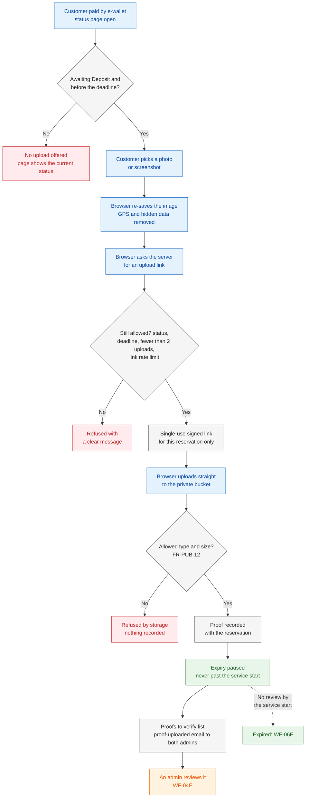

### Sequence diagram

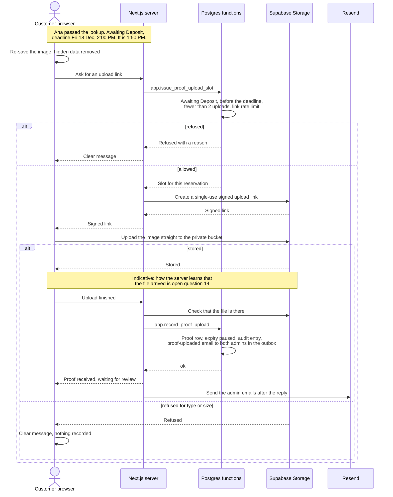

### Steps

| Step | Actor | What happens | Data created, updated, or read | Rules and requirements |
|---|---|---|---|---|
| 1 | Customer | Pays the deposit by e-wallet, using the deposit instructions on the status page. | — | [catalog-and-payments][cat] §4.3, §7, [FR-PUB-11][fr] |
| 2 | Customer | After a successful lookup (WF-07D), chooses to upload a proof. The control is shown only while Awaiting Deposit and before the deadline. | Read: status, deadline | [FR-PUB-12][fr], [BR-12][br], [EC-32][ec] |
| 3 | Customer browser | Picks a picture. The browser re-saves it, which removes the GPS location and other hidden data (EXIF). | — | [FR-PUB-12][fr], [NFR-14][nfr], [privacy-and-retention][priv] §3.2 |
| 4 | Next.js server | Asks the database for an upload slot for this reservation. | — | [FR-PUB-12][fr] |
| 5 | Database | Checks that the booking is still Awaiting Deposit and before the deadline, that it has fewer than 2 uploads ever, and the upload-link rate limit (3 per reservation per hour, NFR-11). A refusal gives a clear message. | Read: status, deadline, proof count, rate-limit counter | [FR-PUB-12][fr], [NFR-11][nfr], [EC-30][ec], [EC-32][ec] |
| 6 | Next.js server, Storage | Issues a single-use signed upload link, bound to this one reservation. | Create: signed upload link | [FR-PUB-12][fr], [NFR-14][nfr] |
| 7 | Customer browser, Storage | Uploads the picture straight to the private bucket. Only the allowed types and size are accepted (JPG, PNG, or WebP, at most 1 MB, FR-PUB-12). | Create: image in the private bucket | [FR-PUB-12][fr], [NFR-14][nfr], [EC-30][ec] |
| 8 | Next.js server, Database | The upload is recorded with the reservation (how the server learns that the file arrived: open question 14). In the same step, expiry is paused, the reservation joins "proofs to verify", and the proof-uploaded email to both admins is queued (the audit entry: open question 16). | Create: proof record, outbox row; update: expiry-paused flag | [BR-12][br], [FR-PUB-12][fr], [FR-ADM-02][fr], [FR-NTF-14][fr], [FR-NTF-16][fr] |
| 9 | Customer | Sees that the proof was received. The booking is still Awaiting Deposit: an upload never confirms it. | Read | [FR-PUB-12][fr], [FR-PUB-11][fr] |
| 10 | WF-07A | Sends the admin email, with admin priority. If it waits at the admin reserve, the dashboard already shows the proof. | Update: outbox | [FR-NTF-14][fr], [FR-NTF-20][fr] |
| 11 | Admins | See the proof in "proofs to verify", with its service start, and review it in [WF-04E][wf-review]. | Read | [FR-ADM-02][fr], [FR-ADM-12][fr] |
| 12 | System | If no admin reviews it by the service start, the pause ends and the booking expires ([WF-04E][wf-review] step 10, [WF-06F][wf-change]). | — | [BR-12][br], [FR-SYS-01][fr], [EC-31][ec] |
| 13 | System | Later, the daily retention job deletes the image ([WF-10E][wf-admin] step 4): 7 days after the deposit is verified **[C]**, or 7 days after the booking becomes Rejected, Expired, or Cancelled for an unverified proof **[P]**. Proof images are never backed up. | Later: image deleted, deletion logged | [privacy-and-retention][priv] §6.2, [D-21][dl], [EC-85][ec], [NFR-27][nfr] |

### Decision points and validation

| Decision | If yes | If no | Rule |
|---|---|---|---|
| Is the booking Awaiting Deposit, and is the deadline still ahead? | The upload is offered | No upload; the page shows the current status | [FR-PUB-12][fr], [BR-12][br], [EC-32][ec] |
| Fewer than 2 uploads ever for this reservation? | Go on | Refused | [FR-PUB-12][fr], [EC-30][ec] |
| Under the upload-link rate limit? | A link is issued | Refused for a while | [NFR-11][nfr], [EC-30][ec] |
| Is the file an allowed type and size? | Stored | Refused | [FR-PUB-12][fr], [EC-30][ec] |
| Was the proof uploaded before the deadline? | Expiry paused until review, never past the service start | No pause | [BR-12][br] |
| Can a second proof be uploaded while the first is under review? | Not defined | Not defined | Open question 15 |

### Failure and exception paths

| Situation | What happens | Edge case or rule |
|---|---|---|
| A third upload, a wrong file type, a file over the limit, or too many link requests | Refused | [EC-30][ec] |
| The customer tries after the deadline | No upload offered; the page shows Expired | [EC-32][ec] |
| The proof arrives just before the deadline | Expiry pauses; a later verification still confirms the booking | [EC-27][ec] |
| No admin reviews the proof by the service start | The booking expires then | [EC-31][ec] |
| An admin rejects the proof while the deadline still runs | The original deadline applies again; the customer may upload once more | [EC-29][ec] |
| An admin rejects the proof after the original deadline | The booking expires at once **[P]** | [EC-28][ec] |
| The upload stops halfway (for example, the network drops) | Nothing is recorded; the link was single-use, so the customer asks for a new one, within the rate limit | [FR-PUB-12][fr], [NFR-11][nfr] |
| The proof-uploaded email waits at the admin reserve, or fails | The proof is already in "proofs to verify" on the dashboard | [FR-NTF-20][fr], [FR-ADM-02][fr] |
| The event is today | An admin may also waive the deposit before the service start ([WF-04F][wf-review]) | [EC-31][ec], [EC-43][ec] |
| The deadline shown, and the reminder, while expiry is paused | Open in batch-1 | [FR §7][fr], question 2 |
| The deadline is extended while the proof is under review | Open in batch-1 | [edge-cases][ec] §15, question 4 |

### Status transitions involved

None. The booking stays **Awaiting Deposit**, and the "expiry paused" flag is set ([reservation-lifecycle][lc] §1.2, and §5 row "Upload a deposit proof"). The next status change happens in [WF-04E][wf-review]: row 6 (verified), row 10c (rejected after the deadline, **[P]**), or row 10b (no review by the service start).

### Developer notes

- **Server actions:** for example `requestProofUpload` and `confirmProofUpload`. **Database functions:** `app.issue_proof_upload_slot(reservation_id)` and `app.record_proof_upload(slot_id, object_path)`. Both re-check the status, the deadline, and the count under the reservation's row lock.
- **Storage:** a private bucket, for example `payment-proofs`, with allowed types `image/jpeg`, `image/png`, `image/webp` and a 1 MB file-size limit; `createSignedUploadUrl` for the single-use link ([spec v0.2][spec] §10, §13; week-1 item 5 in [NFR-14][nfr]). The object path holds only IDs, for example `<reservation_id>/<random>.webp`, never customer data.
- **Browser re-save:** draw the image on a canvas and export it with `toBlob`, which drops the EXIF data; check the size after re-saving.
- **Table** `payment_proofs`: storage path, upload time, review result, deletion time ([catalog-and-payments][cat] §9). The "at most 2 ever" check counts these rows (what counts: open question 14).
- **Expiry pause:** the reservation's `expiry_paused` field ([BR-12][br] developer note).
- **Lookup first:** the link is issued only after the reference code and mobile were checked ([spec v0.2][spec] §13); how the server remembers that is open question 10.
- **Audit:** category `booking`, actor `customer`, action such as `proof.uploaded` (open question 16).
- **Outbox email type:** `admin_proof_uploaded` ([FR-NTF-14][fr]), admin priority.
- **Tests:** week-1 item 5 (a signed upload with the size and type limits); an end-to-end test of a proof upload with the admin verifying it; proof pausing expiry in pgTAP ([spec v0.2][spec] §17).

*(indicative; final names in api-specification, batch 3)*

---

## WF-07F · Customers without email

### In plain words

Email is optional, so some customers give only a mobile number **[C]** ([D-08][dl]). They can still book and follow everything on the status page (WF-07D). No customer emails are sent for them, and nothing fails because of that. Instead, the reservation page in the admin panel shows a **prepared message** with the same information the email would have carried, which staff copy into SMS or Messenger and send themselves. Admin emails are not affected.

*Example.* Ben gave no email. After approving his request, the Admin copies the prepared message, with the deposit instructions and the deadline, and sends it to Ben on Messenger ([FR-NTF-21][fr]).

### Actors and responsibilities

| Actor | Responsibilities in this sub-flow |
|---|---|
| Customer (no email) | Follows the booking on the status page; replies or calls, quoting the reference code ([D-09][dl]) |
| Admin (either admin) | Opens the reservation page, copies the prepared message, and sends it by SMS or Messenger outside the system |
| Next.js server | Shows the reservation page with the prepared message ([FR-ADM-04][fr]) |
| Postgres functions | Queue no customer email for this reservation; queue admin emails as usual |

### Trigger and preconditions

- **Trigger:** an event that sends a customer email (WF-07B) happens on a reservation with no email address.
- **Preconditions:**
  - The email field is empty: the customer left it out online ([FR-PUB-05][fr]), or the admin left it out on a staff-created booking ([FR-ADM-24][fr]).
  - Staff can reach the customer by SMS or Messenger (outside the system).

### Flowchart

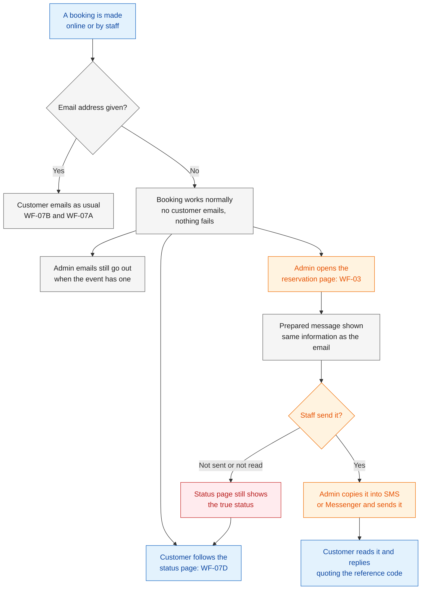

### Sequence diagram

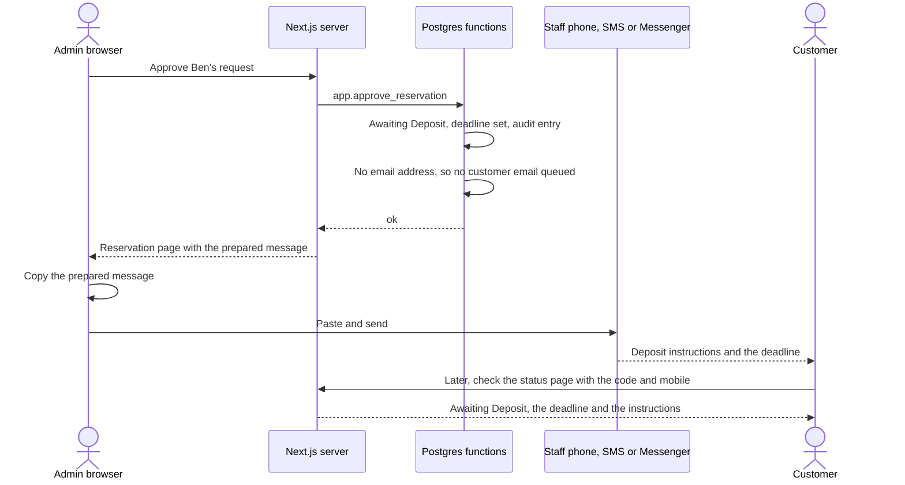

### Steps

| Step | Actor | What happens | Data created, updated, or read | Rules and requirements |
|---|---|---|---|---|
| 1 | Customer or admin | The booking is made without an email address: online, or as a staff-created booking. The booking still works. | Create: reservation with no email | [FR-PUB-05][fr], [FR-ADM-24][fr], [D-08][dl] |
| 2 | Database | For every event that sends a customer email (WF-07B), no customer email is queued, and nothing fails. Admin emails are queued as usual. | — | [FR-NTF-21][fr], [FR-NTF-13 to FR-NTF-15][fr], [EC-12][ec] |
| 3 | Customer | Follows the booking on the status page with the reference code and the full mobile number (WF-07D). | Read | [FR-PUB-05][fr], [FR-PUB-11][fr], [NFR-33][nfr] |
| 4 | Admin | Opens the reservation page ([WF-03][wf-review]), for example right after the action. The page shows the prepared message. | Read | [FR-ADM-04][fr], [FR-NTF-21][fr] |
| 5 | Admin | Copies the prepared message. It carries the same information the email would have carried **[P]** (new in [FR-NTF-21][fr]). | Read | [FR-NTF-21][fr] |
| 6 | Admin | Sends it by SMS or Messenger, from the business's phone or account, outside the system. Whether the system records that it was sent is not defined (open question 18). | — | [FR-NTF-21][fr], [project-charter][charter] §4.2 |
| 7 | Customer | Reads it, and replies or calls quoting the reference code. | — | [D-09][dl] |
| 8 | Customer | Whether or not a message arrived, the status page shows the true status. | Read | [NFR-33][nfr] |

### Decision points and validation

| Decision | If yes | If no | Rule |
|---|---|---|---|
| Does the reservation have an email address? | Customer emails as usual (WF-07B) | No customer emails; prepared message | [FR-NTF-21][fr] |
| Does the event send a customer email (WF-07B table)? | A prepared message is relevant | No message needed | [FR-NTF-21][fr], [reservation-lifecycle][lc] §4.2, §5 |
| Does the event also send an admin email? | Sent to both admins as usual | — | [FR-NTF-13 to FR-NTF-15][fr] |

### Failure and exception paths

| Situation | What happens | Edge case or rule |
|---|---|---|
| The customer gave no email address | The booking works; no customer emails; nothing fails | [EC-12][ec] |
| Staff forget to send the prepared message, or the customer misses it | The status page still shows the true status; the dashboard's deadline alerts show holds that are due soon | [NFR-33][nfr], [FR-ADM-02][fr] |
| The customer lost the reference code | They contact the business; an admin finds the booking by mobile number or name ([WF-03C][wf-review]) | [FR-ADM-03][fr] |
| A deposit reminder falls due | No email; whether staff get a prepared reminder is open question 18 | [FR-NTF-04][fr], [FR-NTF-21][fr] |
| The customer needs the QR code (staff booking without email) | Open in [lookup-and-review][wf-review] open question 14 | [FR-NTF-21][fr] |
| An admin later adds an email address with edit details | Which emails go out after that is open | [changes-and-expiry][wf-change] open question 7 |

### Status transitions involved

None. Missing emails never change a status ([NFR-33][nfr]).

### Developer notes

- **Prepared message:** built on the reservation page from the reservation's current state and the same template data as the email for its latest event (indicative; see open question 18). A "Copy" button uses the browser clipboard. Plain text, short enough for an SMS.
- **No outbox row** is written for a customer email when the email field is empty: the simplest reading of "nothing is sent and nothing fails" ([FR-NTF-21][fr]).
- **Database functions:** none of its own; every action function skips the customer outbox row when the email is empty.
- **Audit:** batch-1 docs define no audit entry for copying or sending a prepared message.
- **Outbox email type:** none for the customer; admin types as in WF-07B.
- **Screens:** the layout of the prepared message comes with the page design (planned: `04-design/ux-and-sitemap.md`).

*(indicative; final names in api-specification, batch 3)*

---

## Source notes: batch-1 docs and the frozen spec

Where the two differ, batch-1 docs win ([D-23][dl]). The spec is not edited. Differences noticed while writing this document:

1. **Reminders: "send" or "queue".** [Spec v0.2][spec] §15 lists the every-minute job as "send deposit reminders that are due", and the [glossary][gl] entry "Every-minute job" says the same. [FR-SYS-02][fr] makes the job **queue** them, and [FR-SYS-03][fr] sends them through the tick, with the caps and skips of FR-NTF-16 to FR-NTF-20. This document follows FR-SYS-02 and FR-SYS-03 (WF-07C steps 4 to 7).
2. **A new QR code on the status page.** Spec §13's list of what the status page returns has no "new QR code" control, although spec §11 makes reissue "available on the status page after verification". [FR-PUB-11][fr] and [FR-PUB-13][fr] include it. This document follows batch-1 (WF-07D steps 9 to 11).
3. **The upload only before the deadline.** Spec §13 issues the upload link "only after reference + mobile verification while Awaiting Deposit". [FR-PUB-12][fr] adds "only before the deadline", in line with [BR-12][br]. This document follows batch-1 (WF-07E steps 2 and 5).
4. **What the cancelled and reminder emails contain.** Spec §9 lists "cancelled, with the refund decision" and gives no contents for the reminder. [FR-NTF-10][fr] adds the reason, and [FR-NTF-04][fr] adds the deadline and the deposit instructions, both marked [P] (new in that doc). This document only links to them (WF-07B, WF-07C).

No other difference affects WF-07.

---

## Open questions

These are not decided here. If the reviewers agree they need an answer, add each one to the [decision log][dl] as a new open item (O-12 onwards), or settle it in the batch-3 doc named.

1. **Retry schedule and the default number of attempts.** [FR-NTF-18][fr] says temporary errors are retried "with growing waits, up to a maximum number of attempts (a setting)", and [FR-ADM-28][fr] lists the setting, but no batch-1 doc gives its default or the waits. (WF-07A step 11; api-specification, batch 3)
2. **Which day the caps count, and the monthly cap.** The system counts in Manila time ([NFR-19][nfr]), but the email service's own daily and monthly limits may reset on another clock **[U]** ([NFR-08][nfr], [NFR-33][nfr]). And "emails left over when a cap is reached go out the next day" ([FR-NTF-20][fr]): when the **monthly** cap is reached, the next day is usually still in the same month. Do the held emails then wait until the next month? (WF-07A steps 9 and 16)
3. **What a late email shows, and to whom.** Only the reminder is worked out at send time ([FR-NTF-04][fr]). Is every other email filled in when it is queued, or from the reservation as it is at send time? *Example:* the approved email is held overnight by the cap, and the deadline is extended in the meantime. And if the address is erased ([privacy-and-retention][priv] §5.5) or blanked by the retention job before a queued email is sent, is it still sent? (A changed address after edit details is already [changes-and-expiry][wf-change] open question 7.) (WF-07A)
4. **Stale rules for each email type.** [FR-NTF-19][fr] gives only the reminder as an example, and [FR-NTF-04][fr] lists its stale statuses. For the other types, when does "the reason no longer holds"? *Examples:* an approved or needs-info email held at the cap after the request expired, or a new-request admin email held at the admin reserve after the request was already approved. (WF-07A step 8)
5. **What admins do with a failed email.** The health panel shows failed emails ([FR-ADM-33][fr]), but no batch-1 doc gives a "send again" action, or says whether staff should then use the prepared message ([FR-NTF-21][fr]) for that customer. (WF-07A step 15)
6. **The unique key of admin emails.** [FR-NTF-17][fr] keys each email on reservation + type + audit entry. The breaker email ([FR-NTF-15][fr]) has no reservation, and every admin email goes to both admins. Is an admin email one email to both addresses, or one per admin, and what is the breaker email's key? (WF-07B; api-specification, batch 3)
7. **The reminder after an extension.** [FR-NTF-04][fr] drops a reminder whose moment had already passed "when the request was approved". If an extension ([WF-06D][wf-change]) gives a new deadline whose reminder moment has already passed when the admin extends, is the reminder sent at once, or not at all? And a reminder already queued for the old deadline but not yet sent (for example, held at the cap): is it skipped, or sent with the new deadline? (The reschedule case is already [changes-and-expiry][wf-change] open question 4.) (WF-07C steps 3 and 9)
8. **Late reminders.** If the reminder job ([FR-SYS-02][fr]) runs late or stops and then catches up, is a reminder still queued after its moment, as long as the deadline has not passed? The daily sweep repeats only the expiry sweep and the email flush ([FR-SYS-08][fr]). (WF-07C step 5)
9. **Reminders at night.** With the default lead time, a 10:00 AM deadline gives a 4:00 AM reminder (Dan's original deadline in WF-07C). Is that acceptable to the business, or should the owner decide another rule for night-time reminders? ([FR-NTF-04][fr], [D-10][dl])
10. **How the status page remembers a passed lookup.** The upload link is issued only after the reference code and mobile number are checked ([spec v0.2][spec] §13, [FR-PUB-12][fr]), and a new QR code only after a successful lookup ([FR-PUB-13][fr]). How does the server know, at the moment of the upload or the reissue, that this browser passed the lookup, and for how long? (WF-07D, WF-07E; security, planned: `05-technical/security.md`; the document links are already [FR §7][fr], question 5)
11. **The key of the failed-lookup limit.** [NFR-11][nfr] (and spec §13) limit failed lookups "per reference code", but store the counters "under an HMAC of the reference code plus mobile number" (also spec §11). A counter keyed on the code plus the mobile would not slow down someone who tries many mobile numbers against one code. Which key is meant? (WF-07D step 3; security, batch 3)
12. **What a failed lookup says.** Batch-1 says only that "no booking data is shown" ([FR-PUB-10][fr]). Should the message be the same whether the code or the mobile was wrong, and how does it differ from the rate-limit message? (WF-07D steps 3 and 4; planned: `04-design/ux-and-sitemap.md` and security)
13. **A new QR code from the status page.** On which statuses is it offered (the same question for admins is [lookup-and-review][wf-review] open question 7)? Is it rate-limited ([NFR-11][nfr] names no limit for it)? (Saving the QR code is already [booking-and-submission][wf-book] open question 11.) (WF-07D steps 9 to 11)
14. **What counts as an upload.** For "before the deadline" ([BR-12][br]) and "at most 2 uploads per reservation, ever" ([FR-PUB-12][fr]): is it the moment the link is issued, the moment the file is stored, or the moment it is recorded? *Example:* a link issued at 1:59 PM, and the file stored at 2:00:05 PM, for a 2:00 PM deadline. Does an issued link that is never used count toward the 2? How does the server learn that the file arrived: the browser tells it, or the server checks the storage? (WF-07E steps 5 to 8; api-specification, batch 3)
15. **A second upload while the first proof is under review.** [EC-29][ec] allows one more upload after a rejection. Can the customer upload a second proof while the first still waits for review, and if so, what happens to "proofs to verify" and to the pause? (WF-07E step 2)
16. **The audit entry for an upload.** [FR-NTF-17][fr] keys the proof-uploaded email on "the audit entry that caused it", which implies an audit entry with the actor "customer". No batch-1 doc says that an upload is audited ([reservation-lifecycle][lc] §4.1 covers status changes; [FR-ADM-07][fr] admin actions). Confirm. This is the one place this question is kept; [administration][wf-admin] open question 2 links here. (WF-07E step 8)
17. **Stray upload files.** If a file reaches the bucket but is never recorded as a proof (for example, the confirming step fails), [privacy-and-retention][priv] §6.2 has no rule for deleting it. (WF-07E step 7)
18. **The prepared message.** [FR-NTF-21][fr] says the reservation page shows "a prepared message". Is there one per event, like the list of emails, or one for the latest event only? Is there one for the deposit reminder, and how would staff know when to send it (for example, from the dashboard's deadline alerts, [FR-ADM-02][fr])? Does the panel record that staff sent it? (WF-07F; planned: `04-design/ux-and-sitemap.md`)

Already listed in other documents, and not repeated here: the emails of a one-step staff booking ([functional-requirements][fr] §7, question 1); the reminder and the deadline shown while expiry is paused (question 2); how the customer gets a QR code an admin reissued (question 4); how the document links are protected (question 5); whether "event not held" sends the cancelled email (question 7); how long outbox rows are kept ([privacy-and-retention][priv] §11, question 3); telling the customer after an erasure (question 6); voided acknowledgments on the status page ([catalog-and-payments][cat] §10, question 5); what the Booking Confirmation shows, and whether it stays available after Completed or Cancelled (question 6); a deadline extended while expiry is paused ([edge-cases][ec] §15, question 4); the QR link in the request-received email and saving the QR code ([booking-and-submission][wf-book] open questions 1 and 11); the statuses for an admin reissue, a proof under review when the booking is confirmed another way, and the QR code for a staff booking without email ([lookup-and-review][wf-review] open questions 7, 10, and 14); the reminder after a reschedule, and a changed email address after edit details ([changes-and-expiry][wf-change] open questions 4 and 7).

[gl]: ../00-project/glossary.md
[dl]: ../00-project/decision-log.md
[charter]: ../00-project/project-charter.md
[roles]: ../01-requirements/roles-and-permissions.md
[br]: ../01-requirements/business-rules.md
[fr]: ../01-requirements/functional-requirements.md
[nfr]: ../01-requirements/non-functional-requirements.md
[ec]: ../01-requirements/edge-cases.md
[priv]: ../01-requirements/privacy-and-retention.md
[lc]: ../02-domain/reservation-lifecycle.md
[cat]: ../02-domain/catalog-and-payments.md
[spec]: ../superpowers/specs/2026-10-21-kasoundbox-design.md
[wf-book]: booking-and-submission.md
[wf-review]: lookup-and-review.md
[wf-avail]: availability-and-conflicts.md
[wf-change]: changes-and-expiry.md
[wf-admin]: administration.md
