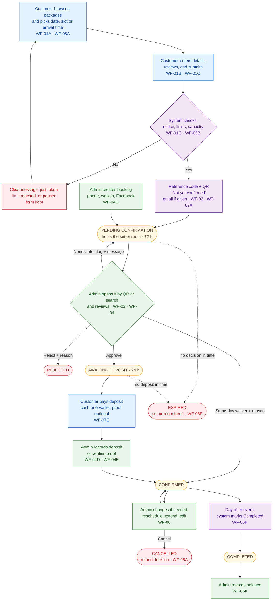

# End-to-End Process Overview

> **Purpose:** One page that shows the whole reservation process, from a customer's first visit to the finished event, and points to the detailed workflow for each part. ·
> **Audience:** The business owner (Admin) and the developer (Super Admin); written for presenting. ·
> **Status:** Draft for review ·
> **Last updated:** 2026-10-21 ·
> **Depends on:** [Reservation Lifecycle](../02-domain/reservation-lifecycle.md), [Business Rules](../01-requirements/business-rules.md), and the six workflow docs in this folder ·
> **Derived from:** the batch 1 and batch 2 docs

## In plain words

1. A customer picks a package, a date, and a delivery slot or arrival time, then sends a **request**. The website gives them a reference code and a QR code, and clearly says **"Not yet confirmed"**.
2. The request **holds** a set (or the room) for up to 72 hours while an admin reviews it.
3. The admin **approves** it, **rejects** it, or asks for more information.
4. After approval, the customer has 24 hours to pay the **deposit**. If they don't pay in time, or nobody reviews the request in time, the request **expires** and the set is free again.
5. Once the deposit is recorded, the booking is **Confirmed**. After the event, the system marks it **Completed** and the balance is recorded.

All deadlines end at the event start at the latest. Every step is logged with who did it and why.

## The whole process on one page

**How to read it.** Blue boxes are what the customer does, purple is the system, green is the admins, yellow shapes are statuses, and red shapes are failures and endings. Dotted arrows are what happens when a deadline passes; emails are sent at every status change (WF-07A), and the customer can check the status any time with the reference code and mobile number (WF-07D). Each `WF-xx` code points to the detailed workflow in the table below.

## Where each part is described

| Part of the process | Workflow | Document |
|---|---|---|
| Browse, choose, and submit a request | WF-01A–WF-01C | [Booking and Submission](booking-and-submission.md) |
| Reference code and QR code | WF-02 | [Booking and Submission](booking-and-submission.md) |
| Open a reservation by QR scan or search; notes; reissue a QR | WF-03A–WF-03E | [Lookup and Review](lookup-and-review.md) |
| Approve, reject, needs info, deposit, proof, waiver, staff-created booking | WF-04A–WF-04G | [Lookup and Review](lookup-and-review.md) |
| Availability calendar, capacity checks, two customers at once, overdue holds, two admins at once | WF-05A–WF-05E | [Availability and Conflicts](availability-and-conflicts.md) |
| Cancel, refund, reschedule, extend, edit, expiry, recreate, completed, event not held, void, balance | WF-06A–WF-06K | [Changes and Expiry](changes-and-expiry.md) |
| Emails, reminders, status page, proof upload, customers without email | WF-07A–WF-07F | [Notifications and Tracking](notifications-and-tracking.md) |
| Catalog, stock, slots, sets and room, settings, blocks, resume booking | WF-08A–WF-08I | [Administration](administration.md) |
| Login with 2FA, permission checks, lost phone, accounts | WF-09A–WF-09G | [Administration](administration.md) |
| Audit log, legal hold, erasure, daily retention job | WF-10A–WF-10E | [Administration](administration.md) |

## The rules behind the picture

The picture shows the order of steps. The rules themselves live in one place each:

- **Statuses and deadlines** (72 h review, 24 h deposit, the event-start cap): [Reservation Lifecycle](../02-domain/reservation-lifecycle.md)
- **Capacity, holds, limits, blocks, and the calendar** (BR-01–BR-12): [Business Rules](../01-requirements/business-rules.md)
- **Who may do what:** [Roles and Permissions](../01-requirements/roles-and-permissions.md)
- **Prices, deposits, balances, refunds, and acknowledgments:** [Catalog and Payments](../02-domain/catalog-and-payments.md)
- **Which email goes out when:** [Functional Requirements](../01-requirements/functional-requirements.md) (FR-NTF)
- **Unusual situations:** [Edge Cases](../01-requirements/edge-cases.md)
