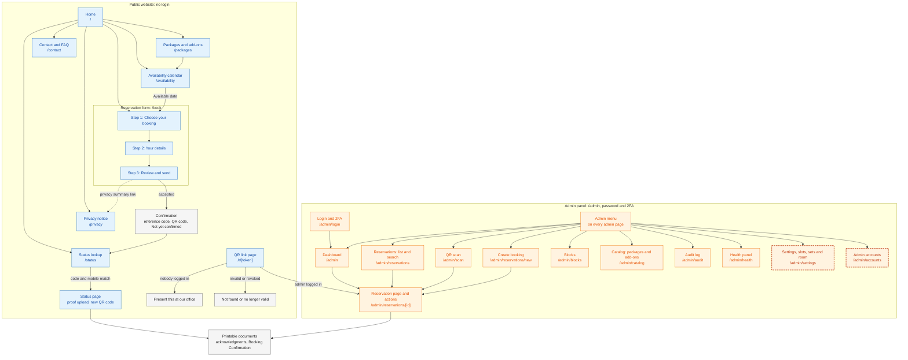

# UX and Sitemap

> **Purpose:** The sitemap, the page inventory, what each key screen contains and which states it can show, the layout guidelines, the UI conventions, and the key customer messages for the public website and the admin panel. It also proposes answers to the UX questions left open by the workflow docs. ·
> **Audience:** The developer (Super Admin), who builds the screens, and the business owner (Admin), who uses the admin panel every day. Written in plain English for both; the "Developer notes" are mainly for the developer ·
> **Status:** Draft for review ·
> **Last updated:** 2026-10-21 ·
> **Depends on:** [Decision log][dl], [Glossary][gl], [Roles and permissions][roles], [Business rules][br], [Functional requirements][fr], [Non-functional requirements][nfr], [Edge cases][ec], [Privacy and retention][priv], [Reservation lifecycle][lc], [Catalog and payments][cat]; workflows [booking-and-submission][wf-book] (WF-01, WF-02), [availability-and-conflicts][wf-avail] (WF-05), [lookup-and-review][wf-review] (WF-03, WF-04), [changes-and-expiry][wf-change] (WF-06), [notifications-and-tracking][wf-notify] (WF-07), [administration][wf-admin] (WF-08 to WF-10) ·
> **Derived from:** [functional-requirements][fr] FR-PUB-01 to FR-PUB-16, FR-ADM-01 to FR-ADM-33, FR-NTF-21; [non-functional-requirements][nfr] NFR-03, NFR-15 to NFR-19; [business-rules][br] BR-07a, BR-09; [reservation-lifecycle][lc] §1, §4, §5; [catalog-and-payments][cat] §5, §6; [privacy-and-retention][priv] §5.1, §7.1; [decision log][dl] D-08, D-09, D-20; the Open questions of the six workflow docs; background: [spec v0.2][spec] §3, §5, §10 (frozen, never edited)

## In plain words

- **Two parts, one website.** Customers use the public site, mostly on a phone, with no login. The two admins use the admin panel at `/admin`, on a phone or a laptop, after a password and a 2FA code.
- **The customer's path is short.** Home → packages → calendar (Available or Full) → a three-step form → a confirmation page with the reference code, the QR code, and a clear **"Not yet confirmed"**. Later, the customer checks the status page with the reference code and the full mobile number.
- **The admin's path starts at the dashboard.** It lists what needs attention: urgent and pending requests, proofs to verify, deadlines coming up, and upcoming events. Every road (dashboard, search, QR scan) leads to the same reservation page.
- **The reservation page shows only the buttons that are allowed.** If a booking is Confirmed, there is no "Approve" button. If you are the Admin, you do not see Super-Admin-only tools such as "Set legal hold". The server checks again anyway.
- **Words, not only colours.** Every status shows its name, for example **Awaiting Deposit**, and every date on the calendar says **Available** or **Full**.
- **Money and time look the same everywhere.** ₱3,400.00, and "Friday 18 December 2026, 2:00 PM", always Manila time.
- **This document proposes answers** to the open UX questions from the workflow docs, for example how the form picks a date when the customer did not come from the calendar, and how a customer saves the QR code. Each answer is marked **[P] (new in this doc)** and waits for your review.

*Running example.* Ana books a delivery for Thursday 24 December 2026, in the 2:00 PM slot: Package A (₱3,000.00) and 2 extra microphones (₱200.00 each), ₱3,400.00 in total, with a ₱1,000.00 deposit after approval. Her reference code is `KSB-7Q2M-K9TX` and her mobile number is `0917 123 4567`. All names, prices, and slot times are made up (O-02, O-03).

## How to read this document

- **What this document owns.** The sitemap, the page inventory, the contents and states of each screen, the layout guidelines, the UI conventions, and the customer-facing wording. It owns **no rules**. Permissions, statuses, deadlines, prices, limits, and retention live in the batch-1 docs and are named here by their ID (BR-xx, FR-…, NFR-xx, EC-xx, D-xx, WF-xx) with a link. If a screen here and an owning doc ever disagree, the owning doc is right, and this document is corrected.
- **Every screen element traces to a source.** The "Source" column names the FR, workflow step, or rule that requires the element. An element with no batch-1 or batch-2 source is marked **[P] (new in this doc)**.
- **Labels.** **[C]** confirmed decision · **[P]** proposed, accepted with the spec approval but may change · **[U]** unverified fact · **[O-nn]** open item in the [decision log][dl]. **[P] (new in this doc)** marks a design proposal made for the first time here; it is not decided until this document is reviewed. Layout choices (section 4), component choices (section 5), and draft wording (section 7) are all proposals of this kind, even where a line carries no label.
- **Routes are indicative.** Page paths such as `/status` are suggestions. The final paths come with the api-specification (planned: `05-technical/api-specification.md`).
- **Time and money.** Every date and time is Manila time (Asia/Manila, [NFR-19][nfr]). Every amount is in pesos and is written the way the screens show it, for example ₱3,400.00 (section 5.4).

---

## 1. Sitemap

The public website and the admin panel are two separate areas of one app ([spec v0.2][spec] §10). Blue boxes are public pages, orange boxes are admin pages, dashed orange boxes are for the Super Admin only, and grey boxes are printable documents or result pages.

How to read it:

- **Footer links.** Every public page links to the privacy notice and the contact and FAQ page in its footer. The diagram shows only the links from the home page ([FR-PUB-01][fr]).
- **No customer accounts.** The public site has no login, sign-up, or "my account" page **[C]** ([D-08][dl]).
- **The confirmation has no address of its own.** It is shown right after Submit, because the QR code is handed out only once ([NFR-13][nfr]; Developer notes in 3.1.5).
- **One page per reservation.** The dashboard, the search, the QR scan, the create form, and the QR link page all open the same reservation page ([WF-03][wf-review]).
- **Super Admin only.** Settings and admin accounts appear in the menu only for the Super Admin ([roles §2.6, §2.7][roles]). Some tools inside shared pages are also Super Admin only, for example a whole-date block on the blocks page and the legal hold on the reservation page (section 4.3).

---

## 2. Page inventory

Every page in the MVP. "Who sees it" describes who can open the page; who may *do* each action on it is defined only in [roles-and-permissions][roles].

| # | Page | Route (indicative) | Who sees it | Purpose | FR IDs | MVP |
|---|---|---|---|---|---|---|
| **Public website** | | | | | | |
| P1 | Home | `/` | Anyone | Names both services and leads to the other pages | FR-PUB-01 | Yes |
| P2 | Packages and add-ons | `/packages` | Anyone | Every active package with its inclusions and price; every active add-on with its price | FR-PUB-02 | Yes |
| P3 | Availability calendar | `/availability` | Anyone | Available or Full per date, for delivery or on-site | FR-PUB-03 | Yes |
| P4 | Reservation form, step 1: Choose your booking | `/book` | Anyone | Service type, date, package, add-ons, slot or arrival time | FR-PUB-04 | Yes |
| P5 | Reservation form, step 2: Your details | `/book` | Anyone | Name, mobile number, email, venue, note | FR-PUB-05 | Yes |
| P6 | Reservation form, step 3: Review and send | `/book` | Anyone | Summary, prices, deposit, privacy summary, agreement, Submit | FR-PUB-06 | Yes |
| P7 | Confirmation | Shown on `/book` after Submit | The customer who just submitted | Reference code, QR code, "Not yet confirmed", next steps | FR-PUB-07, FR-PUB-08 | Yes |
| P8 | Status lookup | `/status` | Anyone | Reference code plus full mobile number | FR-PUB-10 | Yes |
| P9 | Status page | Shown on `/status` after a lookup | The customer, after a successful lookup | Status, details, deadline, messages, documents, proof upload, new QR code | FR-PUB-11 to FR-PUB-14 | Yes |
| P10 | Printable documents: Deposit Acknowledgment, Balance Payment Acknowledgment, Booking Confirmation | Customer: `/status/acknowledgment/[paymentId]`, `/status/booking-confirmation`. Admin: under `/admin/reservations/[id]` ([api-specification][api] §2.10) | The customer, only after a status lookup, through the signed lookup cookie (a link in the Confirmed email opens the status lookup first); either admin, from the reservation page ([security][sec] §4.5.5; reconciled 2026-10-21) | A page to print or save | FR-PUB-14, FR-ADM-23 | Yes |
| P11 | Privacy notice | `/privacy` | Anyone | The full privacy notice | FR-PUB-15 | Yes |
| P12 | Contact and FAQ | `/contact` | Anyone | Contact details, how to cancel or reschedule, common questions | FR-PUB-16 | Yes |
| P13 | QR link page | `/r/[token]` | Anyone who opens a QR code | "Present this at our office", or "not found / no longer valid", or the admin reservation page | FR-PUB-09 | Yes |
| **Admin panel** | | | | | | |
| A1 | Login and 2FA | `/admin/login` | Anyone can open it; only the two admins can log in, and there is no sign-up | Email and password, then the authenticator code or a backup code | FR-ADM-01 | Yes |
| A2 | Password change, 2FA setup, and backup codes | `/admin/change-password`, then `/admin/setup-2fa` | An admin on first login, or after a reset | Choose a new password first **[C]** ([D-36][dl]); connect the authenticator app; store the backup codes offline | FR-ADM-01, FR-ADM-30 ([roles §5.2][roles]) | Yes |
| A3 | Dashboard | `/admin` | Either admin | What needs attention now; the paused banner | FR-ADM-02, FR-ADM-29 | Yes |
| A4 | Reservation list and search | `/admin/reservations` | Either admin | Find any reservation | FR-ADM-03 | Yes |
| A5 | Reservation page and action panel | `/admin/reservations/[id]` | Either admin | Everything about one reservation; the allowed actions | FR-ADM-04 to FR-ADM-23, FR-ADM-31, FR-ADM-32, FR-NTF-21 | Yes |
| A6 | QR scan | `/admin/scan` | Either admin | Open a reservation from the customer's QR code, with a screenshot fallback | FR-ADM-06 | Yes |
| A7 | Create booking | `/admin/reservations/new` | Either admin | Phone, walk-in, and Facebook bookings | FR-ADM-24 | Yes |
| A8 | Blocks | `/admin/blocks` | Either admin; whole-date blocks: Super Admin only | Block or unblock a set, the room, or a whole date | FR-ADM-25 | Yes |
| A9 | Catalog | `/admin/catalog` | Either admin | Packages, add-ons, prices, daily stock | FR-ADM-26 | Yes |
| A10 | Settings | `/admin/settings` | Super Admin only | Setting groups, delivery slots, delivery sets and the room | FR-ADM-27, FR-ADM-28 | Yes |
| A11 | Admin accounts | `/admin/accounts` | Super Admin only | Create, disable, re-enable, reset, and sign out admin accounts | FR-ADM-30 | Yes |
| A12 | Audit log | `/admin/audit` | Either admin | Who did what, when, and why | FR-ADM-32 | Yes |
| A13 | Health panel | `/admin/health` | Either admin | Scheduled jobs, emails, caps, and storage | FR-ADM-33 | Yes |

Not in the MVP, so no page: customer accounts, online cancel or reschedule ([D-08][dl]), online payment, reports, promotions, gallery, and reviews ([FR §6][fr]). The break-glass script for a lost Super Admin 2FA device is a script, not a screen ([FR-ADM-30][fr]).

---

## 3. Key screens

Each screen lists its parts, what each part shows or does, and the source that requires it. Then a table lists the states the screen can show. States that every screen shares (loading, a lost connection, a server error) follow the patterns in section 5.7 and are listed only where a screen needs something special.

### 3.1 Public screens

#### 3.1.1 Home (P1)

**Purpose:** introduce DJB Kasoundbox and lead to the other pages ([FR-PUB-01][fr]).

| Part | Contents | Source |
|---|---|---|
| Header | Business name; menu (section 4.2) | [FR-PUB-01][fr] |
| Services | Two cards. **Delivery:** we bring the videoke to your venue, set it up, and pick it up afterwards. **On-site:** you use our room. | [FR-PUB-01][fr], [D-01][dl] |
| Main buttons | "Check available dates" (P3), "See packages" (P2), "Book now" (P4), "Check my booking" (P8) | [FR-PUB-01][fr] (links **[P]** in that doc) |
| Footer | Privacy notice (P11); Contact and FAQ (P12) | [FR-PUB-01][fr] |

| State | What the screen shows |
|---|---|
| Normal | The parts above. No personal data ([FR-PUB-01][fr]). |
| Online booking paused | No change on this page. The calendar and the form show the paused banner ([BR-07a][br]). Whether the home page should show it too is open question B4. |
| Online booking not open yet (before launch) | The "Opening soon" message (section 7.2) in place of "Book now" and "Check available dates"; "See packages" and the contact details stay. Every page sends `noindex` **[C]** ([D-30][dl]; [FR-ADM-34][fr]). |

#### 3.1.2 Packages and add-ons (P2)

**Purpose:** show what can be booked and what it costs ([FR-PUB-02][fr]).

| Part | Contents | Source |
|---|---|---|
| Packages | One card per active package: name, inclusions as a short list, price ("₱3,000.00"). The same packages for delivery and on-site **[C]**. | [FR-PUB-02][fr], [D-14][dl], [catalog-and-payments §1.1][cat] |
| Add-ons | One row per active add-on: name and price ("Extra microphone: ₱200.00"). Daily stock is not shown. | [FR-PUB-02][fr], [catalog-and-payments §1.2][cat] |
| Free delivery | The fixed free-delivery wording, once confirmed (O-04) | [FR-PUB-02][fr] (**[P]** in that doc), [D-11][dl] |
| Button | "Check available dates" (P3) | [WF-01A][wf-book] step 2 |

| State | What the screen shows |
|---|---|
| Normal | Active items only; archived items never appear ([FR-PUB-02][fr]). |
| No active package | "Our packages are being updated. Please message or call us." with the contact details. Booking needs at least one active package ([WF-01A][wf-book] preconditions). |

**Developer notes.** Cached, and refreshed whenever the catalog is edited ([NFR-03][nfr]). Prices shown here are for display; the server calculates the saved prices at Submit ([catalog-and-payments §2.1][cat]).

#### 3.1.3 Availability calendar (P3)

**Purpose:** show Available or Full for each date, for one service type ([FR-PUB-03][fr], [BR-09][br]).

| Part | Contents | Source |
|---|---|---|
| Service type | A two-way switch: Delivery · On-site. Picked first; nothing shows until one is picked. | [FR-PUB-03][fr] |
| Dates | Each date from today through the booking window shows the word **Available** or **Full**. Dates outside the window cannot be picked. No names, counts, or other data. | [BR-09][br], [NFR-17][nfr] (item 5), [EC-08][ec] |
| Layout | Phone: a list of dates grouped by week, one row per date ("Thu 24 Dec · Available"). From the `md` breakpoint: a month grid with the word in each cell. Previous and next month buttons stop at the booking window. | Section 4.1 |
| Note | "Available means free right now. We check again when you send your request." | [BR-09][br] ("Available is not a promise") |
| Paused banner | While online booking is paused: the paused banner (section 7.2) with the contact details | [BR-07a][br], [FR-PUB-03][fr] |
| Action | Tapping an Available date opens step 1 of the form with the service type and the date filled in | [FR-PUB-03][fr] (**[P]** in that doc) |

| State | What the screen shows |
|---|---|
| No service type yet | The switch and a short prompt: "Pick delivery or on-site to see free dates." |
| Loading | The list or grid outline with placeholder rows (section 5.7). |
| Normal | Labels for every date in view. Today can show **Full** when no start time is left that meets the notice period ([BR-09][br], [EC-07][ec]). |
| Online booking paused | The banner above the calendar. Labels stay visible, but no date can be picked (proposal 9 in section 8). |
| Online booking not open yet (before launch) | The "Opening soon" message with the contact details, and no dates **[C]** ([D-30][dl]; [FR-ADM-34][fr]). |
| Could not load | "We could not load the calendar. Please try again, or message or call us." with a "Try again" button. |

**Developer notes.** Always live, never cached; one call to the availability function per view; no polling ([NFR-03][nfr]; [WF-05A][wf-avail] developer notes, `app.availability_calendar`). The calendar component is shared with step 1 of the form (proposal 1).

#### 3.1.4 Reservation form (P4 to P6)

**Purpose:** collect one booking request in three short steps, then send it ([FR-PUB-04][fr] to [FR-PUB-06][fr]; [WF-01][wf-book]).

```mermaid
flowchart TD
    H["Home: Book now"] --> S1
    C["Calendar: tap an Available date"] --> S1
    S1["Step 1: Choose your booking<br/>service type, date, package, add-ons,<br/>slot or arrival time"] --> S2["Step 2: Your details<br/>name, mobile, email, venue, note"]
    S2 --> S3["Step 3: Review and send<br/>prices, deposit, privacy summary, agreement"]
    S3 --> D{"Send request"}
    D -->|"Accepted"| OK["Confirmation<br/>reference code, QR code, Not yet confirmed"]
    D -->|"Just taken"| JT["Message with nearby Available dates<br/>everything typed is kept"]
    JT --> S1
    D -->|"A field to fix"| FIX["Back to that step<br/>message next to the field"]
    FIX --> S2
    D -->|"Paused or too soon"| CALL["Please message or call us<br/>with the contact details"]
    classDef public fill:#e3f2fd,stroke:#1565c0,color:#0d47a1
    classDef result fill:#e8f5e9,stroke:#2e7d32,color:#1b5e20
    classDef failure fill:#ffebee,stroke:#c62828,color:#b71c1c
    class H,C,S1,S2,S3,D public
    class OK result
    class JT,FIX,CALL failure
```

**All steps.** A step indicator ("Step 2 of 3"), a "Back" button, and the draft kept in the browser session, so a reload loses nothing ([FR-PUB-06][fr], [EC-02][ec]).

**Step 1: Choose your booking (P4)**

| Part | Contents | Source |
|---|---|---|
| Service type | Delivery · On-site (filled in when coming from the calendar) | [FR-PUB-03][fr], [FR-PUB-04][fr] |
| Date | The live calendar from 3.1.3, inside the form; only Available dates can be picked (filled in when coming from the calendar) | Proposal 1 in section 8 |
| Package | One choice, as cards: name, inclusions, price | [FR-PUB-04][fr] |
| Add-ons | Each active add-on with its price and a quantity stepper starting at 0. Stock is checked at Submit, not here. | [FR-PUB-04][fr], [BR-03][br], [EC-05][ec] |
| Delivery slot (delivery) | One choice from the active slots, each with its label and times. The free-delivery wording (O-04). | [FR-PUB-04][fr], [D-03][dl] |
| Arrival time (on-site) | A list of times within on-site hours (O-02) | [FR-PUB-04][fr], [D-03][dl]; proposal 15 |
| Too soon | For today, a slot or time less than the notice period away is shown but cannot be picked, with "Too soon to book online. Please message or call us." | [BR-06][br], [FR-PUB-04][fr]; proposal 15 |
| Button | "Next: your details" | — |

**Step 2: Your details (P5)**

| Part | Contents | Source |
|---|---|---|
| Name | Text field | [FR-PUB-05][fr] (whether required: [booking-and-submission][wf-book] open question 7) |
| Mobile number (required) | Phone keypad; hint "For example 0917 123 4567". Accepted forms and the saved form: [BR-11][br]. | [FR-PUB-05][fr], [BR-11][br], [D-08][dl] |
| Email (optional) | Labelled "Email (optional)", with "Without an email, follow your booking on the status page." | [FR-PUB-05][fr], [FR-NTF-21][fr], [D-08][dl] |
| Venue (delivery only) | Barangay (required), city or municipality (required), street, landmarks. Whether street and landmarks are required: [FR §7][fr], question 6. | [FR-PUB-05][fr] |
| Additional requirements | Optional text box with a character counter and its limit ([FR-PUB-05][fr]); the warning "Do not enter IDs, birthdates, health, or religious information." above the box | [FR-PUB-05][fr], [privacy-and-retention §2][priv] |
| Hidden field | The honeypot field; never visible, never read out by screen readers | [NFR-12][nfr] |
| Button | "Next: review" | — |

**Step 3: Review and send (P6)**

| Part | Contents | Source |
|---|---|---|
| Booking summary | Service type, date, slot or arrival time, package, add-ons with quantities; an "Edit" link next to each block goes back to its step | [FR-PUB-06][fr] |
| Price breakdown | Package ₱3,000.00 · 2 × Extra microphone ₱200.00 = ₱400.00 · Delivery: free · **Total ₱3,400.00** · **Deposit ₱1,000.00, paid after approval** | [FR-PUB-06][fr], [catalog-and-payments §2.1][cat] |
| Not yet confirmed | "Sending this request does not confirm your booking." | [FR-PUB-07][fr], [lc §1.1][lc] (only an admin confirms) |
| Privacy summary | The short summary, with a link to the full notice (P11). Its wording is owned by [privacy-and-retention §5.1][priv]. | [FR-PUB-06][fr], [FR-PUB-15][fr] |
| Agreement | A checkbox: "I agree to the policies." The Submit button works only once it is ticked. | [FR-PUB-06][fr] |
| Bot check | The Turnstile widget | [FR-PUB-06][fr], [NFR-12][nfr] |
| Button | "Send request" | [FR-PUB-06][fr] |

**States of the form**

| State | What the screen shows | Source |
|---|---|---|
| Online booking paused | In place of the form: the paused banner and the contact details. The draft stays in the browser session. | [BR-07a][br], [FR-PUB-06][fr] |
| Online booking not open yet (before launch) | In place of the form: the "Opening soon" message and the contact details. A submit that reaches the server anyway is refused (`booking_not_open`) | [FR-ADM-34][fr], **[C]** [D-30][dl] |
| Field errors | A message next to each field, and a short list at the top of the step that moves the focus to the first error | [NFR-17][nfr] (item 4), [WF-01B][wf-book] |
| Sending | The button reads "Sending…" and cannot be pressed again. A double press or a retry still returns the same request. | [FR-PUB-06][fr], [EC-01][ec] |
| Just taken (set or room) | "Sorry, this date was just taken." with up to 3 nearby Available dates as buttons, and "See the calendar". Everything typed is kept. | [FR-PUB-06][fr], [EC-03][ec], [EC-04][ec]; proposal 2 |
| Just taken (add-on stock) | "Sorry, there are not enough Extra microphones left on Thu 24 Dec for the quantity you chose." with "Change the quantity" and the nearby dates. Everything typed is kept. | [FR-PUB-06][fr], [EC-05][ec] |
| Too soon | "This start time is now too soon to book online. Please pick a later time, or message or call us." | [BR-06][br], [EC-06][ec] |
| Open-request limit | "This mobile number already has an open request for this date." or "This mobile number already has the most open requests allowed." Then "Message or call us if you need help." | [BR-07][br], [EC-09][ec], [EC-10][ec] |
| Outside the booking window | "This date is too far ahead to book online." | [BR-09][br], [EC-08][ec] |
| Bot check failed | "We could not check that you are not a robot. Please try again." The same message for the honeypot and Turnstile; the attempt still counts toward the submission limit | [NFR-12][nfr]; wording confirmed **[C]** ([D-27][dl]) |
| Too many tries | "Too many requests from this device. Please wait a while and try again, or message or call us." | [NFR-11][nfr], [EC-14][ec] |
| No connection | "We could not reach the server. Your answers are saved. Try again." Trying again sends the same duplicate-submission key, so no second request is made. | [FR-PUB-06][fr], [EC-01][ec] |
| New website version | "A new version of this page is ready. Reload to continue. Your answers are kept." | [FR-PUB-06][fr], [EC-02][ec] |
| Accepted | The confirmation (3.1.5) | [FR-PUB-07][fr] |

**Developer notes.**
- One route, `/book`, with the step in client state; the draft and the duplicate-submission key in browser session storage ([FR-PUB-06][fr]; which storage, and when a new key is made: [booking-and-submission][wf-book] open question 3).
- Each refusal code returned by `app.book_reservation` (for example `sold_out`, `addon_short`, `too_soon`, `hold_limit_date`, `hold_limit_total`, `paused`, `breaker_tripped`, `outside_window`; [WF-01C][wf-book] developer notes) maps to one message above. `breaker_tripped` shows the same message as `paused`.
- React Hook Form with the Zod resolver; the same Zod schemas run in the server action (section 5.2).

#### 3.1.5 Confirmation (P7)

**Purpose:** give the customer their reference code and QR code, and make clear that nothing is confirmed yet ([FR-PUB-07][fr], [FR-PUB-08][fr], [WF-02][wf-book]).

| Part | Contents | Source |
|---|---|---|
| Heading | "Request received" with a large **Not yet confirmed** notice right under it | [FR-PUB-07][fr] |
| Reference code | `KSB-7Q2M-K9TX` in large monospace text, with a "Copy" button | [FR-PUB-08][fr], [NFR-17][nfr] (item 6) |
| QR code | The QR code, with the text alternative "QR code for booking KSB-7Q2M-K9TX" | [FR-PUB-07][fr], [FR-PUB-08][fr], [NFR-17][nfr] (item 6) |
| Save the QR code | A "Save QR code" button (an image named after the reference code), a "Take a screenshot of this page" hint, and "You can get a new QR code anytime on the status page." | Proposal 3; [FR-PUB-13][fr] |
| How to use them | "Show the QR code at our office or when you pay. Quote the reference code when you message or call us. You do not need the QR code on your event day." **[C]** | [FR-PUB-07][fr], [D-09][dl] |
| Next steps | 1. We review your request. 2. After approval, pay the deposit by its deadline, in cash at our office or by e-wallet (deadline rule: [lc §3.2][lc]). 3. Check progress on the status page with your reference code and full mobile number. | [FR-PUB-07][fr] |
| Email line | With an email: "We also sent these details to your email." Without one: "You did not give an email, so please check the status page for updates." | [FR-PUB-07][fr], [FR-NTF-01][fr], [FR-NTF-21][fr] |
| Button | "Check my booking" (P8) | [FR-PUB-07][fr] |

| State | What the screen shows |
|---|---|
| Normal | The parts above. Nothing says or suggests that the booking is approved or paid ([FR-PUB-07][fr]). |
| A repeat submission | The same reference code ([EC-01][ec]). If no QR code can be shown for a repeat ([booking-and-submission][wf-book] open question 2), the page never shows a broken image: it shows the reference code and "Get your QR code on the status page." **[P] (new in this doc)** |

**Developer notes.** The confirmation is rendered from the result of the submit action, not from an address that can be bookmarked or reloaded, because the raw QR token is returned only once and never stored ([NFR-13][nfr]; [WF-02][wf-book] step 4). "Save QR code" turns the QR SVG already on the page into a PNG in the browser; the image never goes to a server.

#### 3.1.6 Status lookup (P8)

**Purpose:** let a customer find their booking without an account ([FR-PUB-10][fr], [WF-07D][wf-notify]).

| Part | Contents | Source |
|---|---|---|
| Reference code | Text field, hint "KSB-XXXX-XXXX". Upper or lower case, spaces, and dashes are all fine. | [FR-PUB-08][fr], [FR-PUB-10][fr], [EC-64][ec] |
| Mobile number | Phone keypad, hint "The full mobile number you gave when booking". Any [BR-11][br] form is fine. | [FR-PUB-10][fr], [BR-11][br] |
| Button | "Check status" | — |
| Help | "Lost your reference code? Message or call us." (P12) | [WF-07F][wf-notify] (failure paths) |

| State | What the screen shows | Source |
|---|---|---|
| Mobile number not valid | A message next to the field | [BR-11][br] |
| No match | "We could not find a booking with that reference code and mobile number. Please check both and try again." The same message whichever one was wrong; no data. | [FR-PUB-10][fr], [EC-65][ec]; proposal 7 |
| Too many tries | "Too many tries. Please wait a while and try again, or message or call us." | [NFR-11][nfr]; proposal 7 |
| Match | The status page (3.1.7) | [FR-PUB-11][fr] |

**Developer notes.** The lookup is sent by a server action, never in the address bar: the reference code and the mobile number must not appear in URLs, browser history, or logs **[P] (new in this doc)** ([NFR-15][nfr]). A passed lookup is remembered by a signed cookie for 15 minutes, which the upload, the new QR code, and the documents need ([security][sec] §4.5.2; [api-specification][api] §1.13; reconciled 2026-10-21).

#### 3.1.7 Status page (P9)

**Purpose:** the customer's source of truth after a lookup ([FR-PUB-11][fr] to [FR-PUB-14][fr]).

| Part | Contents | Source |
|---|---|---|
| Status | The status badge with its display label (section 5.5), the service type, and the reference code | [FR-PUB-11][fr] |
| Headline | One sentence for the status (table below) | [FR-PUB-11][fr] |
| Deadline | The current deadline in Manila time, for example "Friday 18 December 2026, 2:00 PM (Manila time)", while the booking has one. What it shows while expiry is paused: [FR §7][fr], question 2. | [FR-PUB-11][fr], [NFR-19][nfr] |
| Message from us | The needs-info message, when flagged; the rejection or cancellation reason, and the refund decision, when there is one | [FR-PUB-11][fr], [FR-ADM-09][fr] |
| Booking | Event date, slot or arrival time, package, add-ons with quantities | [FR-PUB-11][fr] |
| Money | Total, deposit, balance due | [FR-PUB-11][fr], [catalog-and-payments §2.1][cat] |
| How to pay | The deposit instructions from the settings, while Awaiting Deposit | [FR-PUB-11][fr], [catalog-and-payments §7][cat] |
| Upload a proof | While Awaiting Deposit and before the deadline: "Upload a picture of your payment", the accepted file types and size, how many uploads are left (limits: [FR-PUB-12][fr]), a preview, and "Upload". The line "Uploading a proof does not confirm your booking. We check it first." | [FR-PUB-12][fr], [BR-12][br] |
| Documents | One link per payment acknowledgment (number, amount, date) and the Booking Confirmation | [FR-PUB-14][fr]; voided ones: [catalog-and-payments §10][cat], question 5 |
| New QR code | "Get a new QR code" with the warning "Your old QR code will stop working." The new code then shows with "Save QR code", as on the confirmation. | [FR-PUB-13][fr], [EC-62][ec]; on which statuses: [notifications-and-tracking][wf-notify] open question 13 |
| Changes | "To cancel, reschedule, or change your details, message or call us and quote your reference code." | [FR-PUB-16][fr], [D-08][dl], [EC-50][ec] |
| Never shown | The customer's name, mobile number, and address; internal notes | [FR-PUB-11][fr], [FR-ADM-05][fr], [roles §6][roles] |

**What the headline says, by status.** The status labels come from [reservation-lifecycle §1.1][lc].

| Status, or situation | Headline (draft wording) | Extra parts shown |
|---|---|---|
| Pending Confirmation | "We are reviewing your request. It is held until [deadline] while we review it." | Booking, money |
| Pending Confirmation, needs info | "We need more information from you. Please message or call us." | Message from us |
| Awaiting Deposit | "Your request is approved. Pay the deposit of ₱1,000.00 by [deadline] to confirm your booking." | How to pay, upload a proof |
| Awaiting Deposit, proof under review | "We received your proof of payment and are checking it. Your booking is not confirmed yet." | Whether a second upload is offered while it waits: [notifications-and-tracking][wf-notify] open question 15 |
| Awaiting Deposit, proof not accepted | "We could not accept your proof: [reason]. You can upload one more, or pay at our office." | Upload, if one is left ([EC-29][ec]) |
| Confirmed | "Your booking is confirmed." | Documents, balance due |
| Completed | "Your event is complete. Thank you for booking with us." | Documents |
| Rejected | "We could not accept your request." | Message from us (reason) |
| Cancelled | "This booking was cancelled." | Message from us (reason, refund decision) |
| Expired | "This request expired because its deadline passed. Message or call us if you still want to book." | — ([FR-NTF-12][fr] content) |

| State | What the screen shows | Source |
|---|---|---|
| Deadline passed, job not yet run | **Expired** at once, and no upload | [BR-05][br], [FR-PUB-11][fr], [EC-22][ec], [EC-32][ec] |
| Uploading | The picture is re-saved on the phone first (removing hidden data such as the location), then a progress bar | [FR-PUB-12][fr], [NFR-14][nfr] |
| Upload refused | One message per cause: wrong file type, file too big, no uploads left, too many tries, or the deadline has passed | [FR-PUB-12][fr], [EC-30][ec], [EC-32][ec], [NFR-11][nfr] |
| Upload received | "Proof received. We will check it soon. Your booking is not confirmed yet." | [FR-PUB-12][fr] |
| Lookup no longer remembered | "Please enter your reference code and mobile number again." (P8) | The 15-minute lookup cookie ([security][sec] §4.5.2) |

**Developer notes.** Always live, never cached ([NFR-03][nfr]); Manila time whatever the phone's time zone ([NFR-19][nfr]). Customer-safe data only ([WF-07D][wf-notify], `app.lookup_status`). The upload re-encodes the image in the browser and sends it straight to the private bucket through the single-use link ([FR-PUB-12][fr]).

#### 3.1.8 Printable documents (P10)

**Purpose:** a payment acknowledgment or the Booking Confirmation that the customer can print or save ([FR-PUB-14][fr], [FR-ADM-23][fr]).

| Part | Contents | Source |
|---|---|---|
| Acknowledgment content | Exactly the fields in [catalog-and-payments §5.3][cat], in that order | [catalog-and-payments §5.3][cat] |
| Fixed statement | The statement required by [privacy-and-retention §7.1][priv], printed word for word at the bottom | [privacy-and-retention §7.1][priv] |
| Booking Confirmation | Its contents are not defined yet ([catalog-and-payments §10][cat], question 6) | [catalog-and-payments §6][cat] |
| Print button | "Print or save as PDF", hidden on the printed page | [FR-PUB-14][fr] |
| Who can open it | The customer, only after a status lookup on this device; either admin, from the reservation page. Without either, the "not found" page | [security][sec] §4.5.5; [api-specification][api] §2.10 (reconciled 2026-10-21) |

Layout: one column that reads well on a phone and fits one A4 or Letter page when printed. The titles and the words that must never appear are set in [privacy-and-retention §7.1][priv].

#### 3.1.9 Privacy notice (P11)

**Purpose:** the full privacy notice ([FR-PUB-15][fr]). Its content is owned by [privacy-and-retention §5.1][priv].

| Part | Contents | Source |
|---|---|---|
| Contents list | One link per topic of the notice | [privacy-and-retention §5.1][priv] |
| Sections | One heading per topic, in plain English | [privacy-and-retention §5.1][priv] |
| Privacy contact | The privacy contact email, once it exists (O-09) | [FR-PUB-15][fr] |
| Last updated | The date of the current notice text | — |

#### 3.1.10 Contact and FAQ (P12)

**Purpose:** how to reach the business, and answers to common questions ([FR-PUB-16][fr]).

| Part | Contents | Source |
|---|---|---|
| Contact details | From the business info setting: phone (tap to call), Facebook Page or Messenger, office address and hours. Which addresses are published is O-05. | [FR-PUB-16][fr], [FR-ADM-28][fr], O-05 |
| Changes to a booking | "You cannot cancel or reschedule online. Message or call us and quote your reference code." **[C]** | [FR-PUB-16][fr], [D-08][dl], [D-09][dl] |
| FAQ | Questions and answers in expandable sections; written with the content of O-03 and O-04 | [FR-PUB-16][fr] (**[P]** in that doc) |

#### 3.1.11 QR link page (P13, `/r/[token]`)

**Purpose:** what anyone sees when they open a QR code's link ([FR-PUB-09][fr], [WF-03B][wf-review]).

| Who opens it | What the screen shows | Source |
|---|---|---|
| Nobody logged in, valid code | "Present this QR code at our office." No booking data. A small "Staff login" link below. | [FR-PUB-09][fr], [EC-61][ec]; proposal 4 |
| A logged-in admin, valid code | Goes straight to the reservation page (A5) | [FR-PUB-09][fr], [FR-ADM-06][fr] |
| Anyone, invalid, replaced, or guessed code, or a booking that is now Rejected, Cancelled, Expired, or Completed | "This QR code is not valid or is no longer in use." No data. A "Check my booking" link (P8). | [FR-PUB-09][fr], [FR-PUB-08][fr], [EC-60][ec] |

### 3.2 Admin screens

Every admin screen has the admin menu (section 4.2), the name and role of the logged-in admin, and "Log out" ([FR-ADM-01][fr]). Every admin page is always live, never cached, and never refreshes itself in the background; lists show "Updated at 10:02 AM" and a "Refresh" button ([FR-ADM-02][fr], [NFR-03][nfr]).

#### 3.2.1 Login with 2FA (A1, A2)

**Purpose:** let only the two admins in, with a second step ([FR-ADM-01][fr], [WF-09A][wf-admin], [WF-09B][wf-admin]).

| Step | Contents | Source |
|---|---|---|
| 1. Password | Email, password, "Log in". No sign-up and no "create account" link. | [FR-ADM-01][fr] |
| 2. Code | A 6-digit code field with the number keypad, "Verify", and "Use a backup code instead", which swaps in a backup-code field | [FR-ADM-01][fr], [roles §5.2][roles] |
| First login, or after a reset (A2) | 0. "Choose a new password": the new password twice, then "Save"; nothing else opens until it is saved **[C]** ([D-36][dl]). 1. A QR code and a typed key for the authenticator app. 2. A field for the first code from the app (a [P] detail of [WF-09B][wf-admin]). 3. The backup codes, with "Print" and "Download", and the advice "Keep these codes offline, for example printed at home." 4. A tick box "I have stored my backup codes", then "Continue". | [FR-ADM-01][fr], [roles §5.2][roles], [WF-09B][wf-admin] |

| State | What the screen shows | Source |
|---|---|---|
| Wrong email, password, or code | "The email, password, or code is not correct." The same message for each. | [WF-09A][wf-admin] step 6; proposal 13 |
| Locked or too many tries | "Too many tries. Please wait and try again later." | [NFR-11][nfr], [EC-72][ec]; proposal 13 |
| After a login with a backup code | A notice "You used a backup code. Move your 2FA to a new phone?" with "Move 2FA": the password, a backup code, the new QR code, and the first code from the new phone. Then: "2FA moved. The Super Admin has been told." (not shown to the Super Admin for his own account) **[C]** ([D-36][dl]) | [FR-ADM-30][fr], [FR-NTF-22][fr], [WF-09D][wf-admin] |
| Success | The page the admin first asked for, or the dashboard | [FR-ADM-01][fr], [EC-73][ec] |

#### 3.2.2 Dashboard (A3)

**Purpose:** the admin home page: what needs attention now ([FR-ADM-02][fr]).

| Section, top to bottom | Contents | Source |
|---|---|---|
| Paused banner | Only while the breaker has paused online booking: "Online booking is paused until 3:45 PM." and the "Resume online booking" button (either admin) | [FR-ADM-02][fr], [FR-ADM-29][fr], [BR-07a][br] |
| Quick actions | "Scan QR" (A6), "Create booking" (A7), and a search box (A4) | [FR-ADM-06][fr], [FR-ADM-24][fr], [FR-ADM-03][fr] |
| Urgent and pending queue | Requests waiting for an admin. Each row: reference code, **Urgent** badge when the event date is today, service type, event date and slot or arrival time, source, **Needs info** badge, deadline. Order **[P] (new in this doc)**: urgent first, then soonest deadline. | [FR-ADM-02][fr], [BR-06a][br] |
| Proofs to verify | Every reservation with a proof no admin has reviewed: reference code, service start, upload time, "Review" (opens the proof on A5) | [FR-ADM-02][fr], [BR-12][br], [FR-ADM-12][fr] |
| Deadline alerts | Holds whose deadline is coming soon ("soon" is set while building, [FR-ADM-02][fr]): reference code, status, deadline, and a **No email** tag when staff must send the prepared message | [FR-ADM-02][fr]; tag: proposal 8 |
| Upcoming events | Confirmed bookings from today onwards, soonest first: date, slot or arrival time, service type, reference code | [FR-ADM-02][fr] (order and range **[P]** in that doc) |

| State | What the screen shows | Source |
|---|---|---|
| A section is empty | One quiet line, for example "No requests waiting." or "No proofs to verify." | — |
| A hold just passed its deadline | It shows as **Expired** at once and leaves the queues | [FR-ADM-02][fr], [BR-05][br] |
| Online booking paused | The banner on top | [FR-ADM-02][fr] |
| Resume pressed | The banner goes away and a short note says "Online booking is open again." If the pause had already ended: "Online booking is already open." | [FR-ADM-29][fr]; proposal 14 |
| Admin emails held by the cap | No change: new requests and proofs still show here at once | [FR-NTF-20][fr], [EC-67][ec] |

#### 3.2.3 Reservation list and search (A4)

**Purpose:** find any reservation ([FR-ADM-03][fr], [WF-03C][wf-review]).

| Part | Contents | Source |
|---|---|---|
| Search box | One box for a reference code, a customer name, or a mobile number. Example: typing `0917-123-4567` finds Ana. | [FR-ADM-03][fr] (**[P]** in that doc), [FR-PUB-08][fr], [BR-11][br]; proposal 5 |
| Filters | Status (several at once), service type, event date as a range with quick picks "Today", "Next 7 days", "This month" | [FR-ADM-03][fr] (**[P]** in that doc); proposal 5 |
| Results | Laptop: a table. Phone: one card per reservation. Each shows reference code, status badge, flags, service type, event date and slot or arrival time, customer name, source, deadline. | [FR-ADM-03][fr], [FR-ADM-04][fr] |
| Paging | "Previous" and "Next" | Proposal 5 |

| State | What the screen shows |
|---|---|
| No search typed | Reservations with an event date from today onwards, soonest first (proposal 5) |
| No results | "No reservations match. Try the reference code, or the full mobile number." |
| An overdue hold in the results | Shown as **Expired** at once ([BR-05][br]) |

#### 3.2.4 Reservation page and action panel (A5)

**Purpose:** everything about one reservation, and the actions its status and the admin's role allow ([FR-ADM-04][fr]).

**Contents**

| Section | Contents | Source |
|---|---|---|
| Header | Reference code (with "Copy"), status badge, flags (Urgent, Needs info, Expiry paused, Legal hold), source, current deadline in Manila time | [FR-ADM-04][fr], [lc §1.2][lc] |
| Booking | Service type, event date, slot or arrival time, service start, package, add-ons with quantities, the locked prices and deposit, total, balance due | [FR-ADM-04][fr], [catalog-and-payments §2.2][cat] |
| Customer | Name, mobile number (tap to call), email, venue barangay and city, venue details, the customer's note. Fields blanked by the retention job or an erasure show "—" and "Removed after the retention period" or "Removed on request". | [FR-ADM-04][fr], [privacy-and-retention §5.5, §6.2][priv] |
| Payments | Every payment: kind, amount, method, e-wallet reference, admin, time, note, ACK number, and void details. A voided row is struck through and marked **Void**. | [FR-ADM-04][fr], [catalog-and-payments §4.2][cat] |
| Proofs | Each uploaded proof with its upload time and review result; the image opens through a short-lived link | [FR-ADM-04][fr], [FR-ADM-12][fr], [NFR-14][nfr] |
| Refund and links | The refund decision; "Recreated from" or "Recreated as" links to the other reservation | [FR-ADM-04][fr], [FR-ADM-21][fr] |
| Prepared message | Only when the reservation has no email address (layout: proposal 8) | [FR-NTF-21][fr], [WF-07F][wf-notify] |
| Internal notes | The notes with author and time, newest first; a text box and "Add note" (proposal 6) | [FR-ADM-05][fr], [WF-03E][wf-review] |
| History | The reservation's audit entries: time, actor, action, changed field names, reason | [FR-ADM-04][fr], [FR-ADM-32][fr] |

**The action panel.** The page shows only the actions that the reservation's status and the admin's role allow ([FR-ADM-04][fr], **[P]** in that doc). The page never decides this by itself: section 4.3 explains how. The table lists each action, what its dialog asks for, and where the rule that allows it lives. The statuses are not repeated here.

| Group | Action | The dialog asks for | Allowed when (rule) | FR |
|---|---|---|---|---|
| Next step | Approve | Delivery: the venue fields and the tick box "I checked that this venue is inside our service area" (proposal 11) | [lc §4.2][lc] row 4; [roles §2.1][roles] | [FR-ADM-08][fr] |
| Next step | Record deposit | Amount, shown from the locked deposit and not editable **[P] (new in this doc)**; method (Cash or E-wallet); e-wallet reference, shown and required only for e-wallet; note, with "Do not type the payer's name or account number." | [lc §4.2][lc] row 6 and §5; [roles §2.2][roles] | [FR-ADM-11][fr] |
| Next step | Review proof | The proof image; "Verify and record deposit" (opens Record deposit) or "Reject proof" (reason required) | [BR-12][br]; [lc §4.2][lc] rows 6 and 10c, §5; [roles §2.2][roles] | [FR-ADM-12][fr] |
| Next step | Waive deposit (same day) | Reason (required) | [lc §6.4][lc], rows 5 and 7; [roles §2.2][roles] | [FR-ADM-13][fr] |
| Next step | Record balance | Amount, prefilled with the total minus the deposit; method; e-wallet reference; note | [lc §5][lc]; [roles §2.2][roles] | [FR-ADM-14][fr] |
| Ask | Needs info / Info received | Needs info: a message for the customer (required). Info received: a confirmation. | [lc §6.1][lc]; [roles §2.1][roles] | [FR-ADM-09][fr] |
| Change | Edit details | The customer fields, the venue, the package and add-ons (no date, slot, or arrival time), and a reason (required) | [lc §6.2][lc]; [roles §2.1][roles] | [FR-ADM-10][fr] |
| Change | Reschedule | New date, slot, or arrival time | [lc §6.5][lc]; [roles §2.3][roles] | [FR-ADM-17][fr] |
| Change | Extend deadline | New deadline (date and time, Manila); the service start is shown as the latest allowed; reason (required) | [lc §6.3][lc]; [roles §2.3][roles] | [FR-ADM-16][fr] |
| Change | Reissue QR | A confirmation: "The old QR code will stop working." Then the new QR code (proposal 12). | [lc §5][lc]; [roles §2.3][roles]; statuses: [lookup-and-review][wf-review] open question 7 | [FR-ADM-22][fr] |
| Money | Void (on a payment row) | Reason (required); the line "Its acknowledgment number will never be used again." | [lc §5][lc]; [roles §2.2][roles] | [FR-ADM-15][fr] |
| Money | Record refund paid | Amount, method, e-wallet reference, note | [lc §5][lc]; [roles §2.2][roles] | [FR-ADM-19][fr] |
| Money | Print documents | One link per acknowledgment and the Booking Confirmation | [roles §2.2][roles] | [FR-ADM-23][fr] |
| End | Reject | Reason (required), with "The customer will see this reason." | [lc §4.2][lc] row 8; [roles §2.1][roles] | [FR-ADM-08][fr] |
| End | Cancel | Reason (required, shown to the customer); the refund decision (none, partial, or full, with the amount) when a deposit was paid | [lc §6.6][lc], rows 11 to 13; [roles §2.3][roles] | [FR-ADM-18][fr] |
| End | Event not held | Reason and refund decision (both required) | [lc §6.7][lc], row 15; [roles §2.3][roles] | [FR-ADM-20][fr] |
| End | Recreate | A confirmation: "This makes a new request with a new reference code and today's prices." Then a link to the new reservation. | [lc §6.9][lc], row 3; [roles §2.3][roles] | [FR-ADM-21][fr] |
| Super Admin | Set or clear legal hold | Reason (required to set; to clear: [privacy-and-retention §5.6][priv]) | [privacy-and-retention §5.6][priv]; [roles §2.7][roles] | [FR-ADM-31][fr] |
| Super Admin | Process erasure | The reference code and full mobile number to check (how the tool checks them: [administration][wf-admin] open question 20); a summary of what will be blanked and what is kept | [privacy-and-retention §5.5][priv]; [roles §2.7][roles] | [FR-ADM-31][fr] |

**States**

| State | What the screen shows | Source |
|---|---|---|
| Loading | The page outline with placeholder blocks | — |
| Overdue hold | **Expired** at once; the forward actions are gone | [BR-05][br], [FR-ADM-07][fr], [EC-22][ec], [EC-23][ec] |
| Someone else acted first | A dialog: "This reservation was changed by someone else. Refresh to see the latest." with "Refresh". Nothing was changed. | [FR-ADM-07][fr], [EC-16][ec] |
| Action refused | The dialog stays open with what was typed, and a message in plain words, for example "This date is full, so the booking stays on Thu 24 Dec." | [FR-ADM-07][fr], [EC-48][ec] |
| Action done | A short note, for example "Approved. Deposit due Fri 18 Dec, 2:00 PM.", and the page refreshes. For a customer without email, the new prepared message is highlighted. | [FR-ADM-04][fr], [FR-NTF-21][fr] |
| Not found | "Reservation not found." with a link to the list | — |
| Blanked data | "—" in the blanked fields (Customer section above) | [FR-ADM-04][fr] |

#### 3.2.5 QR scan (A6)

**Purpose:** open the right reservation from the customer's QR code ([FR-ADM-06][fr], [WF-03A][wf-review]).

| Part | Contents | Source |
|---|---|---|
| Camera | A camera view with a square guide, and a line saying why the camera is needed before the browser asks for permission | [FR-ADM-06][fr], [NFR-18][nfr] |
| Screenshot fallback | "Upload a screenshot instead" | [FR-ADM-06][fr], [EC-63][ec] |
| Search fallback | "Type the reference code" (A4) | [FR-ADM-06][fr], [FR-ADM-03][fr] |

| State | What the screen shows |
|---|---|
| Waiting for permission | The explanation line and "Allow camera" |
| Camera refused or missing | The two fallbacks become the main buttons |
| Valid code | The reservation page opens |
| Invalid, replaced, or finished booking | "Not found or no longer valid." The reservation can still be found by its reference code ([EC-60][ec]). |
| No QR code in the screenshot | "No QR code found in this picture. Try another, or type the reference code." |

**Developer notes.** `@yudiel/react-qr-scanner` loads on this page only ([FR-ADM-06][fr]). Where the screenshot is read, and whether it is kept: [lookup-and-review][wf-review] open question 2.

#### 3.2.6 Create booking (A7)

**Purpose:** enter phone, walk-in, and Facebook bookings on the same calendar ([FR-ADM-24][fr], [WF-04G][wf-review]).

| Part | Contents | Source |
|---|---|---|
| Source | Phone · Walk-in · Facebook (required) | [FR-ADM-24][fr] |
| Booking and customer fields | The same fields as steps 1 and 2 of the public form. Mobile required, email optional **[C]**. No Turnstile and no honeypot. | [FR-ADM-24][fr], [D-08][dl] |
| Urgent preview | An **Urgent** badge as soon as the date is today | [BR-06a][br] |
| One-step section | Shown only when the start has already passed or is within the notice period: "Record deposit" (the deposit fields) or "Waive deposit" (reason required) | [BR-06a][br], [FR-ADM-24][fr] |
| Button | "Create booking" | — |

| State | What the screen shows | Source |
|---|---|---|
| Not free | "No set is free on that date." or "Not enough Extra microphones on that date." Nothing is created. | [FR-ADM-24][fr], [BR-01][br] to [BR-03][br] |
| Created (normal) | The new reservation page, Pending Confirmation, with its QR code shown once (proposal 12) | [FR-ADM-24][fr], [lc §4.2][lc] row 2 |
| Created (one step) | The new reservation page, Confirmed; with a deposit, the ACK number and "Print acknowledgment" | [FR-ADM-24][fr], [FR-ADM-23][fr] |

#### 3.2.7 Blocks (A8)

**Purpose:** make a set, the room, or a whole date unbookable, with a reason ([FR-ADM-25][fr], [WF-08H][wf-admin], [WF-08I][wf-admin]).

| Part | Contents | Source |
|---|---|---|
| Active blocks | A list by date: date, what is blocked ("Set 2", "Room", "Whole date"), reason, created by, "Remove" (reason required) | [FR-ADM-25][fr], [BR-08][br] |
| New block | Kind: one set (with the set to pick), the room, or the whole date. The whole-date option appears only for the Super Admin. Date, or a range "from" and "to". Reason (required). | [FR-ADM-25][fr], [roles §2.5][roles] |

| State | What the screen shows | Source |
|---|---|---|
| No active blocks | "No active blocks." | — |
| Refused | "Set 1 already has a booking on Thu 24 Dec: KSB-7Q2M-K9TX." with a link to it. Reschedule or cancel it first. | [FR-ADM-25][fr] (**[P]** in that doc), [BR-08][br], [EC-18][ec]; a range with some clashing dates: [edge-cases §15][ec], question 1 |
| Created or removed | The list updates; the public calendar changes at once | [FR-ADM-25][fr] |

#### 3.2.8 Catalog (A9)

**Purpose:** keep packages, add-ons, prices, and daily stock up to date ([FR-ADM-26][fr], [WF-08A][wf-admin] to [WF-08C][wf-admin]).

| Part | Contents | Source |
|---|---|---|
| Tabs | Packages · Add-ons, each with an "Active" and "Archived" filter | [FR-ADM-26][fr] |
| Package form | Name, inclusions (one per line), price (₱0.00 allowed) | [FR-ADM-26][fr]; **[C]** [D-35][dl] |
| Add-on form | Name, price (₱0.00 allowed, for a free extra), daily stock (0 means not available) | [FR-ADM-26][fr]; **[C]** [D-35][dl] |
| Archive | "Archive" with a confirmation. Items are archived, never deleted. | [FR-ADM-26][fr], [catalog-and-payments §1.6][cat] |
| Helper line | "A new price applies to new requests only. Existing bookings keep their price." | [FR-ADM-26][fr], [D-12][dl] |

| State | What the screen shows | Source |
|---|---|---|
| Refused because of bookings | "Cannot lower the stock to 2: 3 are booked on Thu 24 Dec." with the list of those reservations | [BR-10][br], [EC-57][ec], [EC-58][ec] |
| Saved | A short note; the public packages page shows the change | [FR-ADM-26][fr], [FR-PUB-02][fr] |

#### 3.2.9 Settings (A10, Super Admin only)

**Purpose:** change values without changing the code ([FR-ADM-28][fr], [FR-ADM-27][fr], [WF-08D][wf-admin] to [WF-08F][wf-admin]).

| Part | Contents | Source |
|---|---|---|
| Setting groups | One card per group in the [FR-ADM-28][fr] table (reserved settings, booking rules, notifications, security, privacy, payments), each with its own "Save" | [FR-ADM-28][fr] |
| Delivery slots | A list: label, start time, end time, active; "Add slot", "Edit", "Archive" | [FR-ADM-28][fr], [catalog-and-payments §1.3][cat] |
| Sets and the room | A list: kind, name, active; "Add set", "Rename", "Deactivate" | [FR-ADM-27][fr] |
| Online-booking pause | Shown as read-only text ("Online booking is open", or "paused until 3:45 PM"), never as a field | [FR-ADM-28][fr], [WF-08F][wf-admin] step 3 |
| Pre-launch switch | "Online booking open": a switch, off until launch, with the confirmation "Customers will be able to book online, and search engines may list the site." | [FR-ADM-34][fr], **[C]** [D-30][dl] |
| Save confirmation | "This does not change existing bookings." before each save | [FR-ADM-28][fr], [EC-55][ec], [EC-56][ec] |

| State | What the screen shows | Source |
|---|---|---|
| The Admin opens it | "Only the Super Admin can open this page." The menu does not show it to the Admin. | [roles §2.6][roles], [EC-74][ec] |
| Value not valid | A message next to the field (the valid ranges are those proposed in the data model, [D-35][dl]) | [NFR-21][nfr] |
| Archive or deactivate refused | The message and the list of reservations that use it | [BR-10][br], [EC-58][ec], [EC-59][ec] |

#### 3.2.10 Admin accounts (A11, Super Admin only)

**Purpose:** create, disable, re-enable, reset, and sign out admin accounts ([FR-ADM-30][fr], [WF-09F][wf-admin], [WF-09G][wf-admin]).

| Part | Contents | Source |
|---|---|---|
| Account list | Name, email, role, active or disabled | [FR-ADM-30][fr] |
| Actions per account | "Disable", "Reset", "Sign out", each with a confirmation that says what happens. "Disable" is not offered on the Super Admin's own account. A disabled account shows "Re-enable" instead **[C]** ([D-37][dl]). No "change role" action | [FR-ADM-30][fr], [roles §5.1][roles] |
| Create Admin | Name, email, first password; offered only when no Admin is active | [roles §5.1][roles], [EC-75][ec] |

| State | What the screen shows | Source |
|---|---|---|
| An Admin is already active | "Create Admin" is replaced by "Disable the current Admin first to create a new one." | [roles §5.1][roles] |
| Reset done | "Password reset. The person must set up 2FA again and is signed out everywhere." Hand the password over in person; the person changes it at the next login ([D-36][dl]) | [FR-ADM-30][fr] |

#### 3.2.11 Audit log (A12)

**Purpose:** see who did what, when, and why ([FR-ADM-32][fr], [WF-10B][wf-admin]).

| Part | Contents | Source |
|---|---|---|
| Filters | Category, date range, and a reference-code search | [FR-ADM-32][fr] (**[P]** in that doc); search: proposal 10 |
| Entries | Time (Manila), category, what it is about (a reference code links to the reservation), actor kind and the admin's name, action, changed field names, reason. Newest first, with paging. | [FR-ADM-32][fr]; order and paging: proposal 10 |
| No edit or delete | The screen offers no way to change or remove an entry | [FR-ADM-32][fr], [NFR-22][nfr] |

| State | What the screen shows |
|---|---|
| No entries | "No entries for these filters." |

#### 3.2.12 Health panel (A13)

**Purpose:** show whether the system is working, without technical tools ([FR-ADM-33][fr], [NFR-26][nfr]).

| Part | Contents | Source |
|---|---|---|
| Scheduled jobs | One card each for the expiry job, the retention job, and the email-sending job: last run ("20 minutes ago") and its result in words | [FR-ADM-33][fr] |
| Emails | Failed emails (reference code, email type, time); the email queue count | [FR-ADM-33][fr], [FR-NTF-18][fr] |
| Email caps | Use today and this month, with a warning when emails are held until the next day | [FR-ADM-33][fr], [FR-NTF-20][fr] |
| Storage | Storage use | [FR-ADM-33][fr] |
| Refresh | "Updated at 10:02 AM" and "Refresh" | [FR-ADM-02][fr] (no background refresh), [NFR-03][nfr] |

| State | What the screen shows |
|---|---|
| A job failed | Its card shows **Failed** in words, next to the colour |
| Nothing failed | "No failed emails." |

What admins do about a failed email is [notifications-and-tracking][wf-notify] open question 5.

---

## 4. Layout guidelines

### 4.1 Mobile first

- **Design for the phone first.** Every screen is drawn first for a small phone, then widened. The minimum width that must work without sideways scrolling is set in [NFR-16][nfr].
- **Breakpoints** are the Tailwind defaults:

| Name | From | Used for |
|---|---|---|
| (base) | 0 px | Phones: one column, cards instead of tables, full-width buttons, the date list instead of the month grid |
| `sm` | 640 px | Large phones: two columns of package cards |
| `md` | 768 px | Tablets: the month grid on the calendar; the admin dialogs become centred windows |
| `lg` | 1024 px | Laptops: the admin sidebar; tables; the reservation page in two columns |
| `xl` | 1280 px | Wide screens: a maximum content width, so lines stay readable |

- **Spacing.** 16 px side padding on phones; main buttons are at least the tap size in [NFR-17][nfr] (item 8).
- **Long forms** keep the main button at the bottom of the step, reachable with a thumb.
- **Printable pages** use a print style sheet that hides the menus and buttons.

### 4.2 Navigation

| Area | Phone | Laptop |
|---|---|---|
| Public site | A top bar with the business name, a "Book" button, and a menu button. The menu holds: Packages, Available dates, Check my booking, Contact and FAQ. The footer holds Privacy notice and Contact and FAQ. | The same items in a top bar; the same footer |
| Reservation form | A plain top bar with the business name and "Step 2 of 3", and no menu, so the customer is not pulled away. "Back" stays at the bottom. | The same, with the summary of choices in a side column |
| Admin panel | A bottom bar with Dashboard, Reservations, Scan, Create, and More. "More" holds Blocks, Catalog, Audit log, Health, and, for the Super Admin only, Settings and Accounts, then Log out. | A left sidebar with the same items, the admin's name and role at the top |

### 4.3 Showing admin actions only when they are allowed

1. **The server decides.** When it builds the reservation page, the server works out the list of allowed actions from the reservation's status and flags ([reservation-lifecycle §4, §5][lc]) and the admin's role ([roles §2][roles]). The page shows only the actions on that list ([FR-ADM-04][fr]).
2. **Hidden, not greyed out.** An action that is not allowed is not shown at all. A short line under the panel says "Other actions are not available for a Confirmed reservation." so the admin knows why.
3. **The server checks again.** When the admin presses a button, the server and the database check the login, the role, the status, and the version again. A forbidden action is refused even if someone calls it directly ([FR-ADM-07][fr], [EC-53][ec], [EC-73][ec], [EC-74][ec]).
4. **Super Admin tools are not rendered for the Admin.** Settings and Accounts are not in the Admin's menu; the whole-date block option, "Set legal hold", and "Process erasure" are not on the Admin's screens ([roles §2.5 to §2.7][roles]). A direct visit to a Super-Admin-only page shows "Only the Super Admin can open this page."
5. **Grouped by purpose.** On the reservation page the allowed actions are grouped as in 3.2.4: "Next step" first, then "Ask", "Change", "Money", "End" (in red), and "Super Admin". On a phone, the first "Next step" action sits in a bar at the bottom of the screen and the rest open from "More actions". On a laptop, the panel is a column on the right that stays in view.
6. **Dialogs for short actions, pages for long ones.** Approve, reject, record a payment, void, waive, extend, and reissue open a dialog (a bottom sheet on a phone). Edit details, reschedule, and create booking open a full page.
7. **Confirm what cannot be undone.** Reject, cancel, event not held, void, reissue QR, disable an account, and erasure ask for confirmation and say what will happen, because nothing is deleted and a mistake is fixed only with a new action ([NFR-22][nfr], [EC-54][ec]).

**Developer notes.**
- Compute the allowed actions on the server in one shared helper (or one read-only database function) that follows [reservation-lifecycle §4, §5][lc] and [roles §2][roles], and test it against the lifecycle's allowed and forbidden changes. The database function of each action stays the real authority ([NFR-21][nfr]).
- Pass the reservation's version to every action dialog, so "already changed, please refresh" works ([FR-ADM-07][fr], [WF-05E][wf-avail]).
- Super-Admin-only routes check the role on the server at the top of the page, not only in the menu ([roles §7][roles]).

---

## 5. UI conventions

### 5.1 Components

- **Tailwind CSS and shadcn/ui** are used for every screen **[C]** ([D-20][dl]; [spec v0.2][spec] §10).
- **Proposed components [P] (new in this doc):** Button, Card, Badge, Alert, Dialog, Sheet (bottom sheet on phones), Tabs, Table, Form, Input, Textarea, Select, RadioGroup, Checkbox, Calendar (admin date fields), Skeleton (placeholders), and Sonner (short notes after an action). Icons from lucide-react, the shadcn/ui default, always next to a word.
- **The public calendar** (3.1.3) is a custom component on top of these, because it must show a word in every date and switch to a list on phones.

### 5.2 Forms

- **React Hook Form with the Zod resolver [P]** ([spec v0.2][spec] §10). The same Zod schemas run in the browser and in the server action ([FR-PUB-06][fr] developer note).
- Fields are checked when the person leaves the field and again on Submit. Errors appear next to the field, in words that say how to fix it ([NFR-17][nfr], item 4).
- Every field has a visible label. Required fields say "required"; optional ones say "(optional)" ([NFR-17][nfr], item 3).
- A required reason is a text box with its label, for example "Reason (the customer will see this)". The button stays disabled until something is typed ([FR-ADM-07][fr]).
- Phone fields use the phone keypad; amount fields use the number keypad and show the ₱ sign in front.

### 5.3 Dates and times

- **Always Manila time** ([NFR-19][nfr]), whatever the phone or laptop is set to.
- **Long form** (status page, confirmation, emails): "Friday 18 December 2026, 2:00 PM". On public pages a deadline is followed by "(Manila time)", for a relative booking from abroad.
- **Short form** (admin lists): "Fri 18 Dec, 2:00 PM", with the year added when it is not the current year.
- **12-hour clock** with AM and PM. "12:00 noon" and "12:00 midnight" are written out.
- **Today** is the Manila date ([EC-82][ec]).

**Developer notes.** Format moments with `Intl.DateTimeFormat('en-PH', { timeZone: 'Asia/Manila', … })`. The event date is a plain date: format it without any time-zone shift ([NFR-19][nfr] developer note).

### 5.4 Money

- **Pesos with centavos:** ₱1,234.00. Examples: ₱3,000.00, ₱200.00, ₱3,400.00.
- **Totals** are bold; a balance due of ₱0.00 reads "Paid in full" next to the amount.
- **Prices shown before Submit** are for display only; the saved amounts come from the server ([catalog-and-payments §2.1][cat]).

**Developer notes.** Format with `Intl.NumberFormat('en-PH', { style: 'currency', currency: 'PHP' })`, which gives "₱1,234.00". How amounts are stored is for the data model (planned: `05-technical/data-model.md`).

### 5.5 Status badges and flags

Every badge shows its word; the colour only helps ([NFR-17][nfr], item 5). The display labels are defined in [reservation-lifecycle §1.1][lc] ("Shown as"); if a label there changes, the badge follows it. Customers and admins see the same labels.

| Code | Display label | Badge style **[P] (new in this doc)** |
|---|---|---|
| `pending` | Pending Confirmation | Amber |
| `awaiting_deposit` | Awaiting Deposit | Blue |
| `confirmed` | Confirmed | Green |
| `completed` | Completed | Slate, outlined |
| `rejected` | Rejected | Red |
| `cancelled` | Cancelled | Red, outlined |
| `expired` | Expired | Grey, outlined |

| Other badge | Where | Style **[P] (new in this doc)** | Source |
|---|---|---|---|
| Urgent | Admin panel only | Orange, solid | [BR-06a][br] |
| Needs info | Admin panel; the status page shows the message instead | Amber, outlined | [lc §1.2][lc] |
| Expiry paused | Admin panel | Blue, outlined | [lc §1.2][lc], [BR-12][br] |
| Legal hold | Admin panel | Purple, outlined | [lc §1.2][lc] |
| Void | Payment rows | Grey, struck through | [catalog-and-payments §4.6][cat] |
| Available · Full | Public calendar | Green text · grey text | [BR-09][br] |
| Block: active · removed | Blocks page | Dark · grey | [lc §7][lc] |

Each colour pair must meet the contrast in [NFR-17][nfr] (item 2).

### 5.6 Codes and numbers

- **Reference codes** in monospace, always in the `KSB-XXXX-XXXX` form ([FR-PUB-08][fr]), with a "Copy" button where a customer or admin will paste them.
- **Mobile numbers** are shown in the admin panel in local form, "0917 123 4567", and tap to call on phones. They are stored in the standard form ([BR-11][br]).
- **Acknowledgment numbers** as `ACK-2026-0001` ([catalog-and-payments §5.2][cat]).

### 5.7 Loading, empty, error, and success patterns

| Pattern | How it looks |
|---|---|
| Loading | Grey placeholder blocks in the shape of the content (Skeleton). Buttons that are working say "Saving…" and cannot be pressed twice. |
| Empty | One calm sentence and, where it helps, the next thing to do |
| Error in a form | Next to the field, and a short list at the top of the form |
| Refused by a rule | An Alert in the dialog or form, in plain words, saying what to do next. What was typed stays. |
| Success after an action | A short note at the bottom of the screen (Sonner), and the page shows the new state |
| Lost connection | "We could not reach the server. Try again." What was typed stays. |
| Page not found | "This page does not exist." and a link home |
| Server error | "Something went wrong on our side. Please try again." The error goes to Sentry without personal data ([NFR-23][nfr]). |

No page asks the server for updates in the background ([NFR-03][nfr]). Admin pages show when they were loaded and offer "Refresh".

---

## 6. Accessibility baseline

The baseline is owned by [NFR-17][nfr] (keyboard, contrast, labels, errors, not by colour alone, images and the QR code, zoom, tap size), with [NFR-16][nfr] (mobile first) and [NFR-18][nfr] (supported browsers, including the Facebook and Messenger in-app browsers). This document does not repeat them. The table shows where each item needs special care in these screens.

| Where | Items of [NFR-17][nfr] that need care |
|---|---|
| Public calendar and the date step of the form (3.1.3, 3.1.4) | 1 (arrow keys move between dates), 5 (the word in every date) |
| Every form, including the admin dialogs | 3 (visible labels), 4 (errors next to the field, read out) |
| Confirmation, status page, QR link page (3.1.5, 3.1.7, 3.1.11) | 6 (the reference code as text next to every QR code) |
| Status badges, flags, the health panel | 2 (contrast), 5 (words, not colour alone) |
| Dialogs and bottom sheets | 1 (focus moves into the dialog, Esc closes it, focus returns to the button) |
| All pages | 7 (zoom and large text), 8 (tap size) |

**Developer notes.** shadcn/ui is built on accessible parts, which helps but does not replace the checks in [NFR-17][nfr] ("How it is checked"). The honeypot field must be hidden from screen readers as well as from the eye.

---

## 7. Copy guidelines

### 7.1 General rules

- **Plain English, short sentences**, "we" for the business and "you" for the customer.
- **No system words** on public pages: not "hold", "claim", "E.164", "token", or "breaker". Say "your request", "the date is taken", "online booking is paused".
- **Say what to do next** in every refusal: pick another date, try again later, or message or call us.
- **Dates with the weekday**, times with AM or PM, Manila time, pesos with centavos (section 5).
- **Never suggest more than the status says.** Nothing before **Confirmed** may sound like a confirmed booking ([FR-PUB-07][fr], [lc §1.1][lc]).
- **Acknowledgments and other documents** use only the titles, and never the words, set in [privacy-and-retention §7.1][priv].
- **UI language [P] (new in this doc):** English, the language of these docs ([D-23][dl]). Whether a Filipino version is needed is open question B1.

### 7.2 Key messages

Draft wording **[P] (new in this doc)**. Legal and fixed texts are not drafted here: they are linked to their owning doc.

| Message | Where | Draft wording | Source |
|---|---|---|---|
| **Not yet confirmed** | Confirmation; form step 3; status page while Pending Confirmation or Awaiting Deposit; the request-received email | "Not yet confirmed. Your booking is confirmed only when your status page says **Confirmed**." | [FR-PUB-07][fr], [FR-NTF-01][fr], [lc §1.1][lc] |
| **Just taken** | Form, after Submit | "Sorry, this date was just taken by another booking. Your details are saved. Pick another date:" followed by up to 3 nearby Available dates and "See the calendar". | [FR-PUB-06][fr], [EC-03][ec], [EC-04][ec]; proposal 2 |
| **Paused banner (public)** | Calendar and form | "Online booking is paused for a short while. Please message or call us to book." with the phone number and the Messenger link from the business info | [BR-07a][br], [FR-PUB-03][fr], [FR-PUB-06][fr] |
| **Opening soon** | Home, calendar, and form, while online booking is not open yet | "Online booking is opening soon. Please message or call us to book." with the phone number and the Messenger link from the business info | [FR-ADM-34][fr], **[C]** [D-30][dl] |
| **Bot check failed** | Form, and the status lookup | "We could not check that you are not a robot. Please try again." (confirmed wording) | [NFR-12][nfr], **[C]** [D-27][dl] |
| **Paused banner (admin)** | Dashboard | "Online booking is paused until 3:45 PM because many requests came in at once. Check the newest requests for fakes." and "Resume online booking" | [BR-07a][br], [FR-ADM-02][fr], [FR-ADM-29][fr], [WF-08G][wf-admin] |
| **Acknowledgment disclaimer** | Every acknowledgment | Not drafted here. The fixed statement and the forbidden words are in [privacy-and-retention §7.1][priv]; print the statement word for word. | [privacy-and-retention §7.1][priv], [catalog-and-payments §5.3][cat] |
| **Privacy summary** | Form step 3 | Not drafted here. Its content follows the notice in [privacy-and-retention §5.1][priv] and is reviewed with the lawyer (O-08). | [FR-PUB-06][fr] |
| **Note warning** | Form step 2 | "Do not enter IDs, birthdates, health, or religious information." | [FR-PUB-05][fr] |
| **Free delivery** | Packages page; form step 1 (delivery) | The fixed wording of O-04, once confirmed | [FR-PUB-02][fr], [FR-PUB-04][fr], O-04 |
| **Proof received** | Status page | "Proof received. We will check it soon. Your booking is not confirmed yet." | [FR-PUB-12][fr] |
| **Expired** | Status page | "This request expired because its deadline passed. Message or call us if you still want to book." | [FR-NTF-12][fr], [BR-05][br] |
| **Failed lookup** | Status lookup | "We could not find a booking with that reference code and mobile number. Please check both and try again." | [FR-PUB-10][fr]; proposal 7 |
| **Already changed** | Admin reservation page | "This reservation was changed by someone else. Refresh to see the latest." | [FR-ADM-07][fr], [EC-16][ec] |
| **Deadline passed (admin)** | Admin action refused | "This request's deadline has passed, so it counts as expired." | [FR-ADM-07][fr], [EC-23][ec], [EC-26][ec] |
| **Reason box** | Every admin action that needs a reason | Label "Reason", plus "(the customer will see this)" when it is shown on the status page | [FR-ADM-07][fr], [lc §4.1][lc] |

---

## 8. Answers to the workflow docs' UX open questions

Each answer below is a **[P] (new in this doc)** proposal. None is decided until this document is reviewed. Each is also listed under [Open questions](#open-questions) (A1 to A15). If a proposal is accepted, the workflow doc that asked the question is updated to point here.

| # | Question, and where it was asked | Proposal **[P] (new in this doc)** |
|---|---|---|
| 1 | **The form without a date.** Does the form have its own date picker, or send the customer to the calendar first? ([booking-and-submission][wf-book] open question 9) | Step 1 of the form starts with the service type and the date, and the date field **is the live calendar** (3.1.3) shown inside the form. Coming from the calendar, both are already filled in and can still be changed. There is never a plain date box, so a Full date can never be typed in, and the form and the calendar always agree. |
| 2 | **"Suggests other dates".** A link back to the calendar, or a short list of nearby Available dates? ([booking-and-submission][wf-book] open question 10) | Both. The "just taken" message lists up to 3 Available dates nearest to the chosen date (before or after, inside the booking window, same service type), each as a button, plus "See the calendar". Picking one returns to step 1 with that date, because the slot or arrival time and the add-ons must be checked again; everything typed is kept. If no nearby date is Available, only "See the calendar" is shown. *Developer note:* one more call to the availability function for about two weeks either side of the chosen date. |
| 3 | **Saving the QR code.** Can it be downloaded, or is a screenshot expected? ([booking-and-submission][wf-book] open question 11) | A "Save QR code" button on the confirmation page and next to a new QR code on the status page. It saves a picture named after the reference code (for example `KSB-7Q2M-K9TX.png`) that shows the QR code with the reference code printed under it. The page also says "or take a screenshot", and "You can get a new QR code anytime on the status page" ([FR-PUB-13][fr]). The picture is made in the browser and is never stored by the system ([NFR-13][nfr]). |
| 4 | **Admins on the "present this at our office" page.** Should it offer a login link that returns to the reservation? ([lookup-and-review][wf-review] open question 4) | Yes: a small "Staff login" link under the message. After login with 2FA, the admin returns to the same QR link, which then opens the reservation ([FR-PUB-09][fr]). Before login the page still shows no data. *Developer note:* the return address may only be a path on this site. |
| 5 | **Search details.** How do names match, can part of a mobile number be searched, is the date filter one date or a range, and how are results ordered and paged? ([lookup-and-review][wf-review] open question 6; the matching rules themselves also go to api-specification) | One search box. A reference code matches as in [FR-PUB-08][fr]. A name matches any part of the name, ignoring upper and lower case. A mobile number must be the full number, in any [BR-11][br] form; part of a number is not searched in the MVP. The event-date filter is a range, with quick picks "Today", "Next 7 days", and "This month". With no search, the list shows event dates from today onwards, soonest first; a search shows all dates, latest event first. 25 results per page, with "Previous" and "Next". |
| 6 | **Correcting or removing an internal note, and its length.** ([lookup-and-review][wf-review] open question 15) | No edit and no delete button in the MVP, because nothing is deleted ([EC-54][ec]). A wrong note is corrected with a new note that starts "Correction:". A note can be up to 1,000 characters, with a counter. A note that holds sensitive data stays with [privacy-and-retention §11][priv], question 9; this proposal does not solve it. |
| 7 | **What a failed lookup says.** The same message whether the code or the mobile was wrong? How does it differ from the rate-limit message? ([notifications-and-tracking][wf-notify] open question 12) | The same message for a wrong code and a wrong mobile number, so the page never reveals that a reference code exists: "We could not find a booking with that reference code and mobile number. Please check both and try again." A different message when a rate limit is reached: "Too many tries. Please wait a while and try again, or message or call us." Neither shows booking data. The security doc may still change the wording. |
| 8 | **The prepared message.** One per event or one for the latest event? One for the deposit reminder? Does the panel record that it was sent? ([notifications-and-tracking][wf-notify] open question 18) | The panel appears only when the reservation has no email. It lists one prepared message per event that would have sent a customer email ([FR-NTF-01][fr] to [FR-NTF-12][fr]), newest first, with the event time and a "Copy" button; the newest is open, the rest are folded. While the booking is Awaiting Deposit, a prepared reminder (the deadline and the deposit instructions) is also offered, and the dashboard's deadline alerts mark such holds with a **No email** tag, so staff know when to send it. The MVP records nothing about sending; staff can add an internal note. Plain text, short enough for one SMS where possible. |
| 9 | **The calendar while online booking is paused.** Are the labels still shown under the banner? ([availability-and-conflicts][wf-avail] open question 4) | The labels stay visible, but no date can be picked; the banner sits above the calendar with the contact details. A customer who messages or calls can then say which Available date they want. |
| 10 | **The audit log screen.** Search by reference code? Paging and order? ([administration][wf-admin] open question 21; whether viewing the log is recorded stays with the security doc) | Filters for category and date range, and a reference-code search box that matches as in [FR-PUB-08][fr]. Newest first, 50 entries per page, with "Previous" and "Next". Each reference code links to its reservation page. |
| 11 | **Recording the service-area check.** ([lookup-and-review][wf-review] open question 8) | For a delivery, the Approve dialog shows the barangay, city, and venue details, and a tick box "I checked that this venue is inside our service area". "Approve" works only after it is ticked. Whether the tick is saved with the approval stays open. |
| 12 | **Getting a new or staff-created QR code to the customer.** ([functional-requirements §7][fr], question 4; [lookup-and-review][wf-review] open question 14) | After an admin reissues a QR code, or creates a booking, the screen shows the new QR code once, with the reference code, "Save QR code", and "Print". The admin can show it to a walk-in, print it, or send the saved picture by Messenger or SMS. After leaving the screen it cannot be shown again; a new reissue is needed. Whether a QR link may also go into emails or prepared messages stays with the security doc ([booking-and-submission][wf-book] open question 1). |
| 13 | **What the login screen says.** The same for a wrong email and a wrong password? Does it say the account is locked? ([administration][wf-admin] open question 6, wording part only) | One message for a wrong email, a wrong password, or a wrong code: "The email, password, or code is not correct." One message for a lock or a rate limit: "Too many tries. Please wait and try again later." The screen never says whether an email belongs to an account. Whether wrong codes count toward the lock stays open. |
| 14 | **Resume pressed after the pause ended, or by both admins.** What is shown? ([administration][wf-admin] open question 17b, screen part only) | No error: the dashboard refreshes and shows "Online booking is already open." Whether an audit entry is written stays open. |
| 15 | **On-site arrival times to choose from.** ([availability-and-conflicts][wf-avail] open question 8, the picker part) | The arrival time is picked from a list in 30-minute steps within on-site hours. For today, times less than the notice period away are shown but cannot be picked, with "Too soon to book online. Please message or call us."; delivery slots behave the same way. Whether the closing time is a valid arrival stays with O-02, and the today check in [BR-09][br] must use the same list of times. |

---

## Open questions

These are not decided here. If the reviewers agree, record each answer in the [decision log][dl] (O-12 onwards) or in the batch-3 doc named, then update the owning doc and this document.

**A. Proposals in this document to confirm.** Each is **[P] (new in this doc)**.

1. The date field of the form is the live calendar (section 8, proposal 1).
2. "Just taken" lists up to 3 nearby Available dates and links to the calendar (proposal 2).
3. "Save QR code" on the confirmation and the status page (proposal 3).
4. A "Staff login" link on the "present this at our office" page (proposal 4).
5. The admin search details: name, mobile, date range, order, paging (proposal 5).
6. Internal notes: no edit or delete, "Correction:" notes (proposal 6). The 1,000-character length: resolved (reconciled 2026-10-21); [data-model](../05-technical/data-model.md) §4 and [api-specification][api] §3.5 now use it.
7. One message for any failed lookup, another for the rate limit (proposal 7).
8. The prepared-message panel, the prepared reminder, and the **No email** tag (proposal 8).
9. Calendar labels stay visible, but cannot be picked, while online booking is paused (proposal 9).
10. The audit log filters, reference-code search, order, and paging (proposal 10).
11. The service-area tick box in the Approve dialog (proposal 11).
12. Showing a new QR code once on the admin's screen, with save and print (proposal 12).
13. The login error messages (proposal 13).
14. "Online booking is already open" after a late resume (proposal 14).
15. Arrival times in 30-minute steps; too-soon times shown but not selectable (proposal 15).
16. The other details marked **[P] (new in this doc)** in sections 3 to 7: the order of the urgent and pending queue (3.2.2); the deposit amount shown read-only in "Record deposit" (3.2.4); no reference code or mobile number in status-page URLs (3.1.6); the repeat-submission fallback on the confirmation (3.1.5); the badge colours (5.5); the component list (5.1); the routes (section 2); the layout (section 4); and the draft wording (section 7).

**B. New questions found while writing this document.**

1. **UI language.** Is the public site English only, or is a Filipino (or Taglish) version needed for customers? The docs are in English ([D-23][dl]), but no doc sets the language of the screens.
2. **Branding.** The business name, a logo, and brand colours for the public site are not set anywhere. Until they are, the screens use the neutral shadcn/ui look.
3. **A summary on the confirmation page.** [FR-PUB-07][fr] does not list a booking summary (date, slot, package, total). Should the confirmation repeat it, or only point to the status page?
4. **The paused banner elsewhere.** [BR-07a][br] puts the banner on the calendar and the form. Should the home page and the packages page show it too, so customers learn about it before they start?
5. **Availability for admins.** When an admin reschedules or creates a booking, should the date field show which dates are free (admins may see counts and names, [roles §6][roles]), or is the date only checked on saving ([FR-ADM-17][fr], [FR-ADM-24][fr])?

**C. Open elsewhere, and needed before some screens can be finished.**

- What the status page shows as the deadline while expiry is paused ([FR §7][fr], question 2); whether the venue street and landmarks are required ([FR §7][fr], question 6). How the document links are protected ([FR §7][fr], question 5): resolved (reconciled 2026-10-21): only after a status lookup, or for an admin ([security][sec] §4.5.5), which sets the routes of P10.
- Whether the name is required, and the QR code on a repeat submission ([booking-and-submission][wf-book] open questions 7 and 2).
- Whether a voided acknowledgment stays linked on the status page, and what the Booking Confirmation shows ([catalog-and-payments §10][cat], questions 5 and 6).
- On which statuses a QR code can be reissued, by an admin or by the customer ([lookup-and-review][wf-review] open question 7; [notifications-and-tracking][wf-notify] open question 13).
- A second upload while a proof is under review ([notifications-and-tracking][wf-notify] open question 15). How the status page remembers a passed lookup (open question 10 there): resolved (reconciled 2026-10-21): a signed cookie for 15 minutes ([security][sec] §4.5.2).
- How a first or reset password is handed over, which values each setting accepts, and how the erasure tool checks the requester ([administration][wf-admin] open questions 8, 13, and 20).
- How soon counts as "soon" for the dashboard's deadline alerts ([FR-ADM-02][fr], to be set while building).
- The content items O-02 (slot times and on-site hours), O-03 (packages, prices, deposit, instructions, terms), O-04 (free-delivery wording), O-05 (domain and published addresses), and O-09 (privacy contact).

[dl]: ../00-project/decision-log.md
[gl]: ../00-project/glossary.md
[roles]: ../01-requirements/roles-and-permissions.md
[br]: ../01-requirements/business-rules.md
[fr]: ../01-requirements/functional-requirements.md
[nfr]: ../01-requirements/non-functional-requirements.md
[ec]: ../01-requirements/edge-cases.md
[priv]: ../01-requirements/privacy-and-retention.md
[lc]: ../02-domain/reservation-lifecycle.md
[cat]: ../02-domain/catalog-and-payments.md
[wf-book]: ../03-workflows/booking-and-submission.md
[wf-avail]: ../03-workflows/availability-and-conflicts.md
[wf-review]: ../03-workflows/lookup-and-review.md
[wf-change]: ../03-workflows/changes-and-expiry.md
[wf-notify]: ../03-workflows/notifications-and-tracking.md
[wf-admin]: ../03-workflows/administration.md
[api]: ../05-technical/api-specification.md
[sec]: ../05-technical/security.md
[spec]: ../superpowers/specs/2026-10-21-kasoundbox-design.md
