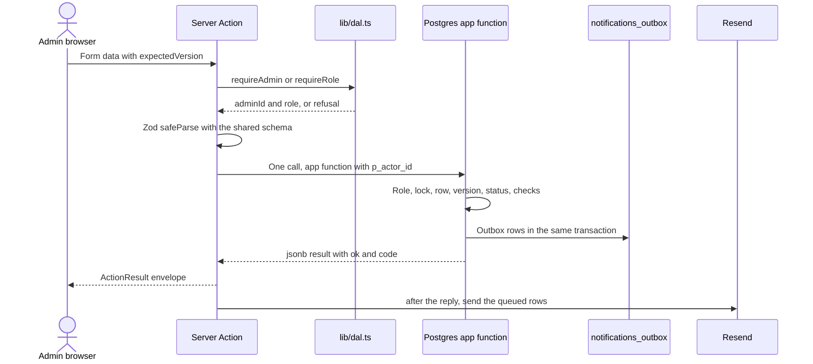
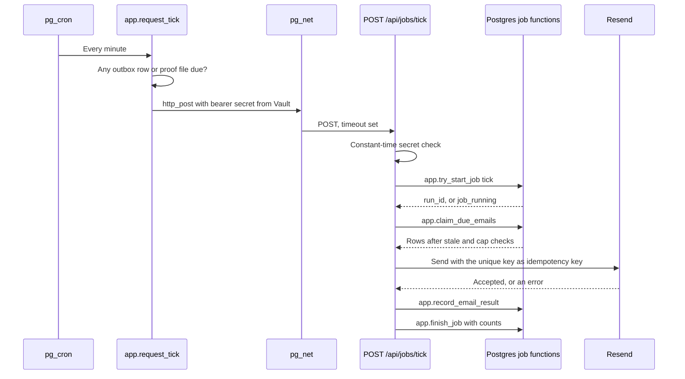

# API Specification

> **Purpose:** The interface contracts of the DJB Kasoundbox system: every public and admin Server Action, every route, every `app.*` Postgres function, the scheduled jobs, the result codes, and the conventions they all share. It settles the final names that the workflow docs gave as indicative. ·
> **Audience:** The developer (Super Admin). The "In plain words" section is for the business owner (Admin) ·
> **Status:** Draft for review ·
> **Last updated:** 2026-10-21 ·
> **Depends on:** [Decision log][dl], [Roles and permissions][roles], [Business rules][br], [Functional requirements][fr], [Non-functional requirements][nfr], [Edge cases][ec], [Privacy and retention][priv], [Reservation lifecycle][lc], [Catalog and payments][cat]; the workflow docs [booking-and-submission][wf-book], [availability-and-conflicts][wf-avail], [lookup-and-review][wf-review], [changes-and-expiry][wf-change], [notifications-and-tracking][wf-notify], [administration][wf-admin]; the batch-3 siblings [architecture][arch], [data-model][data], [security][sec], [ux-and-sitemap][ux] ·
> **Derived from:** [functional-requirements][fr] (every FR-PUB, FR-ADM, FR-NTF, and FR-SYS ID); [roles-and-permissions][roles] §2, §4, §5, §7; [business-rules][br] BR-01 to BR-12; [reservation-lifecycle][lc] §1 to §7; [catalog-and-payments][cat] §1 to §7, §9; [non-functional-requirements][nfr] NFR-02, NFR-03, NFR-09 to NFR-14, NFR-19 to NFR-26, NFR-33; [edge-cases][ec] EC-01 to EC-85; [privacy-and-retention][priv] §5.4 to §5.6, §6; the "Developer notes" of WF-01 to WF-10; background: [spec v0.2][spec] §4, §9, §10, §11, §12, §13, §15 (frozen, never edited)

## In plain words

*For the business owner (Admin).*

- **One door per button.** Every button in the website and the admin panel that changes something (submit a request, approve, record a deposit, cancel, block a set) goes through one named "door" on the server. This document is the list of those doors: what goes in, what comes out, and what can be refused.
- **All or nothing.** Behind each door, the database does the whole job in one step: the change, the history entry, and the emails are saved together, or nothing is saved.
- **Who you are is checked first.** Before an admin door opens, the server checks your login, your 2FA, and whether your role may do this. Who may do what is not repeated here; it stays in [roles-and-permissions][roles].
- **Clear refusals.** When something is refused, you see one short reason, for example "Already changed, please refresh" when the other admin acted first, or "Just taken" when someone else got the last set.
- **Timers.** A few doors are opened by timers with a secret password, every minute (expire holds, send emails) and every night (mark events Completed, clean up old data). The health panel shows when they last ran.
- **No new rules.** Where this document had to choose a technical detail that the other documents leave open, it is marked **[P] (new in this doc)** and listed under [Open questions](#open-questions) for review.

## How to read this document

- **What this document owns.** Interface contracts only: names, inputs, validation, outputs, result codes, the database function behind each action, locks, the SQLSTATE policy, the job routes, and the `pg_cron` schedule. Every rule, permission, status, deadline, limit, price, and retention period is owned by a batch-1 document and is cited here by its ID with a link, never restated. Where a rule has a number, this document says "the limit in NFR-11" or "the notice period (BR-06)", never the number.
- **Labels.** **[C]** confirmed decision · **[P]** proposed, accepted with the spec approval but may change · **[U]** unverified fact, to be checked in the week-1 test or before launch · **[O-nn]** open item in the [decision log][dl]. **[P] (new in this doc)** marks a technical contract detail that no batch-1 or batch-2 doc defines; each one is listed under [Open questions](#open-questions).
- **Provisional.** "Provisional" marks a technical default chosen so the contract can be built while a business question is still open elsewhere. It changes when that question is answered; the question is linked, not repeated.
- **Names.** These names are final; they replace the "indicative" names of the workflow docs. Server Actions are `camelCase` verbs without an `Action` suffix. Database functions are `app.<verb>_<noun>`. Result codes, audit actions, and outbox types are `snake_case`. Where a name differs from the indicative one, the [Source notes](#source-notes-workflow-names-the-frozen-spec-and-the-siblings) say why.
- **Where things live.** Module paths follow [architecture][arch] §9: public actions in `lib/actions/public/`, admin actions in `lib/actions/admin/` (each file `server-only`), the DAL in `lib/dal.ts`, typed database calls in `lib/db/functions.ts`, Zod schemas in `lib/validation/`, email in `lib/email/`. Tables, columns, and indexes are owned by [data-model][data]; threats and controls by [security][sec]; page layouts and final wording by [ux-and-sitemap][ux].
- **Time and money.** Every date and time a person sees is Manila time ([NFR-19][nfr]). Amounts are Philippine pesos (₱). Section 1.10 says how both travel on the wire.

---

## 1. Conventions

### 1.1 Where each kind of call lives

| Kind of call | Used for | Mechanism | Module |
|---|---|---|---|
| Public page read | Catalog, calendar, status page, documents, QR link page | Server Component calling a DAL read; the read calls a **public** `app.*` function ([architecture][arch] §4.2) | `lib/queries/public/` **[P] (new in this doc)** |
| Public mutation | Submit, status lookup, QR reissue, the two upload steps | Server Action | `lib/actions/public/` |
| Admin page read | Dashboard, list, details, audit log, health, catalog, settings, accounts | Server Component calling a DAL read that starts with `requireAdmin()`; Drizzle query builder ([architecture][arch] §6.3) | `lib/queries/admin/` **[P] (new in this doc)** |
| Admin mutation | Every admin action in FR-ADM | Server Action whose first line is `requireAdmin()` or `requireRole('superAdmin')` | `lib/actions/admin/` |
| Route handler | Job routes, health check, Better Auth | `route.ts` under `app/api/` | `app/api/jobs/tick`, `app/api/jobs/daily`, `app/api/health`, `app/api/auth/[...all]` |

Rules **[P] (new in this doc)**:

- **Server Actions** serve only our own pages. They are not a public API: no outside caller is supported, and their IDs may change on every deploy (the reload prompt of [EC-02][ec]).
- **Route handlers** exist only where an outside caller needs a stable address: `pg_net` (tick), Vercel Cron (daily), the uptime check (health), and Better Auth's own client.
- **No client-side data endpoints and no polling** ([NFR-03][nfr], [FR-ADM-02][fr]). Pages re-read on navigation; the calendar month and the list filters are URL search parameters.
- **Every write is one database function call** ([NFR-21][nfr]); Drizzle's query builder is used for admin reads only ([architecture][arch] §6.3).

Every mutation follows the same path. The diagram shows an admin action; a public action skips the DAL step and runs its bot and rate checks instead (section 2.3).



### 1.2 The DAL and the role check

`lib/dal.ts` ([architecture][arch] §4.3) exports `verifySession()`, `requireAdmin()`, and `requireRole('superAdmin')`. Their contract:

| Step | Check | On failure |
|---|---|---|
| 1 | A Better Auth session exists for the request cookies | `not_authenticated`; pages redirect to `/admin/login` |
| 2 | The account is not disabled | `not_authenticated`, and the session is revoked **[P] (new in this doc)**, following the proposal in [administration][wf-admin] open question 4 |
| 3 | 2FA is enabled for the account and was passed for this session | Redirect to `/admin/setup-2fa` ([WF-09B][wf-admin]); every other admin page and action refuses with `not_authenticated` |
| 4 | The role is allowed: `requireAdmin()` accepts both admin roles; `requireRole('superAdmin')` only the Super Admin | `forbidden` |
| 5 | Returns `{ adminId, role, displayName }`; memoized per request with React `cache()` in Server Components | — |

- **Which role each action needs** is defined only in [roles-and-permissions][roles] §2. Each action card in section 3 links to its row there.
- **The database checks again.** Every admin function takes the acting admin's ID as its first argument, `p_actor_id uuid`, and checks the role from the user table with `app.assert_actor` before anything else **[P] (new in this doc)**. This settles [administration][wf-admin] open question 22: the server passes the ID explicitly; nothing is kept on the pooled connection.
- **Role values** in code are `superAdmin` and `admin` ([architecture][arch] §4.3); the stored values are set in [data-model][data].

### 1.3 Input validation with Zod 4

- **One schema, two uses.** Each form has one Zod 4 schema in `lib/validation/`. The browser form uses it through the React Hook Form Zod resolver; the Server Action runs `schema.safeParse()` on the same object ([FR-PUB-06][fr] developer note; [spec v0.2][spec] §10).
- **Three layers.** Browser, Server Action, and database each validate ([NFR-21][nfr]). The database re-checks every rule it owns, so a request that skips the browser still meets every rule.
- **Field errors.** A Zod failure returns `invalid_input` with `fieldErrors`, keyed by the field's dotted path, for example `customer.mobile` **[P] (new in this doc)**. A database check that fails on a single field (for example the mobile normalizer) returns its own code and names the field in `fieldErrors` too.
- **Never trusted from the browser:** prices, totals, the deposit, deadlines, the service start, the urgent flag, the reference code, and the QR token. The database computes them ([catalog-and-payments][cat] §2.1; [NFR-21][nfr]).

**Shared field schemas.** Lengths and formats marked **[P]** are technical limits new in this doc; every business limit is cited.

| Schema | Wire type | Validation | Source |
|---|---|---|---|
| `referenceCode` | string | Trim, uppercase, drop spaces and dashes, then require the `KSB-XXXX-XXXX` format and alphabet of FR-PUB-08; the normalized value is sent with dashes | [FR-PUB-08][fr], [EC-64][ec] |
| `mobile` | string, sent as E.164 | Only the forms in BR-11, converted to the one standard form. The same normalizer exists in SQL as `app.normalize_mobile` | [BR-11][br] |
| `email` | string, optional | Trimmed, lowercased, `z.email()`, at most 254 characters **[P] (new in this doc)** | [FR-PUB-05][fr], [D-08][dl] |
| `customerName` | string | Trimmed, inner spaces collapsed, at most 100 characters **[P] (new in this doc)**. Whether it may be empty: [booking-and-submission][wf-book] open question 7; the schema has one flag for it | [FR-PUB-05][fr] |
| `serviceType` | `'delivery'` or `'onsite'` | Enum | [D-01][dl] |
| `eventDate` | `YYYY-MM-DD` | A real calendar date, read as a Manila date | [NFR-19][nfr] |
| `slotId` | uuid | Required for delivery, absent for on-site | [FR-PUB-04][fr] |
| `arrivalTime` | `HH:MM` | 24-hour Manila wall time; required for on-site, absent for delivery | [FR-PUB-04][fr], [D-03][dl] |
| `packageId`, `addonId`, other IDs | uuid | — | — |
| `addons` | array of `{ addonId, quantity }` | Distinct `addonId`s; `quantity` an integer of at least 1; at most 20 lines **[P] (new in this doc)** | [FR-PUB-04][fr] |
| `venue` | object | Delivery only: `barangay` and `city` required; `street` and `landmarks` per [functional-requirements][fr] §7, question 6; each at most 200 characters **[P] (new in this doc)** | [FR-PUB-05][fr] |
| `customerNote` | string, optional | The length limit in FR-PUB-05 | [FR-PUB-05][fr] |
| `reason`, `message` | string | Trimmed, not empty, at most 500 characters **[P] (new in this doc)** | [FR-ADM-07][fr] |
| `amountCentavos` | integer | Whole centavos, more than 0 (0 allowed only for a "none" refund decision), at most 99,999,999 **[P] (new in this doc)** | Section 1.10 |
| `method` | `'cash'` or `'ewallet'` | Enum | [D-05][dl], [catalog-and-payments][cat] §4.2 |
| `ewalletRef` | string | Required for e-wallet, absent or empty for cash; trimmed, 1 to 64 letters, digits, or dashes **[P] (new in this doc)** | [catalog-and-payments][cat] §4.2 |
| `paymentNote` | string, optional | At most 500 characters **[P] (new in this doc)**. Never payer names or account numbers ([catalog-and-payments][cat] §4.7) | [catalog-and-payments][cat] §4.2 |
| `refundDecision` | `{ kind, amountCentavos }` | `kind` is `'none'`, `'partial'`, or `'full'`; `none` has amount 0; `partial` and `full` more than 0 | [reservation-lifecycle][lc] §6.6 |
| `expectedVersion` | integer | At least 1 | Section 1.9 |
| `manilaDateTime` | `YYYY-MM-DDTHH:MM` | Manila wall time typed by an admin; converted to UTC on the server | Section 1.10 |

### 1.4 One Postgres function per business action

- **Shape.** `app.<verb>_<noun>(...) returns jsonb`, PL/pgSQL, `VOLATILE`, `SECURITY DEFINER`, owned by a role that cannot log in, `search_path = ''` with fully qualified names, `READ COMMITTED` ([architecture][arch] §6.3).
- **Grants.** The app's database role has `EXECUTE` on the public, admin, and job-route functions listed in section 5, and nothing else ([NFR-10][nfr]). Internal helpers (section 5.2) and the SQL-only jobs are not granted to it **[P] (new in this doc)**; [security][sec] owns the full grant list.
- **One call, one transaction.** The app sends one `SELECT app.fn(...)`; through the transaction pooler that statement is its own transaction ([architecture][arch] §6.3). No app code opens a multi-statement transaction.
- **Lock order.** The capacity lock first (only in functions that take or move capacity), then the reservation row `FOR UPDATE`, then child rows (payments, proofs, the acknowledgment counter) ([architecture][arch] §6.4). This is the order proposed in [availability-and-conflicts][wf-avail] open question 10.
- **Time.** After its locks are held, a function reads the time with `clock_timestamp()`; "today" is `(clock_timestamp() AT TIME ZONE 'Asia/Manila')::date` through `app.manila_today()` ([architecture][arch] §6.3; [NFR-19][nfr]).
- **Timeouts.** Capacity functions run `SET LOCAL lock_timeout = '3s'`; the app role has `statement_timeout = '10s'` **[P] (new in this doc)**. A lock timeout returns `busy` ([architecture][arch] §6.4).

### 1.5 The result envelope

Every Server Action returns this type **[P] (new in this doc)** for the `conflicts` field; the rest is as specified for this project:

```ts
type ActionResult<T> =
  | { ok: true; data: T }
  | {
      ok: false;
      code: ResultCode;            // section 1.7
      message: string;             // from the message table, never from the database
      fieldErrors?: Record<string, string[]>;
      conflicts?: Conflict[];      // only with code 'conflict'
    };

type Conflict = {
  date: string;                    // YYYY-MM-DD
  kind: 'reservation' | 'block';
  referenceCode?: string;          // for a reservation
  blockId?: string;                // for a block
  resourceName?: string;           // the set or the room
  quantity?: number;               // add-on units, for a stock clash
};
```

Every `app.*` function returns `jsonb` in this shape **[P] (new in this doc)**:

```json
{ "ok": true,  "code": "ok",            "data":   { "reservation_id": "…", "version": 4 } }
{ "ok": true,  "code": "duplicate",     "data":   { "reference_code": "KSB-7Q2M-K9TX" } }
{ "ok": false, "code": "stale_version", "detail": { } }
{ "ok": false, "code": "conflict",      "detail": { "conflicts": [ ] } }
```

- **Mapping.** `lib/db/functions.ts` turns the database result into `ActionResult`: `code` passes through, `message` comes from one message table keyed by code (section 1.7), with placeholders filled from `detail` (for example the add-on's name). The database never sends user-facing text **[P] (new in this doc)**.
- **Success codes.** `ok`, and `duplicate` for a repeated submission (section 1.8), which maps to `{ ok: true, data: { …, duplicate: true } }`.
- **HTTP.** A Server Action always answers HTTP 200 with the envelope. Only the route handlers (section 4) use HTTP status codes.

### 1.6 Errors, exceptions, and the SQLSTATE policy

**[P] (new in this doc)** throughout:

1. **Expected refusals are returned, not raised.** A check that fails returns `{ ok: false, code }`. Nothing of the action's own change has been written yet, so nothing needs undoing.
2. **A refusal after the action's own writes** (for example "no free set" found after the reservation row was inserted) calls `app.refuse(code, detail)`, which raises SQLSTATE **`KS000`** with the code in the message and the detail as JSON. Each function wraps its own writes in one inner `BEGIN … EXCEPTION WHEN SQLSTATE 'KS000' …` block, so the raise undoes the action's writes and the function returns the refusal normally.
3. **Writes made before that inner block are kept on purpose:** a breaker trip (its pause, audit entry, and admin email, [BR-07a][br]), rate-limit counters, and overdue holds marked Expired before a claim (each a real "deadline passed" change with its own audit entry and email, [reservation-lifecycle][lc] §4.1). This is why the breaker trip commits ([WF-01C][wf-book] developer notes).
4. **Unexpected errors propagate** and are mapped by `lib/db/functions.ts`:

| SQLSTATE | Where | Returned code | Also |
|---|---|---|---|
| `KS000` (escaped a function) | A missing inner block | The code in the message | Sentry error: a bug |
| `23505` on the live-claim index | Any claim insert | `sold_out` (public) or `not_free` (admin) | Sentry error, following the proposal in [availability-and-conflicts][wf-avail] open question 11 |
| `23505` on the reference code | `app.new_reference_code()` | Never surfaces: retried inside, up to 5 times | — |
| `23505` on the submission key | `app.book_reservation`, `app.create_staff_reservation` | Never surfaces: the key's reservation is read and returned as `duplicate` | — |
| `55P03` lock not available | Capacity lock | `busy` | — |
| `57014` statement timeout | Any | `busy` | Sentry warning |
| `40P01` deadlock, `40001` serialization | Any | The server retries the call once, then `busy` | Sentry warning |
| `22xxx` data exception, `23502`, `23514` check violation | Any | `invalid_input` | Sentry error: the schemas missed it |
| Any other, or a lost connection | Any | `internal_error` | Sentry error, personal data scrubbed ([NFR-23][nfr]) |

5. **No raw database text** ever reaches a page or an email.

### 1.7 Result-code catalog

Draft messages **[P] (new in this doc)**, except where the "Wording" column cites [ux-and-sitemap][ux] §7.2, which owns the final words. Messages use placeholders filled from settings or the result (`{deposit}`, `{serviceStart}`), never numbers written into the text, so a setting change never makes a message wrong.

| Code | Meaning | Returned by | Draft message | Wording |
|---|---|---|---|---|
| `invalid_input` | A field failed validation | Every action | "Please check the highlighted fields." | — |
| `invalid_mobile` | The mobile number is not a BR-11 form | Submit, lookup, edit details, staff booking, erasure | "Enter a Philippine mobile number, for example 0917 123 4567." | [NFR-17][nfr] item 4 |
| `not_authenticated` | No admin session, no 2FA, or a disabled account | Every admin action and read | (redirect) "Please log in again." | — |
| `forbidden` | The role may not do this ([roles][roles] §2) | Admin actions | "Your account can't do this. Ask the Super Admin." | — |
| `not_found` | The record does not exist, or the visitor may not see it | Many | Lookup: see the "Failed lookup" message. QR: "Not found or no longer valid." Admin: "This record no longer exists." | [ux][ux] §7.2 |
| `stale_version` | The record changed since the page was loaded | Admin actions | "Already changed, please refresh." | [ux][ux] §7.2 "Already changed" |
| `not_allowed` | The status or the record's state does not allow this action ([EC-53][ec]) | Admin actions, upload | "This isn't available for this booking's current status." | — |
| `overdue` | The hold is past its deadline and not paused, so it counts as expired ([BR-05][br]) | Admin actions, upload | "This request's deadline has passed, so it counts as expired." | [ux][ux] §7.2 "Deadline passed" |
| `reason_required` | A required reason or message is missing (checked again in the database) | Actions that need a reason | "Please write a reason." | — |
| `refund_decision_required` | A refund decision is required here | Cancel, event not held | "Choose a refund decision: none, partial, or full." | — |
| `rate_limited` | A rate limit in NFR-11 was reached | Submit, lookup, upload slot, login | "Too many tries. Please wait a while and try again, or message or call us." | — |
| `bot_check_failed` | Turnstile failed, or the honeypot was filled | Submit | "We couldn't complete the security check. Please try again." | — |
| `outside_window` | The date is outside the booking window (BR-09) | Submit | "This date can't be booked online. Please pick a date on the calendar." | — |
| `slot_inactive` | The delivery slot is archived or unknown | Submit, staff booking, reschedule, recreate | "That delivery time is no longer offered. Please pick another one." | — |
| `outside_onsite_hours` | The arrival time is outside on-site hours | Submit, staff booking | "Please pick an arrival time within our on-site hours." | — |
| `item_unavailable` | A package or add-on is archived or unknown | Submit, staff booking, edit details, recreate | "Something you chose is no longer offered. Please check your package and add-ons." | — |
| `too_soon` | The start is within the notice period (BR-06) | Submit | "That start time is too soon to book online. Pick a later time, or message or call us." | — |
| `hold_limit_date` | The per-date hold limit for this number (BR-07) | Submit | "This mobile number already has an open request for this date. Please message or call us." | — |
| `hold_limit_total` | The total hold limit for this number (BR-07) | Submit | "This mobile number already has the most open requests allowed. Please message or call us." | — |
| `paused` | Online booking is paused (BR-07a) | Submit | "Online booking is paused for a short while. Please message or call us to book." | [ux][ux] §7.2 "Paused banner" |
| `breaker_tripped` | This request tripped the breaker (BR-07a) | Submit | Same as `paused` | [ux][ux] §7.2 |
| `sold_out` | No set or room is free on that date | Submit | "Sorry, this date was just taken by another booking. Your details are saved. Pick another date:" | [ux][ux] §7.2 "Just taken" |
| `addon_short` | Not enough of an add-on on that date (BR-03) | Submit, staff booking, edit details, reschedule, recreate | "Not enough {addon} left on {date}. Lower the quantity or pick another date." | — |
| `not_free` | An admin change needs capacity that is not free | Staff booking, reschedule, recreate | "Not free on {date}: {what}. Nothing was changed." | — |
| `conflict` | A block or catalog change clashes with live claims (BR-08, BR-10) | Blocks, catalog, slots, resources | "Can't save: it clashes with the bookings or blocks listed below." | — |
| `after_service_start` | The new deadline is later than the service start | Extend | "The new deadline can't be later than the service start, {serviceStart}." | — |
| `not_later` | The new deadline is not later than the current one | Extend | "The new deadline must be later than the current one, {deadline}." | — |
| `not_today` | The event date is not today, Manila date ([reservation-lifecycle][lc] §6.4) | Waiver, one-step waiver | "A deposit can be waived only on the event date." | — |
| `amount_mismatch` | The deposit is not the locked deposit amount | Record deposit, verify proof, one-step deposit | "The deposit must be exactly {deposit}." | — |
| `deposit_exists` | An active deposit already exists | Record deposit, verify proof | "This booking already has an active deposit." | — |
| `invalid_ewallet_ref` | Reference missing for e-wallet, or given for cash | Payment actions | "E-wallet payments need the reference number; cash payments leave it empty." | — |
| `already_void` | The payment is already void | Void | "This payment is already void." | — |
| `one_step_required` | A staff booking whose start is within the notice period needs the deposit or a waiver | Staff booking | "This start is too close for a normal booking. Record the deposit or waive it to finish in one step." | — |
| `one_step_not_allowed` | One-step fields were sent for a booking that does not need them | Staff booking | "This booking doesn't need the one-step form. Save it as a normal booking." | — |
| `service_start_passed` | The service start has passed (provisional, section 5.4) | Recreate | "This booking's start time has passed, so it can't be recreated." | — |
| `already_removed` | The block was already removed | Remove block | "This block was already removed." | — |
| `not_paused` | Online booking is not paused | Resume online booking | "Online booking is already open." | — |
| `legal_hold` | A legal hold stops the erasure ([privacy-and-retention][priv] §5.5) | Erasure | "A legal hold is set on this reservation, so nothing was erased." | — |
| `verification_failed` | The reference code and mobile number do not match this reservation | Erasure | "The reference code and mobile number don't match this reservation." | — |
| `admin_exists` | An Admin account is already active ([roles][roles] §5.1) | Create admin | "An Admin account is already active. Disable it first." | — |
| `self_action` | The Super Admin may not do this to its own account ([roles][roles] §5.1) | Disable admin | "You can't do this to your own account." | — |
| `lookup_required` | The status-page session is missing or expired (section 1.13) | Public actions after the lookup | "Please enter your reference code and mobile number again." | — |
| `upload_limit` | The upload limit in FR-PUB-12 was reached | Upload slot, upload confirm | "This booking already has the most proof uploads allowed. Please message or call us." | — |
| `proof_pending` | A proof is still waiting for review (provisional, section 2.7) | Upload slot | "Your earlier proof is still being checked." | — |
| `upload_invalid_file` | The file type or size is not allowed (FR-PUB-12) | Upload slot, upload confirm | "Please upload a picture in one of the accepted formats, within the size limit." | — |
| `upload_missing` | The file never reached storage | Upload confirm | "We didn't receive your picture. Please try again." | — |
| `account_locked` | The login lock of NFR-11 is active | Login | "Too many failed tries. This account is locked for a while." | — |
| `invalid_credentials` | Wrong email, password, or 2FA code | Login | "The email, password, or code is not right." (same text for every case, [administration][wf-admin] open question 6) | — |
| `busy` | A lock wait or a statement timed out | Any | "The system is busy. Nothing was saved. Please try again in a moment." | — |
| `internal_error` | Anything unexpected | Any | "Something went wrong on our side. Please refresh to see whether your change was saved." | — |
| `unauthorized` | Job route called without the right secret | Job routes | (HTTP 401, no body text) | — |
| `job_running` | Another run of the job holds its lease | Job routes | (HTTP 409) | — |
| `db_unavailable` | The health query failed | `/api/health` | (HTTP 503) | — |

### 1.8 Idempotency

**[P] (new in this doc)** unless cited:

| What | How it is made idempotent |
|---|---|
| **Public submission** ([EC-01][ec], [EC-02][ec]) | The browser makes a `submissionKey` (UUID v4) when a new draft starts and keeps it in `sessionStorage` with the draft ([architecture][arch] §3.2). The server sends only its SHA-256 to the database. `app.book_reservation` looks the hash up under the capacity lock; a unique index on the hash is the backstop. A known key returns `duplicate` with the earlier reservation, whatever the data sent. **Key rotation:** the browser keeps the key after an unknown outcome (network error, timeout, reload) and makes a new key when the draft changes after a known outcome (a refusal), and after a success. This settles the technical half of [booking-and-submission][wf-book] open question 3; whether a repeat with changed data should return the earlier reservation stays open there. |
| **Repeat answer** | A `duplicate` result returns the reference code, status, and deadline, but **no QR code**, because only the token's hash is stored ([FR-PUB-08][fr]). The confirmation page then shows the reference code and links to the status page, where the customer can get a new QR code ([FR-PUB-13][fr]). Provisional, for [booking-and-submission][wf-book] open question 2. |
| **Staff-created booking** | The create form carries a `submissionKey` too, and `app.create_staff_reservation` uses the same key table, so a double click on Create returns the same booking. This answers [lookup-and-review][wf-review] open question 11. |
| **Admin actions on a reservation** | The version check (section 1.9): a second identical call carries the old version and gets `stale_version` ([EC-16][ec]). |
| **Catalog, settings, blocks, resources** | A `version` on each row and `expectedVersion` on each update (section 1.9). Creates are not deduplicated: an accidental second item is archived. |
| **Upload confirm** | `app.record_proof_upload` is keyed by the slot: a second call for a used slot returns the first result. |
| **Emails** | The outbox unique key of [FR-NTF-17][fr], inserted with `ON CONFLICT DO NOTHING`, and the same key sent to Resend as its idempotency key ([WF-07A][wf-notify] developer notes). |
| **Jobs** | Every job is safe to run twice: expiry and completion update only rows still in the old status; reminders insert with `ON CONFLICT DO NOTHING`; the routes take a lease (section 4). |

### 1.9 The optimistic version check

- **Every reservation has an integer `version`** ([spec v0.2][spec] §11). Admin pages send it as `expectedVersion`; the function compares it under the row lock and returns `stale_version` on a mismatch, writing nothing ([FR-ADM-07][fr], [WF-05E][wf-avail]).
- **Check order:** version first, then status. If the other admin approved first, the answer is "Already changed, please refresh", not "not allowed" **[P] (new in this doc)**.
- **What increases the version [P] (new in this doc):** every successful write that changes what the admin reservation page shows, by any actor: status, deadline, flags, details, items, the refund decision, the QR token, expiry paused, a payment recorded or voided, a proof uploaded or reviewed, and an internal note. A refusal never increases it. This settles the technical side of [availability-and-conflicts][wf-avail] open question 9; it means an admin page opened before a customer's upload must be refreshed before recording that deposit.
- **Customer actions carry no version.** The customer's QR reissue and upload act on the current row.
- **Other editable rows** (packages, add-ons, delivery slots, resources, blocks, and each setting) have a `version` too, and their update functions take `p_expected_version` **[P] (new in this doc)**. This answers [administration][wf-admin] open question 12 with "a version check, not last save wins".

### 1.10 Time and money on the wire

**[P] (new in this doc)** unless cited:

| Value | On the wire | Notes |
|---|---|---|
| A moment (deadline, service start, created, recorded) | ISO 8601 in UTC with `Z`, for example `2026-12-18T06:00:00Z` | Stored as `timestamptz` ([NFR-19][nfr]) |
| An event date | `YYYY-MM-DD`, a Manila calendar date | Stored as `date` |
| A time of day (arrival, slot start and end, on-site hours) | `HH:MM`, Manila wall time | The database builds the service start with `(event_date + arrival_time) AT TIME ZONE 'Asia/Manila'` |
| A moment typed by an admin (a new deadline) | `YYYY-MM-DDTHH:MM`, Manila wall time | Converted on the server; the browser's time zone is never used |
| Display | Formatted on the server with `Intl.DateTimeFormat('en-PH', { timeZone: 'Asia/Manila' })` | [NFR-19][nfr]; layout in [ux-and-sitemap][ux] §5.3 |
| Money | Integer centavos, field names ending in `Centavos` | No floating point anywhere. Column types: [data-model][data]. Display in pesos: [ux-and-sitemap][ux] §5.4 |

### 1.11 Rate limits, Turnstile, and the honeypot

- **Limits.** The thresholds are the settings of [NFR-11][nfr]; they are read from the settings table on every check and never written in code.
- **Counters** live in the database, keyed by an HMAC of the IP address with the day's key, or by an HMAC of an account or a reference code ([NFR-11][nfr], [FR-SYS-06][fr]). The server passes the raw IP to the function; `app.rate_limit_hit` computes the HMAC with the current key and never stores the IP **[P] (new in this doc)**. The IP comes only from `getClientIp()` ([architecture][arch] §9).
- **Buckets [P] (new in this doc):**

| Bucket | Key | Checked in | NFR-11 row |
|---|---|---|---|
| `submit_ip` | HMAC(IP) | `submitReservation`, before Turnstile | Form submission |
| `lookup_ip` | HMAC(IP) | `app.lookup_status` | Status lookup |
| `lookup_fail_ref` | HMAC(normalized reference code) | `app.lookup_status`, failures only | Status lookup |
| `upload_slot` | Reservation ID | `app.issue_proof_upload_slot` | Proof upload link |
| `login_ip` | HMAC(IP) | `app.login_guard` | Login |
| `login_fail_account` | HMAC(normalized email) | `app.login_guard`, `app.login_result` | Login |

  The failed-lookup key is the reference code alone, as the NFR-11 table says "per reference code"; a key of code plus mobile would not slow down someone trying many numbers against one code. This answers the technical side of [notifications-and-tracking][wf-notify] open question 11; [security][sec] confirms.
- **Turnstile.** The server calls siteverify with the secret key, the token, and the client IP, with a 5-second time limit **[P] (new in this doc)**. A failure, a used token, or a Cloudflare outage returns `bot_check_failed`: the check fails closed, as Submit "requires" it ([FR-PUB-06][fr]). Each Submit needs a fresh token ([WF-01C][wf-book] developer notes).
- **Honeypot.** A hidden field named `website` that must arrive empty **[P] (new in this doc)**. A filled honeypot returns `bot_check_failed`, the same answer as a failed Turnstile check.
- **Admin forms** have no Turnstile and no honeypot ([FR-ADM-24][fr]).

### 1.12 Emails after the reply

- Each function returns the IDs of the outbox rows it queued in `data.outbox_ids`. The Server Action answers first, then calls `after(() => sendOutbox(outboxIds))` ([FR-NTF-16][fr]; [architecture][arch] §3.2).
- `sendOutbox` claims exactly those rows with `app.claim_due_emails(null, …, p_only_ids)` (section 5.9) and sends them as the tick does. A row it cannot send stays queued for the tick.
- A customer email is queued only when the reservation has an email address; without one, no row is written and nothing fails ([FR-NTF-21][fr]; [WF-07F][wf-notify] developer notes).

### 1.13 The status-page session and document access

**[P] (new in this doc)**; [security][sec] owns the cookie flags, lifetimes, and token format.

- **After a successful lookup** ([FR-PUB-10][fr]), `lookupStatus` sets a cookie `ksb_status`: an HMAC-signed value holding the reservation ID and an expiry; `HttpOnly`, `Secure`, `SameSite=Lax`, `Path=/status`, proposed lifetime 30 minutes. The later public actions (QR reissue, upload slot, upload confirm) and the document pages read the reservation ID only from this cookie. A missing or expired cookie returns `lookup_required`. This answers the technical side of [notifications-and-tracking][wf-notify] open question 10.
- **Document pages** (section 2.10) accept one of three proofs of access: the `ksb_status` cookie for the same reservation; a signed link token `?t=` in a Confirmed email ([FR-NTF-07][fr]); or an admin session. The token's format and lifetime are for [security][sec], which owns [functional-requirements][fr] §7, question 5.
- **The QR link in the request-received email.** The outbox row keeps the QR address in its payload only while the row is `queued`; the address is erased when the row reaches `sent`, `failed`, or `skipped`. Until then a working link sits in the database; [security][sec] may replace this with encryption. Provisional, for [booking-and-submission][wf-book] open question 1.

### 1.14 Caching and revalidation

| Data | Cache | Refreshed by |
|---|---|---|
| Public catalog (`/packages`, the form's lists) | `'use cache'` in `lib/catalog.ts`, tag `catalog` ([architecture][arch] §5) | `updateTag('catalog')` after any catalog, delivery-slot, or resource function returns `ok`; never before the commit |
| Public settings shown on cached pages (business info, the deposit amount, deposit instructions) | Tag `settings` **[P] (new in this doc)** | `updateTag('settings')` after `app.update_setting` returns `ok` (answers the technical side of [administration][wf-admin] open question 15) |
| Calendar, form submit, status page, documents, `/r/[token]`, every admin page, every route | Never cached ([NFR-03][nfr]) | — |

---

## 2. Public Server Actions and routes

Every public action and page in this section needs no login. None of them returns the customer's name, mobile number, address, or any internal note, except the acknowledgment's "received from" line ([roles-and-permissions][roles] §6). Common result codes for every public action: `invalid_input`, `busy`, `internal_error`.

### 2.1 Availability calendar read

| Field | Contract |
|---|---|
| Name | DAL read `getAvailability(serviceType, month)` on the page `/availability?type=delivery&month=2026-12` (the form's date picker uses the same read) |
| Input | `type`: `serviceType`; `month`: `YYYY-MM`, defaults to the current Manila month. Out-of-range months are clamped to the booking window (BR-09) |
| Checks | None besides Zod. No Turnstile. No rate limit is defined for it ([NFR-11][nfr] lists none); [security][sec] may add one |
| DB function | `app.availability_calendar(p_service_type, p_from, p_to)` |
| Output | `{ onlinePaused: boolean, pausedUntil: string \| null, today: 'YYYY-MM-DD', windowEnd: 'YYYY-MM-DD', days: [{ date, label: 'available' \| 'full' }] }`. Labels are returned even while paused; whether the page shows them under the banner is [availability-and-conflicts][wf-avail] open question 4 |
| Result codes | `invalid_input` |
| Emails | None |
| Serves | [FR-PUB-03][fr]; [WF-01A][wf-book], [WF-05A][wf-avail] |

### 2.2 Catalog and public settings read

| Field | Contract |
|---|---|
| Name | DAL reads `getPublicCatalog()` and `getPublicSettings()`, cached (section 1.14) |
| DB function | `app.public_catalog()`, `app.public_settings()` |
| Output | Catalog: active packages (ID, name, inclusions, price), active add-ons (ID, name, unit price), active delivery slots (ID, label, start, end). No stock figures **[P] (new in this doc)**: stock is checked at Submit ([BR-03][br], [EC-05][ec]). Settings: business info, the deposit amount, the notice period and on-site hours (so the form can refuse a too-early start or an arrival outside the hours before Submit, [FR-PUB-04][fr]), deposit instructions, and the free-delivery wording (O-04) |
| Serves | [FR-PUB-01][fr], [FR-PUB-02][fr], [FR-PUB-04][fr], [FR-PUB-16][fr] |

### 2.3 `submitReservation`

| Field | Contract |
|---|---|
| Input | `serviceType`, `eventDate`, `slotId` or `arrivalTime`, `packageId`, `addons`; `customer: { name, mobile, email?, venue?, customerNote? }`; `policyAccepted: true` (whether it is stored: [booking-and-submission][wf-book] open question 6); `submissionKey` (uuid); `turnstileToken`; `website` (honeypot, empty) |
| Checks, in order | **[P] (new in this doc)**, settling the technical side of [booking-and-submission][wf-book] open question 5: (1) honeypot empty, else `bot_check_failed`; (2) rate limit `submit_ip` ([NFR-11][nfr]), else `rate_limited`, and a repeat with the same key counts too; (3) Zod, else `invalid_input`; (4) Turnstile siteverify, else `bot_check_failed`; (5) one database call |
| DB function | `app.book_reservation(p_submission_key_hash, p_booking, p_customer)` (section 5.3) |
| Output `data` | `{ referenceCode, status: 'pending', deadline, qrUrl, qrSvg, duplicate: false }`; or on a repeat `{ referenceCode, status, deadline, qrUrl: null, qrSvg: null, duplicate: true }`. The QR address is `SITE_URL` + `/r/` + the token ([FR-PUB-08][fr], O-05); the SVG is drawn by `uqr` on the server. The confirmation is rendered on `/book` ([ux-and-sitemap][ux] P7) |
| Result codes | `bot_check_failed`, `rate_limited`, `invalid_mobile`, `item_unavailable`, `slot_inactive`, `outside_onsite_hours`, `outside_window`, `too_soon`, `hold_limit_date`, `hold_limit_total`, `paused`, `breaker_tripped`, `sold_out`, `addon_short` |
| Emails queued | `request_received` ([FR-NTF-01][fr], only with an email address) and `admin_new_request` ([FR-NTF-13][fr]). On a breaker trip: `admin_online_paused` ([FR-NTF-15][fr]) instead. For each overdue hold the call marks Expired: `expired` ([FR-NTF-12][fr]) |
| Audit | `booking` · `reservation.submitted` · actor kind `customer` |
| Serves | [FR-PUB-04][fr] to [FR-PUB-08][fr]; [WF-01C][wf-book], [WF-02][wf-book], [WF-05B][wf-avail], [WF-05C][wf-avail] |

### 2.4 `lookupStatus`

| Field | Contract |
|---|---|
| Input | `referenceCode`, `mobile` |
| Checks | Zod (both normalized, [FR-PUB-10][fr]); the rate limits `lookup_ip` and `lookup_fail_ref` run inside the database function so a failure is counted in the same call ([NFR-11][nfr]). No Turnstile (none is required by batch-1 docs) |
| DB function | `app.lookup_status(p_ref_code, p_mobile_e164, p_ip)` |
| Output `data` | `{ ok }` and the `ksb_status` cookie (section 1.13); the page then renders the status view on `/status` ([ux-and-sitemap][ux] P8, P9) |
| Result codes | `invalid_mobile`, `rate_limited`, `not_found` (the same answer whether the code or the mobile was wrong, [ux-and-sitemap][ux] §7.2 "Failed lookup") |
| Emails | None |
| Audit | None: batch-1 docs define no audit entry for a lookup |
| Serves | [FR-PUB-10][fr]; [WF-07D][wf-notify] steps 1 to 5 |

### 2.5 Status view read

| Field | Contract |
|---|---|
| Name | DAL read `getStatusView()` on `/status`, using the `ksb_status` cookie; without a valid cookie the lookup form is shown |
| DB function | `app.get_status_view(p_reservation_id)` |
| Output | `StatusView`: `status` (the effective status: an overdue hold shows `expired`, [BR-05][br]); `serviceType`; `eventDate`; `slot { label, start, end }` or `arrivalTime`; `package { name, unitPriceCentavos }`; `addons [{ name, quantity, unitPriceCentavos }]`; `totalCentavos`, `depositCentavos`, `balanceDueCentavos` ([catalog-and-payments][cat] §2.1); `deadline` and `expiryPaused` (what the page shows while paused: [functional-requirements][fr] §7, question 2); `depositInstructions` (Awaiting Deposit only); `needsInfoMessage` (only while Pending Confirmation and flagged **[P] (new in this doc)**); `rejectionReason`, `cancellationReason`, `refundDecision { kind, amountCentavos }`; `documents [{ kind: 'deposit_ack' \| 'balance_ack', paymentId, ackNumber, void }]` and `bookingConfirmationAvailable`; `canUploadProof`, `uploadsUsed`; `canReissueQr` |
| Never returned | Name, mobile, email, venue, customer note, internal notes, admin names other than on acknowledgments ([FR-PUB-11][fr], [NFR-15][nfr]) |
| Serves | [FR-PUB-11][fr], [FR-PUB-14][fr] (links); [WF-07D][wf-notify] steps 5 to 8 |

### 2.6 `reissueQrFromStatus`

| Field | Contract |
|---|---|
| Input | None; the reservation comes from the `ksb_status` cookie |
| Checks | Cookie, else `lookup_required`. No extra rate limit: the lookup before it is rate-limited; whether reissue needs its own limit is [notifications-and-tracking][wf-notify] open question 13 |
| DB function | `app.reissue_qr('customer', null, p_reservation_id, null)` |
| Output `data` | `{ qrUrl, qrSvg }`, shown once ([FR-PUB-13][fr]) |
| Result codes | `lookup_required`, `not_allowed` (status not Pending Confirmation, Awaiting Deposit, or Confirmed, section 5.3), `overdue` |
| Emails | None ([reservation-lifecycle][lc] §5) |
| Audit | `booking` · `qr.reissued` · actor kind `customer` |
| Serves | [FR-PUB-13][fr]; [WF-07D][wf-notify] steps 9 to 11 |

### 2.7 `requestProofUpload`

| Field | Contract |
|---|---|
| Input | `{ contentType, byteSize }` of the picture **after** the browser re-saved it ([FR-PUB-12][fr]) |
| Checks | Cookie, else `lookup_required`; the `upload_slot` rate limit ([NFR-11][nfr]) inside the database function |
| DB function | `app.issue_proof_upload_slot(p_reservation_id, p_content_type, p_byte_size)`; then the server calls Supabase Storage `createSignedUploadUrl(objectPath)` on the private bucket ([NFR-14][nfr]) |
| Output `data` | `{ slotId, objectPath, signedUrl, token, expiresAt }`. The browser uploads with `uploadToSignedUrl` ([architecture][arch] §8.1). The signed link's own validity and single use are **[U]** (week-1 item 5) |
| Result codes | `lookup_required`, `rate_limited`, `upload_invalid_file`, `not_allowed`, `overdue`, `upload_limit`, `proof_pending` |
| `proof_pending` | Provisional: while one proof waits for review, no second slot is issued. Whether a second upload is allowed then is [notifications-and-tracking][wf-notify] open question 15 |
| Emails | None |
| Serves | [FR-PUB-12][fr]; [WF-07E][wf-notify] steps 2 to 6 |

### 2.8 `confirmProofUpload`

| Field | Contract |
|---|---|
| Input | `{ slotId }` |
| Checks | Cookie, else `lookup_required`; the slot must belong to the cookie's reservation, else `not_found` |
| DB function | `app.record_proof_upload(p_slot_id)`. It reads the stored object's row in `storage.objects` (same database) to confirm that the file arrived, its size, and its type, so the server never trusts the browser's "done" **[P] (new in this doc)**; this answers the "how does the server learn" part of [notifications-and-tracking][wf-notify] open question 14 |
| Output `data` | `{ status: 'awaiting_deposit', expiryPaused: true, uploadsUsed }` |
| Result codes | `lookup_required`, `not_found`, `upload_missing`, `upload_invalid_file`, `overdue`, `not_allowed`, `upload_limit` |
| Emails queued | `admin_proof_uploaded` ([FR-NTF-14][fr]) |
| Audit | `booking` · `proof.uploaded` · actor kind `customer` **[P] (new in this doc)**, following [notifications-and-tracking][wf-notify] open question 16 (the email's unique key needs an audit entry) |
| Serves | [FR-PUB-12][fr], [BR-12][br]; [WF-07E][wf-notify] steps 7 to 9 |

### 2.9 The QR link page `/r/[token]`

| Field | Contract |
|---|---|
| Route | `GET /r/{token}`, a public page (`app/(public)/r/[token]/page.tsx`), rendered per request, `noindex` ([architecture][arch] §4.1) |
| Input | `token`: base64url of 20 random bytes ([FR-PUB-08][fr]); anything that does not match `^[A-Za-z0-9_-]{27}$` is treated as unknown **[P] (new in this doc)** |
| Steps | (1) SHA-256 of the token; (2) `app.resolve_qr(p_token_hash)`; (3) if valid and a request has an admin session that passes `verifySession()` (2FA passed), redirect 307 to `/admin/reservations/{id}`; (4) if valid and no admin session, show "present this at our office" with no booking data; (5) otherwise show "not found / no longer valid" with HTTP 404 ([FR-PUB-09][fr]) |
| Valid means | The token hash matches a reservation whose **effective** status is Pending Confirmation, Awaiting Deposit, or Confirmed. An overdue hold not yet marked Expired counts as expired, so its QR shows "no longer valid" **[P] (new in this doc)**, following [BR-05][br] for [lookup-and-review][wf-review] open question 1 |
| Headers | `Cache-Control: no-store`; `Referrer-Policy: no-referrer`, so the token never leaks to another site **[P] (new in this doc)** |
| Rate limit | None defined ([lookup-and-review][wf-review] open question 5); [security][sec] decides |
| Serves | [FR-PUB-09][fr], [FR-PUB-08][fr]; [WF-03B][wf-review] |

### 2.10 Acknowledgment and booking-confirmation views

| Field | Contract |
|---|---|
| Routes **[P] (new in this doc)** | Customer: `GET /status/acknowledgment/[paymentId]` and `GET /status/booking-confirmation`. Admin print: `GET /admin/reservations/[id]/acknowledgment/[paymentId]` and `GET /admin/reservations/[id]/booking-confirmation`. Printable HTML pages, never cached ([catalog-and-payments][cat] §5.4, §9) |
| Access | Section 1.13: the `ksb_status` cookie, a signed link token `?t=`, or an admin session (`requireAdmin()` on the admin routes). Anything else gets the "not found" page, HTTP 404 |
| DB function | `app.get_document(p_reservation_id, p_kind, p_payment_id)` |
| Output | Acknowledgment: exactly the fields of [catalog-and-payments][cat] §5.3, including "received from" and "received by". A voided acknowledgment returns `void: true`; whether the customer still sees it is [catalog-and-payments][cat] §10, question 5. Booking Confirmation: available while the reservation is Confirmed ([catalog-and-payments][cat] §6); its contents and its availability after Completed or Cancelled are [catalog-and-payments][cat] §10, question 6, so other statuses return `not_found` until answered (provisional) |
| Wording | The forbidden words and the fixed statement: [privacy-and-retention][priv] §7.1 |
| Serves | [FR-PUB-14][fr], [FR-ADM-23][fr], [FR-NTF-07][fr] (links) |

### 2.11 Static public pages

The home page (`/`, [FR-PUB-01][fr]), the privacy notice (`/privacy`, [FR-PUB-15][fr]), and contact and FAQ (`/contact`, [FR-PUB-16][fr]) have no action. They read only the cached public settings (section 2.2).

---

## 3. Admin Server Actions

### 3.1 Rules common to every admin action

- **First line:** `requireAdmin()` or `requireRole('superAdmin')`, as the action's "Permission" row says (section 1.2). The permission itself is defined only in [roles-and-permissions][roles].
- **Then** Zod with the shared schema, then **one** database call with `p_actor_id` and, for reservation actions, `p_expected_version` ([FR-ADM-07][fr]).
- **Reasons** are required where [FR-ADM-07][fr] and the lifecycle say so; Zod checks them, and the function checks again (`reason_required`).
- **Audit:** every function writes one entry per change with field names only ([FR-ADM-32][fr]; section 5.2, `app.write_audit`). **Categories:** batch-1 docs assign only some of them ([administration][wf-admin] open question 1). This document uses **[P] (new in this doc)**: `booking` for every reservation, payment, proof, note, QR, legal-hold, and erasure entry; `catalog` for packages, add-ons, resources, and blocks; `settings` for settings, delivery slots, the breaker pause, and the early resume; `account` for accounts and 2FA; `security` for logins.
- **Emails** are queued inside the function and sent after the reply (section 1.12).
- **Common result codes** for every admin action, not repeated in the cards: `not_authenticated`, `forbidden`, `invalid_input`, `busy`, `internal_error`; and for actions on an existing record: `not_found`, `stale_version`.
- **Allowed actions.** The reservation page offers only the actions that `app.allowed_actions` returns for the status and the role (section 5.8), so the page and the database use one rule ([FR-ADM-04][fr]).

### 3.2 Admin reads and lookups

All are always live ([NFR-03][nfr]) and start with `requireAdmin()`. The overdue rule is applied in SQL by `app.effective_status`, never reimplemented in TypeScript **[P] (new in this doc)**.

| Read | Page | Query or function | Returns | Serves |
|---|---|---|---|---|
| `getDashboard()` | `/admin` | Drizzle over `app.v_reservations` (the view that adds `effective_status`) | The urgent and pending queue (Pending Confirmation, urgent first, [BR-06a][br]); proofs to verify (unreviewed proofs on Awaiting Deposit reservations, with the service start **[P] (new in this doc)**, see [changes-and-expiry][wf-change] open question 2); upcoming events (Confirmed, event date from today, soonest first, first 50 **[P] (new in this doc)**); deadline alerts (holds whose deadline is within the next 24 hours **[P] (new in this doc)**, the window [FR-ADM-02][fr] leaves to building); the paused banner (`pausedUntil`) | [FR-ADM-02][fr] |
| `searchReservations(params)` | `/admin/reservations?q=&status=&type=&from=&to=&cursor=` | Drizzle over `app.v_reservations` | Rows with reference code, effective status, service type, event date, name, flags; 25 per page with a keyset cursor, newest event date first **[P] (new in this doc)** | [FR-ADM-03][fr]; [WF-03C][wf-review] |
| `getReservation(id)` | `/admin/reservations/[id]` | Drizzle, plus `app.allowed_actions(id, role)` | Every field of [FR-ADM-04][fr]; payments; proofs; notes; history (audit entries for the reservation); `version`; `allowedActions`; the prepared message for customers without email ([FR-NTF-21][fr]) | [FR-ADM-04][fr], [FR-ADM-05][fr], [FR-ADM-32][fr], [FR-NTF-21][fr] |
| `getAuditLog(params)` | `/admin/audit?category=&from=&to=&ref=&cursor=` | Drizzle over `audit_log`, joined to the admin's display name | Entries newest first, 50 per page with a keyset cursor; optional reference-code filter **[P] (new in this doc)** ([administration][wf-admin] open question 21) | [FR-ADM-32][fr]; [WF-10B][wf-admin] |
| `getHealth()` | `/admin/health` | `app.health_summary()` | The last run and result of `every_minute` (expiry and reminders), `retention`, and `tick`; failed emails; the queue; cap usage today and this month, with a held-until warning; storage use of the proof bucket | [FR-ADM-33][fr], [FR-SYS-10][fr] |
| `listBlocks(params)`, `getCatalogAdmin()`, `getSettings()`, `listAdminAccounts()` | `/admin/blocks`, `/admin/catalog`, `/admin/settings`, `/admin/accounts` | Drizzle | Active blocks by date ([FR-ADM-25][fr]); the full catalog with archived items and versions; settings with versions; accounts (Super Admin only) | [FR-ADM-25][fr] to [FR-ADM-28][fr], [FR-ADM-30][fr] |

**`lookupReservationByQr`** (a read-only Server Action used by `/admin/scan`)

| Field | Contract |
|---|---|
| Input | `{ scannedText }`: the full text read by the camera, or read **in the browser** from an uploaded screenshot; the image never leaves the browser **[P] (new in this doc)**, answering [lookup-and-review][wf-review] open question 2 |
| Permission | Either admin ([roles][roles] §2.1) |
| Steps | Accept only `SITE_URL` + `/r/` + a token (anything else is `not_found`); SHA-256 of the token; `app.resolve_qr(p_token_hash)` |
| Output `data` | `{ reservationId }`; the page navigates to `/admin/reservations/{id}` |
| Result codes | `not_found` ("Not found or no longer valid", [FR-ADM-06][fr]) |
| Audit | None ([lookup-and-review][wf-review] open question 3) |
| Serves | [FR-ADM-06][fr]; [WF-03A][wf-review] |

**`getProofImageUrl`** (read-only Server Action)

| Field | Contract |
|---|---|
| Input | `{ proofId }` |
| Permission | Either admin ([roles][roles] §2.2) |
| Steps | `app.get_proof_object(p_actor_id, p_proof_id)` returns the object path while the file exists; the server calls Storage `createSignedUrl(path, 60)`: a 60-second link **[P] (new in this doc)** ([lookup-and-review][wf-review] open question 5; [security][sec] confirms) |
| Output `data` | `{ url, expiresAt }` |
| Result codes | `not_found` (also after the image was deleted by retention) |
| Serves | [FR-ADM-12][fr], [FR-ADM-04][fr]; [WF-04E][wf-review] step 1 |

### 3.3 Review and decisions

#### `approveReservation`

| Field | Contract |
|---|---|
| Input | `reservationId`, `expectedVersion` |
| Permission | Either admin ([roles][roles] §2.1) |
| DB function | `app.approve_reservation(p_actor_id, p_reservation_id, p_expected_version)` |
| Output `data` | `{ reservationId, version, status: 'awaiting_deposit', deadline }` |
| Result codes | `not_allowed`, `overdue` |
| Emails | `approved` ([FR-NTF-03][fr]); later `reminder` from the job ([FR-NTF-04][fr]) |
| Audit | `booking` · `reservation.approved` |
| Serves | [FR-ADM-08][fr]; [WF-04A][wf-review] |

#### `rejectReservation`

| Field | Contract |
|---|---|
| Input | `reservationId`, `expectedVersion`, `reason` |
| Permission | Either admin ([roles][roles] §2.1) |
| DB function | `app.reject_reservation(p_actor_id, p_reservation_id, p_expected_version, p_reason)` |
| Output `data` | `{ reservationId, version, status: 'rejected' }` |
| Result codes | `not_allowed`, `overdue`, `reason_required` |
| Emails | `rejected`, with the reason ([FR-NTF-09][fr]) |
| Audit | `booking` · `reservation.rejected`, with the reason |
| Serves | [FR-ADM-08][fr]; [WF-04B][wf-review] |

#### `flagNeedsInfo` and `clearNeedsInfo`

| Field | Contract |
|---|---|
| Input | Flag: `reservationId`, `expectedVersion`, `message`. Clear: `reservationId`, `expectedVersion` |
| Permission | Either admin ([roles][roles] §2.1) |
| DB function | `app.flag_needs_info(p_actor_id, p_reservation_id, p_expected_version, p_message)`; `app.clear_needs_info(p_actor_id, p_reservation_id, p_expected_version)` |
| Output `data` | `{ reservationId, version, needsInfo }` |
| Result codes | `not_allowed`, `overdue`, `reason_required` (flag, missing message); `not_allowed` (clear, not flagged) |
| Emails | Flag: `needs_info` ([FR-NTF-02][fr]). Clear: none |
| Audit | `booking` · `reservation.needs_info_flagged` / `reservation.needs_info_cleared` |
| Serves | [FR-ADM-09][fr]; [WF-04C][wf-review] |

Flagging an already-flagged request replaces the message and queues a new email (its audit entry gives it a new key); "Info received" keeps the old message on the row but hides it from the status page. Both are provisional, for [lookup-and-review][wf-review] open question 9.

#### `waiveDeposit`

| Field | Contract |
|---|---|
| Input | `reservationId`, `expectedVersion`, `reason` |
| Permission | Either admin ([roles][roles] §2.2) |
| DB function | `app.waive_deposit(p_actor_id, p_reservation_id, p_expected_version, p_reason)` |
| Output `data` | `{ reservationId, version, status: 'confirmed' }` |
| Result codes | `not_allowed`, `overdue`, `not_today`, `reason_required` |
| Emails | `confirmed` ([FR-NTF-07][fr]), with no acknowledgment link |
| Audit | `booking` · `reservation.deposit_waived`, with the reason |
| Serves | [FR-ADM-13][fr]; [WF-04F][wf-review] |

### 3.4 Money

#### `recordDeposit`

| Field | Contract |
|---|---|
| Input | `reservationId`, `expectedVersion`, `amountCentavos` (prefilled from the locked deposit), `method`, `ewalletRef`, `paymentNote` |
| Permission | Either admin ([roles][roles] §2.2) |
| DB function | `app.record_deposit(p_actor_id, p_reservation_id, p_expected_version, p_amount_centavos, p_method, p_ewallet_ref, p_note)` |
| Output `data` | `{ reservationId, version, status, paymentId, ackNumber }` |
| Result codes | `not_allowed`, `overdue`, `amount_mismatch`, `deposit_exists`, `invalid_ewallet_ref` |
| Emails | `confirmed` ([FR-NTF-07][fr]) only when the status changes to Confirmed; none after a waiver |
| Audit | `booking` · `payment.deposit_recorded` |
| Serves | [FR-ADM-11][fr]; [WF-04D][wf-review] |

#### `verifyProof`

| Field | Contract |
|---|---|
| Input | `proofId`, `expectedVersion` (the reservation's), and the deposit fields of `recordDeposit` |
| Permission | Either admin ([roles][roles] §2.2) |
| DB function | `app.verify_proof(p_actor_id, p_proof_id, p_expected_version, p_amount_centavos, p_method, p_ewallet_ref, p_note)` |
| Output `data` | `{ reservationId, version, status: 'confirmed', paymentId, ackNumber }` |
| Result codes | `not_allowed`, `overdue` (the service start has arrived), `amount_mismatch`, `deposit_exists`, `invalid_ewallet_ref` |
| Emails | `confirmed` ([FR-NTF-07][fr]) |
| Audit | `booking` · `proof.verified` and `payment.deposit_recorded` (two entries; the email is keyed on the second) |
| Serves | [FR-ADM-12][fr], [FR-ADM-11][fr]; [WF-04E][wf-review] |

#### `rejectProof`

| Field | Contract |
|---|---|
| Input | `proofId`, `expectedVersion`, `reason` |
| Permission | Either admin ([roles][roles] §2.2) |
| DB function | `app.reject_proof(p_actor_id, p_proof_id, p_expected_version, p_reason)` |
| Output `data` | `{ reservationId, version, status: 'awaiting_deposit' \| 'expired' }` |
| Result codes | `not_allowed`, `overdue`, `reason_required` |
| Emails | `proof_not_accepted` ([FR-NTF-06][fr]); if the original deadline has passed, also `expired` ([FR-NTF-12][fr], [reservation-lifecycle][lc] row 10c) |
| Audit | `booking` · `proof.rejected`, with the reason; for row 10c also `reservation.expired` with actor kind `admin` |
| Serves | [FR-ADM-12][fr], [BR-12][br]; [WF-04E][wf-review] |

#### `recordBalancePayment`

| Field | Contract |
|---|---|
| Input | `reservationId`, `expectedVersion`, `amountCentavos` (the page prefills the total minus the deposit; after a waiver see [edge-cases][ec] §15, question 5), `method`, `ewalletRef`, `paymentNote` |
| Permission | Either admin ([roles][roles] §2.2) |
| DB function | `app.record_balance(p_actor_id, p_reservation_id, p_expected_version, p_amount_centavos, p_method, p_ewallet_ref, p_note)` |
| Output `data` | `{ reservationId, version, paymentId, ackNumber }` |
| Result codes | `not_allowed`, `invalid_ewallet_ref` |
| Emails | None |
| Audit | `booking` · `payment.balance_recorded` |
| Serves | [FR-ADM-14][fr]; [WF-06K][wf-change] |

#### `voidPayment`

| Field | Contract |
|---|---|
| Input | `paymentId`, `expectedVersion` (the reservation's), `reason` |
| Permission | Either admin, for a deposit, balance, or refund record ([roles][roles] §2.2, [D-24][dl]) |
| DB function | `app.void_payment(p_actor_id, p_payment_id, p_expected_version, p_reason)` |
| Output `data` | `{ reservationId, version, paymentId, voided: true }` |
| Result codes | `already_void`, `reason_required` |
| Emails | None |
| Audit | `booking` · `payment.voided`, with the reason |
| Serves | [FR-ADM-15][fr]; [WF-06J][wf-change] |

#### `recordRefundPaid`

| Field | Contract |
|---|---|
| Input | `reservationId`, `expectedVersion`, `amountCentavos`, `method`, `ewalletRef`, `paymentNote` |
| Permission | Either admin ([roles][roles] §2.2) |
| DB function | `app.record_refund(p_actor_id, p_reservation_id, p_expected_version, p_amount_centavos, p_method, p_ewallet_ref, p_note)` |
| Output `data` | `{ reservationId, version, paymentId }` (no acknowledgment, [catalog-and-payments][cat] §5.1) |
| Result codes | `not_allowed` (not Cancelled, or no partial or full refund decision: provisional, for [changes-and-expiry][wf-change] open question 10), `invalid_ewallet_ref` |
| Emails | None |
| Audit | `booking` · `payment.refund_recorded` |
| Serves | [FR-ADM-19][fr]; [WF-06B][wf-change] |

### 3.5 Changes to a reservation

#### `editReservationDetails`

| Field | Contract |
|---|---|
| Input | `reservationId`, `expectedVersion`, `reason`, and `changes`: any of `customer { name, mobile, email }`, `venue`, `customerNote`, `packageId`, `addons` (the full new list). Never the date, slot, or arrival time ([FR-ADM-10][fr]) |
| Permission | Either admin ([roles][roles] §2.1) |
| DB function | `app.edit_reservation_details(p_actor_id, p_reservation_id, p_expected_version, p_changes, p_reason)` |
| Output `data` | `{ reservationId, version, changedFields, totalCentavos }` |
| Result codes | `not_allowed`, `overdue`, `reason_required`, `invalid_mobile`, `item_unavailable`, `addon_short` |
| Emails | `reservation_updated` ([FR-NTF-08][fr]), to the address as it is after the edit (provisional, [changes-and-expiry][wf-change] open question 7) |
| Audit | `booking` · `reservation.details_edited`, field names only |
| Serves | [FR-ADM-10][fr]; [WF-06E][wf-change] |

#### `extendDeadline`

| Field | Contract |
|---|---|
| Input | `reservationId`, `expectedVersion`, `newDeadline` (`manilaDateTime`), `reason` |
| Permission | Either admin ([roles][roles] §2.3) |
| DB function | `app.extend_deadline(p_actor_id, p_reservation_id, p_expected_version, p_new_deadline, p_reason)` |
| Output `data` | `{ reservationId, version, deadline }` |
| Result codes | `not_allowed`, `overdue`, `after_service_start`, `not_later`, `reason_required` |
| Emails | `deadline_extended` ([FR-NTF-05][fr]); the reminder follows the new deadline ([FR-NTF-04][fr], [FR-NTF-17][fr]) |
| Audit | `booking` · `reservation.deadline_extended`, with the reason |
| Serves | [FR-ADM-16][fr]; [WF-06D][wf-change] |

`not_later` applies the [P] in [changes-and-expiry][wf-change] open question 5.

#### `rescheduleReservation`

| Field | Contract |
|---|---|
| Input | `reservationId`, `expectedVersion`, `eventDate`, and `slotId` (delivery) or `arrivalTime` (on-site). The service type does not change ([changes-and-expiry][wf-change] open question 3) |
| Permission | Either admin ([roles][roles] §2.3) |
| DB function | `app.reschedule_reservation(p_actor_id, p_reservation_id, p_expected_version, p_event_date, p_slot_id, p_arrival_time)` |
| Output `data` | `{ reservationId, version, eventDate, serviceStart, deadline, urgent }` |
| Result codes | `not_allowed`, `overdue`, `slot_inactive`, `not_free`, `addon_short` |
| Emails | `rescheduled` ([FR-NTF-11][fr]); `expired` for each overdue hold marked Expired on the new date |
| Audit | `booking` · `reservation.rescheduled` |
| Serves | [FR-ADM-17][fr]; [WF-06C][wf-change], [WF-05B][wf-avail] |

#### `cancelReservation`

| Field | Contract |
|---|---|
| Input | `reservationId`, `expectedVersion`, `reason`, `refundDecision` (required when an active deposit exists) |
| Permission | Either admin ([roles][roles] §2.3) |
| DB function | `app.cancel_reservation(p_actor_id, p_reservation_id, p_expected_version, p_reason, p_refund)` |
| Output `data` | `{ reservationId, version, status: 'cancelled' }` |
| Result codes | `not_allowed`, `overdue`, `reason_required`, `refund_decision_required` |
| Emails | `cancelled`, with the reason and the refund decision ([FR-NTF-10][fr]) |
| Audit | `booking` · `reservation.cancelled`, with the reason |
| Serves | [FR-ADM-18][fr]; [WF-06A][wf-change] |

#### `markEventNotHeld`

| Field | Contract |
|---|---|
| Input | `reservationId`, `expectedVersion`, `reason`, `refundDecision` (always required) |
| Permission | Either admin ([roles][roles] §2.3) |
| DB function | `app.mark_event_not_held(p_actor_id, p_reservation_id, p_expected_version, p_reason, p_refund)` |
| Output `data` | `{ reservationId, version, status: 'cancelled' }` |
| Result codes | `not_allowed`, `reason_required`, `refund_decision_required` |
| Emails | None until [functional-requirements][fr] §7, question 7 is answered; then `cancelled` if the answer is yes ([WF-06I][wf-change] developer notes) |
| Audit | `booking` · `reservation.event_not_held`, with the reason |
| Serves | [FR-ADM-20][fr]; [WF-06I][wf-change] |

#### `recreateExpiredReservation`

| Field | Contract |
|---|---|
| Input | `reservationId` (the expired original), `expectedVersion` |
| Permission | Either admin ([roles][roles] §2.3) |
| DB function | `app.recreate_expired(p_actor_id, p_reservation_id, p_expected_version)` |
| Output `data` | `{ newReservationId, referenceCode, status: 'pending', deadline, qrUrl, qrSvg }`; the page opens the new reservation |
| Result codes | `not_allowed`, `service_start_passed`, `item_unavailable`, `slot_inactive`, `not_free`, `addon_short` |
| Emails | `request_received` ([FR-NTF-01][fr]); `expired` for overdue holds marked Expired on that date |
| Audit | `booking` · `reservation.recreated`, on the new reservation |
| Serves | [FR-ADM-21][fr]; [WF-06G][wf-change] |

#### `reissueQr`

| Field | Contract |
|---|---|
| Input | `reservationId`, `expectedVersion` |
| Permission | Either admin ([roles][roles] §2.3) |
| DB function | `app.reissue_qr('admin', p_actor_id, p_reservation_id, p_expected_version)` |
| Output `data` | `{ reservationId, version, qrUrl, qrSvg }`, shown once on the admin screen, where it can be printed. How the customer then receives it is [functional-requirements][fr] §7, question 4 |
| Result codes | `not_allowed`, `overdue` |
| Emails | None |
| Audit | `booking` · `qr.reissued` |
| Serves | [FR-ADM-22][fr]; [WF-03D][wf-review] |

#### `addInternalNote`

| Field | Contract |
|---|---|
| Input | `reservationId`, `expectedVersion`, `body` (1 to 2,000 characters **[P] (new in this doc)**, [lookup-and-review][wf-review] open question 15) |
| Permission | Either admin ([roles][roles] §2.1) |
| DB function | `app.add_internal_note(p_actor_id, p_reservation_id, p_expected_version, p_body)` |
| Output `data` | `{ reservationId, version, noteId }` |
| Result codes | Common codes only |
| Emails | None |
| Audit | `booking` · `note.added`, never the text |
| Serves | [FR-ADM-05][fr]; [WF-03E][wf-review] |

### 3.6 Staff-created booking

#### `createStaffReservation`

| Field | Contract |
|---|---|
| Input | `source` (`'phone'`, `'walk_in'`, or `'facebook'`); the booking and customer fields of `submitReservation` without the policy box, Turnstile, and honeypot ([FR-ADM-24][fr]); `submissionKey`; `oneStep`: `null`, `{ mode: 'deposit', amountCentavos, method, ewalletRef, paymentNote }`, or `{ mode: 'waiver', reason }` |
| Permission | Either admin ([roles][roles] §2.3) |
| DB function | `app.create_staff_reservation(p_actor_id, p_source, p_submission_key_hash, p_booking, p_customer, p_one_step)` |
| One-step decision | Made by the database at the moment of saving, not by the form **[P] (new in this doc)**, answering part (a) of [lookup-and-review][wf-review] open question 13. The form shows the one-step fields when its own clock says so; if the database disagrees it returns `one_step_required` or `one_step_not_allowed`, and the form asks again |
| Output `data` | `{ reservationId, referenceCode, status: 'pending' \| 'confirmed', deadline, ackNumber?, qrUrl, qrSvg, duplicate }`; the QR is shown once on the admin screen ([lookup-and-review][wf-review] open question 14) |
| Result codes | `invalid_mobile`, `item_unavailable`, `slot_inactive`, `outside_onsite_hours`, `not_free`, `addon_short`, `one_step_required`, `one_step_not_allowed`, `not_today` (one-step waiver, [reservation-lifecycle][lc] §6.4; the late-night case is part (b) of [lookup-and-review][wf-review] open question 13), `amount_mismatch`, `invalid_ewallet_ref`, `reason_required` |
| Emails | Normal booking: `request_received` ([FR-NTF-01][fr]). One-step: `request_received` and `confirmed` (the literal triggers of FR-NTF-01 and FR-NTF-07; provisional, for [functional-requirements][fr] §7, question 1). Never `admin_new_request` ([BR-06a][br]) |
| Audit | `booking` · `reservation.created_by_staff`; for a one-step booking also `payment.deposit_recorded` or `reservation.deposit_waived`, one entry per lifecycle step **[P] (new in this doc)**, for [reservation-lifecycle][lc] §9, question 1 |
| Serves | [FR-ADM-24][fr], [BR-06a][br]; [WF-04G][wf-review], [WF-05B][wf-avail] |

### 3.7 Capacity, catalog, settings, and online booking

#### `createBlock` and `removeBlock`

| Field | Contract |
|---|---|
| Input | Create: `kind` (`'set'`, `'room'`, or `'whole_date'`), `resourceId` (set or room only), `fromDate`, `toDate`, `reason`. Remove: `blockId`, `expectedVersion`, `reason` |
| Permission | Set or room: either admin. Whole date: Super Admin only ([roles][roles] §2.5). Removing follows the kind of the block. The Server Action calls `requireAdmin()`; the function applies the kind rule |
| DB function | `app.create_blocks(p_actor_id, p_kind, p_resource_id, p_from_date, p_to_date, p_reason)`; `app.remove_block(p_actor_id, p_block_id, p_expected_version, p_reason)` |
| Output `data` | Create: `{ blockIds }`, one per date ([BR-08][br]). Remove: `{ blockId, version, status: 'removed' }` |
| Result codes | Create: `conflict` (with every clashing booking or block, [FR-ADM-25][fr]), `reason_required`. Remove: `already_removed`, `reason_required` |
| Emails | None |
| Audit | `catalog` · `block.created` (one per block) / `block.removed`, with the reason |
| Serves | [FR-ADM-25][fr], [BR-08][br]; [WF-08H][wf-admin], [WF-08I][wf-admin], [WF-05B][wf-avail] |

#### Catalog actions

| Action | Input | Permission | DB function | Result codes | Audit (`catalog`) |
|---|---|---|---|---|---|
| `createPackage` | `name`, `inclusions` (list of strings), `priceCentavos` | Either admin ([roles][roles] §2.5) | `app.create_package(p_actor_id, p_name, p_inclusions, p_price_centavos)` | Common | `package.created` |
| `updatePackage` | `packageId`, `expectedVersion`, `changes { name?, inclusions?, priceCentavos? }` | Either admin | `app.update_package(p_actor_id, p_package_id, p_expected_version, p_changes)` | `not_allowed` (archived item, provisional: [administration][wf-admin] open question 14) | `package.updated` |
| `createAddon` | `name`, `priceCentavos`, `dailyStock` | Either admin | `app.create_addon(p_actor_id, p_name, p_price_centavos, p_daily_stock)` | Common | `addon.created` |
| `updateAddon` | `addonId`, `expectedVersion`, `changes { name?, priceCentavos?, dailyStock? }` | Either admin | `app.update_addon(p_actor_id, p_addon_id, p_expected_version, p_changes)` | `conflict` (lower stock, [BR-10][br]), `not_allowed` (archived) | `addon.updated`, or `addon.stock_changed` when the stock changes |
| `archiveCatalogItem` | `kind` (`'package'`, `'addon'`, or `'delivery_slot'`), `itemId`, `expectedVersion` | Package or add-on: either admin. Delivery slot: Super Admin ([roles][roles] §2.6) | `app.archive_catalog_item(p_actor_id, p_kind, p_item_id, p_expected_version)` | `conflict` ([BR-10][br]), `not_allowed` (already archived) | `package.archived`, `addon.archived`; slots: `settings` · `slot.archived` |

All return `{ id, version }` and refresh the `catalog` tag (section 1.14). No emails. Serves [FR-ADM-26][fr], [FR-PUB-02][fr]; [WF-08A][wf-admin] to [WF-08C][wf-admin].

#### Delivery slots, resources, and settings (Super Admin only)

| Action | Input | DB function | Result codes | Audit | Serves |
|---|---|---|---|---|---|
| `createDeliverySlot` | `label`, `startTime`, `endTime` | `app.create_delivery_slot(p_actor_id, p_label, p_start_time, p_end_time)` | Common (start before end **[P] (new in this doc)**) | `settings` · `slot.created` | [FR-ADM-28][fr]; [WF-08D][wf-admin] |
| `updateDeliverySlot` | `slotId`, `expectedVersion`, `changes { label?, startTime?, endTime? }` | `app.update_delivery_slot(p_actor_id, p_slot_id, p_expected_version, p_changes)` | `not_allowed` (archived). Never a clash ([EC-56][ec]) | `settings` · `slot.updated` | [FR-ADM-28][fr]; [WF-08D][wf-admin] |
| `createResource` | `kind` (`'delivery_set'` or `'room'`), `name` | `app.create_resource(p_actor_id, p_kind, p_name)` | `not_allowed` (a second active room, [BR-02][br]) | `catalog` · `resource.created` | [FR-ADM-27][fr]; [WF-08E][wf-admin] |
| `renameResource` | `resourceId`, `expectedVersion`, `name` | `app.rename_resource(p_actor_id, p_resource_id, p_expected_version, p_name)` | Common | `catalog` · `resource.renamed` | [FR-ADM-27][fr] |
| `deactivateResource` | `resourceId`, `expectedVersion` | `app.deactivate_resource(p_actor_id, p_resource_id, p_expected_version)` | `conflict` ([BR-10][br]), `not_allowed` (already inactive) | `catalog` · `resource.deactivated` | [FR-ADM-27][fr]; [WF-08E][wf-admin] |
| `updateSetting` | `key`, `value`, `expectedVersion` | `app.update_setting(p_actor_id, p_key, p_value, p_expected_version)` | `not_allowed` (unknown key, or `online_paused_until`, [FR-ADM-28][fr]) | `settings` · `setting.updated`, changed field = the key, never the value | [FR-ADM-28][fr]; [WF-08F][wf-admin] |

The Server Actions call `requireRole('superAdmin')` ([roles][roles] §2.5, §2.6); each returns `{ id or key, version }`. Slot and resource changes refresh the `catalog` tag; settings refresh `settings`.

**Setting keys [P] (new in this doc).** One row per key, with its type and editing role in `app.setting_definitions` ([data-model][data]); the values and defaults stay in their owning docs:

| Group ([FR-ADM-28][fr]) | Keys | Type | Owning rule |
|---|---|---|---|
| Reserved **[C]** | `deposit_amount_centavos`, `review_deadline_hours`, `deposit_deadline_hours`, `business_info` | integer, integer, integer, object | [catalog-and-payments][cat] §7, [reservation-lifecycle][lc] §3.2, [FR-PUB-16][fr] |
| Booking rules | `notice_period_minutes`, `onsite_hours` (`{ open, close }`), `booking_window_days`, `hold_limit_per_date`, `hold_limit_total`, `breaker_limit`, `breaker_window_minutes`, `breaker_pause_minutes` | integer or object | [BR-06][br], [BR-07][br], [BR-07a][br], [BR-09][br] |
| Notifications | `reminder_lead_minutes`, `email_cap_daily`, `email_cap_monthly`, `email_admin_reserve`, `email_max_attempts` | integer | [FR-NTF-04][fr], [FR-NTF-18][fr], [FR-NTF-20][fr] |
| Security | `rate_limit.<bucket>` (`{ max, window_minutes }`), `login_lock_minutes` | object, integer | [NFR-11][nfr] |
| Privacy | `retention.<data kind>` | object | [privacy-and-retention][priv] §6.2 |
| Payments | `ack_issuer_name`, `deposit_instructions`, `deposit_terms_text` | text or object | [catalog-and-payments][cat] §7 |
| Not editable | `online_paused_until` | timestamp or null | [BR-07a][br]; written only by the breaker and `app.resume_online_booking` |

Valid ranges for each key ([administration][wf-admin] open question 13) are set in `app.setting_definitions`; the proposed ranges go to [data-model][data].

#### `resumeOnlineBooking`

| Field | Contract |
|---|---|
| Input | None |
| Permission | Either admin ([roles][roles] §2.4) |
| DB function | `app.resume_online_booking(p_actor_id)` |
| Output `data` | `{ onlinePaused: false }` |
| Result codes | `not_paused` (writes nothing and no audit entry **[P] (new in this doc)**, [administration][wf-admin] open question 17b) |
| Emails | None |
| Audit | `settings` · `online_booking.resumed_early` |
| Serves | [FR-ADM-29][fr], [BR-07a][br]; [WF-08G][wf-admin] |

### 3.8 Accounts, login, and privacy tools

#### Login and 2FA (Better Auth)

Login, 2FA verification, backup codes, and logout are Better Auth endpoints under `/api/auth/[...all]`, called by its client on `/admin/login` and `/admin/setup-2fa` ([architecture][arch] §9). This document adds only hooks **[P] (new in this doc)**:

| Hook | Calls | Effect | Serves |
|---|---|---|---|
| Before email sign-in | `app.login_guard(p_email, p_ip)` | `rate_limited` (per IP) or `account_locked` (per account) stops the attempt before the password is checked ([NFR-11][nfr]) | [FR-ADM-01][fr], [EC-72][ec] |
| After email sign-in or 2FA verification | `app.login_result(p_email, p_ip, p_success, p_user_id)` | Counts a failure; on a full success (2FA passed) clears the failures and writes `security` · `auth.login` ([FR-ADM-01][fr]). Whether 2FA failures and backup-code use count is [administration][wf-admin] open questions 3 and 6 | [FR-ADM-01][fr] |
| After TOTP enabled | `app.record_account_event(p_user_id, 'account.2fa_enabled')` | `account` audit entry | [WF-09B][wf-admin] |

Better Auth's built-in limiter is turned off if it stores raw IP addresses ([architecture][arch] open question 16).

#### Account actions (Super Admin only)

| Action | Input | DB function | Result codes | Audit (`account`) |
|---|---|---|---|---|
| `createAdminAccount` | `name`, `email`, `initialPassword` | `app.create_admin_account(p_actor_id, p_name, p_email, p_password_hash)` | `admin_exists` ([roles][roles] §5.1), `invalid_input` (email in use) | `account.created` |
| `disableAdminAccount` | `targetUserId` | `app.disable_admin(p_actor_id, p_target_user_id)` | `self_action`, `not_allowed` (already disabled) | `account.disabled` |
| `resetAdminAccount` | `targetUserId`, `newPassword` | `app.reset_admin(p_actor_id, p_target_user_id, p_password_hash)` | `not_allowed` (disabled account) | `account.reset` |
| `signOutAdminAccount` | `targetUserId` | `app.sign_out_admin(p_actor_id, p_target_user_id, p_keep_session_id)` | Common | `account.signed_out` |

- `requireRole('superAdmin')` first ([roles][roles] §2.7). The Server Action hashes the password with argon2id (`@node-rs/argon2`, [NFR-09][nfr]) and passes only the hash, so the account change and its audit entry are one transaction **[P] (new in this doc)**. The functions write Better Auth's own tables; their column names are **[U]** until checked against Better Auth 1.7 at setup.
- **Disable** also ends every session of that person at once (the proposal in [administration][wf-admin] open question 4). **Reset** sets the new password, removes the 2FA secret and backup codes, and ends every session ([roles][roles] §5.1). **Sign out** ends every session of the target; when the target is the Super Admin himself, every session except the current one **[P] (new in this doc)** ([administration][wf-admin] open question 10).
- How a first or reset password reaches the person is [administration][wf-admin] open question 8. No emails.
- Serves [FR-ADM-30][fr]; [WF-09F][wf-admin], [WF-09G][wf-admin].

**The break-glass script** is not a Server Action ([FR-ADM-30][fr]). `scripts/break-glass-reset-2fa.ts` runs `app.break_glass_reset_2fa(p_email)` with the `postgres` role from the developer's laptop ([architecture][arch] §8.2). The function is not granted to the app role. It removes the Super Admin's 2FA secret and backup codes, ends his sessions, and writes `account` · `account.2fa_reset_break_glass` with actor kind `admin` and his own ID **[P] (new in this doc)** ([administration][wf-admin] open question 9). Serves [WF-09E][wf-admin].

#### `setLegalHold` and `clearLegalHold` (Super Admin only)

| Field | Contract |
|---|---|
| Input | `reservationId`, `expectedVersion`, `reason` (required for both, [privacy-and-retention][priv] §5.6) |
| Permission | Super Admin only ([roles][roles] §2.7) |
| DB function | `app.set_legal_hold(p_actor_id, p_reservation_id, p_expected_version, p_reason)`; `app.clear_legal_hold(…same…)` |
| Output `data` | `{ reservationId, version, legalHold }` |
| Result codes | `not_allowed` (already set, or not set), `reason_required` |
| Emails | None |
| Audit | `booking` · `reservation.legal_hold_set` / `reservation.legal_hold_cleared`, with the reason |
| Serves | [FR-ADM-31][fr]; [WF-10C][wf-admin] |

#### `processErasure` (Super Admin only)

| Field | Contract |
|---|---|
| Input | `reservationId`, `expectedVersion`, `referenceCode`, `mobile`: the requester's pair, typed by the Super Admin and checked by the function **[P] (new in this doc)** ([administration][wf-admin] open question 20a) |
| Permission | Super Admin only ([roles][roles] §2.7) |
| DB function | `app.process_erasure(p_actor_id, p_reservation_id, p_expected_version, p_ref_code, p_mobile_e164)` |
| Output `data` | `{ reservationId, version, erasedFields }` |
| Result codes | `verification_failed`, `legal_hold`, `not_allowed` (already erased), `invalid_mobile` |
| Emails | None from the system; telling the customer is [privacy-and-retention][priv] §11, question 6 |
| Audit | `booking` · `reservation.erased`, field names only |
| Serves | [FR-ADM-31][fr], [privacy-and-retention][priv] §5.5; [WF-10D][wf-admin] |

---

## 4. Job routes and the health check

Both job routes run on Node.js in `sin1`, are outside the `proxy.ts` matcher, and are never cached ([architecture][arch] §4.4, §5; [FR-SYS-09][fr]).

**Authentication (both routes).** `Authorization: Bearer <secret>`, where the secret is `CRON_SECRET` on Vercel and the same value as `job_route_secret` in Supabase Vault ([architecture][arch] §8). The route hashes the received and the expected secret with SHA-256 and compares the digests with `crypto.timingSafeEqual` ([architecture][arch] §7.4). A missing or wrong secret returns HTTP 401 with `{ "ok": false, "code": "unauthorized" }` and does nothing else ([EC-78][ec]).

**Overlap guard (both routes).** A lease row, because a session advisory lock is unsafe through the transaction pooler ([architecture][arch] §7.2): `app.try_start_job(p_job, p_lease)` inside a transaction-scoped advisory lock, and `app.finish_job(p_run_id, …)` at the end. The run's `job_runs` row is the lease ([FR-SYS-10][fr]).

### 4.1 `POST /api/jobs/tick`

| Field | Contract |
|---|---|
| Caller | `pg_net`, from the every-minute `pg_cron` job, only when work is due (section 6) |
| Method | `POST` only; any other method returns 405 |
| Body | Empty, or `{ "reason": "outbox" \| "proof_files" }` for the log only |
| Steps | (1) Secret. (2) `app.try_start_job('tick', interval '2 minutes')`, else 409 `job_running`. (3) Up to 25 seconds of work **[P] (new in this doc)**, staying below the function's time limit **[U]**: claim emails with `app.claim_due_emails(run_id, 20)` (customer rows first; the stale and cap checks happen in the claim, section 5.9); render each and send it to Resend with the row's unique key as the idempotency key and a 10-second time limit **[P] (new in this doc)**; record each outcome with `app.record_email_result`. (4) Claim due proof-file deletions with `app.claim_due_proof_deletions(run_id, 20)`, delete each file through the Storage API, and confirm with `app.mark_proof_file_deleted` **[P] (new in this doc)** (the Storage-API part of [WF-10E][wf-admin]). (5) `app.finish_job(run_id, result, counts)` |
| Response 200 | `{ "ok": true, "data": { "runId", "claimed", "sent", "retried", "failed", "skipped", "held", "proofFilesDeleted", "moreDue" } }` |
| Other responses | 401 `unauthorized`; 405; 409 `job_running`; 500 `internal_error` (the lease expires on its own) |
| `job_runs` | One row per call: job `tick`, start, finish, result `ok`, `partial`, or `error`, and the counts above |
| Serves | [FR-SYS-03][fr], [FR-SYS-09][fr], [FR-SYS-10][fr], [FR-NTF-16][fr] to [FR-NTF-20][fr], [FR-SYS-05][fr] (file part); [WF-07A][wf-notify] |

**Send outcomes** ([FR-NTF-18][fr]): Resend accepted → `sent`; network error, timeout, 429, or 5xx → `retry`; any other 4xx → `failed`. A retry waits 1, 5, 15, and then 60 minutes; the default for `email_max_attempts` is proposed as 5 **[P] (new in this doc)**, answering [notifications-and-tracking][wf-notify] open question 1. Resend's idempotency-key window is **[U]**.

### 4.2 `GET /api/jobs/daily`

| Field | Contract |
|---|---|
| Caller | Vercel Cron, `"schedule": "0 18 * * *"` in `vercel.json` (02:00 Manila, after the 00:15 SQL jobs; [architecture][arch] §7.3). Hobby cron may fire late, twice, or not at all **[U]**, so the route is idempotent and only a backup |
| Method | `GET` (what Vercel Cron sends); any other method returns 405 |
| Steps | (1) Secret. (2) `app.try_start_job('daily', interval '10 minutes')`, else 409. (3) `app.expire_overdue_holds()`, the repeat expiry sweep ([FR-SYS-08][fr]). (4) The same email flush and proof-file step as the tick, until nothing is due or the time budget ends. (5) `app.check_heartbeat()`: which jobs have no fresh successful run; any stale job is reported to Sentry as an error ([NFR-24][nfr]). (6) `app.finish_job` |
| Response 200 | `{ "ok": true, "data": { "runId", "expired", "sent", "failed", "skipped", "held", "proofFilesDeleted", "staleJobs": [ ] } }` |
| Other responses | 401, 405, 409, 500, as for the tick |
| `job_runs` | One row: job `daily`, with the counts |
| Not included | The Completed job ([changes-and-expiry][wf-change] open question 12) |
| Serves | [FR-SYS-08][fr], [FR-SYS-09][fr], [FR-SYS-10][fr]; [WF-06F][wf-change] step 10 |

### 4.3 `GET /api/health`

| Field | Contract |
|---|---|
| Caller | The Sentry uptime check ([NFR-04][nfr]); anyone |
| Auth | None. It returns no personal data ([FR-SYS-11][fr]) |
| Steps | `SELECT app.health_ping()` with a 3-second time limit **[P] (new in this doc)** |
| Response 200 | `{ "ok": true, "data": { "region": "<VERCEL_REGION>", "db": "ok", "dbLatencyMs": 12, "time": "<UTC ISO>" } }` |
| Response 503 | `{ "ok": false, "code": "db_unavailable", "message": "Database unreachable" }` with the region in a header `X-Region` |
| Headers | `Cache-Control: no-store` |
| Serves | [FR-SYS-11][fr], [NFR-02][nfr], [NFR-04][nfr] |

---

## 5. Postgres functions catalog

Every function is in the `app` schema and follows section 1.4. Table names are indicative; [data-model][data] owns them.

### 5.1 Standard steps

To keep each entry short, the entries below refer to these standard steps. Every step that writes runs **after** every check of the entry's "Checks, in order" row, unless the entry says otherwise.

| Step | What it does | Refusal |
|---|---|---|
| **A** (actor) | `app.assert_actor(p_actor_id, <roles>)`: the account exists, is not disabled, has passed 2FA setup, and has one of the roles allowed by [roles-and-permissions][roles] §2 | `forbidden` |
| **L** (capacity lock) | `app.take_capacity_lock()`: `SELECT … FROM app.capacity_lock WHERE id = 1 FOR UPDATE` with `SET LOCAL lock_timeout`; only functions that take or move capacity ([NFR-20][nfr]) | `busy` |
| **R** (reservation row) | `SELECT … FROM app.reservations WHERE id = … FOR UPDATE`; then the version compare; then the stored status must be in the entry's allowed list; then, unless the entry accepts it, a hold for which `app.hold_is_overdue` is true is refused | `not_found`, `stale_version`, `not_allowed`, `overdue` |
| **X** (expire on the date) | For each hold with a live claim on the affected date or dates for which `app.hold_is_overdue` is true: `app.expire_hold(id, 'system', null)`. Runs under L, before any claim ([WF-05B][wf-avail] step 6) | — |
| **W** (write epilogue) | `version = version + 1`, `updated_at = clock_timestamp()`; `app.write_audit(...)` (one entry per change); `app.enqueue_email(...)` for each email, skipped when the recipient is empty; return `{ ok: true, code: 'ok', data: { …, version, outbox_ids } }` | — |

**Overdue, settled [P] (new in this doc).** `app.hold_is_overdue(r)` is true when the status is `pending` or `awaiting_deposit` and either (a) `deadline <= now` and `expiry_paused` is false, or (b) `expiry_paused` is true and `service_start <= now`. Part (b) applies the proposal in [availability-and-conflicts][wf-avail] open question 3 ([BR-12][br]: the pause never runs past the service start). The calendar, the status page, the admin views, every function, and the expiry job use this one helper.

**Which actions take the capacity lock, settled [P] (new in this doc)** for [availability-and-conflicts][wf-avail] open question 2: every function that **claims** capacity or could make a clash check stale takes L: book, staff booking, recreate, reschedule, edit details (only when items change), block create and remove, lowering add-on stock, archiving an item, and deactivating a resource. Functions that only **free** capacity (reject, cancel, expiry, Completed, event not held) do not, because freeing can never cause a double booking; at worst a waiting booking misses a set freed a moment later.

### 5.2 Internal helpers (not granted to the app role)

| Helper | Purpose |
|---|---|
| `app.manila_today() returns date` | Today's Manila date from `clock_timestamp()` ([NFR-19][nfr]) |
| `app.normalize_mobile(text) returns text` | The BR-11 normalizer; `null` when the input is not an accepted form |
| `app.normalize_ref_code(text) returns text` | Uppercase, drop spaces and dashes, re-insert dashes ([FR-PUB-08][fr]) |
| `app.setting(key text) returns jsonb` | Reads one setting |
| `app.assert_actor(uuid, text[])`, `app.take_capacity_lock()` | Steps A and L |
| `app.hold_is_overdue(reservation)`, `app.effective_status(reservation) returns text`, `app.is_live_claim(...)` | The shared predicates ([WF-05A][wf-avail] developer notes); `effective_status` returns `expired` for an overdue hold |
| `app.expire_hold(p_id uuid, p_actor_kind text, p_actor_id uuid) returns uuid` | The one "deadline passed" change ([reservation-lifecycle][lc] rows 9 and 10): only if still `pending` or `awaiting_deposit`; status `expired`, claims released, needs-info cleared, `expiry_paused` false, closure date set, version; audit `reservation.expired`; email `expired`. Returns the outbox ID, or null when it did nothing (idempotent, [EC-68][ec]) |
| `app.claim_resource(p_reservation_id, p_service_type, p_event_date) returns uuid` | Picks a free active set (lowest name first **[P] (new in this doc)**) or the room and inserts the live claim; null when none is free |
| `app.check_addon_stock(p_event_date, p_items jsonb, p_exclude_reservation uuid) returns jsonb` | The shortages, counting only live, non-overdue claims ([BR-03][br], [BR-05][br]) |
| `app.release_claims(p_reservation_id)` | Marks the reservation's set, room, and add-on claims not live ([BR-04][br]) |
| `app.price_items(p_package_id, p_addons, p_keep jsonb) returns jsonb` | The price snapshot: current catalog prices, except lines in `p_keep`, which keep their locked prices ([catalog-and-payments][cat] §2.1 to §2.3) |
| `app.new_reference_code() returns text` | `gen_random_bytes` mapped to the FR-PUB-08 alphabet without modulo bias; the unique-violation retry is in the caller ([WF-02][wf-book] developer notes) |
| `app.new_qr_token() returns record(token text, hash bytea)` | 20 random bytes, base64url, and its SHA-256 ([FR-PUB-08][fr]) |
| `app.next_ack_number() returns text` | Locks the Manila year's `ack_counters` row, increments it, pads to at least 4 digits ([catalog-and-payments][cat] §9) |
| `app.recompute_closure_date(p_reservation_id)` | The closure date of [privacy-and-retention][priv] §6.1, from the final-status date, the event date (Completed), and the latest payment or refund that is not void |
| `app.write_audit(category, entity_type, entity_id, actor_kind, actor_id, action, changed_fields text[], reason) returns bigint` | The append-only entry ([WF-10A][wf-admin]) |
| `app.enqueue_email(p_type, p_reservation_id, p_audit_id, p_recipient, p_priority, p_payload) returns uuid` | One outbox row, `INSERT … ON CONFLICT (unique_key) DO NOTHING` ([FR-NTF-17][fr]); returns null and writes nothing when `p_recipient` is empty ([FR-NTF-21][fr]) |
| `app.rate_limit_hit(p_bucket, p_key text, p_ip inet) returns boolean` | Increments the bucket's counter for its window and returns whether the limit in [NFR-11][nfr] is still respected |
| `app.refuse(p_code text, p_detail jsonb)` | Raises SQLSTATE `KS000` (section 1.6) |

### 5.3 Public functions

#### `app.availability_calendar`

| Aspect | Contract |
|---|---|
| Signature | `app.availability_calendar(p_service_type text, p_from date, p_to date) returns jsonb`, `STABLE` |
| Checks, in order | Valid service type; `p_from <= p_to`; at most 62 days **[P] (new in this doc)**, else `invalid_input`; dates are clamped to today through the window end ([BR-09][br]) |
| Logic | Per date: Full when no active resource of the type is free after leaving out released claims and overdue holds ([BR-01][br] to [BR-05][br], [BR-08][br]); for today, also Full when no start meets the notice period ([BR-06][br], [EC-07][ec]); add-on stock never changes the label ([BR-03][br]) |
| Locks, writes | None; it only reads ([WF-05A][wf-avail]) |
| Result codes | `ok`, `invalid_input` |

#### `app.book_reservation`

| Aspect | Contract |
|---|---|
| Signature | `app.book_reservation(p_submission_key_hash bytea, p_booking jsonb, p_customer jsonb) returns jsonb` |
| Checks, in order | (1) Input shape, before any lock: types and required keys; `app.normalize_mobile` (`invalid_mobile`); package and add-ons exist and are active (`item_unavailable`); the delivery slot exists and is active (`slot_inactive`); the arrival time is within on-site hours (`outside_onsite_hours`); the venue rule for delivery (`invalid_input`). (2) L. (3) The submission key: if known, return `duplicate`. (4) X on the requested event date, for both service types: the technical answer to [booking-and-submission][wf-book] open question 8 **[P] (new in this doc)**; the every-minute job handles the rest. (5) Booking window ([BR-09][br]): `outside_window`. (6) Notice period ([BR-06][br]): `too_soon`. (7) Hold limits ([BR-07][br]): `hold_limit_date`, `hold_limit_total`. (8) Breaker ([BR-07a][br]): if paused, `paused`; if this request would trip it, write the trip (sets `online_paused_until`; audit `settings` · `online_booking.paused`, actor kind `system`; email `admin_online_paused`) and return `breaker_tripped`. (9) Inner block: insert the reservation (status `pending`, source `online`, service start, deadline = the earlier of submission plus the review-deadline setting and the service start, urgent when the event date is today, price and deposit snapshot, reference code, QR hash); `app.claim_resource`, else refuse `sold_out`; `app.check_addon_stock`, else refuse `addon_short` (detail: the add-on names); insert the add-on claims and the submission key. (10) W |
| Locks | Capacity lock; the rows of the overdue holds it expires |
| Writes | Reservation, claims, add-on claims, submission key, audit `booking` · `reservation.submitted` (actor kind `customer`), outbox `request_received` and `admin_new_request` |
| Result codes | `ok`, `duplicate`, `invalid_input`, `invalid_mobile`, `item_unavailable`, `slot_inactive`, `outside_onsite_hours`, `outside_window`, `too_soon`, `hold_limit_date`, `hold_limit_total`, `paused`, `breaker_tripped`, `sold_out`, `addon_short` |
| Exceptions | The inner block (step 9) undoes the reservation on `sold_out` or `addon_short`; steps 4 and 8 stay committed (section 1.6). `23505` on the claim index maps to `sold_out` |
| Returns | `{ reservation_id, reference_code, qr_token, status, deadline, outbox_ids }`; `qr_token` is the only time the raw token leaves the database |

The order of steps 5 to 8 follows the [BR-09][br] developer note, with the booking window placed before the notice check as [WF-01C][wf-book] proposes.

#### `app.lookup_status` and `app.get_status_view`

| Aspect | Contract |
|---|---|
| Signatures | `app.lookup_status(p_ref_code text, p_mobile_e164 text, p_ip inet) returns jsonb`; `app.get_status_view(p_reservation_id uuid) returns jsonb` (`STABLE`) |
| Checks, in order (lookup) | (1) `app.rate_limit_hit('lookup_ip', …)`, else `rate_limited`. (2) The `lookup_fail_ref` counter for this code is under its limit, else `rate_limited`. (3) One reservation with this normalized code **and** this mobile, where the mobile is not blank (erased or blanked records cannot match, [privacy-and-retention][priv] §5.5). (4) No match: increment `lookup_fail_ref`, return `not_found` |
| Locks | None besides the counter rows |
| Writes | Rate-limit counters only; they commit because the function returns normally |
| Returns | Lookup: `{ reservation_id }`. View: the `StatusView` of section 2.5, built from `app.effective_status` |
| Result codes | `ok`, `rate_limited`, `not_found` |

#### `app.reissue_qr`

| Aspect | Contract |
|---|---|
| Signature | `app.reissue_qr(p_actor_kind text, p_actor_id uuid, p_reservation_id uuid, p_expected_version int) returns jsonb` |
| Checks, in order | For `admin`: A (both roles, [roles][roles] §2.3). For `customer`: `p_actor_id` and `p_expected_version` must be null. R, skipping the version compare for `customer`; allowed statuses `pending`, `awaiting_deposit`, `confirmed`; overdue refused. Reissue on the other statuses is refused because their QR cannot work anyway ([FR-PUB-08][fr]): provisional, for [lookup-and-review][wf-review] open question 7 and [notifications-and-tracking][wf-notify] open question 13 |
| Writes | New `qr_token_hash` (the old token stops working), W with audit `booking` · `qr.reissued` and the actor kind; no email |
| Returns | `{ qr_token, version }` |
| Result codes | `ok`, `forbidden`, `not_found`, `stale_version`, `not_allowed`, `overdue` |

#### `app.issue_proof_upload_slot`

| Aspect | Contract |
|---|---|
| Signature | `app.issue_proof_upload_slot(p_reservation_id uuid, p_content_type text, p_byte_size int) returns jsonb` |
| Checks, in order | (1) `app.rate_limit_hit('upload_slot', reservation_id)`, else `rate_limited` (committed). (2) Lock the reservation row. (3) Type and size within [FR-PUB-12][fr], else `upload_invalid_file`. (4) Status `awaiting_deposit`, else `not_allowed`. (5) Not overdue and the deadline not passed, else `overdue` ([BR-12][br]: only an upload before the deadline pauses expiry). (6) No proof waiting for review, else `proof_pending` (provisional, section 2.7). (7) Recorded proofs below the limit in [FR-PUB-12][fr], else `upload_limit` |
| Writes | A slot row: ID, reservation, object path `<reservation_id>/<slot_id>.<ext>` (IDs only, no customer data), content type, `expires_at` 10 minutes ahead **[P] (new in this doc)**; the counter |
| Returns | `{ slot_id, object_path, expires_at }` |
| Result codes | `ok`, `rate_limited`, `upload_invalid_file`, `not_allowed`, `overdue`, `proof_pending`, `upload_limit` |

#### `app.record_proof_upload`

| Aspect | Contract |
|---|---|
| Signature | `app.record_proof_upload(p_slot_id uuid) returns jsonb` |
| Checks, in order | (1) The slot exists and has not expired, else `not_found`; a slot already used returns its first result. (2) Lock the reservation row. (3) The object exists in `storage.objects` for the bucket and path, else `upload_missing`. (4) Its stored size and type are within [FR-PUB-12][fr], else `upload_invalid_file` (the file is queued for deletion). (5) Status `awaiting_deposit`, else `not_allowed`. (6) The object's `created_at` is before the deadline, else `overdue`: **the moment that counts is when the file was stored** **[P] (new in this doc)**, answering [notifications-and-tracking][wf-notify] open question 14. (7) Recorded proofs below the limit, else `upload_limit`; only recorded proofs count, never issued slots **[P] (new in this doc)** |
| Writes | `payment_proofs` row (path, uploaded at = the object's `created_at`, review empty); the slot marked used; `expiry_paused = true`; W with audit `booking` · `proof.uploaded` (actor kind `customer`) and email `admin_proof_uploaded` |
| Result codes | `ok`, `not_found`, `upload_missing`, `upload_invalid_file`, `not_allowed`, `overdue`, `upload_limit` |

#### `app.resolve_qr` and `app.get_document`

| Aspect | Contract |
|---|---|
| Signatures | `app.resolve_qr(p_token_hash bytea) returns jsonb` (`STABLE`); `app.get_document(p_reservation_id uuid, p_kind text, p_payment_id uuid) returns jsonb` (`STABLE`) |
| Logic | `resolve_qr`: `{ valid, reservation_id }`, valid only when the hash matches and the effective status is `pending`, `awaiting_deposit`, or `confirmed` (section 2.9). `get_document`: `p_kind` is `'acknowledgment'` (a deposit or balance payment of that reservation) or `'booking_confirmation'` (status `confirmed`); fields as in section 2.10 |
| Writes | None |
| Result codes | `ok`, `not_found` |

`app.public_catalog()`, `app.public_settings()`, and `app.health_ping()` are `STABLE` reads with no checks; `health_ping` returns `clock_timestamp()`.

### 5.4 Admin functions on reservations

Each entry starts with A and R unless it says otherwise, and ends with W.

| Function | Signature (after `p_actor_id uuid`) | A: roles | R: allowed statuses; overdue | Specific checks, in order | Writes | Codes |
|---|---|---|---|---|---|---|
| `app.approve_reservation` | `p_reservation_id uuid, p_expected_version int` | Both | `pending`; overdue refused | — | `awaiting_deposit`; `approved_at`; deadline = the earlier of now plus the deposit-deadline setting and the service start ([reservation-lifecycle][lc] §3.2); needs-info cleared. Audit `reservation.approved`; email `approved` | `ok`, `not_allowed`, `overdue` |
| `app.reject_reservation` | `…, p_reason text` | Both | `pending`; overdue refused | Reason | `rejected`, reason, needs-info cleared, `app.release_claims`, closure date. Audit with reason; email `rejected` | `ok`, `not_allowed`, `overdue`, `reason_required` |
| `app.flag_needs_info` | `…, p_message text` | Both | `pending`; overdue refused | Message | Flag and message; deadline unchanged ([D-13][dl]). Audit; email `needs_info` | `ok`, `not_allowed`, `overdue`, `reason_required` |
| `app.clear_needs_info` | `p_reservation_id, p_expected_version` | Both | `pending`; overdue refused | The flag is set, else `not_allowed` | Flag cleared, message kept. Audit; no email | `ok`, `not_allowed`, `overdue` |
| `app.waive_deposit` | `…, p_reason text` | Both | `pending`, `awaiting_deposit`; overdue refused, except an `awaiting_deposit` hold whose expiry is paused and whose service start has not arrived ([reservation-lifecycle][lc] rows 5 and 7) | Reason; event date = `app.manila_today()`, else `not_today` | `confirmed`, deadline null, `expiry_paused` false, `deposit_waived` true. The needs-info flag is left as it is, because the status page shows the message only while Pending Confirmation ([reservation-lifecycle][lc] §9, question 3). Audit with reason; email `confirmed` | `ok`, `not_allowed`, `overdue`, `not_today`, `reason_required` |
| `app.edit_reservation_details` | `…, p_changes jsonb, p_reason text` | Both | `pending`, `awaiting_deposit`, `confirmed`; overdue refused | L first, only when `packageId` or `addons` change (so the lock order holds); reason; at least one real change, else `invalid_input`; `app.normalize_mobile` on a new mobile (`invalid_mobile`); delivery venue rule; new items active (`item_unavailable`); inner block: lines rewritten with `app.price_items` (unchanged lines keep their locked prices; extra units of a kept line: [catalog-and-payments][cat] §10, question 2), `app.check_addon_stock` excluding this reservation, else refuse `addon_short` | Changed fields and items, totals. The locked deposit never changes. Audit `reservation.details_edited` with field names; email `reservation_updated` | `ok`, `not_allowed`, `overdue`, `reason_required`, `invalid_mobile`, `item_unavailable`, `addon_short` |
| `app.extend_deadline` | `…, p_new_deadline timestamptz, p_reason text` | Both | `pending`, `awaiting_deposit`; overdue refused (paused and before the service start is not overdue) | Reason; new deadline later than now **[P] (new in this doc)**; not later than the service start, else `after_service_start`; later than the current deadline, else `not_later` | Deadline. While a proof is under review, `expiry_paused` stays true and the rejection brings back the deadline stored at that moment, which is then the extended one (technical consequence of storing the pause as a flag; [edge-cases][ec] §15, question 4 decides whether that is right). Audit with reason; email `deadline_extended` | `ok`, `not_allowed`, `overdue`, `after_service_start`, `not_later`, `reason_required` |
| `app.reschedule_reservation` | `…, p_event_date date, p_slot_id uuid, p_arrival_time time` | Both | `pending`, `awaiting_deposit`, `confirmed`; overdue refused | L (taken before R); the inputs match the reservation's service type, else `invalid_input`; a different date, slot, or time, else `invalid_input`; the slot exists and is active, else `slot_inactive` **[P] (new in this doc)**; X on the new date; inner block: `app.release_claims`, `app.claim_resource` on the new date (else refuse `not_free`), `app.check_addon_stock` (else refuse `addon_short`), new add-on claims. Booking window, on-site hours, and a start already past are not checked ([availability-and-conflicts][wf-avail] open question 5) | Event date, slot or arrival, service start; for a hold, deadline = the earlier of the current deadline and the new service start; urgent recomputed ([reservation-lifecycle][lc] §6.5). Prices kept. Audit; email `rescheduled` | `ok`, `not_allowed`, `overdue`, `slot_inactive`, `not_free`, `addon_short` |
| `app.cancel_reservation` | `…, p_reason text, p_refund jsonb` | Both | `pending`, `awaiting_deposit`, `confirmed`; overdue refused (paused and before the service start is not overdue) | Reason; when an active (not void) deposit exists, a refund decision is required, else `refund_decision_required`; without one, a refund decision is optional (provisional, for [reservation-lifecycle][lc] §9, question 2); a partial or full amount must be more than 0 and at most the active deposit and balance payments **[P] (new in this doc)** | `cancelled`, reason, refund decision with decided-by and decided-at, needs-info cleared, `expiry_paused` false, `app.release_claims`, closure date. Audit with reason; email `cancelled` | `ok`, `not_allowed`, `overdue`, `reason_required`, `refund_decision_required`, `invalid_input` |
| `app.mark_event_not_held` | `…, p_reason text, p_refund jsonb` | Both | `completed` | Reason; a refund decision (any kind), else `refund_decision_required` | `cancelled`, reason, refund decision; closure date recomputed with the date of this change as the final-status date, the reading in [privacy-and-retention][priv] §11, question 10. No claims to release. Audit with reason; no email (section 3.5) | `ok`, `not_allowed`, `reason_required`, `refund_decision_required` |
| `app.recreate_expired` | `p_reservation_id uuid, p_expected_version int` (the original) | Both | Stored `expired`; or an overdue hold, which this function first records as Expired with `app.expire_hold` in the same transaction **[P] (new in this doc)**, answering [changes-and-expiry][wf-change] open question 9e; the original's version is compared | L (before R); the original's service start is in the future, else `service_start_passed` (provisional: a new hold would be overdue at once; [edge-cases][ec] §15, question 2); the package, add-ons, and slot are active, else `item_unavailable` or `slot_inactive` (provisional, [changes-and-expiry][wf-change] open question 9c); X on the date; inner block: a new reservation copying the booking details and the stored service start **[P] (new in this doc)** (open question 9b there), source copied from the original (provisional, open question 9a there), current prices and deposit, deadline = the earlier of now plus the review-deadline setting and the service start, urgent, `recreated_from`, new reference code and QR; claims (else refuse `not_free` or `addon_short`). No hold-limit check ([BR-07][br]) | The new reservation and its claims; the original is not changed (except a just-recorded expiry). Audit `reservation.recreated` on the new reservation; email `request_received` | `ok`, `not_allowed`, `service_start_passed`, `item_unavailable`, `slot_inactive`, `not_free`, `addon_short` |
| `app.add_internal_note` | `…, p_body text` | Both | Any status; overdue accepted | Body length (section 3.5) | Note with author and time. Audit `note.added`, no text | `ok` |
| `app.set_legal_hold`, `app.clear_legal_hold` | `…, p_reason text` | Super Admin | Any status; overdue accepted | Reason; the flag is not already in the wanted state, else `not_allowed` | Flag and reason. Audit with reason | `ok`, `not_allowed`, `reason_required` |
| `app.process_erasure` | `…, p_ref_code text, p_mobile_e164 text` | Super Admin | Any status; overdue accepted (erasure of an active booking: [privacy-and-retention][priv] §11, question 5) | Code and mobile match this row, else `verification_failed`; not already erased, else `not_allowed`; no legal hold, else `legal_hold` | Name, mobile, email, venue street, and landmarks set to null ([privacy-and-retention][priv] §5.5; notes and barangay: §11, question 4). Queued customer outbox rows of this reservation get an empty recipient and status `skipped` **[P] (new in this doc)**. Payments untouched. Audit `reservation.erased`, field names only | `ok`, `verification_failed`, `not_allowed`, `legal_hold` |

**`app.create_staff_reservation`**

| Aspect | Contract |
|---|---|
| Signature | `app.create_staff_reservation(p_actor_id uuid, p_source text, p_submission_key_hash bytea, p_booking jsonb, p_customer jsonb, p_one_step jsonb) returns jsonb` |
| Checks, in order | (1) A (both). (2) Input shape as `app.book_reservation` step 1, with `p_source` one of `phone`, `walk_in`, `facebook`. (3) L. (4) Known submission key: `duplicate`. (5) X on the event date. (6) One-step needed = the service start has passed or is within the notice period ([BR-06a][br]); a mismatch with `p_one_step` returns `one_step_required` or `one_step_not_allowed`. (7) Waiver mode: event date = today, else `not_today`; reason, else `reason_required`. Deposit mode: e-wallet rule (`invalid_ewallet_ref`); amount = the deposit setting being locked now, else `amount_mismatch`. (8) Inner block: the reservation (source, snapshot, service start, deadline as row 2 of [reservation-lifecycle][lc] §4.2, urgent, codes); `app.claim_resource` (else refuse `not_free`); `app.check_addon_stock` (else refuse `addon_short`); add-on claims; submission key; one-step deposit: `app.next_ack_number`, the payment (verified now), status `confirmed`, deadline null; one-step waiver: `confirmed`, `deposit_waived`. (9) W, with one audit entry per lifecycle step (section 3.6) |
| Not checked | Notice, hold limits, breaker ([BR-06a][br]); the booking window ([lookup-and-review][wf-review] open question 12) |
| Locks | Capacity lock; overdue hold rows; the acknowledgment counter row (deposit mode) |
| Result codes | `ok`, `duplicate`, `invalid_input`, `invalid_mobile`, `item_unavailable`, `slot_inactive`, `outside_onsite_hours`, `not_free`, `addon_short`, `one_step_required`, `one_step_not_allowed`, `not_today`, `reason_required`, `amount_mismatch`, `invalid_ewallet_ref` |
| Returns | `{ reservation_id, reference_code, qr_token, status, deadline, ack_number, outbox_ids }` |

### 5.5 Payment and proof functions

Each starts with A (both roles, [roles][roles] §2.2) and R on the payment's or proof's reservation, then locks the payment or proof row, and ends with W.

| Function | Signature (after `p_actor_id uuid`) | R: allowed statuses; overdue | Specific checks, in order | Writes | Codes |
|---|---|---|---|---|---|
| `app.record_deposit` | `p_reservation_id uuid, p_expected_version int, p_amount_centavos int, p_method text, p_ewallet_ref text, p_note text` | `awaiting_deposit` (overdue refused unless paused and before the service start); or `confirmed` with `deposit_waived` true ([reservation-lifecycle][lc] §5). A Confirmed booking whose deposit was voided, without a waiver: `not_allowed` until [functional-requirements][fr] §7, question 3 is answered | E-wallet rule (`invalid_ewallet_ref`); amount = the deposit snapshot (`amount_mismatch`, [EC-34][ec]); no active deposit (`deposit_exists`, [EC-35][ec]); `app.next_ack_number()` | Payment (kind deposit, ACK, received by, `verified_at`); from `awaiting_deposit`: `confirmed`, deadline null, `expiry_paused` false. A proof still waiting for review is left as it is and leaves the dashboard list with the status ([lookup-and-review][wf-review] open question 10). Closure date. Audit `payment.deposit_recorded`; email `confirmed` only on the status change | `ok`, `not_allowed`, `overdue`, `invalid_ewallet_ref`, `amount_mismatch`, `deposit_exists` |
| `app.verify_proof` | `p_proof_id uuid, p_expected_version int, p_amount_centavos int, p_method text, p_ewallet_ref text, p_note text` | `awaiting_deposit` with `expiry_paused` true; the service start has not arrived, else `overdue` | The proof has no review yet, else `stale_version`; then the deposit checks of `record_deposit` | Proof `verified` (by, at); the deposit as `record_deposit`. Two audit entries (section 3.4); email `confirmed` | `ok`, `not_allowed`, `overdue`, `stale_version`, `invalid_ewallet_ref`, `amount_mismatch`, `deposit_exists` |
| `app.reject_proof` | `p_proof_id uuid, p_expected_version int, p_reason text` | `awaiting_deposit`; the service start has not arrived, else `overdue` | The proof has no review yet, else `stale_version`; reason | Proof `rejected` with reason; `expiry_paused` false; audit `proof.rejected`; email `proof_not_accepted`. If the deadline has passed: `app.expire_hold(id, 'admin', p_actor_id)` in the same transaction (row 10c **[P]**, [BR-12][br]), which adds `reservation.expired` and email `expired` | `ok`, `not_allowed`, `overdue`, `stale_version`, `reason_required` |
| `app.record_balance` | `p_reservation_id uuid, p_expected_version int, p_amount_centavos int, p_method text, p_ewallet_ref text, p_note text` | `confirmed`, `completed` | E-wallet rule; `app.next_ack_number()`. More than one balance is not blocked ([catalog-and-payments][cat] §10, question 1) | Payment (kind balance, ACK, received by); closure date. Audit `payment.balance_recorded`; no email | `ok`, `not_allowed`, `invalid_ewallet_ref` |
| `app.void_payment` | `p_payment_id uuid, p_expected_version int, p_reason text` | Any status; overdue accepted | The payment exists, else `not_found`; not void, else `already_void` (the [P] of [WF-06J][wf-change] step 5); reason | Void fields (reason, by, at); the ACK number stays retired; closure date recomputed from the payments that are not void (provisional, [changes-and-expiry][wf-change] open question 11). Audit `payment.voided` with reason; no email | `ok`, `not_found`, `already_void`, `reason_required` |
| `app.record_refund` | `p_reservation_id uuid, p_expected_version int, p_amount_centavos int, p_method text, p_ewallet_ref text, p_note text` | `cancelled` | A refund decision of kind partial or full, else `not_allowed` (provisional, section 3.4); e-wallet rule. The amount is not compared with the decision ([catalog-and-payments][cat] §10, question 3) | Payment (kind refund, no ACK, paid by); closure date. Audit `payment.refund_recorded`; no email | `ok`, `not_allowed`, `invalid_ewallet_ref` |
| `app.get_proof_object` | `p_proof_id uuid` | — (A only) | The proof exists and its file is not deleted, else `not_found` | None (read) | `ok`, `not_found` |

### 5.6 Capacity, catalog, settings, and online-booking functions

| Function | Signature (after `p_actor_id uuid`) | A: roles | Checks, in order | Locks | Writes | Codes |
|---|---|---|---|---|---|---|
| `app.create_blocks` | `p_kind text, p_resource_id uuid, p_from_date date, p_to_date date, p_reason text` | Both for `set` and `room`; Super Admin for `whole_date` ([roles][roles] §2.5, [EC-19][ec]) | Kind and resource match (a set must be an active delivery set; the room the active room), else `invalid_input`; `p_from_date <= p_to_date`, at most 62 dates **[P] (new in this doc)**; from date not before today (provisional, [administration][wf-admin] open question 19); reason; L; X on every date (the [P] of [availability-and-conflicts][wf-avail] open question 1); every target set or room on every date is free of live claims, else `conflict` listing **every** clash. Whole range or nothing, as [FR-ADM-07][fr] requires all or nothing ([edge-cases][ec] §15, question 1 decides whether partial ranges are wanted) | Capacity lock | One block per date and its claims (a whole-date block: every active set and the room, [BR-08][br]). One audit entry per block, `catalog` · `block.created` with reason | `ok`, `forbidden`, `invalid_input`, `reason_required`, `conflict` |
| `app.remove_block` | `p_block_id uuid, p_expected_version int, p_reason text` | As for the block's kind | L; lock the block row (`not_found`); version (`stale_version`); status `active`, else `already_removed`; reason | Capacity lock, block row | Status `removed`, removed by, at, reason; claims released. Audit `block.removed` with reason | `ok`, `forbidden`, `not_found`, `stale_version`, `already_removed`, `reason_required` |
| `app.create_package`, `app.create_addon` | Section 3.7 | Both | Name not empty; price more than 0 **[P] (new in this doc)** (whether ₱0 is allowed: [administration][wf-admin] open question 13); daily stock an integer of at least 0 | None | The row (version 1). Audit `package.created` / `addon.created` | `ok`, `invalid_input` |
| `app.update_package` | `p_package_id uuid, p_expected_version int, p_changes jsonb` | Both | Row lock; version; not archived (provisional) | Package row | Changed fields. A price change touches no reservation ([D-12][dl]). Audit `package.updated` | `ok`, `not_found`, `stale_version`, `not_allowed`, `invalid_input` |
| `app.update_addon` | `p_addon_id uuid, p_expected_version int, p_changes jsonb` | Both | L, only when the daily stock is lowered; row lock; version; not archived; when lowering: for every date from today on (today counts as future, provisional, [availability-and-conflicts][wf-avail] open question 7), the live, non-overdue quantity claimed must not exceed the new stock, else `conflict` listing those reservations ([BR-10][br], [EC-57][ec]) | Capacity lock (when lowering), add-on row | Changed fields. Audit `addon.updated` or `addon.stock_changed` | `ok`, `not_found`, `stale_version`, `not_allowed`, `conflict` |
| `app.archive_catalog_item` | `p_kind text, p_item_id uuid, p_expected_version int` | Both for `package` and `addon`; Super Admin for `delivery_slot` | L; row lock; version; not archived, else `not_allowed`; no live reservation uses it, else `conflict` ([BR-10][br], [EC-58][ec]) | Capacity lock, item row | Archived. Audit `catalog` · `package.archived`, `addon.archived`, or `settings` · `slot.archived` | `ok`, `forbidden`, `not_found`, `stale_version`, `not_allowed`, `conflict` |
| `app.create_delivery_slot`, `app.update_delivery_slot` | Section 3.7 | Super Admin | Start before end; update: row lock, version, not archived | Slot row | The slot. No reservation changes ([EC-56][ec]). Audit `settings` · `slot.created` / `slot.updated` | `ok`, `forbidden`, `not_found`, `stale_version`, `not_allowed`, `invalid_input` |
| `app.create_resource`, `app.rename_resource` | Section 3.7 | Super Admin | Kind valid; at most one active room **[P] (new in this doc)** ([BR-02][br]); rename: row lock, version | Resource row | The resource. Audit `catalog` · `resource.created` / `resource.renamed` | `ok`, `forbidden`, `not_allowed`, `not_found`, `stale_version`, `invalid_input` |
| `app.deactivate_resource` | `p_resource_id uuid, p_expected_version int` | Super Admin | L; row lock; version; active, else `not_allowed`; no live claim from today on, from a reservation or an active block, else `conflict` ([BR-10][br], [EC-59][ec]) | Capacity lock, resource row | `active` false. Audit `catalog` · `resource.deactivated` | `ok`, `forbidden`, `not_found`, `stale_version`, `not_allowed`, `conflict` |
| `app.update_setting` | `p_key text, p_value jsonb, p_expected_version int` | The role in `app.setting_definitions` (every key: Super Admin, [roles][roles] §2.6) | Key known and editable, else `not_allowed`; value valid for its definition, else `invalid_input`; row lock; version | Setting row | The value. Never moves existing reservations ([FR-ADM-28][fr]). Audit `settings` · `setting.updated`, changed field = the key | `ok`, `forbidden`, `not_allowed`, `invalid_input`, `stale_version` |
| `app.resume_online_booking` | — | Both ([roles][roles] §2.4) | Lock the `online_paused_until` row; it is in the future, else `not_paused` | Setting row | `online_paused_until` null. The breaker's trailing count is not reset ([administration][wf-admin] open question 17a). Audit `settings` · `online_booking.resumed_early` | `ok`, `not_paused` |

### 5.7 Account functions

| Function | Signature | A: roles | Checks, in order | Writes | Codes |
|---|---|---|---|---|---|
| `app.create_admin_account` | `(p_actor_id uuid, p_name text, p_email text, p_password_hash text)` | Super Admin | Transaction advisory lock on accounts **[P] (new in this doc)**; no active Admin, else `admin_exists`; email not in use, else `invalid_input` | User (role admin, 2FA not set up) and its password credential. Audit `account` · `account.created` | `ok`, `forbidden`, `admin_exists`, `invalid_input` |
| `app.disable_admin` | `(p_actor_id uuid, p_target_user_id uuid)` | Super Admin | Target is not the actor, else `self_action`; target exists and is active, else `not_found` or `not_allowed` | Disabled flag; every session of the target deleted. Audit `account.disabled` | `ok`, `forbidden`, `self_action`, `not_found`, `not_allowed` |
| `app.reset_admin` | `(p_actor_id uuid, p_target_user_id uuid, p_password_hash text)` | Super Admin | Target exists and is active | New password hash; 2FA secret and backup codes removed; 2FA marked not set up; every session deleted. Audit `account.reset` | `ok`, `forbidden`, `not_found`, `not_allowed` |
| `app.sign_out_admin` | `(p_actor_id uuid, p_target_user_id uuid, p_keep_session_id text)` | Super Admin | Target exists | Every session of the target deleted, except `p_keep_session_id` when the target is the actor. Audit `account.signed_out` | `ok`, `forbidden`, `not_found` |
| `app.record_account_event` | `(p_user_id uuid, p_action text)` | — (called by the Better Auth hook) | `p_action` is in an allow-list (`account.2fa_enabled`) | Audit `account` | `ok`, `invalid_input` |
| `app.login_guard` | `(p_email text, p_ip inet)` | — | `login_ip` bucket, else `rate_limited`; account lock (failures within the NFR-11 window), else `account_locked` | Counter | `ok`, `rate_limited`, `account_locked` |
| `app.login_result` | `(p_email text, p_ip inet, p_success boolean, p_user_id uuid)` | — | — | Failure: `login_fail_account` counter. Success: failures cleared; audit `security` · `auth.login` | `ok` |
| `app.break_glass_reset_2fa` | `(p_email text)` | Not granted to the app role; run as `postgres` | The account is the Super Admin | 2FA secret and backup codes removed; sessions deleted; audit `account.2fa_reset_break_glass` | `ok`, `not_found` |

### 5.8 Read helpers for admin pages

| Object | Kind | Purpose |
|---|---|---|
| `app.v_reservations` | View | Every reservation with `effective_status`, totals, balance due, `has_unreviewed_proof`, and flags; the base of the dashboard, the list, and the details ([FR-ADM-02][fr] to [FR-ADM-04][fr]) |
| `app.allowed_actions(p_reservation_id uuid, p_role text) returns text[]` | Function, `STABLE` | The admin actions this reservation's effective status and this role allow, from the same status lists as section 5.4 ([FR-ADM-04][fr], [ux-and-sitemap][ux] §4.3) |
| `app.health_summary(p_actor_id uuid) returns jsonb` | Function, `STABLE` | The health panel's data ([FR-ADM-33][fr]): last run per job from `job_runs`; failed and queued outbox counts and the latest failed rows (type, time, error, never the recipient); cap usage per Manila day and month; storage use summed from `storage.objects` metadata for the proof bucket |

### 5.9 Job functions

| Function | Called by | Checks, in order | Locks | Writes | Returns |
|---|---|---|---|---|---|
| `app.expire_overdue_holds()` | `pg_cron` every minute; `/api/jobs/daily` | Transaction advisory lock `expire` (waits, so two runs never overlap, [FR-SYS-09][fr]) | Each hold row with `FOR UPDATE SKIP LOCKED` | `app.expire_hold(id, 'system', null)` for every hold for which `app.hold_is_overdue` is true, including paused holds at their service start ([FR-SYS-01][fr], [BR-12][br]); a `job_runs` row `expire` | `{ expired }` |
| `app.queue_due_reminders()` | `pg_cron` every minute | Try-lock `reminders`, else return | — | For each `awaiting_deposit` reservation with an email address, not paused (provisional, [functional-requirements][fr] §7, question 2), where now ≥ deadline minus the lead time, now < deadline, and the reminder moment is after `approved_at` ([FR-NTF-04][fr]): `app.enqueue_email('reminder', …)` with the key reservation + `reminder` + deadline ([FR-NTF-17][fr]). A late run still queues a reminder while its deadline is ahead ([notifications-and-tracking][wf-notify] open question 8). A `job_runs` row `reminders` | `{ queued }` |
| `app.request_tick()` | `pg_cron` every minute | Any outbox row due (status `queued`, next attempt ≤ now, not claimed) or any proof file due for deletion; else return | — | `net.http_post` to Vault `tick_url` with the bearer from Vault `job_route_secret` and `timeout_milliseconds` 5,000 **[P] (new in this doc)** ([architecture][arch] §7.4) | `{ called }` |
| `app.complete_finished_events()` | `pg_cron` daily | Try-lock `complete` | Each row `FOR UPDATE SKIP LOCKED` | Every `confirmed` reservation with event date before `app.manila_today()`: `completed`, `app.release_claims`, closure date, version, audit `booking` · `reservation.completed` (actor kind `system`); no email ([FR-SYS-04][fr]); a `job_runs` row `complete` | `{ completed }` |
| `app.rotate_ip_key()` | `pg_cron` daily | Try-lock `ip_key` | — | A new random key for the new day; every older key deleted ([FR-SYS-06][fr]); a `job_runs` row | `{ rotated }` |
| `app.run_retention()` | `pg_cron` daily; by hand after a restore ([NFR-29][nfr]) | Try-lock `retention`; reservations under legal hold are filtered out before any related row is touched ([privacy-and-retention][priv] §5.6) | — | Applies every row of [privacy-and-retention][priv] §6.2 with the periods from the `retention.*` settings: blanks contact fields and notes, venue details, and the barangay; reduces records to statistics at ledger end; marks proof files due for deletion (the tick deletes them, section 4.1); deletes duplicate-submission keys, rate-limit counters, expired upload slots and their unconfirmed files **[P] (new in this doc)** ([notifications-and-tracking][wf-notify] open question 17), security audit entries, and booking audit entries after adding them to the monthly counts; writes `retention_runs` (counts only) and a `job_runs` row `retention` ([FR-SYS-05][fr]) | `{ counts }` |
| `app.prune_job_runs()` | `pg_cron` daily | — | — | Deletes `job_runs` rows older than 30 days, keeping the latest row per job **[P] (new in this doc)**, and `cron.job_run_details` rows older than 7 days ([architecture][arch] §7.1) | `{ deleted }` |
| `app.keep_alive()` | `pg_cron` daily | — | — | A `job_runs` row `keep_alive` ([FR-SYS-07][fr]) | `{ ok }` |
| `app.send_heartbeat()` | `pg_cron` every 5 minutes | `app.check_heartbeat()` | — | A `pg_net` check-in to Vault `sentry_checkin_url` only when every watched job is fresh ([architecture][arch] §7.4; [NFR-24][nfr]) | `{ checkedIn }` |
| `app.check_heartbeat()` | `app.send_heartbeat`; `/api/jobs/daily` | — | — | None | `{ stale: [job names] }`: `expire` and `reminders` older than 5 minutes, the daily jobs older than 26 hours **[P] (new in this doc)** |
| `app.try_start_job(p_job text, p_lease interval)` | Job routes | Transaction advisory lock on `p_job`; no `running` row for `p_job` with an unexpired lease, else `job_running` | Advisory (transaction) | A `job_runs` row: `running`, lease until now + `p_lease` | `{ run_id }` |
| `app.finish_job(p_run_id uuid, p_result text, p_counts jsonb)` | Job routes | The row is `running` | — | Finish time, result, counts | `{ ok }` |
| `app.claim_due_emails(p_run_id uuid, p_limit int, p_only_ids uuid[] default null)` | Tick, daily, `after()` sender (section 1.12) | Rows `queued` with next attempt ≤ now, ordered customer priority first, then oldest, `FOR UPDATE SKIP LOCKED` | Outbox rows | **Stale check** first: a row whose reason no longer holds is marked `skipped` ([FR-NTF-19][fr]; the per-type rules below). **Caps** next ([FR-NTF-20][fr]): counted from `sent` rows and rows claimed now, per Manila day and month; a customer row is held while the daily or monthly cap is reached; an admin row also while the day's count is at the admin reserve; a held row's next attempt moves to the next Manila day, or to the first day of the next month when the monthly cap is reached **[P] (new in this doc)** ([notifications-and-tracking][wf-notify] open question 2). The rest get a short claim lease ([architecture][arch] §7.2) | `[{ outbox_id, type, recipient, unique_key, template data }]` |
| `app.record_email_result(p_outbox_id uuid, p_run_id uuid, p_outcome text, p_provider_id text, p_error text)` | Tick, daily, `after()` | The row is claimed | Outbox row | `sent` (sent time, provider ID); `retry` (attempts + 1, next attempt per section 4.1, or `failed` after the last attempt); `failed`. The QR address in the payload is erased on any terminal status (section 1.13) | `{ status }` |
| `app.claim_due_proof_deletions(p_run_id uuid, p_limit int)`, `app.mark_proof_file_deleted(p_proof_id uuid, p_run_id uuid)` | Tick, daily | Proofs (and unconfirmed slot files) marked due, never under legal hold | Proof rows | Sets the proof's deletion time and logs it in `retention_runs` counts ([privacy-and-retention][priv] §6.4) | List; `{ ok }` |

**Email template data and stale rules [P] (new in this doc).** Every email is rendered at send time from the reservation's current state, plus a payload that holds only what the reservation does not keep (the proof-rejection reason, the transient QR address). This answers the technical side of [notifications-and-tracking][wf-notify] open question 3. The stale rules settle [notifications-and-tracking][wf-notify] open question 4 provisionally:

| Type | Skipped at send time when |
|---|---|
| `reminder` | Status is not `awaiting_deposit`, or the deadline differs from the one in the key ([FR-NTF-04][fr]; [notifications-and-tracking][wf-notify] open question 7) |
| `needs_info` | Status is not `pending`, or the flag was cleared |
| `approved`, `deadline_extended` | Status is not `awaiting_deposit` |
| `admin_new_request` | Status is no longer `pending` |
| `admin_proof_uploaded` | The proof has been reviewed |
| Every customer type | The recipient was erased or blanked |
| Every other type | Never stale: it reports a change that has already happened |

**Admin email recipients [P] (new in this doc)** ([notifications-and-tracking][wf-notify] open question 6): one outbox row per admin email, sent as one email to both admin addresses, counted once against the caps (how Resend counts recipients is **[U]**). The breaker email has no reservation; its key is `admin_online_paused` + the audit entry.

---

## 6. `pg_cron` jobs

All schedules are in UTC; Manila is UTC+8 with no daylight saving time ([NFR-19][nfr]). Each job is created in a migration ([architecture][arch] §9) and calls one function. Two runs of the same job never overlap (the locks in section 5.9).

| `pg_cron` job name **[P] (new in this doc)** | Schedule (UTC) | Manila equivalent | Calls | Requirement |
|---|---|---|---|---|
| `ksb_expire_holds` | `* * * * *` | Every minute | `app.expire_overdue_holds()` | [FR-SYS-01][fr] |
| `ksb_queue_reminders` | `* * * * *` | Every minute | `app.queue_due_reminders()` | [FR-SYS-02][fr] |
| `ksb_request_tick` | `* * * * *` | Every minute | `app.request_tick()` → `POST /api/jobs/tick` when work is due | [FR-SYS-03][fr] |
| `ksb_heartbeat` | `*/5 * * * *` | Every 5 minutes | `app.send_heartbeat()` | [NFR-24][nfr]; [architecture][arch] §7.1 |
| `ksb_complete_events` | `15 16 * * *` | 00:15 daily | `app.complete_finished_events()` | [FR-SYS-04][fr] |
| `ksb_rotate_ip_key` | `16 16 * * *` | 00:16 daily | `app.rotate_ip_key()` | [FR-SYS-06][fr] |
| `ksb_retention` | `20 16 * * *` | 00:20 daily | `app.run_retention()` | [FR-SYS-05][fr] |
| `ksb_prune_logs` | `30 16 * * *` | 00:30 daily | `app.prune_job_runs()` | [architecture][arch] §7.1 |
| `ksb_keep_alive` | `35 16 * * *` | 00:35 daily | `app.keep_alive()` | [FR-SYS-07][fr] |

- **Why the daily jobs are a few minutes apart [P] (new in this doc).** [FR-SYS-04][fr] to [FR-SYS-07][fr] name 00:15 Manila. Completed runs at exactly 00:15; the others follow within 20 minutes so that retention sees the closure dates the Completed job has just set, and the jobs do not compete for the same rows. "Today" in each is still computed in Manila time.
- **Outside `pg_cron`:** Vercel Cron calls `/api/jobs/daily` at `0 18 * * *` (02:00 Manila; section 4.2), and GitHub Actions runs the nightly encrypted backup ([FR-SYS-12][fr]; [architecture][arch] §11.3), which has no API in this document.



---

## 7. Traceability

Every functional requirement, with the action, route, or function that implements it.

| FR | Implemented by |
|---|---|
| [FR-PUB-01][fr] | Page `/`; `getPublicSettings` → `app.public_settings` (section 2.11) |
| [FR-PUB-02][fr] | Page `/packages`; `getPublicCatalog` → `app.public_catalog`, tag `catalog` (2.2) |
| [FR-PUB-03][fr] | Page `/availability`; `getAvailability` → `app.availability_calendar` (2.1) |
| [FR-PUB-04][fr] | `/book`; `submitReservation` → `app.book_reservation` (input checks, notice, on-site hours, slots) (2.3) |
| [FR-PUB-05][fr] | Shared Zod schemas (1.3); `app.book_reservation` step 1; `app.normalize_mobile` |
| [FR-PUB-06][fr] | `submitReservation` → `app.book_reservation`; Turnstile, honeypot, `submit_ip` (1.11); submission key (1.8) |
| [FR-PUB-07][fr] | `submitReservation` result rendered on `/book` (2.3) |
| [FR-PUB-08][fr] | `app.new_reference_code`, `app.new_qr_token`; `app.resolve_qr` (5.2, 5.3) |
| [FR-PUB-09][fr] | Page `/r/[token]` → `app.resolve_qr` (2.9) |
| [FR-PUB-10][fr] | `lookupStatus` → `app.lookup_status`; `ksb_status` cookie (2.4, 1.13) |
| [FR-PUB-11][fr] | `getStatusView` → `app.get_status_view` (2.5) |
| [FR-PUB-12][fr] | `requestProofUpload` → `app.issue_proof_upload_slot`; `confirmProofUpload` → `app.record_proof_upload` (2.7, 2.8) |
| [FR-PUB-13][fr] | `reissueQrFromStatus` → `app.reissue_qr` (2.6) |
| [FR-PUB-14][fr] | `/status/acknowledgment/[paymentId]`, `/status/booking-confirmation` → `app.get_document` (2.10) |
| [FR-PUB-15][fr] | Page `/privacy` (2.11) |
| [FR-PUB-16][fr] | Page `/contact`; `app.public_settings` (2.11) |
| [FR-ADM-01][fr] | Better Auth `/api/auth/[...all]`; hooks `app.login_guard`, `app.login_result`, `app.record_account_event`; `verifySession` (1.2, 3.8) |
| [FR-ADM-02][fr] | `getDashboard` over `app.v_reservations` (3.2) |
| [FR-ADM-03][fr] | `searchReservations` over `app.v_reservations` (3.2) |
| [FR-ADM-04][fr] | `getReservation`; `app.allowed_actions` (3.2, 5.8) |
| [FR-ADM-05][fr] | `addInternalNote` → `app.add_internal_note` (3.5) |
| [FR-ADM-06][fr] | `/admin/scan`; `lookupReservationByQr` → `app.resolve_qr` (3.2) |
| [FR-ADM-07][fr] | `requireAdmin`/`requireRole`; steps A, R, W; version check; outbox in the same transaction (1.2, 1.9, 5.1) |
| [FR-ADM-08][fr] | `approveReservation` → `app.approve_reservation`; `rejectReservation` → `app.reject_reservation` (3.3) |
| [FR-ADM-09][fr] | `flagNeedsInfo`, `clearNeedsInfo` → `app.flag_needs_info`, `app.clear_needs_info` (3.3) |
| [FR-ADM-10][fr] | `editReservationDetails` → `app.edit_reservation_details` (3.5) |
| [FR-ADM-11][fr] | `recordDeposit` → `app.record_deposit` (3.4) |
| [FR-ADM-12][fr] | `getProofImageUrl`; `verifyProof` → `app.verify_proof`; `rejectProof` → `app.reject_proof` (3.2, 3.4) |
| [FR-ADM-13][fr] | `waiveDeposit` → `app.waive_deposit` (3.3) |
| [FR-ADM-14][fr] | `recordBalancePayment` → `app.record_balance` (3.4) |
| [FR-ADM-15][fr] | `voidPayment` → `app.void_payment` (3.4) |
| [FR-ADM-16][fr] | `extendDeadline` → `app.extend_deadline` (3.5) |
| [FR-ADM-17][fr] | `rescheduleReservation` → `app.reschedule_reservation` (3.5) |
| [FR-ADM-18][fr] | `cancelReservation` → `app.cancel_reservation` (3.5) |
| [FR-ADM-19][fr] | `recordRefundPaid` → `app.record_refund` (3.4) |
| [FR-ADM-20][fr] | `markEventNotHeld` → `app.mark_event_not_held` (3.5) |
| [FR-ADM-21][fr] | `recreateExpiredReservation` → `app.recreate_expired` (3.5) |
| [FR-ADM-22][fr] | `reissueQr` → `app.reissue_qr` (3.5) |
| [FR-ADM-23][fr] | `/admin/reservations/[id]/acknowledgment/[paymentId]`, `/admin/reservations/[id]/booking-confirmation` → `app.get_document` (2.10) |
| [FR-ADM-24][fr] | `createStaffReservation` → `app.create_staff_reservation` (3.6) |
| [FR-ADM-25][fr] | `createBlock`, `removeBlock` → `app.create_blocks`, `app.remove_block`; `listBlocks` (3.7) |
| [FR-ADM-26][fr] | `createPackage`, `updatePackage`, `createAddon`, `updateAddon`, `archiveCatalogItem` → `app.create_package`, `app.update_package`, `app.create_addon`, `app.update_addon`, `app.archive_catalog_item` (3.7) |
| [FR-ADM-27][fr] | `createResource`, `renameResource`, `deactivateResource` → `app.create_resource`, `app.rename_resource`, `app.deactivate_resource` (3.7) |
| [FR-ADM-28][fr] | `updateSetting` → `app.update_setting`; `createDeliverySlot`, `updateDeliverySlot`, `archiveCatalogItem` (slots) (3.7) |
| [FR-ADM-29][fr] | `resumeOnlineBooking` → `app.resume_online_booking` (3.7) |
| [FR-ADM-30][fr] | `createAdminAccount`, `disableAdminAccount`, `resetAdminAccount`, `signOutAdminAccount` → `app.create_admin_account`, `app.disable_admin`, `app.reset_admin`, `app.sign_out_admin`; break-glass `app.break_glass_reset_2fa` (3.8) |
| [FR-ADM-31][fr] | `setLegalHold`, `clearLegalHold`, `processErasure` → `app.set_legal_hold`, `app.clear_legal_hold`, `app.process_erasure` (3.8) |
| [FR-ADM-32][fr] | `app.write_audit` in every function; `getAuditLog`; history in `getReservation` (3.2, 5.2) |
| [FR-ADM-33][fr] | `getHealth` → `app.health_summary` (3.2, 5.8) |
| [FR-NTF-01][fr] | `request_received`: `app.book_reservation`, `app.create_staff_reservation`, `app.recreate_expired` |
| [FR-NTF-02][fr] | `needs_info`: `app.flag_needs_info` |
| [FR-NTF-03][fr] | `approved`: `app.approve_reservation` |
| [FR-NTF-04][fr] | `reminder`: `app.queue_due_reminders` (5.9) |
| [FR-NTF-05][fr] | `deadline_extended`: `app.extend_deadline` |
| [FR-NTF-06][fr] | `proof_not_accepted`: `app.reject_proof` |
| [FR-NTF-07][fr] | `confirmed`: `app.record_deposit`, `app.verify_proof`, `app.waive_deposit`, `app.create_staff_reservation` (one-step); document links (1.13) |
| [FR-NTF-08][fr] | `reservation_updated`: `app.edit_reservation_details` |
| [FR-NTF-09][fr] | `rejected`: `app.reject_reservation` |
| [FR-NTF-10][fr] | `cancelled`: `app.cancel_reservation` (and `app.mark_event_not_held` if FR §7 question 7 says yes) |
| [FR-NTF-11][fr] | `rescheduled`: `app.reschedule_reservation` |
| [FR-NTF-12][fr] | `expired`: `app.expire_hold`, called by `app.expire_overdue_holds`, the X step of the capacity functions, `app.recreate_expired`, and `app.reject_proof` |
| [FR-NTF-13][fr] | `admin_new_request`: `app.book_reservation` |
| [FR-NTF-14][fr] | `admin_proof_uploaded`: `app.record_proof_upload` |
| [FR-NTF-15][fr] | `admin_online_paused`: `app.book_reservation` (breaker, step 8) |
| [FR-NTF-16][fr] | `app.enqueue_email` inside every function; the `after()` sender (1.12) |
| [FR-NTF-17][fr] | Outbox unique key with `ON CONFLICT DO NOTHING`; Resend idempotency key (1.8, 5.2) |
| [FR-NTF-18][fr] | `app.record_email_result`; retry schedule (4.1, 5.9) |
| [FR-NTF-19][fr] | Stale rules in `app.claim_due_emails` (5.9) |
| [FR-NTF-20][fr] | Caps and admin reserve in `app.claim_due_emails` (5.9); health panel (3.2) |
| [FR-NTF-21][fr] | `app.enqueue_email` skips an empty recipient; prepared message in `getReservation` (3.2, 5.2) |
| [FR-SYS-01][fr] | `ksb_expire_holds` → `app.expire_overdue_holds` (5.9, 6) |
| [FR-SYS-02][fr] | `ksb_queue_reminders` → `app.queue_due_reminders` (5.9, 6) |
| [FR-SYS-03][fr] | `ksb_request_tick` → `app.request_tick` → `POST /api/jobs/tick` (4.1, 6) |
| [FR-SYS-04][fr] | `ksb_complete_events` → `app.complete_finished_events` (5.9, 6) |
| [FR-SYS-05][fr] | `ksb_retention` → `app.run_retention`; file deletion in the tick (4.1, 5.9) |
| [FR-SYS-06][fr] | `ksb_rotate_ip_key` → `app.rotate_ip_key`; `app.rate_limit_hit` (1.11, 5.9) |
| [FR-SYS-07][fr] | `ksb_keep_alive` → `app.keep_alive` (5.9, 6) |
| [FR-SYS-08][fr] | `GET /api/jobs/daily` (4.2) |
| [FR-SYS-09][fr] | Bearer secret, constant-time compare, `app.try_start_job` lease, transaction advisory locks (4, 5.9) |
| [FR-SYS-10][fr] | `job_runs` rows from every job and route; `app.check_heartbeat`, `ksb_heartbeat` (5.9, 6) |
| [FR-SYS-11][fr] | `GET /api/health` → `app.health_ping` (4.3) |
| [FR-SYS-12][fr] | GitHub Actions `backup.yml` ([architecture][arch] §11.3); no API |

---

## Source notes: workflow names, the frozen spec, and the siblings

Where these differ, the batch-1 docs win over the spec ([D-23][dl]); the spec is not edited.

1. **Names changed from the indicative ones.** `requestProofUpload`, `confirmProofUpload`, `submitReservation`, `lookupStatus`, and every indicative `app.*` name are kept. Changed: the `…Action` suffix of the [administration][wf-admin] names is dropped (`updatePackage`, `createBlock`, `processErasure`); `app.record_refund` keeps its name while the action is `recordRefundPaid`, as in [WF-06B][wf-change]; the admin account actions get a noun (`disableAdminAccount` instead of `disableAdminAction`); `app.issue_proof_upload_slot` and `app.record_proof_upload` are kept; `booking.resumed_early` becomes `online_booking.resumed_early`, to pair with `online_booking.paused`; and the lease function takes the name `app.try_start_job` from [architecture][arch] §7.2.
2. **Two refusal codes where the workflows used one.** [WF-09C][wf-admin] used `not_allowed` for a role refusal and [WF-04A][wf-review] used it for a status refusal. This document splits them: `forbidden` for the role, `not_allowed` for the status, because the person needs a different message.
3. **`duplicate` is a success.** [WF-01C][wf-book] listed `duplicate` among the refusals of `app.book_reservation`. [FR-PUB-06][fr] says a repeat "returns the same reservation", so it is an `ok: true` result here.
4. **The booking-window check at Submit.** Spec §12 lists only notice, hold limits, and breaker; [reservation-lifecycle][lc] row 1 adds the booking window. This document follows the lifecycle, as [availability-and-conflicts][wf-avail] does.
5. **Reminders are queued, not sent, by the job.** Spec §15 says the every-minute job "sends" reminders; [FR-SYS-02][fr] and [FR-SYS-03][fr] say it queues them and the tick sends them. This document follows FR-SYS.
6. **The daily jobs' minutes.** [FR-SYS-04][fr] to [FR-SYS-07][fr] and [architecture][arch] §7.1 put all four daily SQL jobs at 00:15 Manila. This document starts them at 00:15 and spreads the next three over the following 20 minutes (section 6); see the open questions.

---

## Open questions

These are not decided here. If the reviewers agree an answer is needed, record it in the [decision log][dl] (O-12 onwards) or in the batch-3 doc named, then update this document.

**New [P] items in this document, to confirm or correct:**

1. **Call layout (§1.1).** Public reads in `lib/queries/public/`, admin reads in `lib/queries/admin/`; Server Actions only for our own pages; route handlers only for outside callers.
2. **Disabled accounts and the DAL (§1.2).** A disabled account's session is revoked on its next request (adopting [administration][wf-admin] open question 4); the database re-checks the role from an explicit `p_actor_id` (settling [administration][wf-admin] open question 22).
3. **Field limits and names (§1.3).** The `fieldErrors` path format; the lengths for email, name, venue, reason, note, payment note, and internal note; the e-wallet reference format; at most 20 add-on lines.
4. **The envelope extension (§1.5).** The optional `conflicts` field on a `conflict` failure, and the database's own `{ ok, code, data | detail }` shape; messages are never sent by the database.
5. **The exception policy (§1.6).** Returned refusals, SQLSTATE `KS000` with an inner block, which writes are kept on a refusal (breaker trip, counters, expiries before a claim), the SQLSTATE mapping table, and one retry on a deadlock.
6. **Draft messages (§1.7).** Every draft message not taken from [ux-and-sitemap][ux] §7.2, and the placeholder rule.
7. **Idempotency (§1.8).** Submission-key rotation in the browser; a repeat returning no QR code (provisional, [booking-and-submission][wf-book] open question 2); the staff form using the same key mechanism ([lookup-and-review][wf-review] open question 11).
8. **Versions (§1.9).** Version before status in the check order; which writes increase a reservation's version, including customer and system writes ([availability-and-conflicts][wf-avail] open question 9); versions on catalog rows, slots, resources, blocks, and settings ([administration][wf-admin] open question 12).
9. **Wire formats (§1.10).** UTC ISO moments, Manila `YYYY-MM-DD` and `HH:MM`, Manila wall time for admin-typed moments, and money as integer centavos.
10. **Rate-limit details (§1.11).** The database computes the IP HMAC from a raw IP that it never stores; the bucket names; the failed-lookup key on the reference code alone ([notifications-and-tracking][wf-notify] open question 11); Turnstile failing closed with a 5-second limit; the honeypot field name.
11. **The status-page session (§1.13).** The signed `ksb_status` cookie with a 30-minute lifetime ([notifications-and-tracking][wf-notify] open question 10); three ways to open a document; the QR address held in the outbox payload only while queued (provisional, [booking-and-submission][wf-book] open question 1). [security][sec] confirms or replaces each.
12. **The `settings` cache tag (§1.14)** for business info and other public settings ([administration][wf-admin] open question 15).
13. **No stock in the public catalog (§2.2)** and the public settings the form needs.
14. **The order of the first submit checks (§2.3):** honeypot, rate limit (repeats count), Zod, Turnstile ([booking-and-submission][wf-book] open question 5).
15. **The needs-info message shown only while Pending Confirmation (§2.5).**
16. **One proof under review at a time (§2.7, provisional)** ([notifications-and-tracking][wf-notify] open question 15).
17. **Upload confirmation (§2.8, §5.3):** the database checks `storage.objects`; the upload counts at the file's stored time; only recorded proofs count toward the limit; 10-minute slots ([notifications-and-tracking][wf-notify] open question 14); the `proof.uploaded` audit entry ([notifications-and-tracking][wf-notify] open question 16).
18. **The QR link page (§2.9):** the token format check, 404 for an invalid token, `Referrer-Policy: no-referrer`, and an overdue hold's QR showing "no longer valid" ([lookup-and-review][wf-review] open question 1).
19. **Document routes and access (§2.10)**, and the Booking Confirmation only while Confirmed (provisional, [catalog-and-payments][cat] §10, question 6).
20. **Audit categories (§3.1):** `booking` for reservation, payment, proof, note, QR, legal hold, and erasure; `catalog` for blocks and resources; `settings` for the breaker pause and resume ([administration][wf-admin] open question 1). Categories decide retention ([privacy-and-retention][priv] §11, question 2), so this needs the owner's review.
21. **Dashboard numbers (§3.2):** proofs to verify only on Awaiting Deposit reservations ([changes-and-expiry][wf-change] open question 2), the first 50 upcoming events, a 24-hour deadline-alert window, page sizes, sort orders, and the audit log's reference-code filter ([administration][wf-admin] open question 21).
22. **The screenshot read in the browser (§3.2)** ([lookup-and-review][wf-review] open question 2) and the 60-second proof image link ([lookup-and-review][wf-review] open question 5).
23. **One-step staff bookings (§3.6, §5.4):** the database decides one-step mode at save time ([lookup-and-review][wf-review] open question 13a); `request_received` plus `confirmed` (provisional, [functional-requirements][fr] §7, question 1); one audit entry per lifecycle step ([reservation-lifecycle][lc] §9, question 1).
24. **Setting keys (§3.7)** and `app.setting_definitions`; the valid ranges go to [data-model][data] ([administration][wf-admin] open question 13).
25. **`not_paused` writes nothing (§3.7)** ([administration][wf-admin] open question 17b).
26. **Account actions in SQL (§3.8):** the server hashes the password and the database writes Better Auth's tables in one transaction with the audit row (column names **[U]**); sign-out of oneself keeps the current session ([administration][wf-admin] open question 10); the break-glass audit entry uses actor kind `admin` with the Super Admin's ID and also ends his sessions ([administration][wf-admin] open question 9).
27. **The erasure tool checks the code and mobile itself (§3.8)** ([administration][wf-admin] open question 20a), and skips queued customer emails of the erased reservation.
28. **Job route details (§4):** the tick's 25-second budget and batch of 20, the 10-second Resend limit, the retry waits and a default of 5 attempts ([notifications-and-tracking][wf-notify] open question 1), the tick deleting proof files through the Storage API, and the 3-second health query.
29. **The overdue predicate includes a paused hold at its service start (§5.1)** ([availability-and-conflicts][wf-avail] open question 3).
30. **Which functions take the capacity lock (§5.1):** claiming functions and clash checks do, freeing functions do not ([availability-and-conflicts][wf-avail] open question 2).
31. **Expiring holds before a claim (§5.3, §5.4, §5.6):** only on the affected date(s), both service types ([booking-and-submission][wf-book] open question 8), and also in staff bookings, recreate, and blocks ([availability-and-conflicts][wf-avail] open question 1).
32. **Set choice (§5.2):** a delivery booking takes the free set with the lowest name first.
33. **Function details (§5.4 to §5.6):** a new deadline must be later than now; the slot must be active on a reschedule; a refund amount at most what was paid; recreate records an overdue original as Expired in the same step ([changes-and-expiry][wf-change] open question 9e) and copies the stored service start ([changes-and-expiry][wf-change] open question 9b); block ranges of at most 62 dates; prices more than ₱0; at most one active room; the 62-day calendar span; an accounts advisory lock.
34. **Email sending (§5.9):** rendering at send time ([notifications-and-tracking][wf-notify] open question 3); the stale rules per type (open question 4 there); caps counted per Manila day and month, with a monthly-cap hold until the next month (open question 2 there); one admin email to both addresses and the breaker email's key (open question 6 there).
35. **Housekeeping (§5.9):** deleting expired upload slots and their unconfirmed files in the retention job ([notifications-and-tracking][wf-notify] open question 17; a new row for [privacy-and-retention][priv] §6.2); pruning `job_runs` after 30 days; the heartbeat freshness limits.
36. **`pg_cron` names and the spread of the daily jobs (§6)**, 00:15 to 00:35 Manila instead of all at 00:15. If accepted, [FR-SYS-04][fr] to [FR-SYS-07][fr] and [architecture][arch] §7.1 should say "from 00:15".

**Provisional defaults that wait for a business answer elsewhere** (the contract is ready for either answer): a repeat with changed data ([booking-and-submission][wf-book] open question 3); the name required or not (open question 7 there); re-flagging needs info and keeping the message ([lookup-and-review][wf-review] open question 9); reissue only on Pending Confirmation, Awaiting Deposit, and Confirmed (open question 7 there); the edit-details email to the new address ([changes-and-expiry][wf-change] open question 7); a refund recorded only after a partial or full decision (open question 10 there); voids recomputing the closure date (open question 11 there); recreate's source, archived items, and a passed service start (open question 9a and 9c there; [edge-cases][ec] §15, question 2); an optional refund decision when only a balance was paid ([reservation-lifecycle][lc] §9, question 2); a deposit after a void on a Confirmed booking refused ([functional-requirements][fr] §7, question 3); no reminder while expiry is paused (question 2 there); today counting as "future" in BR-10 ([availability-and-conflicts][wf-avail] open question 7); whole block ranges refused on one clash ([edge-cases][ec] §15, question 1); blocks not in the past ([administration][wf-admin] open question 19); archived catalog items not editable (open question 14 there).

**Already open in other documents and not repeated here:** the emails of "event not held" ([functional-requirements][fr] §7, question 7); how the customer receives an admin-reissued QR code (question 4 there); how document links are protected (question 5 there, for [security][sec]); the online-only checks for a reschedule ([availability-and-conflicts][wf-avail] open question 5); the labels under the paused banner (open question 4 there); the booking window for staff bookings ([lookup-and-review][wf-review] open question 12); the late-night one-step waiver (open question 13b there); logging who opened a reservation (open question 3 there); the breaker count after an early resume ([administration][wf-admin] open question 17a); 2FA failures and the lock (open questions 3 and 6 there); how a password reaches a new Admin (open question 8 there); what an erasure blanks and erasure on an active booking ([privacy-and-retention][priv] §11, questions 4 and 5); the extra units of a kept add-on line ([catalog-and-payments][cat] §10, question 2); a balance in parts and refunds against the decision (questions 1 and 3 there); a deadline extended while expiry is paused ([edge-cases][ec] §15, question 4); the Completed job in the daily sweep ([changes-and-expiry][wf-change] open question 12); the QR token design ([architecture][arch] open question 14).

[dl]: ../00-project/decision-log.md
[roles]: ../01-requirements/roles-and-permissions.md
[br]: ../01-requirements/business-rules.md
[fr]: ../01-requirements/functional-requirements.md
[nfr]: ../01-requirements/non-functional-requirements.md
[ec]: ../01-requirements/edge-cases.md
[priv]: ../01-requirements/privacy-and-retention.md
[lc]: ../02-domain/reservation-lifecycle.md
[cat]: ../02-domain/catalog-and-payments.md
[wf-book]: ../03-workflows/booking-and-submission.md
[wf-avail]: ../03-workflows/availability-and-conflicts.md
[wf-review]: ../03-workflows/lookup-and-review.md
[wf-change]: ../03-workflows/changes-and-expiry.md
[wf-notify]: ../03-workflows/notifications-and-tracking.md
[wf-admin]: ../03-workflows/administration.md
[arch]: architecture.md
[data]: data-model.md
[sec]: security.md
[ux]: ../04-design/ux-and-sitemap.md
[spec]: ../superpowers/specs/2026-10-21-kasoundbox-design.md
