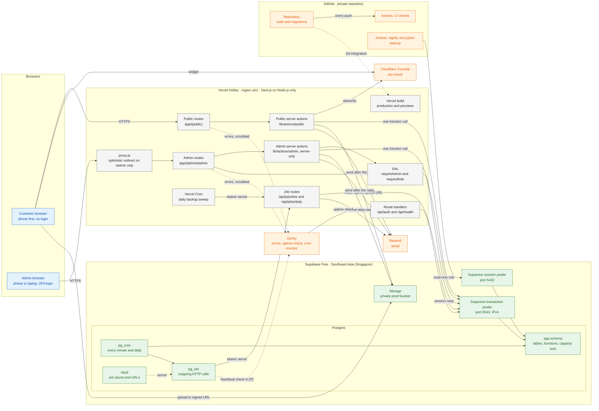
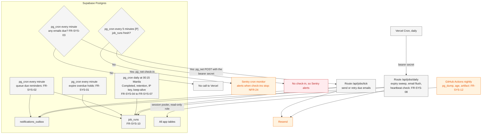
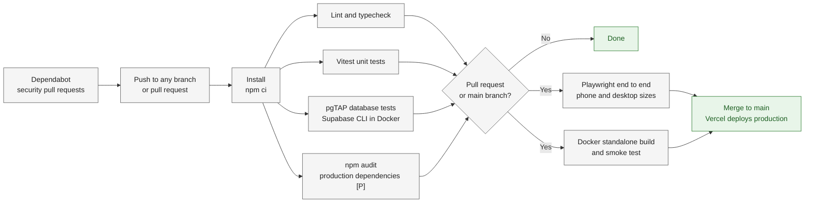

# Architecture

> **Purpose:** How the DJB Kasoundbox reservation system is built and hosted: the components and how they connect, the pinned stack, the main request paths, the split between the public site and the admin panel, caching, database access, scheduled work, environment variables, the repository layout, local development, the CI pipeline, and the plan for leaving Vercel Hobby. ·
> **Audience:** Mainly the developer (Super Admin). The "In plain words" summary is for the business owner (Admin) ·
> **Status:** Draft for review ·
> **Last updated:** 2026-10-21 ·
> **Depends on:** [Decision log][dl] (D-19, D-20, D-22), [Non-functional requirements][nfr], [Functional requirements][fr] (FR-SYS), [Roles and permissions][roles] §7, [Business rules][br], [Privacy and retention][priv], [Reservation lifecycle][lc]; workflows [booking-and-submission][wf-book], [availability-and-conflicts][wf-avail], [lookup-and-review][wf-review], [changes-and-expiry][wf-change], [notifications-and-tracking][wf-notify], [administration][wf-admin]; sibling technical docs [data-model][data], [api-specification][api], [security][sec] ·
> **Derived from:** [spec v0.2][spec] §10, §12, §15 (main sources), with §11, §13, §17, §18, §20; [decision-log][dl] D-19, D-20, D-22, D-23; [non-functional-requirements][nfr] NFR-01 to NFR-07, NFR-09 to NFR-14, NFR-19 to NFR-24, NFR-26 to NFR-33; [functional-requirements][fr] FR-SYS-01 to FR-SYS-12, FR-PUB-12, FR-ADM-33; [roles-and-permissions][roles] §7; [edge-cases][ec] EC-02, EC-77 to EC-82; [notifications-and-tracking][wf-notify] WF-07A, WF-07D, WF-07E; [administration][wf-admin] WF-09A, WF-09C, WF-09E, WF-10E; the stack research rounds behind spec §10 (sources in spec §20), used for exact versions and settings

## In plain words

The system has three main parts.

- **The website.** The public pages and the admin panel are one website. It runs on Vercel's free plan, on computers in Singapore, close to the Philippines.
- **The database.** It runs on Supabase's free plan, also in Singapore. It holds every booking, payment, setting, and uploaded proof picture. It also holds the booking rules themselves, so no page and no mistake in the website code can skip them. Two people pressing Submit at the same moment can never get the same set.
- **Helper services, each with one job.** Resend sends the emails. Cloudflare Turnstile checks that a person, not a bot, filled in the form. Sentry tells the developer when something breaks or stops. GitHub keeps the code, runs the automatic checks on every change, and stores the nightly encrypted backup.

Timers inside the database end overdue holds and send waiting emails every minute. Vercel adds one safety run each day. Everything runs on free plans ([NFR-01][nfr]).

Vercel's free plan is for non-commercial use, and this risk was accepted knowingly **[C]** ([D-20][dl]). All the data and rules live in the database, not at Vercel. So if Vercel ever stops the website, no booking is lost, and the website can be moved to another host by changing settings, not by rebuilding it (section 12).

## How to read this document

- **What this document owns.** The system structure, the stack with its pinned versions, hosting and connection settings, the repository layout, local development, the CI outline, and the portability plan. Every business rule, permission, deadline, limit, and retention period is owned by a batch-1 document and is only linked here by its ID. If a number here and the owning document ever differ, the owning document is right.
- **Labels.** **[C]** confirmed decision · **[P]** proposed, accepted with the spec approval but may change · **[U]** unverified fact, to be checked in the week-1 test or before launch · **[O-nn]** open item in the [decision log][dl]. They keep their batch-1 meaning.
- **Where the details come from.** The stack in spec v0.2 §10 is approved design. Exact versions and settings come from the stack research behind it, and are pinned at setup ([NFR-30][nfr]). Mechanisms that this document adds beyond the spec, the batch-1 docs, and that research are marked **[P] (new in this doc)**. Each one is also listed under [Open questions](#open-questions). Nothing marked that way is decided until the review confirms it.
- **The week-1 test.** "Week-1 item N" means item N of the week-1 test list in spec v0.2 §17 ([project-charter][charter] phase 4).
- **Developer names** (routes, files, functions, environment variables) are indicative. Final function and route names come in [api-specification][api]. Tables and columns are in [data-model][data]. Threats and controls are in [security][sec].
- **Time.** Every date and time is Manila time (Asia/Manila, [NFR-19][nfr]). Cron expressions are written in UTC, as both pg_cron and Vercel Cron read them.

---

## 1. Component diagram



**Colours:** blue = browsers · grey = Vercel · green = Supabase · orange = other services. "[P]" on an arrow marks a link proposed in this document (section 7.4).

**Reading the diagram.**

- **Vercel holds no data.** Every booking, payment, setting, queued email, job schedule, and proof image lives in the one Supabase project. That is what makes the website portable ([NFR-31][nfr]).
- **The browser never talks to the database.** It talks to Vercel, and directly to Storage only to upload a proof through a single-use signed link ([FR-PUB-12][fr], [NFR-14][nfr]).
- **Every business change is one database function call** through the transaction pooler ([NFR-21][nfr]); section 6.
- **Supabase Auth and the Supabase Data API are not used by the app.** Admin login is Better Auth, inside the Next.js app ([D-20][dl]).

---

## 2. Stack

### 2.1 Stack table

"Pinned at setup" means the version is fixed exactly in the lockfile when the project is created, and changes only on purpose ([NFR-30][nfr]).

| Layer | Choice and pinned version | Why it was chosen | Decision / requirement |
|---|---|---|---|
| Hosting | **Vercel Hobby**. Functions in region `sin1` (Singapore), Node.js runtime only, Fluid compute left on (the default) | Free; the region sits next to the database; Node.js runs on almost any other host | **[C]** [D-20][dl]; [NFR-02][nfr], [NFR-05][nfr], [NFR-06][nfr] |
| Framework | **Next.js 16.4.2**, App Router, pinned exactly; never below 16.4.1 | One app for both areas; server actions, `after()`, and Cache Components. 16.4.1 fixed the 2026-10-14 advisories, including a critical one in `'use cache'` and one in image optimization | [D-20][dl]; [NFR-30][nfr] |
| UI runtime | **React and React DOM 19.3.1**, pinned. The lockfile must resolve `sharp` 0.35.5 or later | Matches Next.js 16.4.2 | [NFR-30][nfr] |
| Language | **TypeScript**, strict mode | The developer's chosen language | **[C]** [D-19][dl]; [NFR-32][nfr] |
| Styling and components | **Tailwind CSS + shadcn/ui**, pinned at setup | Fast phone-first layouts; accessible building blocks | **[C]** [D-20][dl]; [NFR-16][nfr], [NFR-17][nfr] |
| Forms | **React Hook Form + the Zod resolver**, pinned at setup | Same schema in the browser and on the server | **[P]** (spec v0.2 §10) |
| Validation | **Zod 4** (4.5 or later; 4.6.7 was current at research), imported as `import * as z from 'zod'`; **drizzle-zod 0.8.3** for shared schemas | Input is checked twice: in the app and again in the database | [NFR-21][nfr] |
| Database | **Supabase Free Postgres**, region "Southeast Asia (Singapore)". Its Postgres major version is noted when the project is created **[U]** | Free; holds the data, the rules, the files, and the timers in one place | [D-20][dl]; [NFR-02][nfr], [NFR-07][nfr] |
| Database driver | **`pg` 8.23.1** with **`pg-pool` 3.14.0**; **`@vercel/functions` 3.10.2** for `attachDatabasePool` | Safe on the transaction pooler; `postgres.js` is not (section 6.2) | [NFR-02][nfr] |
| ORM and migrations | **Drizzle ORM 0.45.4** (`drizzle-orm/node-postgres`; stay on 0.45.x until 1.0 is stable) and **drizzle-kit** (pinned at setup). Hand-written SQL for the functions, roles, grants, and cron schedules | Typed reads and catalog edits; the rules themselves are SQL functions | [NFR-21][nfr], [NFR-32][nfr] |
| Admin login | **Better Auth 1.7.12** (never below 1.7.7; plan the move to 1.8) with its Drizzle adapter, email and password, the admin plugin (two roles), and the two-factor plugin (TOTP, required) | Self-hosted, free, and no customer accounts needed | [D-20][dl]; [NFR-09][nfr]; [roles][roles] §7 |
| Password hashing | **`@node-rs/argon2` 2.2.2**: argon2id with m = 19456 KiB, t = 2, p = 1. Fallback: `node:crypto` scrypt with N = 2^17, r = 8, p = 1, maxmem 256 MiB. Better Auth's default scrypt settings are not kept | Meets the OWASP minimum; the parameters are stored in each hash, so they can be raised later. The native binary loading on Vercel is **[U]** (week-1 item 3) | [NFR-09][nfr] |
| File storage client | **`@supabase/supabase-js` 2.118.0**, on the server only, with the secret key. The browser gets only the publishable key, for `uploadToSignedUrl` | Proof bytes go straight from the browser to the private bucket, never through Vercel | [NFR-14][nfr]; [FR-PUB-12][fr] |
| Email | **Resend Free**, through its REST API, behind a small `EmailProvider` interface. The outbox key is sent as Resend's idempotency key | Free; the interface keeps a later switch cheap | [D-10][dl], [D-20][dl]; [NFR-33][nfr]; [FR-NTF-16][fr] to [FR-NTF-20][fr] |
| Scheduled jobs | **Supabase Cron (`pg_cron`)**, **`pg_net`**, and **Vault**. **Vercel Cron** runs only the daily backup sweep. Availability of all three extensions on Free is **[U]** (week-1 item 4) | Time-critical work runs next to the data at no Vercel cost | [FR-SYS-01][fr] to [FR-SYS-10][fr]; [NFR-06][nfr], [NFR-24][nfr] |
| QR | **`uqr`** (pinned at setup) draws the SVG on the server; **`@yudiel/react-qr-scanner` 2.6.0** scans, on `/admin/scan` only, with its ZXing WASM file self-hosted under `/public` | No external QR service; the scanner never ships to the public site | [FR-PUB-08][fr], [FR-ADM-06][fr]; [NFR-16][nfr] |
| Bot protection | **Cloudflare Turnstile** (free), a honeypot field, and rate limits counted in the database | Free; works without accounts | [NFR-11][nfr], [NFR-12][nfr] |
| Monitoring | **Sentry Developer (free)** through **`@sentry/nextjs`** (pinned at setup), with `sendDefaultPii: false` and a `beforeSend` scrubber; one uptime check and one cron monitor. Compatibility with Next.js 16.4 Cache Components is **[U]** | Vercel keeps runtime logs only briefly ([NFR-23][nfr]) | [NFR-04][nfr], [NFR-23][nfr], [NFR-24][nfr] |
| Tests | **Vitest**, **Playwright**, and **pgTAP** through the **Supabase CLI**, all pinned at setup | Rules are tested where they live: in the database | [NFR-32][nfr]; test plan (planned: `06-delivery/test-plan.md`) |
| CI and backups | **GitHub Actions** on `ubuntu-24.04` runners; **Dependabot**; **`age`** for encryption; a PGDG `pg_dump` client that matches the server's major version | Free in a private repository (minutes allowance **[U]**, [NFR-01][nfr]) | [D-22][dl]; [NFR-27][nfr] to [NFR-30][nfr] |
| Local development | **Supabase CLI** with **Docker** | The full database stack, including the extensions, on the laptop | Section 10 |
| Toolchain | **npm** with a committed `package-lock.json`; a Node.js LTS line that Vercel offers, pinned in `package.json` `engines`, `.nvmrc`, and the Docker base image **[P] (new in this doc)** | One lockfile for `npm ci`, `npm audit`, and Dependabot | [NFR-30][nfr] |

### 2.2 Hosting configuration

**Vercel project.**

- `vercel.json` sets `"regions": ["sin1"]` and the one daily cron (section 7.3). The deployment summary must show `sin1`, and `/api/health` reports `VERCEL_REGION` ([FR-SYS-11][fr]). Left at the default region, every database round trip would cross the Pacific.
- Deployment Protection: **Standard Protection**, so previews are private and production is public. "All Deployments" would block the public site.
- Environment variables use the "Secret" type, with separate Production and Preview values ([NFR-13][nfr]; section 8).
- A custom domain, if O-05 decides on one, gets Vercel's automatic HTTPS. The camera QR scanner needs HTTPS ([NFR-18][nfr]). DNS stays with a registrar or DNS host the business controls ([NFR-31][nfr]).

**`next.config.ts`.**

- `cacheComponents: true` (the create-next-app 16.4.2 default).
- `images: { unoptimized: true }`. Catalog photos are pre-sized static files in `/public` ([NFR-03][nfr]).
- `output: 'standalone'` is set only for the Docker build, for example when `NEXT_OUTPUT=standalone`; the Vercel build keeps the default **[P] (new in this doc)**.
- **Never used**, because each drew a 2026 advisory or ties the app to Vercel: `images.remotePatterns`, SVG through `next/image`, `next/og` with user input, the `i18n` config, rewrites to dynamic hosts, the Edge runtime, Vercel Blob, KV, and Edge Config ([NFR-30][nfr], [NFR-31][nfr]).

**Supabase project.**

- Created in the specific region "Southeast Asia (Singapore)".
- "Enforce SSL on incoming connections" on. "Automatically expose new tables" off. The `app` schema is not exposed through the Data API. If Storage keeps working with the Data API turned off, it is turned off **[U]** (week-1 item 5). Details: [security][sec].
- Extensions: `pg_cron`, `pg_net`, and Vault enabled **[U]** (week-1 item 4).
- The proof bucket is private, with the file types and size limit of [FR-PUB-12][fr] set on the bucket. Whether the bucket limits are enforced on hosted signed uploads is **[U]** (week-1 item 5).

---

## 3. Request flows

These are the paths a request takes through the components. The business steps are drawn only once, in the workflow named for each flow.

### 3.1 A public page read

**Workflows:** [WF-01A][wf-book] (browse), [WF-05A][wf-avail] (calendar).

1. The customer's browser asks Vercel for `/packages` (or the home page).
2. The page shell and the catalog data come from the Next.js cache. The catalog is read by one cached function (section 5), so the database is touched only after an admin edit refreshes the cache.
3. The customer opens `/availability`. This part is dynamic: a function in `sin1` calls the calendar function through the transaction pooler (for example `app.availability_calendar`; no login needed) and renders it inside `<Suspense>`. It is never cached and never polls ([NFR-03][nfr], [BR-09][br]).

### 3.2 A booking submission

**Workflows:** [WF-01C][wf-book] (submit and server checks), [WF-02][wf-book] (reference code and QR), [WF-05C][wf-avail] (two customers at the same instant), [WF-07A][wf-notify] (sending the emails).

1. The browser runs the Turnstile widget. It sends the form, the Turnstile token, the honeypot field, and the duplicate-submission key kept in `sessionStorage` ([EC-01][ec], [EC-02][ec]).
2. The public server action `submitReservation` (in `lib/actions/public`) parses the input with Zod, checks the honeypot, and calls Turnstile's siteverify from the server, with a time limit on the call.
3. It makes **one** call through the transaction pooler: `SELECT app.book_reservation(...)`. Inside that single statement, Postgres takes the capacity lock and applies every rule of [WF-01C][wf-book] (section 6.4).
4. The action renders the confirmation page, with the QR code drawn by `uqr` as an inline SVG ([FR-PUB-07][fr]).
5. After the reply, `after()` sends the emails that the function queued in the outbox. Anything not sent is picked up by the every-minute tick (section 3.4).

### 3.3 An admin action

**Workflows:** [WF-09C][wf-admin] (the server checks every admin request), [WF-05E][wf-avail] (two admins at once), and the action's own workflow, for example [WF-04A][wf-review] (approve).

1. The admin's browser posts to an admin server action. `proxy.ts` sees the session cookie and lets the request through; it decides nothing else (section 4.4).
2. The action's first line calls the DAL: `requireAdmin()`, or `requireRole('superAdmin')` for a Super-Admin-only action. The DAL reads the Better Auth session through the pooler and checks that 2FA was passed and the role allows the action ([roles][roles] §7).
3. The action parses the input with Zod, including the reservation version the page showed ([FR-ADM-07][fr]).
4. It makes one database function call, for example `app.approve_reservation(...)`. The function checks the role again, the status, the version, and the deadline, then saves the change, its audit entry, and its outbox rows in one transaction ([NFR-21][nfr]). How the function learns who is acting is open in [administration][wf-admin] (open question 22).
5. The action returns the result, and `after()` sends the queued emails.

### 3.4 A job tick

**Workflows:** [WF-07A][wf-notify] (the email pipeline); [FR-SYS-03][fr], [FR-SYS-09][fr], [FR-SYS-10][fr].

1. Every minute, a `pg_cron` job in Postgres checks whether any outbox rows are due. If none are, nothing else happens and Vercel is not called.
2. If rows are due, it calls `net.http_post` to the tick URL stored in Vault, with the bearer secret from Vault and an explicit `timeout_milliseconds`.
3. The route `/api/jobs/tick` runs in `sin1` on Node.js. It compares the bearer secret in constant time and refuses anything else ([FR-SYS-09][fr], [EC-78][ec]).
4. It takes the job's overlap guard (section 7.2), claims a batch of due rows (customer emails first), applies the stale check and the caps ([FR-NTF-19][fr], [FR-NTF-20][fr]), and sends each email to Resend with a time limit.
5. It marks each row sent, retried later, or failed ([FR-NTF-18][fr]), then writes its `job_runs` record ([FR-SYS-10][fr]).

---

## 4. Public and admin separation

One Next.js app has two areas ([spec v0.2][spec] §10; [roles][roles] §7). They are kept apart at four levels.

### 4.1 Route groups and layouts

| Area | Folder | Root layout | Indexing |
|---|---|---|---|
| Public site | `app/(public)` | `app/(public)/layout.tsx`: `lang="en-PH"`, metadata, `sitemap.ts` (catalog pages only), `robots.ts` | Indexed, except `/status` and `/r/[token]`, which are `noindex` |
| Admin panel | `app/(admin)/admin` | `app/(admin)/admin/layout.tsx`: the admin shell, `robots: noindex` | Never indexed; `robots.ts` disallows `/admin` |

- The two root layouts share no layout code. Moving between the areas is a full page load.
- **Layouts hold no auth logic.** A layout is not a security boundary: it does not run again on every navigation, and it does not protect the server actions that a page imports.
- The QR scanner and its WASM file load only on `/admin/scan`, client-side through `next/dynamic` with `ssr: false`. The public bundle never contains admin code.

### 4.2 Separate module trees

- **`lib/actions/public/*`** holds the public server actions: submit, status lookup, QR reissue from the status page, and the two proof-upload steps ([WF-07D][wf-notify], [WF-07E][wf-notify]). They may call only the public database functions, and those return minimal, customer-safe data.
- **`lib/actions/admin/*`** holds the admin server actions. Every file starts with `import 'server-only'` and exports only actions.
- Every exported `'use server'` function is a public HTTP endpoint that anyone can POST to directly. So every action runs the same four steps, in this order: (1) parse with Zod; (2) authorize (the DAL for admin actions; Turnstile and the honeypot for public ones); (3) one database call; (4) return a minimal result.
- The real guard behind the module split is in the database: every admin function checks the acting admin's role again ([WF-09C][wf-admin] step 9).

### 4.3 The DAL check in every admin page, action, and route

`lib/dal.ts` imports `server-only` and exports:

| Helper | What it checks |
|---|---|
| `verifySession()` | A valid Better Auth session with 2FA passed. In server components it is memoized per request with React `cache()`; in actions and route handlers it runs on every call |
| `requireAdmin()` | `verifySession()`, plus an active account with either admin role |
| `requireRole('superAdmin')` | `requireAdmin()`, plus the Super Admin role |

- One of these is the **first line** of every admin page, every exported admin action, and every admin route handler. The permission matrix it applies is defined only in [roles-and-permissions][roles] §2.
- Better Auth's cookie cache stays off, so an ended session or a disabled account stops working at once (see [administration][wf-admin] open question 4).
- Cookie flags, CSRF, and session lifetime belong to [security][sec].

### 4.4 `proxy.ts`: an optimistic redirect only

- `proxy.ts` is the Next.js 16 replacement for middleware. Its matcher is `['/admin/:path*']`, and it skips the login page.
- It does one thing: if the session cookie is missing on a page request, it redirects to the login page. It makes no database call and grants nothing.
- The job routes live under `/api/jobs/*`, outside the matcher, so they are never redirected ([FR-SYS-09][fr]). They use their own bearer secret.
- **Why it is not the boundary.** 2026 saw several proxy-bypass advisories, and a matcher change can silently drop coverage. Every admin request is checked again by the DAL and by the database ([NFR-10][nfr], [EC-73][ec]).
- **Tested.** An automated test calls every exported admin action and admin route while logged out and with the wrong role, and expects a refusal ([NFR-10][nfr]; test plan, planned).

---

## 5. Caching

**Rule:** `'use cache'` is used for the catalog only. Everything else is dynamic ([NFR-03][nfr]).

| What | How it is served | Refreshed when |
|---|---|---|
| Catalog data: packages, add-ons, prices ([FR-PUB-02][fr]) | One module, `lib/catalog.ts`, with `'use cache'`, `cacheLife('max')`, and `cacheTag('catalog')`. No other file uses `'use cache'` | An admin catalog action calls `updateTag('catalog')` (the Next.js 16 server-action form of `revalidateTag`) **after** its database function returns `ok`, never before the commit ([WF-08A][wf-admin] developer notes) |
| Availability calendar, booking form, status page, `/r/[token]`, upload steps | Rendered at request time, inside `<Suspense>` on public pages; the status page is `no-store` | Never cached |
| Every admin page | Rendered at request time | Never cached |
| `/api/*` route handlers | Dynamic | Never cached |

- Whether `updateTag` also refreshes prerendered page shells on Vercel is **[U]** (checked in the week-1 test).
- Whether any cached public page shows a setting value (business info, deposit amount) is [administration][wf-admin] open question 15. Until it is answered, setting values are read live.
- No page polls the server in the background ([NFR-03][nfr], [FR-ADM-02][fr]).

---

## 6. Database access

### 6.1 Two poolers, two purposes

| Connection | Port | Used by | Role |
|---|---|---|---|
| Supavisor **transaction** pooler (shared, IPv4) | 6543 | The app on Vercel: every page, action, and route | The app's login role, which can only call the app's functions and read what it needs ([NFR-10][nfr]) |
| Supavisor **session** pooler (IPv4) | 5432 | Migrations (from the developer's laptop) and the nightly `pg_dump` (GitHub Actions) | The `postgres` role for migrations; a separate read-only role for backups ([NFR-10][nfr], [NFR-27][nfr]) |

- The free plan's direct database host is IPv6-only, and Vercel and GitHub runners are IPv4-only, so the app never uses the direct host.
- The pooler user name has the form `<role>.<project-ref>`. The login role is created `WITH LOGIN` and a SCRAM-SHA-256 password, with no `VALID UNTIL`; Supavisor rejects MD5 secrets and expired roles.
- Role timeouts are set on the app's login role: `statement_timeout = '5s'`, `lock_timeout = '2s'`, `idle_in_transaction_session_timeout = '10s'`. That they apply through the shared pooler is **[U]** (week-1 item 1). The full grants are in [security][sec] and [data-model][data].
- Migrations never run during a Vercel build.

### 6.2 The driver and the pool

```ts
// lib/db/pool.ts (indicative)
import 'server-only';
import { Pool } from 'pg';
import { attachDatabasePool } from '@vercel/functions';
import { drizzle } from 'drizzle-orm/node-postgres';

const pool = new Pool({
  connectionString: process.env.DATABASE_URL, // transaction pooler, port 6543; no sslmode in the URL
  max: 1,
  min: 0,
  idleTimeoutMillis: 5_000,
  connectionTimeoutMillis: 5_000,
  query_timeout: 10_000,
  ssl: { ca: process.env.SUPABASE_DB_CA, rejectUnauthorized: true },
});
attachDatabasePool(pool); // closes idle clients cleanly on Vercel; does nothing elsewhere
export const db = drizzle({ client: pool });
```

- **One pool per function instance, with one connection.** The pool is created once at module scope; in development it is cached on `globalThis`, so hot reloads do not open new pools. Raise `max` to 2 only if queuing is measured.
- **`sslmode` stays out of the URL.** `pg-connection-string` turns `sslmode=require` into full verification, and values from the URL override the `ssl` object. Verified TLS against the pooler with the Supabase CA is **[U]** (week-1 item 1).
- **`attachDatabasePool`** keeps the function instance alive just long enough for idle clients to close cleanly. It is the only Vercel-specific line in the data layer.
- **No `postgres.js`.** It pipelines queries by default, which Supabase warns can hang queries or return mismatched rows on port 6543. Turning pipelining off breaks its transactions, and `attachDatabasePool` does not support it.
- **Rules for transaction mode.** Never use Drizzle's named `.prepare('name')` or `pg`'s pipeline option. No session-level `SET` (use `SET LOCAL`), no session advisory locks, no `LISTEN`/`NOTIFY`, no temporary tables, no `WITH HOLD` cursors. Only transaction-scoped locks: row locks and `pg_*_xact_*` advisory locks.
- **Pool of 1 and transactions.** Inside `db.transaction(...)`, await each statement in turn and use only the transaction client. Touching `db` or calling `auth.api.*` inside it would wait for the only connection and fail after `connectionTimeoutMillis`. Better Auth's adapter `transaction` option stays at its default (off).
- **`@supabase/supabase-js`** is used only on the server, only for Storage.

### 6.3 One function call per business action

- Every booking and every admin action is **one** statement: `SELECT app.<function>(...)` ([NFR-21][nfr]). Through the transaction pooler that statement is its own transaction, so its locks live inside Postgres for milliseconds. A frozen or killed Vercel function can never leave a transaction open.
- The functions are `VOLATILE`, `SECURITY DEFINER` PL/pgSQL, owned by a role that cannot log in, with `search_path = ''`, running under `READ COMMITTED`. Each statement inside then sees rows committed by others, which the lock-then-check pattern needs.
- Each function takes the time with `clock_timestamp()` after its locks are held. `now()` is the start of the transaction and goes stale after a wait for a lock.
- Drizzle's typed query builder is used for **reads** only: lists, search, the dashboard. Every **write**, including catalog and settings edits, is a function call, so it carries its own checks and audit entry ([NFR-21][nfr]; the WF-08 developer notes in [administration][wf-admin]). Typed wrappers in `lib/db/functions.ts` send `sql\`select app.fn(...)\`` for each one.
- The one exception is Better Auth: its adapter writes its own tables (users, sessions, 2FA) directly. The grants this needs are in [security][sec]. Better Auth's tables go in a non-exposed schema chosen in [data-model][data], never in Supabase's reserved `auth` schema.
- Function names, arguments, and result codes are in [api-specification][api]; tables, indexes, and constraints in [data-model][data].

### 6.4 The capacity lock

[NFR-20][nfr] owns the requirement and [WF-05B][wf-avail] the steps. Technically:

- Every function that uses or frees capacity (book, staff booking, reschedule, edit details, block, recreate) starts with `SELECT … FROM app.capacity_lock WHERE id = 1 FOR UPDATE` on a single row. Which actions take the lock is also [availability-and-conflicts][wf-avail] open question 2.
- Under the lock it expires overdue holds for the dates it touches, checks the rules, counts add-on stock, and writes the claims.
- The partial unique index on live claims, across bookings and blocks ([data-model][data]), is the hard guard. A `unique_violation` is returned as "just taken", never as a server error ([EC-03][ec], [EC-17][ec]).
- **Waiting too long.** If the lock wait reaches `lock_timeout`, the function catches the error and returns a "busy, please try again" result instead of failing **[P] (new in this doc)**.
- **Lock order.** A function always takes the capacity lock before any reservation row lock (`SELECT … FOR UPDATE` on the reservation), and locks the reservation row before writing payments or other child rows **[P] (new in this doc)**. One fixed order means two actions can never wait on each other.
- **If volume ever grows,** the single lock can become per-date lock rows taken in ascending date order. At the business's volume this is not needed ([NFR-20][nfr], "Why one lock is enough").

---

## 7. Scheduled work

The jobs themselves are defined in [FR-SYS-01][fr] to [FR-SYS-12][fr]. No business rule depends on a job running on time: every page and action checks deadlines itself ([BR-05][br], [NFR-21][nfr], [EC-77][ec]).

### 7.1 The timers



| Timer | Schedule (UTC) | What it runs | Requirement |
|---|---|---|---|
| `pg_cron` | `* * * * *` | `app.expire_overdue_holds()`, pure SQL | [FR-SYS-01][fr] |
| `pg_cron` | `* * * * *` | `app.queue_due_reminders()`, pure SQL | [FR-SYS-02][fr] |
| `pg_cron` | `* * * * *` | If due outbox rows exist: `net.http_post` to the tick URL | [FR-SYS-03][fr] |
| `pg_cron` | `15 16 * * *` (the daily time in [NFR-19][nfr]) | `app.complete_finished_events()`, `app.run_retention()`, the IP-key rotation, and the keep-alive query | [FR-SYS-04][fr] to [FR-SYS-07][fr] |
| `pg_cron` | `*/5 * * * *` | Heartbeat: if `job_runs` shows fresh runs of the every-minute jobs, a `pg_net` check-in to the Sentry cron monitor **[P] (new in this doc)** | [NFR-24][nfr] |
| `pg_cron` | daily | Delete `cron.job_run_details` rows older than 7 days, so the log table stays small **[P] (new in this doc)** | — |
| Vercel Cron | `0 18 * * *` **[P] (new in this doc)** | `/api/jobs/daily` | [FR-SYS-08][fr] |
| GitHub Actions | nightly | The encrypted backup (section 11.3) | [FR-SYS-12][fr] |

- **Why the daily Vercel run is at `0 18 * * *`.** That is 02:00 Manila. Vercel Hobby cron may fire anywhere within that hour **[U]**, so the run always comes after the 00:15 daily SQL jobs and can check that they wrote their `job_runs` records.
- **Supabase's own guidance** is to keep at most 8 jobs running at once, each under 10 minutes **[U]**. These jobs are far smaller.
- **Proof file deletion.** The retention job must delete proof files through the Storage API, never by deleting `storage.objects` rows in SQL. Whether it calls the API through `pg_net` or hands the work to `/api/jobs/daily` is for [api-specification][api] ([WF-10E][wf-admin] developer notes).

### 7.2 Overlap guard

[FR-SYS-09][fr] requires that two runs of the same job never overlap, using an advisory lock. Through the transaction pooler, a session-level advisory lock is not safe (section 6.2). So **[P] (new in this doc)**:

- **SQL jobs** (`pg_cron`) take `pg_try_advisory_xact_lock(<job id>)` as their first statement and return at once if another run holds it. The lock ends with the job's own transaction.
- **The two job routes** run several database calls with Resend calls in between, so a transaction lock would not cover the whole run. They take a **lease row** instead: one function call such as `app.try_start_job('tick', interval '2 minutes')` succeeds only if no unexpired lease exists, and the run ends by releasing it. A crashed run's lease simply expires.
- **Outbox rows** are claimed with `FOR UPDATE SKIP LOCKED`, and the claim also pushes the row's next-attempt time forward by a short lease, so the `after()` sender, the tick, and the daily sweep never send the same row at once. Whether this uses the next-attempt column or a separate claimed-until column is for [data-model][data].

### 7.3 Vercel Cron and the daily route

- `vercel.json`: `"crons": [{ "path": "/api/jobs/daily", "schedule": "0 18 * * *" }]`. The path must match exactly; cron does not follow redirects.
- Hobby cron facts **[U]** (read from a docs mirror): it runs at most once a day, may fire anywhere within the scheduled hour, uses UTC, runs only on production, never retries, and may fire twice. Attack Mode in the Vercel Firewall also blocks it. So the daily route is idempotent, and it is only the backup sweep ([FR-SYS-08][fr], [NFR-06][nfr]).
- Vercel Cron sends `Authorization: Bearer <CRON_SECRET>` from the project's `CRON_SECRET` variable **[U]**.

### 7.4 `pg_net` and the job secret

- `pg_net` is fire-and-forget: it does not retry, and it keeps responses only for a short time **[U]**. The outbox table, not `pg_net`, is the record of what still needs sending ([FR-NTF-16][fr]).
- Every `net.http_post` sets `timeout_milliseconds` explicitly. The default timeout, and whether a `pg_net` timeout stops the Vercel function it called, are **[U]** (week-1 item 4).
- The bearer secret and the tick URL are read from `vault.decrypted_secrets` at call time. The same secret is a Vercel environment variable ([FR-SYS-09][fr]); section 8.
- **Constant-time compare.** The route hashes both the received and the expected secret with SHA-256 and compares the digests with `crypto.timingSafeEqual`, so the length of the secret never leaks.
- **Heartbeat check-in [P] (new in this doc).** The Sentry check-in URL is also kept in Vault. The 5-minute heartbeat job (section 7.1) sends a check-in only when the every-minute jobs have fresh `job_runs` records, so Sentry alerts both when `pg_cron` stops and when the jobs fail. The daily route also reports a stale heartbeat to Sentry as an error ([FR-SYS-08][fr]).

---

## 8. Environment variables

Names and purposes only. Values are never written in the code or in these docs ([NFR-13][nfr]). The names are **[P] (new in this doc)**, except those that a library or Vercel fixes. `.env.example` lists every name with an empty value.

### 8.1 Vercel (Production; Preview gets its own non-production values or none)

| Name | Browser? | Purpose |
|---|---|---|
| `SITE_URL` | No | The public base address. Every absolute link (QR codes, email links, the status link) is built from it, never from `VERCEL_URL` |
| `DATABASE_URL` | No | The app's login role through the transaction pooler (port 6543); no `sslmode` in it |
| `SUPABASE_DB_CA` | No | The Supabase CA certificate, for verified TLS to the pooler |
| `SUPABASE_URL` | No | The project address, for Storage calls from the server |
| `SUPABASE_SECRET_KEY` | No | The server-only Storage key: signed upload links, short-lived view links, file deletion |
| `NEXT_PUBLIC_SUPABASE_URL` | Yes | The project address, for the browser's upload to a signed link |
| `NEXT_PUBLIC_SUPABASE_PUBLISHABLE_KEY` | Yes | The publishable key, needed only by `uploadToSignedUrl` |
| `BETTER_AUTH_SECRETS` | No | Better Auth's signing secrets. Rotate them only through this variable. The exact names Better Auth 1.7.12 reads are confirmed at setup **[U]** |
| `BETTER_AUTH_URL` | No | The base address Better Auth uses for its routes and cookies **[U]** |
| `CRON_SECRET` | No | The bearer secret for both job routes. Vercel Cron sends it **[U]**; the same value is stored in Vault for `pg_net` |
| `TURNSTILE_SECRET_KEY` | No | Server-side siteverify |
| `NEXT_PUBLIC_TURNSTILE_SITE_KEY` | Yes | The Turnstile widget |
| `RESEND_API_KEY` | No | Sending email |
| `EMAIL_FROM` | No | The sender address; its domain depends on O-05 |
| `SENTRY_DSN` | No | Server error reports |
| `NEXT_PUBLIC_SENTRY_DSN` | Yes | Browser error reports |
| `SENTRY_AUTH_TOKEN` | No | Build only: uploading source maps (optional) |

**Set by Vercel, read only:** `VERCEL_REGION` (reported by `/api/health`), `VERCEL_ENV`, `VERCEL_URL` (never used for links). `TZ` is reserved on Vercel and is never set; times are formatted with `Intl.DateTimeFormat` and `timeZone: 'Asia/Manila'` ([NFR-19][nfr]).

### 8.2 Elsewhere

| Where | Name | Purpose |
|---|---|---|
| GitHub Actions secret | `BACKUP_DATABASE_URL` | The read-only backup role through the session pooler (port 5432) |
| GitHub Actions secret | `SUPABASE_DB_CA` | Verified TLS for the backup |
| GitHub Actions variable | `BACKUP_AGE_RECIPIENT` | The `age` public key the backup is encrypted to. The private key stays offline with the Super Admin ([NFR-13][nfr]) |
| Supabase Vault | `job_route_secret` | The same value as `CRON_SECRET`, read by `pg_net` |
| Supabase Vault | `tick_url` | `SITE_URL` + `/api/jobs/tick`. It changes when the site moves host (section 12) |
| Supabase Vault | `sentry_checkin_url` **[P] (new in this doc)** | The Sentry cron monitor's check-in address (section 7.4) |
| Developer's laptop only | the password of the database's `postgres` role | Migrations and the break-glass script ([WF-09E][wf-admin]). Never stored in GitHub or Vercel |
| Offline only | the `age` private key | Needed only for a restore ([NFR-13][nfr]) |

- The IP-HMAC keys are not environment variables. They live in the database and are rotated by the daily SQL job ([FR-SYS-06][fr]); details in [security][sec].
- **Previews never get production secrets** ([NFR-13][nfr]). By default a preview gets no database and no email keys at all, so it can build and show the static pages only **[P] (new in this doc)**. A staging database is open question 9.

---

## 9. Repository and folder structure

**[P]** (approved design: one app, two areas, a separate admin module tree, rules in Postgres; the exact layout is proposed here). Page paths are indicative; the page inventory comes in `04-design/ux-and-sitemap.md` (planned).

```text
kasoundbox-2026/
├── app/
│   ├── (public)/                  public site, its own root layout
│   │   ├── layout.tsx
│   │   ├── page.tsx               home
│   │   ├── packages/              cached catalog
│   │   ├── availability/          live calendar
│   │   ├── book/                  reservation form and confirmation
│   │   ├── status/                status lookup, proof upload, QR reissue (noindex)
│   │   ├── r/[token]/             QR link page (noindex)
│   │   ├── privacy/  contact/
│   │   ├── sitemap.ts  robots.ts
│   ├── (admin)/admin/             admin panel, its own root layout (noindex)
│   │   ├── layout.tsx
│   │   ├── login/                 left out of the proxy redirect
│   │   ├── page.tsx               dashboard
│   │   ├── reservations/          list, [id], new (staff-created)
│   │   ├── scan/                  camera QR scanner, client-only
│   │   ├── blocks/  catalog/  settings/  accounts/  audit/  health/
│   └── api/
│       ├── auth/[...all]/route.ts Better Auth handler
│       ├── jobs/tick/route.ts     outbox flush (bearer secret)
│       ├── jobs/daily/route.ts    daily backup sweep (bearer secret)
│       └── health/route.ts        region and a cheap database query
├── proxy.ts                       optimistic redirect for /admin only
├── lib/
│   ├── actions/
│   │   ├── public/                public server actions
│   │   └── admin/                 admin server actions, each file 'server-only'
│   ├── db/                        pool.ts, schema.ts (Drizzle), functions.ts (typed app.* calls)
│   ├── dal.ts                     verifySession, requireAdmin, requireRole
│   ├── auth.ts                    Better Auth configuration
│   ├── catalog.ts                 the only 'use cache' module
│   ├── email/                     templates, outbox sender, EmailProvider
│   ├── storage.ts                 supabase-js, server-only
│   ├── qr.ts  time.ts  client-ip.ts
│   └── validation/                Zod schemas shared by forms and actions
├── components/                    ui/ (shadcn), public/, admin/
├── public/                        pre-sized images, zxing/ (scanner WASM)
├── supabase/
│   ├── config.toml
│   ├── migrations/                schema, functions, roles, grants, cron schedules
│   ├── tests/                     pgTAP tests (supabase test db)
│   └── seed.sql                   made-up catalog and settings for local use
├── scripts/                       seed-admins.ts, break-glass-reset-2fa.ts
├── tests/                         unit/ (Vitest), e2e/ (Playwright)
├── .github/
│   ├── workflows/                 ci.yml, backup.yml
│   └── dependabot.yml
├── Dockerfile  vercel.json  next.config.ts  drizzle.config.ts
├── .env.example  .nvmrc  AGENTS.md
```

- **`lib/client-ip.ts`** holds the one `getClientIp()` helper. Which Vercel header to trust is **[U]** (week-1 item 3); it is the only place that changes when the host changes.
- **`AGENTS.md`** comes from create-next-app 16.4.2. It points the AI assistant to the Next.js docs that match the installed version.
- **Migrations [P] (new in this doc).** `supabase/migrations` is the only migration folder. drizzle-kit generates the table SQL into it with Supabase-style file names (its `migrations.prefix: 'supabase'` option **[U]**); the functions, roles, grants, and cron schedules are hand-written SQL files in the same folder. The Supabase CLI applies them: locally with `supabase db reset`, in production with `supabase db push` through the session pooler.

---

## 10. Local development

### 10.1 What the developer needs

- Node.js at the version in `.nvmrc`, and npm.
- Docker (Desktop or Engine), running.
- The Supabase CLI, pinned as a dev dependency and run with `npx supabase`.

### 10.2 First run

1. `npm ci`.
2. `npx supabase start`. This starts Postgres, Storage, and Supabase Studio in Docker. The local images include `pg_cron`, `pg_net`, and Vault; that they behave as on the hosted Free plan is still checked in week-1 item 4.
3. `npx supabase db reset`. This applies every file in `supabase/migrations`, then `supabase/seed.sql`.
4. Copy `.env.example` to `.env.local` and fill it from `npx supabase status` (local database address, keys). `.env.local` is never committed.
5. `npm run seed:admins` (section 10.4).
6. `npm run dev`, open `/admin`, log in, and set up 2FA ([WF-09B][wf-admin]).

### 10.3 Seed data

`supabase/seed.sql` loads **made-up** data only, because the real catalog and slot times are still open (O-02, O-03): a few packages and add-ons with daily stock, two delivery sets and the room, delivery slots, and every setting at its documented default. It never contains real customer data.

- pgTAP tests do not depend on the seed. Each test builds its own rows inside a transaction and rolls back.
- Playwright tests start from a fresh `supabase db reset`.

### 10.4 The seed script for the two admin accounts

There is no public sign-up ([NFR-09][nfr], [roles][roles] §5.1). `scripts/seed-admins.ts` creates the first two accounts:

- One Super Admin and one Admin, through Better Auth's server-side API with the same configuration as the app, so passwords are hashed with argon2id exactly as at login.
- It asks for each email address and first password at the prompt; nothing is saved to a file or the shell history.
- It refuses to run if any admin account already exists.
- It creates no 2FA. Each person sets up 2FA at their first login ([WF-09B][wf-admin]).
- The same script creates the production accounts once, run by the developer against production. How a first password reaches the Admin, and the script's audit entry, are [administration][wf-admin] open questions 8 and 9. The runbook goes in deployment and operations (planned: `07-operations/deployment-and-operations.md`).

### 10.5 Local conventions [P] (new in this doc)

- **Email.** When `RESEND_API_KEY` is empty, the `EmailProvider` writes each email to the console instead of sending it.
- **Turnstile.** Cloudflare's published test keys are used locally; check their current values in Cloudflare's docs.
- **The tick from the local database.** The local Vault's `tick_url` points to `http://host.docker.internal:3000/api/jobs/tick`, because `pg_net` runs inside Docker.
- **Sentry** is off locally (no DSN).

---

## 11. CI pipeline outline



### 11.1 `ci.yml`

| Step | Runs on | What it checks | Requirement |
|---|---|---|---|
| Lint | every push | ESLint, including import rules: no `lib/actions/admin` import from public code, no `runtime = 'edge'`, no `next/image` with remote sources **[P] (new in this doc)**; the ZXing WASM file matches its pinned version and checksum | [NFR-32][nfr], [NFR-31][nfr] |
| Typecheck | every push | `tsc --noEmit`, strict | [NFR-32][nfr] |
| Unit tests | every push | Vitest: validation, prices, codes and tokens, mobile normalization, time-zone formatting | [NFR-32][nfr]; spec v0.2 §17 |
| Database tests | every push | `supabase start`, `supabase db reset` (every migration applies from zero), `supabase test db` | [NFR-32][nfr]; spec v0.2 §17 |
| Dependency audit | every push | `npm audit --omit=dev` fails on high or critical advisories **[P] (new in this doc)** | [NFR-30][nfr] |
| End-to-end | pull requests and `main` **[P] (new in this doc)** | Playwright against `next build && next start` and the local Supabase; Chromium and WebKit; phone and desktop sizes; an axe scan | [NFR-16][nfr] to [NFR-18][nfr] |
| Docker build | pull requests and `main` **[P] (new in this doc)** | Builds the standalone image, starts it, and checks that it serves a page and `/api/health` | [NFR-31][nfr] |

- Running the two slow steps only on pull requests and `main` saves GitHub minutes once the repository is private ([NFR-01][nfr]).
- `main` accepts changes only through pull requests with green checks, so Vercel's production build from `main` always follows a passing CI run **[P] (new in this doc)**.

### 11.2 The Dockerfile

- A multi-stage build on a Debian-slim (glibc) Node.js image at the pinned version, so the same `@node-rs/argon2` binary as on Vercel loads.
- It copies `.next/standalone`, `.next/static`, and `public`, and runs as a non-root user.
- It is the tested exit path (section 12), not a deployment target today.

### 11.3 `backup.yml`

The backup job itself is [FR-SYS-12][fr], with the rules in [NFR-27][nfr] to [NFR-29][nfr]. Technically:

- **Added only after the repository is private** **[C]** ([D-22][dl], O-06). In a public repository, anyone could download the artifacts.
- Scheduled nightly at an off-hour minute, on `ubuntu-24.04`. Whether GitHub's `schedule` accepts a time zone, or the cron must be written in UTC, is **[U]**.
- Installs a PGDG `pg_dump` client of the server's major version, and fails if the client is older than the server.
- Dumps through the session pooler with the read-only role, encrypts with `age` to `BACKUP_AGE_RECIPIENT`, and uploads the result with `actions/upload-artifact` and the `retention-days` set by [NFR-27][nfr]. Never committed to the repository.
- Storage (proof images) is not in the dump, by design ([NFR-27][nfr]).
- Its result shows as the workflow status, and GitHub emails the developer when it fails. The read-only role cannot write a `job_runs` record (open question 11).
- The restore drill and the monthly offline copy are runbook steps (planned: `07-operations/deployment-and-operations.md`).

### 11.4 Dependabot

- `dependabot.yml` covers `npm` and `github-actions`: security updates as they appear, and grouped version updates once a week.
- Every Dependabot pull request runs the full CI before it is merged. Critical fixes are merged within the time in [NFR-30][nfr].
- The developer also watches the `vercel/next.js` and `facebook/react` security advisories.

---

## 12. Portability and exit plan

[NFR-05][nfr] and [NFR-31][nfr] own the requirement; [EC-80][ec] describes the outage. The step-by-step exit runbook goes in deployment and operations (planned: `07-operations/deployment-and-operations.md`). Moving to any paid plan is a new decision in the [decision log][dl] first ([NFR-01][nfr]).

### 12.1 What stays the same in every move

- **Supabase**: the database, the rules (SQL functions), Storage, the outbox, the `pg_cron` jobs, and Vault. No data moves.
- **The code**: the same Next.js app on Node.js.
- **The domain and DNS**, if the business has its own domain. With the free `vercel.app` address, every QR code already handed out would stop working after a move (O-05; [NFR-31][nfr]).

### 12.2 What is tied to Vercel, all of it isolated

| Item | Where | On another host |
|---|---|---|
| `regions` and `crons` | `vercel.json` | Replaced by the host's region choice and a scheduler (below) |
| `attachDatabasePool` | `lib/db/pool.ts` | Does nothing off Vercel; can stay |
| The client-IP header | `lib/client-ip.ts` and Better Auth's IP header setting | Pointed at the new proxy's header |
| `VERCEL_REGION` | `/api/health` | Replaced by a `REGION` variable |
| The firewall rate-limit rule, if used (open question 12) | Vercel Firewall | Recreated at the host, or Cloudflare's free proxy in front |

`after()` is a Next.js feature and also works under `next start`.

### 12.3 Options

| Option | Effort | Steps |
|---|---|---|
| **A. Vercel Pro** | Lowest; no code change | Create a Pro team, add a card, transfer the project. A paused Hobby team cannot start a Pro trial **[U]**. Cost: [NFR-05][nfr] |
| **B. A Node.js host that allows commercial use**, in Singapore or the nearest region (prices not researched) | A configuration change | 1. Run the standalone Docker image (or `next start`). 2. Set the environment variables (section 8), with `SITE_URL` unchanged if the domain stays. 3. Keep `DATABASE_URL` on the transaction pooler. 4. Replace the daily Vercel Cron: a `pg_cron` job that calls `/api/jobs/daily` through `pg_net` with the same secret, or the host's own scheduler. 5. Update `tick_url` in Vault if the address changes. 6. Point `getClientIp()` and Better Auth's IP header at the new proxy. 7. Recreate the edge rate-limit rule, or put Cloudflare's free proxy in front. 8. Run the smoke checks, then switch DNS |
| **C. Cloudflare Workers** through the OpenNext adapter | Highest | Not recommended. The free Workers CPU limit is too small for argon2id, and adapter support for Next.js 16.4 Cache Components is **[U]**. Choose it only if Cloudflare is wanted for its own sake |

### 12.4 Keeping the business running during an outage [P] (new in this doc)

- The data stays safe in Supabase. The Super Admin can read reservations in the Supabase dashboard.
- Staff take bookings by phone or Facebook and enter them later as staff-created bookings ([WF-04G][wf-review]), through the same locked function the app uses.
- Customers can be told the reference codes and statuses by phone until the site is back.
- Releases are tagged in git, so a known-good version can always be rebuilt on any host.

---

## 13. Vercel Hobby limits and risks

The limits, their figures, and how each is reduced are owned by the batch-1 docs. This section only maps them to the design choices above.

| Risk | Owned by | How this architecture reduces it |
|---|---|---|
| Non-commercial terms; Vercel may disable the project | **[C]** [D-20][dl]; [NFR-05][nfr]; [EC-80][ec] | No data at Vercel; Node.js only; Docker build in CI; DNS held by the business; the exit plan (section 12) |
| Going over a monthly allotment pauses the site | [NFR-06][nfr] **[U]** figures | Catalog from cache (section 5); no polling; `pg_net` calls Vercel only when emails are due (section 3.4); Turnstile and database rate limits; a time limit on every outgoing call and on the pool; `images.unoptimized`; the weekly usage check ([NFR-06][nfr]) |
| The scheduler runs only daily | [NFR-06][nfr]; [FR-SYS-08][fr] | Every time-critical job runs in `pg_cron` (section 7) |
| Runtime logs are kept only briefly | [NFR-23][nfr] | Sentry plus the audit log in the database |
| No uptime promise | [NFR-04][nfr] | The Sentry uptime check on `/api/health` |
| No skew protection: an open tab may call a server action from an older deploy **[U]** | [EC-02][ec]; [NFR-04][nfr] | The page catches "Failed to find Server Action" and asks the customer to reload; the draft and the duplicate key survive in `sessionStorage`; deploys happen off-hours |
| Vendor terms not yet read in full | [NFR-08][nfr], O-08 | Read and saved before launch |

---

## 14. Known technical risks and mitigations

| Risk | Mitigation in this design | Owned by |
|---|---|---|
| Two submissions, or a booking and a block, race for the last set | One capacity lock; the partial unique index as the hard guard; `unique_violation` returned as "just taken" (section 6.4) | [NFR-20][nfr]; [EC-04][ec], [EC-17][ec]; [WF-05C][wf-avail] |
| An overdue hold blocks a date because a job is late | Deadlines are checked in every read and action; jobs only tidy up | [BR-05][br]; [NFR-21][nfr]; [EC-22][ec], [EC-77][ec] |
| Transaction-pooler pitfalls: prepared statements, pipelining, leaked session state, pool-of-1 self-deadlock | `pg`, not `postgres.js`; the transaction-mode rules (section 6.2); a short `connectionTimeoutMillis`, so mistakes fail fast | This document; [NFR-02][nfr] |
| The pooler rejects the app role, or the role timeouts do not apply through it **[U]** | SCRAM password, no `VALID UNTIL`; check each timeout through port 6543 | Week-1 item 1 |
| Pooler client connections leak (this stack had a known leak, reported fixed) **[U]** | Pool of 1, short idle timeout, `attachDatabasePool`; check the "Shared Pooler Client Connections" chart weekly | [NFR-06][nfr] (weekly check) |
| `pg_cron` or `pg_net` missing on Free, or silently stopped **[U]** | Correctness does not depend on them; the heartbeat check-in (section 7.4); the daily Vercel sweep; the health panel | [NFR-24][nfr]; [FR-SYS-08][fr], [FR-SYS-10][fr]; week-1 item 4 |
| The keep-alive does not count as activity, because it runs inside the database **[U]** | Outside traffic also reaches the database every day: the daily route, the uptime check's health query, and the nightly backup through the pooler | [NFR-07][nfr]; [EC-79][ec]; week-1 item 4 |
| A critical Next.js or React vulnerability | Exact pins with the version floor; Dependabot; advisory watches; the avoided features (section 2.2) | [NFR-30][nfr] |
| Admin authorization bypassed: a proxy matcher gap, a check only in a layout, a direct POST to an action | The DAL check first in every page, action, and route; the role checked again in the database; the logged-out and wrong-role tests (section 4) | [NFR-10][nfr]; [roles][roles] §7; [security][sec] |
| The argon2id native binary does not load on Vercel **[U]** | Tested first; scrypt fallback with the settings in section 2.1 | [NFR-09][nfr]; week-1 item 3 |
| Emails lost or sent twice | The outbox in the same transaction; unique keys; the claim lease; Resend's idempotency key; the status page as the source of truth | [NFR-33][nfr]; [FR-NTF-16][fr] to [FR-NTF-18][fr]; [WF-07A][wf-notify] |
| A Supabase signed upload link can be reused while it is valid **[U]**, although [FR-PUB-12][fr] requires single use | Single use is enforced by the app: upload slots with final states, `upsert: false`, a server-side check of each stored file, and a cleanup of files that were never recorded | [NFR-14][nfr]; [WF-07E][wf-notify] open questions 14 and 17; [security][sec] |
| Functions run in the wrong region, or a date is computed in UTC | `regions: ["sin1"]`, checked through `/api/health`; every date computed as a Manila date inside SQL; a pgTAP test just after Manila midnight | [NFR-02][nfr], [NFR-19][nfr]; [EC-82][ec] |
| Free database, storage, or transfer limits run low **[U]** | Small proof images deleted on schedule; old short-lived rows removed by the retention job; storage use on the health panel | [NFR-26][nfr]; [privacy-and-retention][priv] |
| Backups readable by others | Private repository first; `age` encryption; the private key offline | **[C]** [D-22][dl]; [NFR-13][nfr], [NFR-27][nfr] |

### 14.1 What the week-1 test must prove for this architecture

| Week-1 item ([spec v0.2][spec] §17) | The **[U]** items in this document it settles |
|---|---|
| 1. `sin1` to pooler, TLS, latency, role timeouts | Verified TLS with the Supabase CA; role timeouts through the pooler; the direct host fails from Vercel; latency for the speed target ([NFR-03][nfr]) |
| 2. Booking function and simultaneous bookings | Exactly one success from parallel requests on the deployed function; no "prepared statement" errors; no "idle in transaction" sessions; no lock timeouts |
| 3. argon2id and 2FA on Vercel | The native binary loads; the client-IP header to trust; the cookie flags; logged-out admin actions refused |
| 4. `pg_cron`, `pg_net`, a test email, keep-alive | The extensions exist on Free; `pg_net` timeout behaviour; Resend idempotency; `after()` fires after the reply; the Sentry check-in |
| 5. Signed upload | Bucket limits on hosted signed uploads; link reuse; Storage with the Data API off |
| 6. QR scanning | The self-hosted WASM scanner on the real phone and laptop over HTTPS |
| 7. Backup and restore | `pg_dump` through the session pooler with the read-only role; restore into a fresh Postgres |
| 8. Real usage vs Hobby allotments | Usage after the load tests is far below the allotments; the pooler client count is stable |

Also checked in that week: `updateTag` refreshing the catalog on Vercel, the "Failed to find Server Action" reload prompt after a redeploy, and the standalone Docker image running against the same Supabase project.

---

## Source notes: the spec, the research, and the batch-1 docs

Where they differ, the batch-1 docs win ([D-23][dl]). The spec is not edited. Differences that affect this document:

1. **Job route names.** The stack research named the routes `/api/jobs/outbox` and `/api/cron/daily`. [FR-SYS-03][fr], [FR-SYS-08][fr], and [FR-SYS-09][fr] use `/api/jobs/tick` and `/api/jobs/daily`. This document follows FR-SYS.
2. **What the daily Vercel run does.** The research put the retention purge and the keep-alive in the daily Vercel cron. [FR-SYS-04][fr] to [FR-SYS-07][fr] run them in `pg_cron` at 00:15 Manila, and [FR-SYS-08][fr] keeps the Vercel run as a backup sweep only. This document follows FR-SYS.
3. **Blocks.** The research stored blocks as rows in the same claim tables as bookings. Spec v0.2 §11 and [NFR-20][nfr] keep `blocks` and `block_resources`, with one unique index across bookings and blocks, and every block taking the capacity lock. This document follows NFR-20; [data-model][data] owns the tables.
4. **QR tokens.** The research derived each token from a secret key, so the same QR could be drawn again without storing the token. [FR-PUB-08][fr] makes the token random, storing only its hash. This document follows FR-PUB-08 (open question 14).
5. **Login lock and admin emails.** The research's Better Auth settings used a different lockout, and sent admins only the breaker email. [NFR-11][nfr] and [FR-NTF-13][fr] to [FR-NTF-15][fr] own these. The Better Auth configuration must follow them.
6. **Hold lengths, proof retention, and extra hold actions.** The research suggested a review buffer before the service start, a shorter pending deadline, a longer proof retention, and actions such as bulk release and reinstate. [D-04][dl], [D-21][dl], [reservation-lifecycle][lc], and [privacy-and-retention][priv] own these, and the extra actions are not in the MVP. None of them is used here.
7. **Role split in Better Auth.** The research sketched its own split of permissions. The access-control setup in Better Auth must mirror [roles-and-permissions][roles] §2 exactly.

No other difference affects this document.

---

## Open questions

These are not decided here. If the reviewers agree an answer is needed, add it to the [decision log][dl] as a new open item (O-12 onwards), or settle it in the batch-3 document named. Items marked **[P] (new in this doc)** are this document's proposals.

1. **[P] (new in this doc) Toolchain.** npm with a committed lockfile, and a Node.js LTS line pinned in `engines`, `.nvmrc`, and a Debian-slim Docker base image (section 2.1, section 11.2). Confirm, and pick the Node.js version at setup.
2. **[P] (new in this doc) Migrations.** One folder, `supabase/migrations`, with drizzle-kit writing Supabase-named files into it **[U]** and the Supabase CLI applying them. Production migrations run from the developer's laptop through the session pooler, after CI passes, so the password of the database's `postgres` role is never stored in GitHub or Vercel (section 9). Confirm, or choose CI-run migrations instead.
3. **[P] (new in this doc) Capacity-lock behaviour.** A lock wait that reaches `lock_timeout` returns "busy, please try again" instead of an error; and the fixed lock order (the capacity lock, then the reservation row, then its child rows) (section 6.4). Confirm in [api-specification][api].
4. **[P] (new in this doc) The overlap guard for jobs.** [FR-SYS-09][fr] names an advisory lock, but a session-level advisory lock is unsafe through the transaction pooler. Proposal: a transaction-scoped try-lock in the SQL jobs, and a lease row for the two job routes (section 7.2). If accepted, FR-SYS-09's "(advisory lock)" should read "(advisory lock or lease)".
5. **[P] (new in this doc) The outbox claim lease.** A claim pushes the row's next attempt forward by a short lease, so the `after()` sender, the tick, and the daily sweep never send one row at once (section 7.2). Spec v0.2 §11 lists no claimed-until column; [data-model][data] decides whether to reuse the next-attempt column or add one.
6. **[P] (new in this doc) The daily Vercel cron time:** `0 18 * * *` (02:00 Manila), after the daily SQL jobs (section 7.1).
7. **[P] (new in this doc) The Sentry heartbeat.** A `pg_cron` job every 5 minutes checks `job_runs` and sends a `pg_net` check-in to the Sentry cron monitor, whose address is kept in Vault; plus a daily cleanup of `cron.job_run_details` after 7 days (sections 7.1 and 7.4). That log holds job results only, no personal data; add it to [privacy-and-retention][priv] §6.2 if every period should be listed there. [NFR-24][nfr] does not say who sends the heartbeat. Confirm the interval; the Sentry free plan's monitor count is **[U]**.
8. **[P] (new in this doc) Environment variable names, and one job secret.** The names in section 8, and one `CRON_SECRET` shared by both job routes (as "the secret" in [FR-SYS-09][fr]), rather than one secret per route. One secret is simpler; two would let either caller be rotated alone.
9. **[P] (new in this doc) Previews and staging.** Previews get no database and no email keys (section 8.2). Is a staging database wanted? It would be a second free Supabase project, with its own keep-alive, and the number of free projects allowed is **[U]**.
10. **[P] (new in this doc) CI details.** End-to-end tests and the Docker build only on pull requests and `main`; the `npm audit` gate; the import-rule lint checks; `main` changed only through pull requests with green checks; `output: 'standalone'` only in the Docker build (sections 2.2 and 11). Confirm; [NFR-32][nfr] requires only lint, type checks, unit tests, and database tests on every push.
11. **The backup's heartbeat.** The backup role is read-only ([NFR-10][nfr]), so the nightly backup cannot write a `job_runs` record. Is GitHub's failure email enough, or should the health panel ([FR-ADM-33][fr]) show the last backup, which needs a narrow write grant or a separate check? ([security][sec])
12. **[P] (new in this doc) An edge rate-limit rule.** Use Vercel Firewall's one rate-limit rule on the submit, status, and login paths as a backstop to the database limits of [NFR-11][nfr]. Whether one rule can cover several paths is **[U]** (week-1 test).
13. **[P] (new in this doc) Local conventions and outage mode.** The local email, Turnstile, and tick-address conventions (section 10.5), and the outage steps (section 12.4). Related decision: should the exit option (A or B, section 12.3) be agreed in advance, so the developer can act on the same day? Paying for it is still a new decision ([NFR-01][nfr]).
14. **QR token design.** [FR-PUB-08][fr] uses a random token, stored only as its hash, so a QR code can be shown only when it is created or reissued. The research instead derived the token from a secret key (adding a `QR_TOKEN_KEY` variable), so the status page could draw the same QR again. Which is wanted? It ties in with [booking-and-submission][wf-book] open question 11 (saving the QR code). ([security][sec], [api-specification][api])
15. **Mobile-number parsing.** The research suggests `libphonenumber-js` (with its full metadata), and notes that some valid Philippine mobile numbers may start with +638 **[U]**. [BR-11][br] accepts only +639 forms. Should the business-rules owner review BR-11, and should the library be used for normalization?
16. **Better Auth's own rate limiter.** [NFR-11][nfr] and [NFR-13][nfr] keep IP addresses only as an HMAC. Whether Better Auth's built-in limiter stores raw IP addresses is **[U]**. If it does, login limits must use the database counters instead, and the built-in limiter is turned off. ([security][sec])

Already open in other documents, and not repeated here: which actions take the capacity lock ([availability-and-conflicts][wf-avail] open question 2); how a database function knows who is acting, cached pages that show settings, and disabling that ends sessions at once ([administration][wf-admin] open questions 22, 15, and 4); the setup script's audit entry and how a first password reaches the Admin (open questions 9 and 8 there); how the server confirms an upload, and stray upload files ([notifications-and-tracking][wf-notify] open questions 14 and 17); how outbox rows are retained ([privacy-and-retention][priv] §11, question 3).

[dl]: ../00-project/decision-log.md
[charter]: ../00-project/project-charter.md
[roles]: ../01-requirements/roles-and-permissions.md
[br]: ../01-requirements/business-rules.md
[fr]: ../01-requirements/functional-requirements.md
[nfr]: ../01-requirements/non-functional-requirements.md
[ec]: ../01-requirements/edge-cases.md
[priv]: ../01-requirements/privacy-and-retention.md
[lc]: ../02-domain/reservation-lifecycle.md
[spec]: ../superpowers/specs/2026-10-21-kasoundbox-design.md
[wf-book]: ../03-workflows/booking-and-submission.md
[wf-review]: ../03-workflows/lookup-and-review.md
[wf-avail]: ../03-workflows/availability-and-conflicts.md
[wf-change]: ../03-workflows/changes-and-expiry.md
[wf-notify]: ../03-workflows/notifications-and-tracking.md
[wf-admin]: ../03-workflows/administration.md
[data]: data-model.md
[api]: api-specification.md
[sec]: security.md
