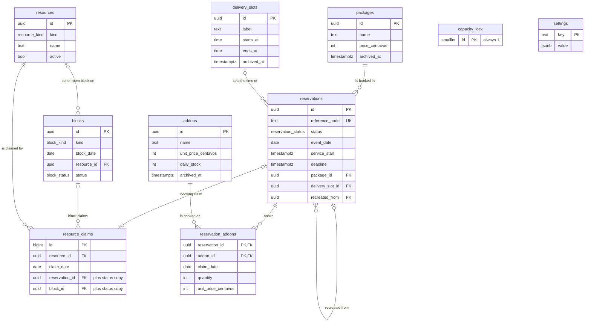
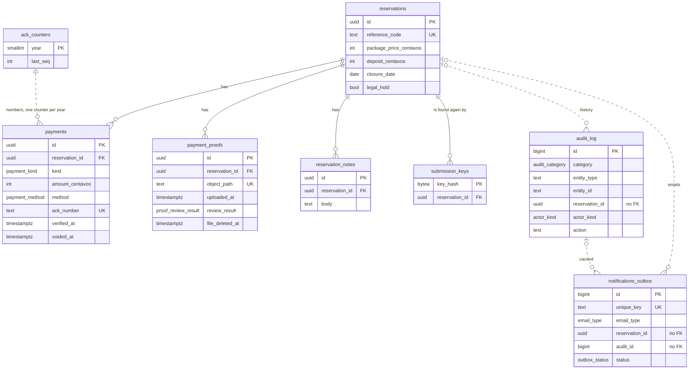
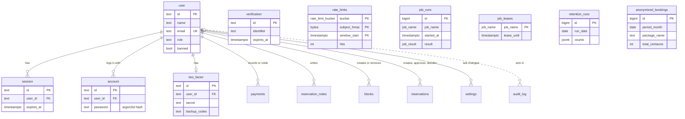
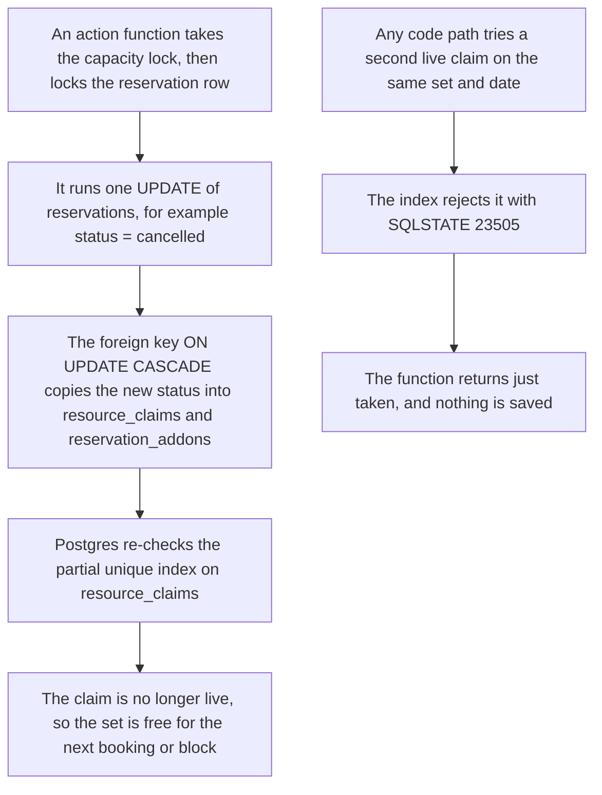

# Data Model

> **Purpose:** The database structure of the DJB Kasoundbox reservation system: schemas, database roles and grants, enums, every table with its columns, keys, constraints, and indexes, the live-claim guard, the settings keys, time handling, the columns the retention job uses, the migration approach, and a storage estimate. For each constraint, it names the rule that the constraint enforces. ·
> **Audience:** The developer (Super Admin). The "In plain words" section is written for the business owner (Admin) ·
> **Status:** Draft for review ·
> **Last updated:** 2026-10-21 ·
> **Depends on:** [Decision log][dl], [Glossary][gl], [Business rules][br], [Reservation lifecycle][lc], [Catalog and payments][cat], [Privacy and retention][priv], [Roles and permissions][roles], [Functional requirements][fr], [Non-functional requirements][nfr], [Edge cases][ec]; workflows [booking-and-submission][wf-book], [availability-and-conflicts][wf-avail], [lookup-and-review][wf-review], [changes-and-expiry][wf-change], [notifications-and-tracking][wf-notify], [administration][wf-admin]; sibling technical docs [architecture][arch], [api-specification][api], [security][sec] ·
> **Derived from:** [spec v0.2][spec] §11 (data model outline) and §12 (concurrency) as the starting point, with §10, §13, §14, §15, and §17; the batch-1 docs above (they win where the spec differs); the "Developer notes" of every workflow doc; and the stack research behind spec §10 to §12 (database layer, concurrency approach, and gap analyses), used where it agrees with the docs

## In plain words (for the Admin)

The system keeps all its information in one database. Think of it as a set of linked notebooks:

1. **The catalog notebook** lists the packages, add-ons, delivery slots, the delivery sets, and the room. Nothing in it is ever erased; old items are archived.
2. **The booking notebook** has one page per reservation: the customer's details, what was booked and for when, the prices that were locked when the request was sent, and the current status.
3. **The calendar sheet** records which set or room each booking or block holds on which day. The database itself refuses a second live entry for the same set on the same day. So a double booking cannot happen, even if the program has a mistake.
4. **The money notebook** records every deposit, balance, and refund. A wrong entry is voided, never erased. Acknowledgment numbers come from one counter per year.
5. **The history notebook** writes a line for every change: who, when, what, and why. It never copies a customer's mobile number or email.
6. **The settings page** holds values such as the deposit amount and the deadlines. Only the Super Admin changes them. The one exception: either admin can resume online booking early.
7. **The nightly clean-up** blanks or deletes old personal data on the schedule in [privacy-and-retention][priv]. It skips any booking under a legal hold.

The website reaches the database through a limited account. That account can run the approved actions and read what the pages show. It cannot delete records or change them directly. On current estimates, the database stays well inside the free plan's size limit for many years (section 11).

## How to read this document

- **Labels.** **[C]** confirmed decision · **[P]** proposed, accepted with the spec approval but may change · **[U]** unverified fact, to be checked in the week-1 test or before launch · **[O-nn]** open item in the [decision log][dl]. **[P] (new in this doc)** marks a detail that neither the spec nor the batch-1 and batch-2 docs state. It was added so the schema is complete enough to build and test. It is not yet approved, and each one is listed in the open questions.
- **Names.** This document owns the table, column, enum, index, and setting-key names. Function names are indicative, following the workflow developer notes; the final names, arguments, and result codes are in [api-specification][api].
- **SQL.** The snippets show the design. The migrations are the source of truth once they exist (section 10).
- **Rules.** This document says *how* a rule is stored and enforced, never *what* the rule is. Each constraint names its rule by ID (BR-xx, FR-xx, NFR-xx, EC-xx) or by its section in the owning doc. Numbers appear only as defaults in the settings table (section 7) or in short parentheses.
- **Time and money.** Every date is a Manila date (Asia/Manila). Money is stored as whole centavos (section 4).

### What this document does not cover

| Topic | Where it lives |
|---|---|
| Statuses, transitions, deadlines, and the rules of each action | [Reservation lifecycle][lc] |
| Capacity, hold limits, the breaker, blocks, catalog-edit refusals, mobile formats | [Business rules][br] |
| Prices, the snapshot, the ledger, acknowledgments | [Catalog and payments][cat] |
| Retention periods, the closure date, legal hold, erasure | [Privacy and retention][priv] |
| Who may do each action or change each setting | [Roles and permissions][roles] |
| Function signatures, result codes, server actions, routes | [API specification][api] |
| Threats, controls, secrets, the rationale for each grant | [Security][sec] |
| Hosting, the pooler, the driver, job schedules, the repository layout | [Architecture][arch] |

---

## 1. Entity-relationship diagrams

The model is split into three diagrams. Each one shows the keys and a few important columns; the full columns are in section 5. A solid line is a foreign key. A dotted line is a link by value, with no foreign key: logs are kept apart from the rows they describe (section 5.11).

### 1.1 Catalog and capacity



### 1.2 Money, proofs, notes, and history



### 1.3 Admin accounts and operations

The Better Auth tables are drawn with the names its CLI generates by default; the exact names for the installed version are **[U]** (section 5.19). `verification` and the operations tables (`rate_limits`, `job_runs`, `job_leases`, `retention_runs`, `anonymized_bookings`) have no foreign keys at all.



---

## 2. Schemas, roles, and exposure

### 2.1 Schemas

| Schema | Holds | Reached through the Data API | Owner |
|---|---|---|---|
| `app` | Every business table, view, enum, trigger, and function in this document | Never; it is not in "Exposed schemas" | `app_owner` |
| `admin_auth` **[P] (new in this doc)** | Only the Better Auth tables (section 5.19) | Never | `app_owner` |
| `public` | Nothing of ours. It stays empty | — | Supabase |
| `storage` | Supabase Storage metadata, including the private proof bucket | Managed by Supabase; files are only ever removed through the Storage API ([architecture][arch] §7.1) | Supabase |
| `cron`, `net`, `vault`, `extensions` | `pg_cron` jobs and their run log, `pg_net` requests, Vault secrets, `pgcrypto` | Managed by Supabase | Supabase |
| `auth` | Supabase Auth. **Not used**: admin login is Better Auth ([D-20][dl]) | — | Supabase |

- **Why a separate schema for Better Auth.** The architecture asks for the Better Auth tables to sit in a non-exposed schema ([architecture][arch] §6.3). `public` is the schema the Data API exposes by default. Placing password hashes and 2FA secrets there would make their safety depend on a dashboard setting. A schema of their own keeps the "never exposed" rule simple.
- **Fallback [U].** That Better Auth's Drizzle adapter works with tables declared through `pgSchema('admin_auth')` must be checked in the week-1 test. If it does not, the tables go in `public`, with the Data API turned off, or with RLS on and every privilege revoked from `anon` and `authenticated` (section 2.4).

### 2.2 Database roles and grants

| Role | Can log in | Used by | Grants |
|---|---|---|---|
| `postgres` (Supabase) | Yes, through the session pooler only | Migrations from the developer's laptop; `pg_cron` jobs; the break-glass script ([architecture][arch] §6.1, [WF-09E][wf-admin]) | Member of `app_owner`, so migrations can create objects owned by it. Never used by the app |
| `app_owner` | **No** (`NOLOGIN`) | Owns `app`, `admin_auth`, and everything in them | Owner. Every `SECURITY DEFINER` function runs as this role, with `SET search_path = ''` |
| `app_rw` | Yes: SCRAM-SHA-256 password, no `VALID UNTIL`; through the transaction pooler as `app_rw.<project-ref>` ([architecture][arch] §6.1) | The website | See below |
| `app_backup` | Yes; `default_transaction_read_only = on` | The nightly `pg_dump` through the session pooler ([FR-SYS-12][fr]) | `USAGE` on `app` and `admin_auth`; `SELECT` on every table and sequence in both. Nothing else |
| `anon`, `authenticated`, `service_role` (Supabase) | API roles | The Data API and Storage | No privileges on `app` or `admin_auth`. `service_role` is used only on the server, by `supabase-js`, for Storage ([architecture][arch] §6.2) |

**What `app_rw` may do** ([NFR-10][nfr]: "can only call the app's functions and read what it needs"):

- `USAGE` on `app` and `admin_auth`.
- `EXECUTE` only on the action functions that the website calls: the public ones (booking, availability, status lookup, QR reissue, the two upload steps) and the admin ones (each reservation, payment, catalog, block, setting, and privacy action). It has no `EXECUTE` on internal helpers (prefixed `_`, for example `app._claim_capacity`) or on the scheduled-job functions, except those that the daily Vercel sweep repeats ([FR-SYS-08][fr]). The exact list is in [api-specification][api].
- `SELECT` on the catalog tables, `settings`, `blocks`, `payments`, `payment_proofs`, `reservation_notes`, `audit_log`, `notifications_outbox`, `job_runs`, and the views in section 5.20.
- **No `SELECT` on `reservations` itself [P] (new in this doc).** Reservations are read through `app.reservation_effective`, which turns an overdue hold into Expired. So no page can show a stale status ([BR-05][br], [EC-22][ec]).
- No `INSERT`, `UPDATE`, `DELETE`, or `TRUNCATE` on any `app` table. Every write is a function call ([NFR-21][nfr]); nothing is deleted by the app ([NFR-22][nfr]).
- No access at all to `capacity_lock`, `ack_counters`, `rate_limits`, `submission_keys`, `job_leases`, `retention_runs`, or `anonymized_bookings`; only functions touch them.
- On `admin_auth`, the writes Better Auth needs ([architecture][arch] §6.3), with two limits **[P] (new in this doc)**: no `UPDATE` of `user.role`, and the role constraints of section 5.19. The rationale is in [security][sec].

```sql
-- Indicative; the migrations hold the real statements (section 10).
CREATE ROLE app_owner NOLOGIN;
GRANT app_owner TO postgres;
CREATE ROLE app_rw LOGIN PASSWORD '…';          -- stored as SCRAM-SHA-256
CREATE ROLE app_backup LOGIN PASSWORD '…';
ALTER ROLE app_backup SET default_transaction_read_only = on;

REVOKE ALL ON SCHEMA app, admin_auth FROM PUBLIC;
REVOKE EXECUTE ON ALL FUNCTIONS IN SCHEMA app FROM PUBLIC;   -- Postgres grants EXECUTE to PUBLIC by default
ALTER DEFAULT PRIVILEGES FOR ROLE app_owner IN SCHEMA app REVOKE EXECUTE ON FUNCTIONS FROM PUBLIC;
GRANT USAGE ON SCHEMA app, admin_auth TO app_rw, app_backup;
GRANT EXECUTE ON FUNCTION app.book_reservation(/* … */) TO app_rw;   -- one line per callable function
GRANT SELECT ON app.packages, app.addons, app.delivery_slots, app.resources, app.settings TO app_rw;
GRANT SELECT ON ALL TABLES IN SCHEMA app, admin_auth TO app_backup;
```

### 2.3 Role timeouts

| Role | `statement_timeout` | `lock_timeout` | `idle_in_transaction_session_timeout` | Why |
|---|---|---|---|---|
| `app_rw` | 5 s | 2 s | 10 s | Every action is one short function call ([architecture][arch] §6.1). A wait for the capacity lock longer than 2 s becomes "busy, please try again" ([architecture][arch] §6.4) |
| `app_backup` | 15 min **[P] (new in this doc)** | 30 s **[P] (new in this doc)** | 1 min **[P] (new in this doc)** | A dump of the whole database is one long read; it must never hold locks for long |
| `postgres` (jobs) | Supabase default | Supabase default | Supabase default | The jobs work in small batches, so no one statement runs long |

```sql
ALTER ROLE app_rw SET statement_timeout = '5s';
ALTER ROLE app_rw SET lock_timeout = '2s';
ALTER ROLE app_rw SET idle_in_transaction_session_timeout = '10s';
```

- These settings take effect only on connections opened after the change. Check them in `pg_roles.rolconfig`, not with `SHOW` in the SQL editor, which runs as `postgres`.
- That the shared pooler applies them to `app_rw` is **[U]** (week-1 item 1; [architecture][arch] §6.1). Test each one through port 6543. The expected errors are SQLSTATE `57014` (statement timeout), `55P03` (lock timeout), and `25P03` (idle in transaction).

### 2.4 Data API and row-level security

- **`app` and `admin_auth` are never exposed.** They are not added to "Exposed schemas". "Automatically expose new tables" is turned off ([architecture][arch] §2.2). The exact names of these dashboard settings are **[U]**.
- **The Data API is turned off** if Storage's signed uploads keep working without it **[U]** (week-1 item 5). The app never uses it ([architecture][arch] §1).
- **If it must stay on:** `public` stays empty. Supabase's default privileges for `anon` and `authenticated` in `public` **[U]** are revoked anyway, so that a table created there by mistake is not readable.
- **RLS is not used on `app` or `admin_auth` [P] (new in this doc).** Neither schema can be reached through the Data API. Access is controlled by the grants above and by the definer functions. RLS would only add a policy for `app_rw` on every table, with no protection gained.
- **If the fallback in 2.1 puts Better Auth in `public`,** RLS is enabled on each of its tables, with a single policy `TO app_rw USING (true) WITH CHECK (true)`, and no policy for `anon` or `authenticated`.
- "Enforce SSL on incoming connections" is on ([architecture][arch] §2.2).

### 2.5 Extensions

| Extension | Schema | Used for | Status |
|---|---|---|---|
| `pgcrypto` | `extensions` | `extensions.gen_random_bytes` (reference codes, QR tokens), `extensions.hmac` (IP and lookup counters) | **[U]** on Free |
| `pg_cron` | `cron` | The scheduled jobs ([architecture][arch] §7.1) | **[U]** on Free (week-1 item 4) |
| `pg_net` | `net` | The tick call and the Sentry heartbeat | **[U]** on Free (week-1 item 4) |
| `supabase_vault` | `vault` | The job secret, the tick URL, the IP-HMAC key (section 5.14) | **[U]** on Free (week-1 item 4) |
| `pgtap` | `extensions` | Database tests, locally and in CI only | — |

`sha256()` and `gen_random_uuid()` are built into Postgres and need no extension. With `search_path = ''`, every call to an extension function is schema-qualified, for example `extensions.hmac(...)`.

---

## 3. Enums

All enums live in `app`. A new value is added with `ALTER TYPE … ADD VALUE` in its own migration. A value is never renamed or removed while rows use it.

| Enum | Values | Defined by |
|---|---|---|
| `reservation_status` | `pending`, `awaiting_deposit`, `confirmed`, `completed`, `rejected`, `cancelled`, `expired` | [Lifecycle][lc] §1.1 |
| `booking_source` | `online`, `phone`, `walk_in`, `facebook` | [BR-06a][br]; spec §11 |
| `service_type` | `delivery`, `onsite` | [D-01][dl]; [FR-PUB-04][fr] |
| `resource_kind` | `delivery_set`, `room` | [Catalog][cat] §1.4 |
| `block_kind` | `delivery_set`, `room`, `whole_date` | [BR-08][br]; spec §11 |
| `block_status` | `active`, `removed` | [BR-08][br]; [lifecycle][lc] §7 |
| `payment_kind` | `deposit`, `balance`, `refund` | [Catalog][cat] §4.1 |
| `payment_method` | `cash`, `ewallet` | [Catalog][cat] §4.2 ([D-05][dl]) |
| `refund_decision_kind` | `none`, `partial`, `full` | [Lifecycle][lc] §6.6 |
| `proof_review_result` | `verified`, `rejected` | [BR-12][br]; spec §11 |
| `outbox_status` | `queued`, `sent`, `failed`, `skipped` | [FR-NTF-16][fr] to [FR-NTF-19][fr] |
| `email_priority` | `customer`, `admin` | [FR-NTF-20][fr] |
| `email_type` | `request_received`, `needs_info`, `approved`, `reminder`, `deadline_extended`, `proof_not_accepted`, `confirmed`, `reservation_updated`, `rejected`, `cancelled`, `rescheduled`, `expired`, `admin_new_request`, `admin_proof_uploaded`, `admin_online_paused` | [WF-07B][wf-notify] (FR-NTF-01 to FR-NTF-15) |
| `audit_category` | `security`, `booking`, `catalog`, `settings`, `account` | [FR-ADM-32][fr]. Which actions use which category is [administration][wf-admin] open question 1 |
| `actor_kind` | `admin`, `system`, `customer` | [FR-ADM-32][fr]. The setup and break-glass scripts are [administration][wf-admin] open question 9 |
| `job_name` | `expire_overdue_holds`, `queue_due_reminders`, `send_emails`, `complete_finished_events`, `run_retention`, `rotate_ip_key`, `keep_alive`, `heartbeat`, `purge_job_logs`, `daily_sweep` | [FR-SYS-01][fr] to [FR-SYS-10][fr]; [architecture][arch] §7.1 |
| `job_result` | `ok`, `error`, `skipped` | [FR-SYS-10][fr]; `skipped` when another run holds the lock ([FR-SYS-09][fr]) |
| `rate_limit_bucket` | `login_account`, `login_ip`, `lookup_ip`, `lookup_reference`, `submit_ip`, `upload_slot` | [NFR-11][nfr] |

The admin role is not an enum. It is Better Auth's `user.role` text column, limited by a CHECK to `superAdmin` and `admin` **[P] (new in this doc)**, the names the [architecture][arch] §4.3 guard uses.

---

## 4. Conventions for every table

- **Keys.** Business rows use `uuid` keys from `gen_random_uuid()`. Log rows (`audit_log`, `notifications_outbox`, `job_runs`, `retention_runs`, `anonymized_bookings`, `resource_claims`) use `bigint GENERATED ALWAYS AS IDENTITY`. Better Auth keeps its own `text` ids.
- **Money in centavos [P] (new in this doc).** Every amount is an `integer` number of centavos, in a column ending `_centavos`, with `CHECK (… >= 0)`. For example, ₱3,400 is stored as `340000`. Integers are exact in SQL and in JavaScript, and the browser formats them as pesos. The largest value, about ₱21 million, is far above any booking.
- **Time.** A moment is `timestamptz`. A calendar day is `date`. A wall-clock time with no date, such as a slot start, is `time`. Section 8 has the details.
- **Text.** Values are trimmed before saving. Free-text columns have length CHECKs **[P] (new in this doc)**: names 100, short labels 100, reasons and messages 1,000, internal notes 2,000, e-wallet references 64, emails 254. The customer's note is limited to 500 characters by [FR-PUB-05][fr].
- **Never deleted.** Reservations, payments, blocks, and catalog items are never deleted by the app ([NFR-22][nfr]; [lifecycle][lc] §6.10). Only `app.run_retention()` deletes rows, and only on the schedule in [privacy-and-retention][priv].
- **Who acted.** Columns ending `_by` hold the Better Auth user id (`text`), with a foreign key to `admin_auth.user`. User rows are never deleted. When a person stops being an admin, the row is scrubbed instead **[P] (new in this doc)** (section 5.19). So every `_by` column keeps its foreign key, and an acknowledgment can still show who received the payment ([catalog][cat] §5.3).
- **`created_at` and `updated_at`.** Every table has `created_at timestamptz NOT NULL DEFAULT now()`. Tables whose rows change also have `updated_at`, set by a shared trigger.
- **Constraint names** follow `<table>_<what>_chk`, `_uq`, `_fk`, `_idx`, so tests and error mapping can refer to them by name **[P] (new in this doc)**.

---

## 5. Tables

### 5.1 Catalog: `resources`, `packages`, `addons`, `delivery_slots`

Written only by the catalog functions, which also check [BR-10][br] (for example `app.update_addon`, `app.archive_catalog_item`, `app.deactivate_resource`; [WF-08A to WF-08E][wf-admin]).

**`resources`**: each delivery set and the room ([catalog][cat] §1.4).

| Column | Type | Null · default | Meaning and rule |
|---|---|---|---|
| `id` | `uuid` | PK | |
| `kind` | `resource_kind` | not null | Delivery set or room |
| `name` | `text` | not null | For example "Set 1". Unique per kind, case-insensitive |
| `active` | `boolean` | not null · `true` | The delivery pool is the active delivery sets ([BR-01][br]) |
| `deactivated_at` | `timestamptz` | null | Set with `active = false` |
| `created_at`, `updated_at` | `timestamptz` | not null | |

- `resources_active_chk`: `active = (deactivated_at IS NULL)`.
- `resources_one_active_room_uq`: unique index on `(kind) WHERE kind = 'room' AND active`. There is one room ([BR-02][br]).
- `resources_name_uq`: unique index on `(kind, lower(name))`.
- Deactivating a resource with future live claims is refused by the function ([BR-10][br], [EC-59][ec]).

**`packages`** ([catalog][cat] §1.1).

| Column | Type | Null · default | Meaning and rule |
|---|---|---|---|
| `id` | `uuid` | PK | |
| `name` | `text` | not null | |
| `inclusions` | `text` | not null · `''` | What the package includes, shown on the packages page ([FR-PUB-02][fr]) |
| `price_centavos` | `integer` | not null | `>= 0`. Whether ₱0 is allowed is [administration][wf-admin] open question 13 |
| `sort_order` | `integer` | not null · `0` | Display order **[P] (new in this doc)** |
| `archived_at` | `timestamptz` | null | Archived, never deleted ([catalog][cat] §1.6). Null means offered |
| `created_at`, `updated_at` | `timestamptz` | not null | |

**`addons`** ([catalog][cat] §1.2).

| Column | Type | Null · default | Meaning and rule |
|---|---|---|---|
| `id` | `uuid` | PK | |
| `name` | `text` | not null | |
| `unit_price_centavos` | `integer` | not null | `>= 0` |
| `daily_stock` | `integer` | not null | `>= 0`. Units bookable per date across all live reservations ([BR-03][br]) |
| `sort_order` | `integer` | not null · `0` | **[P] (new in this doc)** |
| `archived_at` | `timestamptz` | null | Archived, never deleted |
| `created_at`, `updated_at` | `timestamptz` | not null | |

**`delivery_slots`** ([catalog][cat] §1.3; a reserved setting, [roles][roles] §2.6).

| Column | Type | Null · default | Meaning and rule |
|---|---|---|---|
| `id` | `uuid` | PK | |
| `label` | `text` | not null | For example "Afternoon" |
| `starts_at` | `time` | not null | Manila wall-clock time. Becomes the service start at submission ([lifecycle][lc] §3.1) |
| `ends_at` | `time` | not null | |
| `archived_at` | `timestamptz` | null | Null means active ("active" in the catalog doc) |
| `created_at`, `updated_at` | `timestamptz` | not null | |

- `delivery_slots_order_chk`: `ends_at > starts_at`. A slot cannot cross midnight **[P] (new in this doc)**; the real slot times are still open (O-02).
- Changing a slot's times never touches reservations, which store their own `service_start` ([EC-56][ec]).

### 5.2 `settings`

One row per setting key. The keys, their types, and their defaults are in section 7.

| Column | Type | Null · default | Meaning and rule |
|---|---|---|---|
| `key` | `text` | PK | One of the keys in section 7 |
| `value` | `jsonb` | not null | The value. JSON `null` means "not set yet" for values that are still open items (O-02, O-03, O-05) |
| `updated_at` | `timestamptz` | not null · `now()` | |
| `updated_by` | `text` | null · FK user | Null for the migration that seeds the row, and for the breaker's own writes |

- `settings_value_chk`: `CHECK (app.setting_value_is_valid(key, value))`. The validator is an `IMMUTABLE` SQL function with one branch per key. It returns false for an unknown key, so a misspelt key cannot be stored. It checks each value's JSON type and basic bounds; the allowed ranges are [administration][wf-admin] open question 13.
- Written only by `app.update_setting(key, value)` ([WF-08F][wf-admin]), which checks the Super Admin role ([roles][roles] §2.6), and by the breaker and `app.resume_online_booking()` for `online_paused_until` ([FR-ADM-28][fr], [FR-ADM-29][fr]).
- Functions read settings through typed `STABLE` getters, for example `app.setting_int('notice_period_minutes')`.
- Every change writes a `settings` audit entry, whose changed field is the key, never the value ([WF-08F][wf-admin]).

### 5.3 `reservations`

One row per reservation, whatever its source. Written only by the action functions ([lifecycle][lc] §4.3); read through `app.reservation_effective` (section 5.20).

| Column | Type | Null · default | Meaning and rule |
|---|---|---|---|
| **Identity** | | | |
| `id` | `uuid` | PK | |
| `reference_code` | `text` | not null · unique | `KSB-XXXX-XXXX` ([FR-PUB-08][fr]). Made by a secure random generator, retried on a unique violation ([WF-02][wf-book]) |
| `source` | `booking_source` | not null | Online or staff-created ([BR-06a][br]). Which source a recreated request gets is [changes-and-expiry][wf-change] open question 9a |
| `created_by` | `text` | null · FK user | The admin who created a staff booking or a recreated request. Null for online requests |
| `recreated_from` | `uuid` | null · FK `reservations` ON DELETE SET NULL | The Expired original ([lifecycle][lc] §6.9) |
| `version` | `integer` | not null · `1` | Raised by 1 on every successful change by an action function ([FR-ADM-07][fr], [EC-16][ec]). Which changes count is [availability-and-conflicts][wf-avail] open question 9 |
| `created_at` | `timestamptz` | not null · `now()` | The submission time. Starts the review deadline ([lifecycle][lc] §3.2) and is counted by the breaker ([BR-07a][br]) |
| `updated_at` | `timestamptz` | not null · `now()` | |
| **Booking** | | | |
| `service_type` | `service_type` | not null | |
| `event_date` | `date` | not null | The Manila calendar date. Part of the claim foreign keys (section 6) |
| `delivery_slot_id` | `uuid` | null · FK `delivery_slots` | Delivery only |
| `arrival_time` | `time` | null | On-site only. Must fall within on-site hours, which the function checks ([D-03][dl]) |
| `service_start` | `timestamptz` | not null | Computed and stored at submission; never moved by later slot or hours changes ([lifecycle][lc] §3.1) |
| `package_id` | `uuid` | not null · FK `packages` | |
| `package_price_centavos` | `integer` | not null | Snapshot ([D-12][dl]; [catalog][cat] §2.2) |
| `deposit_centavos` | `integer` | not null | Snapshot of the deposit setting ([catalog][cat] §2.2) |
| **State** | | | |
| `status` | `reservation_status` | not null · `'pending'` | Changed only along the arrows of [lifecycle][lc] §2 (trigger below) |
| `deadline` | `timestamptz` | null | The hold's own deadline ([lifecycle][lc] §3.2). Set only while the reservation is a hold |
| `expiry_paused` | `boolean` | not null · `false` | A proof waits for review ([BR-12][br]) |
| `approved_at` | `timestamptz` | null | **[P] (new in this doc)**. Set by approve (row 4). The reminder rule needs it ([FR-NTF-04][fr]; [WF-07C][wf-notify] asks where it is stored) |
| `approved_by` | `text` | null · FK user | **[P] (new in this doc)** |
| `needs_info` | `boolean` | not null · `false` | The needs-info flag ([lifecycle][lc] §6.1) |
| `needs_info_message` | `text` | null | Shown on the status page and sent by email ([FR-ADM-09][fr]) |
| `decision_reason` | `text` | null | **[P] (new in this doc)**. The rejection or cancellation reason that the status page shows ([lifecycle][lc] §4.1; [FR-PUB-11][fr]). The audit entry keeps its own copy |
| `deposit_waived_at` | `timestamptz` | null | **[P] (new in this doc)**. Same-day waiver ([lifecycle][lc] §6.4). The reason is in the audit entry ([FR-ADM-13][fr]) |
| `deposit_waived_by` | `text` | null · FK user | **[P] (new in this doc)** |
| `refund_decision` | `refund_decision_kind` | null | The refund decision ([lifecycle][lc] §6.6, §6.7) |
| `refund_amount_centavos` | `integer` | null | The decided amount |
| `refund_decided_by` | `text` | null · FK user | |
| `refund_decided_at` | `timestamptz` | null | |
| `final_status_at` | `timestamptz` | null | **[P] (new in this doc)**. When the reservation reached its final status ([lifecycle][lc] §1.1). For Expired, the moment it counted as expired (the deadline, or the service start for a paused hold), not the moment a job recorded it ([changes-and-expiry][wf-change] open question 8). Drives the closure date and the deletion of unverified proofs ([privacy-and-retention][priv] §6.1, §6.2) |
| `closure_date` | `date` | null | The closure date ([privacy-and-retention][priv] §6.1). Set when the reservation reaches a final status, and recomputed inside each payment and refund function |
| `legal_hold` | `boolean` | not null · `false` | Retention deletions wait ([privacy-and-retention][priv] §5.6) |
| `legal_hold_reason` | `text` | null | Required while the hold is set |
| `legal_hold_set_at` | `timestamptz` | null | |
| `legal_hold_set_by` | `text` | null · FK user | |
| `contact_blanked_at` | `timestamptz` | null | **[P] (new in this doc)**. When an erasure or the retention job blanked the contact fields. The admin page then shows "erased" instead of empty fields |
| **Customer** | | | |
| `customer_name` | `text` | null | Blanked on the schedule ([privacy-and-retention][priv] §6.2). Whether it is required at booking is [booking-and-submission][wf-book] open question 7 |
| `mobile` | `text` | null | Always stored as `+639XXXXXXXXX` ([BR-11][br]). Required until blanked ([D-08][dl]) |
| `email` | `text` | null | Optional ([D-08][dl]). Stored in lower case |
| `venue_barangay` | `text` | null | Delivery only. Kept until ledger end ([privacy-and-retention][priv] §6.2) |
| `venue_city` | `text` | null | Delivery only. Kept into the anonymous statistics |
| `venue_street` | `text` | null | Delivery only. Whether it is required is [FR §7][fr], question 6 |
| `venue_landmarks` | `text` | null | Delivery only |
| `customer_note` | `text` | null | "Additional requirements" ([FR-PUB-05][fr]) |
| **QR** | | | |
| `qr_token_hash` | `bytea` | not null · unique | SHA-256 of the 160-bit token ([FR-PUB-08][fr], [NFR-13][nfr]). A reissue replaces it ([FR-PUB-13][fr], [FR-ADM-22][fr]). The status decides whether the link still works, so the hash is never cleared |
| `qr_issued_at` | `timestamptz` | not null · `now()` | **[P] (new in this doc)**. When the current token was made |

**CHECK constraints.**

| Name | Condition (in words) | Enforces |
|---|---|---|
| `reservations_reference_code_chk` | `reference_code ~ '^KSB-[2-9A-HJKMNP-Z]{4}-[2-9A-HJKMNP-Z]{4}$'`: the 31-character alphabet | [FR-PUB-08][fr] |
| `reservations_slot_or_arrival_chk` | Delivery has a slot and no arrival time; on-site has an arrival time and no slot | [D-03][dl]; [FR-PUB-04][fr] |
| `reservations_service_start_date_chk` | `(service_start AT TIME ZONE 'Asia/Manila')::date = event_date` | [Lifecycle][lc] §3.1 |
| `reservations_deadline_chk` | `(status IN ('pending','awaiting_deposit')) = (deadline IS NOT NULL)`: only holds have a deadline | [Lifecycle][lc] §1.1, §3.2 |
| `reservations_deadline_cap_chk` | `deadline <= service_start` | Never past the service start [C] ([lifecycle][lc] §3.2; [D-04][dl]) |
| `reservations_expiry_paused_chk` | `NOT expiry_paused OR status = 'awaiting_deposit'` | [BR-12][br]; [lifecycle][lc] §1.2 ("found on") |
| `reservations_needs_info_chk` | `NOT needs_info OR (status = 'pending' AND needs_info_message IS NOT NULL)` | [Lifecycle][lc] §1.2, §6.1. A consequence: any change out of Pending Confirmation clears the flag, including the same-day waiver ([lifecycle][lc] §9, question 3) |
| `reservations_decision_reason_chk` | `(status IN ('rejected','cancelled')) = (decision_reason IS NOT NULL)` | Reasons required ([lifecycle][lc] §4.1, rows 8, 11 to 13, 15) |
| `reservations_waiver_chk` | `deposit_waived_at` and `deposit_waived_by` are both set or both null; when set, the status is `confirmed`, `completed`, or `cancelled` | [Lifecycle][lc] §6.4 |
| `reservations_refund_chk` | A refund decision exists only on a `cancelled` reservation. `decided_by` and `decided_at` are set with it. `none` has no amount; `partial` and `full` have an amount above 0 | [Lifecycle][lc] §6.6, §6.7 |
| `reservations_final_status_chk` | `(status IN ('completed','rejected','cancelled','expired')) = (final_status_at IS NOT NULL)` | [Lifecycle][lc] §1.1 (final statuses) |
| `reservations_closure_chk` | `(closure_date IS NULL) = (final_status_at IS NULL)`: no closure date while the reservation is open | [Privacy-and-retention][priv] §6.1 |
| `reservations_legal_hold_chk` | When `legal_hold` is true, its reason, time, and admin are set | [Privacy-and-retention][priv] §5.6 |
| `reservations_mobile_chk` | `mobile ~ '^\+639[0-9]{9}$'`; and `mobile IS NOT NULL OR contact_blanked_at IS NOT NULL` | [BR-11][br]; mobile required [C] ([D-08][dl]) |
| `reservations_venue_chk` | Delivery has `venue_barangay` and `venue_city`; on-site has no venue fields | [FR-PUB-05][fr] |
| `reservations_email_chk` | A simple shape check (`^[^@\s]+@[^@\s]+\.[^@\s]+$`) and the length limit **[P] (new in this doc)** | [FR-PUB-05][fr] |
| `reservations_note_length_chk` | `char_length(customer_note) <= 500`, plus the other length limits in section 4 | [FR-PUB-05][fr] |
| `reservations_money_chk` | Every `_centavos` column `>= 0` | Section 4 |
| `reservations_qr_hash_chk` | `octet_length(qr_token_hash) = 32` | [NFR-13][nfr] |
| `reservations_claim_target_uq` | `UNIQUE (id, status, event_date)`: the target of the claim foreign keys | Section 6 |

**Indexes.**

| Index | On | Serves |
|---|---|---|
| `reservations_reference_code_uq`, `reservations_qr_token_hash_uq` | the unique columns | Status lookup and QR lookup ([FR-PUB-10][fr], [FR-PUB-09][fr]) |
| `reservations_online_holds_idx` | `(mobile) WHERE source = 'online' AND status IN ('pending','awaiting_deposit')` | Hold-limit counts ([BR-07][br]). It is not unique: the limits are settings, and overdue holds must not count |
| `reservations_online_created_idx` | `(created_at) WHERE source = 'online'` | Breaker count ([BR-07a][br]) |
| `reservations_open_holds_idx` | `(deadline) WHERE status IN ('pending','awaiting_deposit')` | Expiry and reminder jobs ([FR-SYS-01][fr], [FR-SYS-02][fr]); dashboard deadline alerts ([FR-ADM-02][fr]) |
| `reservations_event_date_idx` | `(event_date, status)` | Admin lists, upcoming events, the daily Completed job ([FR-SYS-04][fr]) |
| `reservations_closure_idx` | `(closure_date) WHERE closure_date IS NOT NULL` | Retention job ([FR-SYS-05][fr]) |
| `reservations_recreated_from_idx` | `(recreated_from)` | Links between originals and recreations ([FR-ADM-21][fr]) |

At this volume (section 11), name search can scan the table. No trigram index is needed.

**Triggers.**

- `reservations_status_guard` (`BEFORE INSERT OR UPDATE OF status`) **[P] (new in this doc)**. A new row must be `pending`. A status change must be one of the 11 arrows in [lifecycle][lc] §2. Anything else raises an error ([EC-53][ec]). A one-step staff booking therefore inserts `pending`, then moves along the existing arrows in the same function, which matches the lifecycle's reading in §2 (its §9, question 1). This is a backstop; the functions check first and return a result code.
- `reservations_immutable_guard` **[P] (new in this doc)**. `id`, `reference_code`, `source`, `created_at`, and `recreated_from` never change after insert.
- No trigger on the claim tables (section 6.6).

### 5.4 `resource_claims`, and the views `reservation_resources` and `block_resources`

Spec §11 lists `reservation_resources` and `block_resources` as two tables sharing one unique index. Postgres cannot put one index across two tables. So both kinds of claim are rows of one table, `resource_claims` **[P] (new in this doc)**, as [availability-and-conflicts][wf-avail] open question 12 expected. Section 6 explains the design.

| Column | Type | Null · default | Meaning and rule |
|---|---|---|---|
| `id` | `bigint` | PK, identity | |
| `resource_id` | `uuid` | not null · FK `resources` | The set or the room |
| `claim_date` | `date` | not null | Equal to the owner's date, through the foreign key |
| `reservation_id` | `uuid` | null | Set for a booking claim |
| `reservation_status` | `reservation_status` | null | A copy of the reservation's status, kept equal by the foreign key |
| `block_id` | `uuid` | null | Set for a block claim |
| `block_status` | `block_status` | null | A copy of the block's status, kept equal by the foreign key |
| `created_at` | `timestamptz` | not null · `now()` | |

```sql
CHECK (num_nonnulls(reservation_id, block_id) = 1),                 -- exactly one owner
CHECK ((reservation_id IS NULL) = (reservation_status IS NULL)),    -- no half-filled key,
CHECK ((block_id IS NULL) = (block_status IS NULL)),                --  which MATCH SIMPLE would skip
FOREIGN KEY (reservation_id, reservation_status, claim_date)
  REFERENCES app.reservations (id, status, event_date) ON UPDATE CASCADE ON DELETE RESTRICT,
FOREIGN KEY (block_id, block_status, claim_date)
  REFERENCES app.blocks (id, status, block_date) ON UPDATE CASCADE ON DELETE RESTRICT,
UNIQUE (reservation_id),              -- a booking claims one set or the room
UNIQUE (block_id, resource_id);       -- a whole-date block claims each resource once

CREATE UNIQUE INDEX resource_claims_one_live_uq ON app.resource_claims (resource_id, claim_date)
  WHERE reservation_status IN ('pending','awaiting_deposit','confirmed') OR block_status = 'active';
```

- **The live-claim guard** is `resource_claims_one_live_uq`: one live claim per resource per date, across bookings and blocks ([BR-01][br], [BR-02][br], [BR-04][br], [BR-08][br]; [NFR-20][nfr]; [EC-04][ec], [EC-17][ec]). Its status list is the "holds capacity" list of [lifecycle][lc] §1.1.
- **Which resource kind.** A delivery reservation claims a `delivery_set` and an on-site one claims the `room`. A whole-date block claims every active set and the room ([BR-08][br]). These are checked by the claiming function, and by an invariant test (section 6.7).
- **A reschedule** deletes the reservation's claim row, updates the reservation's date, then inserts the new claim, all in one function call ([lifecycle][lc] §6.5). The claim rows of final reservations stay as a record of which set was used.
- **Views [P] (new in this doc).** `app.reservation_resources` (`WHERE reservation_id IS NOT NULL`) and `app.block_resources` (`WHERE block_id IS NOT NULL`) keep the spec's names for readers and tests. They are read-only.

### 5.5 `reservation_addons`

The add-ons of each reservation, with their unit-price snapshot ([catalog][cat] §2.2; spec §11).

| Column | Type | Null · default | Meaning and rule |
|---|---|---|---|
| `reservation_id` | `uuid` | PK part · not null | |
| `addon_id` | `uuid` | PK part · not null · FK `addons` | |
| `reservation_status` | `reservation_status` | not null | Status copy, kept equal by the foreign key |
| `claim_date` | `date` | not null | Equal to the reservation's `event_date`, through the foreign key |
| `quantity` | `integer` | not null | `> 0` |
| `unit_price_centavos` | `integer` | not null | `>= 0`. Snapshot at submission; a newly added add-on takes the current price ([catalog][cat] §2.3) |

- `FOREIGN KEY (reservation_id, reservation_status, claim_date) REFERENCES app.reservations (id, status, event_date) ON UPDATE CASCADE ON DELETE RESTRICT`. A reschedule moves the rows to the new date by itself; the function then re-checks the stock on that date.
- `reservation_addons_live_idx`: `(addon_id, claim_date) WHERE reservation_status IN ('pending','awaiting_deposit','confirmed')`. It serves the stock sum under the capacity lock ([BR-03][br]) and the clash list for a lower stock ([BR-10][br], [EC-57][ec]).
- Add-on stock has no unique-index guard. It is a sum, checked while the capacity lock is held (section 6.5).
- Blocks never claim add-on stock ([BR-08][br]), so this table has no block rows.
- The primary key allows one price per add-on per reservation. If extra units added by "edit details" take the current price, the key must change ([catalog][cat] §10, question 2).

### 5.6 `blocks`

A block makes a set, the room, or a whole date unavailable ([BR-08][br]; [lifecycle][lc] §7). A date range creates one row per date.

| Column | Type | Null · default | Meaning and rule |
|---|---|---|---|
| `id` | `uuid` | PK | |
| `kind` | `block_kind` | not null | A set, the room, or the whole date |
| `block_date` | `date` | not null | One Manila date |
| `resource_id` | `uuid` | null · FK `resources` | The set or the room; null for a whole-date block |
| `status` | `block_status` | not null · `'active'` | Active blocks are live claims ([BR-04][br]) |
| `reason` | `text` | not null | Required ([BR-08][br]) |
| `created_by` | `text` | not null · FK user | The role allowed depends on `kind` ([roles][roles] §2.5); the function checks it |
| `created_at` | `timestamptz` | not null · `now()` | |
| `removed_at` | `timestamptz` | null | |
| `removed_by` | `text` | null · FK user | |
| `removal_reason` | `text` | null | Required for removal ([BR-08][br]) |

- `blocks_target_chk`: `(kind = 'whole_date') = (resource_id IS NULL)`.
- `blocks_removed_chk`: `removed_at`, `removed_by`, and `removal_reason` are all set when `status = 'removed'`, and all null when it is `active`.
- `blocks_claim_target_uq`: `UNIQUE (id, status, block_date)`, the claim foreign-key target.
- `blocks_guard` trigger **[P] (new in this doc)**: the only status change is `active` → `removed` ([lifecycle][lc] §7). `kind`, `block_date`, and `resource_id` never change.
- `blocks_date_idx`: `(block_date) WHERE status = 'active'`, for the active-blocks list ([FR-ADM-25][fr]).
- A whole-date block's claim rows cover the sets that are active when it is created. A set added later is [availability-and-conflicts][wf-avail] open question 6.

### 5.7 `payments`

The payments ledger: every deposit, balance, and refund ([catalog][cat] §4).

| Column | Type | Null · default | Meaning and rule |
|---|---|---|---|
| `id` | `uuid` | PK | |
| `reservation_id` | `uuid` | not null · FK `reservations` | |
| `kind` | `payment_kind` | not null | |
| `amount_centavos` | `integer` | not null | `> 0`. A deposit must equal the reservation's `deposit_centavos`; the function checks this ([catalog][cat] §4.3; [EC-34][ec]) |
| `method` | `payment_method` | not null | |
| `ewallet_ref` | `text` | null | Required for e-wallet, empty for cash ([catalog][cat] §4.2) |
| `note` | `text` | null | Optional. Never payer names or account numbers ([catalog][cat] §4.7) |
| `recorded_by` | `text` | not null · FK user | "Received by" or "paid by" ([catalog][cat] §4.2) |
| `recorded_at` | `timestamptz` | not null · `now()` | The payment time. Whether an earlier actual payment date can be entered is [catalog][cat] §10, question 7 |
| `ack_year` | `smallint` | null | The Manila year when it was recorded ([catalog][cat] §5.2) |
| `ack_seq` | `integer` | null | The number within that year, from `ack_counters` |
| `ack_number` | `text` | generated · unique | `ACK-YYYY-NNNN`, padded to at least 4 digits and never truncated (see below) |
| `verified_at` | `timestamptz` | null | Deposits only; equal to `recorded_at`. Starts the proof-deletion clock ([D-21][dl]) |
| `voided_at` | `timestamptz` | null | Void details ([catalog][cat] §4.6) |
| `voided_by` | `text` | null · FK user | |
| `void_reason` | `text` | null | |

```sql
ack_number text GENERATED ALWAYS AS (
  'ACK-' || ack_year::text || '-' ||
  CASE WHEN ack_seq < 10000 THEN lpad(ack_seq::text, 4, '0') ELSE ack_seq::text END
) STORED,   -- lpad alone would cut 10000 down to '1000'
```

| Constraint or index | Condition | Enforces |
|---|---|---|
| `payments_ewallet_ref_chk` | `(method = 'ewallet') = (ewallet_ref IS NOT NULL)` | [Catalog][cat] §4.2, §9 |
| `payments_ack_chk` | `(kind IN ('deposit','balance')) = (ack_seq IS NOT NULL)`, and `ack_year` is set with `ack_seq` | Acknowledgments for deposits and balances only ([catalog][cat] §5.1) |
| `payments_verified_chk` | `(kind = 'deposit') = (verified_at IS NOT NULL)` | [Catalog][cat] §4.3 |
| `payments_void_chk` | The three void columns are all set or all null | [Catalog][cat] §4.6 |
| `payments_ack_uq` | `UNIQUE (ack_year, ack_seq)` | A number is never repeated ([catalog][cat] §5.2; [EC-36][ec]) |
| `payments_one_active_deposit_uq` | Unique index on `(reservation_id) WHERE kind = 'deposit' AND voided_at IS NULL` | One active deposit ([catalog][cat] §4.3; [EC-35][ec]) |
| `payments_reservation_idx` | `(reservation_id, recorded_at)` | Reservation page, balance due, closure date |
| `payments_guard` trigger **[P] (new in this doc)** | After insert, only the void columns may change, and only once | Voided, never edited or deleted ([NFR-22][nfr]); voiding a void twice is refused ([changes-and-expiry][wf-change] open question 11) |

- A voided row keeps its number, which is retired for good ([catalog][cat] §4.6; [EC-33][ec]).
- "A deposit was paid" means an active deposit row exists ([WF-06A][wf-change]).

### 5.8 `ack_counters`

| Column | Type | Null · default | Meaning and rule |
|---|---|---|---|
| `year` | `smallint` | PK | A Manila year |
| `last_seq` | `integer` | not null · `0` | `>= 0`. The last number issued that year. Never lowered |

The number is taken inside the recording function, in the same transaction as the payment row ([catalog][cat] §9). An upsert takes the row lock and creates the year's row on its first use, so 1 January needs no preparation ([EC-37][ec]):

```sql
INSERT INTO app.ack_counters AS c (year, last_seq)
VALUES (extract(year FROM v_now AT TIME ZONE 'Asia/Manila')::smallint, 1)
ON CONFLICT (year) DO UPDATE SET last_seq = c.last_seq + 1
RETURNING c.year, c.last_seq;
```

### 5.9 `payment_proofs`

One row per proof upload link issued, and its file ([FR-PUB-12][fr]; [BR-12][br]; spec §11).

| Column | Type | Null · default | Meaning and rule |
|---|---|---|---|
| `id` | `uuid` | PK | Also the upload slot's id ([WF-07E][wf-notify]) |
| `reservation_id` | `uuid` | not null · FK `reservations` | |
| `object_path` | `text` | not null · unique | The path in the private bucket. It holds only ids, for example `<reservation_id>/<random>.webp` ([WF-07E][wf-notify]) |
| `slot_issued_at` | `timestamptz` | not null · `now()` | When the signed upload link was issued |
| `slot_expires_at` | `timestamptz` | not null | When that link stops working. Its lifetime is set in [security][sec] |
| `uploaded_at` | `timestamptz` | null | When the upload was recorded. This is what pauses expiry ([BR-12][br]) |
| `review_result` | `proof_review_result` | null | Verified or rejected |
| `reviewed_at` | `timestamptz` | null | |
| `reviewed_by` | `text` | null · FK user | |
| `reject_reason` | `text` | null | Required for a rejection ([FR-ADM-12][fr]) |
| `file_deleted_at` | `timestamptz` | null | When the file was hard-deleted. The row stays as the record ([privacy-and-retention][priv] §6.4) |

- `payment_proofs_review_chk`: a review needs an upload; `reviewed_at` and `reviewed_by` are set together with `review_result`; `reject_reason` is set exactly when the result is `rejected`.
- `payment_proofs_to_verify_idx`: `(uploaded_at) WHERE uploaded_at IS NOT NULL AND review_result IS NULL`. The dashboard's "proofs to verify" list ([FR-ADM-02][fr]).
- `payment_proofs_reservation_idx`: `(reservation_id)`.
- The function counts this table's rows for "at most 2 uploads per reservation, ever" ([FR-PUB-12][fr]) and for the "3 links per hour" limit ([NFR-11][nfr]). Which moment counts as an upload is [notifications-and-tracking][wf-notify] open question 14. A link issued but never used is a stray file risk (open question 17 there).
- `reservations.expiry_paused` is set when an upload is recorded and cleared when the proof is reviewed ([WF-04E][wf-review]).

### 5.10 `reservation_notes`

Internal notes by admins ([FR-ADM-05][fr]). Customers never see them.

| Column | Type | Null · default | Meaning and rule |
|---|---|---|---|
| `id` | `uuid` | PK | |
| `reservation_id` | `uuid` | not null · FK `reservations` | |
| `author_id` | `text` | not null · FK user | |
| `created_at` | `timestamptz` | not null · `now()` | |
| `body` | `text` | null | Blanked with the contact fields ([privacy-and-retention][priv] §6.2) |
| `blanked_at` | `timestamptz` | null | |

- `reservation_notes_body_chk`: `(body IS NULL) = (blanked_at IS NOT NULL)`, plus the length limit of section 4. Correcting or removing a note is [lookup-and-review][wf-review] open question 15.
- `reservation_notes_reservation_idx`: `(reservation_id, created_at)`.

### 5.11 `audit_log`

Append-only. Every status change and admin action writes one row in the same transaction ([FR-ADM-32][fr]; [NFR-25][nfr]). It is also the reservation history.

| Column | Type | Null · default | Meaning and rule |
|---|---|---|---|
| `id` | `bigint` | PK, identity | Used in outbox keys ([FR-NTF-17][fr]) |
| `occurred_at` | `timestamptz` | not null · `now()` | Shown in Manila time |
| `category` | `audit_category` | not null | |
| `entity_type` | `text` | not null | One of `reservation`, `payment`, `proof`, `note`, `block`, `package`, `addon`, `delivery_slot`, `resource`, `setting`, `admin_account`, `online_booking` (CHECK) **[P] (new in this doc)** |
| `entity_id` | `text` | null | The row's id, or the setting key |
| `reservation_id` | `uuid` | null, no FK | **[P] (new in this doc)**. The reservation an entry belongs to, even when the entity is a payment or a proof. It is used for the history, the legal-hold filter, and the ledger-end deletion |
| `actor_kind` | `actor_kind` | not null | |
| `actor_id` | `text` | null, no FK | The admin's id. Null for the customer and the system. The display name comes from the scrubbed user row (section 5.19) |
| `action` | `text` | not null | For example `reservation.approved`. CHECK `^[a-z_]+\.[a-z0-9_]+$` |
| `changed_fields` | `text[]` | not null · `'{}'` | Field **names** only. A CHECK allows only `[a-z0-9_]` names, so no value can be stored here ([FR-ADM-32][fr]) |
| `reason` | `text` | null | The admin's reason, where one is required |

- **No customer contact data.** The helper (for example `app._write_audit`) takes names, never values. A test scans every row for mobile-number and email patterns ([WF-10A][wf-admin]; [NFR-15][nfr]).
- **No foreign keys.** An audit row must not block, or be removed by, changes to the rows it describes. Its retention is separate ([privacy-and-retention][priv] §6.2).
- **Append-only.** No role but `app_owner` has `UPDATE`, `DELETE`, or `TRUNCATE`. A trigger also refuses every `UPDATE`, and refuses `DELETE` unless the transaction has set `app.retention_run = 'on'` with `SET LOCAL`, which only `app.run_retention()` does **[P] (new in this doc)** ([NFR-22][nfr]; [WF-10A][wf-admin]).
- **Indexes:** `(occurred_at)`; `(category, occurred_at)`; `(reservation_id, occurred_at) WHERE reservation_id IS NOT NULL`; `(entity_type, entity_id)`.

### 5.12 `notifications_outbox`

Each email is queued in the same transaction as the change that causes it ([FR-NTF-16][fr]).

| Column | Type | Null · default | Meaning and rule |
|---|---|---|---|
| `id` | `bigint` | PK, identity | |
| `unique_key` | `text` | not null · unique | Reservation + type + audit entry, or reservation + `reminder` + deadline ([FR-NTF-17][fr]). Queued with `ON CONFLICT (unique_key) DO NOTHING`. It is also passed to Resend as its idempotency key |
| `email_type` | `email_type` | not null | |
| `priority` | `email_priority` | not null | Customer emails first ([FR-NTF-20][fr]) |
| `reservation_id` | `uuid` | null, no FK | Null for the breaker email |
| `audit_id` | `bigint` | null, no FK | The audit entry that caused it |
| `recipient` | `text` | null | The email address. Blanked with the reservation's contact fields **[P] (new in this doc)** (section 9) |
| `template_data` | `jsonb` | null | Only data that cannot be read from the reservation at send time, for example when a breaker pause ends. Never a raw QR token or a secret ([booking-and-submission][wf-book] open question 1) |
| `status` | `outbox_status` | not null · `'queued'` | |
| `attempts` | `smallint` | not null · `0` | Up to the maximum-attempts setting ([FR-NTF-18][fr]) |
| `next_attempt_at` | `timestamptz` | not null · `now()` | When it may be tried next. **Also the claim lease [P] (new in this doc):** claiming a row moves this time a short lease ahead, so the `after()` sender, the tick, and the daily sweep never send one row at once ([architecture][arch] §7.2, open question 5). No separate claimed-until column is needed |
| `last_error` | `text` | null | A short error, with no personal data ([NFR-23][nfr]) |
| `provider_message_id` | `text` | null | Resend's id **[P] (new in this doc)** |
| `created_at` | `timestamptz` | not null · `now()` | |
| `sent_at` | `timestamptz` | null | |
| `updated_at` | `timestamptz` | not null · `now()` | |

- `notifications_outbox_sent_chk`: `(status = 'sent') = (sent_at IS NOT NULL)`.
- `notifications_outbox_due_idx`: `(priority, next_attempt_at) WHERE status = 'queued'`. Claimed with `FOR UPDATE SKIP LOCKED` ([WF-07A][wf-notify]).
- `notifications_outbox_sent_idx`: `(sent_at) WHERE status = 'sent'`. Counts for the daily and monthly caps, by Manila day and month ([FR-NTF-20][fr]).
- `notifications_outbox_reservation_idx`: `(reservation_id)`.
- **No row** is written for a customer email when the reservation has no email address ([WF-07F][wf-notify]; [FR-NTF-21][fr]).
- **Admin emails** get one row per admin, with the admin's id inside the unique key **[P] (new in this doc)** ([notifications-and-tracking][wf-notify] open question 6).

### 5.13 `submission_keys`

Duplicate-submission keys ([FR-PUB-06][fr]; [EC-01][ec]).

| Column | Type | Null · default | Meaning and rule |
|---|---|---|---|
| `key_hash` | `bytea` | PK | SHA-256 of the browser's key (32 bytes, CHECK). Only the hash is stored ([WF-01C][wf-book]) |
| `request_fingerprint` | `bytea` | not null | **[P] (new in this doc)**. SHA-256 of the normalized request, so a repeat with different data can be told apart ([booking-and-submission][wf-book] open question 3) |
| `reservation_id` | `uuid` | not null · FK `reservations` | The reservation a repeat returns |
| `created_at` | `timestamptz` | not null · `now()` | Deleted after its period ([privacy-and-retention][priv] §6.2) |

- `submission_keys_created_idx`: `(created_at)`, for the retention job.
- The primary key makes the check atomic with the insert, so a double click cannot create two reservations ([WF-01C][wf-book]).

### 5.14 `rate_limits`

Counters for [NFR-11][nfr]. They never hold a raw IP address, reference code, or mobile number ([privacy-and-retention][priv] §3.2).

| Column | Type | Null · default | Meaning and rule |
|---|---|---|---|
| `bucket` | `rate_limit_bucket` | PK part | What is limited |
| `subject_hmac` | `bytea` | PK part | HMAC of the IP address, the account, the reference code (plus mobile), or the reservation id (32 bytes, CHECK) |
| `window_start` | `timestamptz` | PK part | Start of a fixed window |
| `hits` | `integer` | not null · `0` | `>= 0` |
| `blocked_until` | `timestamptz` | null | The login lockout ([NFR-11][nfr]) |

- `rate_limits_window_idx`: `(window_start)`, for the clean-up.
- **The HMAC key [P] (new in this doc).** It is a Vault secret, `ip_hmac_key`, replaced daily by `app.rotate_ip_key()`, which overwrites the old value ([FR-SYS-06][fr]). The HMAC is computed inside the database, so the app never holds the key. The full design belongs to [security][sec].
- Which key the failed-lookup limit uses is [notifications-and-tracking][wf-notify] open question 11. The table supports either.
- Whether Better Auth's own limiter must be turned off is [architecture][arch] open question 16.

### 5.15 `job_runs` and `job_leases`

**`job_runs`**: one row per job run, for the health panel and the heartbeat ([FR-SYS-10][fr]; [FR-ADM-33][fr]).

| Column | Type | Null · default | Meaning and rule |
|---|---|---|---|
| `id` | `bigint` | PK, identity | |
| `job_name` | `job_name` | not null | |
| `started_at` | `timestamptz` | not null · `now()` | |
| `finished_at` | `timestamptz` | null | Null while running |
| `result` | `job_result` | null | Null while running |
| `counts` | `jsonb` | not null · `'{}'` | For example `{"expired": 2}`. Counts only, no personal data |
| `error_summary` | `text` | null | Short, with no personal data ([NFR-23][nfr]) |

- `job_runs_latest_idx`: `(job_name, started_at DESC)`.
- **Kept 14 days [P] (new in this doc).** The every-minute jobs write several thousand rows a day (section 11). The daily retention job deletes older rows. The health panel needs only the latest runs.

**`job_leases`** **[P] (new in this doc)**: the lease rows behind `app.try_start_job(...)` for the two job routes ([architecture][arch] §7.2).

| Column | Type | Null · default | Meaning and rule |
|---|---|---|---|
| `job_name` | `job_name` | PK | |
| `lease_until` | `timestamptz` | not null | A run may start only once this has passed. A crashed run's lease simply expires |
| `holder` | `text` | null | An id for the run, so only the holder releases it |

### 5.16 `retention_runs`

The retention job's log, with counts only ([FR-SYS-05][fr]; [privacy-and-retention][priv] §6.4).

| Column | Type | Null · default | Meaning and rule |
|---|---|---|---|
| `id` | `bigint` | PK, identity | |
| `run_date` | `date` | not null | The Manila date of the run |
| `started_at` | `timestamptz` | not null | |
| `finished_at` | `timestamptz` | null | |
| `counts` | `jsonb` | not null · `'{}'` | Rows blanked, deleted, or reduced, per category |
| `audit_action_counts` | `jsonb` | not null · `'{}'` | The monthly per-action counts of the booking audit events deleted in this run, for example `{"2026-12": {"reservation.approved": 14}}` ([privacy-and-retention][priv] §6.2) |
| `legal_hold_skipped` | `integer` | not null · `0` | Reservations skipped because of a legal hold |

Kept until ledger end; which ledger end is [privacy-and-retention][priv] §11, question 11.

### 5.17 `anonymized_bookings`

**[P] (new in this doc).** After ledger end, booking and payment records are "reduced to anonymous statistics: month and year, package, amounts, city" ([privacy-and-retention][priv] §6.2). This table holds those statistics, one row per reduced reservation. The reservation's own rows are then deleted (section 9).

| Column | Type | Null · default | Meaning and rule |
|---|---|---|---|
| `id` | `bigint` | PK, identity | |
| `period_month` | `date` | not null | The first day of the event's month. CHECK: the day is 1 |
| `package_name` | `text` | not null | The package name when the reservation was reduced |
| `total_centavos` | `integer` | not null | `>= 0` |
| `deposit_paid_centavos` | `integer` | not null · `0` | Active deposits |
| `balance_paid_centavos` | `integer` | not null · `0` | Active balances |
| `refunded_centavos` | `integer` | not null · `0` | Active refunds |
| `venue_city` | `text` | null | Null for on-site bookings |

No reference code, date, status, timestamp, or id from the original is copied, so no row can be traced back to a person.

### 5.18 `capacity_lock`

| Column | Type | Null · default | Meaning and rule |
|---|---|---|---|
| `id` | `smallint` | PK | CHECK `id = 1`. One row, inserted by a migration |

Every function that changes claims takes it first: `SELECT 1 FROM app.capacity_lock WHERE id = 1 FOR UPDATE` ([NFR-20][nfr]; spec §12). No role but `app_owner` can read or lock it.

### 5.19 Better Auth tables (by reference)

The tables are generated by the Better Auth CLI for the installed 1.7.x version, with the Drizzle adapter, the admin plugin, and the two-factor plugin ([architecture][arch] §2.1). Their exact table and column names are **[U]** until that code is generated. They live in `admin_auth` (section 2.1).

| Table | Holds | Retention |
|---|---|---|
| `user` | Each admin: id, display name, email, role, ban state, 2FA-enabled flag | While the person is an admin; then scrubbed (below) |
| `session` | Login sessions | Deleted when the account is disabled, reset, or signed out ([roles][roles] §5.1) |
| `account` | The password hash (argon2id) | Credentials are deleted within the period in [privacy-and-retention][priv] §6.2 |
| `two_factor` | The TOTP secret and backup codes | As `account` |
| `verification` | Short-lived verification values | Expire by themselves |

Additions made in hand-written migrations **[P] (new in this doc)**:

- `user_role_chk`: `role IN ('superAdmin','admin')`.
- `user_one_active_per_role_uq`: a unique index on `(role) WHERE banned IS NOT TRUE`. At most one Super Admin and one active Admin ([roles][roles] §5.1; [EC-75][ec]).
- **Scrub instead of delete.** When a former admin's credentials are deleted, the `account`, `two_factor`, and `session` rows are deleted. The `user` row is kept: its email is replaced by a non-personal placeholder such as `removed-<id>@invalid`, and it stays banned. Only the id and the display name remain ([privacy-and-retention][priv] §6.2). Who runs this is [administration][wf-admin] open question 11.
- **No raw IP addresses.** Better Auth stores the client IP on sessions by default. It is turned off (an option such as `advanced.ipAddress.disableIpTracking`, **[U]** for 1.7.x), because the system keeps no raw IP addresses ([privacy-and-retention][priv] §3.2).
- `app_rw` cannot update `role` (section 2.2). No action changes a role ([roles][roles] §5.1).

### 5.20 Views and shared helper functions

These are owned by `app_owner`. The views run with their owner's rights, so `app_rw` reads them without reading the base table.

| Object | Kind | What it does |
|---|---|---|
| `app.manila_today()` | `STABLE` function | `(now() AT TIME ZONE 'Asia/Manila')::date` (section 8) |
| `app.holds_capacity(status)` | `IMMUTABLE` function | `status IN ('pending','awaiting_deposit','confirmed')`: the same list as the index predicate. A catalog test checks that they agree ([lifecycle][lc] §1.1) |
| `app.hold_is_overdue(status, deadline, expiry_paused, service_start, at)` | `IMMUTABLE` function | True for a hold whose deadline has passed and is not paused, or whose pause has reached the service start ([BR-05][br], [BR-12][br]). The second part is [availability-and-conflicts][wf-avail] open question 3. It is the shared predicate the workflow docs ask for ([WF-05A][wf-avail], [WF-05D][wf-avail]) |
| `app.reservation_effective` | View | Every reservation column, plus: `effective_status` (Expired for an overdue hold); `is_overdue`; `is_urgent` (`event_date = app.manila_today()`); `total_centavos`; `deposit_paid_centavos`, `balance_paid_centavos`, `refund_paid_centavos` (active rows only); `balance_due_centavos` = total minus active deposits and balances ([catalog][cat] §2.1) |
| `app.reservation_resources`, `app.block_resources` | Views | Section 5.4 |
| `app.setting_value_is_valid(key, value)` | `IMMUTABLE` function | Section 5.2 |

- **The urgent flag is computed, not stored [P] (new in this doc).** "Urgent" means the event date is today in Manila ([BR-06a][br]). A stored flag would be wrong from the next midnight on. A computed one is always right, and it is "recomputed after a reschedule" ([lifecycle][lc] §6.5) by definition. Spec §11 lists it among the stored flags; this is the one place this design differs.
- **Readers never write.** The view only *shows* an overdue hold as Expired. Recording Expired is done by a function or the job ([WF-05D][wf-avail]).

---

## 6. The live-claim guard

### 6.1 The problem

[NFR-20][nfr] asks for a hard guard: one partial unique index allowing one live claim per resource per date, across bookings and blocks. Three Postgres facts shape the design:

1. An index covers one table. Booking claims and block claims must therefore be rows of the same table.
2. An index's `WHERE` clause can use only that table's columns. It cannot read `reservations.status` or `blocks.status`. The table needs its own copy of the owner's status.
3. The `WHERE` clause must be immutable, so it cannot use `now()` (SQLSTATE `42P17`). An overdue hold stays "live" for the index until its status changes.

### 6.2 The design

- **One claims table:** `resource_claims` (section 5.4), with exactly one owner per row, either a reservation or a block.
- **The status copy is kept by a foreign key, not by code.** The composite foreign key `(reservation_id, reservation_status, claim_date) → reservations (id, status, event_date)` has `ON UPDATE CASCADE`. When a function changes a reservation's status, Postgres copies the new status into its claim rows and re-checks the unique index in the same statement. The same holds for blocks.
- **A wrong copy is impossible.** `(id, status, event_date)` is unique on the parent, so a child row's copy must equal the parent's current values. A direct write of a different status, or of another date, fails with a foreign-key violation (SQLSTATE `23503`). This also covers a manual edit in the Supabase table editor.
- **No half-filled keys.** A composite foreign key is not checked when any of its columns is null (`MATCH SIMPLE`). The CHECKs in section 5.4 make sure that each owner's id and status are either both set or both null.
- **Every status change is a plain `UPDATE` of the parent.** No transition function has to remember the claims.



These behaviours were tried on a scratch PostgreSQL 16.15 database while this document was written: the cascade on cancel and on block removal, the refusal of a second live booking, the refusal of a block on a booked set, the foreign-key refusal of a direct write to the copy and of a claim on the wrong date, the CHECK refusal of a half-filled claim, the date cascade on reschedule, and the trigger refusal of a forbidden transition. They must be re-run as pgTAP tests on the Supabase project (section 6.7), whose Postgres major version is **[U]**.

### 6.3 Alternatives that were not chosen

| Option | Why not |
|---|---|
| Two tables, `reservation_resources` and `block_resources`, each with its own index, relying on the capacity lock | No hard guard between a booking and a block. In the research's test, a writer that skipped the lock created a double claim ([EC-17][ec]) |
| Blocks stored as `reservations` rows with a `blocked` status (the research's design) | It mixes the two block statuses into the seven reservation statuses. Every reader would have to filter out blocks, and blocks would need blank customer fields. The docs keep blocks separate (spec §11; [lifecycle][lc] §7) |
| A trigger that copies the status | A direct write to the copy can still disagree with the parent, and the trigger is more code to test |
| A "live" boolean column kept by the functions | The same sync problem, moved to another column |
| An exclusion constraint with time ranges (`btree_gist`) | The same one-table limits as a partial index. It is only useful for hour-level occupancy, which whole-day claims do not need ([D-03][dl]) |

The research also counted `completed` as live and claimed every Manila date of an overnight rental. The docs release claims at Completed ([BR-04][br]) and book by whole event date ([D-03][dl]), so neither is carried over.

### 6.4 What the index cannot see, and how the gap is closed

- An overdue hold that the job has not yet marked Expired still blocks its set in the index, while the calendar already shows the date free ([BR-05][br]). The index can only be stricter than the view, never looser.
- Every function that **adds** a claim (book, staff booking, recreate, reschedule, block) first marks the overdue holds on the target date Expired, under the capacity lock and through the same code as the every-minute job ([WF-05B][wf-avail]; [availability-and-conflicts][wf-avail] open question 1). Then it claims. So a date that "looked full only because of an overdue hold" can still be booked ([EC-48][ec]).
- Which overdue holds the booking function expires is [booking-and-submission][wf-book] open question 8.

### 6.5 Add-on stock

Stock is a sum, not a uniqueness rule, so no index can guard it. Under the capacity lock, after expiring overdue holds on the date, the function sums `reservation_addons.quantity` for live rows on `(addon_id, claim_date)`, adds the requested quantity, and compares the total with `addons.daily_stock` ([BR-03][br]; spec §12). The lock is what makes this safe: every writer of add-on rows takes it.

### 6.6 Lock order and the cost of the cascade

- **Order:** the capacity lock, then the reservation row (`SELECT … FOR UPDATE`, with the status and version compare), then child rows and the year's `ack_counters` row ([architecture][arch] §6.4; [availability-and-conflicts][wf-avail] open question 10).
- **Why the row lock comes first.** `status` and `event_date` are in a unique key that a foreign key uses. Changing them needs the strongest row lock, which conflicts with the key-share lock that inserting a payment or a claim takes. The research reproduced a deadlock between two such sessions, and locking the reservation row first removed it.
- **No triggers on `resource_claims` or `reservation_addons`.** Cascaded updates fire child triggers. A trigger that blocks or changes the copied columns could break the foreign key's guarantee.
- **Actions that only free capacity** (reject, cancel, expire, complete, remove a block) cannot violate the index. Whether they also take the capacity lock is [availability-and-conflicts][wf-avail] open question 2.

### 6.7 Tests for the guard

These are pgTAP tests in the database test suite ([NFR-32][nfr]; test plan, batch 4):

- **Status matrix.** For every value of `reservation_status`, two claims on one set and date conflict exactly when `app.holds_capacity(status)` is true. The same is done for `block_status`.
- **Catalog checks.** Both claim foreign keys have `confupdtype = 'c'`. `pg_get_indexdef` of `resource_claims_one_live_uq` matches the expected text, so a later migration cannot quietly change the predicate.
- **One test per transition.** The copy follows the parent. A cancel frees the set at once. A reschedule into a taken set fails with `23505` inside the cascade and is returned as "not free".
- **Direct writes.** An `UPDATE` or `INSERT` of a wrong status copy fails with `23503`.
- **Invariants, checked after each step:** (1) no claim's copy differs from its owner; (2) no resource and date has two live claims according to `reservation_effective`; (3) once overdue holds are expired, the index's live set equals the view's live set; (4) every delivery claim is on a `delivery_set` and every on-site claim on the `room`.
- **Concurrency**, with two sessions: two bookings for the last set ([EC-04][ec]); a block racing a booking ([EC-17][ec]); two bookings over an overdue hold; approve and expiry at the deadline.

---

## 7. Settings keys

Every row below is a key in `settings` (section 5.2). The value is stored as JSON; "integer" means a JSON number with no fraction. "Not set" rows hold JSON `null` until the open item is answered; until then, a function that needs the value refuses with a "not configured" result **[P] (new in this doc)**.

**Who can edit.** Every key is a Super Admin setting ([roles][roles] §2.6). The one exception is `online_paused_until`: only the breaker sets it, and either admin can clear it with "resume early" ([roles][roles] §2.4; [FR-ADM-28][fr]). The defaults below are the owning docs' values; the owning doc wins if they differ.

| Key | Type | Default | Unit | Group | Owning rule |
|---|---|---|---|---|---|
| `deposit_amount_centavos` | integer ≥ 0 | Not set (O-03) | centavos | Reserved **[C]** | [Catalog][cat] §7; [D-05][dl] |
| `review_deadline_hours` | integer > 0 | 72 | hours | Reserved **[C]** | [Lifecycle][lc] §3.2 |
| `deposit_deadline_hours` | integer > 0 | 24 | hours | Reserved **[C]** | [Lifecycle][lc] §3.2 |
| `business_info` | object: `name`, `address`, `phone`, `email`, `facebook_url`, `office_hours` (texts) **[P] (new in this doc)** | Not set (O-05) | — | Reserved **[C]** | [FR-ADM-28][fr]; [FR-PUB-16][fr] |
| `notice_period_minutes` | integer ≥ 0 | 60 | minutes | Booking rules | [BR-06][br] |
| `onsite_hours` | object: `opens`, `closes` (`"HH:MM"`) **[P] (new in this doc)** | Not set (O-02) | Manila time | Booking rules | [BR-02][br]; [lifecycle][lc] §3.1 |
| `booking_window_days` | integer > 0 | 180 | days | Booking rules | [BR-09][br] |
| `hold_limit_per_date` | integer > 0 | 1 | holds per mobile per date | Booking rules | [BR-07][br] |
| `hold_limit_total` | integer > 0 | 2 | holds per mobile | Booking rules | [BR-07][br] |
| `breaker_limit` | integer > 0 | 6 (the next request in the window is refused) | online requests per 60 minutes | Booking rules | [BR-07a][br] |
| `breaker_pause_minutes` | integer > 0 | 60 | minutes | Booking rules | [BR-07a][br] |
| `online_paused_until` | timestamp string or `null` | `null` | moment | System | [BR-07a][br]; [FR-ADM-29][fr] |
| `reminder_lead_hours` | integer > 0 | 6 | hours | Notifications | [FR-NTF-04][fr] ([D-10][dl]) |
| `email_cap_daily` | integer > 0 | 100 **[U]** | emails per Manila day | Notifications | [FR-NTF-20][fr] |
| `email_cap_monthly` | integer > 0 | 3,000 **[U]** | emails per Manila month | Notifications | [FR-NTF-20][fr] |
| `email_admin_reserve` | integer ≥ 0 | 90 | emails per day | Notifications | [FR-NTF-20][fr] |
| `email_max_attempts` | integer > 0 | 5 **[P] (new in this doc)** | attempts | Notifications | [FR-NTF-18][fr] |
| `rate_limit_login` | object: `max_failures_per_account`, `lockout_minutes`, `max_attempts_per_ip_per_hour` | 5, 15, 20 | — | Security | [NFR-11][nfr] |
| `rate_limit_lookup` | object: `max_per_ip`, `ip_window_minutes`, `max_failures_per_reference`, `reference_window_minutes` | 10, 15, 5, 60 | — | Security | [NFR-11][nfr] |
| `rate_limit_submit` | object: `max_per_ip_per_hour` | 5 | — | Security | [NFR-11][nfr] |
| `rate_limit_upload_slot` | object: `max_per_reservation_per_hour` | 3 | — | Security | [NFR-11][nfr] |
| `retention_contact_years` | integer > 0 | 2 | years after closure | Privacy (defaults [C]) | [Privacy-and-retention][priv] §6.2 |
| `retention_ledger_years` | integer > 0 | 6 | ledger end = 31 Dec of this year after the closure year | Privacy (defaults [C]) | [Privacy-and-retention][priv] §6.1 |
| `retention_proof_verified_days` | integer > 0 | 7 | days after the deposit is verified | Privacy (defaults [C]) | [Privacy-and-retention][priv] §6.2 ([D-21][dl]) |
| `retention_proof_unverified_days` | integer > 0 | 7 | days after the final status | Privacy (defaults [C]) | [Privacy-and-retention][priv] §6.2 |
| `retention_rate_limit_hours` | integer > 0 | 24 | hours | Privacy (defaults [C]) | [Privacy-and-retention][priv] §6.2 |
| `retention_submission_key_hours` | integer > 0 | 72 | hours | Privacy (defaults [C]) | [Privacy-and-retention][priv] §6.2 |
| `retention_security_audit_months` | integer > 0 | 12 | months | Privacy (defaults [C]) | [Privacy-and-retention][priv] §6.2 |
| `ack_issuer_name` | text | `DJB Kasoundbox` | — | Payments | [Catalog][cat] §7 ([D-21][dl]) |
| `deposit_instructions` | object: `ewallet_name`, `ewallet_number`, `ewallet_account_name`, `office_address`, `office_hours` | Not set (O-03) | — | Payments | [Catalog][cat] §7 |
| `deposit_terms_text` | text | Not set (O-03) | — | Payments | [Catalog][cat] §7 |

- **Labels.** The reserved settings are [C] ([D-07][dl]); keeping the other values as settings is [P] ([FR-ADM-28][fr]); the retention defaults are [C] ([D-21][dl]).
- **The breaker window is fixed at 60 minutes.** [BR-07a][br] makes only the limit and the pause length settings.
- **Not settings:** delivery slots (a table, section 5.1, though a reserved setting by permission), the number of sets (the active `resources` rows, [BR-01][br]), and each add-on's daily stock (a catalog value, [catalog][cat] §1.2).
- **A change never moves existing reservations.** They keep their stored service start, deadline, and price snapshot ([EC-55][ec], [EC-56][ec]).

---

## 8. Time handling

The rule is [NFR-19][nfr]: every calendar date is a Manila date. The database's own time zone stays UTC (Supabase's default **[U]**), and nothing relies on the session time zone. Every conversion is written out.

| Kind of value | Type | Examples |
|---|---|---|
| A moment | `timestamptz` (stored in UTC) | `service_start`, `deadline`, `created_at`, `verified_at`, `final_status_at` |
| A Manila calendar day | `date` | `event_date`, `claim_date`, `block_date`, `closure_date`, `run_date` |
| A Manila wall-clock time | `time` | `delivery_slots.starts_at`, `arrival_time`, `onsite_hours` |

```sql
-- "Today" in Manila (app.manila_today())
SELECT (now() AT TIME ZONE 'Asia/Manila')::date;

-- The Manila date of a moment. A bare ts::date gives the UTC date: wrong between 00:00 and 08:00 Manila (EC-82)
SELECT (v_ts AT TIME ZONE 'Asia/Manila')::date;

-- A service start from a date and a Manila wall-clock time: date + time is a timestamp without
-- time zone, and AT TIME ZONE then reads it as Manila time and returns a timestamptz
v_service_start := (p_event_date + v_slot.starts_at) AT TIME ZONE 'Asia/Manila';

-- A review deadline, capped at the service start (lifecycle §3.2)
v_deadline := least(v_now + make_interval(hours => app.setting_int('review_deadline_hours')), v_service_start);

-- The Manila year of an acknowledgment (catalog §5.2)
extract(year FROM v_now AT TIME ZONE 'Asia/Manila')

-- The start of today in Manila as a moment, for the daily email cap
(date_trunc('day', now() AT TIME ZONE 'Asia/Manila')) AT TIME ZONE 'Asia/Manila'
```

- **`now()` and `clock_timestamp()`.** `now()` is the start of the transaction. A function that waited for the capacity lock takes `v_now := clock_timestamp()` after the lock is held, and uses `v_now` everywhere after that ([architecture][arch] §6.3).
- **Immutability.** `timezone(text, timestamptz)` is immutable, so the Manila-date CHECK on `reservations` (section 5.3) is valid. It is also why `app.hold_is_overdue` takes the time as an argument instead of calling `now()`.
- **Jobs.** `pg_cron` schedules are in UTC: the daily jobs run at `15 16 * * *`, which is 00:15 Manila ([NFR-19][nfr]; [architecture][arch] §7.1).
- **No daylight saving.** Asia/Manila is UTC+8 all year. The code still uses the zone name, never a fixed `+08`.
- **In TypeScript.** Drizzle reads `timestamptz` columns as `Date`, `date` columns as `'YYYY-MM-DD'` strings (`mode: 'string'`), and `time` columns as strings. An event date never passes through a JavaScript `Date`, so no server time zone can shift it **[P] (new in this doc)**. Times are shown with `Intl.DateTimeFormat` and `timeZone: 'Asia/Manila'` ([NFR-19][nfr]).

---

## 9. Retention columns and how the retention job uses them

The periods, the closure date, ledger end, the legal hold, and erasure are defined only in [privacy-and-retention][priv]. This section shows which columns the daily `app.run_retention()` reads and writes ([FR-SYS-05][fr]; [WF-10E][wf-admin]).

**Order of work in one run:**

1. **Lock and log.** Take the job's transaction lock ([FR-SYS-09][fr]). Start a `retention_runs` row and a `job_runs` row.
2. **Filter first.** Pick reservations with `legal_hold = false`. Every later step touches only rows that belong to them, including their `payment_proofs`, `reservation_notes`, outbox rows, and audit entries ([privacy-and-retention][priv] §5.6). Count the held ones in `legal_hold_skipped`.
3. **Work in batches.** Each step changes at most a few hundred rows per statement, so no statement runs long.
4. **Write the counts** to `retention_runs` and finish the `job_runs` row.

| Data ([privacy-and-retention][priv] §6.2) | Columns read | What the job does |
|---|---|---|
| Customer name, mobile, email, customer note, internal notes | `reservations.closure_date`, `contact_blanked_at` | From closure + the contact period: set `customer_name`, `mobile`, `email`, `customer_note` to null and `contact_blanked_at` to now. Set `reservation_notes.body` to null and `blanked_at` to now. Set `notifications_outbox.recipient` to null for that reservation **[P] (new in this doc)** |
| Venue street and landmarks | Same | Set `venue_street` and `venue_landmarks` to null in the same step |
| Venue barangay | `closure_date` → ledger end | Removed at ledger end with the rest of the row (below); the city goes to the statistics |
| Booking details, amounts, payments | `closure_date` → ledger end, computed as 31 December of the closure year plus `retention_ledger_years` | After ledger end: insert one `anonymized_bookings` row; add the reservation's booking audit events to `retention_runs.audit_action_counts`; then delete, in order, its `audit_log`, `notifications_outbox`, `submission_keys`, `payment_proofs`, `reservation_notes`, `payments`, `reservation_addons`, `resource_claims`, and the `reservations` row |
| Proof images, deposit verified | `payments.verified_at` of the active deposit; `payment_proofs.file_deleted_at` | After the verified period: delete each file through the Storage API, then set `file_deleted_at` ([architecture][arch] §7.1; [api-specification][api]) |
| Proof images, never verified | `reservations.final_status_at` (Rejected, Expired, or Cancelled); `file_deleted_at` | After the unverified period: as above. A proof on a booking that went ahead without verification is [privacy-and-retention][priv] §11, question 1 |
| Rate-limit counters | `rate_limits.window_start` | Delete rows older than the counter period. The key rotation is a separate daily job ([FR-SYS-06][fr]) |
| Duplicate-submission keys | `submission_keys.created_at` | Delete rows older than the key period |
| Audit log: security events | `audit_log.category = 'security'`, `occurred_at` | Delete after the security period |
| Audit log: booking events | `audit_log.reservation_id`, `category = 'booking'` | Counted, then deleted with their reservation at its ledger end (above) |
| Retention run logs | `retention_runs.run_date` | Deleted at ledger end ([privacy-and-retention][priv] §11, question 11) |
| Admin account data | Better Auth rows of banned users | Scrubbed and deleted as in section 5.19, if this job does it ([administration][wf-admin] open question 11) |
| Job logs (not personal data) | `job_runs.started_at`; `cron.job_run_details` | `job_runs` after 14 days **[P] (new in this doc)**. `cron.job_run_details` is cleaned by its own daily job ([architecture][arch] §7.1) |

- **Erasure** (`app.process_erasure`, [WF-10D][wf-admin]) uses the same columns. Unless `legal_hold` is set, it blanks the contact and venue-detail fields and the outbox `recipient` at once, and sets `contact_blanked_at`. Payments are untouched ([privacy-and-retention][priv] §5.5). What else it blanks is [privacy-and-retention][priv] §11, question 4. If the answer includes the barangay, `reservations_venue_chk` must allow a null barangay after blanking.
- **No period yet** for catalog, settings, and account audit events ([privacy-and-retention][priv] §11, question 2), or for outbox rows ([privacy-and-retention][priv] §11, question 3). Until those are answered, the job keeps those rows.
- **After a restore**, the job runs before the system reopens ([NFR-29][nfr]). An erasure made after the backup is [privacy-and-retention][priv] §11, question 7.

---

## 10. Migration approach

The tooling follows [architecture][arch] §9: one folder, `supabase/migrations`, applied by the Supabase CLI.

| What | How it is written | Why |
|---|---|---|
| Tables, columns, enums, primary and foreign keys (including the composite cascading keys), plain and partial indexes | Drizzle schema in `lib/db/schema.ts` (`pgSchema('app')`, `pgSchema('admin_auth')`); `drizzle-kit generate` writes the SQL into `supabase/migrations` with Supabase-style names (`migrations.prefix: 'supabase'` **[U]**) | Typed reads in the app come from the same schema |
| Better Auth tables | Generated by the Better Auth CLI into the Drizzle schema, then by drizzle-kit as above | One source for their shape |
| Roles, grants, default privileges, ownership (`ALTER … OWNER TO app_owner`), role timeouts | Hand-written SQL | drizzle-kit does not manage roles |
| CHECK constraints, generated columns, the Better Auth additions | Hand-written SQL | Every invariant sits in one reviewed place, next to the functions that rely on it |
| Functions, triggers, views | Hand-written SQL, `CREATE OR REPLACE`; one migration per change, holding the whole new function body | Each function is reviewed and tested as a unit |
| Seed rows needed in production: the `capacity_lock` row, every settings key with its default or `null`, the room resource | Hand-written SQL | Production starts consistent |
| `pg_cron` schedules | Hand-written SQL, `cron.schedule('<name>', '<cron>', $$…$$)`, which updates a job of the same name | The schedules are part of the code, in [architecture][arch] §7.1 |
| Vault secrets (job secret, tick URL, IP-HMAC key, Sentry URL) | **Never** in a migration; created by hand in the dashboard | Secrets never enter the repository ([NFR-13][nfr]) |
| Made-up local data | `supabase/seed.sql` ([architecture][arch] §10.3) | Local development only |

**Rules.**

- **Never `drizzle-kit push`** against a real database. It compares with the live database and would drop the hand-written CHECKs and triggers that it does not know about. `generate` compares only with its own snapshot, so the hand-written objects are safe.
- **Order inside one release:** extensions and roles → schemas → tables (generated) → constraints → functions, views, triggers → grants → seed rows → cron schedules.
- **Enum values** are added with `ALTER TYPE … ADD VALUE` in a migration of their own. A new value cannot be used in the same transaction that adds it.
- **Applying.** Locally with `supabase db reset`, which applies every migration from zero, so CI proves the full chain ([architecture][arch] §11). In production with `supabase db push` through the session pooler, from the developer's laptop, after CI passes ([architecture][arch] open question 2). Never during a Vercel build.
- **Tests run on the migrated schema.** `supabase test db` runs the pgTAP tests, including the catalog tests in section 6.7.

---

## 11. Data volume and free-tier storage estimate

**[P] (new in this doc). This is an estimate**, built from the capacity rules and rough row sizes. Check it against the real database after the first months, using the storage figure on the health panel ([FR-ADM-33][fr]).

**Free-plan limits from the stack research [U]:** a 500 MB database, which turns read-only above that; 1 GB of file storage; 5 GB of egress per month. Re-check them in Supabase's current terms before launch ([NFR-08][nfr]).

**Assumptions.**

- At most 3 delivery sets and 1 room can be live per date ([D-02][dl]), so at most about 4 bookings a day.
- Upper case: 4 bookings a day on every day of the year, plus half as many requests that end Rejected or Expired: about 2,200 reservations a year. A more likely case is half that.
- Rows are kept until ledger end, so up to about 8 years of reservations exist at once ([privacy-and-retention][priv] §6.1).

| Rows per reservation | Count | Approximate size with indexes |
|---|---|---|
| `reservations` | 1 | 0.8 KB |
| `resource_claims` | 1 | 0.2 KB |
| `reservation_addons` | 2 | 0.3 KB |
| `payments` | 2 | 0.6 KB |
| `audit_log` | 8 to 10 | 2.2 KB |
| `notifications_outbox` (if kept) | 4 to 6 | 1.5 KB |
| `reservation_notes`, `payment_proofs` | about 1 | 0.4 KB |
| **Total, with about 50% for page fill and dead rows** | | **about 9 to 10 KB** |

| Item | Estimate |
|---|---|
| Reservations and their rows, upper case | 2,200 a year × 10 KB ≈ 22 MB a year; up to about 175 MB after 8 years |
| Reservations, likely case | About 11 MB a year; about 90 MB after 8 years |
| `job_runs`, kept 14 days | The every-minute jobs write about 4,500 rows a day ([architecture][arch] §7.1) ≈ 1 MB a day; about 15 MB at steady state |
| `cron.job_run_details`, kept 7 days | About 4,500 rows a day ≈ 1 to 2 MB a day; about 10 MB at steady state. **Without the clean-up it would grow by several hundred MB a year**, so the daily clean-up job is needed ([architecture][arch] §7.1) |
| `rate_limits`, `submission_keys`, `net` responses | Under 5 MB together (kept 24 to 72 hours; `pg_net`'s own response clean-up **[U]**) |
| Catalog, settings, Better Auth, `retention_runs`, `anonymized_bookings` | Under 5 MB |
| Supabase's own schemas and system catalogs | Some tens of MB **[U]** |
| **Database total** | **About 150 MB in the likely case and about 250 MB in the upper case, after 8 years.** Inside 500 MB, but worth watching |
| **File storage** | At most 2 proof images of 1 MB or less per reservation, each deleted about a week after review ([privacy-and-retention][priv] §6.2): a few tens of MB at any time, far below 1 GB |

- **Free space is reused, not returned.** Deleted rows leave space that autovacuum reuses. The file size does not shrink, so the figures above are steady-state sizes.
- **Warning level [P] (new in this doc):** the health panel shows a warning above 400 MB (80% of the limit).

---

## 12. Changing this document

- **A new table, column, constraint, or setting key** that a rule needs starts in the owning doc for that rule. Change this document after that, then the migrations, then the tests.
- **A "[P] (new in this doc)" item** becomes plain text once the review confirms it, or is corrected. If it changes a business rule, record it in the [decision log][dl] first.
- **A schema change in production** is always a new migration, never an edit to an applied one (section 10).
- **The frozen spec is never edited** ([D-23][dl]). Where this document differs from spec §11, the difference is named here: `resource_claims` instead of two claim tables (section 5.4), and the urgent flag computed instead of stored (section 5.20).

---

## 13. Open questions

These are not decided here. If the reviewers agree an answer is needed, add each one to the [decision log][dl] as a new open item (O-12 onwards), or settle it in the batch-3 doc named, then update this document.

**Raised by this document** (each is a **[P] (new in this doc)** proposal to confirm or correct):

1. **One claims table.** `resource_claims` holds both booking and block claims, with status copies kept by composite foreign keys with `ON UPDATE CASCADE`. `reservation_resources` and `block_resources` become read-only views (sections 5.4 and 6). This answers [availability-and-conflicts][wf-avail] open question 12.
2. **A Better Auth schema of its own.** `admin_auth`, with `public` left empty, and the fallback in section 2.1 **[U]**.
3. **Money in whole centavos** (`integer`, `_centavos` columns) (section 4).
4. **The urgent flag is computed from the event date, not stored** (section 5.20). This differs from spec §11, which lists it as a stored flag. Please confirm against [BR-06a][br] and [lifecycle][lc] §1.2.
5. **New reservation columns.** `approved_at` and `approved_by`, `decision_reason`, `deposit_waived_at` and `deposit_waived_by`, `final_status_at`, `contact_blanked_at`, `qr_issued_at` (section 5.3). For `final_status_at` on Expired, this document proposes the moment the hold counted as expired, which also settles [changes-and-expiry][wf-change] open question 8.
6. **Flags held by CHECKs.** `needs_info` exists only on Pending Confirmation, and `expiry_paused` only on Awaiting Deposit (section 5.3). So the same-day waiver from Pending Confirmation always clears needs info. Confirm this as the answer to [lifecycle][lc] §9, question 3.
7. **Database guards for the lifecycle.** The status trigger allows only the 11 arrows of [lifecycle][lc] §2, and a new row must start as Pending Confirmation. Block, payment, and audit rows have their own guard triggers (sections 5.3, 5.6, 5.7, and 5.11).
8. **Admin user rows are scrubbed, never deleted** (section 5.19). Every `_by` foreign key stays valid, and acknowledgments keep "received by". This is read as meeting "only the admin's ID and display name stay" ([privacy-and-retention][priv] §6.2). It also needs the answer to [administration][wf-admin] open question 11.
9. **Better Auth without raw IP addresses.** Turn off its session IP tracking (option name **[U]**), and add the role CHECK and the one-active-per-role index (section 5.19).
10. **`app_rw` reads reservations only through `reservation_effective`**, never the base table (section 2.2).
11. **The outbox.** `next_attempt_at` doubles as the claim lease, which answers [architecture][arch] open question 5. Admin emails get one row per admin, which answers part of [notifications-and-tracking][wf-notify] open question 6. `recipient` is blanked together with the contact fields and on erasure ([privacy-and-retention][priv] §11, question 3, for the rest of the row) (sections 5.12 and 9).
12. **`anonymized_bookings`** as the form of the "anonymous statistics", with exactly the fields that [privacy-and-retention][priv] §6.2 lists (section 5.17). Should the service type be kept too?
13. **New defaults and limits.** `email_max_attempts` = 5 ([notifications-and-tracking][wf-notify] open question 1); the free-text length limits in section 4; `job_runs` kept 14 days; the 400 MB storage warning.
14. **Setting shapes.** The fields of `business_info`, `onsite_hours`, and `deposit_instructions`; a single opening and closing time for on-site hours (O-02 may need hours per weekday); and the "not configured" refusal while a value is unset (section 7).
15. **The IP-HMAC key.** Kept in Vault, rotated by overwriting, and the HMAC computed inside the database (section 5.14). To be settled in [security][sec].
16. **Delivery slots cannot cross midnight** (`ends_at > starts_at`). This must be checked when the real slot times are set (O-02).
17. **`submission_keys.request_fingerprint`.** A repeat with the same key but different data can then be refused instead of returning the first reservation ([booking-and-submission][wf-book] open question 3).

**Already open elsewhere, with the schema change each answer would cause:**

| Question | Where it is kept | Schema impact |
|---|---|---|
| A set added after a whole-date block | [availability-and-conflicts][wf-avail] open question 6 | If the block should cover it, `app.create_resource` adds claim rows for active future whole-date blocks |
| Which changes raise `version` | [availability-and-conflicts][wf-avail] open question 9 | Which functions increase `reservations.version` |
| Audit categories for blocks, sets, payments, the breaker, the legal hold, erasure | [administration][wf-admin] open question 1 | How `audit_category` is used, and so which entries the retention job deletes |
| A version check on catalog items, settings, and blocks | [administration][wf-admin] open question 12 | A `version` column on those tables |
| Allowed values for prices, stock, and settings | [administration][wf-admin] open question 13 | The bounds in the CHECKs and in `app.setting_value_is_valid` |
| Resuming early restarts the breaker count | [administration][wf-admin] open question 17 | A new setting or column holding when the count restarted |
| Recording the service-area check | [lookup-and-review][wf-review] open question 8 | A column on `reservations`, set by approve |
| A proof under review when the booking is confirmed another way | [lookup-and-review][wf-review] open question 10 | Perhaps a third `proof_review_result` value |
| Recording the policy agreement | [booking-and-submission][wf-book] open question 6 | Columns for the agreement time and notice version |
| What counts as an upload | [notifications-and-tracking][wf-notify] open question 14 | Which `payment_proofs` rows the 2-upload count includes |
| Which source a recreated request gets | [changes-and-expiry][wf-change] open question 9a | The `source` value, and so the hold-limit count |
| A void and the closure date | [changes-and-expiry][wf-change] open question 11 | Whether `app.void_payment` recomputes `closure_date` |
| More units of an add-on at the current price | [catalog-and-payments][cat] §10, question 2 | The primary key of `reservation_addons` |
| An actual payment date | [catalog-and-payments][cat] §10, question 7 | A `paid_on` date column on `payments` |
| What an erasure blanks | [privacy-and-retention][priv] §11, question 4 | `reservations_venue_chk` and the erasure function |
| "Event not held" and the closure date | [privacy-and-retention][priv] §11, question 10 | Whether that change resets `final_status_at` |
| Mobile numbers that start with +638 **[U]** | [architecture][arch] open question 15 | `reservations_mobile_chk`, after [BR-11][br] changes first |
| The backup's heartbeat | [architecture][arch] open question 11 | A narrow write grant for `app_backup`, or none |

[dl]: ../00-project/decision-log.md
[gl]: ../00-project/glossary.md
[br]: ../01-requirements/business-rules.md
[fr]: ../01-requirements/functional-requirements.md
[nfr]: ../01-requirements/non-functional-requirements.md
[ec]: ../01-requirements/edge-cases.md
[priv]: ../01-requirements/privacy-and-retention.md
[roles]: ../01-requirements/roles-and-permissions.md
[lc]: ../02-domain/reservation-lifecycle.md
[cat]: ../02-domain/catalog-and-payments.md
[wf-book]: ../03-workflows/booking-and-submission.md
[wf-avail]: ../03-workflows/availability-and-conflicts.md
[wf-review]: ../03-workflows/lookup-and-review.md
[wf-change]: ../03-workflows/changes-and-expiry.md
[wf-notify]: ../03-workflows/notifications-and-tracking.md
[wf-admin]: ../03-workflows/administration.md
[arch]: architecture.md
[api]: api-specification.md
[sec]: security.md
[spec]: ../superpowers/specs/2026-10-21-kasoundbox-design.md
