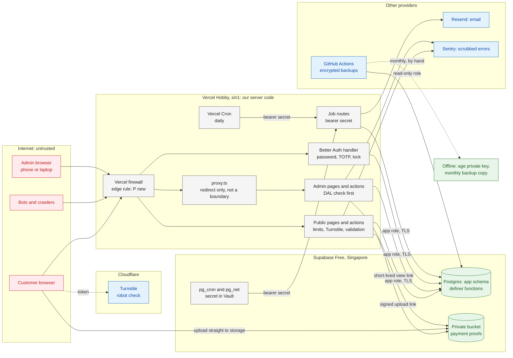
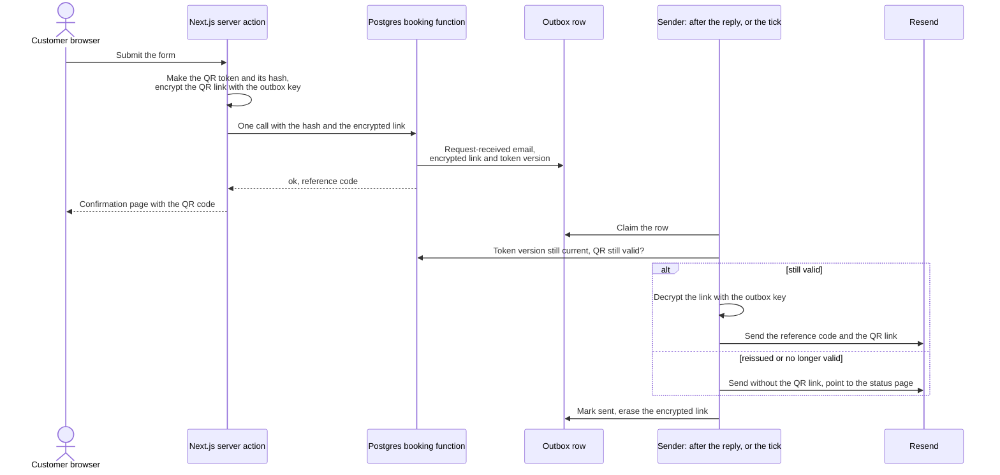

# Security

> **Purpose:** The threats to the DJB Kasoundbox system and the controls against them: what is protected and from whom, the threat model, the security controls in each area, and the security tests the test plan must include. This document owns the security controls. The requirements they implement stay in their batch-1 documents. ·
> **Audience:** The developer (Super Admin). The business owner (Admin) can read "In plain words" on its own ·
> **Status:** Draft for review ·
> **Last updated:** 2026-10-21 ·
> **Depends on:** [Decision log][dl], [Glossary][gl], [Roles and permissions][roles], [Business rules][br], [Functional requirements][fr], [Non-functional requirements][nfr], [Edge cases][ec], [Privacy and retention][priv], [Reservation lifecycle][lc], [Catalog and payments][cat]; workflows [booking-and-submission][wf-book], [lookup-and-review][wf-review], [notifications-and-tracking][wf-notify], [administration][wf-admin]; sibling technical docs [architecture][arch], [data-model][data], [api-specification][api] ·
> **Derived from:** [non-functional-requirements][nfr] NFR-09 to NFR-15, NFR-23, NFR-25, NFR-27 to NFR-30; [roles-and-permissions][roles] §5 to §7; [functional-requirements][fr] FR-PUB-06 to FR-PUB-14, FR-ADM-01, FR-ADM-06, FR-ADM-12, FR-ADM-22, FR-ADM-30 to FR-ADM-32, FR-NTF-01, FR-NTF-07, FR-NTF-16 to FR-NTF-20, FR-SYS-05, FR-SYS-06, FR-SYS-09, FR-SYS-12, and §7 questions 4 and 5; [privacy-and-retention][priv] §3.2, §4, §5.7, §6.2; [business-rules][br] BR-07, BR-07a, BR-11, BR-12; [catalog-and-payments][cat] §4.7, §5.4; [edge-cases][ec] EC-01, EC-02, EC-09, EC-14, EC-15, EC-30, EC-60 to EC-65, EC-71 to EC-78, EC-81; workflows WF-01C, WF-02, WF-03A, WF-03B, WF-03D, WF-04E, WF-07A, WF-07D, WF-07E, WF-09A to WF-09G, WF-10A, WF-10E, and the open questions they route to this document; [architecture][arch] open questions 11, 14, and 16; background: [spec v0.2][spec] §10, §13, §15, §17, §18 (frozen, never edited)

## In plain words

This page is about keeping the booking system and its data safe. Here is what it means for you, without the technical parts.

- **What we protect.** Customers' names, mobile numbers, emails, and addresses. The payment pictures customers upload. The record of every peso paid and refunded. Your login and the Super Admin's. The secret keys that let the website talk to its services. And the calendar itself, so that nobody can fill every date with fake requests.
- **Your login is the only door to the admin panel.** You type your password and then the code from the app on your phone. Nobody can sign up for an account. After too many wrong tries, the account locks for a while, even if the next try is right.
- **Keep your backup codes on paper, at home.** They let you in if your phone is lost. Never keep them in the phone itself.
- **Nobody will ever ask you for your code or your password.** Not the Super Admin, not an email, not a Messenger chat. If anyone asks, it is a trick. Tell the Super Admin.
- **If your phone is lost or stolen, call the Super Admin the same day.** He can sign that phone out of the admin panel at once.
- **The system checks every button press again on its own.** Hiding a button is not the protection. Even if someone tries an action you are not allowed to do, the system refuses it.
- **Customers see only their own booking,** and only with both the reference code and the full mobile number. The status page never shows a name, a mobile number, or an address. A stranger who scans a customer's QR code sees only "present this at our office".
- **Robots and pranksters.** The website has a robot check, limits on how often one phone or computer can try, and an automatic pause when too many requests arrive at once. If you see requests that look fake, reject them.
- **Payment pictures are private.** Only the two admins can open them, through links that stop working after a short time. They are deleted on the schedule in [privacy and retention][priv]. Never copy the payer's name or account number from a picture.
- **If something looks wrong,** for example a login warning you did not expect, bookings that make no sense, or a warning email from one of our services, tell the Super Admin the same day. If customers' personal data may have leaked, the law may require the business to report it quickly, so time matters.
- **Backups are locked** with a key that only the Super Admin keeps, offline.

## How to read this document

- **What this document owns.** The assets, the threat actors, the threat model, and the security controls. Every rule, limit, and period (rate-limit numbers, retention periods, token formats, permissions, deadlines) is owned by a batch-1 document. This document cites it by ID and links to it. It never repeats the number, so the number can change in one place.
- **Labels.** **[C]** confirmed decision · **[P]** proposed, accepted with the spec approval but may change · **[U]** unverified fact, to be checked in the week-1 test or before launch · **[O-nn]** open item in the [decision log][dl]. They keep their batch-1 meaning.
- **Controls without a label** implement the batch-1 requirement named next to them. They add no new rule.
- **[P] (new in this doc)** marks a new control, limit, period, or visible behaviour that the batch-1 docs do not define. Each one is also listed under [Open questions](#open-questions). Nothing marked that way is decided until the review confirms it.
- **[U] from the research.** Facts from the technical research that are not yet checked keep their **[U]** label. They are collected in section 7.
- **IDs.** Threats are numbered TM-01 to TM-41. These IDs are local to this document; the test plan can cite them.
- **Developer names** (files, functions, routes, environment variables) are indicative. Final names come in [api-specification][api] (functions and routes), [data-model][data] (tables and grants), and [architecture][arch] (stack, versions, and environment variables).
- **Research versus the docs.** Where the research and the batch-1 docs differ, the batch-1 docs win ([D-23][dl]). The differences are listed in section 6.
- **Tests.** "test-plan (batch 4)" means the test plan, planned as `06-delivery/test-plan.md`. It will hold the test cases (TC-xx).

### What this document does not cover

| Topic | Where it lives |
|---|---|
| Who may do what | [Roles and permissions][roles] §2 |
| Rate-limit numbers and the security baseline | [Non-functional requirements][nfr] (NFR-09 to NFR-15) |
| Hold limits and the breaker | [Business rules][br] (BR-07, BR-07a) |
| Token and reference-code formats | [Functional requirements][fr] (FR-PUB-08) |
| Retention periods, erasure, legal hold, and the legal breach duties | [Privacy and retention][priv] |
| Versions, hosting, environment variable names, CI | [Architecture][arch]; minimum versions: [NFR-30][nfr] |
| Tables, columns, and per-table grants | [Data model][data] |
| Function and route signatures | [API specification][api] |
| Step-by-step runbooks: break-glass, restore, incident | Deployment and operations (planned: `07-operations/deployment-and-operations.md`) |

---

## 1. Assets

| Asset | What it includes | Why it matters | Rules owned by |
|---|---|---|---|
| **Customer personal data** | Names, mobile numbers, emails, venue details, customer notes, internal notes. Copies sit in the outbox, the backups, and the providers' own logs | The Data Privacy Act applies ([D-18][dl]). A leak can force a breach notification and harms the customers | [Privacy and retention][priv] §3, §6 |
| **Payment proofs** | Screenshots and photos of e-wallet payments, in a private storage bucket | The most sensitive files: they may show a payer's name or account number, although those are never copied ([catalog-and-payments][cat] §4.7) | [BR-12][br], [FR-PUB-12][fr], [NFR-14][nfr] |
| **The payments ledger** | Deposits, balances, refunds, acknowledgment numbers, voids, and the audit log that shows who did what | Integrity: the money records support disputes and a later registration. A changed or missing record cannot be explained | [Catalog and payments][cat] §4, §5; [NFR-22][nfr], [NFR-25][nfr] |
| **Admin accounts** | The two accounts, their password hashes, 2FA secrets, backup codes, and sessions; the role split | They are the only door to every other asset. On Vercel Hobby the login is the only gate on `/admin`: there is no password protection or IP allow-list in front of it | [Roles and permissions][roles] §5; [NFR-09][nfr] |
| **Secrets** | Database passwords, Better Auth secrets, the Supabase secret key, the job secret, the Turnstile and Resend keys, the `age` private key, and the provider console accounts (GitHub, Vercel, Supabase, Resend, Sentry, Cloudflare, the domain registrar) | Whoever holds a secret can go around the app's own checks | [NFR-13][nfr] |
| **Availability and capacity** | The site staying up inside the free-plan allotments; the sets and the room not tied up by fake holds; online booking not paused by abuse | The business's income. A paused Hobby project, or a calendar full of fake requests, stops real bookings | [NFR-04][nfr] to [NFR-07][nfr], [NFR-12][nfr], [BR-07][br], [BR-07a][br] |

---

## 2. Threat actors

| Actor | Motive and means | Likely targets | Main controls |
|---|---|---|---|
| **Bots and crawlers** | Automated, cheap, many internet addresses; fill forms, probe paths | The public form, the status lookup, the login, the Vercel allotments | §4.4, §4.5 |
| **A prankster or competitor** | Fills dates with fake requests; can pass the robot check by hand; can trip the breaker on purpose | Capacity (denial of inventory), online booking | §4.4 |
| **Someone close to a customer** | Family, an ex-partner, a party guest; knows the reference code and the mobile number, or sees the QR code | The status page, the QR link, the documents | §4.5 |
| **A credential attacker** | Phishing, reused passwords, password spraying against the two admin emails | The admin login | §4.1 |
| **A thief or finder of an admin phone or laptop** | Uses an open session, or the authenticator app on the device | The admin panel | §4.1 |
| **A former admin, or an admin making a mistake** | Old credentials; a wrong click; an action outside their role | Accounts, the ledger | §4.1, §4.2, §4.11 |
| **A supply-chain attacker** | A malicious npm package, GitHub Action, or WASM file | The build, CI, the server | §4.10 |
| **A provider-account attacker** | Takes over the developer's GitHub, Vercel, Supabase, Resend, Cloudflare, Sentry, or domain account | Everything: these accounts sit above the app | §4.7 |
| **The developer's own misconfiguration** | Not an attacker, but the most likely cause of a leak: a public repository, an exposed Data API, production secrets in a preview, a matcher change | Secrets, the database, backups | §4.3, §4.7, §4.12 |

---

## 3. Threat model

### 3.1 Trust boundaries

Everything on the internet side is untrusted. The server code on Vercel is the first place where a request is checked, and the database checks again. The providers each hold a piece of the data, and the offline items never touch a network.



Notes on the diagram:

- **`proxy.ts` sits in front of the admin pages only, and decides nothing.** The real check is the DAL in each admin page, action, and route, and again in the database (section 4.2).
- **Proof images never pass through Vercel.** The browser uploads straight to Supabase Storage with a signed link, and admins view them through short-lived links (section 4.6).
- **The job routes are reached from outside**, by `pg_net` and by Vercel Cron, so they guard themselves with a secret (section 4.8).

### 3.2 Threats (lightweight STRIDE)

STRIDE groups threats into six kinds: **S**poofing (pretending to be someone), **T**ampering (changing data or code), **R**epudiation (denying an action), **I**nformation disclosure (a leak), **D**enial of service (stopping the service), and **E**levation of privilege (doing more than allowed).

| ID | Kind | Threat | Where it occurs | Control (section) | Owning requirement | Test |
|---|---|---|---|---|---|---|
| TM-01 | S | Password guessing or credential stuffing on an admin account | Login | argon2id hashes; account lock and per-IP limit; TOTP required; generic error (§4.1) | [NFR-09][nfr], [NFR-11][nfr], [EC-72][ec] | test-plan (batch 4) |
| TM-02 | S | A phished or reused password used from another device | Login | TOTP before the admin area opens; no "trust this device" **[P]**; nobody ever asks for a code (§4.1) | [NFR-09][nfr] | test-plan (batch 4) |
| TM-03 | S | A lost or stolen admin phone or laptop with an open session | Admin panel | Sign out and reset by the Super Admin; no session cookie cache; session lifetime **[P]** (§4.1) | [NFR-09][nfr], [EC-71][ec] | test-plan (batch 4) |
| TM-04 | S | A forged call to a job route | `/api/jobs/tick`, `/api/jobs/daily` | Bearer secret, constant-time compare, overlap guard, idempotent jobs (§4.8) | [FR-SYS-09][fr], [EC-78][ec] | test-plan (batch 4) |
| TM-05 | S | A faked client-IP header to get around the per-IP limits | Every per-IP limit | One helper reads only the header the platform sets **[U]**; per-account and per-code limits do not use the IP (§4.4) | [NFR-11][nfr] | test-plan (batch 4) |
| TM-06 | S | Someone close to the customer, who knows the reference code and the full mobile number, opens the status page | Status page | The page shows no name, mobile, or address; accepted residual risk; the customer can reissue the QR (§4.5) | [FR-PUB-10][fr], [FR-PUB-11][fr], [NFR-15][nfr] | test-plan (batch 4) |
| TM-07 | S | Guessing reference-code and mobile pairs, or trying many mobiles against one code | Status lookup | [NFR-11][nfr] limits; failure counter keyed on the code **[P]**; Turnstile **[P]**; one generic message **[P]** (§4.5.2) | [NFR-11][nfr], [EC-65][ec] | test-plan (batch 4) |
| TM-08 | S | Guessing or harvesting QR tokens | `/r/` + token | Random token ([FR-PUB-08][fr]), stored only as a hash; the same "not found" for every invalid case; no data without an admin session (§4.5) | [NFR-13][nfr], [FR-PUB-09][fr], [EC-60][ec], [EC-61][ec] | test-plan (batch 4) |
| TM-09 | T | Price, deposit, or capacity values tampered with in the browser | Booking form, admin forms | Amounts computed in the database from the catalog; validation in the app and the database; one function per action (§4.3, §4.4) | [NFR-21][nfr] | test-plan (batch 4) |
| TM-10 | T | An admin action reached directly: a POST to a server action, a route outside the proxy matcher, or a check placed only in a layout | Admin pages, actions, routes | The DAL is the first line of every page, action, and route; the database checks the role again; negative tests (§4.2) | [NFR-10][nfr], [EC-73][ec] | test-plan (batch 4) |
| TM-11 | T | Direct table writes after an app bug or SQL injection | Postgres | The app role can only execute functions; definer functions with an empty `search_path`; parameterized queries; no delete grants (§4.3) | [NFR-10][nfr], [NFR-22][nfr] | test-plan (batch 4) |
| TM-12 | T | Tables reached through Supabase's Data API with the public key | Supabase Data API | Data API off **[U]**, or the `app` schema not exposed and RLS on with no policies (§4.3) | [NFR-10][nfr], [NFR-15][nfr] | test-plan (batch 4) |
| TM-13 | T | A harmful upload: not an image, a script-bearing file, too big, or the wrong type | Proof upload | The type and size limits of [FR-PUB-12][fr]; magic-byte check **[P]**; browser re-encode; never SVG; private bucket (§4.6) | [NFR-14][nfr], [EC-30][ec] | test-plan (batch 4) |
| TM-14 | T | A signed upload link reused to add or replace files | Supabase Storage | One random path per slot, no overwrite, final slot states, cleanup of stray files **[P]** (§4.6) | [NFR-14][nfr], [FR-PUB-12][fr] | test-plan (batch 4) |
| TM-15 | T | Cross-site request forgery against admin actions | Admin panel | SameSite=Strict session cookie; the Server Actions origin check; Better Auth trusted origins (§4.1, §4.9) | [NFR-10][nfr] | test-plan (batch 4) |
| TM-16 | T | Script or HTML injected through customer text (name, note, venue) into the admin panel or an email | Admin panel, email templates | React escaping, no raw HTML, escaped email templates, a content security policy **[P]** (§4.9) | [NFR-21][nfr] | test-plan (batch 4) |
| TM-17 | T | A malicious dependency, GitHub Action, or WASM file | Build and CI | Pinned versions and lockfile; Dependabot; audit gate; Actions pinned to commits **[P]**; WASM checksum (§4.10) | [NFR-30][nfr], [NFR-32][nfr] | test-plan (batch 4) |
| TM-18 | R | An admin change cannot be traced, or is denied later | Every admin action | One audit entry in the same transaction, with actor, action, field names, and reason; append-only (§4.11) | [NFR-25][nfr], [FR-ADM-32][fr] | test-plan (batch 4) |
| TM-19 | R | Failed logins, locks, and refused requests leave no trace for an investigation | Login, DAL | Security audit events **[P]**; Sentry (§4.11) | [NFR-25][nfr], [NFR-23][nfr] | test-plan (batch 4) |
| TM-20 | I | Personal data in error reports or runtime logs | Sentry, Vercel logs | Scrubber; no personal data in URLs **[P]**; no logging of request bodies (§4.11) | [NFR-23][nfr], [NFR-15][nfr] | test-plan (batch 4) |
| TM-21 | I | Customer contact data copied into the audit log | Audit log | Field names only, never values; a pattern test (§4.11) | [NFR-25][nfr], [FR-ADM-32][fr] | test-plan (batch 4) |
| TM-22 | I | A copy of the database or a backup leaks | Supabase, GitHub artifacts, the offline copy | Hash-only tokens; argon2id; `age` encryption with the private key offline; private repository; read-only backup role (§4.3, §4.12) | [NFR-13][nfr], [NFR-27][nfr], [NFR-28][nfr], [D-22][dl] | test-plan (batch 4) |
| TM-23 | I | A working QR link sits in the outbox until the email is sent | Outbox table | Encrypted, short-lived link **[P]** (§4.5.4) | [NFR-13][nfr], [FR-NTF-01][fr] | test-plan (batch 4) |
| TM-24 | I | Document links in a forwarded or breached mailbox show the customer's name and payments | Confirmed email | Documents open only after a lookup, or for an admin **[P]** (§4.5.5) | [FR-NTF-07][fr], [FR-PUB-14][fr] | test-plan (batch 4) |
| TM-25 | I | A proof image is seen by someone who should not see it | Storage | Private bucket; short-lived view links **[P]**; deletion schedule; never backed up (§4.6) | [NFR-14][nfr], [FR-ADM-12][fr] | test-plan (batch 4) |
| TM-26 | I | A hold-limit refusal reveals the reference code of the existing request | Booking form | Never shown **[P]** (§4.4) | [BR-07][br], [EC-09][ec] | test-plan (batch 4) |
| TM-27 | I | Production secrets reach a preview, the repository, or a log | Vercel, GitHub | Scoped variables; previews without production secrets; private repository; secret scanning **[P]** (§4.7) | [NFR-13][nfr], [D-22][dl] | test-plan (batch 4) |
| TM-28 | I | The QR token leaks through the Referer header, search engines, a cache, or a shared device | `/r/` page | `no-referrer`, `noindex`, `no-store`, no third-party content **[P]** (§4.5.3) | [NFR-13][nfr], [FR-PUB-09][fr] | test-plan (batch 4) |
| TM-29 | I | Raw IP addresses stored by the login library | Better Auth tables | HMAC keys for the limiter; IP removed from session rows **[P]** **[U]** (§4.1) | [NFR-11][nfr], [NFR-13][nfr] | test-plan (batch 4) |
| TM-30 | D | Fake requests hold every set and the room (denial of inventory) | Booking | Turnstile, honeypot, rate limit, hold limits, breaker; admins reject fakes (§4.4) | [NFR-12][nfr], [BR-07][br], [BR-07a][br], [EC-14][ec] | test-plan (batch 4) |
| TM-31 | D | Someone trips the breaker on purpose to pause online booking | Booking | The per-IP limit slows it; one email to both admins; either admin resumes early; staff bookings still work; accepted residual risk (§4.4) | [BR-07a][br], [EC-15][ec] | test-plan (batch 4) |
| TM-32 | D | A flood uses up a Vercel Hobby allotment and the project is paused | Vercel | Static catalog, no polling, cheap checks first, edge rule **[P]**, Attack Mode (§4.4) | [NFR-06][nfr], [NFR-11][nfr] | test-plan (batch 4) |
| TM-33 | D | A slow query or a held lock freezes bookings | Postgres | The capacity lock lives only inside one function call; role timeouts **[P]** (§4.3) | [NFR-20][nfr], [NFR-21][nfr] | test-plan (batch 4) |
| TM-34 | D | Someone locks an admin out, or blocks a customer's lookups, on purpose | Login, status lookup | Locks are temporary; a reset by the Super Admin clears an account lock **[P]**; the customer can contact the business (§4.1, §4.5.2) | [NFR-11][nfr] | test-plan (batch 4) |
| TM-35 | D | The form is used to send many emails to a stranger, or to burn the email cap | Outbox | Rate limits, the breaker, and the caps with customer priority (§4.4) | [NFR-11][nfr], [NFR-33][nfr], [FR-NTF-20][fr] | test-plan (batch 4) |
| TM-36 | E | The Admin account runs a Super-Admin-only action | Admin actions | DAL role check; database re-check; matching access-control statements; Better Auth's admin endpoints closed **[P]** (§4.2) | [NFR-10][nfr], [EC-74][ec] | test-plan (batch 4) |
| TM-37 | E | A session without 2FA, or of a disabled account, reaches the admin area | DAL | The DAL requires 2FA passed and an active account (§4.2) | [NFR-09][nfr], [EC-73][ec], [EC-76][ec] | test-plan (batch 4) |
| TM-38 | E | A `search_path` hijack or SQL injection inside a definer function | Postgres | Empty `search_path`, qualified names, no unsafe dynamic SQL, `EXECUTE` revoked from `PUBLIC` (§4.3) | [NFR-10][nfr] | test-plan (batch 4) |
| TM-39 | E | A framework flaw gives code execution on the server (the 2026 advisories) | Next.js server | Patched pinned versions; risky features avoided; critical fixes applied fast (§4.10) | [NFR-30][nfr] | test-plan (batch 4) |
| TM-40 | E | A provider console account is taken over | GitHub, Vercel, Supabase, registrar, other providers | 2FA on every provider account; recovery codes offline **[P]** (§4.7) | [NFR-13][nfr] | test-plan (batch 4) |
| TM-41 | E | The break-glass path, or the database owner password, is misused | Database | The password lives only on the developer's laptop and offline; the script writes an audit entry (§4.1) | [NFR-13][nfr], [EC-71][ec] | test-plan (batch 4) |

In this table, a bare **[P]** in the Control column means **[P] (new in this doc)**; the section named gives the detail.

---

## 4. Controls

### 4.1 Admin authentication

Implements [NFR-09][nfr] and [NFR-11][nfr]. The account rules (two accounts, reset, backup codes, break-glass) are defined only in [roles-and-permissions][roles] §5. The steps are [WF-09A][wf-admin] to [WF-09G][wf-admin].

#### Better Auth configuration

Better Auth runs self-hosted in the Next.js server, with its Drizzle adapter, on the Node.js runtime ([NFR-02][nfr]). The version is pinned in [architecture][arch]. The research names 1.7.7 as the lowest safe 1.7 release; never running below it is **[P] (new in this doc)**.

```ts
// lib/auth.ts — indicative; final in api-specification
export const auth = betterAuth({
  baseURL: process.env.SITE_URL,            // never VERCEL_URL or the Host header
  database: drizzleAdapter(db, { provider: 'pg' }), // its transaction option stays unset (off)
  emailAndPassword: {
    enabled: true,
    disableSignUp: true,                    // accounts come from the setup script and WF-09F
    revokeSessionsOnPasswordReset: true,
    minPasswordLength: 12,                  // [P] new in this doc
    password: { hash: hashArgon2id, verify: verifyArgon2id },
  },
  session: {
    expiresIn: 60 * 60 * 24,                // [P] new in this doc: 24 hours, no sliding renewal
    updateAge: 60 * 60 * 24,
    cookieCache: { enabled: false },        // an ended session stops at the next request
  },
  advanced: {
    useSecureCookies: true,
    defaultCookieAttributes: { httpOnly: true, secure: true, sameSite: 'strict' },
    ipAddress: { ipAddressHeaders: [TRUSTED_CLIENT_IP_HEADER] }, // which header: [U]
  },
  rateLimit: { enabled: true, customStorage: hmacKeyedCounters }, // never raw IPs (TM-29)
  trustedOrigins: [process.env.SITE_URL!],
  plugins: [
    admin({ ac, roles: { superAdmin, admin: adminRole } }), // mirrors roles §2
    twoFactor({ issuer: 'DJB Kasoundbox', backupCodeOptions: { storeBackupCodes: 'encrypted' } }),
  ],
});
```

- **Plugins:** email and password, the admin plugin (two roles), and the two-factor plugin only.
- **Roles.** The access-control statements of the two roles mirror the permission matrix in [roles-and-permissions][roles] §2 and nothing more. The plugin's default admin statements (user management, impersonation) are not copied into the Admin role, and impersonation is granted to nobody.
- **One way in.** Sign-in goes only through the Better Auth route handler (`app/api/auth/[...all]/route.ts`).
- **An allow-list of Better Auth endpoints [P] (new in this doc).** The route handler passes on only the endpoints the app uses: email sign-in, sign-out, get-session, the two-factor endpoints, change-password, and the session list and revoke endpoints. Every other path returns "not found": sign-up, password-reset emails, account deletion, email change, and the admin plugin's HTTP endpoints (ban, set role, set password, impersonate). Account changes go through the app's own audited functions instead (section 4.2). The exact list is in [api-specification][api].
- **Never inside a database transaction.** `auth.api.*` is never called inside the app's own `db.transaction`: with a pool of one connection it would deadlock ([architecture][arch] §6).
- **Secrets.** Better Auth's signing secrets are rotated only through `BETTER_AUTH_SECRETS` ([architecture][arch] §8).
- **No raw IP addresses [P] (new in this doc).** [NFR-11][nfr] and [NFR-13][nfr] keep IP addresses only as an HMAC. Whether Better Auth's built-in limiter stores raw addresses is **[U]** ([architecture][arch] open question 16). So the limiter writes through custom storage that keys every counter by the HMAC of [FR-SYS-06][fr]; if that is not possible, it is turned off and the login limits run on the app's own database counters. Better Auth also keeps an IP address on each session row: a database hook replaces it with nothing before the row is saved **[U]** (the hook's exact behaviour is checked in week-1 item 3). The user agent stays, so the Super Admin can tell devices apart when signing one out.

#### Password hashing

- **argon2id** through `@node-rs/argon2`, at **m = 19,456 KiB, t = 2, p = 1**, the OWASP minimum **[P] (new in this doc)**. Better Auth's `password.hash` and `password.verify` are replaced with this.
- The stored string (PHC format) carries its own parameters. So the parameters can be raised later, and an old hash is re-hashed at the next successful login **[P] (new in this doc)**.
- **Fallback:** if the native binary does not load on Vercel **[U]** (week-1 item 3), `node:crypto` scrypt at **N = 2^17, r = 8, p = 1, maxmem 256 MiB** **[P] (new in this doc)** ([NFR-09][nfr] names scrypt as the fallback).
- **Never Better Auth's default scrypt settings** (N = 2^14, r = 16, p = 1). The research found them below every OWASP option.
- The Docker image uses a glibc base, so the same native binary loads there ([architecture][arch] §11.2).

#### Two-factor login and backup codes

- **TOTP is required** before the admin area opens ([NFR-09][nfr], [FR-ADM-01][fr]).
- **How "required" is enforced.** Better Auth creates a full session after the password alone when an account has no 2FA yet. So the DAL treats such a session as "setup only": it opens the 2FA setup page and nothing else ([WF-09B][wf-admin]; section 4.2).
- **The setup finishes only after a first correct code** from the app. This is [administration][wf-admin] open question 7, already proposed there.
- **No "trust this device" [P] (new in this doc).** Better Auth can skip the code on a remembered device. The app never offers it, and the route handler drops the option if a request sends it. Every login asks for the code.
- **The TOTP secret** must be stored in a form the server can read back, because the server needs it to check codes. Better Auth stores it encrypted with its secret **[U]** (checked in week-1 item 3).
- **Backup codes [P] (new in this doc).** Ten one-time codes, shown once at setup ([roles-and-permissions][roles] §5.2). The admin prints them and keeps them at home. Making a new set needs the password and a current code, and it ends the old set at once. Each code works once ([WF-09D][wf-admin]).
- **How backup codes are stored [P] (new in this doc).** Better Auth stores them encrypted with its secret (`storeBackupCodes: 'encrypted'`), not as one-way hashes. Whether the library supports hashed backup codes is **[U]**. Proposal: accept encrypted storage. A copy of the database alone does not reveal the codes, which is the aim of "hashed where stored" in [NFR-13][nfr]. This answers the question left in [WF-09B][wf-admin] (developer notes).

#### Lockout and rate limits

- **The numbers are in [NFR-11][nfr]:** the failures that lock one account and for how long, and the attempts allowed from one internet address. The research suggested other values; NFR-11 wins (section 6).
- **What counts toward the account lock [P] (new in this doc).** Wrong passwords, wrong TOTP codes, and wrong backup codes all count toward the same account counter. While the account is locked, nothing opens it, not even a correct backup code ([administration][wf-admin] open question 6).
- **Generic messages [P] (new in this doc).** A wrong email and a wrong password show the same message. A locked account and an address over its limit both show "too many attempts, please try again later", so the screen never confirms that an email belongs to an admin.
- **Ending a lock early [P] (new in this doc).** A reset by the Super Admin ([WF-09G][wf-admin]) also clears that account's lock. There is no separate unlock button.
- **Lock-out abuse.** Anyone who knows an admin email can lock that account for a while (TM-34). This is accepted: the lock is temporary, and the TOTP step still protects the account. If it becomes a nuisance, the review can weigh a longer lock against a per-address-only limit.

#### Sessions and revocation

- **Cookie.** HttpOnly, Secure, SameSite=Strict, with the `__Secure-` prefix. Server Actions accept a request that has no Origin header, so the SameSite flag is the main defence against cross-site request forgery (TM-15).
- **No cookie cache.** Better Auth's session cookie cache stays off, so a signed-out, reset, or disabled account stops working at its next request ([architecture][arch] §4.3).
- **Lifetime [P] (new in this doc).** A session lasts at most 24 hours from the login, with no sliding renewal; then the admin logs in again with the password and the code. Shorter means less exposure if a phone is taken while unlocked; longer means fewer logins for the business owner ([administration][wf-admin] open question 5).
- **Ending sessions.** Logging out ends that session. A reset ends all of that person's sessions ([roles-and-permissions][roles] §5.1). Disabling an account ends all of its sessions at once, as [administration][wf-admin] open question 4 proposes.
- **Sign out [P] (new in this doc).** The Super Admin's "sign out" ends **all** of that admin's sessions. Each admin can also end their own other sessions ("sign out other devices") ([administration][wf-admin] open question 10).
- **The QR link and SameSite=Strict [U].** A phone's camera app may open the QR link without sending a SameSite=Strict cookie. Then a logged-in admin would see "present this at our office" instead of the reservation ([FR-PUB-09][fr]). The admin scan page ([FR-ADM-06][fr]) is not affected, because it runs inside the logged-in browser. This is checked in week-1 item 6 (QR scanning on the real phones).

#### Passwords and account handover

All of this is **[P] (new in this doc)** and answers [administration][wf-admin] open question 8:

- **Length.** At least 12 characters; long passphrases allowed; no rules about symbols; no forced periodic change. Dropping symbol rules and forced changes follows current NIST guidance (SP 800-63B).
- **First and reset passwords** are made by the system: long and random, shown once to the Super Admin on screen, and handed over in person. Never by email, SMS, or Messenger.
- **Changing your own password** needs the current password, and ends your other sessions.
- **No "forgot password" link.** There is no reset email. The Super Admin resets the Admin ([WF-09G][wf-admin]). If the Super Admin forgets his own password, the break-glass script sets a new one.

#### Break-glass

The break-glass script resets the Super Admin's 2FA when he has no device and no backup codes left ([roles-and-permissions][roles] §5.2, [WF-09E][wf-admin]).

- It runs from the developer's own computer, through the session pooler, with the password of the database's `postgres` role. That password lives only on the developer's laptop and offline. It is never stored in GitHub or Vercel ([architecture][arch] §8.2).
- In one transaction it removes the Super Admin's two-factor rows, and writes one audit entry.
- **[P] (new in this doc):** it also ends all of the Super Admin's sessions, for example on the lost phone. It can also set a new password hash for a forgotten password. Its audit entry uses the actor kind "system" and the category "security", with the reason "break-glass" ([administration][wf-admin] open question 9).
- **[P] (new in this doc):** the setup script that creates the first two accounts writes "account created" audit entries with the actor kind "system".
- The step-by-step runbook will be in the operations docs (planned: `07-operations/deployment-and-operations.md`).

### 4.2 Authorization

Implements [NFR-10][nfr] and [roles-and-permissions][roles] §7. The steps are [WF-09C][wf-admin].

**The DAL check in every admin page, action, and route.** `lib/dal.ts` imports `server-only` and exports the guards ([architecture][arch] §4.3):

```ts
// lib/dal.ts — indicative
export const verifySession = cache(async () =>
  auth.api.getSession({ headers: await headers() }));

export async function requireAdmin(allowed: Role[] = ['superAdmin', 'admin']) {
  const s = await verifySession();
  if (!s) deny('login');                       // a page redirects; an action or route refuses
  if (!s.user.twoFactorEnabled) deny('2fa');   // only the 2FA setup page is open
  if (s.user.banned) deny('disabled');         // a disabled account
  if (!allowed.includes(s.user.role)) deny('not_allowed');
  return { actorId: s.user.id, role: s.user.role };
}
// requireRole('superAdmin') = requireAdmin(['superAdmin'])
```

- One of these guards is the **first line** of every admin `page.tsx`, every exported admin server action, and every admin route handler. React's `cache()` memo applies only while one page renders; in actions and route handlers the check runs on every call.
- **Not in layouts.** A layout is not re-run on every navigation, and server actions never pass through it. A check placed only in a layout protects nothing.
- **What the screen offers is a convenience.** The reservation page offers only the actions the role and status allow ([FR-ADM-04][fr]); a hidden action called anyway is refused by the guard.

**Why `proxy.ts` is not a security boundary.**

- Its matcher is `['/admin/:path*']`. It only checks that a session cookie exists, makes no database call, and redirects to the login page.
- A server action can be called by a direct POST to any page path, which the matcher may not cover.
- A matcher change can drop coverage without any warning.
- 2026 had several proxy-bypass advisories (the research counted five). Whether Vercel-hosted deployments were exposed to them is **[U]**.
- So the proxy is kept only to spare an anonymous visitor a broken page. The job routes are outside its matcher ([FR-SYS-09][fr]).

**A separate module tree for admin actions.**

- Admin server actions live only in `lib/actions/admin/*`; public ones in `lib/actions/public/*` ([NFR-32][nfr]).
- Admin modules import `server-only` and export only actions, so no helper in them becomes a callable endpoint by accident.
- A lint rule stops public code from importing the admin tree ([architecture][arch] §11.1).
- The admin pages sit in their own route group with their own root layout, marked `noindex`.

**The database checks again.**

- Every admin action is one call to one database function ([NFR-21][nfr]).
- **How the function knows who is acting [P] (new in this doc).** The server passes the acting admin's ID as the function's first parameter. The function reads that admin's role and disabled flag from the Better Auth user table, refuses if the role does not allow the action, and writes the audit entry with that ID. This answers [administration][wf-admin] open question 22.
- **What that check is worth.** It catches a missing or wrong check in one server action. It does not stop a fully compromised server, which could pass any ID; that case is covered by secrets (section 4.7) and patching (section 4.10).
- **Account changes are audited functions too [P] (new in this doc).** Create, disable, reset, and sign out ([WF-09F][wf-admin], [WF-09G][wf-admin]) are the app's own database functions. Each one changes the Better Auth rows and writes its audit entry in one transaction. The server makes the new password hash before the call. The Better Auth admin plugin's own HTTP endpoints stay closed (section 4.1). The "one active Admin" and "the Super Admin cannot disable itself" rules are checked inside those functions ([roles-and-permissions][roles] §5.1).

**Automated negative tests.**

- A test lists every exported function under `lib/actions/admin` and every admin route. It calls each one: logged out; as an account that has not set up 2FA; as a disabled account; and, for each Super-Admin-only action, as the Admin. It expects a refusal every time ([NFR-10][nfr], [EC-73][ec], [EC-74][ec]).
- **[P] (new in this doc):** the test keeps a table of every admin action and the roles allowed, taken from [roles-and-permissions][roles] §2. A new exported action that is missing from the table fails the build.
- pgTAP tests call every admin database function with an actor of the wrong role, or a disabled actor, and expect a refusal ([roles-and-permissions][roles] §7).

### 4.3 Database security

Implements [NFR-10][nfr], [NFR-21][nfr], and [NFR-22][nfr]. The per-table grants are in [data-model][data].

**Roles and grants.**

| Role | Logs in? | Used by | Can do |
|---|---|---|---|
| `app_owner` | No (`NOLOGIN`) | Owns the `app` schema, its tables, and its `SECURITY DEFINER` functions | Everything inside `app`. Nobody logs in as it |
| `app_rw` | Yes: SCRAM-SHA-256 password, no `VALID UNTIL` | The website, through the transaction pooler | `EXECUTE` on the app's entry-point functions only; `SELECT` on the read views; read and write on the Better Auth tables, which the adapter needs. No `INSERT`, `UPDATE`, or `DELETE` on any business table |
| Backup role (read-only) | Yes | The nightly backup, through the session pooler | `SELECT` only, with read-only transactions ([NFR-10][nfr], [FR-SYS-12][fr]) |
| `postgres` | Yes | Migrations and the break-glass script, from the developer's laptop | Everything. The password is never in Vercel or GitHub |
| `anon`, `authenticated` | Through Supabase's APIs | Nothing | No grants on `app` or on the Better Auth tables |

- **No direct writes.** Every write to reservations, claims, payments, the outbox, settings, the catalog, and the audit log goes through a definer function ([NFR-21][nfr]; [roles-and-permissions][roles] §7).
- **The audit log is append-only.** Only definer functions insert into it, and only the retention function deletes from it ([WF-10A][wf-admin], [WF-10E][wf-admin]).
- **Nothing can be deleted by the app.** A test checks that `app_rw` cannot delete reservations, payments, blocks, or audit entries ([NFR-22][nfr]).
- **Better Auth's tables** live in their own schema, which is not exposed. They hold password hashes and sessions. That is one more reason the app's queries are always parameterized.

**`SECURITY DEFINER` functions with an empty `search_path`.**

```sql
-- indicative; final grants in data-model
create function app.approve_reservation(p_actor uuid, p_id uuid, p_version int)
  returns jsonb language plpgsql
  security definer set search_path = ''      -- every name is schema-qualified inside
as $$ ... $$;
revoke execute on all functions in schema app from public;
alter default privileges for role app_owner in schema app revoke execute on functions from public;
grant execute on function app.approve_reservation(uuid, uuid, int) to app_rw;
```

- Every definer function sets `search_path = ''` and names every table, function, and operator with its schema (for example `pg_catalog.now()`). A table someone creates elsewhere can then never be picked up instead of the real one (TM-38).
- **`EXECUTE` is revoked from `PUBLIC`**, both on existing functions and in the default privileges, because Postgres grants it to everyone by default. Then each entry point is granted to `app_rw` one by one.
- **Internal helpers** (claiming capacity, writing the audit entry, queueing an email) are not executable by `app_rw`.
- **No unsafe dynamic SQL.** Where dynamic SQL is needed, it is built with `format()` and `%I` or `%L`, never by joining strings.
- **Input is checked again** inside each function, as well as in the app ([NFR-21][nfr]).
- **A catalog test** lists every `SECURITY DEFINER` function in `app` and fails if one lacks the empty `search_path`, or if `PUBLIC` can execute it.

**Data API exposure off.**

- The `app` schema and the Better Auth schema are never in the Data API's exposed schemas. "Automatically expose new tables" is off ([architecture][arch] §2.2).
- If Storage keeps working with the Data API turned off, the Data API is turned off **[U]** (week-1 item 5). Then the publishable key in the browser can reach no table at all.
- If it must stay on, nothing sensitive is in an exposed schema, and the RLS posture below is the second lock.

**RLS posture.**

- RLS is a second lock, not the main one. The main lock is that no table is exposed, and that `app_rw` holds only the grants above.
- RLS is enabled on every table, with no policies for `anon` or `authenticated`. A schema exposed by mistake then still shows nothing.
- `app_rw` reads through views and functions owned by `app_owner`, which RLS does not restrict as the owner. Where `app_rw` must read a table directly, an explicit policy `TO app_rw` is added. The choice per table is in [data-model][data].
- Whether foreign-key cascade actions, and not only foreign-key checks, bypass RLS is **[U]**. It matters if the data model uses cascading status copies.
- The storage bucket has no policies for `anon` or `authenticated`: uploads use signed links, and views use short-lived links made with the secret key (section 4.6).

**SSL enforced.**

- "Enforce SSL on incoming connections" is on in Supabase.
- The app's pool verifies the server certificate against the Supabase CA (`SUPABASE_DB_CA`). Whether full verification works against the pooler's certificate is **[U]** (week-1 item 1, [NFR-02][nfr]).
- Supabase's IP allow-list cannot be used, because Vercel Hobby has no fixed outgoing addresses. So the database passwords are long and random, and they are rotated if they may have leaked.

**Role timeouts [P] (new in this doc).** On `app_rw`: `statement_timeout = '5s'`, `lock_timeout = '2s'`, `idle_in_transaction_session_timeout = '10s'`, the same values as [architecture][arch] §6.

- They stop a slow query, or a transaction left open by a bug, from holding the capacity lock and freezing every booking (TM-33).
- The backup role gets its own, longer statement timeout, so a dump can finish.
- Whether role settings apply to connections opened through the shared pooler is **[U]** (week-1 item 1 checks role timeouts).

### 4.4 Public form abuse

Implements [NFR-11][nfr] and [NFR-12][nfr], with the hold limits and the breaker of [BR-07][br] and [BR-07a][br]. The steps are [WF-01C][wf-book].

**Denial of inventory.** A Pending Confirmation request holds capacity from the moment it is sent ([BR-04][br]), and the mobile number is never verified. So a few hand-made requests that each pass Turnstile could hold every set and the room for a date (OWASP OAT-021). Turnstile only slows this down. The real limits are the hold limits, the breaker, the deadlines that never pass the service start ([reservation-lifecycle][lc]), and the admins rejecting fakes (TM-30).

**Turnstile.**

- Every submission carries a Turnstile token. The server checks it with Cloudflare's siteverify, passing the client IP and an idempotency key for the siteverify call itself.
- **[P] (new in this doc):** the server also checks that the response's hostname is the site's own and that its action name is the booking form's.
- A token works once and expires after a few minutes, so the widget is reset when a token expires. A retry after a network error needs a fresh token ([WF-01C][wf-book] developer notes).
- Turnstile does not stop duplicates. That is the duplicate-submission key's job (below).

**Honeypot.** A hidden field that people never see. It sits off-screen, hidden from screen readers and from the keyboard (`aria-hidden`, `tabindex="-1"`, `autocomplete="off"`). A filled honeypot means a bot.

**The order of the checks [P] (new in this doc).** This answers [booking-and-submission][wf-book] open question 5. The cheapest checks run first, so a flood costs as little as possible:

1. **Submission rate limit** ([NFR-11][nfr]), counted in one database statement. **Every attempt counts**, including a repeat with the same duplicate key. A customer who reaches the limit is told to message or call.
2. **Honeypot.**
3. **Turnstile siteverify.**
4. **Field validation** with the shared Zod schema, and the mobile number converted to its standard form ([BR-11][br]).
5. **One call to the booking function**, which runs the order fixed in [BR-09][br] (developer note): the capacity lock, the duplicate key, overdue holds, notice, hold limits and the breaker, a set or the room, then add-on stock.

A request caught at step 2 or 3 sees one generic message: "We could not check that this request came from a person. Please try again, or message or call us." It never says which check failed **[P] (new in this doc)**.

**Rate limits.**

- The numbers are in [NFR-11][nfr]. The counters live in the database, keyed by an HMAC of the IP address with the daily key of [FR-SYS-06][fr], and are deleted on the [privacy-and-retention][priv] §6.2 schedule.
- **The IP-HMAC key** lives in a table that only `app_owner` can read. It is rotated by the daily SQL job, and old keys are destroyed ([FR-SYS-06][fr]). The server passes the raw IP to the database function, which makes the HMAC; the raw IP is never stored.
- **The trusted client-IP header.** One helper reads the client IP from the header that Vercel itself sets, and every limit, Better Auth, and Turnstile use that helper. Which header to trust (`x-forwarded-for`, `x-real-ip`, or `x-vercel-forwarded-for`) is **[U]** (week-1 test). A header the client can set would let an attacker invent a new IP for every request (TM-05).
- **Shared addresses.** Many Philippine mobile users may share one public IP address (carrier-grade NAT) **[U]**. So the per-IP limits stay loose, and the per-mobile hold limits and per-reference-code limits do the precise work.
- **An edge backstop [P] (new in this doc).** Vercel Firewall's one rate-limit rule covers POST requests to the booking, status, and sign-in paths. Requests it blocks do not count toward the Hobby allotments. Whether one rule can cover several paths is **[U]** ([architecture][arch] open question 12). During a flood, the Super Admin turns on Attack Mode, and off again afterwards: it also blocks Vercel Cron.

**Hold limits and the breaker.**

- The limits and the pause are defined only in [BR-07][br] and [BR-07a][br]. They run inside the booking function, under the capacity lock, so the counts are exact.
- They stop honest duplicates and slow down abuse. They cannot stop a person with many SIM cards, because the mobile number is not verified.
- **Tripping the breaker on purpose** pauses online booking for everyone (TM-31). This is accepted. Both admins get one email ([FR-NTF-15][fr]), either admin can resume early ([FR-ADM-29][fr]), and staff-created bookings still work ([BR-06a][br]). Whether a resume should restart the count is [administration][wf-admin] open question 17.
- **Never echo the existing booking [P] (new in this doc).** A refusal for the hold limits ([EC-09][ec], [EC-10][ec]) never shows the reference code or the QR code of the request that already exists. Otherwise anyone who knows a mobile number and a date could learn the reference code, which with the mobile number opens the status page (TM-26).

**Duplicate-submission keys [P] (new in this doc).** This answers [booking-and-submission][wf-book] open question 3.

- **The key** is a random UUID made in the browser when a new draft starts.
- **Where it is kept.** The key is kept in `localStorage`, which every tab of the same browser shares, so a second tab sends the same key ([EC-01][ec]). The draft itself, which holds personal data, stays in `sessionStorage` (one tab), so it does not stay behind on a shared phone. The confirmation page clears the key, so the next booking gets a new one.
- **What the server keeps.** Only a hash of the key ([FR-PUB-06][fr]), with a fingerprint: a hash of the request's main fields (service type, date, package, add-ons, and the standard-form mobile number). Both are deleted on the [privacy-and-retention][priv] §6.2 schedule.
- **A repeat with the same key and the same fingerprint** returns the same reservation and reference code ([EC-01][ec]). This is safe, because only that browser knows the key.
- **The same key with a different fingerprint** (for example, the date was changed after a network error) is refused with "This looks like a new booking. Please check your earlier request on the status page, or start again." The browser then makes a new key. The earlier request stands.
- **What the repeat shows instead of the QR code** is [booking-and-submission][wf-book] open question 2. It depends on the QR design chosen in section 4.5.4.

**Emails to strangers.** Someone could type another person's email address into the form, so that person gets a request-received email (TM-35). The rate limits and the breaker cap how often this can happen, the caps of [FR-NTF-20][fr] protect the email allowance, and the email holds only the booking summary and no admin data.

### 4.5 Status lookup and QR

Implements [FR-PUB-08][fr] to [FR-PUB-14][fr], [NFR-11][nfr], [NFR-13][nfr], and [NFR-15][nfr]. The steps are [WF-02][wf-book], [WF-03A][wf-review], [WF-03B][wf-review], [WF-03D][wf-review], and [WF-07D][wf-notify].

#### 4.5.1 Reference codes and QR tokens

- **Token entropy.** The QR token has the random bits set in [FR-PUB-08][fr] and [NFR-13][nfr], made with a cryptographically secure generator (Node `crypto.randomBytes` or Postgres `gen_random_bytes`) and written in the link as base64url. At that size, guessing a valid token is not practical (TM-08).
- **Hash-only storage.** Only the token's SHA-256 hash is stored, with a unique index. No salt is needed, because the token itself is long and random. The raw token exists only in the server's memory, at creation or reissue ([WF-02][wf-book], [WF-03D][wf-review]).
- **The reference code** also comes from a secure generator, mapped to its alphabet without bias ([FR-PUB-08][fr]). It is **not a secret on its own**: it is printed in emails, messages, and acknowledgments. It works only together with the full mobile number, and lookups are rate-limited.
- **Revocation.** A token stops working when the reservation becomes Rejected, Cancelled, Expired, or Completed ([FR-PUB-08][fr]), and when it is reissued. Whether the QR code of an overdue hold still opens it is [lookup-and-review][wf-review] open question 1.
- **Reissue.** A new token replaces the old hash in the same step, and the reissue is audited ([FR-PUB-13][fr], [FR-ADM-22][fr]).
- **Rate limit on the customer's reissue [P] (new in this doc).** A reissue on the status page needs a valid lookup (section 4.5.2) and counts toward the per-IP status-lookup limit of [NFR-11][nfr]. Also, at most 3 reissues per reservation per hour. This answers [notifications-and-tracking][wf-notify] open question 13; the number would move into NFR-11 if accepted.

#### 4.5.2 The status lookup

- **POST only [P] (new in this doc).** The lookup is a form POST. The reference code and the mobile number never appear in a URL, so they never reach browser history, logs, or the Referer header.
- **Matching.** The input is normalized as [FR-PUB-08][fr] and [BR-11][br] say, and both must match the same reservation ([FR-PUB-10][fr]).
- **Rate limits.** Per internet address and per reference code, with the numbers in [NFR-11][nfr].
- **The failure counter's key [P] (new in this doc).** Failures are counted under an HMAC of the normalized reference code alone. The NFR-11 details also mention a counter "under an HMAC of the reference code plus mobile number", but such a counter would not slow down someone trying many mobile numbers against one code. This answers [notifications-and-tracking][wf-notify] open question 11; the NFR-11 details would be corrected.
  - *Side effect:* someone who knows a customer's reference code can block that customer's lookups for a while (TM-34). This is accepted; the customer can still message or call.
- **One generic message [P] (new in this doc).** A wrong code and a wrong mobile number show the same message: "We could not find a booking with that reference code and mobile number." The limit message is different but just as generic: "Too many tries. Please wait a while, or message or call us." Both paths do the same database work, so the response time does not give the answer away ([notifications-and-tracking][wf-notify] open question 12).
- **Turnstile on the lookup form [P] (new in this doc).** The same robot check as the booking form. It makes scripted guessing from many addresses harder. Spec v0.2 §13 and [NFR-12][nfr] name Turnstile only for the booking form.
- **The lookup session [P] (new in this doc).** This answers [notifications-and-tracking][wf-notify] open question 10.
  - After a successful lookup, the server sets a cookie holding the reservation ID and an expiry time, signed with an HMAC (key `STATUS_COOKIE_KEY`). It is HttpOnly, Secure, and SameSite=Strict, limited to the `/status` path (the customer's document pages sit under it), and lasts 15 minutes.
  - The proof upload (section 4.6), the QR reissue, and the document pages (section 4.5.5) require it.
  - Each of those actions still checks the status and the deadline in the database.
  - Nothing is stored on the server, so no new retention row is needed.
  - *Alternative:* the browser sends the reference code and mobile number again with each action. That is stateless, but every action then counts as a lookup, and the mobile number travels more often.
- **What the page shows** is fixed by [FR-PUB-11][fr]. It never shows the name, mobile number, or address. It is always live and never cached ([NFR-03][nfr]); the response also says `Cache-Control: no-store`.
- **The residual risk (TM-06).** Someone close to the customer may know both the reference code and the mobile number. They then see the booking details, and, through an acknowledgment, the customer's name ([catalog-and-payments][cat] §5.3). This is accepted: they learn little they do not already know. If a customer worries, an admin corrects the mobile number with "edit details" ([EC-46][ec]) and the customer reissues the QR code ([EC-62][ec]).

#### 4.5.3 The `/r/<token>` page

- **Always rendered live.** The answer depends on the current status and the current hash ([WF-03B][wf-review]).
- **The same answer for every invalid token [P] (new in this doc).** An unknown, guessed, replaced, or final-status token gets the same "not found / no longer valid" page with the same HTTP status (404). The page never reveals that a token once existed ([EC-60][ec]).
- **A valid token** shows "present this at our office" to anyone without an admin session ([FR-PUB-09][fr], [EC-61][ec]). An admin session that passes the `requireAdmin` checks (2FA passed, active account) is redirected to the reservation by its ID. The redirect never carries the token.
- **Headers [P] (new in this doc):**
  - `Referrer-Policy: no-referrer`, so the token never leaves in a Referer header;
  - `X-Robots-Tag: noindex, nofollow`, so search engines never list a QR link;
  - `Cache-Control: no-store`, so no cache or shared device keeps a copy.
- **No third-party content [P] (new in this doc).** No scripts, images, fonts, or analytics from other hosts on this page, so nothing else ever sees the URL.
- **The token is never logged.** Sentry scrubs the `/r/` path (section 4.11).
- **Rate limit [P] (new in this doc).** A request without an admin session counts toward the per-IP status-lookup limit of [NFR-11][nfr]. Guessing is already impractical; the limit protects the Vercel allotments. This answers [lookup-and-review][wf-review] open question 5 (first part).

#### 4.5.4 The QR link in the request-received email [P] (new in this doc)

**The problem.** The request-received email must carry the QR link ([FR-NTF-01][fr], **[C]**). But only the token's hash is stored ([NFR-13][nfr]), and the email may be sent later by the every-minute job ([FR-NTF-16][fr]), or held until the next day by the caps ([FR-NTF-20][fr]). Where does the sender get the link? This is [booking-and-submission][wf-book] open question 1. [Architecture][arch] open question 14 asks the related question of the token design.

| Option | How it works | Security | Other effects | Changes to batch-1 docs |
|---|---|---|---|---|
| **A. Plain link in the outbox** | The outbox row holds the link until it is sent, then it is wiped | A copy of the database or a backup reveals a working link for every email still queued: usually minutes, but a day or more when a cap holds emails | The simplest | Goes against the aim of [NFR-13][nfr] ("a leaked database does not reveal working QR links") |
| **B. Encrypted, short-lived link (proposed)** | The server, which holds the raw token in memory at creation, encrypts the link and passes only the ciphertext and the token's version to the booking function. The sender decrypts it at send time. The ciphertext is erased when the row is sent, failed, or skipped, or when the QR code stops working, whichever comes first | A copy of the database or a backup alone reveals no working link. A leak of both the database and the key reveals only the links of emails still queued | One more secret. A key change waits until queued rows have gone, or keeps the old key until then. If the QR was reissued before sending, the old link is dropped | None: the token rules and FR-NTF-01 stay as they are |
| **C. Derived token** | token = HMAC(key, reservation ID + token version), worked out again whenever it is needed. Only the hash and the version are stored | A copy of the database alone reveals nothing. But the key together with the reservation IDs reveals every live QR link, and changing the key changes every customer's QR code unless key versions are kept | The QR code can be shown again: on a repeat submission, for a staff booking without email, and after an admin reissue | [FR-PUB-08][fr] and [NFR-13][nfr] say "random bits": a decision is needed |
| **D. Reference code and status link only** | The email carries the reference code and a link to the status page, but no QR link | Nothing secret in the outbox | A customer who closed the confirmation page must get a new QR code on the status page | [FR-NTF-01][fr] is **[C]**: needs a decision-log change |

**Proposal: option B.** It keeps every batch-1 rule as it is, and it limits what a leak can show to the emails still waiting.

- **Who makes the token.** Option B needs the server, not the database, to make the token before the call; [WF-02][wf-book] allows either. The same applies to staff-created and recreated requests, which also send the request-received email ([FR-NTF-01][fr]).
- **Encryption.** AES-256-GCM with a fresh random nonce per row. The associated data is the outbox row ID and the reservation ID, so a ciphertext cannot be moved to another row. The key, `OUTBOX_LINK_KEY` (32 random bytes), is a Vercel production secret; previews get none. The database never sees the key.
- **At send time,** the sender checks that the reservation's token version is still the one in the row, and that the QR code is still valid. If not, the email goes out without the QR link, and says that a new QR code can be taken on the status page.
- **Provider copies.** Resend keeps a copy of each sent email for its own retention period ([privacy-and-retention][priv] §6.2, "Provider copies"). That copy holds the link under every option except D. A working QR link shows only "present this at our office" to anyone who is not an admin ([FR-PUB-09][fr]), so the harm is small.
- **Option C** remains worth weighing if the review wants the QR code to be shown again. It would also answer [booking-and-submission][wf-book] open question 2, [lookup-and-review][wf-review] open question 14, and [functional-requirements][fr] §7 question 4.



#### 4.5.5 Document links in emails [P] (new in this doc)

**The problem.** The Confirmed email links to the acknowledgment and the Booking Confirmation ([FR-NTF-07][fr]). An acknowledgment shows the customer's name, the amount, and the e-wallet reference ([catalog-and-payments][cat] §5.3). A link that opens the document on its own would show all of that to anyone who holds the email, for example after it is forwarded, or if the mailbox is broken into. This is [functional-requirements][fr] §7 question 5 and [catalog-and-payments][cat] §5.4.

**Proposal.**

- The document pages open only for a logged-in admin ([FR-ADM-23][fr]), or for a browser with a valid lookup session for that reservation (section 4.5.2).
- The links in the email point to the status page, with the reference code and the document named after a `#`. Browsers never send that part of a URL to the server, and never put it in a Referer header.
- The page fills in the reference code, the customer types the full mobile number, and the document opens.
- **Trade-offs.** One extra step for the customer. No new token to store or protect. A forwarded email or a broken-into mailbox alone does not open the documents. The reference code is in the email body anyway.
- **Alternative:** a signed link per document that expires (an HMAC with a server key, nothing stored). One tap for the customer, but anyone who holds the email can open the document until the link expires.

#### 4.5.6 Admin scanning and the screenshot fallback

- The scanner library loads only on the admin scan page ([FR-ADM-06][fr]).
- **Never navigate to what was scanned.** The page accepts only a link with exactly the host of `SITE_URL` and the `/r/` path, takes the token out, and sends it to an admin server action. That action passes `requireAdmin`, hashes the token, and looks it up ([WF-03A][wf-review]).
- **The screenshot is read in the admin's browser [P] (new in this doc).** The barcode detector decodes the uploaded image locally. The image is never sent to the server and never stored. So [privacy-and-retention][priv] §6.2 needs no row for it. This answers [lookup-and-review][wf-review] open question 2.
- The decoder's WASM file is served from the site itself, and CI checks its version and checksum ([architecture][arch] §11.1).

### 4.6 Uploads

Implements [FR-PUB-12][fr], [FR-ADM-12][fr], [NFR-11][nfr], and [NFR-14][nfr]. The rule that a proof pauses expiry is [BR-12][br]. The steps are [WF-07E][wf-notify] and [WF-04E][wf-review].

**Single-use signed upload links.**

- **Who can ask for one.** A link is issued only to a browser with a valid lookup session (section 4.5.2), while the booking is Awaiting Deposit and before its deadline, within the per-reservation upload count of [FR-PUB-12][fr] and the link rate limit of [NFR-11][nfr].
- **Supabase's links are not single-use.** The research found that a signed upload link is a reusable token, valid for a fixed time (2 hours), and that it can upload again to the same path once the file there is deleted. So "single use" is enforced by the app ([architecture][arch] §14):
  - **One slot, one path.** Each link belongs to an upload slot row with its own random object path, `<reservation id>/<random id>.<ext>`. The path holds only IDs, never customer data.
  - **No overwrite:** the link is made with `upsert: false`.
  - **Final slot states [P] (new in this doc).** A slot is `issued`, then `uploaded` or `rejected`, and never changes again. Admin screens show only `uploaded` proofs.
  - **The server checks each file [P] (new in this doc).** Storage trusts the type the browser declares, so the confirm step checks for itself: that the object exists, its size, and its first bytes (the JPEG, PNG, or WebP signature). It then marks the slot `uploaded`, or deletes the object and marks the slot `rejected`. This answers how the server learns that the file arrived ([notifications-and-tracking][wf-notify] open question 14, second part).
  - **What counts toward the upload limit [P] (new in this doc).** Only `uploaded` slots count toward the per-reservation limit of [FR-PUB-12][fr]. Links that were issued but never used count toward the link rate limit of [NFR-11][nfr] instead. Which moment counts for "before the deadline" ([BR-12][br]) stays [notifications-and-tracking][wf-notify] open question 14.
  - **Stray files [P] (new in this doc).** The daily job deletes any object that has no `uploaded` slot and is more than one day old. This answers [notifications-and-tracking][wf-notify] open question 17, and needs a row in [privacy-and-retention][priv] §6.2.

**Size and type limits.** The bucket's file-size limit and allowed types are set to the values in [FR-PUB-12][fr]. Whether Supabase enforces them on hosted signed uploads is **[U]** (verified only in the source code; week-1 item 5). The server check above covers both cases. SVG is never allowed, so no proof can carry a script.

**Browser re-encode.** The browser draws the picture on a canvas and saves it again (`toBlob`), which drops GPS and other hidden photo data ([FR-PUB-12][fr], [NFR-14][nfr]). The size is checked after re-encoding. The server does not rely on this step for safety; the type and magic-byte checks still run.

**Private bucket.** The bucket is private and has no public address, and no policies for `anon` or `authenticated`. Bytes never pass through Vercel. The server-only secret key (`SUPABASE_SECRET_KEY`) makes the signed links. The browser gets only the publishable key, which `uploadToSignedUrl` needs.

**Short-lived view links.**

- An admin views a proof only through a signed view link that the server makes after `requireAdmin`, for each view ([FR-ADM-12][fr]).
- **Lifetime: 5 minutes [P] (new in this doc).** This answers [lookup-and-review][wf-review] open question 5 (second part).
- The image is shown in a plain `` or a new tab, never through `next/image`. The link is served from the Supabase domain, so even a harmful file could not run a script on the site's own domain.
- **Proof views are audited [P] (new in this doc):** a `security` entry with who opened which proof, and when. Opening a reservation is not logged: the two admins see the same data ([roles-and-permissions][roles] §6), and logging every page view would bury the entries that matter. This answers [lookup-and-review][wf-review] open question 3.

**Deletion.**

- The daily retention job deletes proofs on the schedule in [privacy-and-retention][priv] §6.2 ([D-21][dl], [WF-10E][wf-admin]).
- Files are always deleted through the Storage API, never by deleting rows in SQL, which would leave the file behind. The proof row keeps its deletion time ([privacy-and-retention][priv] §6.4).
- Proof images are never backed up ([NFR-27][nfr]).

### 4.7 Secrets and configuration

Implements [NFR-13][nfr]. The names follow [architecture][arch] §8.

| Secret | Kept in | Used by | Never in |
|---|---|---|---|
| `DATABASE_URL` (the app's login role) | Vercel, production | The server, through the transaction pooler | Previews, the repository, logs |
| `BETTER_AUTH_SECRETS` | Vercel, production | Better Auth: sessions, encrypted 2FA secrets and backup codes | Previews (they get their own value, or none) |
| `SUPABASE_SECRET_KEY` | Vercel, production | Storage: signed upload links, view links, deletion | The browser, previews |
| `CRON_SECRET` | Vercel, production; the same value in Supabase Vault (`job_route_secret`) | The two job routes; Vercel Cron and `pg_net` send it | The repository, logs |
| `TURNSTILE_SECRET_KEY` | Vercel, production | Siteverify | The browser |
| `RESEND_API_KEY` | Vercel, production | Sending email. **[P] (new in this doc):** a sending-only key limited to the site's domain | Previews |
| `OUTBOX_LINK_KEY` **[P] (new in this doc)** | Vercel, production | The encrypted QR link (section 4.5.4) | The database, previews |
| `STATUS_COOKIE_KEY` **[P] (new in this doc)** | Vercel, production | The lookup session cookie (section 4.5.2) | Previews |
| `SENTRY_AUTH_TOKEN` | Vercel, build only | Uploading source maps (optional) | Runtime code |
| `BACKUP_DATABASE_URL` (the read-only role) | GitHub Actions secret | The nightly backup | Vercel |
| The IP-HMAC keys | A database table only `app_owner` can read | The rate-limit functions ([FR-SYS-06][fr]) | Vercel, logs |
| The `postgres` role's password | The developer's laptop and offline | Migrations, break-glass | Vercel, GitHub |
| The `age` private key | Offline only (section 4.12) | A restore | Every online system |
| Provider recovery codes; admin backup codes | Offline, on paper | Recovering an account | Phones, email, chats |

**Vercel and GitHub encrypted variables.**

- Secrets live only in Vercel's sensitive environment variables and GitHub's encrypted secrets ([NFR-13][nfr]). They are never written in the code. `.env.example` lists the names with empty values ([architecture][arch] §8).
- **[P] (new in this doc):** a secret scanner (for example gitleaks) runs in CI, so a committed secret fails the build.
- **[P] (new in this doc):** a secret is rotated whenever it may have leaked, and whenever someone who knew it leaves.

**Preview versus production.**

- Previews never get production secrets ([NFR-13][nfr]). By default a preview gets no database and no email keys, and shows only the static pages ([architecture][arch] §8.2 and open question 9).
- **[P] (new in this doc):** Vercel Deployment Protection is set to "Standard Protection", so previews are private and production stays public.

**Absolute links.** Every absolute link (QR codes, emails, the status page) is built from `SITE_URL`. Never from `VERCEL_URL`, which would leak preview addresses, and never from the request's `Host` header, which an attacker can set to plant a fake link in an email.

**Vault for the `pg_net` secret.**

- The every-minute job reads the bearer secret and the tick address from `vault.decrypted_secrets` at call time ([architecture][arch] §7.4).
- **[P] (new in this doc):** only the `postgres` role can read that view; `app_rw` cannot.
- Whether `pg_cron`, `pg_net`, and Vault are all available on Supabase Free is **[U]** (week-1 item 4).
- **One shared secret.** One `CRON_SECRET` serves both job routes, as [architecture][arch] open question 8 proposes; this document agrees. Two secrets would let each caller be rotated alone, but would add a second value to keep in step.

**Provider accounts [P] (new in this doc).**

- Every provider console account has two-factor login, with its recovery codes kept offline: GitHub, Vercel, Supabase, Resend, Sentry, Cloudflare, and the domain registrar (O-05).
- These accounts sit above the app: whoever holds one can read the database or change the code without passing any check in this document (TM-40).
- The business owns its domain's DNS settings ([NFR-31][nfr]). The registrar account is protected like the others.

### 4.8 Job routes

Implements [FR-SYS-09][fr]. The routes are `/api/jobs/tick` (called by `pg_net`, [FR-SYS-03][fr]) and `/api/jobs/daily` (called by Vercel Cron, [FR-SYS-08][fr]).

- **Bearer secret.** Each route refuses any call without `Authorization: Bearer <CRON_SECRET>`. Vercel Cron sends this header from the project's `CRON_SECRET` variable **[U]** ([architecture][arch] §7.3).
- **Constant-time compare.** The route hashes the received and the expected secret with SHA-256, and compares the two digests with `crypto.timingSafeEqual`. So the comparison time does not depend on how many characters match, and the secret's length never leaks ([architecture][arch] §7.4).
- **A refusal does nothing.** A missing or wrong secret returns 401 with an empty body. Nothing runs. The failure is logged without the received value ([EC-78][ec]).
- **The secret [P] (new in this doc):** at least 32 random bytes.
- **Excluded from the proxy.** The routes are outside the `proxy.ts` matcher and outside the admin login ([FR-SYS-09][fr]).
- **Trust nothing in the request.** No parameter in the request body changes what a job does. Each job reads its work from the database.
- **The method its caller uses only.** `pg_net` posts to the tick route; Vercel Cron sends a GET to the daily route.
- **Never two runs at once.** SQL jobs take a transaction-scoped try-lock. The two job routes take a short lease row ([architecture][arch] §7.2 and open question 4). Every job is idempotent, so a duplicate call, which Vercel Cron can make, does no harm.
- **Time limits.** Every outgoing call has a time limit ([NFR-03][nfr]), and every `net.http_post` sets its timeout explicitly.
- **Small replies.** A job route replies with counts only, never personal data. Errors go to Sentry, scrubbed (section 4.11).

### 4.9 Web headers and cookies

All of this section is **[P] (new in this doc)**, except the session cookie flags, which are in section 4.1.

- **HTTPS everywhere.** `Strict-Transport-Security` with a one-year `max-age` on the site's own domain (O-05), once HTTPS is confirmed to work on it.
- **No framing.** `Content-Security-Policy: frame-ancestors 'none'` on every page, so no other site can load the admin panel in a frame and trick an admin into a click.
- **A content security policy.** It allows scripts only from the site itself and from Turnstile (on the booking and status pages only); images from the site, `data:`, `blob:`, and the Supabase storage address (admin proof pages only); connections to the site, Supabase (the upload), and Sentry. It also sets `object-src 'none'`, `base-uri 'none'`, and `form-action 'self'`. How strict the script rule can be (nonces need dynamic pages, while the catalog pages are static) is settled in [architecture][arch].
- **Other headers.** `X-Content-Type-Options: nosniff` everywhere. `Referrer-Policy: strict-origin-when-cross-origin` on the site, and `no-referrer` on `/r/` and `/status`. `Permissions-Policy: camera=(self)` on the admin scan page only, and `camera=()` everywhere else.
- **Not in search engines.** `X-Robots-Tag: noindex` on `/r/`, `/status`, and `/admin`.
- **No third-party scripts** except Turnstile, on the pages that need it. Sentry's script is bundled with the site's own code.
- **No open redirect.** The login page's "return to" value accepts only a relative path under `/admin`.
- **Customer text is always escaped.** React escapes it on every page. The code never uses `dangerouslySetInnerHTML` with customer text. The email templates, which build HTML, escape every value they insert. The prepared message for SMS or Messenger ([FR-NTF-21][fr]) is plain text (TM-16).

### 4.10 Dependency and patching policy

Implements [NFR-30][nfr] and [NFR-32][nfr]. The versions are pinned in [architecture][arch] §2.

- **Pinned versions.** Every dependency is pinned to an exact version, with the committed lockfile, and installed with `npm ci`. Next.js never runs below the minimum named in [NFR-30][nfr], which carries the security fixes of 2026-10-14.
- **Other minimum versions [P] (new in this doc).** The lockfile must resolve `sharp` 0.35.5 or later (part of the Image Optimization fix), and Better Auth 1.7.7 or later (section 4.1). CI fails if a pinned version is below any of these minimums.
- **Dependabot.** Security updates as they appear, and grouped version updates once a week, for `npm` and `github-actions` ([architecture][arch] §11.4). Every Dependabot pull request runs the full CI before it is merged.
- **Critical fixes** are merged within the time set in [NFR-30][nfr]. The developer watches the security advisories of `vercel/next.js`, `facebook/react`, and Better Auth.
- **Audit gate.** `npm audit --omit=dev` fails the build on a high or critical advisory ([architecture][arch] §11.1, **[P]** there).
- **GitHub Actions [P] (new in this doc).** Third-party actions are pinned to a commit hash, not a tag. Each workflow sets the smallest `permissions` it needs. No workflow uses `pull_request_target`.
- **Self-hosted files.** The QR decoder's WASM file is checked against its pinned version and checksum in CI ([architecture][arch] §11.1).

**Next.js features to avoid, and why.** These follow the 2026 advisories found by the research. Whether Vercel-hosted deployments were exposed to them is **[U]**.

| Feature | Why it is avoided | Instead |
|---|---|---|
| Image Optimization with `images.remotePatterns` | A critical remote-code-execution advisory through SVG and `sharp` (GHSA-2464, CVE-2026-96889). It also uses the Hobby allowance ([NFR-03][nfr]) | `images.unoptimized: true`; catalog photos pre-sized in `/public` |
| SVG through `next/image` | The same advisory | The QR code is an inline SVG made on the server by `uqr` from our own data, never from user input |
| `next/og` with user input | It has drawn advisories, and no page needs it | Not used |
| `'use cache'` around anything but the catalog | A critical remote-code-execution advisory in `'use cache'` (GHSA-673q), fixed in the pinned version. Caching per-user or admin data could also show one person's data to another | `'use cache'` only in `lib/catalog.ts`, tagged `catalog`. Availability, bookings, the status page, `/r/`, uploads, and admin pages are always rendered live ([NFR-03][nfr]) |
| Server Actions without limits | A high denial-of-service advisory (GHSA-p3m5), fixed in the pinned version | The pinned version, plus the rate limits of [NFR-11][nfr] |
| The `i18n` setting | It has drawn advisories, and the site needs no locale routing | Not used |
| Rewrites to hosts worked out at request time | They can turn the server into a proxy for an attacker | Not used |
| The Edge runtime | [NFR-02][nfr] allows the Node.js runtime only, and Edge code paths have had their own advisories | Node.js only; a lint rule rejects `runtime = 'edge'` ([architecture][arch] §11.1) |

### 4.11 Logging and personal data

Implements [NFR-15][nfr], [NFR-23][nfr], and [NFR-25][nfr].

**Sentry scrubbing.**

- `sendDefaultPii: false`. No session replay.
- A `beforeSend` and a `beforeBreadcrumb` scrubber remove: names, mobile numbers, email addresses, venue fields, notes, reference codes, QR tokens (including the `/r/` path, which is replaced with `/r/[token]`), cookies, `Authorization` headers, and request bodies ([NFR-23][nfr]).
- Before launch, a test error is sent and the report is checked for personal data ([NFR-23][nfr]).
- Sentry's own data retention is set to its shortest option ([privacy-and-retention][priv] §6.2, "Provider copies").

**No personal data in logs.**

- Vercel keeps runtime logs only for a short time ([NFR-23][nfr]); they are for live debugging only.
- The code never logs request bodies, form fields, or database rows.
- Error messages shown to users are generic; stack traces never reach the browser.
- **[P] (new in this doc):** personal data never appears in a URL (section 4.5.2).

**The audit log never holds contact data.**

- Entries store the names of the changed fields, never their old or new values, and never a customer's name, mobile number, email, or address ([FR-ADM-32][fr], [NFR-25][nfr]).
- The audit helper takes field names only. A test scans every audit row for anything that looks like a mobile number or an email address ([WF-10A][wf-admin]).
- Rate-limit counters store HMACs only ([NFR-11][nfr], [FR-SYS-06][fr]).

**Security events [P] (new in this doc).** This answers [administration][wf-admin] open question 3. The `security` category records:

| Event | What the entry holds |
|---|---|
| Login succeeded | The admin ([FR-ADM-01][fr], **[P]** there) |
| Login failed | The admin's ID if the email belongs to an admin; otherwise nothing but the time and the IP-HMAC. The typed email is never stored, because it may be a stranger's |
| Wrong 2FA or backup code | The admin |
| Account locked | The admin |
| Backup code used | The admin (not the code) |
| Logout, session ended, other devices signed out | The admin, and who ended it |
| Refused admin request (logged out, 2FA not passed, disabled, wrong role) | The action's name and the admin, if known |
| Job route called without the right secret | The route's name (never the received value) |
| Rate limit tripped (once per key and time window, so a flood does not fill the log) | The limit's name and the IP-HMAC. The breaker's own entry is [WF-01C][wf-book] step 12; its category is [administration][wf-admin] open question 1 |
| Break-glass script run | Actor kind "system", reason "break-glass" (section 4.1) |
| Proof image viewed | The admin and the proof (section 4.6) |

These entries hold no customer data, and are kept for the security-event period in [privacy-and-retention][priv] §6.2. They are the main evidence after an incident (section 4.13).

### 4.12 Backups

Implements [NFR-13][nfr] and [NFR-27][nfr] to [NFR-29][nfr]. The job is [FR-SYS-12][fr]; its workflow is [architecture][arch] §11.3.

**What a backup holds.** Every table: customer data, the ledger, the audit log, the outbox, Better Auth's password hashes and sessions, and the encrypted 2FA secrets and backup codes. Not the proof images ([NFR-27][nfr]). That is why every copy must be encrypted.

**Encryption with `age`.**

- The nightly dump is encrypted with `age` to a public key (`BACKUP_AGE_RECIPIENT`) before it leaves the runner ([NFR-27][nfr]).
- The runner never holds the private key, so a compromised workflow cannot read old backups.
- The dump runs through the session pooler with the read-only role ([NFR-10][nfr]).
- Dumps are never committed to the repository ([FR-SYS-12][fr]).

**Key handling.**

- The Super Admin makes the key pair on his own computer, never on CI.
- The private key is kept offline only ([NFR-13][nfr]).
- **[P] (new in this doc):** a second copy of the private key is kept sealed in another safe place, for example with the business owner. If the only copy is lost, every backup is lost with it.
- **[P] (new in this doc):** if the private key may have leaked, a new key pair is made at once. The online copies made with the old key expire on their own ([NFR-27][nfr]), and the offline copy is replaced with one made with the new key.

**Artifact retention.**

- Each copy is a GitHub workflow artifact that expires after the period set in [NFR-27][nfr].
- The monthly offline copy follows [NFR-28][nfr]: the previous offline copy is destroyed. The overall limit is in [privacy-and-retention][priv] §6.2.
- **The repository is private before the backup workflow is added** ([D-22][dl], O-06). In a public repository, anyone could download the artifacts.

**The workflow.**

- The backup job runs in a protected GitHub environment that holds `BACKUP_DATABASE_URL`, with the hardening of section 4.10.
- **The backup's heartbeat [P] (new in this doc).** The backup role stays strictly read-only, with no write grant, not even for a `job_runs` record. GitHub's failure email to the developer, plus the weekly look at the Actions page, is enough for the MVP. This answers [architecture][arch] open question 11.

**After a restore.**

- The retention job runs before the system reopens ([NFR-29][nfr], [EC-81][ec]).
- **[P] (new in this doc):** all admin sessions from the backup are also ended, so the admins log in again.

### 4.13 Breach and incident handling

The legal duties (what counts as a breach, notifying the regulator and the people affected) are in [privacy-and-retention][priv] §5.7. The step-by-step incident runbook will be in deployment and operations (planned: `07-operations/deployment-and-operations.md`). This section names the stages and the controls each one uses.

| Stage | What happens | Who | Tools and controls |
|---|---|---|---|
| **1. Detect** | Notice that something is wrong | Either admin; the developer | Sentry errors and alerts ([NFR-23][nfr]); the uptime and heartbeat alerts ([NFR-04][nfr], [NFR-24][nfr]); the health panel ([NFR-26][nfr]); security audit events (section 4.11); a breaker trip; warning emails from Vercel, Supabase, GitHub, or Resend; a report from a customer |
| **2. Contain** | Stop the damage from growing | The Super Admin | Sign out or disable an admin account ([WF-09G][wf-admin]); rotate the secret that may have leaked (section 4.7); change the database passwords; Vercel Attack Mode; take the site offline in Vercel if needed. Bookings and payments stay safe in Supabase ([NFR-04][nfr]) |
| **3. Preserve evidence** | Keep what will explain it | The Super Admin | Vercel keeps runtime logs only briefly ([NFR-23][nfr]), so copy them first. Then export the related Sentry events and audit entries. If the incident concerns a booking, consider a legal hold ([WF-10C][wf-admin]) |
| **4. Assess** | What data, whose, how much, and since when | The Super Admin, with the privacy officer (O-09) | The audit log, Sentry, the provider logs. Payment data makes notification more likely ([privacy-and-retention][priv] §5.7) |
| **5. Notify** | Tell those who must be told | The privacy officer (O-09), advised by the lawyer (O-08) | The NPC (National Privacy Commission) and the affected customers, as [privacy-and-retention][priv] §5.7 requires. The NPC's 72-hour notification rule is **[U]**: the lawyer confirms it before launch |
| **6. Recover** | Back to normal, safely | The Super Admin | Patch the cause; restore from a backup if data was lost (the retention job runs first, [NFR-29][nfr]); end all sessions; ask both admins to log in again |
| **7. Learn** | Stop it happening again | Both admins | A short written note: what happened, why, what changed. Update this document and the runbook |

**Common cases.**

- **A lost admin phone.** Sign out at once, then reset if no backup codes are left ([WF-09D][wf-admin], [EC-71][ec]).
- **A leaked secret.** Rotate it first, then look for use of it.
- **Personal data seen by the wrong person.** Contain it, preserve the evidence, then follow [privacy-and-retention][priv] §5.7 without delay.

---

## 5. Security test checklist

The test plan must include at least these security tests. Each one names the threats it covers. **TC IDs in test-plan (batch 4).**

| Area | Test | Expected result | Covers |
|---|---|---|---|
| **Authentication** | An admin logs in with the password and a TOTP code | The admin area opens only after the code ([NFR-09][nfr]) | TM-01, TM-02 |
| | The account-lock and per-IP login limits of [NFR-11][nfr] | Locked after the set failures, even with the right password; per-IP attempts refused | TM-01, TM-34 |
| | Wrong TOTP and backup codes **[P]** | Count toward the same lock; a locked account refuses a correct backup code | TM-01 |
| | A backup code used twice | Refused the second time ([EC-71][ec]) | TM-02 |
| | A session for an account without 2FA | Only the 2FA setup page opens; every other admin page, action, and route refuses | TM-37 |
| | Sign out, reset, and disable | The next request from an ended session is refused at once | TM-03, TM-37 |
| | Closed Better Auth endpoints **[P]** | Sign-up, password reset, and the admin plugin's endpoints return "not found" | TM-36 |
| | Password storage | The stored hash is argon2id with the parameters of section 4.1 **[P]** | TM-22 |
| | IP addresses | No session or limiter row holds a raw IP **[P]** | TM-29 |
| **Authorization** | Every admin page, action, and route, called logged out | Refused ([EC-73][ec]) | TM-10 |
| | Every Super-Admin-only action, called as the Admin | Refused ([EC-74][ec]) | TM-36 |
| | Coverage **[P]** | Every exported admin action is in the role table; a missing one fails the build | TM-10 |
| | pgTAP: every admin database function with a wrong-role or disabled actor | Refused ([roles-and-permissions][roles] §7) | TM-36 |
| **Database** | `app_rw` writes to business tables directly | Refused; it cannot delete reservations, payments, blocks, or audit entries ([NFR-22][nfr]) | TM-11 |
| | `app_rw` calls an internal helper; `PUBLIC` execute rights | Refused; `PUBLIC` holds no `EXECUTE` on `app` functions | TM-11, TM-38 |
| | Catalog check | Every `SECURITY DEFINER` function has `search_path = ''` | TM-38 |
| | The publishable key against the Data API | No table can be read or written | TM-12 |
| | A connection without TLS; the role timeouts through the pooler | Refused; the timeouts apply **[U]** | TM-22, TM-33 |
| **Public form** | A missing or invalid Turnstile token; a filled honeypot | Refused with the generic message **[P]** | TM-30 |
| | The submission rate limit; the hold limits; the breaker | Refused as [NFR-11][nfr], [BR-07][br], and [BR-07a][br] say ([EC-09][ec], [EC-10][ec], [EC-15][ec]) | TM-30, TM-31 |
| | A repeat with the same key; the same key with other data **[P]** | The same reservation returned; the second refused ([EC-01][ec]) | TM-30 |
| | A hold-limit refusal | Never shows the existing reference code or QR **[P]** | TM-26 |
| | A spoofed client-IP header | The rate-limit key does not change **[U]** | TM-05 |
| **Status and QR** | The lookup rate limits, per IP and per reference code | Refused as [NFR-11][nfr] says ([EC-65][ec]) | TM-07 |
| | A wrong code and a wrong mobile | The same message **[P]** | TM-07 |
| | The status page and the `/r/` page | No personal data ([NFR-15][nfr]) | TM-06, TM-08 |
| | Revoked, replaced, unknown, and final-status QR tokens | The same "not found" page and status, no data ([EC-60][ec]) | TM-08 |
| | `/r/` response headers **[P]** | `no-referrer`, `noindex`, `no-store`; no third-party requests | TM-28 |
| | Stored tokens | No raw token or QR link anywhere in the database, including the outbox **[P]** | TM-22, TM-23 |
| | Upload, reissue, and document pages without a lookup session **[P]** | Refused | TM-24, TM-25 |
| | The customer's QR reissue limit **[P]** | Refused over the limit | TM-07 |
| **Uploads** | A third upload; a wrong type; an oversized file; a non-image with an image name | Refused ([EC-30][ec]); the magic-byte check catches the last **[P]** | TM-13 |
| | A signed upload link used a second time | Refused; the slot stays in its final state | TM-14 |
| | An uploaded image | Holds no GPS or other photo data ([NFR-14][nfr]) | TM-25 |
| | A view link after its lifetime **[P]**; anonymous access to the bucket | Refused | TM-25 |
| | The retention job on proofs | Files removed from Storage, not only their rows | TM-25 |
| **Job routes** | No secret, a wrong secret, a secret of a different length | 401, nothing runs ([EC-78][ec]) | TM-04 |
| | Two runs at once | Only one runs | TM-04 |
| **Secrets and configuration** | A preview build | Holds no production secret ([NFR-13][nfr]) | TM-27 |
| | The repository before the backup workflow | Private ([D-22][dl]) | TM-22, TM-27 |
| | The secret scanner **[P]** | A planted test secret fails CI | TM-27 |
| **Headers and pages** | Admin pages in a frame; the security headers **[P]** | Refused; headers present | TM-15, TM-16 |
| | Customer text with HTML in the name and note | Shown as text in the admin panel and in the emails | TM-16 |
| **Logging** | A test error sent to Sentry | No personal data, no token in the URL ([NFR-23][nfr]) | TM-20 |
| | The audit log | No row holds a mobile-number or email pattern ([NFR-25][nfr]) | TM-21 |
| | Security events **[P]** | A failed login, a lock, and a refused request each write one entry | TM-19 |
| **Backups** | A backup artifact | Cannot be read without the private key; the restore test passes ([NFR-29][nfr]) | TM-22 |
| **Patching** | CI with a pinned version below a minimum **[P]** | Fails | TM-17, TM-39 |
| | Dependabot and the audit gate | Enabled; a known high advisory fails CI | TM-17 |

In this table, a bare **[P]** means a test of a control marked **[P] (new in this doc)** above. It is needed only if the review accepts that control.

---

## 6. Source notes: research, spec, and batch-1 docs

Where they differ, the batch-1 docs win ([D-23][dl]). The spec is not edited. Differences noticed while writing this document:

1. **The account lock.** The research suggested a lockout after 10 failures for 900 seconds. [NFR-11][nfr] sets its own defaults, and they apply (section 4.1).
2. **Proof retention.** The research suggested deleting proofs 30 to 90 days after the reservation closes. [D-21][dl] and [privacy-and-retention][priv] §6.2 set the schedule.
3. **Backing up proofs.** The research suggested a weekly encrypted export of the proof bucket. [NFR-27][nfr] says proofs are never backed up, by design. Not adopted.
4. **Job route names.** The research used `/api/jobs/outbox` and `/api/cron/daily`. [FR-SYS-09][fr] names `/api/jobs/tick` and `/api/jobs/daily`.
5. **The role split.** The research's access-control sketch gave the catalog and prices to the Super Admin only, and added tools such as bulk release and reinstate. [Roles-and-permissions][roles] §2 is the only permission matrix: either admin manages the catalog, and those extra tools do not exist in the batch-1 docs.
6. **Direct writes to the catalog and settings.** The research let the app's role write those tables directly. [NFR-21][nfr] and [roles-and-permissions][roles] §7 make every admin action one database function call, so those writes go through functions too (section 4.3).
7. **The QR token.** The research derived the token from a secret key. [FR-PUB-08][fr] and [NFR-13][nfr] use a random token. This document keeps the random token and lists the derived token as option C (section 4.5.4).
8. **Breaker thresholds and IP brakes.** The research proposed a daily breaker limit, a per-IP limit on live holds per date, and holds that end a set time before the service start. [BR-07][br], [BR-07a][br], and [reservation-lifecycle][lc] define the limits and deadlines. Not adopted; see open question 33.
9. **Echoing the reference code.** The research said a duplicate response must never echo the existing reference code. [EC-01][ec] returns the same reference code for a repeat with the same key. Both hold: the key is known only to that browser, while a hold-limit refusal ([EC-09][ec]) never echoes (section 4.4).
10. **Turnstile scope.** Spec v0.2 §13 and [NFR-12][nfr] name Turnstile for the booking form only. This document proposes it on the status lookup too (section 4.5.2).
11. **The advisory lock.** [FR-SYS-09][fr] names an advisory lock. Through the transaction pooler only transaction-scoped locks are safe, and the role timeouts would end a transaction left open for a whole run. So the job routes use a lease ([architecture][arch] §7.2 and open question 4). No rule changes.
12. **"Hashed where stored" and backup codes.** [NFR-13][nfr] hashes reference codes and tokens. [WF-09B][wf-admin] asked whether backup codes are hashed too. Better Auth stores them encrypted; see section 4.1 and open question 5.

---

## 7. Unverified items to check

Each one is **[U]** until checked. Most belong to the week-1 test ([project-charter][charter], phase 4).

| Item | Where it matters | When |
|---|---|---|
| Which client-IP header to trust on Vercel (`x-forwarded-for`, `x-real-ip`, or `x-vercel-forwarded-for`) | Every per-IP limit, Turnstile, Better Auth (§4.4) | Week-1 test |
| The `@node-rs/argon2` binary loads in Vercel's Node.js runtime | Password hashing (§4.1) | Week-1 item 3 |
| Better Auth: whether its limiter or session rows store raw IPs; how the session hook behaves; whether the TOTP secret is encrypted; whether hashed backup codes are possible | §4.1 | Week-1 item 3 |
| Whether the adapter stays free of transactions in other plugins and future 1.7.x and 1.8 versions | §4.1 | Each Better Auth update |
| A camera-app QR scan carries the SameSite=Strict cookie | The admin path of `/r/` (§4.1) | Week-1 item 6 |
| `pg_cron`, `pg_net`, and Vault are available on Supabase Free | Job routes, the job secret (§4.7, §4.8) | Week-1 item 4 |
| Vercel Cron sends the `CRON_SECRET` bearer header | The daily route (§4.8) | Week-1 item 4 |
| Role timeouts set with `ALTER ROLE` apply through the shared pooler | §4.3 | Week-1 item 1 |
| Full TLS verification works against the pooler's certificate | §4.3 | Week-1 item 1 |
| Storage keeps working with the Data API turned off | §4.3 | Week-1 item 5 |
| Bucket size and type limits are enforced on hosted signed uploads | §4.6 | Week-1 item 5 |
| Whether foreign-key cascade actions bypass RLS | §4.3 | Data model, before the schema is frozen |
| Whether Vercel-hosted deployments were exposed to the 2026 Image Optimization and proxy-bypass advisories | §4.2, §4.10 | Before launch |
| One Vercel Firewall rate-limit rule can cover several paths | The edge backstop (§4.4) | Week-1 test |
| Whether many Philippine mobile users share public IP addresses (carrier-grade NAT) | How loose the per-IP limits must be (§4.4) | After launch, from real traffic |
| The NPC's 72-hour breach-notification rule (NPC Circular 16-03) | §4.13 | Lawyer review, O-08 |

---

## Open questions

These are not decided here. If the reviewers agree, each **[P] (new in this doc)** proposal becomes part of this document, and the batch-1 document named is updated through the [decision log][dl]. Otherwise add the question to the decision log as a new open item (O-12 onwards).

**Authentication**

1. **[P] argon2id parameters and the scrypt fallback** (section 4.1): m = 19,456 KiB, t = 2, p = 1; scrypt N = 2^17, r = 8, p = 1, maxmem 256 MiB; re-hash on login when the parameters rise. Update [NFR-09][nfr] if accepted.
2. **[P] Session lifetime** (section 4.1): 24 hours from login, no sliding renewal, no "trust this device". Answers [administration][wf-admin] open question 5. Update [NFR-09][nfr].
3. **[P] Lock details** (section 4.1): wrong 2FA and backup codes count toward the account lock; a locked account refuses everything; generic messages; a reset clears a lock. Answers [administration][wf-admin] open question 6. Update [NFR-11][nfr].
4. **[P] Passwords** (section 4.1): at least 12 characters; system-made first and reset passwords handed over in person; changing your own password needs the current one; no "forgot password" link; the break-glass script for a forgotten Super Admin password. Should a first or reset password also have to be changed at the next login? Better Auth has no built-in flag for that. Answers [administration][wf-admin] open question 8. Update [roles-and-permissions][roles] §5.1.
5. **[P] Backup codes** (section 4.1): ten codes, shown once; a new set needs the password and a code, and ends the old set; stored encrypted rather than hashed. Answers [administration][wf-admin] open question 7 (the count and the new-set rule). Update [roles-and-permissions][roles] §5.2, and the "hashed where stored" wording of [NFR-13][nfr].
6. **[P] Sign out** (section 4.1): the Super Admin's sign-out ends all of that admin's sessions; each admin can end their own other sessions. Answers [administration][wf-admin] open question 10. Update [roles-and-permissions][roles] §5.1.
7. **[P] Break-glass and the setup script** (section 4.1): actor kind "system", category "security"; the script also ends the Super Admin's sessions and can set a new password; the setup script audits the first accounts. Answers [administration][wf-admin] open question 9. Update [roles-and-permissions][roles] §5.2 and [FR-ADM-32][fr].
8. **[P] Better Auth endpoint allow-list, and account changes through the app's own functions** (sections 4.1, 4.2). Confirm in [api-specification][api].
9. **[P] No raw IP addresses in Better Auth** (section 4.1): HMAC-keyed limiter storage, or the limiter off; the IP removed from session rows. Answers [architecture][arch] open question 16, pending the **[U]** check.
10. **[P] Minimum versions** (sections 4.1 and 4.10): Better Auth 1.7.7 and `sharp` 0.35.5, checked in CI. Add to [NFR-30][nfr] or [architecture][arch].

**Authorization and logging**

11. **[P] How a database function knows who is acting** (section 4.2): the actor's ID as the first parameter; the function checks the role and the disabled flag. Answers [administration][wf-admin] open question 22.
12. **[P] The role-table coverage test** (section 4.2). Add to the test plan.
13. **[P] Security events** (section 4.11): the list of what the `security` category records, and never storing a typed email that matches no admin. Answers [administration][wf-admin] open question 3. Update [FR-ADM-32][fr].
14. **[P] Proof views are audited; reservation views are not** (section 4.6). Answers [lookup-and-review][wf-review] open question 3.

**Status lookup, QR, and documents**

15. **[P] The QR link in the request-received email: option B** (section 4.5.4), or option C if the QR code should be shown again. Answers [booking-and-submission][wf-book] open question 1 and [architecture][arch] open question 14. Option C would change [FR-PUB-08][fr] and [NFR-13][nfr]; option D would change [FR-NTF-01][fr], which is **[C]**.
16. **[P] Document links that open only after a lookup** (section 4.5.5). Answers [functional-requirements][fr] §7 question 5 and [catalog-and-payments][cat] §5.4. Update [FR-NTF-07][fr] and [FR-PUB-14][fr].
17. **[P] The lookup session** (section 4.5.2): a signed cookie for 15 minutes, needed for uploads, reissues, and documents. Answers [notifications-and-tracking][wf-notify] open question 10.
18. **[P] The failed-lookup counter keyed on the reference code alone** (section 4.5.2). Answers [notifications-and-tracking][wf-notify] open question 11. Update the details of [NFR-11][nfr].
19. **[P] One generic message for a failed lookup, and another for the limits** (section 4.5.2). Answers [notifications-and-tracking][wf-notify] open question 12.
20. **[P] Turnstile on the status lookup** (section 4.5.2). Update [NFR-12][nfr] and [FR-PUB-10][fr].
21. **[P] A limit on the customer's QR reissue**: it counts as a lookup, and at most 3 per reservation per hour (section 4.5.1). Answers the rate-limit part of [notifications-and-tracking][wf-notify] open question 13. Update [NFR-11][nfr].
22. **[P] The `/r/` page** (section 4.5.3): one 404 answer for every invalid token; `no-referrer`, `noindex`, `no-store`; no third-party content; counted toward the per-IP lookup limit. Answers [lookup-and-review][wf-review] open question 5 (first part). Update [NFR-11][nfr].
23. **[P] The screenshot fallback is decoded in the browser and never stored** (section 4.5.6). Answers [lookup-and-review][wf-review] open question 2.

**Public form and uploads**

24. **[P] The order of the first checks, every attempt counting toward the submission limit, and one generic bot-check message** (section 4.4). Answers [booking-and-submission][wf-book] open question 5.
25. **[P] Duplicate-submission keys** (section 4.4): the key in `localStorage`, the draft in `sessionStorage`, a fingerprint stored with the key's hash, and the same key with other data refused. Answers [booking-and-submission][wf-book] open question 3. Update the "browser session" wording of [FR-PUB-06][fr], [EC-01][ec], and [EC-02][ec].
26. **[P] A hold-limit refusal never shows the existing reference code or QR** (section 4.4). Update [FR-PUB-06][fr] or [EC-09][ec].
27. **[P] Turnstile response checks and the edge backstop** (section 4.4): hostname and action checked; Vercel Firewall's rule on the booking, status, and sign-in paths. Joins [architecture][arch] open question 12.
28. **[P] Upload slots** (section 4.6): final slot states, the magic-byte check, only `uploaded` slots counting toward the upload limit, and a daily cleanup of stray files after one day. Answers [notifications-and-tracking][wf-notify] open question 14 (how the server learns the file arrived, and what counts) and open question 17. The cleanup needs a row in [privacy-and-retention][priv] §6.2.
29. **[P] Proof view links last 5 minutes** (section 4.6). Answers [lookup-and-review][wf-review] open question 5 (second part).

**Database, secrets, and operations**

30. **[P] Role timeout values** (section 4.3): the same as [architecture][arch] §6, pending the **[U]** check through the pooler.
31. **[P] Platform and account settings** (sections 4.7, 4.9, 4.10): two-factor login on every provider account, with recovery codes offline; Vercel Standard Deployment Protection; a sending-only Resend key; a secret scanner in CI; rotating secrets after a possible leak or a departure; only `postgres` can read Vault; GitHub Actions pinned to commits with minimal permissions; the web headers and the third-party-script rule; one `CRON_SECRET` of at least 32 random bytes (agreeing with [architecture][arch] open question 8).
32. **[P] Backups** (section 4.12): a sealed second copy of the `age` private key; a new key pair after a possible leak; the backup role stays strictly read-only, with GitHub's failure email as its alert; all admin sessions ended after a restore. Answers [architecture][arch] open question 11. Update [NFR-27][nfr] to [NFR-29][nfr] if accepted.
33. **Research ideas not adopted.** A per-IP limit on live holds per date, a daily breaker limit, holds that end a set time before the service start, and a bulk release of holds by IP-HMAC or time window (section 6, note 8). Does the business-rules owner want any of them? They would be new rules in [business-rules][br] and [reservation-lifecycle][lc], not security controls.

Already open in other documents, and not repeated here: what a repeat submission shows instead of the QR code ([booking-and-submission][wf-book] open question 2); how a customer gets a QR code an admin reissued ([functional-requirements][fr] §7, question 4); the QR code for a staff booking without email ([lookup-and-review][wf-review] open question 14); the QR code of an overdue hold (open question 1 there); which statuses allow a reissue ([lookup-and-review][wf-review] open question 7 and [notifications-and-tracking][wf-notify] open question 13); which moment counts as "before the deadline" for an upload ([notifications-and-tracking][wf-notify] open question 14); disabling an account ends its sessions ([administration][wf-admin] open question 4, which this document supports); who deletes a former admin's credentials ([administration][wf-admin] open question 11); how long outbox rows are kept ([privacy-and-retention][priv] §11, question 3).

[gl]: ../00-project/glossary.md
[dl]: ../00-project/decision-log.md
[charter]: ../00-project/project-charter.md
[roles]: ../01-requirements/roles-and-permissions.md
[br]: ../01-requirements/business-rules.md
[fr]: ../01-requirements/functional-requirements.md
[nfr]: ../01-requirements/non-functional-requirements.md
[ec]: ../01-requirements/edge-cases.md
[priv]: ../01-requirements/privacy-and-retention.md
[lc]: ../02-domain/reservation-lifecycle.md
[cat]: ../02-domain/catalog-and-payments.md
[spec]: ../superpowers/specs/2026-10-21-kasoundbox-design.md
[wf-book]: ../03-workflows/booking-and-submission.md
[wf-review]: ../03-workflows/lookup-and-review.md
[wf-notify]: ../03-workflows/notifications-and-tracking.md
[wf-admin]: ../03-workflows/administration.md
[arch]: architecture.md
[data]: data-model.md
[api]: api-specification.md
