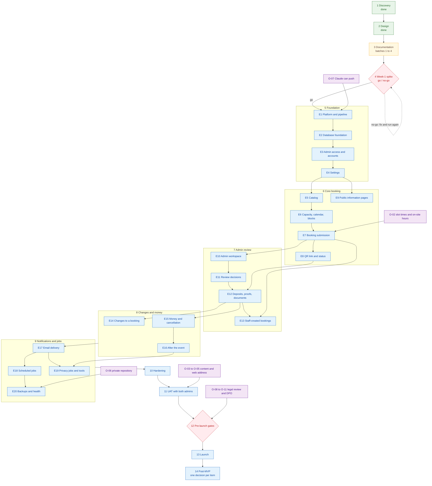

# Roadmap

> **Purpose:** The order of work for the DJB Kasoundbox reservation system: the phases from discovery to post-MVP with their entry and exit criteria, the milestones, the MVP backlog by epic and feature in build order, the definition of done, the pre-launch gates, and what the business owner will be asked to provide. It sets no dates and no estimates. ·
> **Audience:** Both readers. The business owner (Admin) can read "In plain words", sections 1, 5, 6, and 7 on their own; the developer (Super Admin), who builds with Claude, uses all of it ·
> **Status:** Draft for review ·
> **Last updated:** 2026-10-21 ·
> **Depends on:** [Project charter][charter], [Decision log][dl], [Functional requirements][fr], [Non-functional requirements][nfr], [Roles and permissions][roles], [Privacy and retention][priv], [Process overview][wf], [UX and sitemap][ux], [Architecture][arch], [API specification][api], [Data model][data], [Security][sec], [Test plan][tp] (being written in parallel), [Deployment and operations][ops] (being written in parallel) ·
> **Derived from:** [project-charter][charter] §4 (scope), §6 (phases); [decision-log][dl] D-22, D-23, §3 (O-02 to O-11); [functional-requirements][fr] §1 (MVP flags), §6 (Later); [non-functional-requirements][nfr] ("How it is checked" lines, NFR-08, NFR-29); [architecture][arch] §9, §10.4, §11, §12, §14.1; [api-specification][api] §2 to §7 (traceability); [data-model][data] §2, §5, §10; [security][sec] §5, §7; [privacy-and-retention][priv] §5.1, §5.2, §9; [ux-and-sitemap][ux] §2 (page inventory); [process overview][wf]; background only: [spec v0.2][spec] §17 (week-1 test), §18 (risks), §19 (open items), frozen and never edited

## In plain words

*For the business owner (Admin).*

- **We build in a fixed order, one layer at a time.** Each phase ends with something that works and can be checked before the next phase starts. This page gives the order, not the calendar: there are no dates here.
- **First, these documents are finished and approved.** Then comes a short technical test on the real free services, the "week-1 spike". It ends with a clear go or no-go. Nothing is built before a "go".
- **Then the building, in five steps:** the foundation (login with 2FA, settings), the customer booking (packages, calendar, form, reference code and QR code), the admin review (dashboard, approve, deposits, proofs, phone and walk-in bookings), changes and money (reschedule, cancel, refunds, balance), and finally emails and the automatic jobs (reminders, expiry, clean-up, backups).
- **Then the checks.** First a round of safety and quality tests. Then you and the Super Admin go through a checklist of real situations together (user acceptance testing, "UAT"). The system opens only when both of you accept it.
- **Before opening to customers, a short list of gates must be cleared:** a lawyer's review of privacy and retention, the privacy notice, naming the data protection officer, reading the service providers' terms, and a successful restore from backup (section 5).
- **What you will be asked for, and when** is in section 6: the real slot times, packages, prices, deposit amount and wording; a decision on the web address; your phone and laptop for one test; setting up your own login; and your time for UAT.
- **New features come after launch.** Messenger, SMS, online payment, and reports are on the "Later" list (section 7). Each one is decided first, then added.

## How to read this document

- **What this document owns.** The phases, the milestones, the order of the MVP backlog, the definition of done, and the gates. **Relative order only; no calendar dates [P].** It sets no dates and no estimates.
- **What it does not own.** Every requirement, rule, permission, deadline, limit, and decision belongs to its owning document and is cited here by its ID (D-xx, O-xx, BR-xx, FR-…, NFR-xx, EC-xx, WF-xx) with a link, never restated. Function, route, and table names come from [api-specification][api] and [data-model][data]. Test cases (TC-xx) are in the [test plan][tp]. Runbooks are in [deployment and operations][ops].
- **Labels.** **[C]** confirmed decision · **[P]** proposed, accepted with the spec approval but may change · **[U]** unverified fact, to be checked in the week-1 test or before launch · **[O-nn]** open item in the [decision log][dl]. **[P] (new in this doc)** marks a planning proposal made for the first time here. The arrangement itself (which phase holds which feature, the milestones, and the gates that no other doc names as "before launch") is such a proposal, even where a line carries no label. Each one waits for review; the main ones are listed under [Open questions](#open-questions).
- **Local IDs.** Epics E1 to E20, features E1.1 and so on, and milestones M1 to M11 are local to this document **[P] (new in this doc)**. The implementation plan (section 9) and the [test plan][tp] can cite them.
- **Page IDs.** P1 to P13 (public) and A1 to A13 (admin) are the pages of the [page inventory][ux] (ux-and-sitemap §2).
- **Week-1 items.** "Week-1 item N" is item N of the week-1 list in spec v0.2 §17, as in [architecture][arch] §14.1.

---

## 1. Phases and milestones

**Relative order only; no calendar dates [P].** Each phase starts only when its entry criteria are met, and ends at its exit criteria. A phase may begin work on a later phase's gate items early (for example, the lawyer review), but it never skips its own exit.

### 1.0 The phases at a glance

| # | Phase | Status | Milestone at exit | Charter phase ([charter][charter] §6) |
|---|---|---|---|---|
| 1 | Discovery | Done | Questions answered | 1. Discovery |
| 2 | Design | Done | Spec approved and frozen **[C]** (D-23) | 2. Design |
| 3 | Documentation | In progress (batches 1 to 4) | **M1** Docs approved | 3. Docs |
| 4 | Week-1 spike | Next | **M2** Go / no-go | 4. Week-1 test |
| 5 | Foundation | Planned | **M3** Skeleton runs | 5. Build |
| 6 | Core booking | Planned | **M4** First online request | 5. Build |
| 7 | Admin review | Planned | **M5** Request to Confirmed | 5. Build |
| 8 | Changes and money | Planned | **M6** Full lifecycle | 5. Build |
| 9 | Notifications and jobs | Planned | **M7** Runs on its own | 5. Build |
| 10 | Hardening | Planned | **M8** Release candidate | 6. Test |
| 11 | UAT with both admins | Planned | **M9** Accepted | 6. Test |
| 12 | Pre-launch gates | Planned | **M10** Gates cleared | 7. Launch |
| 13 | Launch | Planned | **M11** Live | 7. Launch |
| 14 | Post-MVP | Later | One milestone per item | [Charter][charter] §4.2 |

The charter's "Build" phase is split here into phases 5 to 9, its "Test" phase into 10 and 11, and its "Launch" phase into 12 and 13 **[P] (new in this doc)**.

### 1.1 Discovery (done)

- **Goal.** Understand the business and list the questions to answer.
- **Entry.** The idea of an online reservation system.
- **Exit.** The questions were answered in the brainstorming session ([charter][charter] §6).
- **Deliverables.** The [discovery brief][disc], now kept for history only.

### 1.2 Design (done)

- **Goal.** One approved design: rules, statuses, tools, security, testing.
- **Entry.** Discovery answered.
- **Exit.** Spec v0.2 approved and frozen; these docs become the source of truth **[C]** (D-23).
- **Deliverables.** The [design spec v0.2][spec] (frozen), decisions D-01 to D-24 in the [decision log][dl].

### 1.3 Documentation (in progress, batches 1 to 4)

- **Goal.** The source-of-truth docs, written in English in reviewed batches **[C]** (D-23).
- **Entry.** Design approved.
- **Exit (M1 Docs approved).**
  - Every batch is reviewed, and every doc in the [docs index][readme] moves from Draft to Final ([charter][charter] §6, phase 3).
  - Every doc's open questions are either answered or moved to the [decision log][dl] as new open items (O-12 onwards), as each doc's own "Open questions" section asks **[P] (new in this doc)**.
  - Each "[P] (new in this doc)" proposal in the docs is confirmed or corrected in its review.
- **Deliverables.** Batch 1 (00-project, 01-requirements, 02-domain), batch 2 (03-workflows), batch 3 (04-design, 05-technical), batch 4 (this roadmap, the [test plan][tp], [deployment and operations][ops], and the [staff guide][staff]).

### 1.4 Week-1 spike (real Vercel and Supabase, go / no-go)

- **Goal.** Prove the risky technical parts on the real free services in Singapore before any feature is built ([charter][charter] §6, phase 4).
- **Entry.**
  - M1 Docs approved.
  - A Vercel Hobby project in `sin1` and a Supabase Free project in Singapore exist ([architecture][arch] §2.2).
  - O-07 is done, so Claude can save code to the repository **[P] (new in this doc)**; until then the developer pushes Claude's work himself.
  - The real phone and laptop that will be used for scanning are available for item 6 ([FR-ADM-06][fr]), including the Admin's if he will scan.
  - If item 7 uses the GitHub Actions backup job, O-06 is done first **[C]** (D-22).
- **Exit (M2 Go / no-go).**
  - Each of the 8 week-1 items has passed, or its failure is fixed and the item is run again (spec v0.2 §17). What each item settles is listed in [architecture][arch] §14.1, plus the extra checks named there.
  - The **[U]** items each run settles are updated in their owning docs: [architecture][arch] §14.1, [security][sec] §7, [data-model][data] (for example the `admin_auth` schema fallback, data-model §2.1).
  - The speed target is set from the measured latency ([NFR-03][nfr]).
  - A fix that would change a decision (for example a stack choice in D-20) goes into the [decision log][dl] first.
  - The go / no-go result is recorded **[P] (new in this doc)**: see [Open questions](#open-questions), item 1.
- **Deliverables.** A short results note per item; the first restore test ([NFR-29][nfr]); real usage figures against the Hobby allotments ([NFR-06][nfr]).

### 1.5 Foundation (repository, CI, schema, roles, auth with 2FA, settings)

- **Goal.** An empty but complete skeleton: the repository, the automatic checks, the whole database structure, admin login with 2FA, accounts, and settings. Epics E1 to E4.
- **Entry.** M2 is "go". O-07 is done.
- **Exit (M3 Skeleton runs).**
  - Every step of `ci.yml` is green on `main` ([architecture][arch] §11.1); `supabase db reset` applies every migration from zero ([data-model][data] §10).
  - The database tests for roles and grants pass (the "Database" rows of [security][sec] §5).
  - An admin created with the seed script logs in with 2FA; logged-out and wrong-role calls are refused ([security][sec] §5, "Authentication" and "Authorization"). The production accounts are created later, once (section 1.11).
  - The Super Admin can change a setting and a delivery slot; the change writes an audit entry.
  - `/api/health` reports the `sin1` region; the keep-alive runs.
- **Deliverables.** The repository layout of [architecture][arch] §9; `ci.yml`, the Dockerfile, `dependabot.yml`; migrations for schemas, roles, enums, every table, the live-claim guard, and the shared helpers; `seed.sql`, `seed-admins.ts`, and the break-glass script; pages A1, A2, A10 (settings and slots), A11.

### 1.6 Core booking (catalog, calendar, booking function, public form, confirmation, QR)

- **Goal.** A customer can browse, see Available or Full, send a request, get a reference code and QR code, and check the status. Capacity is never double-booked. Epics E5 to E9.
- **Entry.** M3. The shape of O-02 is known (single on-site hours or per weekday; slots within one day), because it can change the settings structure ([data-model][data] open questions 14 and 16) **[P] (new in this doc)**. The real values may come later; made-up seed data is used until then ([architecture][arch] §10.3).
- **Exit (M4 First online request).**
  - The end-to-end tests "a customer books and sees the QR" and "a status check" pass at phone and desktop sizes ([test plan][tp]).
  - The database tests for capacity, simultaneous bookings, add-on stock, blocks, catalog-edit refusals, the same-day notice in Manila time, hold limits, the breaker, and mobile normalization pass ([test plan][tp]).
  - Emails are queued in the outbox but not yet sent (they are sent from phase 9).
- **Deliverables.** Pages P1 to P8, P9 (without proof upload and documents), P11, P12, P13; admin pages A8, A9, A10 (sets and the room).

### 1.7 Admin review (dashboard, search and scan, approve / reject / needs info, deposits, proofs, waiver, staff-created booking)

- **Goal.** The admins find each request, decide on it, and take deposits until it is Confirmed. Phone, walk-in, and Facebook bookings use the same calendar. Epics E10 to E13.
- **Entry.** M4.
- **Exit (M5 Request to Confirmed).**
  - The end-to-end tests "an admin logs in with 2FA, approves, and records a deposit", "a proof upload, with the admin verifying it", "a staff-created booking", and "QR lookup through the screenshot fallback" pass ([test plan][tp]).
  - The database tests for proof pausing, proof rejection after the deadline, waivers, two admins at once, and acknowledgment numbering under concurrency pass.
- **Deliverables.** Pages A3 to A7 and A12; the proof upload on P9; the printable documents P10.

### 1.8 Changes and money (reschedule, extend, edit, cancel and refund, balance, void, recreate, completed, event not held)

- **Goal.** Every remaining reservation action, and the daily Completed job. Epics E14 to E16.
- **Entry.** M5.
- **Exit (M6 Full lifecycle).**
  - Every allowed and every forbidden status change of [reservation-lifecycle][lc] §2, including "event not held", has a passing database test.
  - The end-to-end tests "a reschedule", "a cancellation with a refund", and "recreating an expired request" pass, and the balance step of the deposit test passes.
  - The closure-date rules and the daily auto-complete pass their database tests.
- **Deliverables.** The remaining action dialogs on A5.

### 1.9 Notifications and jobs (outbox, tick, reminders, expiry, retention, backups, health panel)

- **Goal.** The system runs on its own: emails go out, timers end overdue holds and queue reminders, old data is removed on schedule, a nightly encrypted backup is made, and the admins can see the system's health. Epics E17 to E20.
- **Entry.** M6, so every email type is already queued by its action. O-06 is done before `backup.yml` is added **[C]** (D-22). The sender address is chosen, since its domain depends on O-05 ([architecture][arch] §8).
- **Exit (M7 Runs on its own).**
  - The database tests for outbox de-duplication, retry, and skip, reminder timing, and the retention job (blanking, proof deletion, skipping legal holds) pass.
  - The "Job routes" rows of the security checklist pass ([security][sec] §5; [FR-SYS-09][fr]).
  - An email marked failed shows on the health panel ([NFR-26][nfr]).
  - The first nightly backup artifact exists in the private repository ([FR-SYS-12][fr]).
- **Deliverables.** Templates for every email type; the tick and daily routes; every `pg_cron` schedule ([api-specification][api] §6); `backup.yml`; page A13; the legal hold, erasure, and prepared-message parts of A5.

### 1.10 Hardening (security tests, accessibility, performance, restore test)

- **Goal.** Prove safety and quality across the whole system before the admins test it.
- **Entry.** M7. No new MVP features are started **[P] (new in this doc)**.
- **Exit (M8 Release candidate).**
  - Every row of the security test checklist passes ([security][sec] §5).
  - The accessibility scan and the keyboard-only booking pass ([NFR-17][nfr]); the browser checks pass ([NFR-18][nfr]).
  - The speed target set at M2 is met ([NFR-03][nfr]); usage after the load tests stays inside the Hobby allotments ([NFR-06][nfr]).
  - The restore test passes again, as [NFR-29][nfr] requires.
  - The Docker image passes its smoke test ([NFR-31][nfr]); no high or critical advisory is open ([NFR-30][nfr]).
- **Deliverables.** Test results recorded in the [test plan][tp]; the deploy, backup and restore, exit, and incident runbooks ready in [deployment and operations][ops].

### 1.11 UAT with both admins

- **Goal.** Both admins confirm, with real scenarios, that the system works for daily operations ([charter][charter] §6, phase 6).
- **Entry.** M8. The UAT checklist exists in the [test plan][tp]. Both admins have the accounts they will use, created once with the seed script ([architecture][arch] §10.4), with 2FA set up; where UAT runs is [open question](#open-questions) 14. The real content (O-02, O-03) is entered, or the gaps are named on the checklist **[P] (new in this doc)**. The [staff guide][staff] is available **[P] (new in this doc)**.
- **Exit (M9 Accepted).** Both admins accept the checklist. Every defect found is fixed and its scenario run again **[P] (new in this doc)**.
- **Deliverables.** The accepted checklist; the list of fixes.

### 1.12 Pre-launch gates

- **Goal.** Every condition that the docs set "before launch" is met (section 5).
- **Entry.** M9. Gate work itself can start much earlier, for example the lawyer review as soon as the batch-1 docs are approved **[P] (new in this doc)**.
- **Exit (M10 Gates cleared).** Every gate in section 5 is cleared, or a decision in the [decision log][dl] accepts it as a known risk **[P] (new in this doc)**.
- **Deliverables.** The gate checklist with evidence for each gate.

### 1.13 Launch

- **Goal.** The website opens to customers ([charter][charter] §6, phase 7).
- **Entry.** M10.
- **Exit (M11 Live).** The public site is open. The health panel shows every job running, and the first nightly backup after opening exists **[P] (new in this doc)**.
- **Deliverables.** Final content in the settings and the catalog; the domain and DNS as O-05 decides; the launch steps of [deployment and operations][ops]. From then on the recurring tasks run: the weekly usage check ([NFR-06][nfr]), the monthly offline copy ([NFR-28][nfr]), and patching ([NFR-30][nfr]).

### 1.14 Post-MVP

- **Goal.** Add the "Later" features (section 7), one at a time.
- **Entry.** M11. For each item, a new decision in the [decision log][dl] first; it then gets its FR IDs ([functional-requirements][fr] §6).
- **Exit.** Per item, the same definition of done as the MVP (section 4).
- **Deliverables.** Per item.

---

## 2. MVP backlog by module

Epics are grouped by the phase that builds them, in build order. Within an epic, features are listed in build order. Each feature names its FR IDs, the Server Actions, routes, and `app.*` functions from [api-specification][api] (its §7 traceability table), the tables from [data-model][data] §5, and what it depends on. "Emails queued" names the outbox types an action writes; they are sent from E17.

Where one FR is split across features, every part is named. The rules behind each FR are in its owning doc; this section only places it.

### 2.1 Foundation

**E1 · Platform and delivery pipeline**

| # | Feature | FR IDs | Actions, routes, functions | Tables | Depends on |
|---|---|---|---|---|---|
| E1.1 | Repository, toolchain, CI, Docker build, Dependabot | — ([NFR-30][nfr], [NFR-31][nfr], [NFR-32][nfr]) | `ci.yml`, `Dockerfile`, `dependabot.yml` ([architecture][arch] §11) | — | M2 go; O-07 |
| E1.2 | Hosting configuration and environment variables | — ([NFR-02][nfr], [NFR-13][nfr]) | `vercel.json` (`sin1`), `next.config.ts`, environment variables ([architecture][arch] §2.2, §8) | — | E1.1 |
| E1.3 | Error monitoring | — ([NFR-23][nfr]) | `@sentry/nextjs` with the scrubber ([architecture][arch] §2.1) | — | E1.2 |
| E1.4 | Health check | [FR-SYS-11][fr] | `GET /api/health` → `app.health_ping` | — | E1.2, E2.1 |
| E1.5 | Keep-alive, from the start, so the free project is not paused during the build **[P] (new in this doc)** | [FR-SYS-07][fr] | `ksb_keep_alive` → `app.keep_alive` | `job_runs` | E2.2; week-1 item 4 |

**E2 · Database foundation**

| # | Feature | FR IDs | Actions, routes, functions | Tables | Depends on |
|---|---|---|---|---|---|
| E2.1 | Schemas, roles, grants, role timeouts, extensions | — ([NFR-10][nfr], [NFR-22][nfr]) | Grants per [api-specification][api] §1.4 and [security][sec] §4.3 | Schemas `app`, `admin_auth`; roles `app_owner`, `app_rw`, `app_backup` ([data-model][data] §2) | E1.1; week-1 item 1 |
| E2.2 | Enums, every table, production seed rows **[P] (new in this doc)**: the whole table set now, functions per epic | — | — | Every table of [data-model][data] §5: `resources`, `packages`, `addons`, `delivery_slots`, `settings`, `reservations`, `resource_claims`, `reservation_addons`, `blocks`, `payments`, `ack_counters`, `payment_proofs`, `reservation_notes`, `audit_log`, `notifications_outbox`, `submission_keys`, `rate_limits`, `job_runs`, `job_leases`, `retention_runs`, `anonymized_bookings`, `capacity_lock`; seed rows per [data-model][data] §10 | E2.1 |
| E2.3 | Live-claim guard and capacity lock | — ([NFR-20][nfr]) | `app.take_capacity_lock` | `resource_claims`, `capacity_lock` ([data-model][data] §6) | E2.2; week-1 item 2 |
| E2.4 | Shared helpers, standard steps, result envelope | [FR-ADM-07][fr] (common rules) | Standard steps A, L, R, X, W ([api-specification][api] §5.1); `app.assert_actor`, `app.manila_today`, `app.normalize_mobile`, `app.normalize_ref_code`, `app.setting`, `app.hold_is_overdue`, `app.effective_status`, `app.refuse`; the envelope and result codes ([api-specification][api] §1.5 to §1.7) | `settings`; view `reservation_effective` | E2.2 |
| E2.5 | Audit writer | [FR-ADM-32][fr] (writing entries) | `app.write_audit` | `audit_log` | E2.2 |
| E2.6 | Outbox writer | [FR-NTF-16][fr] (queueing) | `app.enqueue_email` | `notifications_outbox` | E2.2 |

**E3 · Admin access and accounts**

| # | Feature | FR IDs | Actions, routes, functions | Tables | Depends on |
|---|---|---|---|---|---|
| E3.1 | Login with 2FA | [FR-ADM-01][fr] | Better Auth `/api/auth/[...all]`; hooks `app.login_guard`, `app.login_result`, `app.record_account_event` | Better Auth tables `user`, `session`, `account`, `two_factor`, `verification` ([data-model][data] §5.19); `rate_limits`, `audit_log` | E2; week-1 item 3 |
| E3.2 | Server-side role checks | [FR-ADM-07][fr] (role check) | `proxy.ts`; `verifySession`, `requireAdmin`, `requireRole` ([api-specification][api] §1.2) | `user`, `session` | E3.1 |
| E3.3 | First accounts and break-glass scripts | [FR-ADM-30][fr] (scripts) | `scripts/seed-admins.ts`; `scripts/break-glass-reset-2fa.ts` → `app.break_glass_reset_2fa` | Better Auth tables, `audit_log` | E3.1 |
| E3.4 | Accounts screen (A11) | [FR-ADM-30][fr] | `listAdminAccounts`; `createAdminAccount`, `disableAdminAccount`, `resetAdminAccount`, `signOutAdminAccount` → `app.create_admin_account`, `app.disable_admin`, `app.reset_admin`, `app.sign_out_admin` | Better Auth tables, `audit_log` | E3.2 |

**E4 · Settings**

| # | Feature | FR IDs | Actions, routes, functions | Tables | Depends on |
|---|---|---|---|---|---|
| E4.1 | Settings screen (A10) | [FR-ADM-28][fr] | `getSettings`; `updateSetting` → `app.update_setting` | `settings`, `audit_log` | E3.2 |
| E4.2 | Delivery slots | [FR-ADM-28][fr] (slots) | `createDeliverySlot`, `updateDeliverySlot`, `archiveCatalogItem` (slots) → `app.create_delivery_slot`, `app.update_delivery_slot`, `app.archive_catalog_item` | `delivery_slots`, `audit_log` | E4.1; shape of O-02 |

### 2.2 Core booking

**E5 · Catalog**

| # | Feature | FR IDs | Actions, routes, functions | Tables | Depends on |
|---|---|---|---|---|---|
| E5.1 | Catalog management (A9) | [FR-ADM-26][fr] | `getCatalogAdmin`; `createPackage`, `updatePackage`, `createAddon`, `updateAddon`, `archiveCatalogItem` → `app.create_package`, `app.update_package`, `app.create_addon`, `app.update_addon`, `app.archive_catalog_item` | `packages`, `addons`, `reservation_addons`, `audit_log` | E3.2 |
| E5.2 | Delivery sets and the room (A10) | [FR-ADM-27][fr] | `createResource`, `renameResource`, `deactivateResource` → `app.create_resource`, `app.rename_resource`, `app.deactivate_resource` | `resources`, `resource_claims`, `audit_log` | E3.2, E2.3 |
| E5.3 | Packages and add-ons page (P2) | [FR-PUB-02][fr] | `getPublicCatalog` → `app.public_catalog` (cache tag `catalog`) | `packages`, `addons`, `delivery_slots` | E5.1 |

**E6 · Capacity, calendar, and blocks**

| # | Feature | FR IDs | Actions, routes, functions | Tables | Depends on |
|---|---|---|---|---|---|
| E6.1 | Claim helpers, used by every capacity action | (serve [FR-PUB-06][fr], [FR-ADM-24][fr], [FR-ADM-25][fr]) | `app.claim_resource`, `app.check_addon_stock`, `app.release_claims`, `app.is_live_claim`, `app.expire_hold` | `resource_claims`, `reservation_addons`, `capacity_lock` | E2.3, E5.2 |
| E6.2 | Availability calendar (P3) | [FR-PUB-03][fr] | `getAvailability` → `app.availability_calendar` | `resource_claims`, `resources`, `settings` | E6.1 |
| E6.3 | Blocks (A8) | [FR-ADM-25][fr] | `listBlocks`; `createBlock`, `removeBlock` → `app.create_blocks`, `app.remove_block` | `blocks`, `resource_claims` (view `block_resources`), `audit_log` | E6.1, E3.2 |

**E7 · Booking submission**

| # | Feature | FR IDs | Actions, routes, functions | Tables | Depends on |
|---|---|---|---|---|---|
| E7.1 | Reservation form: choose and details (P4, P5) | [FR-PUB-04][fr], [FR-PUB-05][fr] | Shared Zod schemas ([api-specification][api] §1.3); `getPublicSettings` → `app.public_settings` | — | E5.3, E6.2 |
| E7.2 | Review and submit, with every server check (P6) | [FR-PUB-06][fr] | `submitReservation` → `app.book_reservation`; `app.price_items`, `app.rate_limit_hit`; Turnstile, honeypot, submission key ([api-specification][api] §1.8, §1.11). Emails queued: `request_received`, `admin_new_request`, `admin_online_paused`, `expired` | `reservations`, `resource_claims`, `reservation_addons`, `submission_keys`, `rate_limits`, `settings` (`online_paused_until`), `audit_log`, `notifications_outbox` | E7.1, E6.1, E2.4 to E2.6 |
| E7.3 | Reference code, QR code, confirmation (P7) | [FR-PUB-07][fr], [FR-PUB-08][fr] | `app.new_reference_code`, `app.new_qr_token`; `uqr` draws the QR | `reservations` | E7.2 |

**E8 · QR link and status tracking**

| # | Feature | FR IDs | Actions, routes, functions | Tables | Depends on |
|---|---|---|---|---|---|
| E8.1 | QR link page (P13) | [FR-PUB-09][fr] | Page `/r/[token]` → `app.resolve_qr` | `reservations` | E7.3; the admin redirect is finished with E10.3 |
| E8.2 | Status lookup (P8) | [FR-PUB-10][fr] | `lookupStatus` → `app.lookup_status`; the `ksb_status` cookie ([api-specification][api] §1.13) | `reservations`, `rate_limits` | E7.2 |
| E8.3 | Status page (P9) | [FR-PUB-11][fr] | `getStatusView` → `app.get_status_view` | `reservations` (through `reservation_effective`), `reservation_addons`, `payments` | E8.2 |
| E8.4 | New QR code from the status page | [FR-PUB-13][fr] | `reissueQrFromStatus` → `app.reissue_qr` | `reservations`, `audit_log` | E8.3 |

**E9 · Public information pages**

| # | Feature | FR IDs | Actions, routes, functions | Tables | Depends on |
|---|---|---|---|---|---|
| E9.1 | Home (P1) | [FR-PUB-01][fr] | Page `/`; `getPublicSettings` → `app.public_settings` | `settings` | E4.1 |
| E9.2 | Privacy notice (P11) | [FR-PUB-15][fr] | Page `/privacy` | — | Contents per [privacy-and-retention][priv] §5.1; O-09 |
| E9.3 | Contact and FAQ (P12) | [FR-PUB-16][fr] | Page `/contact`; `app.public_settings` | `settings` (`business_info`) | E4.1; O-03, O-04, O-05 |

### 2.3 Admin review

**E10 · Admin workspace**

| # | Feature | FR IDs | Actions, routes, functions | Tables | Depends on |
|---|---|---|---|---|---|
| E10.1 | Dashboard and early resume (A3) | [FR-ADM-02][fr], [FR-ADM-29][fr] | `getDashboard`; `resumeOnlineBooking` → `app.resume_online_booking` | `reservations` (through the view), `payment_proofs`, `settings`, `audit_log` | E3.2, E7.2 |
| E10.2 | Reservation list and search (A4) | [FR-ADM-03][fr] | `searchReservations` | `reservations` (through the view) | E3.2, E7.2 |
| E10.3 | Reservation page, history, and internal notes (A5) | [FR-ADM-04][fr], [FR-ADM-05][fr], [FR-ADM-32][fr] (history) | `getReservation` with `app.allowed_actions`; `addInternalNote` → `app.add_internal_note` | `reservations`, `reservation_addons`, `payments`, `payment_proofs`, `reservation_notes`, `audit_log` | E10.2 |
| E10.4 | QR scan with screenshot fallback (A6) | [FR-ADM-06][fr] | `lookupReservationByQr` → `app.resolve_qr` | `reservations` | E10.3, E8.1; week-1 item 6 |
| E10.5 | Audit log page (A12) | [FR-ADM-32][fr] (viewing) | `getAuditLog` | `audit_log` | E2.5, E3.2 |
| E10.6 | New QR code by an admin | [FR-ADM-22][fr] | `reissueQr` → `app.reissue_qr` | `reservations`, `audit_log` | E10.3, E8.4 |

**E11 · Review decisions**

| # | Feature | FR IDs | Actions, routes, functions | Tables | Depends on |
|---|---|---|---|---|---|
| E11.1 | Approve and reject | [FR-ADM-08][fr] | `approveReservation` → `app.approve_reservation`; `rejectReservation` → `app.reject_reservation`. Emails queued: `approved`, `rejected` | `reservations`, `resource_claims`, `audit_log`, `notifications_outbox` | E10.3 |
| E11.2 | Needs info | [FR-ADM-09][fr] | `flagNeedsInfo`, `clearNeedsInfo` → `app.flag_needs_info`, `app.clear_needs_info`. Email queued: `needs_info` | `reservations`, `audit_log`, `notifications_outbox` | E10.3 |
| E11.3 | Same-day deposit waiver | [FR-ADM-13][fr] | `waiveDeposit` → `app.waive_deposit`. Email queued: `confirmed` | `reservations`, `audit_log`, `notifications_outbox` | E11.1 |

**E12 · Deposits, proofs, and documents**

| # | Feature | FR IDs | Actions, routes, functions | Tables | Depends on |
|---|---|---|---|---|---|
| E12.1 | Record a deposit | [FR-ADM-11][fr] | `recordDeposit` → `app.record_deposit`; `app.next_ack_number`. Email queued: `confirmed` | `payments`, `ack_counters`, `reservations`, `audit_log`, `notifications_outbox` | E11.1 |
| E12.2 | Proof upload on the status page | [FR-PUB-12][fr] | `requestProofUpload` → `app.issue_proof_upload_slot`; `confirmProofUpload` → `app.record_proof_upload`. Email queued: `admin_proof_uploaded` | `payment_proofs`, `rate_limits`, the private Storage bucket, `audit_log`, `notifications_outbox` | E8.3, E11.1; week-1 item 5 |
| E12.3 | Verify or reject a proof | [FR-ADM-12][fr] | `getProofImageUrl` → `app.get_proof_object`; `verifyProof` → `app.verify_proof`; `rejectProof` → `app.reject_proof`. Emails queued: `confirmed`, `proof_not_accepted`, `expired` | `payment_proofs`, `payments`, `ack_counters`, `reservations`, `audit_log`, `notifications_outbox` | E12.1, E12.2 |
| E12.4 | Acknowledgments and booking confirmation (P10) | [FR-PUB-14][fr], [FR-ADM-23][fr] | `/status/acknowledgment/[paymentId]`, `/status/booking-confirmation`, `/admin/reservations/[id]/acknowledgment/[paymentId]`, `/admin/reservations/[id]/booking-confirmation` → `app.get_document` | `payments`, `reservations` | E12.1, E8.3; the balance acknowledgment arrives with E15.1 |

**E13 · Staff-created bookings**

| # | Feature | FR IDs | Actions, routes, functions | Tables | Depends on |
|---|---|---|---|---|---|
| E13.1 | Create booking, two-step and one-step (A7) | [FR-ADM-24][fr] | `createStaffReservation` → `app.create_staff_reservation`. Emails queued: `request_received`, `confirmed` (one-step) | `reservations`, `resource_claims`, `reservation_addons`, `payments`, `ack_counters`, `submission_keys`, `audit_log`, `notifications_outbox` | E7.2, E11.3, E12.1 |

### 2.4 Changes and money

**E14 · Changes to a booking**

| # | Feature | FR IDs | Actions, routes, functions | Tables | Depends on |
|---|---|---|---|---|---|
| E14.1 | Edit details | [FR-ADM-10][fr] | `editReservationDetails` → `app.edit_reservation_details`. Email queued: `reservation_updated` | `reservations`, `reservation_addons`, `audit_log`, `notifications_outbox` | E11.1, E6.1 |
| E14.2 | Extend a deadline | [FR-ADM-16][fr] | `extendDeadline` → `app.extend_deadline`. Email queued: `deadline_extended` | `reservations`, `audit_log`, `notifications_outbox` | E11.1 |
| E14.3 | Reschedule | [FR-ADM-17][fr] | `rescheduleReservation` → `app.reschedule_reservation`. Email queued: `rescheduled` | `reservations`, `resource_claims`, `reservation_addons`, `audit_log`, `notifications_outbox` | E11.1, E6.1 |
| E14.4 | Recreate an expired request | [FR-ADM-21][fr] | `recreateExpiredReservation` → `app.recreate_expired`. Emails queued: `request_received`, `expired` | `reservations`, `resource_claims`, `reservation_addons`, `audit_log`, `notifications_outbox` | E7.2, E6.1 |

**E15 · Money after confirmation, and cancellation**

| # | Feature | FR IDs | Actions, routes, functions | Tables | Depends on |
|---|---|---|---|---|---|
| E15.1 | Record a balance payment | [FR-ADM-14][fr] | `recordBalancePayment` → `app.record_balance` | `payments`, `ack_counters`, `audit_log` | E12.1 |
| E15.2 | Void a payment | [FR-ADM-15][fr] | `voidPayment` → `app.void_payment` | `payments`, `audit_log` | E12.1, E15.1 |
| E15.3 | Cancel with a refund decision | [FR-ADM-18][fr] | `cancelReservation` → `app.cancel_reservation`; `app.recompute_closure_date`. Email queued: `cancelled` | `reservations`, `resource_claims`, `payments`, `audit_log`, `notifications_outbox` | E12.1 |
| E15.4 | Record a refund paid | [FR-ADM-19][fr] | `recordRefundPaid` → `app.record_refund` | `payments`, `reservations`, `audit_log` | E15.3 |

**E16 · After the event**

| # | Feature | FR IDs | Actions, routes, functions | Tables | Depends on |
|---|---|---|---|---|---|
| E16.1 | Mark finished events Completed (daily) | [FR-SYS-04][fr] | `ksb_complete_events` → `app.complete_finished_events` | `reservations`, `resource_claims`, `job_runs`, `audit_log` | E12.1; week-1 item 4 |
| E16.2 | Event not held | [FR-ADM-20][fr] | `markEventNotHeld` → `app.mark_event_not_held` (its email: [functional-requirements][fr] §7, question 7) | `reservations`, `audit_log` | E16.1, E15.3 |

### 2.5 Notifications and jobs

**E17 · Email delivery**

| # | Feature | FR IDs | Actions, routes, functions | Tables | Depends on |
|---|---|---|---|---|---|
| E17.1 | Email provider and one template per email type | [FR-NTF-01][fr], [FR-NTF-02][fr], [FR-NTF-03][fr], [FR-NTF-04][fr], [FR-NTF-05][fr], [FR-NTF-06][fr], [FR-NTF-07][fr], [FR-NTF-08][fr], [FR-NTF-09][fr], [FR-NTF-10][fr], [FR-NTF-11][fr], [FR-NTF-12][fr], [FR-NTF-13][fr], [FR-NTF-14][fr], [FR-NTF-15][fr] | `EmailProvider` (Resend) and templates in `lib/email/` ([architecture][arch] §9); the outbox type of each FR is in [api-specification][api] §7 | `notifications_outbox` | E2.6; the features that queue each type (table below) |
| E17.2 | Sending after the reply and on the tick | [FR-NTF-16][fr] (sending), [FR-SYS-03][fr], [FR-SYS-09][fr] | The `after()` sender ([api-specification][api] §1.12); `ksb_request_tick` → `app.request_tick` → `POST /api/jobs/tick`; `app.try_start_job`, `app.finish_job`, `app.claim_due_emails`, `app.record_email_result` | `notifications_outbox`, `job_runs`, `job_leases` | E17.1; week-1 item 4 |
| E17.3 | No duplicates, retries, stale skips, caps | [FR-NTF-17][fr], [FR-NTF-18][fr], [FR-NTF-19][fr], [FR-NTF-20][fr] | Outbox unique key with `ON CONFLICT DO NOTHING`; the Resend idempotency key; `app.claim_due_emails`, `app.record_email_result` | `notifications_outbox`, `settings` | E17.2 |
| E17.4 | Customers without email: the prepared message | [FR-NTF-21][fr] | `app.enqueue_email` skips an empty recipient; the prepared message in `getReservation` | `notifications_outbox`, `reservations` | E17.1, E10.3 |

Which feature queues each email type, so E17.1 can be tested against real rows:

| Email | Outbox type | Queued by |
|---|---|---|
| [FR-NTF-01][fr] | `request_received` | E7.2, E13.1, E14.4 |
| [FR-NTF-02][fr] | `needs_info` | E11.2 |
| [FR-NTF-03][fr] | `approved` | E11.1 |
| [FR-NTF-04][fr] | `reminder` | E18.2 |
| [FR-NTF-05][fr] | `deadline_extended` | E14.2 |
| [FR-NTF-06][fr] | `proof_not_accepted` | E12.3 |
| [FR-NTF-07][fr] | `confirmed` | E11.3, E12.1, E12.3, E13.1 |
| [FR-NTF-08][fr] | `reservation_updated` | E14.1 |
| [FR-NTF-09][fr] | `rejected` | E11.1 |
| [FR-NTF-10][fr] | `cancelled` | E15.3 (and E16.2, depending on [functional-requirements][fr] §7, question 7) |
| [FR-NTF-11][fr] | `rescheduled` | E14.3 |
| [FR-NTF-12][fr] | `expired` | E6.1 (`app.expire_hold`, step X), E12.3, E14.4, E18.1 |
| [FR-NTF-13][fr] | `admin_new_request` | E7.2 |
| [FR-NTF-14][fr] | `admin_proof_uploaded` | E12.2 |
| [FR-NTF-15][fr] | `admin_online_paused` | E7.2 |

**E18 · Scheduled jobs**

| # | Feature | FR IDs | Actions, routes, functions | Tables | Depends on |
|---|---|---|---|---|---|
| E18.1 | Expire overdue holds | [FR-SYS-01][fr] | `ksb_expire_holds` → `app.expire_overdue_holds` (through `app.expire_hold`) | `reservations`, `resource_claims`, `job_runs`, `audit_log`, `notifications_outbox` | E6.1; week-1 item 4 |
| E18.2 | Queue due deposit reminders | [FR-SYS-02][fr], [FR-NTF-04][fr] (timing) | `ksb_queue_reminders` → `app.queue_due_reminders` | `reservations`, `notifications_outbox`, `job_runs` | E17.3, E11.1 |
| E18.3 | Rotate the IP key | [FR-SYS-06][fr] | `ksb_rotate_ip_key` → `app.rotate_ip_key`; used by `app.rate_limit_hit` | `rate_limits`; the key in Vault ([data-model][data] §5.14) | E7.2 |
| E18.4 | Daily backup sweep on Vercel | [FR-SYS-08][fr] | `GET /api/jobs/daily` (Vercel Cron) | `job_runs`, `job_leases`, `notifications_outbox` | E17.2, E18.1 |
| E18.5 | Job run records and heartbeat | [FR-SYS-10][fr] | `job_runs` rows from every job; `ksb_heartbeat` → `app.send_heartbeat`, `app.check_heartbeat`; `ksb_prune_logs` → `app.prune_job_runs` | `job_runs` | E18.1 to E18.4 |

**E19 · Privacy jobs and tools**

| # | Feature | FR IDs | Actions, routes, functions | Tables | Depends on |
|---|---|---|---|---|---|
| E19.1 | Retention job, including proof-file deletion | [FR-SYS-05][fr] | `ksb_retention` → `app.run_retention`; in the tick: `app.claim_due_proof_deletions`, `app.mark_proof_file_deleted` | `retention_runs`, `anonymized_bookings`, `reservations`, `payment_proofs` and Storage, `submission_keys`, `rate_limits`, `notifications_outbox`, `audit_log`, Better Auth tables | E15.3, E16.1, E17.2 |
| E19.2 | Legal hold | [FR-ADM-31][fr] (legal hold) | `setLegalHold`, `clearLegalHold` → `app.set_legal_hold`, `app.clear_legal_hold` | `reservations`, `audit_log` | E10.3 |
| E19.3 | Erasure requests | [FR-ADM-31][fr] (erasure) | `processErasure` → `app.process_erasure` | `reservations`, `notifications_outbox`, `audit_log` | E19.2 |

**E20 · Backups and health**

| # | Feature | FR IDs | Actions, routes, functions | Tables | Depends on |
|---|---|---|---|---|---|
| E20.1 | Nightly encrypted backup | [FR-SYS-12][fr] | `backup.yml` ([architecture][arch] §11.3); no API | Every table, read by `app_backup` | **O-06 first [C]** (D-22); week-1 item 7 |
| E20.2 | Health panel (A13) | [FR-ADM-33][fr] | `getHealth` → `app.health_summary` | `job_runs`, `notifications_outbox`, Storage usage | E17.3, E18.5 |

### 2.6 Non-functional requirements by phase

NFRs have no feature of their own. Each one is built or checked in the phase named, by the check its "How it is checked" line describes in [non-functional-requirements][nfr].

| NFR | Week-1 spike | Built in | Verified again in |
|---|---|---|---|
| NFR-01 (cost) | Item 8 | — | Pre-launch gates (terms, GitHub minutes) |
| NFR-02 (Singapore) | Item 1 | Foundation (E1.2, E1.4) | Hardening |
| NFR-03 (caching and speed) | Item 1 (latency, sets the target) | Core booking (E5.3, E6.2) | Hardening |
| NFR-04 (uptime check) | — | Foundation (E1.4) | Hardening; pre-launch gates |
| NFR-05, NFR-31 (portability) | Docker image check ([architecture][arch] §14.1) | Foundation (E1.1) | Hardening |
| NFR-06 (Hobby usage) | Item 8 | All phases (no polling, cache) | Hardening; weekly after launch |
| NFR-07 (no pausing) | Item 4 | Foundation (E1.5) | — |
| NFR-08 (vendor terms) | — | — | Pre-launch gates (O-08) |
| NFR-09 (admin login) | Item 3 | Foundation (E3.1) | Hardening |
| NFR-10 (server checks, least privilege) | Item 3 | Foundation (E2.1, E3.2); every feature | Hardening |
| NFR-11 (rate limits) | — | Foundation (login), Core booking (submit, lookup), Admin review (upload) | Hardening |
| NFR-12 (bot protection) | — | Core booking (E7.2) | Hardening |
| NFR-13 (secrets, codes) | — | Foundation (E1.2), Core booking (E7.3), Notifications and jobs (job secret) | Hardening |
| NFR-14 (safe uploads) | Item 5 | Admin review (E12.2) | Hardening |
| NFR-15 (privacy by design) | — | Every feature; Notifications and jobs (E19) | Hardening |
| NFR-16 (mobile first) | Item 6 | Every feature | Hardening; UAT |
| NFR-17 (accessibility) | — | Every feature | Hardening; UAT |
| NFR-18 (browsers) | — | Every feature | Hardening; pre-launch gates |
| NFR-19 (Manila time) | — | Foundation (E2.4) | Every phase |
| NFR-20 (no double booking) | Item 2 | Foundation (E2.3), Core booking (E6, E7) | Hardening |
| NFR-21 (one complete step) | Item 2 | Foundation (E2.4); every action | Hardening |
| NFR-22 (nothing deleted) | — | Foundation (E2.1); Changes and money | Hardening |
| NFR-23 (Sentry without personal data) | — | Foundation (E1.3) | Hardening; pre-launch gates |
| NFR-24 (jobs watched) | Item 4 | Notifications and jobs (E18.5) | Hardening; pre-launch gates |
| NFR-25 (traceability) | — | Foundation (E2.5); every action | Hardening |
| NFR-26 (health panel) | — | Notifications and jobs (E20.2) | UAT |
| NFR-27 (nightly backup) | Item 7 | Notifications and jobs (E20.1) | Pre-launch gates |
| NFR-28 (monthly offline copy) | — | Launch (operations task) | Monthly after launch |
| NFR-29 (restore test) | Item 7 | — | Hardening; pre-launch gates |
| NFR-30 (pinned versions, patching) | — | Foundation (E1.1) | Hardening; ongoing |
| NFR-32 (code quality, CI) | — | Foundation (E1.1) | Every merge |
| NFR-33 (email limits) | Item 4 | Notifications and jobs (E17) | Pre-launch gates (Resend terms) |

### 2.7 Backlog coverage check

Every FR in [functional-requirements][fr] §1 has MVP flag **Yes**. Each one is placed below, with every feature that holds a part of it.

| Group | FR → feature |
|---|---|
| Public website | FR-PUB-01 → E9.1 · FR-PUB-02 → E5.3 · FR-PUB-03 → E6.2 · FR-PUB-04 → E7.1 · FR-PUB-05 → E7.1 · FR-PUB-06 → E7.2 · FR-PUB-07 → E7.3 · FR-PUB-08 → E7.3 · FR-PUB-09 → E8.1 · FR-PUB-10 → E8.2 · FR-PUB-11 → E8.3 · FR-PUB-12 → E12.2 · FR-PUB-13 → E8.4 · FR-PUB-14 → E12.4 · FR-PUB-15 → E9.2 · FR-PUB-16 → E9.3 |
| Admin panel | FR-ADM-01 → E3.1 · FR-ADM-02 → E10.1 · FR-ADM-03 → E10.2 · FR-ADM-04 → E10.3 · FR-ADM-05 → E10.3 · FR-ADM-06 → E10.4 · FR-ADM-07 → E2.4, E3.2 · FR-ADM-08 → E11.1 · FR-ADM-09 → E11.2 · FR-ADM-10 → E14.1 · FR-ADM-11 → E12.1 · FR-ADM-12 → E12.3 · FR-ADM-13 → E11.3 · FR-ADM-14 → E15.1 · FR-ADM-15 → E15.2 · FR-ADM-16 → E14.2 · FR-ADM-17 → E14.3 · FR-ADM-18 → E15.3 · FR-ADM-19 → E15.4 · FR-ADM-20 → E16.2 · FR-ADM-21 → E14.4 · FR-ADM-22 → E10.6 · FR-ADM-23 → E12.4 · FR-ADM-24 → E13.1 · FR-ADM-25 → E6.3 · FR-ADM-26 → E5.1 · FR-ADM-27 → E5.2 · FR-ADM-28 → E4.1, E4.2 · FR-ADM-29 → E10.1 · FR-ADM-30 → E3.3, E3.4 · FR-ADM-31 → E19.2, E19.3 · FR-ADM-32 → E2.5, E10.3, E10.5 · FR-ADM-33 → E20.2 |
| Notifications | FR-NTF-01 to FR-NTF-15 → E17.1 (each queued as in the table under E17) · FR-NTF-04 → also E18.2 · FR-NTF-16 → E2.6, E17.2 · FR-NTF-17 → E17.3 · FR-NTF-18 → E17.3 · FR-NTF-19 → E17.3 · FR-NTF-20 → E17.3 · FR-NTF-21 → E17.4 |
| Scheduled jobs and system | FR-SYS-01 → E18.1 · FR-SYS-02 → E18.2 · FR-SYS-03 → E17.2 · FR-SYS-04 → E16.1 · FR-SYS-05 → E19.1 · FR-SYS-06 → E18.3 · FR-SYS-07 → E1.5 · FR-SYS-08 → E18.4 · FR-SYS-09 → E17.2 (and the daily route in E18.4) · FR-SYS-10 → E18.5 · FR-SYS-11 → E1.4 · FR-SYS-12 → E20.1 |

**MVP FRs not placed in the backlog:** none. (82 MVP FRs: 16 FR-PUB, 33 FR-ADM, 21 FR-NTF, 12 FR-SYS.)

---

## 3. Dependency diagram

**Colours:** green = done · yellow = in progress · blue = to build or do · red = decision points (go / no-go and the gates) · purple = items needed from people, not code.

**Reading the diagram.** Arrows mean "must be done before". Inside a phase, the arrows show the build order of its epics; arrows that cross phases show the main dependencies of section 2 (for example, proofs on the status page need E8 first). The phase boxes also follow each other: no epic of a phase starts before the previous phase's exit milestone. Content (O-02 to O-05) is drawn where it is needed at the latest; earlier is better (section 6).

---

## 4. Definition of done for a feature

A feature (one row of section 2) is done only when every line below is true. The [test plan][tp] holds the test cases; this list says which kinds must exist and pass.

| Area | Done when | Source |
|---|---|---|
| **Scope** | Every acceptance criterion of the feature's FR IDs passes. Nothing outside them is built; a new need goes to the [decision log][dl] first (its §4) | [functional-requirements][fr]; D-23 |
| **Code** | It lives where [architecture][arch] §9 puts it, uses the names, inputs, envelope, and result codes of [api-specification][api], shares one Zod schema between form and action, and makes each write one `app.*` function call. Lint and strict type checks pass | [api-specification][api] §1; [NFR-21][nfr], [NFR-32][nfr] |
| **Database** | Its migration is in `supabase/migrations`, applies from zero with `supabase db reset`, and follows the migration rules and order of [data-model][data] §10 | [data-model][data] §10 |
| **Tests** | Its test cases are in the [test plan][tp], each naming its FR ID. A pgTAP test exists for each rule its function enforces; Vitest for its pure logic; Playwright at phone and desktop sizes, with the accessibility scan, for each user journey it touches; and the rows of the security checklist that apply ([security][sec] §5). All pass in CI | [test plan][tp]; [architecture][arch] §11.1; [NFR-16][nfr], [NFR-17][nfr] |
| **Permissions** | The DAL check runs first ([architecture][arch] §4.3) and the function checks the actor again (`app.assert_actor`), both matching [roles-and-permissions][roles] §2. A logged-out call and a wrong-role call are refused by test | [NFR-10][nfr]; [FR-ADM-07][fr] |
| **Audit** | Every change writes the audit entries its [api-specification][api] card names, with the reason where one is required, and no customer contact data | [FR-ADM-07][fr], [FR-ADM-32][fr]; [NFR-25][nfr] |
| **Emails** | It queues exactly the outbox types that [api-specification][api] §7 lists for it, in the same transaction as the change. Before E17 exists, the test checks the outbox row; after, it checks the sent email too | [FR-NTF-16][fr], [FR-NTF-21][fr] |
| **Time, money, privacy** | Dates and times are Manila time; amounts follow [ux-and-sitemap][ux] §5.4; no new personal data is collected, and none reaches logs or Sentry | [NFR-15][nfr], [NFR-19][nfr], [NFR-23][nfr] |
| **Screens** | The page matches its entry in [ux-and-sitemap][ux]; only the allowed actions are shown ([ux-and-sitemap][ux] §4.3), and the server refuses the rest anyway | [ux-and-sitemap][ux] |
| **Docs updated** | If building it changed a rule or a decision: the [decision log][dl] first, then every doc it lists ([decision log][dl] §4). If a name, column, or contract changed: [api-specification][api] or [data-model][data] updated in the same change. Any "[P] (new in this doc)" item it settles is marked confirmed | [decision log][dl] §4; D-23 |
| **Review** | Merged to `main` through a pull request with every CI check green ([architecture][arch] §11.1, **[P]** there). The developer checks the FR acceptance criteria before merging. Screens the Admin uses are shown to the Admin at the end of their phase **[P] (new in this doc)** | [architecture][arch] §11.1 |

---

## 5. Pre-launch gates

Every gate must be cleared before M10 (section 1.12). This section owns the list of gates. [Deployment and operations][ops] §10 holds the checklist that proves each one (who does it, and the evidence), and the runbooks; the last column maps each gate to its row there. "Before launch" in the source column means the owning doc already sets the gate; **[P] (new in this doc)** means this roadmap proposes it as a gate; "**[P]** there" means the owning doc proposes it.

| # | Gate | Cleared when | Source | Ops §10 row |
|---|---|---|---|---|
| G1 | **Private repository (O-06)** | O-06 was done before E20.1, and the check that the repository is private passes again | **[C]** D-22; [O-06][dl]; [NFR-27][nfr] (before launch); [security][sec] §5 | 7 |
| G2 | **Claude can save code (O-07)** | Done since Foundation (section 1.5); listed here so it is closed | [O-07][dl] | — |
| G3 | **Vendor terms (O-08)** | The reading and saving that [NFR-08][nfr] requires is done. The free-plan figures marked **[U]** are confirmed from those terms: GitHub minutes ([NFR-01][nfr]), the email limits ([NFR-33][nfr], [FR-NTF-20][fr]), the database and storage sizes ([data-model][data] §11) | [NFR-08][nfr] (before launch); [O-08][dl]; [charter][charter] §6, phase 7 | 1 |
| G4 | **Lawyer review (O-08)** | The one-time review of O-08 is done, covering what [privacy-and-retention][priv] §9 lists and the breach-notification item in [security][sec] §7. Any change it causes goes through the [decision log][dl] | [O-08][dl]; [privacy-and-retention][priv] §9 (before launch) | 2 |
| G5 | **Privacy notice** | The page has every item [privacy-and-retention][priv] §5.1 lists, and passes [FR-PUB-15][fr] and the privacy part of [FR-PUB-06][fr] | [FR-PUB-15][fr], [FR-PUB-06][fr]; [privacy-and-retention][priv] §5.1 | 6 |
| G6 | **DPO and privacy contact (O-09)** | O-09 is done, and the contact is on the privacy notice | [O-09][dl]; [privacy-and-retention][priv] §5.2. A gate **[P] (new in this doc)**: privacy §9 sets no date, but G5 needs the contact | 5 |
| G7 | **SDAU (O-10)** | The lawyer has answered O-10, and anything it requires is done | [O-10][dl]; [privacy-and-retention][priv] §5.3. A gate **[P] (new in this doc)**; see [Open questions](#open-questions) | 3 |
| G8 | **Registration and the acknowledgment name (O-11)** | A CPA or lawyer has advised on O-11; the issuer-name setting ([FR-ADM-28][fr], Payments group) matches the advice. The current name is a knowingly accepted risk **[C]** (D-21) | [O-11][dl]; [privacy-and-retention][priv] §7.2, §8. A gate **[P] (new in this doc)**; see [Open questions](#open-questions) | 4 |
| G9 | **Week-1 go recorded** | M2 was "go", and the **[U]** items it settles are resolved in their owning docs | [charter][charter] §6, phase 4; [architecture][arch] §14.1 | 8 |
| G10 | **Restore test** | The second restore test of [NFR-29][nfr] passed (M8) | [NFR-29][nfr] (before launch); [charter][charter] §6, phase 6 | 9 |
| G11 | **UAT accepted** | M9 is reached | [charter][charter] §6, phase 6 | 10 |
| G12 | **Content in place (O-02 to O-05)** | Each of O-02 to O-05 is answered and its values are entered; no setting is left "not set" ([data-model][data] §7) | [O-02 to O-05][dl]. **[P] (new in this doc)** as a gate | 12 |
| G13 | **Email sending domain** | The sender domain chosen under O-05 is set up as [deployment and operations][ops] §2, step 4 says | [O-05][dl]; **[P]** there | 13 |
| G14 | **Security and unverified items** | M8 is reached, so the security checklist passed; every [security][sec] §7 item marked "Before launch" is checked | [security][sec] §5, §7 | — |
| G15 | **Monitoring tried** | The pre-launch checks of [NFR-04][nfr] (uptime alert), [NFR-23][nfr] (test error), and [NFR-24][nfr] (stopped job) are done | [NFR-04][nfr], [NFR-23][nfr], [NFR-24][nfr] (before launch, **[P]** there) | 11 |
| G16 | **Facebook in-app browser** | The hand check of [NFR-18][nfr] is done | [NFR-18][nfr] (before launch, **[P]** there) | — |
| G17 | **Accounts and devices** | Both admins' accounts and 2FA are set up as [roles-and-permissions][roles] §5.2 says; every provider console account is secured as [security][sec] §4.7 says | [roles-and-permissions][roles] §5.2; [security][sec] §4.7. **[P] (new in this doc)** as a gate | 14 |
| G18 | **Provider retention** | The "provider copies" action of [privacy-and-retention][priv] §9 is done | [privacy-and-retention][priv] §6.2, §9 (no date set there). **[P] (new in this doc)** as a gate | 15 |
| G19 | **First offline backup copy** | The first monthly offline copy of [NFR-28][nfr] and the stored key copy of [deployment and operations][ops] §5.2 exist | [NFR-28][nfr]; **[P]** there | 16 |
| G20 | **Runbooks ready** | Deploy, backup and restore, the Vercel exit, and the incident and breach runbooks exist in [deployment and operations][ops] | [NFR-05][nfr]; [privacy-and-retention][priv] §5.7, §9. **[P] (new in this doc)** as a gate | — |
| G21 | **Staff guide handed over** | The Admin has the [staff guide][staff] | **[P]** there | 17 |

---

## 6. What the business owner will be asked to provide and when

*For the business owner (Admin).* "When" is a phase, not a date. "At the latest" means the phase cannot finish without it; sooner is always better.

| What you will be asked for | Item | Asked in | Needed at the latest by | Why then |
|---|---|---|---|---|
| Read and approve the docs in each batch, including the items marked "[P] (new in this doc)" | D-23 | Documentation | M1 (end of Documentation) | Nothing is built on unapproved docs |
| Delivery slot times and on-site hours | O-02 | Documentation | Start of Core booking for the shape (per weekday or not); UAT for the values | The shape can change the settings structure ([data-model][data] open questions 14 and 16) |
| The catalog content: packages, add-ons, prices, stock, the deposit, the delivery sets, and the deposit texts (the full list is in O-03) | O-03 | Foundation | Start of UAT | Building uses made-up data ([architecture][arch] §10.3); UAT should use the real catalog |
| Confirm the free-delivery wording | O-04 | Core booking | End of Core booking | It appears on the packages page, the form, and the FAQ ([functional-requirements][fr] FR-PUB-02, FR-PUB-04, FR-PUB-16) |
| Own domain name or the free `vercel.app` address; a Facebook Page; a business email | O-05 | Foundation | Start of Notifications and jobs (the sender address); pre-launch gates (the QR address) | The email sender depends on it ([architecture][arch] §8), and the free email plan may need a verified domain before it emails customers **[U]** ([deployment and operations][ops] open question 44); QR codes handed out keep their address only with an own domain ([NFR-31][nfr]) |
| Your phone and laptop for the QR scanning test, if you will scan at the office | Week-1 item 6 | Week-1 spike | M2 | Scanning is proven on the devices that will really be used ([FR-ADM-06][fr]) |
| Set up your own login with 2FA and keep your backup codes safe | [roles-and-permissions][roles] §5.2; [security][sec] "In plain words" | When your account is created (seed script) | Start of UAT | You test with your own account |
| Look at the new admin screens at the end of each build phase, and say what is unclear | — **[P] (new in this doc)** | Phases 5 to 9 | — | Problems found early are cheaper to fix |
| Who will be the DPO (one of the two admins), and the privacy contact email | O-09 | Any time after M1 | Pre-launch gates (G6) | The privacy notice must name a contact ([privacy-and-retention][priv] §5.1, §5.2) |
| Arrange the review by a Philippine lawyer (privacy and retention, retention periods, the SDAU) and by a CPA or lawyer (registration and the name on acknowledgments) | O-08, O-10, O-11 | Any time after M1 **[P] (new in this doc)** | Pre-launch gates (G4, G7, G8) | Review takes time; starting early keeps launch from waiting. Who arranges it is an [open question](#open-questions) |
| Work through the UAT checklist with the Super Admin | [test plan][tp] | UAT | M9 | The system opens only when both admins accept it ([charter][charter] §6) |
| Agree that the gates are cleared and the site can open | — | Pre-launch gates | M10 | — |

---

## 7. Post-MVP list

These come after launch, in an order not yet set. Each one starts with a new decision in the [decision log][dl], then gets its FR IDs ([functional-requirements][fr] §6). The list is owned by the [project charter][charter] §4.2:

- **Messenger notifications**, automated, for customers who opt in **[C]** (D-10). They will be researched again before they are built **[U]**.
- **SMS notifications.**
- **An online payment gateway.**
- **Revenue reports, CSV export, and charts.**
- **A promotions manager, a gallery, and reviews.**
- **Multiple branches.**

Until Messenger exists, customers without email use the status page and the prepared message ([FR-NTF-21][fr]). Customer accounts, customer self-cancel, and customer self-rescheduling are out of scope by confirmed decision, not "later" **[C]** ([charter][charter] §4.3, D-08).

---

## 8. Risks to the plan

The risks are already listed in their owning documents. They are linked here, not repeated.

| Risk table | Covers |
|---|---|
| [Architecture][arch] §13 "Vercel Hobby limits and risks" | The non-commercial terms, usage allotments, the daily-only scheduler, short logs, no uptime promise, deploy skew |
| [Architecture][arch] §14 "Known technical risks and mitigations" and §14.1 | Races, pooler pitfalls, `pg_cron` on Free, argon2id on Vercel, emails, uploads, region and time zone, free limits, backups; and what the week-1 spike must prove |
| [Non-functional requirements][nfr] §3 (NFR-04 to NFR-08) | Availability and the free-plan risks |
| [Security][sec] §3.2 (threats TM-01 to TM-41) and §7 (unverified items) | Threats and the security facts still to check |
| [Privacy and retention][priv] §8 and §9 | The unregistered business and the open legal items |
| [Spec v0.2][spec] §18 (frozen, background only) | The original risk list |

**What these risks mean for the order of work [P] (new in this doc).** The plan puts the week-1 spike first so that a technical risk shows up before features exist. A late content item (O-02 to O-05) does not stop the build, because it runs on made-up data, but it does hold UAT and launch. A late legal review holds launch (G4). A changed decision found while building goes through the [decision log][dl] before the work continues (section 4, "Docs updated").

---

## 9. How this connects to the implementation plan

- **Next step.** After the docs are approved (M1), the detailed task-by-task implementation plan is written with the writing-plans process. This roadmap is its input.
- **What the plan takes from here.** The phase order, the entry and exit criteria, the epics and features with their FR IDs, functions, and tables, the definition of done, and the gates. It does not change scope: anything new goes to the [decision log][dl] first.
- **What the plan adds.** Small, test-first tasks for each feature, with the exact files, migrations, and test cases (TC IDs from the [test plan][tp]). Proposal **[P] (new in this doc)**: one plan per phase, starting with the week-1 spike, each written when the previous phase reaches its milestone, so that each plan uses what the previous phase learned.
- **Keeping this roadmap current.** When a phase reaches its milestone, its status in section 1.0 is updated. If the plan finds that a feature must move to another phase, this roadmap is updated in the same change **[P] (new in this doc)**.

---

## Open questions

These are not decided here. If the reviewers agree that an answer is needed, record it in the [decision log][dl] (O-12 onwards) or in the document named, then update this roadmap.

**Proposals in this document to confirm** (each **[P] (new in this doc)**):

1. **Recording the go / no-go.** Where is the week-1 result recorded? Proposal: a new decision in the [decision log][dl] (D-25 or the next free number), listing each item's result and any fix.
2. **The spike's code.** Is the week-1 spike code thrown away, or does it become the start of Foundation?
3. **The whole table set in Foundation** (E2.2), with functions added epic by epic, instead of adding tables per epic.
4. **Keep-alive in Foundation** (E1.5) rather than with the other daily jobs, so the free Supabase project is not paused during the build ([NFR-07][nfr]).
5. **Emails only queued until phase 9.** The phase order sends no email before Notifications and jobs. Is a working sender wanted earlier, for example for the Admin's phase-end look at the screens?
6. **Phase-end demos to the Admin** (section 4, "Review"; section 6).
7. **The extra gates** G6, G7, G8, G12, G17, G18, and G20, which no owning doc yet sets as "before launch". G2, G14, G16, and G20 have no row in [deployment and operations][ops] §10 yet; if they are accepted, that checklist needs rows for them.
8. **The docs exit criterion** that every doc's open questions are answered or moved to the decision log before M1.
9. **The staff guide as an entry criterion for UAT,** and the real content (O-02, O-03) entered before UAT.
10. **One implementation plan per phase** (section 9).
11. **The local IDs** E1 to E20 and M1 to M11.

**New questions found while writing this document:**

12. **Do O-10 and O-11 hold launch?** [Privacy-and-retention][priv] §9 sets "No date set" for both, and D-21 accepts the acknowledgment-name risk knowingly. Must launch wait for the lawyer's and the CPA's advice, or only for O-08?
13. **Who arranges and pays for the lawyer and CPA reviews, and when?** The [charter][charter] §3 names them as stakeholders, and the ₱0 rule covers running cost only (NFR-01); no doc says who engages them.
14. **Where UAT runs.** On the production project before it opens, or on a separate project ([architecture][arch] open question 9)? Business records can never be deleted ([NFR-22][nfr]), so test bookings in production would stay. The options are set out in [deployment and operations][ops] open question 46; the answer also decides when the production admin accounts are created (section 1.11).
15. **Production before launch.** Merges to `main` deploy production from Foundation on ([architecture][arch] §11), and Standard Protection leaves production public ([architecture][arch] §2.2). How is the production site kept from taking real bookings before launch?
16. **The charter's line on dates.** [Charter][charter] §6 says "Detailed tasks, their order, and dates are in the roadmap". This roadmap sets no dates, and the detailed tasks go to the implementation plan. Should the charter line be corrected when this roadmap is approved?
17. **Name mismatches to settle before Foundation's migrations.** [API-specification][api] calls the reservations view `app.v_reservations` (§3.2, §5.8); [data-model][data] calls it `app.reservation_effective` (§5.20). The API spec names `app.setting_definitions` (§3.7); the data model uses `app.setting_value_is_valid` (§5.2). The data model's `job_name` and `job_result` enums (§3) differ from the job names and results in the API spec (§4.1, §4.2, §3.2). The route lease is a `job_leases` row in the data model (§5.15) but the run's `job_runs` row in the API spec (§4). `job_runs` is kept 14 days in the data model (§5.15) and 30 days in the API spec (§5.9). The `app_rw` timeouts differ ([data-model][data] §2.3 versus [api-specification][api] §1.4). Which name and value wins in each case?
18. **Content timing for O-02.** If the per-weekday question for on-site hours is not answered by Core booking, is a single opening and closing time built first ([data-model][data] open question 14), with a later migration if needed?

Already open elsewhere and not repeated here: every question in the "Open questions" sections of the docs named under "Depends on". Several of them must be answered before a feature can be finished; the feature's tests then follow the answer ([api-specification][api] lists its provisional defaults).

[readme]: ../README.md
[charter]: ../00-project/project-charter.md
[dl]: ../00-project/decision-log.md
[disc]: ../00-project/discovery-brief.md
[roles]: ../01-requirements/roles-and-permissions.md
[fr]: ../01-requirements/functional-requirements.md
[nfr]: ../01-requirements/non-functional-requirements.md
[priv]: ../01-requirements/privacy-and-retention.md
[lc]: ../02-domain/reservation-lifecycle.md
[wf]: ../03-workflows/overview.md
[ux]: ../04-design/ux-and-sitemap.md
[arch]: ../05-technical/architecture.md
[api]: ../05-technical/api-specification.md
[data]: ../05-technical/data-model.md
[sec]: ../05-technical/security.md
[tp]: test-plan.md
[ops]: ../07-operations/deployment-and-operations.md
[staff]: ../07-operations/staff-guide.md
[spec]: ../superpowers/specs/2026-10-21-kasoundbox-design.md
