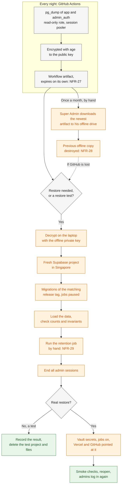

# Deployment and Operations

> **Purpose:** The operating procedures (runbooks) for the DJB Kasoundbox reservation system: the environments, the first-time setup, deploying and releasing, the scheduled jobs, backup and restore, the monitoring routine, incidents, leaving Vercel Hobby, maintenance and key rotation, and the pre-launch gate. This document owns the procedures. Every rule, limit, period, and value they use stays in the document that owns it ·
> **Audience:** Mainly the developer (Super Admin), who runs these procedures. The business owner (Admin) can read "In plain words" and "What the Admin should notice and report" on their own ·
> **Status:** Draft for review ·
> **Last updated:** 2026-10-21 ·
> **Depends on:** [Decision log][dl] (D-20, D-21, D-22; O-05 to O-11), [Project charter][charter] (phases 4, 6, 7), [Non-functional requirements][nfr], [Functional requirements][fr] (FR-SYS, FR-ADM-30, FR-ADM-33), [Privacy and retention][priv], [Roles and permissions][roles] §5, [Edge cases][ec]; workflows [administration][wf-admin] (WF-09D, WF-09E, WF-09G, WF-10E) and [notifications-and-tracking][wf-notify] (WF-07A); technical docs [architecture][arch], [security][sec], [data-model][data], [api-specification][api]; delivery docs [test-plan][test] and [roadmap][roadmap]; the [staff guide][staff] ·
> **Derived from:** [architecture][arch] §2.2, §6.1, §7, §8, §9, §10, §11, §12, §13, §14.1; [security][sec] §4.1, §4.3, §4.7, §4.8, §4.10 to §4.13; [data-model][data] §2, §5.15, §9, §10, §11; [non-functional-requirements][nfr] NFR-01, NFR-04 to NFR-08, NFR-13, NFR-23, NFR-24, NFR-26 to NFR-31, NFR-33; [privacy-and-retention][priv] §5.1 to §5.3, §5.7, §6.2, §6.4, §9, §11; [functional-requirements][fr] FR-SYS-01 to FR-SYS-12, FR-ADM-30, FR-ADM-33; [administration][wf-admin] WF-09D, WF-09E, WF-09G, WF-10E; [notifications-and-tracking][wf-notify] WF-07A; [roles-and-permissions][roles] §5; [edge-cases][ec] EC-77 to EC-81; [api-specification][api] §3.8, §4, §5.9, §6; background only: [spec v0.2][spec] §15, §17 (week-1 test), §18 (frozen, never edited)

## In plain words

This page is the developer's checklist for keeping the booking website running. It says how the system is set up, how changes go live, how the nightly backup is made and tested, what is checked every day, week, and month, and what to do when something goes wrong.

- **Where things live.** Every booking and payment is in the database in Singapore (Supabase). The website itself (Vercel) holds no bookings. So if the website stops, no booking is lost.
- **Changes go live outside busy hours,** and only after the automatic checks pass. If the booking page ever asks you or a customer to reload, just reload: what was typed is kept.
- **Every night, a locked (encrypted) copy of the database is made.** Once a month the developer keeps one copy on his own drive. The key that opens the copies is kept offline. Before launch, a copy is actually restored, to prove it works.
- **Every day, a quick look at the health panel** in the admin panel tells you whether the automatic jobs and the emails are working. The developer also gets automatic alerts when the site is down or the jobs stop.
- **If the website is down,** keep taking bookings by phone and Facebook, write them down, and enter them in the admin panel when it is back. Nothing already booked is lost.
- **If Vercel ever stops our free plan,** the developer moves the website to another host. That costs money, so you decide first.
- **If your phone is lost,** call the developer the same day. He can sign it out of the admin panel at once.
- **Before launch,** a lawyer reviews privacy, the terms of each service are read and saved, the privacy notice is published, and a privacy officer is named.

## What the Admin should notice and report

Call or message the Super Admin **the same day**. Say when it happened and what you saw; a screenshot helps. Never post customers' personal data in a group chat. How to read the admin screens is in the [staff guide][staff].

1. The website or the admin panel does not open, is very slow, or shows an error page.
2. The health panel shows a job whose last run is old, failed emails, a growing email queue, a warning that emails are held until tomorrow, or high storage use.
3. A customer says an email never arrived, or arrived twice.
4. The "online booking paused" email arrives, or many requests come in that look fake.
5. A login you did not expect: a warning, a locked account, a code you did not ask for, or anyone asking for your password or code.
6. Your phone or laptop is lost or stolen.
7. A reservation or payment changed when nobody changed it.
8. Customer data was seen by the wrong person, a customer complains about privacy, or a demand letter or case arrives about a booking.
9. A warning email from Vercel, Supabase, Resend, GitHub, Sentry, or Cloudflare reaches you.

## How to read this document

- **What this document owns.** The procedures: the order of the steps, who does them, and how to check them. Every rule, limit, period, and value (backup periods, rate limits, retention periods, cron schedules, versions, variable names) is owned by another document and is cited here by ID and link. A number appears here only as a short reminder in brackets. If a number here and the owning document differ, the owning document is right.
- **Labels.** **[C]** confirmed decision · **[P]** proposed, accepted with the spec approval but may change · **[U]** unverified fact, to be checked in the week-1 test or before launch · **[O-nn]** open item in the [decision log][dl]. They keep their batch-1 meaning. A proposal made in a sibling document is cited as "[P] in [architecture][arch] §11.1" (or similar).
- **[P] (new in this doc)** marks a procedure step, an order of steps, or a value that no other document defines. Each one is listed under [Open questions](#open-questions). Nothing marked that way is decided until the review confirms it. **[P] items listed in [D-38][dl] are accepted as the Foundation baseline** (open questions 1 to 11).
- **Commands and names are indicative.** Function and route names come from [api-specification][api], tables from [data-model][data], environment variables from [architecture][arch] §8. Run a command against production only where the step says so.
- **Time.** Every date and time is Manila time (Asia/Manila, [NFR-19][nfr]). Cron expressions are not repeated here; they are in [architecture][arch] §7.1 and [api-specification][api] §6.
- **The week-1 test.** "Week-1 item N" means item N of the week-1 test list in spec v0.2 §17 ([project-charter][charter] phase 4).
- **The frozen spec** is background only. Where it differs from the docs, the docs win ([D-23][dl]); see [Source notes](#source-notes).

### What this document does not cover

| Topic | Where it lives |
|---|---|
| Stack, pinned versions, hosting settings, environment variable names, repository layout, CI steps, the portability plan | [Architecture][arch] |
| Threats, controls, the secrets table, when a secret is rotated, the breach stages | [Security][sec] |
| Schemas, database roles and grants, `job_runs`, retention columns, migration rules, the storage estimate | [Data model][data] |
| Function and route contracts, `pg_cron` job names and schedules | [API specification][api] |
| What each scheduled job does | [Functional requirements][fr] (FR-SYS-01 to FR-SYS-12) |
| Backup periods, restore-test rule, patching time, Hobby limits, cost | [Non-functional requirements][nfr] |
| Retention schedule, breach duties, the privacy notice | [Privacy and retention][priv] |
| Admin panel procedures step by step (health panel, lost phone, staff bookings) | [Staff guide][staff] |
| Test cases, the acceptance checklist, the restore-test record | [Test plan][test] |
| Order of work and dates (week-1 test, build, launch) | [Roadmap][roadmap] |

---

## 1. Environments

There are three lasting environments. What each one gets is owned by [architecture][arch] §8 and §10 and [security][sec] §4.7; this table only points to it.

| | Local | Preview | Production |
|---|---|---|---|
| **Runs on** | The developer's laptop: Next.js and the Supabase CLI in Docker ([architecture][arch] §10) | A Vercel preview deployment of a branch or pull request, private behind Standard Protection ([architecture][arch] §2.2) | Vercel Hobby in `sin1` and Supabase Free in Singapore ([NFR-02][nfr]) |
| **Database** | Local Postgres, rebuilt from the migrations by `supabase db reset` | None by default ([P] in [architecture][arch] §8.2; a staging database is its open question 9) | The one production project |
| **Data** | Made-up seed data only, never real customer data ([architecture][arch] §10.3) | None | Real customer data |
| **Secrets** | `.env.local`, filled from `supabase status`, never committed ([architecture][arch] §10.2) | Never production secrets ([NFR-13][nfr]) | Vercel production variables, GitHub Actions secrets, Supabase Vault ([architecture][arch] §8; [security][sec] §4.7) |
| **Email, Turnstile, Sentry** | Console email, Cloudflare's test keys, Sentry off ([P] in [architecture][arch] §10.5) | No email keys; Cloudflare's test keys **[P] (new in this doc)** | Resend, the production Turnstile widget, Sentry |
| **Scheduled jobs** | Local `pg_cron`; the tick reaches the laptop ([architecture][arch] §10.5) | None. Vercel Cron runs only on production **[U]** ([architecture][arch] §7.3) | All jobs (section 4) |
| **Who uses it** | The developer | The developer | Customers and both admins |

**Short-lived environments [P] (new in this doc).**

- **The test project [C]** ([D-28][dl]). The week-1 test and acceptance testing (UAT) run on a separate test project on real Vercel and Supabase services ([project-charter][charter] phase 4), set up with the checklist in section 2. During the build it is also the staging environment. Production is created fresh just before launch, so it starts with no test records and acknowledgment numbering starts clean. Online booking stays closed on the test project (`public_booking_open` false, [D-30][dl]).
- **A restore-test project.** A fresh Supabase project used only for a restore test (section 5.5), deleted the same day.
- Whether the free plan allows a second Supabase project at the same time is **[U]** ([architecture][arch] open question 9). If it does not, the restore test uses a local Postgres (section 5.5).
- **Production data never leaves production,** except as the encrypted backup. Nothing is copied into local or preview.

---

## 2. First-time setup checklist

Run this first for the test project (section 1), and again, once, for production when it is created fresh just before launch ([D-28][dl]), in this order. Each step names the document that owns the values. Steps not defined elsewhere are marked.

1. **Two-factor login on every provider account.** GitHub, Vercel, Supabase, Resend, Sentry, Cloudflare, and the domain registrar (O-05). Print the recovery codes and keep them offline ([P] in [security][sec] §4.7). Give every account an email address the Super Admin reads every day, so provider warnings are seen **[P] (new in this doc)**.
2. **Make the GitHub repository private (O-06).** Do this before anything that stores secrets or backups there **[C]** ([D-22][dl]). Then:
   - protect `main`, so it changes only through pull requests with green checks ([P] in [architecture][arch] §11.1);
   - turn on Dependabot alerts and add `dependabot.yml` ([architecture][arch] §11.4);
   - set the default workflow permissions to the minimum ([P] in [security][sec] §4.10);
   - check the free Actions minutes for a private repository **[U]** ([NFR-01][nfr]).
3. **Supabase project.**
   1. Create it in the region "Southeast Asia (Singapore)" ([NFR-02][nfr]). Write down its Postgres major version **[U]** ([architecture][arch] §2.1); the backup client must match it (section 5.1).
   2. Turn on "Enforce SSL on incoming connections". Download the CA certificate for `SUPABASE_DB_CA` ([architecture][arch] §2.2; [security][sec] §4.3).
   3. Data API: "Automatically expose new tables" off; `app` and `admin_auth` never in the exposed schemas; the Data API turned off if Storage still works without it **[U]** (week-1 item 5) ([architecture][arch] §2.2; [data-model][data] §2.4).
   4. Enable `pg_cron`, `pg_net`, Vault, and `pgcrypto`. Their availability on Free is **[U]** (week-1 item 4) ([data-model][data] §2.5).
   5. Turn off sign-ups in Supabase Auth, which the app does not use ([D-20][dl]) **[P] (new in this doc)**.
   6. Apply the migrations from the developer's laptop through the session pooler, with the `postgres` password: `supabase link`, then `supabase db push` ([data-model][data] §10; [P] in [architecture][arch] open question 2). This creates the schemas, the roles and grants, the role timeouts, the functions, the seed rows, and the `pg_cron` schedules.
   7. Set the passwords of `app_rw` and the backup role by hand: long, random, stored as SCRAM. A password is never written in a migration file **[P] (new in this doc)** ([data-model][data] §2.2; [NFR-13][nfr]). Check the timeouts in `pg_roles.rolconfig` ([data-model][data] §2.3).
   8. Create the Vault secrets by hand ([data-model][data] §10; names in [architecture][arch] §8.2): `job_route_secret` (the same value as `CRON_SECRET`, step 7), `tick_url`, and `sentry_checkin_url` (from step 6). Create the first IP-HMAC key by running the rotation function once, `select app.rotate_ip_key();` **[P] (new in this doc)** ([FR-SYS-06][fr]). It writes the Vault secret `ip_hmac_key` ([data-model][data] §5.14).
   9. Create the private proof bucket, with the file types and size limit of [FR-PUB-12][fr] ([architecture][arch] §2.2).
   10. Keep the `postgres` password only on the developer's laptop and offline ([architecture][arch] §8.2).
4. **Resend.**
   - Add the sending domain (it needs a domain: O-05). At the registrar, publish the SPF, DKIM, and DMARC records that Resend shows, and wait until Resend marks the domain verified.
   - DMARC starts at `p=none`, with reports to the Super Admin, and moves to `p=quarantine` once the reports show that only Resend sends for the domain **[P] (new in this doc)**.
   - Without a verified domain, the free plan sends only to the account's own address **[U]**, so customer emails would not work (open question 44).
   - Create a sending-only API key limited to that domain for `RESEND_API_KEY` ([P] in [security][sec] §4.7).
   - Set Resend's data retention to its shortest option ([privacy-and-retention][priv] §6.2, "Provider copies"). Confirm the free limits in Resend's terms ([NFR-33][nfr], [NFR-08][nfr]).
5. **Cloudflare Turnstile.** One widget for the production hostname. The site key goes in `NEXT_PUBLIC_TURNSTILE_SITE_KEY`, the secret in `TURNSTILE_SECRET_KEY` ([architecture][arch] §8.1). Local and preview use Cloudflare's test keys (section 1).
6. **Sentry.** One project for the Next.js app.
   - PII scrubbing as in [security][sec] §4.11: `sendDefaultPii: false`, the `beforeSend` and `beforeBreadcrumb` scrubbers, no session replay. Also turn on Sentry's own server-side data scrubbing and its "do not store IP addresses" option **[P] (new in this doc)**. Set data retention to the shortest option ([privacy-and-retention][priv] §6.2).
   - An **uptime monitor** on `SITE_URL` + `/api/health` ([FR-SYS-11][fr], [NFR-04][nfr]).
   - A **cron monitor** for the heartbeat check-ins. Its check-in address goes in Vault (step 3.8) ([P] in [architecture][arch] §7.4). Whether the free plan includes both monitors is **[U]** ([architecture][arch] open question 7).
   - **Alert rules** to the Super Admin ([P] in [NFR-04][nfr] and [NFR-24][nfr]): by email and by push to Sentry's phone app, plus an alert on every new issue **[P] (new in this doc)**.
   - The DSNs and the optional build token ([architecture][arch] §8.1).
7. **Vercel project.**
   - Import the repository; production branch `main`; the Node.js version that is pinned ([architecture][arch] §2.1).
   - `vercel.json` sets the region `sin1` and the one daily cron ([architecture][arch] §2.2, §7.3). After the first deploy, check that the deployment shows `sin1` and that `/api/health` reports it ([FR-SYS-11][fr]).
   - Deployment Protection: Standard Protection ([architecture][arch] §2.2; [security][sec] §4.7).
   - The environment variables of [architecture][arch] §8.1, as sensitive variables for Production only ([NFR-13][nfr]). `CRON_SECRET` is at least 32 random bytes ([P] in [security][sec] §4.8). Preview gets none of the production values ([architecture][arch] §8.2).
   - The custom domain, if O-05 decides on one. HTTPS is automatic; the camera scanner needs it ([NFR-18][nfr]). DNS stays at the registrar ([NFR-31][nfr]).
   - Optional: the edge rate-limit rule ([P] in [architecture][arch] open question 12).
8. **GitHub Actions: the `age` key pair, the secrets, and the backup workflow.**
   1. On the Super Admin's own computer, make the key pair with `age-keygen` ([security][sec] §4.12). The private key goes offline only ([NFR-13][nfr]), with a sealed second copy in another safe place ([P] in [security][sec] §4.12). The public key goes in the Actions variable `BACKUP_AGE_RECIPIENT` ([architecture][arch] §8.2).
   2. Add the secrets `BACKUP_DATABASE_URL` (the backup role through the session pooler) and `SUPABASE_DB_CA`, in a protected environment ([security][sec] §4.12). Whether a private repository on the free plan can use environments is **[U]**; if not, they are repository secrets (open question 45).
   3. Add `backup.yml` only now, after step 2 **[C]** ([D-22][dl]; [FR-SYS-12][fr]). Give it a manual trigger as well as the nightly one, for the runs before a migration and for tests **[P] (new in this doc)**.
   4. Run it once by hand. Download the artifact, decrypt it on the laptop with the private key, list it with `pg_restore --list`, and delete the decrypted file **[P] (new in this doc)**. This is the start of the week-1 item 7 test (section 5.5).
9. **Seed the two admin accounts.** Once per project, from the developer's laptop: `npm run seed:admins` ([architecture][arch] §10.4): on the test project for the build and UAT, and on production when it is created. The script refuses to run if any admin account exists.
   - Give the script the production connection values for that run only: type them into the current shell session, never into a file, and close the terminal afterwards **[P] (new in this doc)**.
   - Hand the Admin's first password over in person ([security][sec] §4.1, accepted in [D-38][dl]). Each person changes it at the first login **[C]** ([D-36][dl]).
   - Each person logs in and sets up 2FA ([WF-09B][wf-admin]), then prints the backup codes and keeps them at home ([roles-and-permissions][roles] §5.2).
   - Check that the "account created" audit entries exist ([P] in [security][sec] §4.1).
10. **First checks [P] (new in this doc).**
    - `/api/health` answers with `sin1` and a working database.
    - The health panel shows a fresh run of every job.
    - Both Sentry monitors are green, and a test error arrives with no personal data ([NFR-23][nfr]).
    - A test email from Resend's dashboard reaches the Super Admin from the sending domain.
    - No test booking is made in production: business records cannot be deleted ([NFR-22][nfr]). Acceptance testing runs on the test project **[C]** ([D-28][dl]).
    - `public_booking_open` is false, so the public pages show "Opening soon" and every page sends `noindex` ([FR-ADM-34][fr]). In production it stays false until the launch step (section 10, row 18) **[C]** ([D-30][dl]).

---

## 3. Deploy and release

```mermaid
flowchart LR
    A["Branch and<br/>pull request"] --> B["CI checks<br/>architecture 11.1"]
    B -->|"Red"| A
    B -->|"Green"| C{"Migration in<br/>this change?"}
    C -->|"Yes"| D["Backup run by hand,<br/>then supabase db push<br/>from the laptop"]
    C -->|"No"| E["Merge to main<br/>in the deploy window"]
    D --> E
    E --> F["Vercel builds and<br/>deploys production"]
    F --> G{"Smoke checks<br/>pass?"}
    G -->|"Yes"| H["Tag the release"]
    G -->|"No"| I["Roll back: previous<br/>deployment, or rebuild a tag"]
    I --> J["Revert pull request<br/>so main matches"]
    classDef system fill:#f5f5f5,stroke:#616161,color:#212121
    classDef admin fill:#fff3e0,stroke:#ef6c00,color:#e65100
    classDef status fill:#e8f5e9,stroke:#2e7d32,color:#1b5e20
    classDef failure fill:#ffebee,stroke:#c62828,color:#b71c1c
    class A,D,E,J admin
    class B,C,F,G system
    class H status
    class I failure
```



**Colours:** orange = a step the developer takes · grey = automatic · green = done · red = rollback.

### 3.1 Branch and pull-request flow

- Every change, including each Dependabot update, is a branch and a pull request. CI runs on it, and Vercel builds a private preview (section 1).
- `main` changes only through pull requests with green checks ([P] in [architecture][arch] §11.1). Every merge to `main` is a production deploy through the Vercel Git integration.
- So a merge is a release. Merge only inside the deploy window (section 3.4), unless the change is a critical security fix ([NFR-30][nfr]).

### 3.2 CI gates

- The gates and when each runs are in [architecture][arch] §11.1: lint, type check, unit tests, and database tests on every push ([NFR-32][nfr]); the dependency audit; end-to-end tests and the Docker build on pull requests and `main`.
- The secret scanner and the minimum-version check are also gates ([P] in [security][sec] §4.7 and §4.10).
- A red gate is never bypassed. A flaky test is fixed, not skipped **[P] (new in this doc)**.

### 3.3 Database migrations

The rules are owned by [data-model][data] §10: one folder, `supabase/migrations`; never `drizzle-kit push`; never edit an applied migration; never migrate during a Vercel build. Production migrations run from the developer's laptop through the session pooler ([P] in [architecture][arch] open question 2). Steps 2 to 5, and the order of all six, are **[P] (new in this doc)**.

1. **CI proves the chain.** The pull request carries the migration. CI has applied every migration from zero and run the pgTAP tests ([data-model][data] §10).
2. **Expand first, contract later.** The code that is in production now must keep working after the migration: add tables, columns, and functions, but do not rename or drop them; a function whose arguments change gets a new name, or a compatible default. A drop comes in a later release, once no deployed code uses the old object.
3. **A fresh backup.** Start the backup workflow by hand and wait until it is green (section 5.1).
4. **Apply.** From the laptop, at the pull request's final commit: `supabase migration list` (production is at the expected level), then `supabase db push`.
5. **Check.** `/api/health` and the health panel; `pg_roles.rolconfig` if roles changed; `cron.job` if schedules changed.
6. **Merge** the pull request (section 3.4).

If a migration fails, fix it forward with a new migration. A restore (section 5) is only for lost or corrupted data, never for a code mistake.

### 3.4 Deploy timing

- **Why timing matters.** Vercel Hobby has no skew protection **[U]**: an open tab may call a server action from the previous deploy. The page then asks the customer to reload and keeps the draft ([architecture][arch] §13; [EC-02][ec]; [NFR-04][nfr]). Deploys therefore happen off-hours ([architecture][arch] §13).
- **The deploy window [P] (new in this doc).** Between 23:00 and 06:00 Manila; not during the daily jobs ([architecture][arch] §7.1); and not while the Admin is working in the panel. A critical security fix does not wait for the window ([NFR-30][nfr]).
- **Smoke checks after every deploy [P] (new in this doc).**
  1. `/api/health` answers 200, with region `sin1` and the database `ok` ([api-specification][api] §4.3).
  2. The home, packages, and availability pages open on a phone.
  3. Admin login with 2FA works, and the dashboard opens.
  4. The health panel shows fresh job runs.
  5. Sentry shows no new issue in the next 15 minutes.

### 3.5 Release tags

Releases are tagged in git ([P] in [architecture][arch] §12.4). The details are **[P] (new in this doc)**:

- After the smoke checks pass, tag the deployed `main` commit with an annotated tag `vYYYY.MM.DD` (`.2`, `.3` for a second or third release that day).
- The tag message holds one line about the change and the name of the latest migration file.
- The tags are the release log. The restore (section 5.4) uses them to find the schema that matches a backup, and the exit (section 8) builds from them.

### 3.6 Rollback

The steps are **[P] (new in this doc)**. Only the code is rolled back; the database never is.

1. **Fastest: the previous deployment.** In Vercel, roll production back to the previous deployment (Instant Rollback). On Hobby, only the deployment just before the current one is offered **[U]**. After a rollback, new deploys may not take over production until the rollback is undone **[U]**.
2. **Older: rebuild a tag.** When the last good build is older, check out the last good tag in a clean folder and run `vercel deploy --prod`. Vercel builds it on its own servers with the production variables, so no secret reaches the laptop.
3. **Make `main` match.** Open a revert pull request, let CI pass, and merge it, so the next deploy does not bring the bad change back. Tag the result.
4. **The schema stays.** The code of the older tag must work with the current schema. Step 2 of section 3.3 makes sure it does. If it does not, write a forward migration.
5. **Write a short note** (section 7).

---

## 4. Scheduled jobs

### 4.1 What runs when

What each job does is defined in [functional-requirements][fr] (FR-SYS). The exact schedules are in [architecture][arch] §7.1 and [api-specification][api] §6. This table only shows where each job runs and where to see that it ran.

| Job | Defined in | Runs on | How often | Proof that it ran |
|---|---|---|---|---|
| Expire overdue holds | [FR-SYS-01][fr] | `pg_cron` | Every minute | A `job_runs` row |
| Queue due deposit reminders | [FR-SYS-02][fr] | `pg_cron` | Every minute | A `job_runs` row |
| Send queued emails (the tick) | [FR-SYS-03][fr]; [WF-07A][wf-notify] | `pg_cron` → `pg_net` → `/api/jobs/tick` | Every minute, only when emails wait | A `job_runs` row per call; the outbox drains |
| Mark finished events Completed | [FR-SYS-04][fr] | `pg_cron` | Daily | A `job_runs` row |
| Retention job | [FR-SYS-05][fr]; [WF-10E][wf-admin] | `pg_cron` | Daily | A `job_runs` row and a `retention_runs` row |
| Rotate the IP key | [FR-SYS-06][fr] | `pg_cron` | Daily | A `job_runs` row |
| Keep-alive | [FR-SYS-07][fr] | `pg_cron` | Daily | A `job_runs` row |
| Backup sweep | [FR-SYS-08][fr] | Vercel Cron → `/api/jobs/daily` | Daily | A `job_runs` row |
| Heartbeat check-in | [NFR-24][nfr]; [P] in [architecture][arch] §7.4 | `pg_cron` → `pg_net` → Sentry | Every few minutes | The Sentry cron monitor |
| Job-log clean-up | [P] in [architecture][arch] §7.1 | `pg_cron` | Daily | A `job_runs` row |
| Nightly encrypted backup | [FR-SYS-12][fr] | GitHub Actions | Nightly | A green run and its artifact |
| Monthly offline copy | [NFR-28][nfr] | The Super Admin, by hand | Monthly | The file on the offline drive (section 5.2) |

No business rule depends on a job running on time: every page and action checks deadlines itself ([architecture][arch] §7; [EC-77][ec]). A late job only delays tidying up and emails.

### 4.2 Checking that the jobs are healthy

Four views, each independent of the others:

1. **The health panel** (`/admin/health`, [FR-ADM-33][fr]). The last run of each job and its result, failed emails, the email queue, cap usage, and storage use. Both admins can open it. How the Admin reads it is in the [staff guide][staff].
2. **Sentry.** The cron monitor stays green while the heartbeat checks in ([NFR-24][nfr]). The daily route reports any stale job as an error ([api-specification][api] §4.2). The uptime monitor watches `/api/health`. When a job counts as stale is set in `app.check_heartbeat()` ([P] in [api-specification][api] §5.9).
3. **GitHub Actions.** The nightly backup run is green. GitHub emails the developer when it fails, because the backup role cannot write a `job_runs` row ([P] in [security][sec] §4.12).
4. **The database** (developer only), in the Supabase SQL editor:

```sql
-- Latest run of each job (FR-SYS-10); names are indicative (data-model §5.15)
select distinct on (job_name)
       job_name,
       started_at at time zone 'Asia/Manila' as started_manila,
       finished_at, result, error_summary
from app.job_runs
order by job_name, started_at desc;

-- pg_cron runs that did not succeed in the last day
select j.jobname, d.status, d.return_message, d.start_time
from cron.job_run_details d
join cron.job j using (jobid)
where d.status <> 'succeeded' and d.start_time > now() - interval '1 day'
order by d.start_time desc;

-- Recent pg_net calls that failed (pg_net keeps responses only briefly [U])
select id, status_code, timed_out, error_msg, created
from net._http_response
where status_code is distinct from 200
order by created desc
limit 20;
```

Vercel keeps its runtime logs only briefly ([NFR-23][nfr]), so the `job_runs` row of the daily route is the lasting record of Vercel Cron.

### 4.3 Running a job by hand

- Each job is one database function ([api-specification][api] §5.9). From the SQL editor, as `postgres`: `select app.run_retention();` (after a restore, [FR-SYS-05][fr], [NFR-29][nfr]); `select app.expire_overdue_holds();`; `select app.request_tick();` to wake the email sender.
- Two runs of one job never overlap ([FR-SYS-09][fr]), so a manual run next to a scheduled one is safe. The SQL jobs take a transaction try-lock; the two job routes take the job's row in `job_leases` (`lease_until`, `holder`; [data-model][data] §5.15; [api-specification][api] §4). A route run that crashed keeps its lease only until `lease_until` passes, so nothing needs clearing by hand.
- **[P] (new in this doc):** never call a job route with `curl` from a shell, because the secret would stay in the shell history. Wake the tick from the database instead.
- **[P] (new in this doc):** to pause one job, `select cron.alter_job(<jobid>, active := false);` and `active := true` to resume it. This is used during a restore (section 5.4).

---

## 5. Backup and restore runbook



**Colours:** grey = automatic or a decision · orange = a step the Super Admin takes · green = done. Every restore step after "Decrypt" is **[P] (new in this doc)** (section 5.4).

### 5.1 The nightly artifact

- **The rules** are owned by [FR-SYS-12][fr], [NFR-27][nfr] (how long each artifact lasts), [architecture][arch] §11.3 (the workflow), and [security][sec] §4.12 (encryption and what a backup holds). The repository is private first **[C]** ([D-22][dl]).
- **What it holds:** every table of the `app` and `admin_auth` schemas, including password hashes and the encrypted 2FA secrets ([security][sec] §4.12). The backup role can read only those two schemas ([data-model][data] §2.2).
- **What it does not hold,** so a restore rebuilds it from elsewhere:
  - proof images, never, by design ([NFR-27][nfr]);
  - the database roles, which `pg_dump` never includes; they come from the migrations;
  - the `pg_cron` schedules, which also come from the migrations ([data-model][data] §10);
  - the Vault secrets and the Supabase platform settings, which are set by hand (section 2, step 3).
- **Format [P] (new in this doc):** `pg_dump --format=custom --schema=app --schema=admin_auth`, with a PGDG client of the server's major version ([architecture][arch] §11.3), encrypted to a file named `ksb-<UTC date>.dump.age`.
- **Checks:** GitHub's failure email at once, and the weekly look at the Actions page (section 6.2). Before a migration or another risky change, start a run by hand (section 3.3).

### 5.2 The monthly offline copy

The rule is [NFR-28][nfr]: once a month the Super Admin keeps one encrypted copy on his own drive and destroys the previous one, so only the latest is kept. The overall limit is in [privacy-and-retention][priv] §6.2. The steps are **[P] (new in this doc)**:

1. In the first week of each month, find the latest green backup run: `gh run list --workflow backup.yml --status success --limit 1`.
2. Download its artifact straight to the offline drive: `gh run download <run-id> -D <drive>/kasoundbox/`.
3. Check that the file is there and that its size is close to the previous month's. The decryption itself is tested at each restore test (section 5.5), so the private key does not come out every month.
4. Delete the previous offline copy. It is encrypted, so an ordinary delete is enough, as long as the private key is safe.
5. Never keep the private key on the same drive as the copies.
6. Tick the monthly checklist (section 6.3).

Whether a copy can be slightly older than the "30 days at most" of the privacy notice in a 31-day month is [privacy-and-retention][priv] §11, question 13.

### 5.3 The `age` key

- **Making the pair:** section 2, step 8. The private key is kept offline by the Super Admin ([NFR-13][nfr]), with a sealed second copy ([P] in [security][sec] §4.12). The runner never holds it.
- **Using it [P] (new in this doc):** only for a restore or a restore test, on the developer's laptop. Decrypted files go to a temporary folder outside the repository and are deleted when the work is done.
- **Changing it:** section 9.6.

### 5.4 Restore into a fresh project

**When:** data is lost or corrupted, the project cannot be recovered (section 7.3), or a restore test (section 5.5). The rules owned elsewhere are: restore into a fresh database (week-1 item 7, [architecture][arch] §14.1); the retention job runs before the system reopens ([NFR-29][nfr], [EC-81][ec]); all admin sessions are ended ([P] in [security][sec] §4.12). Every other step below is **[P] (new in this doc)**.

**Before you start.**

- Pick the backup: the newest nightly artifact, or the offline copy if the GitHub artifacts are lost.
- Know what will be lost: every change made after the backup was taken, and the proof images, which are never backed up ([NFR-27][nfr]). A booking whose proof was waiting for review loses its file (open question 23).
- Open an incident note (section 7).

**Steps.**

1. **Freeze.** If the old project still answers but its data is wrong, stop the app from writing to it: `alter role app_rw nologin;`. Tell the Admin to switch to phone and Facebook bookings ([P] in [architecture][arch] §12.4). Leave the old project otherwise untouched, as evidence.
2. **Decrypt.** On the laptop: `age --decrypt -i <private key> -o "$TMPDIR/ksb.dump" ksb-<date>.dump.age`, then `pg_restore --list "$TMPDIR/ksb.dump"` to check that it reads.
3. **Fresh project.** Create a Supabase project in Singapore with the same Postgres major version as the backup **[U]**. Apply section 2, step 3, parts 1 to 5 and 9.
4. **Schema.** Check out the release tag that was in production on the backup's date (section 3.5), and run `supabase db push` against the new project. This rebuilds the schemas, roles, grants, functions, and `pg_cron` schedules ([data-model][data] §10). Set new role passwords (section 2, step 3.7).
5. **Pause the jobs.** Turn every `pg_cron` job off (section 4.3) and leave the Vault secrets empty for now. No job then runs on half-loaded data, and no email is sent.
6. **Remove the seed rows** that the migrations inserted and the dump also holds: the capacity-lock row, the settings, and the room ([data-model][data] §10).
7. **Load the data** through the session pooler as `postgres`. Write the data part out with `pg_restore --data-only --schema=app --schema=admin_auth -f "$TMPDIR/data.sql" "$TMPDIR/ksb.dump"`, then run it with `psql --single-transaction`, with `set session_replication_role = replica;` first and `set session_replication_role = origin;` last, so the guard triggers and foreign keys do not refuse rows during the load. Whether Supabase lets `postgres` set this is **[U]** (week-1 item 7).
8. **Check.** Row counts of the main tables against the dump's list; the invariant checks of [data-model][data] §6.7; `select app.health_ping();`.
9. **Retention first.** `select app.run_retention();` ([NFR-29][nfr], [FR-SYS-05][fr]). Check its new `retention_runs` row. An erasure processed after the backup was taken is not repeated by the job; how to apply it again is [privacy-and-retention][priv] §11, question 7. Until that is answered, the Super Admin repeats it by hand.
10. **End all admin sessions** (`delete from admin_auth.session;`, table name **[U]**, [data-model][data] §5.19), so both admins log in again. Rotate the IP key once (`select app.rotate_ip_key();`).
    *A restore test stops here.* Record the date, the backup used, the time taken, and the counts; then delete the test project and every decrypted file.
11. **The outbox.** Some restored rows that are still `queued` may already have been sent after the backup was taken. Resend's idempotency key stops a repeat only within its own window **[U]**. Mark those rows `skipped` by hand, unless they still matter (open question 24).
12. **Secrets and jobs.** Create the Vault secrets (section 2, step 3.8), then turn the `pg_cron` jobs back on.
13. **Point the app at it.** In Vercel, update the variables that name the project (`DATABASE_URL`, `SUPABASE_URL`, `NEXT_PUBLIC_SUPABASE_URL`, the two Supabase keys, and `SUPABASE_DB_CA` if it changed; [architecture][arch] §8.1), and redeploy. Update `BACKUP_DATABASE_URL` in GitHub. **Do not change `BETTER_AUTH_SECRETS`:** the restored 2FA secrets and backup codes are encrypted with it ([security][sec] §4.1).
14. **Reopen.** Run the smoke checks (section 3.4). Both admins log in again. The Admin enters the bookings taken by phone since the backup as staff-created bookings ([WF-04G][wf-review]), and checks the payments recorded since the backup against his notes. Start a backup run by hand.
15. **Afterwards.** Keep the old project only while the incident needs it, and delete it within the backup period of [privacy-and-retention][priv] §6.2. Finish the incident note.

### 5.5 Restore test schedule

| When | Required by | Where | Passes when |
|---|---|---|---|
| **Week-1 test,** item 7 | [NFR-29][nfr]; [project-charter][charter] phase 4 | A backup of the week-1 project, restored into a second fresh project, or into a local Postgres (`supabase start`) if the free plan allows only one project **[U]** | Steps 1 to 10 of section 5.4 complete; the retention job ran; the counts match |
| **Before launch,** in the test phase | [NFR-29][nfr]; [project-charter][charter] phase 6 | A backup of the test project (production is created only just before launch, [D-28][dl]), restored into a restore-test project | As above, with the release that will launch |
| After each Postgres major upgrade **[P] (new in this doc)** | — | As above | As above |
| Once a year **[P] (new in this doc)** | — | As above | As above |

Each result is recorded in the [test plan][test] **[P] (new in this doc)**.

---

## 6. Monitoring routine

### 6.1 Daily

| Who | What | Source |
|---|---|---|
| The Admin | Opens the health panel once a day, and reports anything on the list in "What the Admin should notice and report" **[P] (new in this doc)** | [FR-ADM-33][fr]; [staff guide][staff] |
| The Super Admin | Reads every alert the same day (section 6.4); glances at the health panel | [NFR-04][nfr], [NFR-24][nfr] |

### 6.2 Weekly (Super Admin)

The weekly usage check is [P] in [NFR-06][nfr]. The other rows are **[P] (new in this doc)**.

| Check | Where | Compare with | If it is high or red |
|---|---|---|---|
| Vercel usage | Vercel → Usage | The Hobby allotments **[U]** ([NFR-06][nfr]) | Find the cause; a flood → section 7.2 |
| Supabase usage: database size, egress, file storage | Supabase → Usage and Reports | The free limits **[U]** and the warning level ([data-model][data] §11) | Section 7.5 |
| Pooler clients | The "Shared Pooler Client Connections" chart | A flat line, no slow climb ([architecture][arch] §14) | Check the pool settings ([architecture][arch] §6.2); redeploy |
| Email caps | Health panel cap usage; the Resend dashboard | The caps of [FR-NTF-20][fr] and Resend's limits **[U]** ([NFR-33][nfr]) | Section 7.4 |
| Storage use | Health panel; Supabase Storage | The free storage limit **[U]** ([data-model][data] §11) | Check that proof files are deleted on schedule ([WF-10E][wf-admin]) |
| Backups | GitHub → Actions | A green run every night | Section 5.1; fix the workflow |
| GitHub minutes | GitHub → Billing | The free allowance **[U]** ([NFR-01][nfr]) | Trim the slow CI steps |
| Sentry | Issues and quota | No unresolved new issue | Fix, or explain in a note |
| Security events | The audit log, `security` category ([P] in [security][sec] §4.11) | No unexpected failed logins, locks, or refused requests | Section 7.6 |
| Dependabot | Pull requests | Security updates merged within [NFR-30][nfr] | Section 9.1 |

### 6.3 Monthly (Super Admin)

1. **The offline backup copy** (section 5.2; [NFR-28][nfr]).
2. **Dependency updates:** merge the grouped Dependabot pull request after CI (section 9.2), and review the advisory watches (section 9.3).
3. **Provider terms check [P] (new in this doc):** look for changes to the terms and limits of Vercel Hobby, Supabase Free, Resend, Sentry, GitHub, and Cloudflare. Save a dated copy when they change ([NFR-08][nfr] is the pre-launch reading; GitHub and Cloudflare are [privacy-and-retention][priv] §11, question 14).
4. **Provider settings [P] (new in this doc):** each provider's data retention is still at its shortest ([privacy-and-retention][priv] §6.2), and 2FA is still on for every account ([P] in [security][sec] §4.7).

### 6.4 Which alerts go where

| Source | What it reports | Goes to | Owned by |
|---|---|---|---|
| Sentry uptime monitor | `/api/health` fails | The Super Admin | [NFR-04][nfr] ([P] there) |
| Sentry cron monitor | The heartbeat check-ins stop | The Super Admin | [NFR-24][nfr] ([P] there); [architecture][arch] §7.4 |
| Sentry, from `/api/jobs/daily` | A job is stale | The Super Admin | [FR-SYS-08][fr]; [api-specification][api] §4.2 |
| Sentry issue alert | A new error in the app | The Super Admin | [NFR-23][nfr]; the alert rule is **[P] (new in this doc)** |
| GitHub Actions | The backup or CI failed | The Super Admin, by email | [P] in [security][sec] §4.12 |
| GitHub Dependabot | A security advisory for a dependency | The Super Admin | [NFR-30][nfr] |
| Supabase emails | Low activity, usage, maintenance, upgrades | The account email (the Super Admin) | [NFR-07][nfr] |
| Vercel emails | Usage near or over an allotment, a paused or disabled project | The account email (the Super Admin) | [NFR-06][nfr] |
| Resend emails | Domain, bounce, or account problems | The account email (the Super Admin) | [NFR-33][nfr] |
| The breaker email | Online booking paused | Both admins | [FR-NTF-15][fr]; [BR-07a][br] |
| The health panel | Failed or held emails, old job runs, storage | Both admins, when they look | [FR-ADM-33][fr] |

Only the breaker email and the health panel reach the Admin directly. When an incident affects bookings, the Super Admin calls the Admin **[P] (new in this doc)**.

---

## 7. Incident runbook

The stages (detect, contain, preserve evidence, assess, notify, recover, learn) are owned by [security][sec] §4.13. This section gives the steps for the common cases.

**For every incident [P] (new in this doc):**

- Open a short incident note: when it was found, what was seen, each step taken with its time, and the outcome.
- If bookings are affected, call the Admin and switch to phone and Facebook bookings ([P] in [architecture][arch] §12.4). Customers can be told their reference codes and statuses by phone.
- Afterwards, finish the note: what happened, why, and what changed ([security][sec] §4.13, stage 7).

| Symptom | Section |
|---|---|
| The uptime alert fires, or the site does not open | 7.1 |
| Vercel says the project is paused or disabled | 7.2 |
| Supabase says the project is paused, or the database is unreachable | 7.3 |
| Failed emails, a growing queue, or customers without emails | 7.4 |
| The database is near its size limit | 7.5 |
| Personal data may have leaked, or an account or secret may be misused | 7.6 |
| An admin lost the phone with the 2FA app, or the developer lost his laptop | 7.7 |

### 7.1 Site down

1. Open `/api/health` from a phone.
   - **No answer:** a Vercel problem (section 7.2) or a domain or DNS problem: check that the domain has not expired and that its records are unchanged at the registrar.
   - **503 `db_unavailable`:** a database problem (section 7.3) ([api-specification][api] §4.3).
   - **200, but pages fail:** an application error. Look in Sentry. If a deploy happened just before, roll back (section 3.6).
2. Check the Vercel and Supabase status pages, and the inbox for provider emails.
3. While the site is down: no data is lost; emails wait in the outbox ([EC-80][ec]); the database jobs keep expiring overdue holds on time.
4. After recovery: the health panel shows fresh runs, the outbox drains, and the Admin enters the phone bookings as staff-created bookings ([WF-04G][wf-review]).

### 7.2 Vercel Hobby paused or project disabled

1. **Which one?** Read Vercel's email or dashboard banner.
   - **Paused for usage:** a monthly allotment was exceeded ([NFR-06][nfr]).
   - **Disabled:** Vercel's non-commercial terms ([NFR-05][nfr]; [EC-80][ec]). This risk was accepted knowingly **[C]** ([D-20][dl]).
2. **In both cases** the data is safe in Supabase. Call the Admin and switch to phone bookings.
3. **Paused for usage.**
   - Find the cause on the Usage page: which function, which path, since when.
   - A flood of requests: once the site runs again, turn on Attack Mode and the edge rule ([security][sec] §4.4). Attack Mode also blocks Vercel Cron, so turn it off when the flood ends.
   - A bug, such as a loop: fix it and deploy.
   - Then either wait until the allotment resets **[U]**, or leave Hobby (section 8). Paying for any plan is a new decision in the [decision log][dl] ([NFR-01][nfr]); the Admin decides.
4. **Disabled.** Go to the exit runbook (section 8), after the decision. Writing to Vercel support can be tried at the same time **[P] (new in this doc)**.
5. **While it is down:** the tick calls from `pg_net` fail and are not retried ([architecture][arch] §7.4); the outbox keeps the emails until the site is back; the database jobs and the heartbeat keep running. Afterwards, check that the outbox drains.

### 7.3 Supabase paused or down

- **Paused for low activity** ([NFR-07][nfr]; [EC-79][ec]).
  1. Restore the project from the Supabase dashboard. How long that takes, and after how long a paused free project can no longer be restored, are **[U]**.
  2. Check: the `pg_cron` jobs are active (`cron.job`), the Vault secrets are present, the health panel shows fresh runs, and an email goes out.
  3. Find out why the keep-alive did not prevent it. An in-database keep-alive may not count as activity **[U]** ([architecture][arch] §14).
  4. If the project cannot be restored: restore from a backup into a fresh project (section 5.4).
- **An outage:** check Supabase's status page and wait; run the business on phone bookings. Afterwards, overdue holds are expired by the next run anyway ([BR-05][br]).
- **Read-only because the database is too big:** section 7.5.

### 7.4 Emails failing

**Signs:** failed emails on the health panel, a queue that keeps growing, the "held until tomorrow" warning, or customers who say they got nothing ([WF-07A][wf-notify]).

1. Read the failed rows and their short errors on the health panel ([FR-ADM-33][fr]; `app.health_summary`, [api-specification][api] §5.8).
2. Find the cause:

   | Cause | Check | Fix |
   |---|---|---|
   | The API key was revoked or replaced | Resend → API keys; Sentry shows the error | A new key (section 9.6) |
   | The sending domain is no longer verified | Resend → Domains | Put the SPF, DKIM, and DMARC records back at the registrar (section 2, step 4) |
   | A cap was reached | Health panel cap usage | Nothing: this is expected; held emails go out the next day ([FR-NTF-20][fr]) |
   | Resend is down | Resend's status page | Nothing: retries handle it ([FR-NTF-18][fr]) |
   | The tick is not being called | The `pg_net` query and the `cron.job` list (section 4.2); a 401 from the tick route in Sentry | The job is active again; Vault's `tick_url` and `job_route_secret` match `SITE_URL` and `CRON_SECRET` (after a rotation or a move) |

3. An email already marked failed is not sent again by the system, and no "send again" action exists ([notifications-and-tracking][wf-notify] open question 5). Until that is answered, staff send those customers the prepared message ([FR-NTF-21][fr]) **[P] (new in this doc)**.
4. The bookings themselves are never affected ([NFR-33][nfr]).

### 7.5 Database near its size limit

The free plan's size limit and its read-only behaviour above it are **[U]**; the health panel warns at the level in [data-model][data] §11 ([P] there).

1. Find the largest tables:

   ```sql
   select n.nspname, c.relname, pg_size_pretty(pg_total_relation_size(c.oid)) as size
   from pg_class c
   join pg_namespace n on n.oid = c.relnamespace
   where c.relkind in ('r', 'm')
   order by pg_total_relation_size(c.oid) desc
   limit 10;
   ```

2. The usual suspects: `cron.job_run_details` (its daily clean-up, [architecture][arch] §7.1), `net._http_response`, `job_runs` ([data-model][data] §5.15), and `notifications_outbox`, which has no retention period yet ([privacy-and-retention][priv] §11, question 3).
3. Check that the retention job and the clean-up job run, and that their counts are not always zero (section 4.2).
4. Freed space is reused, not returned ([data-model][data] §11). After a large clean-up, run `vacuum (analyze)` on that table off-hours. Use `vacuum full` only in a planned window, because it locks the table **[P] (new in this doc)**.
5. If real growth is the cause, more space means a paid plan, which is a new decision ([NFR-01][nfr]).

### 7.6 Suspected breach

The stages and their controls are owned by [security][sec] §4.13. The legal duties (what counts as a breach, whom to notify) are owned by [privacy-and-retention][priv] §5.7. This is the order of work.

1. **Detect.** The signals are listed in [security][sec] §4.13, stage 1: Sentry, the uptime and heartbeat alerts, the health panel, security audit events, a breaker trip, provider warning emails, or a report from a customer or the Admin. **Write down the time it was found** **[P] (new in this doc)**; the notification time may count from then **[U]**.
2. **Contain** (the Super Admin, at once).
   - Sign out or disable an admin account ([WF-09G][wf-admin]).
   - Rotate the secret that may have leaked (section 9.6), and the database passwords.
   - If the database itself is at risk, cut the app off it: `alter role app_rw nologin;` **[P] (new in this doc)**. Or turn on Vercel Attack Mode.
   - If a provider account may be taken over, end its other sessions and revoke its tokens (GitHub, Vercel, Supabase) **[P] (new in this doc)** ([security][sec] TM-40).
3. **Preserve evidence.** Copy the Vercel runtime logs first, because they last only briefly ([NFR-23][nfr]). Then export the related Sentry events, the `security` audit entries, and the `job_runs` rows **[P] (new in this doc)** for the period. If a booking is involved, consider a legal hold ([WF-10C][wf-admin]).
4. **Assess,** with the privacy officer (O-09): what data, whose, how many people, and since when. Payment data makes notification more likely ([privacy-and-retention][priv] §5.7).
5. **Notify.** The privacy officer decides with the lawyer (O-08) whether and how to notify the NPC and the affected customers, as [privacy-and-retention][priv] §5.7 requires. The NPC's 72-hour rule is **[U]**; the lawyer confirms it before launch (section 10).
6. **Recover.** Fix the cause; restore from a backup if data was lost (section 5.4); end all sessions; both admins log in again.
7. **Learn.** Finish the incident note; update this document and [security][sec].

### 7.7 A lost admin 2FA device

The rules are [roles-and-permissions][roles] §5.2; the flows are [WF-09D][wf-admin], [WF-09E][wf-admin], and [WF-09G][wf-admin].

**The Admin's phone.**

1. The Admin calls the Super Admin the same day.
2. The Super Admin signs out all of the Admin's sessions ([WF-09G][wf-admin]; [api-specification][api] §3.8).
3. If a backup code is left, the Admin logs in with it, then moves 2FA to the new phone alone with the password and a backup code; the Super Admin gets an email **[C]** ([D-36][dl]; [WF-09D][wf-admin]). If not, the Super Admin resets the account; the new password is handed over in person ([security][sec] §4.1) and changed at the next login ([D-36][dl]); the Admin sets up 2FA on the new phone ([WF-09B][wf-admin]) and prints new backup codes.
4. The Super Admin checks the `security` audit events for logins since the loss **[P] (new in this doc)**.

**The Super Admin's phone.**

1. If a backup code is left, log in with it, move 2FA to the new phone (no email for the Super Admin's own account, [D-36][dl]), and sign out the other sessions ([api-specification][api] §3.8).
2. If none is left, run the break-glass script ([WF-09E][wf-admin]):
   1. On the developer's own laptop, take the `postgres` password from its offline place ([architecture][arch] §8.2).
   2. Run `scripts/break-glass-reset-2fa.ts` through the session pooler. It calls `app.break_glass_reset_2fa`, which removes his 2FA secret and backup codes, ends his sessions, and writes the audit entry ([P] in [api-specification][api] §3.8 and [security][sec] §4.1).
   3. The script asks for the password at a prompt, so it never appears in the shell history **[P] (new in this doc)**.
   4. Check that the audit entry exists.
   5. Log in with the password and set up 2FA on the new phone ([WF-09B][wf-admin]). Print new backup codes and keep them offline.
   6. If the password is forgotten too, the same script can set a new one ([P] in [security][sec] §4.1).
3. The lost phone may also hold the 2FA codes for GitHub, Vercel, Supabase, Resend, Sentry, Cloudflare, and the registrar. Use the offline recovery codes, move each one to the new phone, and end each provider's other sessions **[P] (new in this doc)**.

**A lost or stolen developer laptop [P] (new in this doc).** It holds the `postgres` password ([architecture][arch] §8.2). Reset the database password in Supabase; sign the laptop out of GitHub, Vercel, Supabase, and the admin panel; rotate every secret that was on it (section 9.6).

---

## 8. Exit runbook

The portability plan and the three options are owned by [architecture][arch] §12; the requirement by [NFR-05][nfr] and [NFR-31][nfr]; the outage by [EC-80][ec]. This section is the step-by-step version. Option C (Cloudflare Workers) is not recommended there, so it has no runbook here.

### 8.1 Decide first

- Moving to any paid plan is a new decision, recorded in the [decision log][dl] first ([NFR-01][nfr]). The Admin decides.
- Whether to agree the option (A or B) in advance, so the move can start the same day, is [architecture][arch] open question 13.

### 8.2 Prepare now, at no cost [P] (new in this doc)

- Have the business's own domain, with its DNS at a registrar the business controls (O-05). Without it, every QR code already handed out stops working after a move ([NFR-31][nfr]).
- Keep the Docker build green in CI ([architecture][arch] §11.2), and tag every release (section 3.5).
- Keep `.env.example` listing every variable ([architecture][arch] §8).
- Know the DNS records' TTL. A day before a planned move, lower it to 300 seconds.

### 8.3 Option A: Vercel Pro

1. The decision is recorded (section 8.1).
2. Create a Pro team, add a card, and transfer the project to it ([architecture][arch] §12.3). A paused Hobby team cannot start a Pro trial **[U]**.
3. After the transfer, check that the variables, the domain, the `sin1` region, the cron, and Deployment Protection came across **[U]**. Redeploy if needed.
4. When the domain moves with the project, no DNS change is needed **[U]**.
5. Run the smoke checks (section 3.4); check that the outbox drains; tag the release.

### 8.4 Option B: a Node.js host

The steps follow [architecture][arch] §12.3, option B. The added detail is **[P] (new in this doc)**.

1. Choose a host in Singapore, or the nearest region, whose terms allow commercial use (prices were not researched). Turn on 2FA on the new account.
2. Build the standalone Docker image from the last good release tag ([architecture][arch] §11.2), or use `next start`.
3. Set the variables of [architecture][arch] §8.1 on the host. `SITE_URL` stays the same when the domain stays. A `REGION` variable replaces `VERCEL_REGION` ([architecture][arch] §12.2). `DATABASE_URL` stays on the transaction pooler.
4. Replace the daily Vercel Cron: a `pg_cron` job that calls `/api/jobs/daily` through `pg_net` with the same secret, or the host's own scheduler ([architecture][arch] §12.3).
5. Point `getClientIp()` and Better Auth's IP header setting at the new host's proxy ([architecture][arch] §12.2).
6. Recreate the edge rate limit at the host, or put Cloudflare's free proxy in front.
7. Test on the host's temporary address: `/api/health` and the public pages. Admin login works only at `SITE_URL` (Better Auth's base address and trusted origins, [security][sec] §4.1), so test it after the DNS switch.
8. **Switch DNS** at the registrar (section 8.5). Change only the website records. Make sure the new host has issued the HTTPS certificate before customers arrive; the camera scanner needs HTTPS ([NFR-18][nfr]).
9. **If the address changes** (no own domain): update `SITE_URL`, `BETTER_AUTH_URL`, Vault's `tick_url`, the Turnstile hostname, and the Sentry uptime address. Tell customers, for example on the Facebook Page, that old QR codes no longer open and that a new one can be taken on the status page ([FR-PUB-13][fr]).
10. Run the smoke checks (section 3.4). Check on the health panel that the tick reaches the new host, and the next day that the daily job ran.
11. **Clean up.** Once the new host runs, remove the production variables from the Vercel project, then delete it. Rotate `CRON_SECRET` (section 9.6).

### 8.5 DNS records in a move

| Record | Used for | Changes in a move? |
|---|---|---|
| The apex record and `www` | The website | **Yes:** point them at the new host |
| SPF, DKIM, DMARC, and the other Resend records | Email ([NFR-33][nfr]) | **No:** never delete or change them |
| Any other records (for example, a Facebook domain check) | Other services | No |

---

## 9. Maintenance

### 9.1 Patching policy

- **The rule is [NFR-30][nfr]:** pinned versions, and critical security fixes applied within its time limit. The version floors and the framework features avoided are in [architecture][arch] §2.1 and [security][sec] §4.10.
- **A critical advisory [P] (new in this doc):**
  1. Read the advisory and check whether the system uses the affected feature ([security][sec] §4.10).
  2. Update through the Dependabot pull request, or by hand, keeping every version floor.
  3. Let CI pass, then merge and deploy, even outside the deploy window (section 3.4).
  4. Run the smoke checks and tag the release, naming the advisory in the tag message.
- **A high advisory** is handled within a week **[P] (new in this doc)**.

### 9.2 Dependabot

- What it opens is set in [architecture][arch] §11.4: security updates as they appear, and grouped version updates once a week, for `npm` and `github-actions`. Every Dependabot pull request runs the full CI.
- **Routine [P] (new in this doc):** security pull requests are merged the same or the next day; the weekly group is merged on a fixed day; a major version is never merged inside the group, but in its own pull request after its changelog is read (for example, the planned move to Better Auth 1.8, [architecture][arch] §2.1); nothing is merged automatically.

### 9.3 The Next.js advisory watch

- The developer watches the security advisories of `vercel/next.js`, `facebook/react`, and Better Auth ([architecture][arch] §11.4; [security][sec] §4.10), through GitHub's "Watch → Custom → Security alerts" on each repository **[P] (new in this doc)**.
- For each new advisory: does it touch a feature in use? The list of avoided features is in [security][sec] §4.10. Whether Vercel-hosted deployments are exposed is often **[U]**; treat the advisory as if they were.
- CI fails when a pinned version is below a floor ([P] in [security][sec] §4.10).

### 9.4 Supabase Postgres upgrades

Supabase may apply minor updates itself and offer major upgrades **[U]**. The steps for a major upgrade are **[P] (new in this doc)**:

1. **Before:** start a backup run by hand. Read Supabase's notes for `pg_cron`, `pg_net`, and Vault on the new version. Run the pgTAP tests locally on a Supabase CLI image with the new major version. Plan the upgrade in the deploy window; it may take the database offline for a while **[U]**.
2. **After:**
   - the extensions are present, and every `pg_cron` job is still active;
   - the role settings are kept (`pg_roles.rolconfig`, [data-model][data] §2.3);
   - `/api/health` and the health panel are green;
   - the PGDG `pg_dump` client in `backup.yml` is moved to the new major version, because the job fails when the client is older than the server ([architecture][arch] §11.3);
   - a restore test passes (section 5.5).

### 9.5 GitHub runner image and pinned actions

- The runners are pinned to `ubuntu-24.04`, never a "latest" label ([architecture][arch] §2.1). Third-party actions are pinned to a commit hash ([P] in [security][sec] §4.10). Dependabot's `github-actions` updates move the hashes.
- **When GitHub announces the image's end of life [P] (new in this doc):** move to the next LTS image on a branch; run CI and a manual backup run there; then merge.
- **The Node.js LTS line** moves in `engines`, `.nvmrc`, the Docker base image, and the Vercel project setting together ([P] in [architecture][arch] §2.1), in one pull request **[P] (new in this doc)**.

### 9.6 Key rotation

**When.** A secret is rotated whenever it may have leaked, and whenever someone who knew it leaves ([P] in [security][sec] §4.7). **[P] (new in this doc):** also once a year, together with the yearly restore test. The steps below are **[P] (new in this doc)**.

| Key | Where it lives | Steps | Watch for |
|---|---|---|---|
| `CRON_SECRET` and Vault `job_route_secret` | Vercel; Supabase Vault ([architecture][arch] §8) | 1. Make a new value of at least 32 random bytes ([P] in [security][sec] §4.8). 2. Set it in Vercel and redeploy; a variable change reaches only new deployments **[U]**. 3. At once, set the same value in Vault. 4. Check that the next tick writes an `ok` `job_runs` row and that Sentry shows no 401 | Between steps 2 and 3, tick calls are refused and emails wait in the outbox for a few minutes |
| `TURNSTILE_SECRET_KEY` | Vercel | 1. Rotate the secret in Cloudflare. 2. Set it in Vercel and redeploy. 3. Watch Sentry for siteverify errors at the next real booking | Whether Cloudflare keeps the old secret working for a while is **[U]**; rotate in the deploy window |
| `RESEND_API_KEY` | Vercel | 1. Create a new sending-only key for the domain. 2. Set it in Vercel and redeploy. 3. Check on the health panel that emails are sent. 4. Revoke the old key in Resend | Revoke only after step 3 |
| The `age` key pair | Private key offline; public key in `BACKUP_AGE_RECIPIENT` | 1. Make a new pair offline (section 2, step 8). 2. Update `BACKUP_AGE_RECIPIENT`. 3. After the next nightly run, decrypt its artifact with the new private key. 4. Replace the offline copy with one made with the new key ([P] in [security][sec] §4.12). 5. Keep the old private key until every artifact made with it has expired ([NFR-27][nfr]), then destroy it and its sealed copy | If the old key may have leaked, also delete the old artifacts at once ([P] in [security][sec] §4.12) |

**Other secrets** follow the same pattern (a new value, a redeploy, then the old value revoked), with two cautions:

- **Database role passwords:** change `DATABASE_URL` or `BACKUP_DATABASE_URL` and the role's password together, in the deploy window; requests fail in between.
- **`BETTER_AUTH_SECRETS`:** the 2FA secrets and backup codes are encrypted with it ([security][sec] §4.1). Add the new secret alongside the old one, never replace it outright **[U]** (how Better Auth 1.7.12 rotates secrets is confirmed at setup, [architecture][arch] §8.1).

---

## 10. Pre-launch gate checklist

The website opens to customers only when every row is done ([project-charter][charter] phase 7). Rows 1 to 10 come from the docs named; rows 11 to 17 are **[P] (new in this doc)**; row 18 is **[C]** ([D-28][dl], [D-30][dl]).

| # | Gate | Who | Evidence | Source |
|---|---|---|---|---|
| **Legal and terms** | | | | |
| 1 | The vendor terms and data processing agreements are read in full, and dated copies saved (O-08). GitHub and Cloudflare are included if [privacy-and-retention][priv] §11, question 14 says so | Super Admin | The dated copies | [NFR-08][nfr]; [privacy-and-retention][priv] §9 |
| 2 | A Philippine lawyer has reviewed privacy and retention once, including the retention periods, every **[U]** legal item, and the NPC's 72-hour rule **[U]** (O-08) | The lawyer | Written advice; any changed period recorded as a decision | [privacy-and-retention][priv] §1, §5.7, §9 |
| 3 | The SDAU question is answered (O-10), and the declaration is filed if required | The lawyer | The advice | [privacy-and-retention][priv] §5.3 |
| 4 | Business registration and the issuer name are reviewed (O-11), or the owner's acceptance of the risk stands **[C]** ([D-21][dl]) | CPA or lawyer; the Admin | The advice, or the decision-log entry | [privacy-and-retention][priv] §7.2, §8 |
| **Privacy** | | | | |
| 5 | The DPO is designated in writing, and the privacy contact email works (O-09) | Both admins | The signed designation; a test message | [privacy-and-retention][priv] §5.2 |
| 6 | The privacy notice is published, covering every point of [privacy-and-retention][priv] §5.1 | Super Admin | The live page ([FR-PUB-15][fr]) | [privacy-and-retention][priv] §5.1 |
| **Technical** | | | | |
| 7 | The repository is private (O-06), and was private before the backup workflow was added | Super Admin | Repository settings | **[C]** [D-22][dl]; [NFR-27][nfr] |
| 8 | The week-1 test passed: the go decision is recorded, and every **[U]** item it settles is resolved | Super Admin | The test record | [project-charter][charter] phase 4; [architecture][arch] §14.1 |
| 9 | The restore test before launch passed | Super Admin | The test record (section 5.5) | [NFR-29][nfr]; [project-charter][charter] phase 6 |
| 10 | Acceptance testing passed: both admins accepted the checklist of real scenarios | Both admins | The signed checklist | [project-charter][charter] phase 6; [test plan][test] |
| **Operations** | | | | |
| 11 | Monitoring tried once: a Sentry test error arrives scrubbed; the uptime alert fires; a job stopped on purpose fires the heartbeat alert | Super Admin | The alerts received | [NFR-04][nfr], [NFR-23][nfr], [NFR-24][nfr] |
| 12 | No setting is still "not set": slots and hours, the catalog and the deposit, the business info (O-02, O-03, O-05) | Both admins | The settings page | [data-model][data] §7 |
| 13 | The domain is decided (O-05), and the Resend sending domain is verified with SPF, DKIM, and DMARC | Super Admin | Resend → Domains | Section 2, step 4 |
| 14 | 2FA is on for every provider account and both admin accounts; backup codes and recovery codes are printed and stored | Both admins | A check of each account | [roles-and-permissions][roles] §5.2; [security][sec] §4.7 |
| 15 | Every provider's data retention is at its shortest option | Super Admin | Each provider's settings | [privacy-and-retention][priv] §6.2 |
| 16 | The first monthly offline copy is made, and the sealed second copy of the `age` key is stored | Super Admin | The files | [NFR-28][nfr]; section 5.2 |
| 17 | The Admin has the [staff guide][staff] and knows "What the Admin should notice and report" | The Admin | — | This document |
| **Launch** | | | | |
| 18 | Production was created fresh just before launch (section 2), so it holds no test records and its acknowledgment counter is unused; `public_booking_open` is false there, and the "Opening soon" pages and `noindex` are checked. Last, at launch: the Super Admin turns `public_booking_open` on | Super Admin | The empty business tables and counters before opening; the settings audit entry of the switch | [D-28][dl], [D-30][dl]; [FR-ADM-34][fr]; [roadmap][roadmap] §5 (G22) |

**The launch step [C]** ([D-30][dl]). When rows 1 to 17 are done, the Super Admin opens **Settings** in production, turns on "Online booking open", and confirms. Then: the calendar shows dates, the form can be sent, and the home page no longer sends `noindex`; run the smoke checks of section 3.4.

---

## Source notes

Where the frozen [spec v0.2][spec] and the docs differ, the docs win ([D-23][dl]). The spec is not edited. Differences that affect this document:

1. **Who makes the monthly offline copy.** Spec §15 says "the owner". [NFR-28][nfr] says the Super Admin. This document follows NFR-28 (section 5.2).
2. **What the nightly dump covers.** Spec §15 says the job dumps "the database". [Data-model][data] §2.2 gives the backup role read access to the `app` and `admin_auth` schemas only. This document follows the data model (section 5.1).
3. **The exit runbook.** Spec §18 names one exit runbook for "Vercel Pro or a Node host". [Architecture][arch] §12.3 adds option C and does not recommend it. This document follows architecture (section 8).

No other difference affects this document. The differences between the sibling docs listed under open questions 47 to 50 were resolved on 2026-10-21.

---

## Open questions

These are not decided here. If the reviewers agree, each **[P] (new in this doc)** proposal becomes part of this document. Otherwise add the question to the [decision log][dl] as a new open item (O-12 onwards), or settle it in the document named.

**Environments and setup**

1. **[P] (new in this doc) Short-lived projects** (section 1): a separate week-1 test project and a restore-test project, both deleted afterwards; production data never leaves production except as the encrypted backup. Accepted ([D-38][dl]), as changed by [D-28][dl]: the week-1 project is kept as the test project for the build and UAT, and production is created fresh just before launch; the short-lived restore-test project stays.
2. **[P] (new in this doc) Previews use Cloudflare's Turnstile test keys** (section 1). Accepted ([D-38][dl]).
3. **[P] (new in this doc) One account email for every provider,** read daily by the Super Admin (section 2, step 1). Accepted ([D-38][dl]).
4. **[P] (new in this doc) Supabase Auth sign-ups turned off** (section 2, step 3.5). Accepted ([D-38][dl]).
5. **[P] (new in this doc) Role passwords set by hand** after the migrations, never in a migration file (section 2, step 3.7). [Data-model][data] §2.2 shows `PASSWORD '…'` in an indicative migration. Accepted ([D-38][dl]).
6. **[P] (new in this doc) The first IP-HMAC key** is made by running the rotation function once (section 2, step 3.8). Accepted ([D-38][dl]).
7. **[P] (new in this doc) DMARC** starts at `p=none` and moves to `p=quarantine` (section 2, step 4). Accepted ([D-38][dl]).
8. **[P] (new in this doc) Sentry settings:** server-side scrubbing, no stored IP addresses, alerts by email and phone push, and an alert on every new issue (section 2, step 6; section 6.4). Accepted ([D-38][dl]).
9. **[P] (new in this doc) The backup workflow's manual trigger,** and a first decrypt-and-list check (section 2, step 8). Accepted ([D-38][dl]).
10. **[P] (new in this doc) The seed script gets production values in the shell only** (section 2, step 9). Accepted ([D-38][dl]).
11. **[P] (new in this doc) The first checks** (section 2, step 10), including "no test booking in production". Accepted ([D-38][dl]).

**Deploy and release**

12. **[P] (new in this doc) Migration steps:** expand first and contract later; a backup run by hand first; `supabase migration list`; the migration applied from the pull request's final commit before the merge (section 3.3).
13. **[P] (new in this doc) The deploy window:** 23:00 to 06:00 Manila, outside the daily jobs, not while the Admin works; critical fixes exempt (section 3.4).
14. **[P] (new in this doc) The smoke checks** after each deploy (section 3.4).
15. **[P] (new in this doc) Release tags:** annotated `vYYYY.MM.DD` tags, with the latest migration in the message (section 3.5).
16. **[P] (new in this doc) Rollback order:** Vercel's rollback, then a rebuild of a tag with `vercel deploy --prod`, then a revert pull request; the database is never rolled back (section 3.6). No red CI gate is bypassed (section 3.2).

**Scheduled jobs**

17. **[P] (new in this doc) No `curl` to the job routes;** jobs are paused with `cron.alter_job` (section 4.3).

**Backup and restore**

18. **[P] (new in this doc) The dump format and scope:** custom format, the `app` and `admin_auth` schemas, and the file name (section 5.1).
19. **[P] (new in this doc) The monthly offline copy steps:** a size check only; an ordinary delete of the previous copy; the private key never on the same drive (section 5.2).
20. **[P] (new in this doc) Decrypted files** only in a temporary folder outside the repository, deleted afterwards (section 5.3).
21. **[P] (new in this doc) The restore procedure** (section 5.4): freezing with `nologin`; the migrations of the matching release tag, then a data-only load with `session_replication_role` **[U]**; the seed rows removed; the jobs paused until the end; the IP key rotated; `BETTER_AUTH_SECRETS` left unchanged; the old project deleted within the backup period.
22. **[P] (new in this doc) Restore tests** also after each Postgres major upgrade and once a year, recorded in the test plan, with a local Postgres as the week-1 fallback (section 5.5).
23. **Proofs lost in a restore.** Proof images are never backed up ([NFR-27][nfr]). After a restore into a new project, a booking whose proof was waiting for review keeps its paused expiry ([BR-12][br]) but has no file to review. Does the admin reject the proof and ask for a new upload, or check the payment another way?
24. **Queued emails after a restore.** Restored outbox rows may already have been sent after the backup. Proposal **[P] (new in this doc)**: the Super Admin marks those older than Resend's idempotency window **[U]** as `skipped`, unless they still matter (section 5.4, step 11). Should this be a rule in [FR-NTF-18][fr] or [api-specification][api]?

**Monitoring**

25. **[P] (new in this doc) The Admin's daily look** at the health panel (section 6.1).
26. **[P] (new in this doc) The weekly checks** beyond Vercel usage, and the **monthly** provider terms and settings check (sections 6.2 and 6.3).
27. **[P] (new in this doc) The Super Admin calls the Admin** when an incident affects bookings (section 6.4).

**Incidents**

28. **[P] (new in this doc) An incident note** for every incident (section 7).
29. **[P] (new in this doc) `alter role app_rw nologin`** as the switch that cuts the app off the database (sections 5.4 and 7.6).
30. **[P] (new in this doc) Failed emails:** staff send the prepared message until [notifications-and-tracking][wf-notify] open question 5 is answered (section 7.4).
31. **[P] (new in this doc) Vacuum guidance** after a large clean-up (section 7.5).
32. **[P] (new in this doc) Breach steps:** writing down the time found; ending provider sessions and tokens; exporting the `job_runs` rows with the evidence (section 7.6).
33. **[P] (new in this doc) After a lost phone:** the security-event check; moving the provider 2FA codes with the recovery codes; the break-glass script prompting for the password (section 7.7).
34. **[P] (new in this doc) A lost developer laptop** (section 7.7).
35. **[P] (new in this doc) Writing to Vercel support** when the project is disabled (section 7.2).

**Exit**

36. **[P] (new in this doc) Preparing now:** the domain, the TTL lowered a day before a move, `.env.example` kept current (section 8.2).
37. **[P] (new in this doc) Option B details:** the admin login tested only after the DNS switch; the email records never touched; telling customers about old QR codes when the address changes; deleting the Vercel project and rotating `CRON_SECRET` afterwards (sections 8.4 and 8.5).

**Maintenance**

38. **[P] (new in this doc) The critical-advisory steps,** and a week for high advisories (section 9.1).
39. **[P] (new in this doc) The Dependabot routine:** security pull requests within a day, the weekly group on a fixed day, majors on their own, no automatic merges (section 9.2).
40. **[P] (new in this doc) The advisory watch** through GitHub's security-alert watch (section 9.3).
41. **[P] (new in this doc) The Postgres major-upgrade steps** (section 9.4).
42. **[P] (new in this doc) Moving the runner image and the Node.js line** (section 9.5).
43. **[P] (new in this doc) Key rotation:** the order of steps for each key, and a yearly rotation (section 9.6).

**Questions for the owner or the vendors**

44. **Email without a domain.** If Resend's free plan sends only to the account's own address until a domain is verified **[U]**, then customer emails ([FR-NTF-01][fr] to [FR-NTF-12][fr]) need a domain, and O-05 must be decided before launch. Is that accepted? (Pre-launch gate 13.)
45. **GitHub environments on a private free repository [U].** [Security][sec] §4.12 keeps `BACKUP_DATABASE_URL` in a protected environment. If the free plan does not offer environments for a private repository, is a repository secret acceptable?
46. **Where acceptance testing runs.** Resolved ([D-28][dl]): option (a). Business records can never be deleted ([NFR-22][nfr]), so a test booking made in production would stay forever, with its acknowledgment number ([catalog-and-payments][cat] §5.2). The week-1 test and UAT run on a separate test project, and production is set up fresh just before launch (sections 1 and 2; row 18 of section 10).

**Differences between sibling docs found while writing this one** (to be aligned by the owning docs)

47. **Where the IP-HMAC key lives.** Resolved (reconciled 2026-10-21): the Vault secret `ip_hmac_key`, with the HMAC computed in the database ([data-model][data] §5.14; [security][sec] §4.4).
48. **The daily job times.** Resolved (reconciled 2026-10-21): from 00:15 Manila, staggered to 00:35 ([api-specification][api] §6); [FR-SYS-04][fr] to [FR-SYS-07][fr] and [architecture][arch] §7.1 now say "from 00:15 Manila".
49. **How long `job_runs` rows are kept.** Resolved (reconciled 2026-10-21): 30 days, keeping the latest row per job ([data-model][data] §5.15; [api-specification][api] §5.9).
50. **Job names in `job_runs`.** Resolved (reconciled 2026-10-21): one list, the `job_name` enum of [data-model][data] §3, which holds the `pg_cron` job names of [api-specification][api] §6 plus `tick` and `daily` for the two job routes. The health panel and `app.check_heartbeat()` use it.

**Already open in other documents, and not repeated here:** the heartbeat design, the edge rate-limit rule, and agreeing the exit option in advance ([architecture][arch] open questions 7, 12, and 13; migrations from the laptop are accepted in [D-38][dl], and staging is settled by [D-28][dl]); what admins do with a failed email ([notifications-and-tracking][wf-notify] open question 5); how long outbox rows are kept, erasures after a restore, the monthly copy in a 31-day month, and the GitHub and Cloudflare terms ([privacy-and-retention][priv] §11, questions 3, 7, 13, and 14). How a first password reaches the Admin and who deletes a former admin's credentials are now settled ([D-36][dl], [D-37][dl], [D-38][dl]).

[dl]: ../00-project/decision-log.md
[charter]: ../00-project/project-charter.md
[roles]: ../01-requirements/roles-and-permissions.md
[br]: ../01-requirements/business-rules.md
[fr]: ../01-requirements/functional-requirements.md
[nfr]: ../01-requirements/non-functional-requirements.md
[ec]: ../01-requirements/edge-cases.md
[priv]: ../01-requirements/privacy-and-retention.md
[cat]: ../02-domain/catalog-and-payments.md
[wf-review]: ../03-workflows/lookup-and-review.md
[wf-notify]: ../03-workflows/notifications-and-tracking.md
[wf-admin]: ../03-workflows/administration.md
[arch]: ../05-technical/architecture.md
[sec]: ../05-technical/security.md
[data]: ../05-technical/data-model.md
[api]: ../05-technical/api-specification.md
[test]: ../06-delivery/test-plan.md
[roadmap]: ../06-delivery/roadmap.md
[staff]: staff-guide.md
[spec]: ../superpowers/specs/2026-10-21-kasoundbox-design.md
