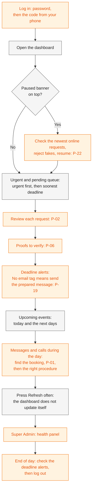

# Staff Guide

> **Purpose:** Step-by-step procedures for running daily reservations in the DJB Kasoundbox admin panel: the daily routine, every common task, what to do when something unusual happens, and the do's and don'ts. It owns the staff procedures only; every rule it mentions lives in the doc it links to. ·
> **Audience:** Mainly the business owner, who holds the Admin account; also the developer, who holds the Super Admin account, for the tasks marked **Super Admin only**. Written in plain English, without technical words ·
> **Status:** Draft for review ·
> **Last updated:** 2026-10-21 ·
> **Depends on:** [Glossary][gl], [Decision log][dl], [Roles and permissions][roles], [Business rules][br], [Functional requirements][fr], [Non-functional requirements][nfr], [Edge cases][ec], [Privacy and retention][priv], [Reservation lifecycle][lc], [Catalog and payments][cat], [UX and sitemap][ux]; workflows [lookup-and-review][wf-review] (WF-03, WF-04), [changes-and-expiry][wf-change] (WF-06), [notifications-and-tracking][wf-notify] (WF-07), [administration][wf-admin] (WF-08 to WF-10), [booking-and-submission][wf-book] (WF-01, WF-02), [availability-and-conflicts][wf-avail] (WF-05); planned: [deployment and operations][ops], [test plan][test], [roadmap][roadmap] ·
> **Derived from:** [roles-and-permissions][roles] §2, §5, §6; [business-rules][br] BR-05 to BR-12; [reservation-lifecycle][lc] §1 to §7; [catalog-and-payments][cat] §1, §2, §4, §5, §7; [functional-requirements][fr] FR-ADM-01 to FR-ADM-33, FR-NTF-21, §7; [edge-cases][ec] EC-03 to EC-85; [privacy-and-retention][priv] §3.2, §5.4, §7.1; [ux-and-sitemap][ux] §3.2, §4.2, §4.3, §8; the workflows WF-01 to WF-10; background: [spec v0.2][spec] (frozen, never edited)

## In plain words

- **Start every day at the dashboard.** It lists what needs you: urgent and pending requests, proofs of payment to check, deadlines coming up, and a banner when online booking is paused.
- **Most tasks start from the reservation page.** You reach it by scanning the customer's QR code, by searching, or from the dashboard. The page shows only the buttons that are allowed for that booking, so a missing button means "not possible for this status".
- **Only Confirmed means booked.** A reference code, a QR code, an approval, or an uploaded picture of a payment never means the booking is secured. Only the status **Confirmed** does ([lifecycle §1.1][lc]).
- **Always type a reason when asked.** Many reasons are shown to the customer.
- **Nothing is ever deleted.** A mistake is fixed with a new action and a reason.
- **Some tasks are for the Super Admin only.** This guide marks them. If you hold the Admin account, ask the developer for those.

---

## 1. How to use this guide

### 1.1 What is in it

| Section | Use it when |
|---|---|
| [2. Daily routine](#2-daily-routine) | You start, run, and close a working day |
| [3. Procedures](#3-procedures) | You need the exact steps for one task (P-01 to P-27) |
| [4. What to do when…](#4-what-to-do-when) | Something unusual happens and you need the quick answer |
| [5. Do's and don'ts](#5-dos-and-donts) | You want the short list of habits that keep the records right |
| [Open questions](#open-questions) | You meet a case this guide cannot answer yet |

### 1.2 How each procedure is laid out

Every procedure in section 3 has the same parts:

- **When to use it.** The situation, with a short example.
- **Steps.** Numbered steps, using the button and screen names of the [UX doc][ux].
- **What the customer sees.** The email they get (if they gave an email address) and what their status page shows.
- **What to check.** The points to look at before you press the last button.
- **Common mistakes.** What tends to go wrong, and how to avoid it.
- **Rules behind it.** The workflow (WF-xx) and the rule IDs (BR-xx, FR-…, EC-xx). The rule itself is only in the linked doc; this guide does not repeat it.

### 1.3 Conventions

- **Labels.** **[C]** confirmed decision · **[P]** proposed, accepted with the design but may still change · **[U]** unverified fact · **[O-nn]** open item in the [decision log][dl]. **[P] (new in this doc)** marks a working habit this guide suggests for the first time; each one is also listed under [Open questions](#open-questions).
- **Screen and button names** come from the [UX doc][ux], where most of them are still proposals. If the built screens use other words, the screens are right, and this guide is updated.
- **Numbers** such as "72 hours" are only reminders. Each one links to the doc that owns it, and many are settings that can change.
- **Time and money.** Every time is Manila time. Every amount is in pesos. Names, prices, slot times, and acknowledgment numbers in the examples are made up; the real slot times are O-02, and the real prices, stock, sets, and deposit amount are O-03.
- **"Either admin"** means the Admin or the Super Admin. Who may do what is defined only in [roles-and-permissions][roles].

### 1.4 Words you will see

The full list is in the [glossary][gl]. These are the ones you will meet most.

| Word | What it means for you |
|---|---|
| **Hold** | A request that is Pending Confirmation or Awaiting Deposit. It keeps a set or the room for the customer, but only until its deadline. |
| **Deadline** | The moment a hold expires if the next step has not happened. It is shown on the reservation page in Manila time ([lifecycle §3.2][lc]). |
| **Service start** | When the service begins: the start of the delivery slot, or the on-site arrival time. No deadline can go past it. |
| **Urgent** | The event date is today. Urgent requests are at the top of the dashboard. |
| **Needs info** | A flag you set when you need more information. It does not stop the deadline clock. |
| **Expiry paused** | The customer uploaded a picture of their payment before the deadline, so the booking waits for you to check it ([BR-12][br]). |
| **Prepared message** | Ready-made text on the reservation page for customers who gave no email, to copy into SMS or Messenger ([FR-NTF-21][fr]). |
| **Acknowledgment** | The printable page for each deposit or balance payment, numbered like `ACK-2026-0001`. It is not an Official Receipt ([catalog §5][cat]). |

### 1.5 The screens you will use

The admin menu is a bar at the bottom of the phone screen, or a sidebar on a laptop ([UX §4.2][ux-nav]).

| Menu item | Screen | What you do there |
|---|---|---|
| Dashboard | Dashboard (A3) | See what needs attention; "Scan QR", "Create booking", and a search box at the top |
| Reservations | Reservation list and search (A4) | Find any booking |
| Scan | QR scan (A6) | Open a booking from the customer's QR code |
| Create | Create booking (A7) | Enter phone, walk-in, and Facebook bookings |
| More → Blocks | Blocks (A8) | Block a set or the room for a day |
| More → Catalog | Catalog (A9) | Packages, add-ons, prices, daily stock |
| More → Audit log | Audit log (A12) | See who did what, when, and why |
| More → Health | Health panel (A13) | See whether the system's automatic jobs and emails are working |
| More → Settings, Accounts | Settings (A10), Admin accounts (A11) | **Super Admin only**; the Admin does not see them |

**The reservation page** (A5) is where most work happens ([UX §3.2.4][ux-res]). From top to bottom it shows the header (reference code with "Copy", status, flags such as **Urgent** or **Needs info**, source, deadline), Booking, Customer, Payments, Proofs, Refund and links, the Prepared message (only when there is no email), Internal notes, and History. The **action panel** groups the allowed buttons:

| Group | Buttons you may see |
|---|---|
| Next step | Approve · Record deposit · Review proof · Waive deposit (same day) · Record balance |
| Ask | Needs info · Info received |
| Change | Edit details · Reschedule · Extend deadline · Reissue QR |
| Money | Void (on a payment row) · Record refund paid · Print documents |
| End (in red) | Reject · Cancel · Event not held · Recreate |
| Super Admin | Set or clear legal hold · Process erasure |

A button that the status or your role does not allow is not shown at all; a short line under the panel says why ([UX §4.3][ux-allowed]). On a phone, the main "Next step" button sits at the bottom of the screen and the rest open from "More actions".

**Useful on every reservation.** "Add note" saves a private note that only the admins see, with your name and the time ([WF-03E][wf-03e]); customers never see it. "History" lists every change to the booking ([WF-10B][wf-10b]).

### 1.6 What to do next, by status

The statuses and how a booking moves between them are defined only in [reservation-lifecycle][lc]. This table only says which procedure usually comes next.

| Status shown | What it means | What you usually do next |
|---|---|---|
| **Pending Confirmation** | Waiting for your review | Review it: [P-02](#p-02--review-a-new-request-approve-reject-or-needs-info) |
| **Awaiting Deposit** | Approved; the customer must pay the deposit | Record the deposit ([P-04](#p-04--record-a-cash-deposit-at-the-office), [P-05](#p-05--record-an-e-wallet-deposit)) or check a proof ([P-06](#p-06--verify-or-reject-an-uploaded-proof)); give more time if agreed ([P-10](#p-10--extend-a-deadline)) |
| **Confirmed** | Booked and secured | Changes if asked ([P-09](#p-09--reschedule), [P-11](#p-11--edit-details)); the balance when the customer pays it ([P-15](#p-15--record-the-balance-payment)) |
| **Completed** | The event date has passed (set by the system the day after) | The balance if still unpaid ([P-15](#p-15--record-the-balance-payment)); "Event not held" if it did not happen ([P-16](#p-16--mark-an-event-as-not-held)) |
| **Rejected** | You declined it | Nothing |
| **Cancelled** | You cancelled it | If a refund was decided, record it when you pay it ([P-14](#p-14--record-a-refund-paid)) |
| **Expired** | A deadline passed | If the customer comes back: [P-17](#p-17--recreate-an-expired-request) |

---

## 2. Daily routine

The order below is a suggestion for a working day **[P] (new in this doc)**. Each step points to the procedure or screen it uses.

### 2.1 Log in

**Steps** ([WF-09A][wf-09a], [FR-ADM-01][fr]):

1. On your phone or laptop, open the admin panel (the `/admin` page of the website; the web address itself is O-05).
2. Type your email address and password, then press **"Log in"**.
3. Open the authenticator app on your own phone. Type the 6-digit code it shows, then press **"Verify"**.
4. The dashboard opens.

**If it does not work:**

- "The email, password, or code is not correct." Check your typing and try again ([UX §8][ux-proposals], proposal 13).
- "Too many tries. Please wait and try again later." After several wrong passwords the account is locked for a while (5 wrong passwords lock it for 15 minutes by default, [NFR-11][nfr]). Wait; trying again during the lock does not help ([EC-72][ec]).
- Your phone is lost, stolen, or broken: press **"Use a backup code instead"** and follow [P-23](#p-23--you-lost-the-phone-with-the-2fa-app).

**Your first login, or after a reset** ([WF-09B][wf-09b]): the screen first asks you to choose a new password, then to set up two-factor login.

1. Type a new password of your own, twice, and press **"Save"**. The first password, or the one from a reset, works only for this one login **[C]** ([D-36][dl]).
2. Open the authenticator app and add the account with the QR code on the screen.
3. Type the first code the app shows.
4. The screen shows your **backup codes**. Press **"Print"** (or **"Download"**), and keep the paper somewhere safe at home, away from your phone ([roles §5.2][roles]).
5. Tick **"I have stored my backup codes"**, then press **"Continue"**.

### 2.2 Check the dashboard, top to bottom

The dashboard ([FR-ADM-02][fr], [UX §3.2.2][ux-dash]) shows what needs attention. It does **not** update by itself: press **"Refresh"** whenever you come back to it, and look at the "Updated at" time.

1. **Paused banner.** If you see "Online booking is paused until 3:45 PM…", the website has stopped taking online requests for a while because many came in at once ([BR-07a][br]). Follow [P-22](#p-22--resume-online-booking-after-a-pause).
2. **Urgent and pending queue.** Requests waiting for you. **Urgent** ones (event today) come first, then the soonest deadline (order: a proposal in the UX doc). Open each one and follow [P-02](#p-02--review-a-new-request-approve-reject-or-needs-info). Same-day requests cannot wait: their deadline is the service start at the latest ([lifecycle §3.2][lc]).
3. **Proofs to verify.** Pictures of payments that customers uploaded. Press **"Review"** and follow [P-06](#p-06--verify-or-reject-an-uploaded-proof). A booking with a proof waiting still expires at its service start if nobody checks it ([EC-31][ec]).
4. **Deadline alerts.** Requests whose deadline is coming soon. A **No email** tag means the customer gets no emails, so you send the prepared message yourself ([P-19](#p-19--send-the-prepared-message-to-a-customer-without-email)).
5. **Upcoming events.** Confirmed bookings from today on, soonest first. Use it to prepare the sets and the room, and to expect balance payments ([P-15](#p-15--record-the-balance-payment)).

### 2.3 Review new requests

Work through the urgent and pending queue with [P-02](#p-02--review-a-new-request-approve-reject-or-needs-info), and for every delivery, [P-03](#p-03--check-that-a-delivery-address-is-inside-the-service-area). Both admins also get an email for each new online request, with urgent ones marked ([FR-NTF-13][fr]); the dashboard shows the same requests even if an email is late.

### 2.4 During the day

- **A customer messages, calls, or comes to the office.** Find the booking first ([P-01](#p-01--find-a-booking-scan-the-qr-code-or-search)), then use the procedure in the [quick finder](#31-quick-finder).
- **Two admins at once.** If the other admin acted first on the same booking, you see "This reservation was changed by someone else. Refresh to see the latest." Press **"Refresh"** and look again before doing anything ([EC-16][ec]).

### 2.5 Check the health panel (Super Admin)

The Super Admin checks the health panel once a day **[P] (new in this doc)**. The Admin may open it too ([roles §2.1][roles]).

1. Open **More → Health** ([UX §3.2.12][ux-health], [FR-ADM-33][fr]).
2. **Scheduled jobs.** Each card (the expiry job, the retention job, the email-sending job) shows its last run, for example "20 minutes ago", and its result in words. A card marked **Failed**, or an expiry job whose last run is much older than a few minutes (it runs every minute: [FR-SYS-01][fr]), needs the developer's runbook (planned: [deployment and operations][ops]).
3. **Emails.** Check the list of failed emails and the queue count. For a failed email, see [section 4](#4-what-to-do-when), "A customer says they got no email".
4. **Email caps.** A warning means some emails are held until the next day ([FR-NTF-20][fr], [EC-67][ec]). Customer emails go first, and the dashboard still shows every new request and proof at once.
5. **Storage.** Note the storage use.
6. Press **"Refresh"** if you keep the page open.

### 2.6 End of day

1. Press **"Refresh"** on the dashboard and look at the deadline alerts once more **[P] (new in this doc)**. A deposit deadline can fall at night or early in the morning, and the reminder email may go out at night ([notifications-and-tracking][wf-notify], open question 9).
2. Send any prepared messages still due for customers without email ([P-19](#p-19--send-the-prepared-message-to-a-customer-without-email)).
3. Press **"Log out"**, especially on a laptop that others use ([FR-ADM-01][fr]).

---

## 3. Procedures

### 3.1 Quick finder

| The customer, or you, wants to… | Procedure | Who |
|---|---|---|
| Find a booking from a QR code, a reference code, a name, or a mobile number | [P-01](#p-01--find-a-booking-scan-the-qr-code-or-search) | Either admin |
| Decide on a new request | [P-02](#p-02--review-a-new-request-approve-reject-or-needs-info) | Either admin |
| Check a delivery address | [P-03](#p-03--check-that-a-delivery-address-is-inside-the-service-area) | Either admin |
| Pay the deposit in cash at the office | [P-04](#p-04--record-a-cash-deposit-at-the-office) | Either admin |
| Pay the deposit by e-wallet | [P-05](#p-05--record-an-e-wallet-deposit) | Either admin |
| Check a picture of a payment the customer uploaded | [P-06](#p-06--verify-or-reject-an-uploaded-proof) | Either admin |
| Book by phone, walk-in, or Facebook, including for today | [P-07](#p-07--create-a-booking-for-a-phone-walk-in-or-facebook-customer) | Either admin |
| Confirm a same-day booking without a deposit | [P-08](#p-08--confirm-a-same-day-booking-without-a-deposit) | Either admin |
| Move to another date, slot, or arrival time | [P-09](#p-09--reschedule) | Either admin |
| Get more time to pay or to answer | [P-10](#p-10--extend-a-deadline) | Either admin |
| Fix a wrong mobile number, email, venue, package, or add-ons | [P-11](#p-11--edit-details) | Either admin |
| Get a new QR code | [P-12](#p-12--reissue-a-qr-code) | Either admin |
| Cancel | [P-13](#p-13--cancel-with-a-refund-decision) | Either admin |
| Collect a refund that was decided | [P-14](#p-14--record-a-refund-paid) | Either admin |
| Pay the balance, before or after the event | [P-15](#p-15--record-the-balance-payment) | Either admin |
| Fix a booking marked Completed whose event did not happen | [P-16](#p-16--mark-an-event-as-not-held) | Either admin |
| Book again after the request expired | [P-17](#p-17--recreate-an-expired-request) | Either admin |
| Fix a payment recorded by mistake | [P-18](#p-18--void-a-wrongly-recorded-payment) | Either admin |
| Tell a customer without email what happened | [P-19](#p-19--send-the-prepared-message-to-a-customer-without-email) | Either admin |
| Take a set or the room out of use for a day | [P-20](#p-20--block-a-set-or-the-room-and-remove-a-block) | Either admin |
| Change a price, the daily stock, or stop offering an item | [P-21](#p-21--change-the-catalog-prices-stock-and-archiving) | Either admin |
| Reopen online booking after a pause | [P-22](#p-22--resume-online-booking-after-a-pause) | Either admin |
| Log in after losing the phone with the 2FA app | [P-23](#p-23--you-lost-the-phone-with-the-2fa-app) | Both; the reset is Super Admin only |
| Close the business for a whole day | [P-24](#p-24--block-or-unblock-a-whole-date) | **Super Admin only** |
| Change a setting, such as the deposit amount | [P-25](#p-25--change-a-setting) | **Super Admin only** |
| Change how customers are told to pay | [P-26](#p-26--update-the-deposit-instructions) | **Super Admin only** |
| Create, disable, reset, or sign out the Admin account | [P-27](#p-27--manage-the-admin-account) | **Super Admin only** |

### 3.2 Rules common to every procedure

These hold for every action below, so the procedures do not repeat them ([FR-ADM-07][fr]):

- **A reason box must be filled in** before the button works. "(the customer will see this)" next to the label means it appears on the status page or in an email.
- **One action at a time wins.** If the other admin changed the booking first, nothing happens and you see "already changed" ([EC-16][ec]).
- **A passed deadline counts as expired at once**, even if the screen still showed the old status a moment ago. Forward actions are then refused ([BR-05][br], [EC-22][ec], [EC-23][ec]).
- **The change and its email are saved together.** An email problem never undoes your change ([FR-NTF-16][fr], [EC-66][ec]).
- **Customers without email get no email.** The page shows a prepared message instead ([P-19](#p-19--send-the-prepared-message-to-a-customer-without-email)).
- **Every action is recorded in the history**, with your name, the time, and the reason ([FR-ADM-32][fr]).

---

### A. Find and review

### P-01 · Find a booking: scan the QR code, or search

**When to use it.** A customer is at the office, is paying, messages, or calls. You need their booking on screen. *Example:* on Thursday 17 December 2026, Ana messages "Hi, about ksb 7q2m k9tx". You type that into the search, and her reservation `KSB-7Q2M-K9TX` opens.

**Steps: scan at the office** ([WF-03A][wf-03a])

1. Ask the customer to show their QR code.
2. Press **"Scan QR"** on the dashboard, or **Scan** in the menu.
3. The first time, the page explains why it needs the camera. Press **"Allow camera"**.
4. Point the camera at the QR code. The reservation page opens.
5. If the camera does not work, press **"Upload a screenshot instead"** and pick a screenshot of the customer's QR code; or press **"Type the reference code"** and search (below).

**Steps: search** ([WF-03C][wf-03c])

1. Open **Reservations**, or use the search box on the dashboard.
2. Type one of these:
   - the **reference code**, in any form: `KSB-7Q2M-K9TX`, `ksb 7q2m k9tx`, or without dashes;
   - the **full mobile number**, in any usual form: `0917 123 4567`, `0917-123-4567`, or `+63 917 123 4567` ([BR-11][br]);
   - the **customer's name**, or part of it.
3. If there are many results, use the filters: status, service type (delivery or on-site), and event date ("Today", "Next 7 days", "This month").
4. Tap the right result. The reservation page opens.

**What the customer sees.** Nothing changes for them. A scan or a search never approves or confirms anything ([WF-03A][wf-03a], step 10).

**What to check.**

- The reference code at the top of the page is the one the customer quotes.
- The status. A booking whose deadline has passed shows **Expired** at once ([EC-22][ec]).

**Common mistakes.**

- **"Not found or no longer valid" after a scan.** That QR code was replaced by a new one, or the booking is Rejected, Cancelled, Expired, or Completed ([EC-60][ec]). The booking still exists: search by the reference code.
- **Searching for part of a mobile number.** Type the full number; part of a number is not searched (a proposal in [UX §8][ux-proposals], proposal 5).
- **Expecting the QR code on event day.** The QR code is used at the office and when paying, not at the event **[C]** ([D-09][dl]).
- **Old bookings by name.** After the retention period, names and mobile numbers are blanked, so only the reference code still finds the booking ([privacy §6.2][priv]).

**Rules behind it.** [WF-03A][wf-03a], [WF-03C][wf-03c] · [FR-ADM-03][fr], [FR-ADM-06][fr] · [EC-60][ec], [EC-63][ec], [EC-64][ec].

---

### P-02 · Review a new request: approve, reject, or needs info

**When to use it.** A request is **Pending Confirmation** in the urgent and pending queue. *Example:* Ana submitted on Wednesday 16 December 2026 at 10:00 AM: delivery on Thursday 24 December, 2:00 PM slot, Package A and 2 extra microphones, ₱3,400 in total, ₱1,000 deposit. You have until Saturday 19 December at 10:00 AM to decide (72 hours by default, or the service start if sooner: [lifecycle §3.2][lc]).

**Steps**

1. On the dashboard, open the request from the urgent and pending queue (urgent ones first).
2. Read the **Booking** part: service type, date, slot or arrival time, package, add-ons, total, and deposit.
3. Read the **Customer** part: name, mobile number, email (if any), and the customer's note.
4. For a **delivery**, check the address first: [P-03](#p-03--check-that-a-delivery-address-is-inside-the-service-area).
5. Decide one of the four:

   **a. You need more information** ([WF-04C][wf-04c])
   1. Press **"Needs info"**.
   2. Type a short, clear message for the customer, for example "Please send a nearby landmark." The customer sees it.
   3. Save. The request stays Pending Confirmation, with a **Needs info** badge.
   4. When the customer answers (by message or call), open the request and press **"Info received"**. Then decide again (b, c, or d).

   **b. Approve** ([WF-04A][wf-04a])
   1. Press **"Approve"**.
   2. For a delivery, the dialog shows the venue again and the tick box "I checked that this venue is inside our service area". Tick it.
   3. Press **"Approve"** in the dialog. A note confirms it, for example "Approved. Deposit due Fri 18 Dec, 2:00 PM."
   4. The status is now **Awaiting Deposit**. The customer has until the deposit deadline to pay (24 hours by default, or the service start if sooner: [lifecycle §3.2][lc]).

   **c. Reject** ([WF-04B][wf-04b])
   1. Press **"Reject"** (in red, in the End group).
   2. Type the reason. "The customer will see this reason." Write it politely, for example "Sorry, the venue is outside our free delivery area."
   3. Confirm. The status is now **Rejected**, and the set or the room is free again at once.

   **d. The event is today, and you will not ask for a deposit.** Follow [P-08](#p-08--confirm-a-same-day-booking-without-a-deposit) instead of approving.

6. If the customer gave no email, send the prepared message now: [P-19](#p-19--send-the-prepared-message-to-a-customer-without-email).

**What the customer sees.**

| Your decision | Email (if an address was given) | Status page |
|---|---|---|
| Needs info | Your message ([FR-NTF-02][fr]) | "We need more information from you…", with your message |
| Approve | Approved, with the deposit instructions and the deadline ([FR-NTF-03][fr]); later a deposit reminder, 6 hours before the deadline by default ([FR-NTF-04][fr]) | Awaiting Deposit, the deadline, how to pay, and the upload button |
| Reject | Rejected, with your reason ([FR-NTF-09][fr]) | Rejected, with your reason |

**What to check.**

- The deadline in the header. If it has passed, the request already counts as expired, and Approve is refused ([EC-23][ec]); see [P-17](#p-17--recreate-an-expired-request).
- For a delivery, the service area ([P-03](#p-03--check-that-a-delivery-address-is-inside-the-service-area)).
- The customer's note: if it contains an ID number, a birthdate, or health or religious details, do not copy them anywhere ([section 5](#5-dos-and-donts)).

**Common mistakes.**

- **Thinking "Needs info" gives more time.** It does not; the deadline keeps running **[C]** ([D-13][dl], [EC-24][ec]). If the customer needs more time to answer, also extend the deadline ([P-10](#p-10--extend-a-deadline)).
- **Rejecting an approved booking.** Reject is only for Pending Confirmation. For a booking that is already Awaiting Deposit or Confirmed, use Cancel ([P-13](#p-13--cancel-with-a-refund-decision)).
- **Telling the customer "you are booked" after approving.** Approved means "pay the deposit"; only Confirmed means booked ([lifecycle §1.1][lc]).
- **Fake requests after a flood.** Reject them with a reason such as "could not verify the request" ([EC-14][ec], [EC-15][ec]).

**Rules behind it.** [WF-04][wf-04], [WF-04A][wf-04a], [WF-04B][wf-04b], [WF-04C][wf-04c] · [lifecycle §4.2][lc] rows 4 and 8, §6.1 · [FR-ADM-08][fr], [FR-ADM-09][fr] · [EC-13][ec], [EC-16][ec], [EC-21][ec], [EC-23][ec], [EC-24][ec].

---

### P-03 · Check that a delivery address is inside the service area

**When to use it.** Before you approve any **delivery** request. Delivery is free inside the service area **[C]**, and the system keeps no list of areas: you decide during the review **[C]** ([D-11][dl], [catalog §1.5][cat]).

**Steps**

1. On the reservation page, read the venue in the **Customer** part: barangay, city or municipality, street, and landmarks.
2. Decide:
   - **Inside the area:** go on with "Approve" ([P-02](#p-02--review-a-new-request-approve-reject-or-needs-info), step 5b) and tick "I checked that this venue is inside our service area".
   - **Not sure** (for example, the barangay is on the border, or the street is missing): press **"Needs info"** and ask, for example "Please send the street and a nearby landmark."
   - **Outside the area:** press **"Reject"** with a polite reason the customer will understand.

**What the customer sees.** The packages page and the form say that delivery is free within the service area and that the address is confirmed during review (the exact wording is O-04). After your decision they get the needs-info, approved, or rejected email, as in P-02.

**What to check.** The barangay and the city or municipality are always there; the street and landmarks may be missing (whether they are required is [FR §7][fr], question 6).

**Common mistakes.**

- **Assuming the system checked it.** It does not check the area at all ([EC-13][ec]).
- **Approving on-site requests with this check.** Only delivery has a venue to check.

**Rules behind it.** [WF-04A][wf-04a] step 2 · [D-11][dl], O-04 · [FR-ADM-08][fr] · [EC-13][ec].

---

### B. Deposits and proofs

### P-04 · Record a cash deposit at the office

**When to use it.** An approved customer (**Awaiting Deposit**) pays the deposit in cash at the office. *Example:* Ben's delivery for Sunday 27 December 2026 was approved on Sunday 20 December at 4:00 PM, so his deposit is due on Monday 21 December at 4:00 PM. On Monday at 10:00 AM he comes with ₱1,000 in cash and shows his QR code.

**Steps**

1. Scan the customer's QR code ([P-01](#p-01--find-a-booking-scan-the-qr-code-or-search)). The reservation page opens.
2. Check that the status is **Awaiting Deposit** and that the deadline in the header has not passed.
3. Look at the deposit amount on the page. Count the cash: it must be exactly that amount.
4. Press **"Record deposit"**.
5. In the dialog:
   - **Amount:** already filled in from the booking's locked deposit; you cannot change it.
   - **Method:** pick **Cash**. (There is no reference number for cash.)
   - **Note:** optional. Do not type the payer's name or account number.
6. Save. The status becomes **Confirmed**, and a **Deposit Acknowledgment** is made with its own number, for example `ACK-2026-0001`.
7. If the customer wants a paper copy, press **"Print documents"** and print the acknowledgment.

**What the customer sees.** The confirmed email, with links to the acknowledgment and the Booking Confirmation ([FR-NTF-07][fr]); the links open the status page, and the documents show after the customer enters the reference code and mobile number ([security](../05-technical/security.md) §4.5.5). Their status page shows **Confirmed**, the balance due, and the document links.

**What to check.**

- **The right booking.** The reference code on the screen matches the customer's.
- **The exact amount.** A part payment cannot be recorded as the deposit; there are no partial deposits **[P]** ([EC-34][ec]). What to do with a part payment is still open ([edge-cases §15][ec], question 3).
- **Only one deposit.** A second deposit on the same booking is refused ([EC-35][ec]).

**Common mistakes.**

- **Recording on the wrong booking.** Void it with a reason and record it on the right one ([P-18](#p-18--void-a-wrongly-recorded-payment)).
- **Recording after the deadline.** It is refused, unless the customer uploaded a proof before the deadline ([EC-23][ec]). If the customer still wants the date, recreate the request ([P-17](#p-17--recreate-an-expired-request)).
- **Calling the acknowledgment a receipt.** It is not an Official Receipt ([section 5](#5-dos-and-donts)).
- **Cash received today, recorded tomorrow.** The acknowledgment shows the day you record it; record it the same day ([catalog §10][cat], question 7).

**Rules behind it.** [WF-03A][wf-03a], [WF-04D][wf-04d] · [catalog §4.3, §5][cat] · [FR-ADM-11][fr], [FR-ADM-23][fr] · [EC-23][ec], [EC-34][ec], [EC-35][ec], [EC-36][ec].

---

### P-05 · Record an e-wallet deposit

**When to use it.** An approved customer (**Awaiting Deposit**) paid the deposit by e-wallet and tells you so, by message or call. If they uploaded a picture of the payment on their status page, use [P-06](#p-06--verify-or-reject-an-uploaded-proof) instead. *Example:* on Friday 18 December 2026 at 10:45 AM, Ana pays ₱1,000 by e-wallet, reference number `1234567890`.

**Steps**

1. Open the business's e-wallet app and find the payment: the amount, the time, and its **reference number**.
2. Find the booking by its reference code or mobile number ([P-01](#p-01--find-a-booking-scan-the-qr-code-or-search)).
3. Check that the status is **Awaiting Deposit**, the deadline has not passed, and the amount you received equals the deposit on the page.
4. Press **"Record deposit"**.
5. In the dialog:
   - **Amount:** already filled in; you cannot change it.
   - **Method:** pick **E-wallet**.
   - **E-wallet reference:** type the transaction's reference number from your e-wallet app, for example `1234567890`. It is required.
   - **Note:** optional. Never the payer's name or account number.
6. Save. The status becomes **Confirmed**, and `ACK-2026-0001` (for example) appears on the customer's status page.

**What the customer sees.** The confirmed email with links to the acknowledgment and the Booking Confirmation, which open after a status lookup ([FR-NTF-07][fr]; [security](../05-technical/security.md) §4.5.5); **Confirmed** on the status page.

**What to check.**

- The money really arrived in the e-wallet account. A screenshot alone is not proof.
- The reference number is typed exactly; it is the lasting record of the payment, because proof pictures are deleted later ([catalog §4.3][cat]).
- You have not already recorded the same e-wallet payment on another booking.

**Common mistakes.**

- **Copying the payer's name or account number** from the e-wallet app or a screenshot. Only the reference number is ever stored ([catalog §4.7][cat], [privacy §3.2][priv]).
- **Leaving the reference empty.** It cannot be saved without it for e-wallet.

**Rules behind it.** [WF-04D][wf-04d] · [catalog §4.2, §4.3, §4.7][cat] · [FR-ADM-11][fr] · [EC-34][ec], [EC-35][ec].

---

### P-06 · Verify or reject an uploaded proof

**When to use it.** A customer uploaded a picture of their e-wallet payment on the status page. It appears under **Proofs to verify** on the dashboard, both admins get an email ([FR-NTF-14][fr]), and the booking does not expire while it waits for you, but never past the service start **[C]** ([BR-12][br]). *Example:* Ana's deposit is due on Friday 18 December 2026 at 2:00 PM. She uploads her proof at 1:50 PM. You review it at 4:30 PM.

**Steps**

1. On the dashboard, under **Proofs to verify**, press **"Review"**. The picture opens on the reservation page.
2. Open the business's e-wallet app and look for the payment shown in the picture: the amount and the reference number.
3. Decide:

   **a. The payment is there and correct: verify**
   1. Press **"Verify and record deposit"**. The "Record deposit" dialog opens.
   2. Pick **E-wallet**, and type the reference number from your e-wallet app.
   3. Save. The status becomes **Confirmed**, and the proof leaves the list. This works even after the original deadline, because expiry was paused ([EC-27][ec]).

   **b. The payment is missing, wrong, or unreadable: reject**
   1. Press **"Reject proof"**.
   2. Type the reason; the customer sees it. For example: "We could not find this payment. Please check the reference number."
   3. Save. The proof leaves the list.
   4. What happens next depends on the deadline:
      - **The original deadline is still ahead:** the booking stays **Awaiting Deposit** with its original deadline. The customer may upload once more (at most 2 uploads per booking, ever: [FR-PUB-12][fr]) ([EC-29][ec]).
      - **The original deadline has passed:** the booking becomes **Expired** at once **[P]** ([EC-28][ec]).

4. For a booking whose event is today, you may also waive the deposit instead ([P-08](#p-08--confirm-a-same-day-booking-without-a-deposit)).

**What the customer sees.**

| Result | Email | Status page |
|---|---|---|
| Verified | Confirmed, with document links ([FR-NTF-07][fr]) | Confirmed |
| Rejected, deadline still ahead | Proof not accepted, with your reason ([FR-NTF-06][fr]) | "We could not accept your proof: [reason]. You can upload one more, or pay at our office." |
| Rejected, deadline passed | Proof not accepted, and expired ([FR-NTF-06][fr], [FR-NTF-12][fr]) | Expired |

**What to check.**

- **Before rejecting, look at the deadline.** If it has passed, rejecting ends the booking at once. If the picture is only unclear, consider asking the customer by message first.
- **Check proofs before the service start.** A proof nobody reviews by then lets the booking expire ([EC-31][ec]).

**Common mistakes.**

- **Copying the payer's name** from the picture into the note. Never ([catalog §4.7][cat]).
- **Verifying from the picture alone**, without finding the payment in the e-wallet account.

**Rules behind it.** [WF-04E][wf-04e], [WF-07E][wf-07e] · [BR-12][br] · [lifecycle §4.2][lc] rows 6, 10b, 10c · [FR-ADM-12][fr] · [EC-27][ec] to [EC-32][ec].

---

### C. Phone, walk-in, Facebook, and same-day bookings

### P-07 · Create a booking for a phone, walk-in, or Facebook customer

**When to use it.** A customer books by phone, walks in, or messages the business on Facebook. You enter the booking yourself, so every booking uses the same calendar. This also works while online booking is paused, for a start that is too soon to book online, and for a customer who already has open online requests ([BR-06a][br], [EC-45][ec]). It never double-books a set, the room, or an add-on.

*Examples.* On Monday 21 December 2026, Dan phones to book a delivery for Saturday 2 January 2027: a normal booking. On Sunday 20 December at 6:40 PM, Carla walks in and wants the room at 7:00 PM: a one-step booking, because the start is less than the notice period away (1 hour by default, [BR-06][br]).

**Steps**

1. Press **"Create booking"** on the dashboard, or **Create** in the menu.
2. Pick the **source**: Phone · Walk-in · Facebook.
3. Fill in the booking: service type, date, package, add-ons, and the delivery slot or arrival time.
4. Fill in the customer: name, **mobile number** (required), **email** (optional; ask for it, because emails keep the customer informed), and for delivery the venue (barangay, city or municipality, street, landmarks). For a delivery, check the service area as in [P-03](#p-03--check-that-a-delivery-address-is-inside-the-service-area).
5. If the date is today, an **Urgent** badge appears.
6. **If the start has already passed, or is within the notice period**, a one-step section appears. Choose one:
   - **"Record deposit"**: take the deposit and fill in the method (Cash or E-wallet) and, for e-wallet, the reference number, as in [P-04](#p-04--record-a-cash-deposit-at-the-office) or [P-05](#p-05--record-an-e-wallet-deposit); or
   - **"Waive deposit"**: type the reason, for example "regular customer, pays in full on arrival".
7. Press **"Create booking"**.
8. The new reservation page opens:
   - **Normal booking:** status **Pending Confirmation**. Its QR code is shown once, with "Save QR code" and "Print" (a proposal in [UX §8][ux-proposals], proposal 12): show it to a walk-in, print it, or save it to send. Then continue as usual: approve ([P-02](#p-02--review-a-new-request-approve-reject-or-needs-info)) and record the deposit when paid.
   - **One-step booking:** status **Confirmed**. With a deposit, the acknowledgment number shows, for example `ACK-2026-0012`; press **"Print acknowledgment"** if the customer wants it.
9. If the customer gave no email, send the prepared message ([P-19](#p-19--send-the-prepared-message-to-a-customer-without-email)) and tell them their reference code.

**What the customer sees.** If an email was given: the request-received email for a normal booking ([FR-NTF-01][fr]). Which emails a one-step booking sends is still open ([FR §7][fr], question 1). The admins get no new-request email for staff bookings ([BR-06a][br]).

**What to check.**

- **The mobile number**, read back to the customer. It is how they open their status page ([BR-11][br]).
- **"No set is free on that date."** or "Not enough Extra microphones on that date." means the capacity is taken; nothing was created. Offer another date.

**Common mistakes.**

- **Leaving a phone booking as Pending Confirmation and forgetting it.** It has the same deadlines as an online request and expires if you do not approve it in time ([lifecycle §4.2][lc], row 2).
- **Pressing "Create booking" twice.** Look at the result before pressing again; whether a double press is protected is still open ([lookup-and-review][wf-review], open question 11).

**Rules behind it.** [WF-04G][wf-04g] · [BR-06a][br], [BR-11][br] · [lifecycle §4.2][lc] row 2, §6.4 · [FR-ADM-24][fr] · [EC-41][ec], [EC-45][ec].

---

### P-08 · Confirm a same-day booking without a deposit

**When to use it.** A request (online or staff-created) is **Pending Confirmation** or **Awaiting Deposit**, its event date is **today**, and you decide not to ask for the deposit. For each same-day booking, the admins decide whether to ask for the deposit or to waive it **[C]** ([D-06][dl]). *Example:* on Saturday 19 December 2026 at 5:30 PM, Rosa requests the room for a 7:00 PM arrival that evening. At 5:40 PM you waive the deposit instead of approving.

**Steps**

1. Open the request; it carries the **Urgent** badge. Find it in the urgent and pending queue, or search for it ([P-01](#p-01--find-a-booking-scan-the-qr-code-or-search)).
2. Press **"Waive deposit (same day)"**. It appears only when the event date is today in Manila ([EC-43][ec]).
3. Type the reason, for example "regular customer, pays in full on arrival".
4. Save. The status becomes **Confirmed**, with no deposit.
5. If the customer pays a deposit later anyway, record it as usual ([P-04](#p-04--record-a-cash-deposit-at-the-office)); the status stays Confirmed ([EC-44][ec]).

**What the customer sees.** The confirmed email ([FR-NTF-07][fr]), with no acknowledgment, because no payment was recorded. **Confirmed** on the status page.

**What to check.**

- The deadline has not passed (or, for Awaiting Deposit, a proof is waiting). Otherwise it already counts as expired ([lifecycle §4.2][lc], rows 5 and 7).
- When the balance is paid later, check the amount carefully: the default after a waiver is still open ([edge-cases §15][ec], question 5).

**Common mistakes.**

- **Looking for the waiver on tomorrow's booking.** It is not offered until that date is today. Just after midnight, the Manila date counts ([EC-82][ec]).

**Rules behind it.** [WF-04F][wf-04f] · [lifecycle §6.4][lc] · [FR-ADM-13][fr] · [EC-42][ec], [EC-43][ec], [EC-44][ec], [EC-82][ec].

---

### D. Changes

### P-09 · Reschedule

**When to use it.** The customer asks to move to another date, delivery slot, or arrival time. Customers cannot do this online; you decide case by case **[C]** ([D-08][dl]). *Example:* Ana's booking for Thursday 24 December 2026 is Confirmed. She asks for Saturday 26 December.

**Steps**

1. Find the booking ([P-01](#p-01--find-a-booking-scan-the-qr-code-or-search)). It must be Pending Confirmation, Awaiting Deposit, or Confirmed.
2. Press **"Reschedule"**. A full page opens.
3. Pick the new date, the new delivery slot, or the new arrival time.
4. Save.
5. Read the result:
   - **Moved.** The booking keeps its reference code, its QR code, and its prices.
   - **Refused**, for example "This date is full, so the booking stays on Thu 24 Dec." Nothing changed. Offer another date ([EC-48][ec]).

**What the customer sees.** The rescheduled email with the new date, slot or arrival time, and deadline ([FR-NTF-11][fr]); the status page shows the new details.

**What to check.**

- **The deadline of a waiting request.** A move never gives more time: the deadline stays the same or moves earlier, and a move to today makes it urgent ([lifecycle §6.5][lc], [EC-49][ec]). Tell the customer if their deadline moved.

**Common mistakes.**

- **Using "Edit details" to change the date.** The date, slot, and arrival time change only with Reschedule.
- **Switching delivery to on-site, or the other way round.** Neither Reschedule nor Edit details does this; how to handle it is open ([changes-and-expiry][wf-change], open question 3).
- **Rescheduling a request whose deadline has passed.** It is refused; recreate it instead ([P-17](#p-17--recreate-an-expired-request)).

**Rules behind it.** [WF-06C][wf-06c] · [lifecycle §6.5][lc] · [FR-ADM-17][fr] · [EC-48][ec], [EC-49][ec], [EC-50][ec].

---

### P-10 · Extend a deadline

**When to use it.** A waiting request (Pending Confirmation or Awaiting Deposit) needs more time, and you agree. *Example:* Dan's request was approved on Monday 21 December 2026 at 10:00 AM, so his deposit is due on Tuesday 22 December at 10:00 AM. His delivery starts on Thursday 24 December at 2:00 PM. He asks to pay at the office on Wednesday morning.

**Steps**

1. Find the booking ([P-01](#p-01--find-a-booking-scan-the-qr-code-or-search)).
2. Press **"Extend deadline"**.
3. Enter the new deadline: date and time, in Manila time. The dialog shows the service start as the latest time allowed. For Dan: Wednesday 23 December, 12:00 noon.
4. Type the reason, for example "paying at the office Wednesday morning".
5. Save. The header shows the new deadline.

**What the customer sees.** The deadline-extended email with the new deadline ([FR-NTF-05][fr]); the status page shows it. The deposit reminder follows the new deadline ([FR-NTF-04][fr]).

**What to check.**

- The new deadline is **before the service start**. A later time is refused **[C]** ([EC-25][ec]). For Dan, Thursday 24 December at 3:00 PM would be refused.
- The deadline has **not already passed**. Then it cannot be extended; recreate the request instead ([EC-26][ec], [P-17](#p-17--recreate-an-expired-request)).

**Common mistakes.**

- **Waiting until after the deadline to extend.** Extend while the request is still alive.
- **Extending while a proof waits for review.** Which deadline then applies if the proof is rejected is still open ([edge-cases §15][ec], question 4). Review the proof first ([P-06](#p-06--verify-or-reject-an-uploaded-proof)).

**Rules behind it.** [WF-06D][wf-06d] · [lifecycle §6.3][lc] · [FR-ADM-16][fr] · [EC-25][ec], [EC-26][ec].

---

### P-11 · Edit details

**When to use it.** A detail is wrong or the customer wants a change: the name, the mobile number, the email, the venue, the package, or the add-ons. Customers cannot change details online. *Example:* Ana typed `0917 123 4576` instead of `0917 123 4567`, so she cannot open her status page. She calls the office.

**Steps**

1. Find the booking ([P-01](#p-01--find-a-booking-scan-the-qr-code-or-search)). It must be Pending Confirmation, Awaiting Deposit, or Confirmed.
2. Press **"Edit details"**. A full page opens.
3. Change only what is needed. A mobile number can be typed in any usual Philippine form ([BR-11][br]).
4. Type the reason, for example "customer called: typo in mobile number".
5. Save.

**What the customer sees.** The reservation-updated email ([FR-NTF-08][fr]). After a mobile-number fix, the status page opens with the corrected number ([EC-46][ec]).

**What to check.**

- **Adding add-ons or changing the package.** The stock is checked again. If the add-on is sold out on that date, the edit is refused and nothing changes ([EC-47][ec]).
- **Prices.** Items that stay keep their locked price; added items take today's catalog price. *Example:* adding 1 set of party lights at ₱300 to Ana's ₱3,400 booking makes ₱3,700 ([lifecycle §6.2][lc]). Tell the customer the new total.

**Common mistakes.**

- **Changing the date here.** Use Reschedule ([P-09](#p-09--reschedule)).
- **Changing or removing the email address.** Which address gets the next emails is still open ([changes-and-expiry][wf-change], open question 7).

**Rules behind it.** [WF-06E][wf-06e] · [lifecycle §6.2][lc] · [FR-ADM-10][fr] · [BR-03][br], [BR-11][br] · [EC-46][ec], [EC-47][ec].

---

### P-12 · Reissue a QR code

**When to use it.** The customer lost their QR code, or shared it by mistake, for example in a family group chat. A new QR code makes the old one stop working at once; the reference code stays the same. Customers can also do this themselves on the status page with "Get a new QR code" ([FR-PUB-13][fr]). *Example:* on Tuesday 22 December 2026, Ana says she posted a photo of her QR code in a group chat.

**Steps**

1. Find the booking by its reference code ([P-01](#p-01--find-a-booking-scan-the-qr-code-or-search)).
2. Press **"Reissue QR"**.
3. Read the warning "The old QR code will stop working." and confirm.
4. The new QR code shows once, with "Save QR code" and "Print" (a proposal in [UX §8][ux-proposals], proposal 12). Show it, print it, or save it and send the picture to the customer. Once you leave the screen, it cannot be shown again; a new reissue would be needed.

**What the customer sees.** No email. The old QR link shows "not valid or no longer in use". The reference code still opens the status page.

**What to check.** The booking is still active. On which statuses a reissue is offered is still open ([lookup-and-review][wf-review], open question 7).

**Common mistakes.** Leaving the screen before the customer has the new code. How the customer receives an admin-made QR code is still open ([FR §7][fr], question 4); for a customer who can open the status page, "Get a new QR code" there is the simplest way.

**Rules behind it.** [WF-03D][wf-03d], [WF-07D][wf-07d] steps 9 to 11 · [FR-ADM-22][fr], [FR-PUB-13][fr] · [EC-60][ec], [EC-62][ec].

---

### E. Ending a booking, and money after the event

### P-13 · Cancel with a refund decision

**When to use it.** The customer asks to cancel, or the business must cancel. Customers cannot cancel online **[C]** ([D-08][dl]). You can cancel a booking that is Pending Confirmation, Awaiting Deposit, or Confirmed. *Example:* Ben paid a ₱1,000 deposit for a delivery on Sunday 27 December 2026. On Tuesday 22 December he calls to cancel.

**Steps**

1. Find the booking ([P-01](#p-01--find-a-booking-scan-the-qr-code-or-search)).
2. Press **"Cancel"** (in red, in the End group).
3. Type the reason; the customer sees it. For example "family emergency".
4. **If a deposit was paid**, choose the refund decision, case by case **[C]**: **none**, **partial** (type the amount), or **full** (type the amount). For Ben: partial, ₱500.
5. Read the confirmation and confirm. The status becomes **Cancelled**, and the set or the room is free again at once.
6. If the refund is partial or full, record it later, when you actually pay it: [P-14](#p-14--record-a-refund-paid).

**What the customer sees.** The cancelled email, with the reason and the refund decision ([FR-NTF-10][fr]); the status page shows the same. The old QR code stops working.

**What to check.**

- **The right booking.** Cancelled is final. There is no undo yet ([changes-and-expiry][wf-change], open question 1).
- **The refund amount** matches what you agreed with the customer.

**Common mistakes.**

- **Using Reject for an approved or confirmed booking.** Reject is only for Pending Confirmation ([P-02](#p-02--review-a-new-request-approve-reject-or-needs-info)).
- **Cancelling a Completed booking whose event did not happen.** Use "Event not held" ([P-16](#p-16--mark-an-event-as-not-held)).
- **A booking where only a balance was paid** (after a same-day waiver). Whether a refund decision is asked is still open ([lifecycle §9][lc], question 2).

**Rules behind it.** [WF-06A][wf-06a] · [lifecycle §6.6][lc], §4.2 rows 11 to 13 · [catalog §4.5][cat] · [FR-ADM-18][fr] · [EC-39][ec], [EC-50][ec].

---

### P-14 · Record a refund paid

**When to use it.** You pay back money that was decided when the booking was cancelled ([P-13](#p-13--cancel-with-a-refund-decision)) or marked "event not held" ([P-16](#p-16--mark-an-event-as-not-held)). *Example:* on Wednesday 23 December 2026, Ben collects his ₱500 at the office.

**Steps**

1. Pay the customer: cash at the office, or by e-wallet.
2. Find the **Cancelled** booking ([P-01](#p-01--find-a-booking-scan-the-qr-code-or-search)). The refund decision shows on the page.
3. Press **"Record refund paid"**.
4. Enter the amount, the method (Cash or E-wallet), the e-wallet reference number for an e-wallet payment, and an optional note (never the payer's name or account number).
5. Save. The refund appears in the Payments list; the status stays Cancelled.

**What the customer sees.** No email and no acknowledgment: refunds get none ([catalog §5.1][cat]).

**What to check.** The amount paid equals the refund decision. Whether it must, and whether a refund can be paid in parts, is still open ([catalog §10][cat], question 3).

**Common mistakes.** Forgetting this step. The money records must show every peso paid back ([catalog §4.1][cat]); recording a late refund also moves the date from which old data is later erased, which is expected ([EC-40][ec]).

**Rules behind it.** [WF-06B][wf-06b] · [catalog §4.5][cat] · [FR-ADM-19][fr] · [EC-39][ec], [EC-40][ec].

---

### P-15 · Record the balance payment

**When to use it.** The customer pays the rest of the price, usually on event day or after. You can record it while the booking is Confirmed or Completed, so a balance paid after the event is fine ([EC-38][ec]). *Example:* on Thursday 24 December 2026, Ana pays her ₱2,400 balance in cash (₱3,400 total minus the ₱1,000 deposit).

**Steps**

1. Find the booking ([P-01](#p-01--find-a-booking-scan-the-qr-code-or-search)).
2. Press **"Record balance"**.
3. Check the amount: it is filled in as the total minus the deposit. Change it only if the customer paid a different amount.
4. Pick the method (Cash or E-wallet), type the e-wallet reference number for e-wallet, and add an optional note.
5. Save. A **Balance Payment Acknowledgment** is made, for example `ACK-2026-0015`.
6. Press **"Print documents"** if the customer wants a copy.

**What the customer sees.** No email. The status page shows the new balance due (₱0.00 reads "Paid in full") and a link to the acknowledgment.

**What to check.**

- **After a same-day waiver**, the filled-in amount may not be what the customer owes; the default is still open ([edge-cases §15][ec], question 5). Check it against the total.
- **A balance paid in parts.** Whether more than one balance payment can be recorded is still open ([catalog §10][cat], question 1).

**Common mistakes.** Recording the balance on the wrong booking. Void it and record it again ([P-18](#p-18--void-a-wrongly-recorded-payment)).

**Rules behind it.** [WF-06K][wf-06k] · [catalog §4.4, §5][cat] · [FR-ADM-14][fr] · [EC-38][ec], [EC-40][ec].

---

### P-16 · Mark an event as not held

**When to use it.** The system marked a booking **Completed** the day after its event (at 12:15 AM: [lifecycle §6.8][lc]), but the event never took place. *Example:* Ana's booking for Thursday 24 December 2026 became Completed at 12:15 AM on Friday 25 December. On Saturday 26 December you learn the event was called off.

**Steps**

1. Find the booking ([P-01](#p-01--find-a-booking-scan-the-qr-code-or-search)). It must be **Completed**.
2. Press **"Event not held"**.
3. Type the reason.
4. Choose the refund decision: none, partial, or full, with the amount. It is required, even if it is "none".
5. Confirm. The status becomes **Cancelled**.
6. If the refund is partial or full, record it when you pay it ([P-14](#p-14--record-a-refund-paid)).

**What the customer sees.** The status page shows Cancelled, the reason, and the refund decision. Whether they also get the cancelled email is still open ([FR §7][fr], question 7), so tell the customer yourself.

**What to check.** This is the only way out of Completed; nothing else changes on the calendar ([lifecycle §6.7][lc]).

**Common mistakes.** Using it on a Confirmed booking before the event. Use Cancel ([P-13](#p-13--cancel-with-a-refund-decision)).

**Rules behind it.** [WF-06I][wf-06i] · [lifecycle §6.7][lc] · [FR-ADM-20][fr] · [EC-51][ec].

---

### P-17 · Recreate an expired request

**When to use it.** A request expired (for example, the deposit came too late), the customer comes back, and the date is still free. An expired request is final, but you can make a new request from it. *Example:* Carla's on-site request for Saturday 2 January 2027 (arrival 5:00 PM) expired. She comes to the office on Wednesday 30 December 2026 at 9:00 AM, and the room is still free.

**Steps**

1. Find the **Expired** booking ([P-01](#p-01--find-a-booking-scan-the-qr-code-or-search)).
2. Press **"Recreate"**.
3. Read the confirmation: "This makes a new request with a new reference code and today's prices." Confirm.
4. A link opens the **new** reservation. It is Pending Confirmation, with a new reference code, a new QR code, and a new review deadline (capped at the service start: [lifecycle §6.9][lc]).
5. Give the customer the **new** reference code.
6. Continue as usual: approve ([P-02](#p-02--review-a-new-request-approve-reject-or-needs-info)), then record the deposit ([P-04](#p-04--record-a-cash-deposit-at-the-office) or [P-05](#p-05--record-an-e-wallet-deposit)).

**What the customer sees.** The request-received email for the new booking ([FR-NTF-01][fr]). The old booking stays Expired, and its QR code no longer works.

**What to check.**

- **Prices and deposit.** The new request uses today's prices and today's deposit setting. *Example:* Carla's old deposit was ₱1,000; the setting is now ₱1,500, so the new request asks for ₱1,500 ([lifecycle §6.9][lc]). Tell the customer before you continue.
- **"Not free" refusal.** Someone else took the date since; nothing was created. Offer another date.

**Common mistakes.**

- **Trying to approve or extend the expired original.** Both are refused ([EC-23][ec], [EC-26][ec]).
- **Recreating a request whose service start has already passed.** What happens is still open ([edge-cases §15][ec], question 2). For a walk-in who wants a time that has already started, create a new booking instead ([P-07](#p-07--create-a-booking-for-a-phone-walk-in-or-facebook-customer)).

**Rules behind it.** [WF-06G][wf-06g] · [lifecycle §6.9][lc], §4.2 row 3 · [FR-ADM-21][fr] · [EC-52][ec].

---

### P-18 · Void a wrongly recorded payment

**When to use it.** A deposit, balance, or refund was recorded by mistake: on the wrong booking, with the wrong amount, or with the wrong method. Either admin can void any of them **[C]** ([D-24][dl]). *Example:* you recorded ₱1,000 on the wrong reservation and got `ACK-2026-0007`.

**Steps**

1. Open the booking with the wrong payment.
2. In the **Payments** part, find the wrong row and press **"Void"** on it.
3. Type the reason, for example "recorded on wrong booking". The dialog reminds you: "Its acknowledgment number will never be used again."
4. Confirm. The row is struck through and marked **Void**. It stays in the list.
5. Record the correct payment where it belongs: a deposit ([P-04](#p-04--record-a-cash-deposit-at-the-office), [P-05](#p-05--record-an-e-wallet-deposit)), a balance ([P-15](#p-15--record-the-balance-payment)), or a refund ([P-14](#p-14--record-a-refund-paid)). The next acknowledgment gets the next number, for example `ACK-2026-0008`.

**What the customer sees.** No email. The status page shows the balance due without the voided payment. Whether it still links to the voided acknowledgment is still open ([catalog §10][cat], question 5).

**What to check.**

- **You picked the right row.** Look at the amount, date, and ACK number.
- **Voiding a deposit on a Confirmed booking.** The status stays Confirmed. Whether you can then record the correct deposit on that same booking is still open ([FR §7][fr], question 3); ask the Super Admin before you void such a deposit.

**Common mistakes.** Looking for a delete button. There is none: voiding is the fix ([EC-54][ec]).

**Rules behind it.** [WF-06J][wf-06j] · [catalog §4.6][cat] · [FR-ADM-15][fr] · [EC-33][ec], [EC-36][ec].

---

### F. Customers without email

### P-19 · Send the prepared message to a customer without email

**When to use it.** The customer gave no email address. Their booking works normally, but they get no emails **[C]** ([D-08][dl], [EC-12][ec]). After each action that would have sent an email, you send the message yourself by SMS or Messenger. *Example:* Ben gave no email. After you approve his request, you send him the deposit instructions and the deadline on Messenger.

**Steps**

1. Do the action as usual (for example, approve).
2. Stay on the reservation page. The **Prepared message** part is highlighted. It shows one message per event that would have sent an email, newest first, with the event time (a proposal in [UX §8][ux-proposals], proposal 8).
3. Press **"Copy"** on the newest message.
4. Open SMS or Messenger on the business phone or account, paste the message into the chat with the customer's mobile number or Messenger account, and send it.
5. Optional: add an internal note, for example "Sent approval message by Messenger, Thu 17 Dec, 2:05 PM" ("Add note"). The panel itself does not record that you sent it.
6. **Deposit reminders.** While the booking is Awaiting Deposit, the dashboard's deadline alerts mark it with a **No email** tag, and a prepared reminder is offered on the reservation page. Send it before the deadline (proposal 8).

**What the customer sees.** Your SMS or Messenger message. Whether or not they read it, their status page always shows the true status ([NFR-33][nfr]).

**What to check.** Send it to the mobile number or Messenger account on this booking. The message has the reference code; do not add other personal details.

**Common mistakes.** Forgetting the reminder for a customer without email. Check the **No email** tags every day ([section 2.2](#22-check-the-dashboard-top-to-bottom)).

**Rules behind it.** [WF-07F][wf-07f] · [FR-NTF-21][fr] · [UX §8][ux-proposals] proposal 8 · [EC-12][ec].

---

### G. Blocks, catalog, and online booking

### P-20 · Block a set or the room, and remove a block

**When to use it.** One delivery set or the room cannot be used on a date, for example for a repair. Either admin can block one set or the room **[C]**; a whole date is for the Super Admin only ([P-24](#p-24--block-or-unblock-a-whole-date)) ([roles §2.5][roles], [D-17][dl]). *Example:* set 2 is being repaired from Monday 21 to Wednesday 23 December 2026.

**Steps: create a block** ([WF-08H][wf-08h])

1. Open **More → Blocks**.
2. Under **New block**, choose the kind: **one set** (then pick the set, for example "Set 2") or **the room**.
3. Pick the date, or a range with "from" and "to" (21 to 23 December). A range makes one block per date.
4. Type the reason, for example "repair".
5. Save. The blocks appear in the list of active blocks, and the public calendar counts that set or the room as taken at once.

**Steps: remove a block** ([WF-08I][wf-08i])

1. Open **More → Blocks**. Find the block in the list of active blocks.
2. Press **"Remove"**.
3. Type the reason, for example "repaired".
4. Save. The set or the room can be booked again at once. *Example:* set 2 is fixed on 22 December, so you remove the 23 December block.

**What the customer sees.** No email. The calendar shows Full or Available as the capacity changes.

**What to check.**

- **"Set 1 already has a booking on Thu 24 Dec: KSB-7Q2M-K9TX."** A block is refused while a booking or another block holds that set or room on that date ([EC-18][ec]). Reschedule or cancel that booking first, or block a different day. There is no button to move a booking to another set on the same date ([administration][wf-admin], open question 18).
- **A range where only some dates clash.** What happens is still open ([edge-cases §15][ec], question 1). Check the list of active blocks after saving.

**Common mistakes.**

- **Blocking for a broken microphone.** A block takes a set or the room, not add-on stock ([BR-08][br]). There is no tool yet to lower the stock for one day ([administration][wf-admin], open question 18).
- **Blocking a set that is gone for good.** Ask the Super Admin to deactivate it instead ([WF-08E][wf-08e]).
- **Removing the wrong block.** It cannot be switched back on; create a new block with a reason.

**Rules behind it.** [WF-08H][wf-08h], [WF-08I][wf-08i] · [BR-08][br] · [lifecycle §7][lc] · [FR-ADM-25][fr] · [EC-17][ec], [EC-18][ec], [EC-19][ec].

---

### P-21 · Change the catalog: prices, stock, and archiving

**When to use it.** You add a package or an add-on, change a name, inclusions, a price, or an add-on's daily stock, or stop offering an item. Either admin can do this **[C]** ([D-07][dl]). Delivery slots, the sets and the room, and the deposit amount are for the Super Admin ([P-25](#p-25--change-a-setting)).

**Steps: add or edit** ([WF-08A][wf-08a], [WF-08B][wf-08b])

1. Open **More → Catalog**. Pick the **Packages** or **Add-ons** tab.
2. To add an item, use the add button on that tab; to edit one, open it.
3. Fill in the fields: a package has a name, inclusions (one per line), and a price; an add-on has a name, a price, and a daily stock. A price of ₱0.00 is allowed, for a free extra; a daily stock of 0 means the add-on cannot be booked until you raise it **[C]** ([D-35][dl]).
4. Save. The public packages page shows the change.

*Example:* on Monday 4 January 2027 you raise Package A from ₱3,000 to ₱3,500. Ana, who sent her request in December, still pays ₱3,000; a customer who submits on 5 January locks ₱3,500 **[C]** ([D-12][dl], [EC-55][ec]).

**Steps: stop offering an item** ([WF-08C][wf-08c])

1. Open the item and press **"Archive"**. Read the confirmation and confirm.
2. The item is no longer offered. Old bookings still show it with their prices. It is never deleted.

**What the customer sees.** The packages page and the form show the change. Existing bookings do not change.

**What to check.**

- **Lowering the daily stock.** It is refused if a future date already has more booked than the new number, and the screen lists those bookings, for example "Cannot lower the stock to 2: 3 are booked on Thu 24 Dec." ([EC-57][ec]).
- **Archiving.** It is refused while a live booking uses the item; those bookings are listed ([EC-58][ec]). Wait until they are Completed or Cancelled.

**Common mistakes.**

- **Expecting a price change to update existing bookings.** It never does; the screen says "A new price applies to new requests only. Existing bookings keep their price."
- **Looking for the deposit amount in the catalog.** It is a setting ([P-25](#p-25--change-a-setting)).
- **Bringing back an archived item.** Whether that is possible is still open ([administration][wf-admin], open question 14).

**Rules behind it.** [WF-08A][wf-08a], [WF-08B][wf-08b], [WF-08C][wf-08c] · [BR-10][br] · [catalog §1, §2.2][cat] · [FR-ADM-26][fr] · [EC-55][ec], [EC-57][ec], [EC-58][ec].

---

### P-22 · Resume online booking after a pause

**When to use it.** The dashboard shows "Online booking is paused until 3:45 PM because many requests came in at once. Check the newest requests for fakes." Online booking pauses by itself when too many online requests arrive in a short time (the 7th within 60 minutes, by default: [BR-07a][br]). Both admins get one email. Either admin may resume early **[P]** ([roles §2.4][roles]); otherwise the pause ends by itself. *Example:* on Saturday 19 December 2026, the 7th request at 2:45 PM pauses online booking until 3:45 PM.

**Steps**

1. On the dashboard, open the newest online requests in the urgent and pending queue.
2. Reject any that look fake, with a reason such as "could not verify the request" ([P-02](#p-02--review-a-new-request-approve-reject-or-needs-info), step 5c).
3. When the rest look real, press **"Resume online booking"** on the banner.
4. The banner goes away, and a note says "Online booking is open again." If it says "Online booking is already open.", the pause had already ended, or the other admin resumed it first.

**What the customer sees.** While paused, the calendar and the form say "Online booking is paused for a short while. Please message or call us to book." After the resume, they can book online again.

**What to check.** While paused, you can still enter bookings for customers who message or call ([P-07](#p-07--create-a-booking-for-a-phone-walk-in-or-facebook-customer); [EC-45][ec]).

**Common mistakes.** Resuming without looking at the requests. Right after a resume, the next online request may pause it again at once ([administration][wf-admin], open question 17).

**Rules behind it.** [WF-08G][wf-08g] · [BR-07a][br] · [FR-ADM-29][fr], [FR-NTF-15][fr] · [EC-14][ec], [EC-15][ec].

---

### H. Login trouble

### P-23 · You lost the phone with the 2FA app

**When to use it.** The phone with your authenticator app is lost, stolen, or broken, so you cannot get the login code. *Example:* on Saturday 2 January 2027, the Admin's phone is stolen.

**Steps: the Admin** (the business owner)

1. Call the Super Admin at once, so he can sign out your sessions on the lost phone ([P-27](#p-27--manage-the-admin-account), "Sign out").
2. On the login page, type your email and password, then press **"Use a backup code instead"**.
3. Type one of your printed backup codes. Each code works only once; cross it off your paper.
4. **Move 2FA to your new phone.** Press **"Move 2FA"**, type your password and another backup code, add the account to the authenticator app on the new phone, and type its first code. The old phone's codes stop working. The Super Admin gets an email that you did this **[C]** ([D-36][dl]).
5. **No backup codes left?** Ask the Super Admin to reset your account ([P-27](#p-27--manage-the-admin-account), "Reset"). You get a new password and set up two-factor login again on your new phone ([section 2.1](#21-log-in)), and you are signed out everywhere else.

**Steps: the Super Admin** (the developer)

1. Use one of your own backup codes, and move 2FA to the new phone, as above. No email is sent for your own account ([D-36][dl]).
2. No backup codes left: run the break-glass script with the database credentials, following the runbook (planned: [deployment and operations][ops]; [WF-09E][wf-09e]). It resets your two-factor login and records this in the audit log.
3. Log in with your password, set up two-factor login on the new phone, and print new backup codes.

**What to check.** After you are back in, make sure the authenticator app works on the new phone, and print a new set of backup codes if few are left. You can move 2FA yourself after using a backup code; a reset is needed only when no codes are left **[C]** ([D-36][dl]).

**Common mistakes.** Keeping the backup codes on the same phone. Keep them on paper, at home ([roles §5.2][roles]).

**Rules behind it.** [WF-09D][wf-09d], [WF-09E][wf-09e], [WF-09G][wf-09g] · [roles §5.2][roles] · [FR-ADM-30][fr] · [EC-71][ec].

---

### I. Super Admin only

The Admin does not see these screens or options. If the Admin tries one anyway, the server refuses it ([EC-74][ec]).

### P-24 · Block or unblock a whole date

**When to use it.** The whole business closes for a day: every delivery set and the room. **Super Admin only [C]** ([D-17][dl], [EC-19][ec]). *Example:* the family decides to close on Friday 25 December 2026.

**Steps**

1. Open **More → Blocks**.
2. Under **New block**, choose **the whole date** (only the Super Admin sees this option).
3. Pick the date or the range, and type the reason.
4. Save. Delivery and on-site both show Full for that date. Add-on stock is not affected ([BR-08][br]).
5. **To reopen:** find the whole-date block in the list of active blocks, press **"Remove"**, type the reason, and save.

**What the customer sees.** No email. The calendar shows **Full** for both delivery and on-site on that date, and **Available** again once the block is removed.

**What to check.** The block is refused if any booking already exists that day; reschedule or cancel it first ([P-09](#p-09--reschedule), [P-13](#p-13--cancel-with-a-refund-decision)). A set added after the block is not covered by it ([availability-and-conflicts][wf-avail], open question 6).

**Common mistakes.** Using a whole-date block when only one set is out of use. Block that one set instead, so the other sets and the room can still be booked ([P-20](#p-20--block-a-set-or-the-room-and-remove-a-block)).

**Rules behind it.** [WF-08H][wf-08h], [WF-08I][wf-08i] · [BR-08][br] · [roles §2.5][roles] · [FR-ADM-25][fr] · [EC-18][ec], [EC-19][ec].

---

### P-25 · Change a setting

**When to use it.** A value must change: the deposit amount, a deadline length, the delivery slots, the business info, the notice period, on-site hours, the booking window, hold limits, the reminder lead time, email caps, retention periods, the issuer name, the deposit instructions, or the deposit terms. **Super Admin only**: the reserved settings **[C]** ([D-07][dl]), the others **[P]** ([roles §2.6][roles]). *Example:* on Monday 28 December 2026 you raise the deposit from ₱1,000 to ₱1,500.

**Steps**

1. Open **More → Settings**.
2. Find the group card (reserved settings, booking rules, notifications, security, privacy, payments).
3. Change the value.
4. Press **"Save"** on that card. Read "This does not change existing bookings." and confirm.
5. If the new value is meant to become the new standard, record it in the [decision log][dl] too (section 4 there, "How to change a decision"). For retention periods after the lawyer's advice, the decision log comes first ([privacy §6.4][priv]).

**For delivery slots and the sets and the room** (on the same Settings page): "Add slot", "Edit", or "Archive" a slot ([WF-08D][wf-08d]); "Add set", "Rename", or "Deactivate" a set or the room ([WF-08E][wf-08e]). Archiving a slot, or deactivating a set or the room, is refused while live bookings use it; they are listed ([EC-58][ec], [EC-59][ec]). A set out of use for one day is blocked instead ([P-20](#p-20--block-a-set-or-the-room-and-remove-a-block)).

**What the customer sees.** New requests use the new value. Existing bookings keep their deposit, start time, and deadline ([EC-55][ec], [EC-56][ec]). *Example:* a request sent on Saturday 26 December keeps its ₱1,000 deposit; a request sent on 29 December gets ₱1,500.

**What to check.** The valid values for each setting are the ranges proposed in the data model; the Super Admin reviews them later **[C]** ([D-35][dl]). Read the field message if a value is refused.

**Common mistakes.** Looking for the "online booking paused until" value. It is shown as text only and cannot be edited; use "Resume online booking" ([P-22](#p-22--resume-online-booking-after-a-pause)).

**Rules behind it.** [WF-08D][wf-08d], [WF-08E][wf-08e], [WF-08F][wf-08f] · [roles §2.5, §2.6][roles] · [FR-ADM-27][fr], [FR-ADM-28][fr] · [EC-55][ec], [EC-56][ec], [EC-58][ec], [EC-59][ec].

---

### P-26 · Update the deposit instructions

**When to use it.** The way customers pay changes: the e-wallet name, number, or account name, or the office address or hours. The deposit instructions are a setting, so this is **Super Admin only [P]** ([roles §2.6][roles]). The real text is O-03.

**Steps**

1. Open **More → Settings**, then the **payments** group card.
2. Edit the **deposit instructions**: the e-wallet name, the e-wallet number, the account name, the office address, and the office hours.
3. Press **"Save"** and confirm.
4. If the **deposit terms text** (printed on every acknowledgment) must change too, edit it in the same card ([catalog §7][cat]).

**What the customer sees.** The deposit instructions appear in the approved email, on the status page while a booking is Awaiting Deposit, and in the deposit reminder **[P]** ([catalog §7][cat]). Emails already sent keep the old text.

**What to check.** Compare the e-wallet number and account name with the e-wallet app, digit by digit. A wrong number sends customers' money to the wrong account.

**Common mistakes.** Forgetting to tell the Admin. The Admin uses the same account to check e-wallet payments ([P-05](#p-05--record-an-e-wallet-deposit)).

**Rules behind it.** [WF-08F][wf-08f] · [catalog §7][cat] · [FR-ADM-28][fr], [FR-NTF-03][fr], [FR-NTF-04][fr], [FR-PUB-11][fr].

---

### P-27 · Manage the Admin account

**When to use it.** **Super Admin only [C]** ([roles §2.7][roles], [D-07][dl]). There is at most one Super Admin and one active Admin, and no sign-up ([roles §5.1][roles]).

**Steps: sign out** (for example, a phone or laptop was lost)

1. Open **More → Accounts**.
2. On the Admin's account, press **"Sign out"** and confirm. The lost device can no longer use the admin panel. All of that admin's sessions end ([security][sec] §4.1, accepted in [D-38][dl]).

**Steps: reset** (the Admin lost his 2FA phone and has no backup codes left)

1. Open **More → Accounts**. On the Admin's account, press **"Reset"** and confirm.
2. The screen says "Password reset. The person must set up 2FA again and is signed out everywhere."
3. Give the new password to the Admin in person, never by message ([security][sec] §4.1, accepted in [D-38][dl]).
4. The Admin logs in, chooses a new password of his own, and sets up two-factor login on his new phone ([section 2.1](#21-log-in); [D-36][dl]).

**Steps: disable** (the person stops being the Admin)

1. Do it the same day the person stops being an admin ([privacy §6.2][priv], [EC-76][ec]).
2. Open **More → Accounts**. On that account, press **"Disable"** and confirm. The person can no longer log in. The daily clean-up deletes their login details 30 days after the disable; the account stays with only the name, so the history and "received by" still show who it was ([privacy §6.2][priv]; **[C]** [D-37][dl]).

**Steps: re-enable** (for example, a disable by mistake) **[C]** ([D-37][dl])

1. Open **More → Accounts**. On the disabled account, press **"Re-enable"** and confirm. It works only while no other Admin is active.
2. If the login details were already deleted (more than 30 days after the disable), also enter the email and a new password; the person then chooses a new password and sets up two-factor login again ([section 2.1](#21-log-in)).

**Steps: create a new Admin**

1. "Create Admin" is offered only when no Admin is active. Otherwise the screen says "Disable the current Admin first to create a new one." ([EC-75][ec]).
2. Enter the name, the email, and a first password, and save.
3. Give the first password to the person, in person. They log in, choose a new password, and set up two-factor login before the admin area opens ([section 2.1](#21-log-in); [D-36][dl]).

**What the customer sees.** Nothing. Account changes never touch bookings, and no email is sent.

**What to check.** "Disable" is not offered on your own account: the Super Admin cannot disable himself ([roles §5.1][roles]). There is no "change role" action ([D-37][dl]). Every account action is recorded in the audit log. An email that the Admin moved 2FA, when you did not expect it, means: sign out and reset that account at once ([P-23](#p-23--you-lost-the-phone-with-the-2fa-app); [D-36][dl]).

**Common mistakes.**

- **Waiting to sign out after a theft.** Sign out the Admin's sessions at once, even before you can do the reset ([WF-09D][wf-09d], step 2). The reset later ends all sessions too.
- **Trying to create a second Admin.** Only one Admin can be active; disable the old account first ([EC-75][ec]).

**Rules behind it.** [WF-09F][wf-09f], [WF-09G][wf-09g] · [roles §5][roles] · [FR-ADM-30][fr] · [EC-71][ec], [EC-75][ec], [EC-76][ec].

---

### Other Super Admin tasks

These are rare. The Admin passes the request to the Super Admin.

| Task | When | Steps live in |
|---|---|---|
| Set or clear a legal hold | A written complaint, demand letter, or case arrives about a booking. Give the letter to the Super Admin, who sets the hold with a reason so nothing about that booking is deleted ([EC-83][ec]) | [WF-10C][wf-10c]; [privacy §5.6][priv] |
| Process an erasure request | A customer asks to have their personal data erased. The Super Admin checks the reference code and full mobile number first ([EC-84][ec]) | [WF-10D][wf-10d]; [privacy §5.5][priv] |
| Delivery slots, sets, and the room | New slot times, a new set, or a set sold | [P-25](#p-25--change-a-setting); [WF-08D][wf-08d], [WF-08E][wf-08e] |
| Open online booking at launch | Once, at launch, after every pre-launch gate is cleared. Until then the website shows "Opening soon" and takes no online request; phone, walk-in, and Facebook bookings still work **[C]** ([D-30][dl]) | **More → Settings**, "Online booking open" ([P-25](#p-25--change-a-setting)); [deployment and operations][ops] §10 |

---

## 4. What to do when…

Each row names the edge case (EC-xx) that defines what the system does, and the procedure to use.

### 4.1 Customers and bookings

| Situation | What to do | Edge case | Procedure |
|---|---|---|---|
| A customer says the website said **"just taken"** | Someone else got the last set, the room, or the add-on stock while they were typing. Their form kept their details. Suggest another date; staff bookings check the same capacity, so you cannot squeeze them in | [EC-03][ec], [EC-04][ec], [EC-05][ec] | — |
| A customer says the website says **"too soon to book online"**, or today shows **Full** | The start is less than the notice period away. If a set or the room is free, book it for them | [EC-06][ec], [EC-07][ec] | [P-07](#p-07--create-a-booking-for-a-phone-walk-in-or-facebook-customer) |
| A customer says their mobile number **"already has an open request"** | The website limits open requests per mobile number. You can book it for them, because staff bookings skip that limit | [EC-09][ec], [EC-10][ec], [EC-45][ec] | [P-07](#p-07--create-a-booking-for-a-phone-walk-in-or-facebook-customer) |
| **The customer paid, but the reservation expired** | Check whether they uploaded a proof before the deadline: if so, the booking is still waiting for you (expiry paused), so verify the proof. If not, recording the deposit is refused; recreate the request if the date is free (today's prices and deposit) | [EC-23][ec], [EC-27][ec], [EC-32][ec], [EC-52][ec] | [P-06](#p-06--verify-or-reject-an-uploaded-proof), [P-17](#p-17--recreate-an-expired-request) |
| The customer paid only **part of the deposit** | It cannot be recorded as the deposit. What to do with the part payment is still open; ask the Super Admin | [EC-34][ec] | — |
| The customer pays the deposit **after you waived it** | Record it as usual; the status stays Confirmed | [EC-44][ec] | [P-04](#p-04--record-a-cash-deposit-at-the-office) |
| The customer pays the **balance after the event** | Record it on the Completed booking | [EC-38][ec] | [P-15](#p-15--record-the-balance-payment) |
| The customer **forgot the reference code** | Search by their full mobile number or their name, and give the code only to the person on the booking **[P] (new in this doc)** | — ([WF-07F][wf-07f] failure paths) | [P-01](#p-01--find-a-booking-scan-the-qr-code-or-search) |
| The customer **cannot open the status page** | Check the mobile number on the booking. If it was mistyped, correct it | [EC-46][ec], [EC-64][ec], [EC-65][ec] | [P-11](#p-11--edit-details) |
| The customer **lost or shared the QR code** | Reissue it, or tell them to use "Get a new QR code" on their status page | [EC-62][ec] | [P-12](#p-12--reissue-a-qr-code) |
| A guest scanned the customer's QR code at the party | They only saw "Present this QR code at our office." Nothing to do | [EC-61][ec] | — |
| The customer wants to **cancel or reschedule online** | There is no online option; they message or call, and you do it | [EC-50][ec] | [P-09](#p-09--reschedule), [P-13](#p-13--cancel-with-a-refund-decision) |
| A request flagged **needs info** expired before the customer answered | The clock kept running. If they still want the date, recreate it | [EC-24][ec] | [P-17](#p-17--recreate-an-expired-request) |
| A booking shows **Completed**, but the event did not happen | Mark it "event not held" with a reason and a refund decision | [EC-51][ec] | [P-16](#p-16--mark-an-event-as-not-held) |
| A price changed after the customer submitted | The customer keeps the price they saw | [EC-55][ec] | — |
| The customer typed an **ID number or health details** in their note | Do not copy it anywhere. What else to do is still open; tell the Super Admin | — ([privacy §11][priv], question 9) | — |
| A **complaint letter**, demand, or case arrives about a booking | Give it to the Super Admin at once, for a legal hold | [EC-83][ec] | [Other Super Admin tasks](#other-super-admin-tasks) |
| A customer asks to **erase their data** | Pass it to the Super Admin | [EC-84][ec] | [Other Super Admin tasks](#other-super-admin-tasks) |

### 4.2 Admin screens and actions

| Situation | What to do | Edge case | Procedure |
|---|---|---|---|
| **"This reservation was changed by someone else. Refresh to see the latest."** | The other admin acted first; nothing you did was saved. Press "Refresh", read the new status, then decide again | [EC-16][ec] | — |
| "This request's deadline has passed, so it counts as expired." | Approve, deposit, waiver, and extend are refused. Recreate if the customer still wants it | [EC-22][ec], [EC-23][ec], [EC-26][ec] | [P-17](#p-17--recreate-an-expired-request) |
| A button you expect is **missing** | The status or your role does not allow it; the line under the action panel says why | [EC-53][ec], [EC-74][ec] | [section 1.6](#16-what-to-do-next-by-status) |
| The camera cannot read the QR code | Upload a screenshot, or type the reference code | [EC-63][ec] | [P-01](#p-01--find-a-booking-scan-the-qr-code-or-search) |
| **"Not found or no longer valid"** after a scan | The QR code was replaced, or the booking has ended. Search by the reference code | [EC-60][ec] | [P-01](#p-01--find-a-booking-scan-the-qr-code-or-search) |
| A reschedule is refused | The new date is full; the booking stays as it was | [EC-48][ec] | [P-09](#p-09--reschedule) |
| An extension is refused | The new time is after the service start, or the deadline has already passed | [EC-25][ec], [EC-26][ec] | [P-10](#p-10--extend-a-deadline) |
| Adding an add-on is refused | It is sold out on that date | [EC-47][ec] | [P-11](#p-11--edit-details) |
| A block is refused | A booking or block already holds that set or room. Reschedule or cancel it first | [EC-18][ec] | [P-20](#p-20--block-a-set-or-the-room-and-remove-a-block) |
| The Admin cannot find the whole-date block | It is for the Super Admin only | [EC-19][ec] | [P-24](#p-24--block-or-unblock-a-whole-date) |
| Lowering stock or archiving is refused | Live bookings use it; they are listed | [EC-57][ec], [EC-58][ec] | [P-21](#p-21--change-the-catalog-prices-stock-and-archiving) |
| A payment was recorded on the wrong booking | Void it with a reason, then record it on the right one | [EC-33][ec] | [P-18](#p-18--void-a-wrongly-recorded-payment) |
| You made a mistake and want to delete it | Nothing is deleted. Fix it with a new action and a reason | [EC-54][ec] | — |

### 4.3 Email, login, and the system

| Situation | What to do | Edge case | Procedure |
|---|---|---|---|
| **A customer says they got no email** | 1. Check that the booking has an email address and that it is spelled right; correct it if not ([P-11](#p-11--edit-details)). 2. Ask them to look in their spam folder. 3. Check the health panel for a failed email or a cap warning. 4. Tell them the status page always shows the true status. Until the follow-up for failed emails is decided, message or call them yourself **[P] (new in this doc)** | [EC-12][ec], [EC-66][ec], [EC-67][ec] | [section 2.5](#25-check-the-health-panel-super-admin) |
| **Online booking is paused** | Look at the newest online requests, reject fakes, then resume or wait. Phone and walk-in bookings still work | [EC-14][ec], [EC-15][ec], [EC-45][ec] | [P-22](#p-22--resume-online-booking-after-a-pause) |
| **You lost the phone with the 2FA app** | Use a backup code, then move 2FA to your new phone yourself; if no codes are left, the Super Admin resets your account | [EC-71][ec] | [P-23](#p-23--you-lost-the-phone-with-the-2fa-app) |
| "Too many tries" at login | The account is locked for a while after wrong passwords. Wait, then try again | [EC-72][ec] | [section 2.1](#21-log-in) |
| A health-panel job shows **Failed**, or the expiry job has not run for a long time | Tell the Super Admin. Deadlines are still checked on every page, so bookings stay correct | [EC-77][ec] | Runbook (planned: [deployment and operations][ops]) |
| The website does not open at all | Tell the Super Admin. How to take bookings meanwhile is still open | [EC-80][ec] | Runbook (planned: [deployment and operations][ops]) |

---

## 5. Do's and don'ts

### 5.1 The five rules that matter most

1. **Never enter IDs or birthdates.** The system never collects government ID numbers, birthdates, ages, religion, or health details, and you must not type them anywhere: not in the booking fields, the payment note, or an internal note ([privacy §3.2][priv]). The customer's form warns them too ([FR-PUB-05][fr]).
2. **Never copy payer names from screenshots.** For an e-wallet payment, type only the reference number. Never the payer's name or account number, not even in the note ([catalog §4.7][cat]).
3. **Acknowledgments are not official receipts.** Call them "acknowledgments". The system never prints "Official Receipt", "OR No.", "Invoice", a TIN, "BIR", or VAT wording, and every acknowledgment says it is NOT an Official Receipt or Invoice ([privacy §7.1][priv]). Do not write those words on anything you hand to a customer.
4. **Always give a reason.** Write it clearly and politely. Rejection and cancellation reasons, refund decisions, needs-info messages, and proof rejections are shown to the customer ([lifecycle §4.1][lc]). Other reasons stay in the history, so the other admin understands later.
5. **Nothing is ever deleted.** Reservations, payments, blocks, and catalog items are never deleted. A mistake is fixed with a new action and a reason: void a payment, remove a block, archive an item ([lifecycle §6.10][lc], [EC-54][ec]). A wrong internal note is corrected with a new note that starts "Correction:" (a proposal in [UX §8][ux-proposals], proposal 6).

### 5.2 Do

- **Do** start the day at the dashboard and press "Refresh" often; it does not update by itself ([FR-ADM-02][fr]).
- **Do** handle urgent requests first; their deadline is the service start at the latest.
- **Do** check the service area for every delivery before approving ([D-11][dl]).
- **Do** tell customers that only **Confirmed** means booked ([lifecycle §1.1][lc]).
- **Do** record every peso the same day: deposits, balances, and refunds paid ([catalog §4.1][cat]).
- **Do** send the prepared message to every customer without email ([P-19](#p-19--send-the-prepared-message-to-a-customer-without-email)).
- **Do** keep your backup codes on paper at home, and call the Super Admin at once if your phone is lost ([roles §5.2][roles]).
- **Do** log out on a shared laptop.
- **Do** pass complaint letters and erasure requests to the Super Admin.

### 5.3 Don't

- **Don't** share your login or your 2FA phone. Each account is for one person **[C]** ([D-07][dl]).
- **Don't** use Reject for a booking that is already approved; use Cancel.
- **Don't** expect "Needs info" to give more time; extend the deadline if needed ([D-13][dl]).
- **Don't** scan QR codes on event day; the QR code is for the office and payments **[C]** ([D-09][dl]).
- **Don't** promise a price change to existing bookings; they keep their locked prices **[C]** ([D-12][dl]).
- **Don't** confirm anything by message before the status page says Confirmed.

---

## Open questions

These are not decided here. If the reviewers agree an answer is needed, record it in the [decision log][dl] (O-12 onwards) or in the doc named, then update this guide.

**A. New in this guide.** Items 1 to 3 are the **[P] (new in this doc)** habits this guide suggests; items 4 and 5 are new questions.

1. **The daily routine** (section 2): confirm the order, that the Super Admin checks the health panel once a day, and the end-of-day check of the deadline alerts.
2. **Giving out a forgotten reference code** (section 4.1): this guide suggests giving it only to the person on the booking. How should staff check who is calling or messaging, given that the privacy doc uses the reference code and mobile number as the check ([privacy §5.4][priv]) and the customer no longer has the code?
3. **When an email failed** (section 4.3): this guide suggests that staff message or call the customer until a rule exists. This depends on [notifications-and-tracking][wf-notify] open question 5 (what admins do with a failed email), and the prepared message appears only for customers with no email address ([UX §8][ux-proposals], proposal 8).
4. **The website is down** (section 4.3, [EC-80][ec]): how do staff take phone and walk-in bookings meanwhile without double-booking, and enter them afterwards? The runbook is planned in [deployment and operations][ops].
5. **A written service-area guide for staff** (P-03): the system keeps no area list by design ([D-11][dl]). Should the business keep a short written guide outside the system, so both admins decide the same way?

**B. Open elsewhere, and met in daily work.** Listed here so staff know the answer is pending; each is kept in the doc named.

- What to do with a part deposit ([edge-cases §15][ec], question 3) · a range block where only some dates clash (question 1) · recreating a request whose start has passed (question 2) · an extension while a proof waits (question 4) · the default balance after a waiver (question 5).
- The emails of a one-step staff booking ([FR §7][fr], question 1) · the reminder and deadline shown while a proof waits (question 2) · recording the deposit again after a void on a Confirmed booking (question 3) · how the customer gets an admin-made QR code (question 4) · whether "event not held" sends the cancelled email (question 7).
- Undoing a mistaken cancel ([changes-and-expiry][wf-change], open question 1) · switching delivery and on-site (question 3) · a changed email address after edit details (question 7).
- On which statuses a QR code can be reissued ([lookup-and-review][wf-review], open question 7) · the QR code for a staff booking without email (question 14) · a double press of "Create booking" (question 11).
- The prepared-message panel and reminder ([UX §8][ux-proposals], proposal 8; [notifications-and-tracking][wf-notify], open question 18) · reminders at night (question 9).
- How soon a deadline counts as "soon" on the dashboard ([FR-ADM-02][fr], set while building).
- Moving a booking to another set on the same date, and lowering an add-on's stock for one day ([administration][wf-admin], open question 18) · resuming early when the count is still high (question 17) · bringing back archived items (question 14). Answered since: how a new or reset password is handed over, and that it is changed at the next login (question 8; [D-36][dl], [D-38][dl]); moving 2FA to a new phone after a backup code (question 7; [D-36][dl]); signing out ends all sessions (question 10; [D-38][dl]); valid prices, stock, and setting values (question 13; [D-35][dl]).
- A balance paid in parts, refunds that differ from the decision, and the payment date when cash is recorded a day later ([catalog §10][cat], questions 1, 3, and 7) · voided acknowledgments on the status page (question 5).
- What staff do with sensitive data typed into a customer's note ([privacy §11][priv], question 9).
- The screen and button names in this guide, which are proposals until the [UX doc][ux] is reviewed and the screens are built; the end-to-end tests for these procedures (planned: [test plan][test]) and the build order (planned: [roadmap][roadmap]).

[gl]: ../00-project/glossary.md
[dl]: ../00-project/decision-log.md
[roles]: ../01-requirements/roles-and-permissions.md
[br]: ../01-requirements/business-rules.md
[fr]: ../01-requirements/functional-requirements.md
[nfr]: ../01-requirements/non-functional-requirements.md
[ec]: ../01-requirements/edge-cases.md
[priv]: ../01-requirements/privacy-and-retention.md
[lc]: ../02-domain/reservation-lifecycle.md
[cat]: ../02-domain/catalog-and-payments.md
[ux]: ../04-design/ux-and-sitemap.md
[ux-nav]: ../04-design/ux-and-sitemap.md#42-navigation
[ux-allowed]: ../04-design/ux-and-sitemap.md#43-showing-admin-actions-only-when-they-are-allowed
[ux-res]: ../04-design/ux-and-sitemap.md#324-reservation-page-and-action-panel-a5
[ux-dash]: ../04-design/ux-and-sitemap.md#322-dashboard-a3
[ux-health]: ../04-design/ux-and-sitemap.md#3212-health-panel-a13
[ux-proposals]: ../04-design/ux-and-sitemap.md#8-answers-to-the-workflow-docs-ux-open-questions
[wf-book]: ../03-workflows/booking-and-submission.md
[wf-avail]: ../03-workflows/availability-and-conflicts.md
[wf-review]: ../03-workflows/lookup-and-review.md
[wf-change]: ../03-workflows/changes-and-expiry.md
[wf-notify]: ../03-workflows/notifications-and-tracking.md
[wf-admin]: ../03-workflows/administration.md
[wf-03a]: ../03-workflows/lookup-and-review.md#wf-03a--scan-a-qr-code-at-the-office
[wf-03c]: ../03-workflows/lookup-and-review.md#wf-03c--search-and-filter-the-reservation-list
[wf-03d]: ../03-workflows/lookup-and-review.md#wf-03d--reissue-a-qr-code-from-the-reservation-page
[wf-03e]: ../03-workflows/lookup-and-review.md#wf-03e--add-an-internal-note
[wf-04]: ../03-workflows/lookup-and-review.md#wf-04--review-a-request-and-decide
[wf-04a]: ../03-workflows/lookup-and-review.md#wf-04a--approve-a-request
[wf-04b]: ../03-workflows/lookup-and-review.md#wf-04b--reject-a-request-with-a-reason
[wf-04c]: ../03-workflows/lookup-and-review.md#wf-04c--flag-or-clear-needs-info
[wf-04d]: ../03-workflows/lookup-and-review.md#wf-04d--record-a-deposit
[wf-04e]: ../03-workflows/lookup-and-review.md#wf-04e--verify-or-reject-an-uploaded-proof
[wf-04f]: ../03-workflows/lookup-and-review.md#wf-04f--same-day-deposit-waiver
[wf-04g]: ../03-workflows/lookup-and-review.md#wf-04g--staff-created-booking
[wf-06a]: ../03-workflows/changes-and-expiry.md#wf-06a--cancel-a-reservation
[wf-06b]: ../03-workflows/changes-and-expiry.md#wf-06b--record-a-refund-paid
[wf-06c]: ../03-workflows/changes-and-expiry.md#wf-06c--reschedule
[wf-06d]: ../03-workflows/changes-and-expiry.md#wf-06d--extend-a-deadline
[wf-06e]: ../03-workflows/changes-and-expiry.md#wf-06e--edit-details
[wf-06g]: ../03-workflows/changes-and-expiry.md#wf-06g--recreate-an-expired-request
[wf-06i]: ../03-workflows/changes-and-expiry.md#wf-06i--event-not-held
[wf-06j]: ../03-workflows/changes-and-expiry.md#wf-06j--void-a-payment
[wf-06k]: ../03-workflows/changes-and-expiry.md#wf-06k--record-a-balance-payment
[wf-07d]: ../03-workflows/notifications-and-tracking.md#wf-07d--status-page-lookup
[wf-07e]: ../03-workflows/notifications-and-tracking.md#wf-07e--deposit-proof-upload-from-the-status-page
[wf-07f]: ../03-workflows/notifications-and-tracking.md#wf-07f--customers-without-email
[wf-08a]: ../03-workflows/administration.md#wf-08a--add-or-edit-a-package-or-an-add-on
[wf-08b]: ../03-workflows/administration.md#wf-08b--change-an-add-ons-daily-stock
[wf-08c]: ../03-workflows/administration.md#wf-08c--archive-a-package-or-an-add-on
[wf-08d]: ../03-workflows/administration.md#wf-08d--manage-the-delivery-slots
[wf-08e]: ../03-workflows/administration.md#wf-08e--add-rename-or-deactivate-a-delivery-set-or-the-room
[wf-08f]: ../03-workflows/administration.md#wf-08f--change-a-setting
[wf-08g]: ../03-workflows/administration.md#wf-08g--resume-online-booking-early
[wf-08h]: ../03-workflows/administration.md#wf-08h--create-a-block
[wf-08i]: ../03-workflows/administration.md#wf-08i--remove-a-block
[wf-09a]: ../03-workflows/administration.md#wf-09a--log-in-with-a-password-and-a-two-factor-code
[wf-09b]: ../03-workflows/administration.md#wf-09b--set-up-two-factor-login-and-backup-codes
[wf-09d]: ../03-workflows/administration.md#wf-09d--an-admin-loses-the-phone-with-the-2fa-app
[wf-09e]: ../03-workflows/administration.md#wf-09e--the-break-glass-script
[wf-09f]: ../03-workflows/administration.md#wf-09f--create-an-admin-account
[wf-09g]: ../03-workflows/administration.md#wf-09g--disable-reset-or-sign-out-an-admin-account
[wf-10b]: ../03-workflows/administration.md#wf-10b--view-the-audit-log-and-a-reservations-history
[wf-10c]: ../03-workflows/administration.md#wf-10c--set-or-clear-a-legal-hold
[wf-10d]: ../03-workflows/administration.md#wf-10d--process-an-erasure-request
[ops]: deployment-and-operations.md
[sec]: ../05-technical/security.md
[test]: ../06-delivery/test-plan.md
[roadmap]: ../06-delivery/roadmap.md
[spec]: ../superpowers/specs/2026-10-21-kasoundbox-design.md
