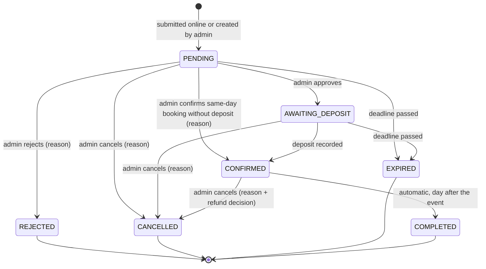
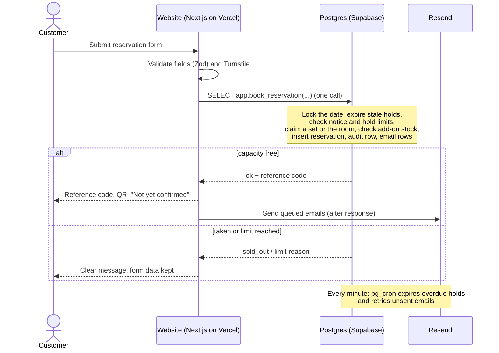

# DJB Kasoundbox Reservation System — Design Spec

> **Status:** Draft for owner review · **Date:** 2026-10-21
> **Source:** Brainstorming session (owner answers given through structured questions), plus two verified web-research rounds on the stack and one on Philippine law.
> **Supersedes:** [`docs/00-project/discovery-brief.md`](../../00-project/discovery-brief.md)

Labels: **[C]** confirmed by the owner · **[P]** proposed and approved as part of a design section · **[U]** unverified fact, to be checked in the week-1 test or before launch · **[O]** open item needing owner input.

---

## 1. Purpose and success criteria

Build a reservation system for DJB Kasoundbox with two parts:

1. **A public website.** Customers browse videoke packages and add-ons, check availability, and submit reservation requests.
2. **A private admin panel.** The two admins review requests, record deposits, and run daily operations.

The release succeeds when all of the following hold:

- Customers can submit a request online in a few minutes on a phone, and receive a reference code and a QR code.
- No set, room, or add-on is ever double-booked, including when two people book at the same moment.
- A request becomes Confirmed only through an admin action. A reference code or QR code never implies approval or payment.
- Every status change and admin action can be traced: who, when, and why.
- Running cost is ₱0/month, excluding the domain name **[C]**.

## 2. Business context

- **The business.** DJB Kasoundbox is a small videoke rental business in the Philippines. Currency is PHP (₱) and the time zone is Asia/Manila **[C]**.
- **Registration.** The business is not registered as a business; it is small and serves only its local area **[C]**. See §14 for what this means for privacy law and receipts.
- **Service types [C]:**
  - **Delivery:** staff bring, set up, and pick up the videoke at the customer's venue.
  - **On-site:** customers use the business's own room.
- **Capacity [C]:**
  - Delivery sets are a separate pool of 2–3 sets (the exact number is a setting). Each set serves one booking per day and is free again the next day.
  - There is one on-site room, which takes one booking per day.
  - Add-ons have limited stock, counted per day.
- **Rental period [C].** For delivery, the customer picks a time slot, which sets the event time; the set is held for the whole day. On-site is booked per day.
- **Packages [C].** The same packages are offered for both delivery and on-site.
- **Delivery fee [C].** Delivery is free inside the service area. Staff check the address during review.
- **Booking notice [C].** Online booking is allowed from 1 hour before the start, for both service types. Same-day requests are flagged urgent. Staff can also create bookings that come in by phone, walk-in, or Facebook.
- **Deposit [C].** The deposit is a fixed amount (a setting) and is due after admin approval. It can be paid in cash at the office or by e-wallet. Staff record each deposit, and customers may upload a proof image.
- **QR codes [C].** Customers present the QR code when visiting the office and when paying. They give the reference code when messaging or calling. The QR is not used on event day.

## 3. Scope

| In the MVP | Later |
|---|---|
| Public pages: home, packages and add-ons, availability calendar, reservation form, confirmation with QR, status check, privacy notice, contact/FAQ | Messenger notifications (automated, opt-in) **[C]** |
| Admin login with required two-factor; Super Admin and Admin roles | SMS notifications |
| Dashboard: urgent and pending queue, upcoming events, deadline alerts | Online payment gateway |
| Reservations: list and search, QR scan, details, internal notes, history | Customer accounts; customer self-cancel or reschedule **[C: not in MVP]** |
| Actions: approve, reject, flag needs-info, record deposit, extend deadline, reschedule, cancel with refund decision, recreate an expired request | Revenue reports, CSV export, charts |
| Staff-created reservations (phone, walk-in, Facebook) | Promotions manager, gallery, reviews |
| Blocks on a set, the room, or a whole date | Multiple branches |
| Catalog management: packages, add-ons, prices, daily stock, delivery slots | |
| Settings, admin accounts (Super Admin only), audit log, health panel | |
| Emails: customer notifications, admin new-request alerts, deposit reminders | |

## 4. Users and permissions

| Action | Super Admin | Admin |
|---|---|---|
| View, search, and scan reservations; view audit log | ✓ | ✓ |
| Approve, reject, flag needs-info, add internal notes | ✓ | ✓ |
| Record a deposit; confirm a same-day booking without a deposit (reason required) | ✓ | ✓ |
| Create reservations for phone, walk-in, or Facebook bookings | ✓ | ✓ |
| Reschedule, extend a deadline, cancel with a refund decision, recreate an expired request | ✓ | ✓ |
| Manage packages, add-ons, prices, and daily stock **[C]** | ✓ | ✓ |
| Create and remove blocks (set, room, or date) | ✓ | **[O-1]** |
| System settings: deposit amount, deadlines, notice period, slots, on-site day hours, hold limits, business info **[C]** | ✓ | — |
| Manage admin accounts: create, disable, reset, sign out **[C]** | ✓ | — |

There are exactly two admin accounts, and there is no public sign-up. Customers never log in.

## 5. Customer journey

1. **Browse.** The customer reads the packages (with inclusions and prices) and the add-ons.
2. **Check availability.** The customer picks a service type and a date. Each date shows **Available** or **Full** **[C]**.
3. **Choose.** The customer picks a package, add-ons with quantities, and a delivery slot (for delivery) or the day (for on-site).
4. **Enter details.** Name, mobile number (required), email (optional), and the venue address for delivery.
5. **Review.** The customer sees a summary with a price breakdown and the fixed deposit amount, reads the privacy summary, and agrees to the policies.
6. **Submit.** The customer sees the reference code, the QR code, and a clear **"Not yet confirmed"** notice with next steps. If an email was given, it is sent there too.
7. **Track.** On the status page, the reference code plus the full mobile number shows the current status.
8. **Pay.** After approval, the customer pays the deposit within 24 hours (cash at the office or by e-wallet) and may upload a proof image.

## 6. Availability and capacity rules

| ID | Rule |
|---|---|
| BR-01 | Each delivery booking claims one specific delivery set for its date. A set can have only one live claim per date. |
| BR-02 | Each on-site booking claims the room for its date. The room can have only one live claim per date. |
| BR-03 | Add-on quantities claimed on a date can never exceed that add-on's daily stock. |
| BR-04 | A claim is **live** while its reservation is Pending, Awaiting Deposit, Confirmed, or a block. Claims of Rejected, Cancelled, Expired, and Completed reservations release capacity. |
| BR-05 | A hold past its deadline stops counting immediately, even before the cleanup job marks it Expired. |
| BR-06 | Online requests need the start time to be at least 1 hour away (a setting), measured in Manila time. Requests for today are flagged **urgent**. |
| BR-07 | Hold limits **[P, approved]**: at most 1 pending request per mobile number per date, and at most 2 pending requests per mobile number overall. If more than 6 new online requests arrive within an hour, online requests pause, customers see "please message or call us", and admins are alerted. |
| BR-08 | A block on a set, the room, or a whole date claims capacity like a booking, and records a reason. |
| BR-09 | The public calendar shows only Available or Full for each service type and date. It never shows personal data. |

**Example.** There are 2 delivery sets.

- Ana requests December 24 and gets set 1. Ben requests the same date and gets set 2. December 24 now shows **Full** for delivery, though the room may still be free.
- Carla and Dan both see December 24 as full. If they had submitted at the same instant while one set was still free, the database would have let only one of them through. The other sees "just taken, pick another date".
- If Ana's request expires, December 24 shows Available again at once.

## 7. Reservation lifecycle

| Status | Shown as | Holds capacity | Deadline |
|---|---|---|---|
| `pending` | Pending Confirmation | Yes | Submission + 72 h, or the service start, whichever is earlier |
| `awaiting_deposit` | Awaiting Deposit | Yes | Approval + 24 h, or the service start, whichever is earlier |
| `confirmed` | Confirmed | Yes | — |
| `completed` | Completed | No | — |
| `rejected` / `cancelled` / `expired` | Rejected / Cancelled / Expired | No | — |

Rules:

- **Needs info [C].** This is a flag on a Pending request, not a status. The 72-hour clock keeps running.
- **Extending a deadline [C].** Either admin can extend a running deadline. A reason is required, and the deadline can never move past the service start.
- **Same-day deposits [C].** For a same-day booking, the admin decides whether to require the deposit first or to confirm without it. Confirming without it needs a reason.
- **Reschedule [C].** Either admin can move an active reservation to a new date, if capacity is free there. The status and history are kept.
- **Cancel [C].** Either admin can cancel, with a reason. For a Confirmed booking, the admin also records the refund decision, decided case by case.
- **Expired is final.** An admin can **recreate** an expired request, which copies its details into a new reservation with a new reference code and checks capacity again.
- **Completed [C].** Confirmed bookings become Completed automatically the day after the event. An admin can correct this.
- **Service start [P].** For delivery, this is the start time of the chosen slot. For on-site, it is the opening time of that day, a setting.
- **No deletions.** Reservations are never deleted. Mistakes are corrected with a new action and a reason.

## 8. Pricing and deposits

- **Prices.** Prices come from the catalog and are calculated on the server. They are copied into the reservation at submission, so later price changes do not affect it **[C]**.
- **Deposit amount.** The deposit amount (a setting) is also copied in at submission.
- **Deposit record.** Each record holds the amount, the method (cash or e-wallet), the e-wallet reference number, who received it, the time, and an optional note.
- **Refunds.** When a Confirmed booking is cancelled, the refund decision is recorded: no refund, or a partial or full refund with the amount.
- **Wording.** The system never calls a deposit record an "official receipt" or an "invoice". See §14.

## 9. Notifications

**Customer emails [C].** These go out only if the customer gave an email address:

- request received (reference code, QR link, "not yet confirmed");
- needs info;
- approved, with deposit instructions and the deadline;
- deposit reminder, 6 hours before the deposit deadline;
- confirmed;
- rejected, with the reason;
- cancelled;
- rescheduled;
- expired.

**Admin alerts [C].** Both admins get an email for every new request, with urgent same-day requests marked. Each request also appears on the dashboard.

**How sending works:**

- Each email is queued in the same database step as the change that causes it. It is sent right away, then retried every minute until it succeeds.
- An email is never sent twice: each one has a unique key.
- If the daily email limit is near, customer emails take priority. Any that are left over go out the next day, and the admin panel shows a warning.

**Customers without email.** The status page is the source of truth. The admin panel shows a prepared message that staff can copy into SMS or Messenger.

**Messenger** is post-MVP: an automated opt-in, re-researched before it is built **[U]**.

## 10. Architecture and stack

| Layer | Choice |
|---|---|
| Hosting | **Vercel Hobby** (free), functions in the Singapore region `sin1` **[C]** |
| Framework | **Next.js 16.4.2**, App Router, TypeScript, pinned exactly; never below 16.4.1 (security fixes of 2026-10-14) |
| Database | **Supabase Free** Postgres, region "Southeast Asia (Singapore)" |
| DB connection | Supavisor transaction pooler (port 6543, IPv4), `pg` driver, pool of 1 per function |
| ORM / validation | Drizzle ORM 0.45.x + drizzle-kit; Zod 4 schemas shared by forms and server |
| Admin auth | Better Auth 1.7.x: email + password, admin plugin (2 roles), required TOTP 2FA, argon2id hashing (`@node-rs/argon2`, fallback scrypt) |
| Email | Resend Free (about 100/day and 3,000/month **[U]**) |
| Scheduled jobs | Supabase Cron (`pg_cron`) every minute, with `pg_net` to call the app. Vercel Hobby cron runs only once a day, so it is the backup sweep only |
| File storage | Private Supabase Storage bucket; the browser uploads directly through a signed URL |
| QR | `uqr` generates SVG codes; `@yudiel/react-qr-scanner` scans them, admin page only; screenshot upload as fallback |
| Bot protection | Cloudflare Turnstile (free) + hidden honeypot field + rate limits in the database |
| Monitoring | Sentry Free (personal data scrubbed), uptime check, job heartbeat; audit log in the database |
| Backups | Nightly encrypted `pg_dump` by GitHub Actions in the **private** repo |

**Structure:**

- **One app, two areas.** One Next.js app has two separate layouts: the public site at `/`, and the admin area at `/admin`.
  - Admin server actions live in their own module tree.
  - A server-only check of login and role runs at the top of every admin page, action, and route. Middleware (`proxy.ts`) only redirects people who are not logged in; it is not the security boundary.
- **Business rules live in Postgres.** Booking, capacity, deadlines, and status changes are database functions. The app validates input and calls one function per action. This keeps the rules testable and the app easy to move to another host.
- **Caching.** Catalog pages are cached and refreshed when an admin edits the catalog. Availability, booking, status, and all admin pages are always live.

**Vercel Hobby risks (accepted by the owner) [C]:**

1. **Terms of use.** Vercel's terms limit Hobby to non-commercial use and allow Vercel to disable projects with or without notice.
   - Mitigation: keep the app portable. All data and rules live in Supabase, the owner controls DNS, no Vercel-only storage is used, and a Docker build is tested in CI.
   - The way out is Vercel Pro (about $20/month) or a Node host that allows commercial use. Either is a configuration change, not a rewrite.
2. **Usage limits.** Going over any Hobby monthly allotment, such as about 4 active-CPU-hours or 1M invocations **[U]**, pauses every project on the account until someone acts.
   - Mitigation: catalog pages are served as static pages, no polling, Turnstile and rate limits, timeouts on outgoing calls, and no Vercel image optimization.
3. **Logs.** Vercel keeps runtime logs for only 1 hour.
   - Mitigation: Sentry, plus the audit log in the database.

## 11. Data model (outline)

| Table | Purpose |
|---|---|
| `resources` | Each delivery set and the on-site room (kind, name, active) |
| `packages`, `addons` | Catalog. Add-ons carry `daily_stock`. Items are archived, never deleted |
| `delivery_slots` | Slot label, start and end time, active |
| `settings` | Deposit amount, 72 h / 24 h deadlines, 1 h notice, 6 h reminder, on-site day hours, hold limits, business info |
| `reservations` | Reference code; kind (booking or block); source; service type; date; slot; service start; status; deadline; needs-info and urgent flags; customer name, mobile, email, venue; package; price and deposit snapshot; QR token hash; version; timestamps |
| `reservation_resources` | Which set or room is claimed on which date. A database rule allows only one live claim per resource per date |
| `reservation_addons` | Add-on, date, quantity, unit-price snapshot |
| `deposits` | Amount, method, reference number, received by, time |
| `payment_proofs` | Storage path and upload time, at most 2 per reservation |
| `reservation_notes` | Internal notes from admins |
| `audit_log` | Append-only. Actor, action, reservation, before and after values, reason, time. This is also the reservation history |
| `notifications_outbox` | Queued emails with a unique key, attempts, next try, and sent time |
| `rate_limits` | Counters keyed by hashed IP and hashed reference code plus mobile |
| Better Auth tables | Admin users, sessions, 2FA secrets |

**Identifiers [P]:**

- **Reference code.** Random, not sequential, using an alphabet without look-alike characters, for example `KSB-7K3M-Q9XP`.
- **QR code.** Encodes `https://<domain>/r/<token>`, where the token is 160 random bits. The database stores only the token's SHA-256 hash.
  - Anyone who scans it sees "present this at our office". A logged-in admin who scans it is taken to the reservation.
  - The token stops working once the reservation closes.

## 12. Concurrency and deadline enforcement

- **One database call per change.** Every booking and every admin action is a single database function call. The transaction starts and ends inside the database, and the locks last milliseconds.
- **Database rules as the hard guard.** A partial unique index rejects a second live claim on the same resource and date. Add-on totals are checked while the date's lock is held.
- **Deadlines are checked, not trusted to jobs.** Each hold stores its deadline. Availability, the status page, and every admin action treat an overdue hold as expired immediately. The every-minute job only cleans up and sends emails.
- **Two admins at once.** Each action checks the reservation's current status and version. The second admin to act gets "already changed, please refresh".

## 13. Security and abuse protection

- **Admin login.**
  - No sign-up; the 2 accounts are created by a seed script.
  - argon2id hashing; TOTP 2FA is required before the admin area opens.
  - Lockout after repeated failures and login rate limits.
  - Sessions can be revoked, and all sessions end when a password is reset.
- **Authorization.** A server-side check of login and role runs in every admin page, action, and route. Automated tests confirm that each admin endpoint refuses visitors who are not logged in and admins with the wrong role.
- **Status lookup.** Requires the reference code plus the full mobile number, is rate-limited, and returns only that reservation's status, date, package, and amounts.
- **Public form.** Turnstile, a honeypot field, validation in both the app and the database, request limits, and the hold limits in BR-07. Every submission carries a duplicate-submission key, so a retry returns the original reference.
- **Uploads.**
  - Images go to a private bucket: JPG, PNG, or WebP, at most 1 MB each and 2 per reservation.
  - The browser re-encodes each image, which strips GPS and other EXIF data.
  - Admins view proofs through short-lived links.
- **Secrets.** Secrets live only in Vercel's and GitHub's encrypted settings, and preview deployments never get production secrets. The database login role can only call the app's functions and read the tables it needs.
- **Updates.** Versions are pinned. Critical security fixes are applied within 24–48 h, and Dependabot raises PRs for security advisories.

## 14. Privacy and data retention (Philippines)

<!-- RETENTION-RESEARCH: filled in from the Philippine-law research round -->

## 15. Scheduled jobs, backups, monitoring

| When | Job | Runs on |
|---|---|---|
| Every minute | Expire overdue holds; send or retry queued emails; send deposit reminders 6 h before the deadline | Supabase Cron |
| Daily | Mark the previous day's Confirmed bookings Completed; clean up old rate-limit and duplicate-key data; run the retention purge; send a keep-alive query so the free project is not paused | Supabase Cron |
| Daily | Backup sweep that catches anything the Supabase jobs missed | Vercel Cron |
| Nightly | Encrypted database dump, kept for 14 days | GitHub Actions (private repo) |
| Weekly | Encrypted export of payment-proof images | GitHub Actions |
| Monthly | Owner downloads one encrypted copy to their own drive | Owner |

- **Restore test.** A restore from backup is tested before launch.
- **Encryption.** Backups are encrypted with a public key; the private key is kept offline.
- **Monitoring.**
  - Sentry tracks errors (personal data scrubbed), runs an uptime check on `/api/health`, and raises an alert if the job heartbeat stops.
  - The admin **Health panel** shows the last expiry run, the email queue, and storage use. Proofs are kept with their records, and the free 1 GB holds about 3,000 proofs.

## 16. Error handling and edge cases

| Situation | System behavior |
|---|---|
| Double click, retry after a network error, or a second tab | The duplicate-submission key returns the same reservation |
| Slot taken while the customer was filling in the form | "Just taken"; form data kept; other dates suggested |
| Both admins act on the same reservation | The second gets "already changed, refresh" |
| Approve or record a deposit after the deadline | Blocked: the hold has already expired |
| Price changed after submission | The reservation keeps its submitted prices |
| Email provider error or daily limit reached | The status change stands; the email is retried and then deferred, and admins see a warning |
| Invalid, revoked, or guessed QR token | A "not found / no longer valid" page with no data shown |
| Bot flood | Turnstile, rate limits, and hold limits; online requests pause after more than 6 per hour |
| Admin mistake | Nothing is deleted; the fix is a new action with a reason, recorded in the audit log |
| Deploy while a customer has the form open | Hobby has no skew protection. The page asks the customer to reload, and the form draft and duplicate key are kept in the browser session |

## 17. Testing

- **Database tests (pgTAP).** One test per business rule:
  - capacity for each set and the room;
  - two simultaneous bookings for the last set, where exactly one wins;
  - add-on stock and blocks;
  - deadlines capped at the service start, and deadline extensions;
  - same-day 1-hour notice in Manila time;
  - hold limits and the circuit breaker;
  - every allowed and every forbidden status transition;
  - role permissions.
- **Unit tests (Vitest).** Validation, price calculation, reference-code and token generation.
- **End-to-end tests (Playwright)** at phone and desktop sizes:
  - a customer books and sees the QR code;
  - a status check;
  - an admin logs in with 2FA, approves, and records a deposit;
  - a QR lookup through the screenshot fallback;
  - a reschedule and a cancellation.
- **Security tests.** Every admin endpoint is called without a login and with the wrong role. Rate limits are exercised. Revoked QR tokens are rejected.
- **Continuous integration.** GitHub Actions runs lint, type checks, unit tests, and database tests on every push.
- **Acceptance testing.** Both admins work through a checklist of real scenarios before launch.

**Week-1 test.** A spike on real Vercel and Supabase in Singapore, before any features are built:

1. Check the Vercel `sin1` ↔ Supabase pooler connection, TLS, latency, and role timeouts.
2. Run the booking function and the simultaneous-booking test on the real database.
3. Log in with argon2id and 2FA on Vercel.
4. Confirm `pg_cron` and `pg_net` work on the free plan, send a test email through Resend, and confirm the keep-alive.
5. Upload to the private bucket through a signed URL, and check the size and type limits.
6. Scan QR codes on the owner's actual phone and laptop.
7. Compare real usage with the Hobby allotments.

The spike ends with a go / no-go. Anything that fails is fixed before features are built.

## 18. Risks

| Risk | Mitigation |
|---|---|
| Vercel disables the Hobby project (commercial use) | Portable design and an exit runbook: move to Vercel Pro or a Node host |
| A Hobby usage limit pauses all projects | Static catalog pages, Turnstile, rate limits, usage checked weekly |
| Supabase Free pauses after 7 days of low activity | Daily keep-alive query; real traffic; warning emails watched |
| Supabase Free has no backups | Nightly encrypted dumps, weekly proof export, monthly offline copy, restore test |
| Fake requests tie up sets | Hold limits, circuit breaker, Turnstile; admins reject |
| Critical Next.js or React vulnerability | Pinned versions, Dependabot, patching within 24–48 h, risky features avoided |
| Emails lost or duplicated | Queue in the database, unique keys, retries, status page as the source of truth |
| Vendor terms not read in full (Vercel, Supabase, Resend, Sentry) **[U]** | Pre-launch terms check: save dated copies |

## 19. Open items

| ID | Item | Owner input |
|---|---|---|
| O-1 | Who can create blocks: Super Admin only (earlier, "system settings" included blocked dates) or both admins | Decision |
| O-2 | Delivery slot times and on-site day hours | Content |
| O-3 | Package and add-on list, prices, daily stock, deposit amount, number of delivery sets | Content |
| O-4 | Service area description shown to customers | Content |
| O-5 | Domain name, Facebook Page, business email | Later |
| O-6 | Make the GitHub repo private before backups are added **[C: owner will do it]** | Action |
| O-7 | GitHub access for pushing from Claude sessions (the push currently returns 403) | Action |
| O-8 | Pre-launch: read and save the vendor terms and DPAs; one-time review by a Philippine lawyer | Action |

## 20. Key sources

- **Vercel:**
  - [Fair use guidelines](https://vercel.com/docs/limits/fair-use-guidelines) · [Terms](https://vercel.com/legal/terms) · [Hobby plan](https://vercel.com/docs/plans/hobby) · [Cron usage](https://vercel.com/docs/cron-jobs/usage-and-pricing) · [Function limits](https://vercel.com/docs/functions/limitations)
  - These Vercel figures were read from a docs mirror because vercel.com was unreachable **[U]**.
- **Next.js:** [Security advisories](https://github.com/vercel/next.js/security/advisories) · [Data security guide](https://raw.githubusercontent.com/vercel/next.js/v16.4.2/docs/01-app/02-guides/data-security.mdx) · [proxy.ts](https://raw.githubusercontent.com/vercel/next.js/v16.4.2/docs/01-app/03-api-reference/03-file-conventions/proxy.mdx)
- **Supabase:** [Connecting to Postgres](https://github.com/supabase/supabase/blob/master/apps/docs/content/guides/database/connecting-to-postgres.mdx) · [Free project pausing](https://github.com/supabase/supabase/blob/master/apps/docs/content/guides/platform/free-project-pausing.mdx) · [Cron](https://raw.githubusercontent.com/supabase/supabase/master/apps/docs/content/guides/cron.mdx) · [pg_net](https://raw.githubusercontent.com/supabase/supabase/master/apps/docs/content/guides/database/extensions/pg_net.mdx) · [Storage limits](https://raw.githubusercontent.com/supabase/supabase/master/apps/docs/content/guides/storage/uploads/file-limits.mdx)
- **Auth and security:** [Better Auth](https://registry.npmjs.org/better-auth) · [OWASP Password Storage](https://github.com/OWASP/CheatSheetSeries/blob/master/cheatsheets/Password_Storage_Cheat_Sheet.md)
- **Email and bot protection:** [Resend idempotency](https://resend.com/docs/dashboard/emails/idempotency-keys) · [Turnstile plans](https://raw.githubusercontent.com/cloudflare/cloudflare-docs/production/src/content/docs/turnstile/plans.mdx)
- **QR:** [uqr](https://github.com/unjs/uqr) · [react-qr-scanner](https://github.com/yudielcurbelo/react-qr-scanner)
