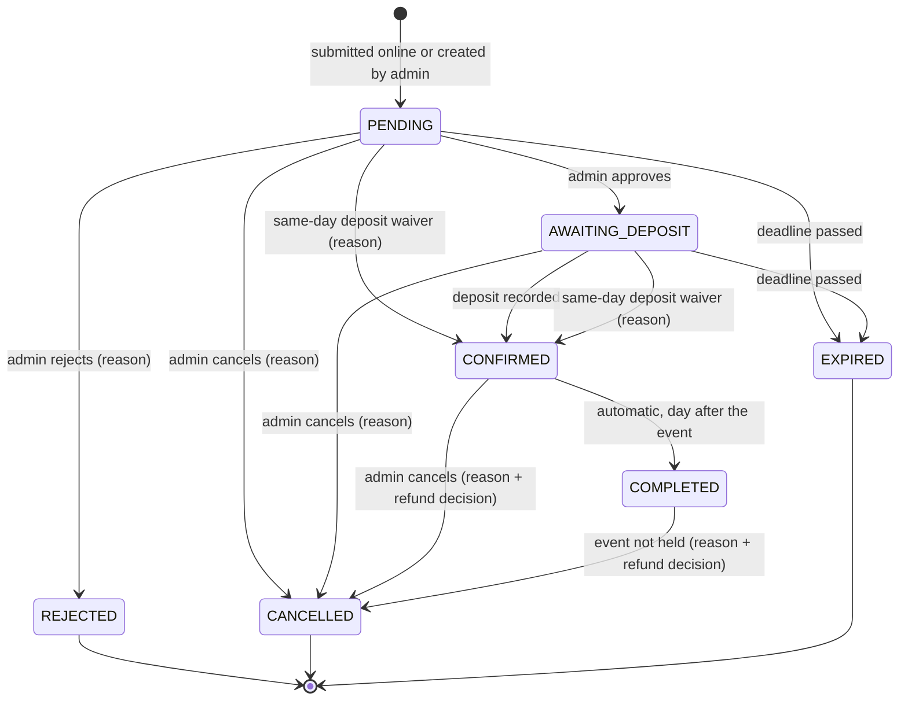
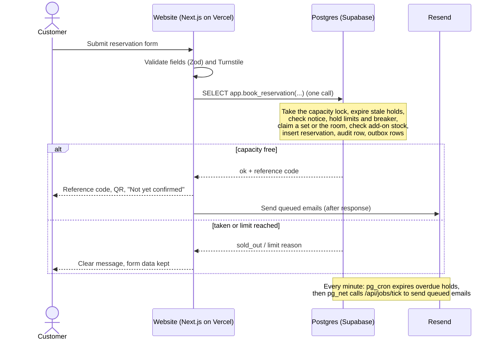

# DJB Kasoundbox Reservation System — Design Spec

> **Status:** Draft for owner review · **Version:** 0.2 · **Date:** 2026-10-21
> **Source:** A brainstorming session (owner answers to structured questions), two verified web-research rounds on the stack, one on Philippine law, and a multi-reviewer spec review whose 48 findings are applied here.
> **Supersedes:** [`docs/00-project/discovery-brief.md`](../../00-project/discovery-brief.md)

Labels:
- **[C]** confirmed by the owner.
- **[P]** proposed by Claude, either approved as part of a design section or awaiting the owner's spec review.
- **[U]** an unverified fact, to be checked in the week-1 test or before launch.
- **[O-n]** an open item that needs owner input (§19).

Time convention: every calendar date in this spec (event date, "today", "previous day", year numbers, closure year) is an **Asia/Manila** date. Instants such as service start and deadlines are stored as `timestamptz` (§12).

---

## 1. Purpose and success criteria

Build a reservation system for DJB Kasoundbox with two parts:

1. **A public website.** Customers browse videoke packages and add-ons, check availability, and submit reservation requests.
2. **A private admin panel.** The two admins review requests, record payments, and run daily operations.

The release succeeds when all of the following are true:

- A customer on a phone can submit a request in a few minutes and receive a reference code and a QR code.
- No set, room, or add-on is ever double-booked, including when two people book at the same moment.
- A request becomes Confirmed only through an admin action. A reference code or QR code never implies approval or payment.
- Every status change and admin action can be traced: who, when, and why.
- Running cost is ₱0/month on free tiers **[C]**. Whether to buy a domain or use the free `vercel.app` address is O-5.

## 2. Business context

- **The business.** DJB Kasoundbox is a small videoke rental business in the Philippines. Currency is PHP (₱); the time zone is Asia/Manila **[C]**.
- **Registration.** The business is not registered as a business: it is small and serves only its local area **[C]**. See §14.
- **Service types [C]:**
  - **Delivery:** staff bring, set up, and pick up the videoke at the customer's venue.
  - **On-site:** customers use the business's own room.
- **Capacity [C]:**
  - Delivery uses its own pool of 2–3 sets. A set serves one booking per day and is free again the next day.
  - There is one on-site room, which takes one booking per day.
  - Add-ons have limited stock, counted per day.
- **Rental period [C]:**
  - Delivery: the customer picks a delivery time slot. The slot sets the event time, and the set is held for the whole day.
  - On-site: the room is booked for the whole day, and the customer picks an arrival time within on-site hours.
- **Packages [C].** The same packages are offered for delivery and on-site.
- **Delivery fee [C].** Delivery is free inside the service area. No area list is kept; staff check each address during review.
- **Booking notice [C].** Customers can book online up to 1 hour before the start (minimum 1 hour's notice), including same-day bookings, for both service types. Staff can also create bookings that arrive by phone, walk-in, or Facebook.
- **Deposit [C].** A fixed amount, due after admin approval. It is paid in cash at the office or by e-wallet. Staff record it; the customer may also upload a proof image.
- **Balance [C].** The remaining balance is also recorded, so the system keeps a full payment ledger.
- **QR code [C].** Customers show the QR when they visit the office or pay. They quote the reference code when messaging or calling. The QR is not used on event day.

## 3. Scope

| In the MVP |
|---|
| **Public pages:** home, packages and add-ons, availability calendar, reservation form, confirmation with QR, status page (with deposit-proof upload while Awaiting Deposit, and payment acknowledgments), privacy notice, contact/FAQ |
| **Admin access:** login with required two-factor authentication; Super Admin and Admin roles |
| **Dashboard:** urgent and pending queue, "proofs to verify" list, upcoming events, deadline alerts, paused-booking banner |
| **Reservations:** list and search, QR scan, details, internal notes, history |
| **Reservation actions:** approve; reject; flag or clear needs-info; edit details; record or void a deposit; verify or reject an uploaded proof; waive the deposit for a same-day booking; record balance; extend a deadline; reschedule; cancel with a refund decision; record a refund paid; mark a Completed event as not held; recreate an expired request; reissue a QR |
| **Staff-created reservations** (phone, walk-in, Facebook) |
| **Blocks:** on a single set or the room, or on a whole date |
| **Catalog:** packages, add-ons, prices, daily stock |
| **Settings:** including delivery slots and resources (sets and room); admin accounts; legal hold and erasure; audit log; health panel |
| **Emails:** customer notifications, admin alerts, deposit reminders |

**Later:**
- Messenger notifications (automated, customer opts in) **[C]**
- SMS notifications
- Online payment gateway
- Revenue reports, CSV export, charts
- Promotions manager, gallery, reviews
- Multiple branches

**Out of scope by owner decision [C]:**
- Customer accounts.
- Customer self-cancel: customers contact staff instead.
- Customer-initiated rescheduling: admins reschedule, case by case.

## 4. Users and permissions

| Action | Super Admin | Admin |
|---|---|---|
| View, search, and scan reservations; view the audit log and health panel | ✓ | ✓ |
| Approve, reject, flag or clear needs-info, add internal notes, edit details (reason required) | ✓ | ✓ |
| Record or void a deposit; verify or reject a proof; record a balance; record a refund paid | ✓ | ✓ |
| Waive the deposit for a same-day booking (reason required) | ✓ | ✓ |
| Create reservations for phone, walk-in, or Facebook bookings | ✓ | ✓ |
| Reschedule, extend a deadline, cancel with a refund decision **[C]**; mark a Completed event as not held, recreate an expired request, reissue a QR **[P]** | ✓ | ✓ |
| Resume paused online booking early | ✓ | ✓ |
| Manage packages, add-ons, prices, and daily stock **[C]** | ✓ | ✓ |
| Block or unblock a single set or the room **[C]** | ✓ | ✓ |
| Block or unblock a whole date **[C]** | ✓ | — |
| Settings the owner reserved: deposit amount, deadlines, delivery slots, business info **[C]** | ✓ | — |
| Other settings **[P]**: notice period, on-site hours, booking window, hold limits and breaker, reminder lead time, email caps, rate-limit thresholds, retention periods, issuer name, deposit instructions, deposit terms text | ✓ | — |
| Add, rename, or deactivate delivery sets and the room **[P]** | ✓ | — |
| Set or clear a legal hold; process an erasure request **[P]** | ✓ | — |
| Manage admin accounts: create, disable, reset, sign out **[C]** | ✓ | — |

**Accounts [P].**
- There is at most one Super Admin and one active Admin, and no public sign-up. Customers never log in.
- The Super Admin can create an Admin only when no Admin is active. The Super Admin cannot disable or demote itself.
- **Reset** sets a new password, forces 2FA re-enrollment, and ends all of that user's sessions.
- **Backup codes.** 2FA backup codes are generated at enrollment and stored offline.
- **Break-glass script.** A documented script, run with database credentials, resets the Super Admin's 2FA and writes an audit row. It is for the case where the Super Admin loses their 2FA device.

## 5. Customer journey

1. **Browse.** The customer reads the packages (inclusions, prices) and the add-ons.
2. **Check availability.** The customer picks a service type and a date. Each date shows **Available** or **Full** **[C]** (BR-09).
3. **Choose.** The customer picks a package and add-ons with quantities, then:
   - for delivery, a delivery slot;
   - for on-site, an arrival time within on-site hours **[C]**.
4. **Enter details:**
   - name;
   - mobile number (required; Philippine mobile, §11);
   - email (optional);
   - for delivery, the venue as barangay and city/municipality (required) plus street and landmarks;
   - an optional "Additional requirements" note of up to 500 characters. The form warns: *do not enter IDs, birthdates, health, or religious information*.
5. **Review.** The customer sees a summary with the price breakdown and the deposit amount, reads the privacy summary, and agrees to the policies.
6. **Submit.** The confirmation shows the reference code, the QR code, a clear **"Not yet confirmed"** notice, and next steps. An email is also sent if one was given.
7. **Track.** The status page asks for the reference code and the full mobile number, then shows the fields listed in §13.
8. **Pay.** After approval, the customer pays the deposit within 24 hours, or before the service start if that comes sooner, in cash at the office or by e-wallet. While the reservation is Awaiting Deposit, the customer can upload a proof image on the status page.

## 6. Availability and capacity rules

| ID | Rule |
|---|---|
| BR-01 | Each delivery booking claims one specific delivery set for its date. A set can have only one **live** claim per date. The delivery pool is the active `resources` rows of kind `delivery_set`; there is no separate count setting. |
| BR-02 | Each on-site booking claims the room for its date. The room can have only one live claim per date. |
| BR-03 | Add-on quantities claimed on a date can never exceed that add-on's daily stock. |
| BR-04 | A claim is **live** while its reservation is Pending, Awaiting Deposit, or Confirmed, or while its block is active. Rejected, Cancelled, Expired, and Completed reservations, and removed blocks, release their claims. |
| BR-05 | A hold whose deadline has passed stops counting at once, even before the every-minute job marks it Expired. A hold whose expiry is paused for proof review keeps counting (BR-12). |
| BR-06 | Online requests must start at least 1 hour after submission (the notice period, a setting). |
| BR-06a | Any reservation whose event date is today is flagged **urgent**, whatever its source. Staff-created bookings (`phone`, `walk_in`, `facebook`) are exempt from the notice check, hold limits, and breaker, and send no admin new-request email. The customer email still goes out if an address was given. If a staff-created booking's service start is already past, or falls within the notice period, the create form finishes in one step: Confirmed with a deposit recorded, or Confirmed with the deposit waived (reason required). |
| BR-07 | **Hold limits [C].** Count online-submitted reservations in Pending or Awaiting Deposit whose deadline has not passed. A mobile number may have at most 1 per event date and at most 2 in total. Staff-created bookings are neither counted nor limited. |
| BR-07a | **Breaker [C, details P].** Count reservations created online in the trailing 60 minutes. The submission that would be the 7th is refused, and `online_paused_until` is set to now + 60 minutes (both numbers are settings). While paused, the form and calendar show "please message or call us". Each pause sends one email to both admins and shows a dashboard banner. Either admin can resume early. |
| BR-08 | **Blocks.** A block is a capacity record with a reason and the statuses `active` → `removed`. Removing a block needs a reason, releases its capacity, and is audited. • A **set or room block** claims that resource. Either admin can create one **[C]**. • A **whole-date block** claims every active set and the room, but not add-on stock. Only the Super Admin can create one **[C]**. • A date range creates one block per date. • A block is refused if any target resource already has a live claim that date; the admin must reschedule or cancel that booking first. |
| BR-09 | **Public calendar.** It shows Available or Full per service type and date, from today through the booking window (default 180 days, a setting). A date is Full when no resource is free or, for today, no start time meets the notice period. Dates outside the window cannot be selected. While booking is paused, a banner is shown. No personal data is ever shown. |
| BR-10 | **Catalog edits that conflict with future live claims are refused**, and the conflicting reservations are listed. This covers lowering an add-on's daily stock below quantities already claimed, archiving a package, add-on, or slot that live reservations use, and deactivating a set or the room that has future live claims. |
| BR-11 | **Mobile numbers.** These input forms are accepted: `09XXXXXXXXX`, `9XXXXXXXXX`, `639XXXXXXXXX`, `+639XXXXXXXXX`; spaces and dashes are ignored. Every number is normalized to E.164 (`+639XXXXXXXXX`) both in the form and in the database. The normalized value is used for storage, hold limits, and status lookup. Anything else is rejected. |
| BR-12 | **A proof pauses expiry [C].** A proof uploaded while Awaiting Deposit, before the deadline, pauses expiry until an admin reviews it: • If the admin verifies it, the admin records the deposit and the reservation becomes Confirmed. • If the admin rejects it (reason required), the original deadline applies again. If that deadline has already passed, the reservation expires at once and the customer is told why **[P]**. • The pause never runs past the service start. At that point an unreviewed reservation expires. |

**Example.** There are 2 delivery sets.
- Ana requests December 24 and gets set 1. Ben requests the same date and gets set 2. December 24 now shows **Full** for delivery; the room may still be free.
- If Carla and Dan had submitted at the same instant while one set was free, the database would have let only one through. The other would see "just taken, pick another date".
- If Ana's request expires, December 24 shows Available again at once.

## 7. Reservation lifecycle

| Status | Shown as | Holds capacity | Deadline |
|---|---|---|---|
| `pending` | Pending Confirmation | Yes | Submission + 72 h, or the service start, whichever is earlier |
| `awaiting_deposit` | Awaiting Deposit | Yes | Approval + 24 h, or the service start, whichever is earlier. Paused while a proof awaits review (BR-12) |
| `confirmed` | Confirmed | Yes | — |
| `completed` | Completed | No | — |
| `rejected` / `cancelled` / `expired` | Rejected / Cancelled / Expired | No | — |

No other transitions exist. Completed can only move to Cancelled ("event not held"). Every action below is one database function, records a reason where stated, and is audited.

**Needs info [C].**
- It is a flag on a Pending request, not a status, and the 72-hour clock keeps running.
- Flagging requires a customer-facing message, which is shown on the status page and sent by email.
- Either admin clears it with "Info received". It also clears on approve, reject, cancel, or expire.

**Edit details [P].**
- Allowed on Pending, Awaiting Deposit, and Confirmed reservations, with a reason.
- Changing the package or add-ons rechecks stock under the capacity lock. Unchanged items keep their price snapshot; added items take the current price.
- The audit row names the fields changed, not their values.

**Extend a deadline [C].** Allowed with a reason, but never past the service start. The customer is emailed the new deadline.

**Same-day deposit waiver [C].**
- Eligible when the event date is today at the moment the admin acts. Allowed from Pending or Awaiting Deposit, with a reason.
- A deposit can still be recorded on the Confirmed booking later. That issues an acknowledgment without changing the status.

**Reschedule [C, details P].**
- Allowed on Pending, Awaiting Deposit, and Confirmed reservations. It may change the date, the slot, or the arrival time.
- In one call, under the capacity lock, it:
  - expires overdue holds on the target date;
  - releases the old claims;
  - takes new set/room and add-on claims, and fails if any is unavailable.
- The reference code, QR, and price snapshot are kept. The new deadline is the earlier of the current deadline and the new service start. The urgent flag is recomputed, and the rescheduled email is queued.

**Cancel [C].**
- Either admin can cancel, with a reason.
- When a deposit was paid, the admin also records a refund decision (none, partial, or full, with the amount), decided case by case. Paying a refund is recorded separately ("record refund paid").

**Event not held [P].** Either admin can move a Completed booking to Cancelled, with a reason and a refund decision.

**Completed [C].**
- A daily job marks Confirmed bookings whose event date is before today as Completed. It touches nothing else.
- Admins correct a wrong Completed with "event not held".

**Recreate expired [P].**
- Creates a new Pending reservation with a new reference code, a new QR, and a new 72-hour deadline capped at the service start. It stores `recreated_from`.
- It uses current catalog prices and the current deposit setting, because it counts as a new submission.
- It is exempt from the online hold limits and queues the request-received email.
- The expired original stays final.

**Service start [C/P].**
- Delivery: the start time of the chosen slot.
- On-site: the arrival time the customer chose **[C]**, which must fall within on-site hours.
- Service start is computed at submission and stored. Later changes to slot or hours settings do not change it.

**No deletions.** Reservations are never deleted; mistakes are fixed with a new action and a reason.

## 8. Pricing and payments

- **Prices.** Prices come from the catalog, are calculated on the server, and are copied into the reservation at submission. Later price changes do not affect it **[C]**. The deposit amount setting is copied the same way.
- **Payments ledger [C].** The `payments` table records every movement of money:
  - **Deposit.** At most one active deposit per reservation. The amount is prefilled from the snapshot and must equal it; there are no partial deposits in the MVP **[P]**.
  - **Balance.** Recorded by either admin on a Confirmed or Completed reservation. The amount defaults to total minus deposit.
  - **Refund.** Recorded when a refund decided at cancellation is actually paid.
  - **Fields for each payment:** amount, method (cash or e-wallet), e-wallet reference number (required for e-wallet, empty for cash), received or paid by (admin), time, optional note.
  - **Deposit effects.** Recording a deposit moves Awaiting Deposit to Confirmed and sets `verified_at`.
  - **Voiding.** A wrongly recorded payment is voided with a reason. The record stays, and its acknowledgment number is retired, never reused.
- **No payer details.** Payer names and account numbers are never copied from screenshots. Only the reference number is stored.
- **Acknowledgments [P].**
  - Every deposit and balance payment issues a printable HTML **Payment Acknowledgment**, titled "Deposit Acknowledgment" or "Balance Payment Acknowledgment".
  - It is numbered `ACK-YYYY-NNNN`: YYYY is the year it was recorded, and NNNN is a per-year counter from 0001. The counter is assigned from a locked counter row inside the recording function; it is never reused and may grow past 4 digits.
  - It is linked from the status page and the Confirmed email, and admins can print it at the office.
  - **Fields:** title, number, booking reference, received from (customer name), issued by (issuer name setting: **DJB Kasoundbox [C]**), received by (admin display name), date, amount, method, e-wallet reference, "for" line (deposit/balance for videoke rental on [date], [package]), balance due, deposit terms (a settings text), and the line *"This is an acknowledgment of payment received. It is NOT an Official Receipt or Invoice."* (§14).
- **Booking Confirmation.** A printable HTML view, linked from the status page and the Confirmed email.

## 9. Notifications

**Customer emails [C, extra types P].** These go out only if the customer gave an email address:
- request received (reference code, QR link, "not yet confirmed");
- needs info (with the admin's message);
- approved (deposit instructions from settings, and the deadline);
- deposit reminder, 6 hours before the deposit deadline. It is computed from the current deadline at send time, and not sent if that moment has already passed at approval;
- deadline extended **[P]**;
- proof not accepted, with the reason **[P]**;
- confirmed, with links to the acknowledgment and booking confirmation;
- reservation updated, after an edit **[P]**;
- rejected, with the reason;
- cancelled, with the refund decision;
- rescheduled;
- expired.

**Admin emails, to both admins:**
- every new **online** request, with urgent ones marked **[C]**;
- proof uploaded **[P]**;
- online booking paused by the breaker **[P]**.

All three also appear on the dashboard.

**How sending works [P]:**
- Each email is queued in `notifications_outbox` in the same database transaction as the change that causes it. It is sent right after the response and retried by the every-minute job.
- **No duplicates.** Each email's unique key is reservation + type + the audit entry that caused it. For reminders, the key is reservation + "reminder" + deadline.
- **Retries.** Transient errors (network, 429, 5xx) are retried with backoff up to a maximum number of attempts (a setting). The email is then marked failed and shown on the health panel. Other 4xx errors fail at once.
- **Stale emails.** At send time, an email is skipped if its trigger no longer holds, for example a reminder after the reservation was confirmed.
- **Caps.** Daily and monthly caps are settings (defaults 100/day and 3,000/month **[U]**). Customer emails have priority. Once the admin-reserve threshold is reached (default 90/day), admin emails wait. Emails left over at the cap go out the next day, with a health-panel warning.

**Customers without email.** The status page is the source of truth, and the admin panel shows a prepared message that staff can copy into SMS or Messenger.

**Messenger** comes after the MVP and is re-researched before it is built **[U]**.

## 10. Architecture and stack

| Layer | Choice |
|---|---|
| Hosting | **Vercel Hobby** (free), with functions in the Singapore region `sin1` and the Node.js runtime only **[C]** |
| Framework | **Next.js 16.4.2**, App Router, TypeScript strict. Pinned exactly, never below 16.4.1 (security fixes of 2026-10-14). React 19.3.1 |
| UI | Tailwind CSS + shadcn/ui **[C]**; forms with React Hook Form + the Zod resolver **[P]**. Versions are pinned at setup |
| Database | **Supabase Free** Postgres, region "Southeast Asia (Singapore)" |
| DB connection | App: the Supavisor transaction pooler (port 6543, IPv4), the `pg` driver, pool of 1 per function. Backups and migrations: the session pooler (port 5432) |
| ORM / validation | Drizzle ORM 0.45.x + drizzle-kit; Zod 4 schemas shared by forms and server |
| Admin auth | Better Auth 1.7.x: email and password, the admin plugin with 2 roles, required TOTP 2FA, argon2id via `@node-rs/argon2` (fallback: scrypt) |
| Email | Resend Free |
| Scheduled jobs | Supabase Cron (`pg_cron`) and `pg_net`. Vercel Hobby cron runs only once a day, so it is the backup sweep |
| File storage | A private Supabase Storage bucket; the browser uploads directly through a single-use signed URL |
| QR | `uqr` generates the SVG; `@yudiel/react-qr-scanner` scans, on the admin page only, with screenshot upload as a fallback |
| Bot protection | Cloudflare Turnstile (free), a honeypot field, rate limits in the database |
| Monitoring | Sentry Free (personal data scrubbed), an uptime check, the job heartbeat, and the audit log in the database |
| Backups | A nightly encrypted dump by GitHub Actions in the **private** repo, stored as an artifact |
| Tests / CI | Vitest, Playwright, pgTAP via the Supabase CLI; GitHub Actions; Dependabot |

**Structure:**
- **One app, two areas.** One Next.js app has two separate layouts: the public site at `/` and the admin area at `/admin`.
- **Admin code is separate.** Admin server actions live in their own module tree.
- **Server-side checks.** A check of login and role runs on the server at the top of every admin page, action, and route. The middleware (`proxy.ts`) only redirects visitors who are not logged in; it is not the security boundary.
- **Rules in Postgres.** Booking, capacity, deadlines, payments, and status changes are database functions. The app validates input and calls one function per action, which keeps the rules testable and the app portable.
- **Caching.** Catalog pages are cached and refreshed when the catalog is edited. Availability, booking, status, and all admin pages are always live.
- **Job routes.** `/api/jobs/tick` flushes the outbox and `/api/jobs/daily` is the backup sweep. Both:
  - require a bearer secret, stored in Supabase Vault and as a Vercel environment variable, and compared in constant time;
  - are excluded from `proxy.ts` redirects;
  - use an advisory lock so two runs never overlap.

**Vercel Hobby risks, accepted by the owner [C]:**
1. **Terms of use.** Hobby is for non-commercial use only, and Vercel may disable projects with or without notice.
   - *Mitigation:* portability. All data and rules live in Supabase, the owner controls DNS, no Vercel-only storage is used, and a Docker build is tested in CI.
   - *Exit:* Vercel Pro (about $20/month) or a Node host that allows commercial use, with a configuration change rather than a rewrite.
2. **Usage limits.** Going over any monthly allotment (about 4 active-CPU-hours or 1M invocations **[U]**) pauses all projects until someone acts.
   - *Mitigation:* static catalog pages, no polling, Turnstile and rate limits, timeouts on outgoing calls, and no Vercel image optimization.
3. **Logs.** Runtime logs are kept only 1 hour.
   - *Mitigation:* Sentry plus the audit log in the database.

## 11. Data model (outline)

| Table | Purpose |
|---|---|
| `resources` | Each delivery set and the room: kind, name, active |
| `packages`, `addons` | Catalog. Add-ons carry `daily_stock`. Items are archived, never deleted |
| `delivery_slots` | Label, start time, end time, active |
| `settings` | See the settings list below |
| `reservations` | See the reservation fields below |
| `reservation_resources` | Which set or room is claimed on which date. A partial unique index allows one live claim per resource per date |
| `reservation_addons` | Add-on, date, quantity, unit-price snapshot |
| `blocks` | Kind (set, room, or whole date), date, reason, status (active or removed), created and removed by |
| `block_resources` | The resources each block claims. The same live-claim unique index applies across bookings and blocks |
| `payments` | Kind (deposit, balance, or refund), amount, method, e-wallet reference, admin, time, note, acknowledgment number, `verified_at` (deposits), and void fields |
| `ack_counters` | Per-year acknowledgment counter, locked when a number is issued |
| `payment_proofs` | Storage path, upload time, review result (verified or rejected, with a reason), deletion time. At most 2 uploads per reservation, ever |
| `reservation_notes` | Internal notes by admins |
| `audit_log` | Append-only. Category (security, booking, catalog, settings, or account), entity type, entity ID, actor kind (admin, system, or customer), actor ID (nullable), action, changed field names, reason, time. It never stores customer contact data. It also serves as the reservation history |
| `notifications_outbox` | Unique key, type, recipient, priority, status (queued, sent, failed, or skipped), attempts, next attempt, last error, sent time |
| `submission_keys` | Duplicate-submission key hash → reservation. Deleted after 72 h |
| `rate_limits` | Counters keyed by an HMAC of the IP (key rotated daily) and of the reference code plus mobile. Deleted after 24 h |
| `job_runs` | Job name, start, finish, result, counts. Drives the health panel and the heartbeat |
| `retention_runs` | Retention job log: date and counts per category, no personal data |
| Better Auth tables | Admin users, sessions, 2FA secrets and backup codes |

**Reservation fields:**
- **Identity:** reference code, source (`online`, `phone`, `walk_in`, or `facebook`), version, timestamps.
- **Booking:** service type, event date, slot or arrival time, service start, package, price and deposit snapshot.
- **State:** status, deadline, `expiry_paused` (proof review), flags (urgent, needs-info, legal hold), `needs_info_message`, refund decision (none, partial, or full; amount; who decided; when), `recreated_from`, closure date.
- **Customer:** name, mobile (E.164), email, venue barangay and city, venue details, customer notes.
- **QR:** token hash.

**Settings:**
- **Owner-reserved [C]:** deposit amount, 72 h and 24 h deadlines, business info.
- **Other [P]:**
  - booking rules: 1 h notice, on-site hours, booking window, hold limits and breaker;
  - notifications: 6 h reminder, email caps and admin reserve, maximum send attempts;
  - security: rate-limit thresholds;
  - privacy: retention periods;
  - payments: acknowledgment issuer name, deposit instructions (e-wallet name, number, and account name; office address and hours), deposit terms text;
  - `online_paused_until`.

**Closure date [P].** Retention (§14) counts from the closure date, which is the latest of:
- the date the reservation reached its final status;
- its event date, for Completed reservations;
- its latest payment or refund date.

It is recomputed if a payment or refund is recorded later.

**Identifiers [P]:**
- **Reference code:** `KSB-XXXX-XXXX` from the 31 characters `23456789ABCDEFGHJKMNPQRSTUVWXYZ`, generated with a cryptographically secure random generator. It has a unique constraint, with a retry on collision. Lookups uppercase the input and ignore spaces and dashes.
- **QR:** encodes `https://<domain>/r/<token>`, where the token is 160 random bits. Only the token's SHA-256 is stored.
  - A visitor who scans it sees "present this at our office". A logged-in admin who scans it opens the reservation.
  - The token stops working when the status becomes Rejected, Cancelled, Expired, or Completed.
  - **Reissue QR** rotates the token, which revokes the old one. It is available on the status page after verification and as an admin action, and it is audited.

## 12. Concurrency and deadline enforcement

- **One database call per change.** Every booking and admin action is a single database function call, so the transaction starts and ends inside the database.
- **One capacity lock.** Every capacity change (book, reschedule, edit, block, recreate) first takes a single capacity lock row with `FOR UPDATE`. That is simple and safe at this volume, and it avoids lock-ordering problems.
- **Hard guard.** A partial unique index rejects a second live claim on the same resource and date. Add-on totals are checked while the lock is held.
- **Deadlines are checked, not trusted to jobs.**
  - Each hold stores its deadline.
  - Availability, the status page, and every admin action treat an overdue hold (not paused) as expired at once.
  - Approving or recording a deposit after the deadline is refused unless expiry is paused (BR-12).
  - The every-minute job only cleans up and sends emails.
- **Two admins at once.** Each action checks the current status and version. The second admin gets "already changed, please refresh".
- **Time.** Event dates are `date`; service start and deadlines are `timestamptz`.
  - Daily jobs run at 00:15 Asia/Manila (`15 16 * * *` UTC) and compute dates with `now() AT TIME ZONE 'Asia/Manila'`.
  - Code formats times with `Intl.DateTimeFormat` and `timeZone: 'Asia/Manila'`.

## 13. Security and abuse protection

**Admin login:**
- No public sign-up; the accounts are seeded by a script (§4).
- Passwords are hashed with argon2id, and TOTP 2FA is required before the admin area opens.
- Sessions can be revoked, and a password reset ends them all.

**Authorization.** A server-side check of login and role runs in every admin page, action, and route. Automated tests call each admin endpoint while logged out and with the wrong role, and expect refusal.

**Rate limits [P].** These are the defaults, and all are settings:

| Target | Limit |
|---|---|
| Login | 5 failures per account → 15-minute lockout; 20 attempts per IP per hour |
| Status lookup | 10 per IP per 15 minutes; 5 failures per reference code per hour |
| Form submission | 5 per IP per hour |
| Proof upload slot | 3 per reservation per hour |

**Status page.** It needs the reference code and the full mobile number. It returns:
- status label and service type;
- event date and slot or arrival time;
- package and add-ons;
- total, deposit, and balance due;
- the current deadline in Manila time;
- deposit instructions, while Awaiting Deposit;
- the needs-info message, when flagged;
- the rejection or cancellation reason, and the refund decision;
- links to acknowledgments and the booking confirmation;
- the upload control, while Awaiting Deposit.

Name, mobile, and address are not shown.

**Public form.**
- Turnstile, a honeypot field, validation in both the app and the database, and the rate limits.
- Hold limits and the breaker (BR-07, BR-07a).
- A duplicate-submission key (`submission_keys`), so a retry returns the original reference.

**Uploads.**
- The server issues a single-use, rate-limited signed URL bound to one reservation, and only after reference + mobile verification while Awaiting Deposit.
- Files go to a private bucket: JPG, PNG, or WebP, at most 1 MB, at most 2 uploads per reservation ever.
- The browser re-encodes each image, which strips GPS and other EXIF data.
- Admins view proofs through short-lived links.
- Each upload adds the reservation to the "proofs to verify" list and pauses expiry (BR-12).

**Secrets and roles.**
- Secrets live only in Vercel's and GitHub's encrypted settings. Preview deployments never get production secrets.
- The app's database role can only call the app's functions and read what it needs.
- Backups use a separate read-only role.

**Updates.** Versions are pinned. Critical fixes are applied within 24–48 h, and Dependabot raises security PRs.

## 14. Privacy, data retention, and legal notes (Philippines)

> **Caveat.** This section is research, not legal advice. The official legal sites could not be reached during research, so the wording comes from secondary copies and summaries. A Philippine lawyer must confirm everything marked **[U]**, and the retention periods, before launch (O-8).

**Does the Data Privacy Act (RA 10173) apply?** Yes, whether or not the business is registered.
- Section 4 covers any person processing personal information. The personal or household exemption does not fit a rental business that charges fees.
- The owner is the *personal information controller*, and stays accountable for data held by Supabase, Vercel, Resend, Sentry, GitHub, and Cloudflare (Secs. 14, 20(d), 21).
- All the data collected is personal information but **not** sensitive personal information, as long as the system never collects IDs, birthdates, ages, religion, or health data. The notes field warns customers about this (§5).

**Obligations built into the design.**
- **Privacy notice.** A short summary sits above the Submit button and links to the full notice. The full notice covers:
  - who the controller is, with a privacy contact;
  - what is collected and why, and on what legal basis: the contract, legitimate interest (audit log, rate limits), or legal obligation (financial records);
  - every recipient, including that data is stored in Singapore and processed abroad;
  - the retention schedule below;
  - data-subject rights, with requesters verified by reference + mobile;
  - the right to complain to the NPC;
  - that deleted data may remain in encrypted backups for up to 30 days.
- **Privacy officer.** The owner or the other admin is designated in writing as DPO / compliance officer, and a privacy contact email is published (O-9).
- **NPC registration.** Mandatory registration is probably not required: there is no sensitive personal information and there are far fewer than 250 employees. A free sworn exemption declaration (SDAU) may still be required **[U]** (O-10).
- **Erasure request (Super Admin).** The system blanks contact and venue-detail fields at once, unless a legal hold applies. It keeps the payment ledger, tells the customer what was kept and why, and writes an audit row.
- **Legal hold (Super Admin).** A written complaint, demand, or case sets `legal_hold` with a reason. Every deletion below is paused until the hold is cleared.
- **Breach procedure.** Payment data raises the chance that notification is required under NPC Circular 16-03 (72-hour rule **[U]**). The operations docs will include an incident runbook.

**Retention schedule [C: defaults, stored as settings].**

Two dates drive it:
- **Closure** is defined in §11.
- **Ledger end** is 31 December of the 6th year after the closure year. For example, records closed in 2026 are processed in January 2033. That covers the 5-year tax-record period (NIRC Sec. 235 as amended by EOPT; RR 7-2024) and the 6-year oral-contract claim period (Civil Code Art. 1145).

| Data | Kept for | Then |
|---|---|---|
| Customer name, mobile, email, customer notes, admin notes | Closure + 2 years | Set to null. A hash does not count as anonymized |
| Venue details (street, landmarks) | Closure + 2 years | Set to null |
| Venue barangay | Until ledger end | Set to null, keeping the city only |
| Booking details, amounts, payments (acknowledgment number, amount, date, method, e-wallet reference, admin) | Until ledger end | Reduce to anonymous statistics: month and year, package, amounts, city |
| Payment-proof images | 7 days after the deposit is verified **[C]**. Unverified proofs: 7 days after the reservation becomes Rejected, Expired, or Cancelled **[P]** | Hard-delete from storage and log the deletion. Proofs are not backed up, by design |
| Rate-limit counters (HMAC'd IPs) | 24 hours; the HMAC key is rotated daily and old keys destroyed | Delete |
| Duplicate-submission keys | 72 hours | Delete |
| Audit log: security events | 12 months, rolling | Delete |
| Audit log: booking events | Until that booking's ledger end | Add to monthly per-action counts in `retention_runs`, then delete |
| Retention run logs (counts only) | Until ledger end | Delete |
| Encrypted backups | 30 days at most, rolling. Only the latest monthly offline copy is kept | Expire or destroy |
| Admin account data | While the person is an admin. Disabled the same day they leave; credentials deleted within 30 days | Keep only the ID and display name in retained audit entries |
| Provider copies (Resend, Sentry, Vercel logs) | The shortest setting each offers (≤ 30 days). Customer data is scrubbed from Sentry | Expired by the provider |

The daily retention job applies this schedule, skips records under legal hold, and writes a `retention_runs` entry.

**Acknowledgments and the business name.**
- Documents are titled "Deposit Acknowledgment", "Balance Payment Acknowledgment", and "Booking Confirmation" (§8). The system never shows "Official Receipt", "OR No.", "Invoice", a TIN, "BIR", or VAT wording.
- **Issuer name [C: owner's choice].** Acknowledgments are issued as **DJB Kasoundbox**.
  - The research found that Act 3883 requires DTI registration before a business name is used on receipts and other written evidence of transactions.
  - The owner accepts this risk and will raise it with a lawyer (O-11).
  - The issuer name is a setting, so it can be changed without code changes.

**Unregistered business: facts to review with a CPA or lawyer (O-11).**
- BIR registration has no size threshold; a sole proprietor registers before starting the business (NIRC Sec. 236 as amended by EOPT; RMC 91-2024).
- RA 12214 (effective 1 July 2025) sets penalties for doing business unregistered.
- The other registrations are a DTI business name, a barangay clearance, and a mayor's permit.
- RA 11967 (Internet Transactions Act) may require showing a registered business name and address **[U]**.
- The payments ledger (§8) records every deposit, balance, and refund, as if the business were registered, so the records support a later registration.

**Key legal sources.**
- Privacy: [RA 10173](https://privacy.gov.ph/wp-content/uploads/2017/03/DPA-of-2012.pdf) · [IRR](https://privacy.gov.ph/wp-content/uploads/2023/06/IRR_RA-10173-as-amended.pdf) · [NPC Circular 2022-04](https://privacy.gov.ph/wp-content/uploads/2023/05/Circular-2022-04-1.pdf) · [NPC Advisory 2017-01](https://privacy.gov.ph/wp-content/uploads/2022/01/NPC-Advisory-2017-01-sgd.pdf) · [NPC Circular 2023-06](https://privacy.gov.ph/wp-content/uploads/2024/03/NPC-Circular-Repeal-16-01-Signed.pdf) · [NPC Advisory 2026-02](https://privacy.gov.ph/wp-content/uploads/2026/05/Advisory-Clarification-on-the-Submission-of-Personal-Data-Breach-Notification-through-DBNMS_11-May-2026.pdf)
- Tax and business registration: [RR 7-2024](https://bir-cdn.bir.gov.ph/BIR/pdf/RR%207-2024%20(final).pdf) · [RMC 91-2024](https://bir-cdn.bir.gov.ph/BIR/pdf/RMC%20No.%2091-2024%20Digest.pdf) · [RA 12214](https://www.lawphil.net/statutes/repacts/ra2025/ra_12214_2025.html) · [Act 3883](https://lawphil.net/statutes/acts/act1931/act_3883_1931.html)
- Contracts and transactions: [Civil Code](https://lawphil.net/statutes/repacts/ra1949/ra_386_1949.html) · [Consumer Act](https://lawphil.net/statutes/repacts/ra1992/ra_7394_1992.html) · [RA 11967](https://www.lawphil.net/statutes/repacts/ra2023/ra_11967_2023.html) · [RA 8792](https://www.lawphil.net/statutes/repacts/ra2000/ra_8792_2000.html)

## 15. Scheduled jobs, backups, monitoring

| When | Job | Runs on |
|---|---|---|
| Every minute | Expire overdue holds (not paused); send deposit reminders that are due | Supabase Cron (SQL) |
| Every minute, when emails are queued | `pg_net` calls `/api/jobs/tick` to send or retry emails | Supabase Cron → Vercel |
| Daily, 00:15 Manila | Mark Confirmed bookings whose event date is before today as Completed; rotate the IP-HMAC key; run the retention job (§14); keep-alive query so the free project is not paused | Supabase Cron (SQL) |
| Daily | `/api/jobs/daily`: repeat the expiry sweep and outbox flush; check the `job_runs` heartbeat | Vercel Cron |
| Nightly | Dump the database through the session pooler with a read-only role, encrypt it with `age` to a public key, and upload it as a workflow **artifact** with `retention-days: 14`. Never committed to the repo | GitHub Actions (private repo) |
| Monthly | The owner downloads one encrypted copy to their own drive and destroys the previous one | Owner |

- **No proof backups.** Payment proofs are not backed up (§14); the e-wallet reference in `payments` is the lasting record.
- **Restore test.** A restore is tested in the week-1 test and again before launch. After any restore, the retention job runs before the system reopens.
- **Monitoring.**
  - Sentry records errors (personal data scrubbed) and runs an uptime check on `/api/health`, which reports the region and does a cheap database query.
  - A Sentry cron monitor alerts if the `job_runs` heartbeat stops.
  - The admin **health panel** shows the last expiry, retention, and tick runs, failed emails, the email queue, cap usage, and storage use.

## 16. Error handling and edge cases

| Situation | System behavior |
|---|---|
| Double click, retry after a network error, or a second tab | The duplicate-submission key returns the same reservation |
| Slot taken while the customer was filling in the form | "Just taken"; the form data is kept and other dates are suggested |
| Both admins act on the same reservation | The second gets "already changed, refresh" |
| Approving or recording a deposit after the deadline | Refused, unless expiry is paused for proof review (BR-12) |
| The customer paid and uploaded proof just before the deadline | Expiry pauses until an admin reviews the proof (BR-12) |
| Walk-in or phone booking for a time that has already started | Created as Confirmed in one step, with a deposit or a waiver (BR-06a) |
| Price changed after submission | The reservation keeps its submitted prices |
| Email provider error, or the cap is reached | The status change stands; the email is retried, deferred, or marked failed and shown on the health panel |
| Invalid, revoked, or guessed QR token | A "not found / no longer valid" page showing no data |
| Bot flood | Turnstile, rate limits, hold limits; the breaker pauses online booking |
| Wrong mobile number entered | An admin uses "edit details" (reason recorded) |
| Wrong payment recorded | Void it (reason recorded); the acknowledgment number is retired |
| Admin mistake | Nothing is deleted; it is fixed with a new action and a reason, and audited |
| A deploy happens while the form is open | The page asks the customer to reload. The draft and the duplicate key are kept in the browser session |

## 17. Testing

**Database tests (pgTAP), one or more per rule:**
- capacity per set and for the room;
- two simultaneous bookings for the last set, where exactly one wins;
- add-on stock (BR-03);
- blocks: creation, removal, refusal when the target is taken, and permissions by kind;
- catalog-edit refusals (BR-10);
- deadlines capped at the service start;
- deadline extension;
- proof pausing expiry, and proof rejection after the deadline;
- the overdue-hold release (BR-05);
- same-day notice in Manila time, including a walk-in after the start;
- hold limits;
- the breaker: tripping, the automatic end of the pause, and early resume;
- mobile normalization;
- every allowed and every forbidden status transition, including "event not held";
- waivers, voids, reschedule, edit details, recreate;
- role permissions for each function;
- acknowledgment numbering under concurrency;
- closure-date rules;
- the retention job: the 2-year blanking, proof deletion, and skipping legal-hold rows;
- outbox de-duplication, retry, and skip;
- the daily auto-complete;
- reminder timing.

**Unit tests (Vitest):** validation, price calculation, reference-code and token generation, mobile normalization, time-zone formatting.

**End-to-end tests (Playwright),** at phone and desktop sizes:
- a customer books and sees the QR;
- a status check;
- a proof upload, with the admin verifying it;
- an admin logs in with 2FA, approves, and records a deposit and a balance;
- a staff-created booking;
- creating and removing a block;
- a reschedule; a cancellation with a refund;
- recreating an expired request;
- QR lookup through the screenshot fallback.

**Security tests:**
- every admin endpoint while logged out and with the wrong role;
- the job routes without the secret;
- the rate limits;
- revoked QR tokens.

**CI.** GitHub Actions runs lint, type checks, unit tests, and database tests on every push.

**Acceptance.** Both admins work through a checklist of real scenarios before launch.

**Week-1 test.** A spike on real Vercel and Supabase in Singapore, before any features are built:
1. Vercel `sin1` ↔ Supabase pooler connection, TLS, latency, role timeouts.
2. The booking function and the simultaneous-booking test on the real database.
3. Login with argon2id and 2FA on Vercel.
4. `pg_cron` and `pg_net` on the free plan; a test email through Resend; the keep-alive.
5. A signed upload to the private bucket, with the size and type limits.
6. QR scanning on the owner's actual phone and laptop.
7. A backup through the session pooler, and a restore test.
8. Real usage compared with the Hobby allotments.

It ends with a go / no-go decision, and anything that fails is fixed before features are built.

## 18. Risks

| Risk | Mitigation |
|---|---|
| Vercel disables the Hobby project for commercial use | Portable design and an exit runbook (move to Vercel Pro or a Node host) |
| A Hobby usage limit pauses all projects | Static catalog pages, Turnstile, rate limits, usage checked weekly |
| Supabase Free pauses after 7 days of low activity | Daily keep-alive query, real traffic, watch for the warning emails |
| Supabase Free has no backups | Nightly encrypted dumps, a monthly offline copy, restore tests |
| Fake requests tie up sets | Hold limits, the breaker, Turnstile; admins reject |
| Critical Next.js or React vulnerability | Pinned versions, Dependabot, patching within 24–48 h, risky features avoided |
| Emails lost or duplicated | Outbox in the database, unique keys, retries, the status page as source of truth |
| An admin misses a proof uploaded near the deadline | Proof-uploaded email, dashboard list; expiry paused until review |
| Admin loses their 2FA device | Backup codes kept offline; break-glass script for the Super Admin |
| Vendor terms not read in full (Vercel, Supabase, Resend, Sentry) **[U]** | Check the terms before launch and save dated copies |
| Unregistered business name on acknowledgments (Act 3883) and other registration duties | Owner accepts the risk; lawyer/CPA review (O-11); the issuer name is a setting |
| Non-compliance with privacy law | Privacy notice, DPO, retention job, legal hold, breach runbook; lawyer review |

## 19. Open items

| ID | Item | Needed from the owner |
|---|---|---|
| O-2 | Delivery slot times and on-site hours | Content |
| O-3 | Package and add-on list, prices, daily stock, deposit amount, the delivery sets, deposit instructions, deposit terms text | Content |
| O-4 | Fixed customer copy: "Delivery is free within our service area; we confirm your address during review." (No area list, per owner decision) | Confirm wording |
| O-5 | Buy a domain name, or use the free `vercel.app` address; Facebook Page; business email | Decision |
| O-6 | Make the GitHub repo private before backups are added **[C: owner will do it]** | Action |
| O-7 | GitHub access for pushing from Claude sessions (the push currently returns 403) | Action |
| O-8 | Before launch: read and save the vendor terms and DPAs; one-time review of §14 by a Philippine lawyer, including the retention periods | Action |
| O-9 | Designate the DPO / compliance officer in writing; set up a privacy contact email | Action |
| O-10 | Confirm whether the NPC SDAU must be filed | Lawyer |
| O-11 | Business registration (BIR, DTI name, barangay, mayor's permit), and using "DJB Kasoundbox" on acknowledgments | CPA / lawyer |

(O-1, who can create blocks, was resolved: set and room blocks are open to both admins; whole-date blocks are Super Admin only.)

## 20. Key sources

- **Vercel:** [Fair use guidelines](https://vercel.com/docs/limits/fair-use-guidelines) · [Terms](https://vercel.com/legal/terms) · [Hobby plan](https://vercel.com/docs/plans/hobby) · [Cron usage](https://vercel.com/docs/cron-jobs/usage-and-pricing) · [Function limits](https://vercel.com/docs/functions/limitations). These figures were read from a docs mirror because vercel.com was unreachable **[U]**.
- **Next.js:** [Security advisories](https://github.com/vercel/next.js/security/advisories) · [Data security guide](https://raw.githubusercontent.com/vercel/next.js/v16.4.2/docs/01-app/02-guides/data-security.mdx) · [proxy.ts](https://raw.githubusercontent.com/vercel/next.js/v16.4.2/docs/01-app/03-api-reference/03-file-conventions/proxy.mdx)
- **Supabase:** [Connecting to Postgres](https://github.com/supabase/supabase/blob/master/apps/docs/content/guides/database/connecting-to-postgres.mdx) · [Free project pausing](https://github.com/supabase/supabase/blob/master/apps/docs/content/guides/platform/free-project-pausing.mdx) · [Cron](https://raw.githubusercontent.com/supabase/supabase/master/apps/docs/content/guides/cron.mdx) · [pg_net](https://raw.githubusercontent.com/supabase/supabase/master/apps/docs/content/guides/database/extensions/pg_net.mdx) · [Storage limits](https://raw.githubusercontent.com/supabase/supabase/master/apps/docs/content/guides/storage/uploads/file-limits.mdx)
- **Auth and security:** [Better Auth](https://registry.npmjs.org/better-auth) · [OWASP Password Storage](https://github.com/OWASP/CheatSheetSeries/blob/master/cheatsheets/Password_Storage_Cheat_Sheet.md) · [Resend idempotency](https://resend.com/docs/dashboard/emails/idempotency-keys) · [Turnstile plans](https://raw.githubusercontent.com/cloudflare/cloudflare-docs/production/src/content/docs/turnstile/plans.mdx)
- **QR:** [uqr](https://github.com/unjs/uqr) · [react-qr-scanner](https://github.com/yudielcurbelo/react-qr-scanner)
